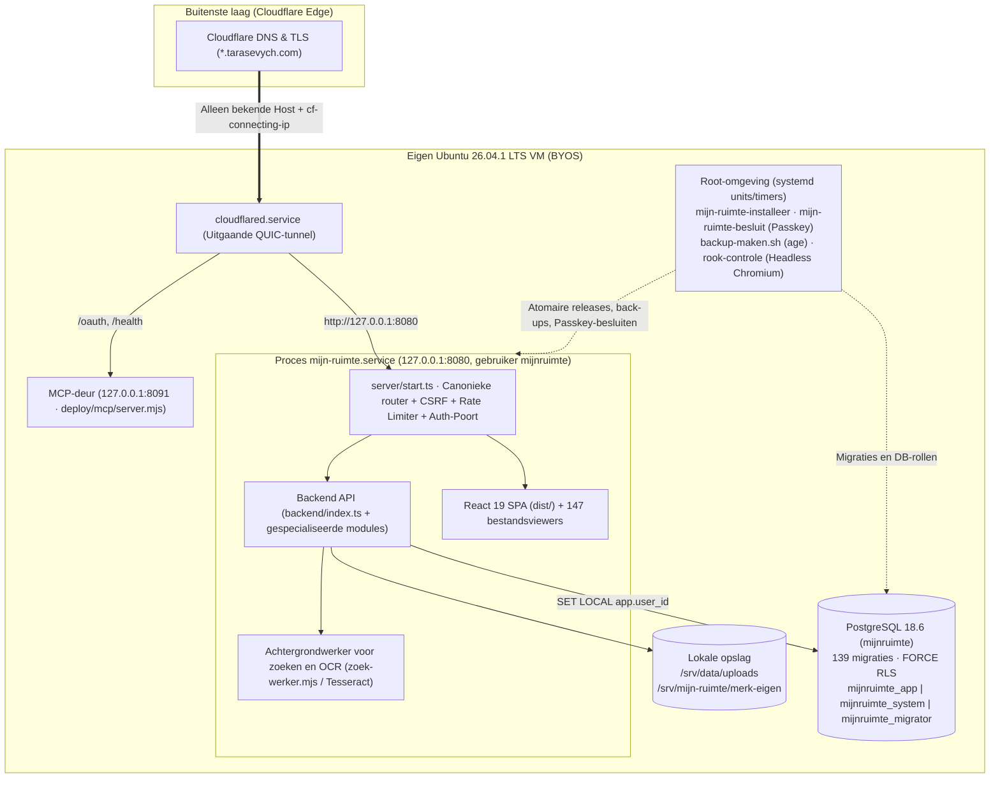

> 🌐 **Taal / Мова:** [Українська](ОГЛЯД-ПРОЄКТУ.uk.md) · **Nederlands** | [Hoofdpagina](LEESMIJ.md) · [Documentatie-index](docs/INDEX.nl.md)

# Mijn Ruimte · Мій простір (`Tarasevych/hub`)

> **Privé zelfstandig BYOS (eigen server) platform voor digitale werkruimte, e-mail, cloudopslag, identiteit, slim huis en multi-agent AI-coördinatie.**

---

## Tweetalige navigatie door de hub-pagina's (🇳🇱 Nederlands ↔ 🇺🇦 Українська)

Elk artikel en elke documentatiepagina in de repository heeft twee volwaardige taalversies — **Nederlands (`🇳🇱 .nl.md`)** en **Oekraïens (`🇺🇦 .uk.md`)** met wederzijdse verwijzingen bovenaan elke pagina:

| Onderdeel / Themapagina | 🇳🇱 Nederlandse versie | 🇺🇦 Oekraïense versie (Українська) |
|---|---|---|
| **Hoofdpagina van de repository** | **[`LEESMIJ.md`](./LEESMIJ.md)** · [`PROJECTOVERZICHT.nl.md`](./PROJECTOVERZICHT.nl.md) | **[`README.md`](./README.md)** · [`README.uk.md`](ОГЛЯД-ПРОЄКТУ.uk.md) |
| **Volledig register van alle artikelen en pagina's (140+ documenten)** | **[`docs/INDEX.nl.md`](./docs/INDEX.nl.md)** | **[`docs/INDEX.nl.md`](./docs/INDEX.nl.md)** · [`docs/INDEX.uk.md`](docs/ПОКАЖЧИК-ДОКУМЕНТАЦІЇ.uk.md) |
| **1. Architectuur en 11 subdomeinen (`*.tarasevych.com`)** | [`docs/hub/ARCHITECTUUR.nl.md`](./docs/hub/ARCHITECTUUR.nl.md) | [`docs/hub/ARCHITECTUUR.uk.md`](docs/hub/АРХІТЕКТУРА-ЦЕНТРУ.uk.md) |
| **2. Ontwikkelingsgeschiedenis van het project (Fasen I–VI)** | [`docs/hub/GESCHIEDENIS.nl.md`](./docs/hub/GESCHIEDENIS.nl.md) | [`docs/hub/GESCHIEDENIS.uk.md`](docs/hub/ІСТОРІЯ-РОЗВИТКУ.uk.md) |
| **3. Gids voor 71 takken, 27 PR's en 18 releases** | [`docs/hub/TAKKEN-EN-SAMENVOEGVERZOEKEN.nl.md`](./docs/hub/TAKKEN-EN-SAMENVOEGVERZOEKEN.nl.md) | [`docs/hub/TAKKEN-EN-PRS.uk.md`](docs/hub/ГІЛКИ-ТА-ЗАПИТИ-НА-ЗЛИТТЯ.uk.md) |
| **4. Repositorystructuur en codekaart** | [`docs/hub/MAP-STRUCTUUR.nl.md`](./docs/hub/MAP-STRUCTUUR.nl.md) | [`docs/hub/MAP-STRUCTUUR.uk.md`](docs/hub/СТРУКТУРА-ТЕК.uk.md) |
| **5. Omgevingsvariabelen en versleutelingssleutels** | [`docs/hub/OMGEVINGSVARIABELEN.nl.md`](./docs/hub/OMGEVINGSVARIABELEN.nl.md) · [`OMGEVINGSVARIABELEN.nl.md`](./OMGEVINGSVARIABELEN.nl.md) | [`docs/hub/OMGEVINGSVARIABELEN.uk.md`](docs/hub/ЗМІННІ-СЕРЕДОВИЩА-ЦЕНТРУ.uk.md) · [`ENV-VARS.uk.md`](ЗМІННІ-СЕРЕДОВИЩА.uk.md) |
| **6. Coördinatie `ORCH-001`, `TRACE-001`, stack `B-009` en uitrol** | [`docs/hub/ORCHESTRATIE-EN-UITROL.nl.md`](./docs/hub/ORCHESTRATIE-EN-UITROL.nl.md) | [`docs/hub/ORCHESTRATIE-EN-UITROL.uk.md`](docs/hub/КООРДИНАЦІЯ-ТА-РОЗГОРТАННЯ.uk.md) |
| **Canonieke agentregels en besluitenregister** | [`AGENTENREGELS.nl.md`](./AGENTENREGELS.nl.md) · [`orchestratie/BESLUITEN.nl.md`](./orchestratie/BESLUITEN.nl.md) | [`AGENTS.uk.md`](ПРАВИЛА-АГЕНТІВ.uk.md) · [`orchestratie/BESLUITEN.uk.md`](orchestratie/РІШЕННЯ.uk.md) |
| **Beveiliging en porteerplan (Self-Hosting)** | [`BEVEILIGINGSNOTITIES.nl.md`](./BEVEILIGINGSNOTITIES.nl.md) · [`PORTEERPLAN.nl.md`](./PORTEERPLAN.nl.md) | [`SECURITY-NOTES.uk.md`](НОТАТКИ-БЕЗПЕКИ.uk.md) · [`PORTEERPLAN.uk.md`](ПЛАН-ПЕРЕНЕСЕННЯ.uk.md) |

---

## Projectpaspoort

| Parameter | Waarde |
|---|---|
| **Repository** | [`Tarasevych/hub`](https://github.com/Tarasevych/hub) |
| **Hoofdtak (Standaardtak)** | [`voornaamst`](https://github.com/Tarasevych/hub/tree/voornaamst) *(gesynchroniseerd met de integratietak [`integratie`](https://github.com/Tarasevych/hub/tree/integratie))* |
| **Publiek toegangspunt** | [https://hub.tarasevych.com](https://hub.tarasevych.com) *(hoofddomein: `tarasevych.com`)* |
| **Architectuurmodel** | Self-hosted BYOS op eigen Ubuntu LTS VM achter uitgaande Cloudflare Tunnel (`127.0.0.1:8080`), zonder externe cloudhosting |
| **Technologiestack** | TypeScript 5.7 · React 19 · Vite 6 · Tailwind CSS 3 · Node.js 26 LTS (`node:http` + `esbuild`) · PostgreSQL 18 (JSONB + relationele tabellen + FORCE RLS) · Systemd · Caddy · OPA · `age` |
| **Canonieke regels (ORCH-001)** | [`AGENTS.md`](AGENTS.md) ([🇳🇱 NL](AGENTENREGELS.nl.md) · [🇺🇦 UK](ПРАВИЛА-АГЕНТІВ.uk.md)) · [`orchestratie/beleid.json`](orchestratie/beleid.json) · [`orchestratie/BESLUITEN.md`](orchestratie/BESLUITEN.md) ([🇳🇱 NL](orchestratie/BESLUITEN.nl.md) · [🇺🇦 UK](orchestratie/РІШЕННЯ.uk.md)) |
| **Taalconventie** | Documentatie en rapporten — **tweetalig (`uk` / `nl`)**; URL/API-paden en modulenamen in de code — **Nederlands (`nl`)**; gebruikersinterface — **tweetalig (`uk` / `nl`)** |
| **Bestandskaart van de codebase** | [`docs/kaart/KAART-BESTANDEN.nl.md`](docs/kaart/KAART-BESTANDEN.nl.md) ([🇳🇱 NL](docs/kaart/KAART-BESTANDEN.nl.md) · [🇺🇦 UK](docs/kaart/КАРТА-ФАЙЛІВ.uk.md)) en [`docs/kaart/bestandskaart.json`](docs/kaart/bestandskaart.json) *(531 hernoemde modules + nieuwe modules met automatische bouwcontrole)* |

---

## Inhoudsopgave (Navigatie op de hoofdpagina)

1. [Over het project en de ecosysteemarchitectuur (11 dienst-subdomeinen)](#1-over-het-project-en-de-ecosysteemarchitectuur-11-dienst-subdomeinen)
2. [Ontwikkelingsgeschiedenis van het project (Chronologie van de fasen)](#2-ontwikkelingsgeschiedenis-van-het-project-chronologie-van-de-fasen)
3. [Volledige gids voor de repository-takken (71 takken: wat waar te vinden)](#3-volledige-gids-voor-de-repository-takken-71-takken-wat-waar-te-vinden)
   - [3.1. Hoofd- en integratietakken](#31-hoofd--en-integratietakken)
   - [3.2. Actieve takken in uitvoering en fusiekandidaten (november 2026)](#32-actieve-takken-in-uitvoering-en-fusiekandidaten-november-2026)
   - [3.3. In `voornaamst` samengevoegde functie- en releasetakken (oktober–november 2026)](#33-in-voornaamst-samengevoegde-functie--en-releasetakken-oktobernovember-2026)
   - [3.4. Historische en archieftakken uit de vroege ontwikkeling (september — 16 oktober 2026)](#34-historische-en-archieftakken-uit-de-vroege-ontwikkeling-september--16-oktober-2026)
4. [Register van Pull Requests (#1–#27) en Uitgaven (GitHub Releases)](#4-register-van-pull-requests-127-en-uitgaven-github-releases)
5. [Repositorystructuur: waar staat wat in de code](#5-repositorystructuur-waar-staat-wat-in-de-code)
6. [Omgevingsvariabelen, versleutelingssleutels en configuratie (`OMGEVINGSVARIABELEN.nl.md`)](#6-omgevingsvariabelen-versleutelingssleutels-en-configuratie-env-varsmd)
7. [Infrastructuur, serverstack (`B-009`), beveiliging en reservekopieën](#7-infrastructuur-serverstack-b-009-beveiliging-en-reservekopieën)
8. [Coördinatie van AI-agenten (`ORCH-001` / `TRACE-001`) en ontwikkelopdrachten](#8-coördinatie-van-ai-agenten-orch-001--trace-001-en-ontwikkelopdrachten)

---

## 1. Over het project en de ecosysteemarchitectuur (11 dienst-subdomeinen)

**Mijn Ruimte (Мій простір)** is een zelfstandig platform voor persoonlijke en gezamenlijke digitale werkruimte, gebouwd volgens het principe van **BYOS (eigen server)** en **Zero-Knowledge / strikte ruimte-isolatie**. Het platform verenigt het werkblad (hub), een e-mailclient met ondersteuning voor tientallen technische en mediabijlageformaten, beveiligde cloudopslag, een agenda, slimme woningbediening, GitHub-integratie en een beheercentrum voor AI-agenten via het Model Context Protocol (MCP).

### Dienst-hosts van het ecosysteem (`*.tarasevych.com`)

Alle subdomeinen (gedefinieerd in [`backend/deployment-identiteit.ts`](backend/deployment-identiteit.ts) en gerouteerd via [`deploy/cloudflared-config.yml`](deploy/cloudflared-config.yml)) worden bediend door één serverkern op `127.0.0.1:8080` met een gedeelde beveiligde sessielaag (`Domain=.tarasevych.com; Secure; HttpOnly; SameSite=Lax`):

| Subdomein | Dienst | Doel en belangrijkste mogelijkheden | Kernmodules in de code |
|---|---|---|---|
| **[`hub.tarasevych.com`](https://hub.tarasevych.com)** | **Hub (`hub`)** | Hoofdwerkblad (**Werkblad v3**), widgets, snelle acties, borden, meldingen (**Meldingen v2/v3**), globaal **Menu v2** (dock rechts/boven/onder), globaal zoeken `/zoek`. | [`src/VerenigdDienstApp.tsx`](src/VerenigdDienstApp.tsx), [`backend/werkblad-v3.ts`](backend/werkblad-v3.ts), [`shared/menu-model.ts`](shared/menu-model.ts) |
| **[`mail.tarasevych.com`](https://mail.tarasevych.com)** | **Mail (`mail`)** | **Adaptive Mail Canvas**: Gmail (OAuth + Pub/Sub), Outlook (Microsoft Graph), IMAP/SMTP (iCloud, Ukr.net, Yahoo, I.ua). Diensten-orbit, mobiele bladen, **147 gespecialiseerde bijlageviewers en -bewerkers** (CAD, DICOM/medisch, bio-informatica, financiën, muziek, archieven, databases, PDF/Office), draadcontext zonder AI en geverifieerde AI-vertaling/samenvatting met letterlijke citaten. | [`src/GoogleMailWerkruimte.tsx`](src/GoogleMailWerkruimte.tsx), [`src/mail/`](src/mail/), [`backend/mail-imap.ts`](backend/mail-imap.ts), [`backend/mail-microsoft.ts`](backend/mail-microsoft.ts) |
| **[`id.tarasevych.com`](https://id.tarasevych.com)** | **Identiteit (`id`)** | Centraal aanmeld- en accountbeveiligingspunt: Google OIDC (PKCE + nonce + `__Secure-tsv_aanmeld_binding`), wachtwoord + TOTP (`AES-256-GCM`) + herstelcodes, **WebAuthn Passkeys**, gasttoegangscodes (`/toegang`), Step-Up bevestiging voor gevoelige acties, accountwisselaar en **12 profielonderdelen**. | [`src/ToegangslaagWeergave.tsx`](src/ToegangslaagWeergave.tsx), [`backend/toegangslaag.ts`](backend/toegangslaag.ts), [`backend/toegangssleutels.ts`](backend/toegangssleutels.ts), [`backend/stap-op.ts`](backend/stap-op.ts) |
| **[`cloud.tarasevych.com`](https://cloud.tarasevych.com)** | **Cloud (`cloud`)** | **Cloud vNext (M1–M11)**: bestandswerkruimten, Google Drive-projectie, client-side zero-knowledge versleuteling (**M7 architectuur voor gegevensbescherming** op basis van WebAuthn PRF en herstelsleutel), universele bestandsviewer, fotodienst. | [`backend/cloud-platform.ts`](backend/cloud-platform.ts), [`backend/cloud-google-drive.ts`](backend/cloud-google-drive.ts), [`docs/WOLK-M7-PRIVACY-ARCHITECTUUR.nl.md`](docs/WOLK-M7-PRIVACY-ARCHITECTUUR.nl.md) |
| **[`ai.tarasevych.com`](https://ai.tarasevych.com)** | **AI-ruimte (`ai`)** | Werken met privé- en technische AI-modellen, AI-agentenbord, fijnmazige **«AI-toegang»**-rechten (scopes per hulpmiddel en gevoelige gegevens), centraal verbindingspunt `/verbindingen`. | [`src/agenten/`](src/agenten/), [`backend/ai-beleid.ts`](backend/ai-beleid.ts), [`backend/connector-v2.ts`](backend/connector-v2.ts) |
| **[`mcp.tarasevych.com`](https://mcp.tarasevych.com)** | **MCP-poort (`mcp`)** | Aparte connectoradressen per agent (`/claude`, `/gpt`, `/grok`, `/gemini`, `/copilot`, `/cursor`), OAuth 2.0-metadata, koppeling van externe MCP-servers (`backend/mcp-klant/`), webpaneel **«Coördinatie»** (`/agents` → `TabOrch.tsx`) en geïsoleerde deur op poort `8091`. | [`src/agenten/TabOrch.tsx`](src/agenten/TabOrch.tsx), [`backend/orch-routes.ts`](backend/orch-routes.ts), [`deploy/VERBINDER-EEN-PAD.nl.md`](deploy/VERBINDER-EEN-PAD.nl.md) |
| **[`github.tarasevych.com`](https://github.tarasevych.com)** | **GitHub (`github`)** | Koppeling met GitHub OAuth / GitHub App, overzicht van repositories, takken, Pull Requests, commits en releases, indexering van code en issues in globaal zoeken `/zoek`. | [`shared/github-koppeling.ts`](shared/github-koppeling.ts), [`backend/uitrol-github.ts`](backend/uitrol-github.ts) |
| **[`huis.tarasevych.com`](https://huis.tarasevych.com)** | **Slim huis (`huis`)** | **Huis vNext**: integratie met Home Assistant en lokale gateways, beheer van kamers, apparaten en automatiseringen, versleuteling van adaptertokens (`HUIS_ADAPTER_SLEUTEL_V1`), beveiliging van het beheersubnet. | [`shared/huis-model.ts`](shared/huis-model.ts), [`deploy/WIJZIGINGEN-20261028-HUIS-VERVOLG.nl.md`](deploy/WIJZIGINGEN-20261028-HUIS-VERVOLG.nl.md) |
| **[`api.tarasevych.com`](https://api.tarasevych.com)** | **API & Kluis (`api`)** | Beheer van machinetokens (`tsv_`), API-koppelingen, webhooks en de beveiligde **Sleutelkluis (Vault)** van de eigenaar. | [`src/ApiPlatformWeergave.tsx`](src/ApiPlatformWeergave.tsx), [`backend/api-platform-kluis.ts`](backend/api-platform-kluis.ts), [`shared/sleutelkluis.ts`](shared/sleutelkluis.ts) |
| **[`admin.tarasevych.com`](https://admin.tarasevych.com)** | **Beheer (`admin`)** | **Technische ruimte**: gebruikers- en rollenbeheer, beveiligingslogboek `app.audit` (append-only hashketen), RLS-isolatiestatus, server- en renderdiagnostiek (`rook-controle`), **Verbindingswizard**, SSH-CA-beheer, browserterminal en het centrum **«Updates»** met cryptografische passkey-goedkeuring door de eigenaar. | [`backend/server-beheer.ts`](backend/server-beheer.ts), [`backend/uitrol-goedkeuring.ts`](backend/uitrol-goedkeuring.ts), [`backend/eigenaar-besluit.ts`](backend/eigenaar-besluit.ts) |
| **[`dashboard.tarasevych.com`](https://dashboard.tarasevych.com)** | **Dashboard (`dashboard`)** | Statisch overzichtspaneel vanuit `/srv/mijn-ruimte/dashboard` (volledig gescheiden van sessies en API). | [`server/start.ts`](server/start.ts), [`deploy/PROJECTOVERZICHT.nl.md`](deploy/LEESMIJ.nl.md) |

### Architectuurschema van het platform



---

## 2. Ontwikkelingsgeschiedenis van het project (Chronologie van de fasen)

Om de structuur van de code en de herkomst van alle 71 takken in de repository te begrijpen, volgt hieronder de volledige chronologie van de evolutie van **Mijn Ruimte**:

### Fase I. Ontstaan en prototype op AppDeploy (augustus — september 2026)
- Het project startte op 29.08.2026 als een geïntegreerd ecosysteem onder de naam **«Мій простір / Tarasevych Hub»** op het AppDeploy-platform (`APP_ID = migrated-bg2v4h`).
- Op 24.09.2026 werd in de tak [`Mijn-ruimte-reservekopieën`](https://github.com/Tarasevych/hub/tree/Mijn-ruimte-reservekopie%C3%ABn) het eerste publieke ijkpunt van de repository vastgelegd.

### Fase II. Portering naar Self-Hosted BYOS en Cryptografische Kern (2–6 oktober 2026)
- **Porteerplan ([`PORTEERPLAN.nl.md`](PORTEERPLAN.nl.md) / [`PORTEERPLAN.nl.md`](PORTEERPLAN.nl.md), 03.10.2026):** besloten werd om de cloudafhankelijkheid van AppDeploy (`@appdeploy/sdk` en `@appdeploy/client`) volledig te verlaten en het systeem over te brengen naar de eigen server van de eigenaar achter een Cloudflare Tunnel.
- Er is een compatibele platformlaag `@platform/server` ([`server/platform/`](server/platform/)) en `@platform/client` ([`src/platform/`](src/platform/)) gebouwd bovenop PostgreSQL (`app.records` met GIN JSONB-indexen), het bestandssysteem `/srv/data/uploads` en omgevingsvariabelen in `/etc/mijn-ruimte/geheimen.env` (takken [`basis-voor-zelf-hosten`](https://github.com/Tarasevych/hub/tree/basis-voor-zelf-hosten), [`zelf-hosten`](https://github.com/Tarasevych/hub/tree/zelf-hosten), [`sync-actief`](https://github.com/Tarasevych/hub/tree/sync-actief)).
- **Beveiligingshervorming (Fasen A, B, Auth Fase 1, Fase 2–3, Audit Fixes — zie [`BEVEILIGINGSNOTITIES.nl.md`](BEVEILIGINGSNOTITIES.nl.md) / [`BEVEILIGINGSNOTITIES.nl.md`](BEVEILIGINGSNOTITIES.nl.md)):**
  - Tak [`auth-fase-1`](https://github.com/Tarasevych/hub/tree/auth-fase-1) (03.10.2026): legacy-aanmeldroutes verwijderd, strikte PKCE (`oauth_pkce_v1`), tabbladgebonden aanmeldtransacties (`__Secure-tsv_aanmeld_binding_*`) en eenmalige atomaire handoff tussen subdomeinen (`tsv_handoff_binding`) ingevoerd.
  - Tak [`beveiliging-fase-2-3`](https://github.com/Tarasevych/hub/tree/beveiliging-fase-2-3) (03.10.2026): **rijniveaubeveiliging (RLS)** op PostgreSQL-niveau ingevoerd, splitsing in 3 DB-rollen (`mijnruimte_migrator`, `mijnruimte_app` met `NOBYPASSRLS`, `mijnruimte_system`), centrale autorisatiepoort `auth-poort.ts` en Step-Up bevestiging (`STEP_UP_REQUIRED`).
  - Tak [`beveiliging-fixes-audit`](https://github.com/Tarasevych/hub/tree/beveiliging-fixes-audit) (04.10.2026): auditlogboek `app.audit` beveiligd met een cryptografische hashketen (`SECURITY DEFINER`-functie `app.audit_toevoegen`), `geheimen.env` en `migratie.env` gescheiden, en tweetalige statische pagina's `/privacy` en `/terms` zonder JS toegevoegd.

### Fase III. WebAuthn Passkeys, Menu v2, Technische Ruimte en AI-connectors (7–16 oktober 2026)
- **Eigen WebAuthn-kern en Passkey-goedkeuring van updates (08–09.10.2026):**
  - In tak [`passkey-schvalennya`](https://github.com/Tarasevych/hub/tree/passkey-schvalennya) werd een onafhankelijke WebAuthn-kern zonder externe npm-afhankelijkheden gebouwd ([`deploy/goedkeuring/webauthn-kern.mjs`](deploy/goedkeuring/webauthn-kern.mjs), ondersteuning voor ES256/EdDSA/RS256), gebruikt door zowel de applicatie als het root-script voor cryptografische goedkeuring van serverupdates op het tabblad `Admin → Updates`.
  - In tak [`aanmeldmethoden`](https://github.com/Tarasevych/hub/tree/aanmeldmethoden) zijn volwaardige gebruikers-Passkeys toegevoegd in «Aanmeldmethoden» (`rpId: tarasevych.com`), en in [`bevestig-toegang`](https://github.com/Tarasevych/hub/tree/bevestig-toegang) tijdelijke toegangscodes en gastsessies (`/toegang`).
- **Globaal Menu v2 ([`menu-v2`](https://github.com/Tarasevych/hub/tree/menu-v2), 09.10.2026):** nieuwe navigatieschil met dock (rechts/boven/onder), snelbalk en drag-and-drop bewerkmodus.
- **Technisch profiel en MCP-ecosysteem (12–16.10.2026):**
  - Een reeks takken `claude/*` en `cursor/*-8d4d` bouwde de **scheiding tussen Privé- en Technische ruimtes** ([`claude/tech-profiel-2026-10-13`](https://github.com/Tarasevych/hub/tree/claude/tech-profiel-2026-10-13), [`cursor/mcp-spiegel-na-b-8d4d`](https://github.com/Tarasevych/hub/tree/cursor/mcp-spiegel-na-b-8d4d)), **één-klik AI-koppeling** ([`claude/mcp-een-klik-2026-10-13`](https://github.com/Tarasevych/hub/tree/claude/mcp-een-klik-2026-10-13)), **browserterminal op basis van xterm** ([`cursor/terminal-etap-c-8d4d`](https://github.com/Tarasevych/hub/tree/cursor/terminal-etap-c-8d4d)), **AI-agentenbord en fijnmazige scopes** ([`cursor/ai-agent-board-8d4d`](https://github.com/Tarasevych/hub/tree/cursor/ai-agent-board-8d4d)) en **Connector v2 met echte acties** ([`claude/connector-v2-2026-10-15`](https://github.com/Tarasevych/hub/tree/claude/connector-v2-2026-10-15), [`cursor/connector-functies-8d4d`](https://github.com/Tarasevych/hub/tree/cursor/connector-functies-8d4d)).

### Fase IV. Grootschalige Module-uitbreiding en Nederlandse Canonisering (17–30 oktober 2026)
- **Sleutelkluis (21.10.2026, migratie `0092`):** gebruikers-datasleutels (DEK) worden nooit onversleuteld op schijf bewaard; voor MCP-koppelingen van agenten worden cryptografische HKDF-enveloppen met `SLEUTELKLUIS_SLEUTEL_V1` gevormd.
- **Globaal zoeken `/zoek` en OCR (22.10.2026, migraties `0100`–`0104`):** full-text zoeken over de interface, mail, bijlagen, cloud, agenda's, bord en GitHub met een achtergrondwerker voor tekstextractie uit PDF/Office/archieven (`zoek-werker.mjs`), OCR via Tesseract (`ukr+nld+eng+rus`) en automatische maskering van geheimen (`shared/geheim-patronen.ts`).
- **Rendercontrole bij uitrol (`rook-controle`, 22.10.2026):** na activatie van elke release start de installer headless Chromium op een geïsoleerde DB en controleert de daadwerkelijke weergave van pagina's; bij een fout wordt de release automatisch teruggedraaid (`ROOK_TERUGGEDRAAID`).
- **Nederlandse canonisering van de code (24.10.2026):** 531 bestanden in `src/`, `backend/`, `shared/`, `server/`, `tests/`, `scripts/` zijn hernoemd naar het Nederlands volgens één woordenboek ([`docs/kaart/KAART-BESTANDEN.nl.md`](docs/kaart/KAART-BESTANDEN.nl.md)), en het script [`scripts/kaart-controle.mjs`](scripts/kaart-controle.mjs) is geïntegreerd in `npm run build`.
- **Adaptive Mail Canvas (pakketten 1–3, 24–25.10.2026):** uniform leesvenster (`LeesVenster.tsx`), draadcontextpaneel zonder AI (`ContextPaneel.tsx`: tijdlijn, bijlageversiegroepen, SPF/DKIM/DMARC, `.ics`-afspraken), geverifieerd blok «Wat wordt er van u verwacht?» (`WatNodigBlok.tsx`) met citaatcontrole tegen het origineel (`shared/ai-bronnen.ts`), alinea-vergelijking van vertalingen (`VergelijkTabel.tsx`) en versievergelijking van PDF/DOCX-documenten (`VersieVergelijk.tsx`).
- **Zones en plekken voor zwevende knoppen (`shared/plaatsing.ts`, 25.10.2026):** wiskundig plaatsingsmodel voor alle zwevende UI-elementen zonder overlapping op telefoon, tablet en desktop.
- **Cloud vNext (M1–M11), Huis vNext (`0128`), Notities vNext (`0129`), Werkblad v3 (`0114`), Agenda v3 (27–29.10.2026):** volledige vernieuwing van cloudopslag (inclusief M7-privacyarchitectuur), Home Assistant-integratie, Werkblad v3-canvas en tweerichtings-agendasynchronisatie.

### Fase V. Audit `SEC-001`, Agentcoördinatie `ORCH-001` en `UX-AI-VAULT-001` (30 oktober — 1 november 2026)
- **Consolidatie en beveiligingsaudit `SEC-001` (30–31.10.2026):** de actuele productiecode is geïmporteerd in [`audit/sec-001-20261030`](https://github.com/Tarasevych/hub/tree/audit/sec-001-20261030), geaudit en hersteld in [`fix/sec-001-20261031-000224`](https://github.com/Tarasevych/hub/tree/fix/sec-001-20261031-000224) en uitgebracht als basisrelease [`release/sec-001-20261031-084138`](https://github.com/Tarasevych/hub/tree/release/sec-001-20261031-084138).
- **Multi-agent coördinatiesysteem `ORCH-001` (31.10.2026, besluiten `B-001`–`B-006`):** één canonieke regelbron [`AGENTS.md`](AGENTS.md), machinebeleid [`orchestratie/beleid.json`](orchestratie/beleid.json), cryptografische afdruk [`orchestratie/regels.lock.json`](orchestratie/regels.lock.json) en de CLI/MCP/web-pijplijn [`scripts/orch.mjs`](scripts/orch.mjs) voor gecoördineerd werk van 8 AI-agenten (Claude, Antigravity, ChatGPT, Codex, Grok, Copilot, Gemini, Cursor).
- **`MCP-ACCESS-001` en `UX-AI-VAULT-001` (01.11.2026):** exacte serverdiagnostiek voor AI-toegang met isolatie per verbinding, agentbeheer op één plek met passkey-bevestiging en één adaptieve Sleutelkluis (PR #17, #18, #19).

### Fase VI. `LOGIN-001`, Integratie `INTEG-001`, `TRACE-001`, Mobiele Mail-Orbit, `PRIVACY-001` en `IDENTITY-ACCOUNT` (1–4 november 2026)
- **`LOGIN-001` (01–02.11.2026):** minimalistisch adaptief meertalig aanmeldscherm en vernieuwd menu voor opgeslagen accounts.
- **`INTEG-001` (03.11.2026):** grootschalige samenvoeging van 9 parallelle functietakken (stille meldingen met uitleg, AI-bord, ruimtebalk, taalvlaggen, afdrukken met Chrome-controle, zoekmenu in de bovenbalk, testherstel) in één tak [`feature/integ-001-zvedennia-20261103-102243`](https://github.com/Tarasevych/hub/tree/feature/integ-001-zvedennia-20261103-102243).
- **`TRACE-001` (03.11.2026, besluiten `B-007`/`B-008`, regels `1.4.1`):** verplicht onveranderlijk ontwikkelarchief `orchestratie/ontwikkelarchieven/<TASK-ID>.json` in elke releasecommit en strikte SHA-256-verificatie van het `.tar.gz`-releasearchief via de GitHub API zowel op de site (`voorcontrole`) als in de root-installer.
- **Reeks Mail-vernieuwingen (`MAILORBIT-001` → `MAILMOB-001` → `MAILPOLISH-001` → `MAILFIX-001` → `MAILFIT-001`/`002`, 03–04.11.2026):** interactieve orbit van e-maildiensten op een lege mailpagina, mobiele koppelbladen voor schermen vanaf 320px, synchronisatie van de 12-uurs Step-Up toestemming («Niet opnieuw vragen») en herstel van mobiele uitlijning.
- **Vernieuwing van de serverstack `B-009` (04.11.2026, regels `1.4.2`):** vastlegging van de overstap van de productie-VM naar `Ubuntu 26.04.1 LTS`, `Node.js 26.13.0 LTS`, `PostgreSQL 18.6`, `Caddy 2.11.7` en oplossing van het seccomp-filterprobleem van `systemd 259` met `openat2` in `GNU tar 1.35` (`RestrictSUIDSGID=no`).
- **`PRIVACY-001` (04.11.2026, besluiten `B-010`/`B-011`, regels `1.4.6`):** volledige verwijdering van persoonsgegevens en echte IP-adressen uit code, tests, documentatie en git-geschiedenis; verplaatsing naar servervariabelen `MR_EIGENAAR_NAAM`, `MR_CONTACT_EMAIL`, `MR_BEHEERSUBNET`, `MR_VM_SSH`.
- **`IDENTITY-ACCOUNT` / `IDENTITY-001` / `IDENTITY-002` (04.11.2026):** ontwerp en realisatie van het uniforme accountscherm met 12 onderdelen en dialoogvenster voor profielfotobeheer.

---

## 3. Volledige gids voor de repository-takken (71 takken: wat waar te vinden)

De repository `Tarasevych/hub` telt **71 takken**. Zodat elke deelnemer of AI-agent direct ziet welke takken canoniek zijn, welke in actieve ontwikkeling zijn, welke al volledig in `voornaamst` zijn samengevoegd en welke tot het historische archief van oktober 2026 behoren, volgt hieronder de volledige classificatie met directe links.

> [!IMPORTANT]
> **Hoofdregel voor navigatie door de takken:**
> 1. De huidige canonieke stand van het project bevindt zich in de takken **[`voornaamst`](https://github.com/Tarasevych/hub/tree/voornaamst)** en **[`integratie`](https://github.com/Tarasevych/hub/tree/integratie)** (ze wijzen naar dezelfde basiscommit van de `B-009`-synchronisatie).
> 2. Alle **28 takken uit Categorie 3.3** zijn al **volledig samengevoegd** (`✅ Samengevoegd`) in de geschiedenis van `voornaamst` — hun code zit al in de hoofdtak.
> 3. **9 takken uit Categorie 3.2** bevatten **nieuwe, nog niet samengevoegde commits van 04.11.2026** (`🔄 Actief / Kandidaat`) bovenop of parallel aan `voornaamst`.
> 4. **30 takken uit Categorie 3.4** (september — 16 oktober 2026) zijn **archieftakken van vóór de consolidatie van de `SEC-001`-productieopname (30.10.2026)** (`📦 Archief`). Hun werk is al opgenomen in de codebase via snapshot `016093f`; ze hoeven dus **niet** rechtstreeks in `integratie` of `voornaamst` te worden samengevoegd.

---

### 3.1. Hoofd- en integratietakken

| Tak | Commit | Datum | Status | Rol en bestemming |
|---|---|---|---|---|
| **[`voornaamst`](https://github.com/Tarasevych/hub/tree/voornaamst)** | `e9d1218` | 2026-11-04 | 🌟 **Standaardtak** | Publieke hoofdtak van de repository. Bevat de volledige samengevoegde platformcode, het coördinatiesysteem `ORCH-001`, `TRACE-001`, `INTEG-001`, `MAILORBIT/MOB/POLISH-001` en de regels `B-009` (`regelsVersie 1.4.2`). |
| **[`integratie`](https://github.com/Tarasevych/hub/tree/integratie)** | `3095e5f` | 2026-11-04 | 🛡️ **Integratietak** | Doeltak van de opeenvolgende integratiewachtrij voor agenten (`orchestratie/wachtrij.json`). Samenvoegen gebeurt uitsluitend met `--no-ff` zonder force-push. |

---

### 3.2. Actieve takken in uitvoering en fusiekandidaten (november 2026)

Deze **9 takken** bevatten nieuw werk van **04.11.2026** dat voorloopt op de basis van `voornaamst` (`3095e5f`) en wordt voorbereid op integratie binnen drie sporen: **Gegevensbescherming (`PRIVACY-001`)**, **Mail (`MAILFIX` / `MAILFIT`)** en **Account (`IDENTITY-ACCOUNT`)**:

#### A. Gegevensbescherming, opschoning van persoonsgegevens en regels `1.4.6` (`PRIVACY-001`)
| Tak | Commit | T.o.v. `3095e5f` | Agent / Auteur | Wat erin zit en waar te zoeken |
|---|---|---|---|---|
| **[`release/persoonsgegevens-20261104-164147`](https://github.com/Tarasevych/hub/tree/release/persoonsgegevens-20261104-164147)** | `6483f3f` | **+7 commits** (0 achter) | Claude | **Hoofd-releasekandidaat `PRIVACY-001` (besluiten `B-010` en `B-011`, `regelsVersie 1.4.6`).** Volledige verwijdering van persoonsgegevens en IP-adressen uit code, tests en documentatie; variabelen `MR_EIGENAAR_NAAM`, `MR_CONTACT_EMAIL`, `MR_BEHEERSUBNET`, `MR_VM_SSH`; vastlegging van `*.sh text eol=lf` in `.gitattributes` en `git -c core.autocrlf=false archive` in `maak-voorstelpakket.sh`; bijgewerkte `regels.lock.json` en dossier `orchestratie/ontwikkelarchieven/PRIVACY-001.json`. |
| **[`fix/persoonsgegevens-uit-code-20261104`](https://github.com/Tarasevych/hub/tree/fix/persoonsgegevens-uit-code-20261104)** | `8d2580d` | **+1 commit** (0 achter) | Claude | Tussentak van de eerste stap `FIX-PERSOONSGEGEVENS` (verplaatsing van eigenaargegevens uit code naar configuratie; opgenomen en uitgebreid in `release/persoonsgegevens-20261104-164147`). |

#### B. Mail: mobiele weergave, lege staat en OAuth (`MAILFIX-001` / `MAILFIT-001` / `MAILFIT-002`)
| Tak | Commit | T.o.v. `3095e5f` | PR / Release | Wat erin zit en waar te zoeken |
|---|---|---|---|---|
| **[`fix/mailfit-002-20261104-170000`](https://github.com/Tarasevych/hub/tree/fix/mailfit-002-20261104-170000)** | `98beb2a` | **+47 commits** (1 achter) | Kandidaat `MAILFIT-002` | **Nieuwste tak uit de `MAILFIT`-reeks.** Bevat alle fixes uit `MAILFIX-001` en `MAILFIT-001`, plus compatibiliteit met het servercontract van `TRACE-001` zonder bestanden van `integratie` te overschrijven, bijgewerkte regressietestfixtures voor `ORCH` en dossier `orchestratie/ontwikkelarchieven/MAILFIT-002.json`. |
| **[`fix/mailfit-001-20261104-110700`](https://github.com/Tarasevych/hub/tree/fix/mailfit-001-20261104-110700)** | `c3eb3f8` | **+21 commits** (1 achter) | [PR #27](https://github.com/Tarasevych/hub/pull/27) · Release `20261104-160049` | **`MAILFIT-001`:** gecentreerde responsieve lege staat van Mail (empty-inbox onboarding), duidelijke Gmail-koppelactie, bescherming van de bedieningselementen van een al gekoppelde mailbox. |
| **[`fix/mailfix-001-20261104-095000`](https://github.com/Tarasevych/hub/tree/fix/mailfix-001-20261104-095000)** | `1d1d28b` | **+18 commits** (1 achter) | [PR #26](https://github.com/Tarasevych/hub/pull/26) | **`MAILFIX-001`:** herstel van mobiele breedte in Mail, verwijdering van dubbele dienstenstrook, diagnose van Gmail OAuth-fout, live browser-DOM-controles (`tests/visueel/mailfix-screen.mjs`). |

#### C. Account en identiteit: 12 profielonderdelen (`IDENTITY-ACCOUNT` / `IDENTITY-001` / `IDENTITY-002`)
| Tak | Commit | T.o.v. `3095e5f` | Release | Wat erin zit en waar te zoeken |
|---|---|---|---|---|
| **[`feature/identity-account-ui-20261104-180000`](https://github.com/Tarasevych/hub/tree/feature/identity-account-ui-20261104-180000)** | `6e815a0` | **+7 eigen commits** *(basis vóór 2e rewrite)* | Release `20261104-204906` | **`IDENTITY-002` (volledige UI-implementatie):** uniform accountscherm met **12 onderdelen** en dialoogvenster voor profielfotobeheer (`796223b`), plus release vanuit de eigen tak (`6e815a0`). |
| **[`fix/identity-release-guard-20261104-171500`](https://github.com/Tarasevych/hub/tree/fix/identity-release-guard-20261104-171500)** | `fb56cae` | **+8 commits** (0 achter) | — | **`IDENTITY-ACCOUNT` (CI-bewaker en integratieplan):** stapsgewijze pakketopbouw in CI, oplossing van `SIGPIPE` (`tar \| grep -q` onder `pipefail`), `privacy`-blok in het ontwikkelarchief en integratieplan voor `IDENTITY-002` (rechtstreeks gebouwd op `voornaamst` `3095e5f`). |
| **[`feature/identity-account-20261104-120000`](https://github.com/Tarasevych/hub/tree/feature/identity-account-20261104-120000)** | `50e6373` | **+5 commits** (0 achter) | Release `20261104-191935` | **`IDENTITY-001`:** ontwerp, prototype en specificatie van de 12 accountschermen, taakregistratie `IDENTITY-001` en ontwikkelarchief volgens `TRACE-001` bovenop `voornaamst` `3095e5f`. |
| **[`feature/identity-account-ui-20261104-1200`](https://github.com/Tarasevych/hub/tree/feature/identity-account-ui-20261104-1200)** | `db4ba84` | **+2 commits** (1 achter) | — | Eerste documentatie- en ontwerptak van de 12 `IDENTITY-ACCOUNT`-schermen (vervangen door `feature/identity-account-20261104-120000`). |

---

### 3.3. In `voornaamst` samengevoegde functie- en releasetakken (oktober–november 2026)

Alle **28 onderstaande takken** (`✅ Samengevoegd`) zijn directe voorouders van `voornaamst`, aangevuld met 3 hulptakken uit dezelfde cyclus:

#### 1. Release-tracering en Mobiele Mail-Orbit (03–04.11.2026)
| Tak | Commit | Status in `voornaamst` | PR / Tag | Inhoud van de tak |
|---|---|---|---|---|
| **[`feature/mailpolish-001-20261104-084133`](https://github.com/Tarasevych/hub/tree/feature/mailpolish-001-20261104-084133)** | `7ba7a0d` | ✅ **Samengevoegd** | [PR #25](https://github.com/Tarasevych/hub/pull/25) · `20261104-075953` | **`MAILPOLISH-001`:** ontwerpafwerking van `MailKoppelVenster.tsx`, `MailOrbitIntro.tsx`, mobiele bladen `mail-koppel-mobile-sheet.css`, visuele voorbeelden en Chromium-opnamen. |
| **[`feature/mailmob-001-20261104-073200`](https://github.com/Tarasevych/hub/tree/feature/mailmob-001-20261104-073200)** | `2b418cf` | ✅ **Samengevoegd** | [PR #24](https://github.com/Tarasevych/hub/pull/24) · `20261104-063430` | **`MAILMOB-001`:** geanimeerde 320px mobiele mail-orbit, toegankelijke koppelvensters en synchronisatie van de 12-uurs Step-Up toestemming («Niet opnieuw vragen» voor Passkey/TOTP/Google). |
| **[`feature/trace-001-20261103-214810`](https://github.com/Tarasevych/hub/tree/feature/trace-001-20261103-214810)** | `017b8e1` | ✅ **Samengevoegd** | [PR #23](https://github.com/Tarasevych/hub/pull/23) | **`TRACE-001` (`B-007` / `B-008`, regels `1.4.1`):** verplicht `ONTWIKKELARCHIEF.json` in elk releasepakket en SHA-256-verificatie van het archief in GitHub Releases op de site en in de root-installer. |
| **[`feature/mailorbit-001-20261103-205354`](https://github.com/Tarasevych/hub/tree/feature/mailorbit-001-20261103-205354)** | `14698ac` | ✅ **Samengevoegd** | [PR #22](https://github.com/Tarasevych/hub/pull/22) · `20261103-211554` | **`MAILORBIT-001`:** live interactieve orbit van e-maildiensten en echte interne koppelvensters bij een lege accountlijst of lege inbox. |

#### 2. Grote integratie `INTEG-001` (03.11.2026 — 10 takken)
| Tak | Commit | Status in `voornaamst` | Inhoud van de tak |
|---|---|---|---|
| **[`feature/integ-001-zvedennia-20261103-102243`](https://github.com/Tarasevych/hub/tree/feature/integ-001-zvedennia-20261103-102243)** | `78fbcf5` | ✅ **Samengevoegd** | **Samengevoegde tak `INTEG-001`:** bundelt alle 9 thematakken `integ-001-*`, volledige AVG/GDPR-accountexport zonder afkapping (`4ddf24d`), registratie van nieuwe modules (`cloud-vnext`, `foto-dienst`) in het poortregister en `NoNewPrivileges=yes` voor de `besluit`-dienst. |
| **[`feature/integ-001-meld-20261103-083755`](https://github.com/Tarasevych/hub/tree/feature/integ-001-meld-20261103-083755)** | `ff46129` | ✅ **Samengevoegd** | Stille meldingen met toelichting op het tabblad «Gelezen», bijwerking van E2E- en UI-catalogus. |
| **[`feature/integ-001-agpag1-20261103-083758`](https://github.com/Tarasevych/hub/tree/feature/integ-001-agpag1-20261103-083758)** | `e25b5a7` | ✅ **Samengevoegd** | AI-bord: tweetalige namen van tabbladen en blokken in het Oekraïens en Nederlands. |
| **[`feature/integ-001-band-20261103-083753`](https://github.com/Tarasevych/hub/tree/feature/integ-001-band-20261103-083753)** | `b98bb2b` | ✅ **Samengevoegd** | Afstemming van `ui-audit-g` (8a)-tests en het vaste kader (`vast-kader`) volgens het bovenbalkbesluit. |
| **[`feature/integ-001-agpag2-20261103-083749`](https://github.com/Tarasevych/hub/tree/feature/integ-001-agpag2-20261103-083749)** | `d4df21b` | ✅ **Samengevoegd** | Uniforme blokkoppen op de agentenpagina volgens `agenten-pagina.css`. |
| **[`feature/integ-001-login-20261103-083803`](https://github.com/Tarasevych/hub/tree/feature/integ-001-login-20261103-083803)** | `6bbb685` | ✅ **Samengevoegd** | Hergeneratie van de canonieke UI-catalogus na integratie van het nieuwe aanmeldscherm. |
| **[`feature/integ-001-menu-20261103-083746`](https://github.com/Tarasevych/hub/tree/feature/integ-001-menu-20261103-083746)** | `ed46b36` | ✅ **Samengevoegd** | Herstel van taalvlagweergave in het menu (`object-fit: fill`, zonder afsnijding). |
| **[`feature/integ-001-print-20261103-083745`](https://github.com/Tarasevych/hub/tree/feature/integ-001-print-20261103-083745)** | `4de3780` | ✅ **Samengevoegd** | Statische afdruktests (76 controles) en afdrukcontrole in echte Chrome (`scripts/afdruk-proef.mjs`). |
| **[`feature/integ-001-zoek-20261103-083752`](https://github.com/Tarasevych/hub/tree/feature/integ-001-zoek-20261103-083752)** | `c15e6ae` | ✅ **Samengevoegd** | Uitklapmenu voor zoeken in de bovenbalk (recente zoekopdrachten, directe resultaten, toetsenbordnavigatie `Esc`/`Enter`/pijlen). |
| **[`feature/integ-001-test-20261103-083753`](https://github.com/Tarasevych/hub/tree/feature/integ-001-test-20261103-083753)** | `feb9f1b` | ✅ **Samengevoegd** | Stabilisatie van eenheidstests (`afstemming-kern`, `agent-apps`, `apparaat-inrichten`). |
| **[`wip/hub-voor-integratie-20261103`](https://github.com/Tarasevych/hub/tree/wip/hub-voor-integratie-20261103)** | `0ca4cad` | 📌 *Reserve-snapshot* | Veiligheidscommit van lokaal onderhanden werk (meldingen, MCP) vóór de start van `INTEG-001`. |

#### 3. Aanmeldscherm `LOGIN-001` (01–03.11.2026)
| Tak | Commit | Status in `voornaamst` | PR | Inhoud van de tak |
|---|---|---|---|---|
| **[`feature/login-001-plus-hub`](https://github.com/Tarasevych/hub/tree/feature/login-001-plus-hub)** | `3be89e0` | ✅ **Samengevoegd** | — | Integratie van `LOGIN-001` met de kernwijzigingen van de hub en testherstel. |
| **[`feature/login-001-20261101-184800-chatgpt`](https://github.com/Tarasevych/hub/tree/feature/login-001-20261101-184800-chatgpt)** | `6952f8e` | ✅ **Samengevoegd** | [PR #20](https://github.com/Tarasevych/hub/pull/20) (Samengevoegd) | Minimalistisch meertalig aanmeldscherm zonder overbodige logo's en veilige GitHub CI voor het bouwen van ongetekende kandidaten. |
| **[`feature/login-001-20261101-195230`](https://github.com/Tarasevych/hub/tree/feature/login-001-20261101-195230)** | `8209000` | 📦 *Gesloten kandidaat* | [PR #21](https://github.com/Tarasevych/hub/pull/21) (Gesloten) | Alternatieve concepttak voor `LOGIN-001` (het werk aan het accountmenu en de kleuren van de technische balk is overgenomen in `feature/login-001-plus-hub`). |

#### 4. Beveiliging `SEC-001`, Coördinatie `ORCH-001`, `MCP-ACCESS-001` en `UX-AI-VAULT-001` (30.10–01.11.2026)
| Tak | Commit | Status in `voornaamst` | PR | Inhoud van de tak |
|---|---|---|---|---|
| **[`release/ux-ai-vault-001-20261101-160600`](https://github.com/Tarasevych/hub/tree/release/ux-ai-vault-001-20261101-160600)** | `80716ac` | ✅ **Samengevoegd** | [PR #19](https://github.com/Tarasevych/hub/pull/19) (Samengevoegd) | **`UX-AI-VAULT-001`:** AI-agentbeheer op één plek met directe Passkey-bevestiging en uniforme adaptieve Sleutelkluis. |
| **[`release/sec-001-20261031-084138`](https://github.com/Tarasevych/hub/tree/release/sec-001-20261031-084138)** | `80716ac` | ✅ **Samengevoegd** | [PR #12](https://github.com/Tarasevych/hub/pull/12) (Samengevoegd) | Basisreleasetak na samenvoeging van `SEC-001`, `ORCH-001`, `MCP-ACCESS-001` en `UX-AI-VAULT-001`. |
| **[`claude/project-thread-99x4j9`](https://github.com/Tarasevych/hub/tree/claude/project-thread-99x4j9)** | `3dea7c1` | ✅ **Samengevoegd** | [PR #17](https://github.com/Tarasevych/hub/pull/17) (Samengevoegd) | Verfijning van `ORCH-001` na PR #16: verbod op inleveren van andermans taak, isolatie van technische MCP-verbindingen van privé «AI-toegang». |
| **[`fix/mcp-access-001-20261101-125530`](https://github.com/Tarasevych/hub/tree/fix/mcp-access-001-20261101-125530)** | `b864308` | ✅ **Samengevoegd** | [PR #18](https://github.com/Tarasevych/hub/pull/18) (Samengevoegd) | **`MCP-ACCESS-001`:** exacte serverdiagnostiek voor AI-toegang, isolatie per verbinding, directe één-klik-acties en live bijwerken van rechten. |
| **[`release/orch-001-mcp-20261031`](https://github.com/Tarasevych/hub/tree/release/orch-001-mcp-20261031)** | `d33d068` | ✅ **Samengevoegd** | [PR #16](https://github.com/Tarasevych/hub/pull/16) (Samengevoegd) | Gezamenlijke integratiekandidaat `ORCH-001` (PR #11 + PR #13) + `MCP-001` (PR #14) + `MCP-DEUR 8091` (PR #15). |
| **[`fix/mcp-deur-uitrol-20261031-204604`](https://github.com/Tarasevych/hub/tree/fix/mcp-deur-uitrol-20261031-204604)** | `ebc3736` | ✅ **Samengevoegd** | [PR #15](https://github.com/Tarasevych/hub/pull/15) | Synchronisatie van `deploy/mcp/server.mjs` en automatische herstart van de dienst op poort `8091` bij installatie en rollback. |
| **[`fix/mcp-tools-catalog-20261031-192004`](https://github.com/Tarasevych/hub/tree/fix/mcp-tools-catalog-20261031-192004)** | `0b0b67c` | ✅ **Samengevoegd** | [PR #14](https://github.com/Tarasevych/hub/pull/14) | **`MCP-001`:** herstel van de MCP-gereedschapscatalogus voor Cursor Cloud / GitHub OAuth / Streamable HTTP. |
| **[`feature/orch-001-20261031-112355`](https://github.com/Tarasevych/hub/tree/feature/orch-001-20261031-112355)** | `7176e95` | ✅ **Samengevoegd** | [PR #11](https://github.com/Tarasevych/hub/pull/11) | **`ORCH-001` (fasen 0–4):** oprichting van `AGENTS.md`, `orchestratie/*`, `scripts/orch.mjs`, beheer vanaf de site/MCP en passkey-goedkeuring van regels. |
| **[`fix/orch-001-review-20261031-165744`](https://github.com/Tarasevych/hub/tree/fix/orch-001-review-20261031-165744)** | `1203048` | ✅ **Samengevoegd** | — | Beveiligingsherstel voor `ORCH-001`: blokkering van willekeurige testcommando's uit een pakket (RCE), verificatie van SSHSIG in GitOps. |
| **[`fix/orch-001-audit-20261031-170250`](https://github.com/Tarasevych/hub/tree/fix/orch-001-audit-20261031-170250)** | `315cebf` | 📦 *Opgenomen in PR #16* | [PR #13](https://github.com/Tarasevych/hub/pull/13) (Gesloten) | Beveiligingstests voor `ORCH-001` (overgebracht naar `fix/orch-001-review-20261031-165744` en `release/orch-001-mcp-20261031`). |
| **[`fix/sec-001-20261031-000224`](https://github.com/Tarasevych/hub/tree/fix/sec-001-20261031-000224)** | `fd52dca` | ✅ **Samengevoegd** | — | Oplossing van kwetsbaarheden uit de `SEC-001`-audit en verificatietestsuite. |
| **[`audit/sec-001-20261030`](https://github.com/Tarasevych/hub/tree/audit/sec-001-20261030)** | `016093f` | ✅ **Samengevoegd** | — | Import van de volledige productieopname van 30.10.2026 voor de uitvoering van audit `SEC-001`. |

---

### 3.4. Historische en archieftakken uit de vroege ontwikkeling (september — 16 oktober 2026)

Deze **30 takken** weerspiegelen de evolutie van het platform vanaf de migratie uit AppDeploy tot de bouw van MCP-connectors v2. Al het werk uit deze takken is opgenomen in de geconsolideerde productieopname `016093f` (`30.10.2026`), en blijft bewaard als historisch naslagwerk:

#### 1. Fundament voor Self-Hosting, Autorisatie en Beveiligingsfasen (september — 6 oktober 2026)
| Tak | Commit | Datum | Beschrijving van de fase |
|---|---|---|---|
| **[`Mijn-ruimte-reservekopieën`](https://github.com/Tarasevych/hub/tree/Mijn-ruimte-reservekopie%C3%ABn)** | `1f377ca` | 2026-09-24 | ✅ Eerste tak van de repository (voorouder van `voornaamst`). |
| **[`basis-voor-zelf-hosten`](https://github.com/Tarasevych/hub/tree/basis-voor-zelf-hosten)** | `722542c` | 2026-10-02 | Uitgangssnapshot met de eerste beveiligingsfixes vóór het verlaten van AppDeploy. |
| **[`auth-fase-1`](https://github.com/Tarasevych/hub/tree/auth-fase-1)** | `a60525a` | 2026-10-03 | **Auth Fase 1:** accountkoppeling op `(provider, subject)`, bescherming van de Google OAuth redirect-flow tegen Login-CSRF, verwijdering van verouderde sessieroutes (migratie `0002`). |
| **[`beveiliging-fase-2-3`](https://github.com/Tarasevych/hub/tree/beveiliging-fase-2-3)** | `77cddc6` | 2026-10-03 | **Beveiliging Fase 2 & 3:** PostgreSQL RLS (`0003`–`0005`), drie DB-rollen (`db-rollen.sql`), `auth-poort.ts`, append-only audit (`0006`), Step-Up (`stap-op.ts`), AVG/GDPR-export. |
| **[`beveiliging-fixes-audit`](https://github.com/Tarasevych/hub/tree/beveiliging-fixes-audit)** | `0f0cab4` | 2026-10-04 | **Audit Fixes (A1–A11):** versterking van de `app.audit`-hashketen (`0008`), RLS per tabel (`0007`), publieke pagina's `/privacy` en `/terms`. |
| **[`sync-actief`](https://github.com/Tarasevych/hub/tree/sync-actief)** | `cb130fd` | 2026-10-06 | Synchronisatie van de actieve release `20261006-124427` vanaf de productie-VM. |
| **[`zelf-hosten`](https://github.com/Tarasevych/hub/tree/zelf-hosten)** | `f30ea67` | 2026-10-06 | Hoofdtak voor de overstap naar self-hosting (`PORTEERPLAN.nl.md`, `server/platform/*`, `deploy/installeer-app.sh`). |

#### 2. Passkeys, Gasttoegang en Menu v2 (6–9 oktober 2026)
| Tak | Commit | Datum | Beschrijving van de fase |
|---|---|---|---|
| **[`feature/connectors-agent`](https://github.com/Tarasevych/hub/tree/feature/connectors-agent)** | `c318679` | 2026-10-06 | Eerste architectuur voor het koppelen van AI-agenten en verpakkings-runbook. |
| **[`feature/connectors-agent-v2`](https://github.com/Tarasevych/hub/tree/feature/connectors-agent-v2)** | `053a29f` | 2026-10-08 | Uitbouw van agent-connectors v2 en adaptieve antwoordeditor in mobiele mail. |
| **[`veilig-agenten-0.4`](https://github.com/Tarasevych/hub/tree/veilig-agenten-0.4)** | `f89d34f` | 2026-10-08 | Beveiligingslaag voor AI-agenten versie 0.4 (`deploy/DRAAIBOEK-AGENTEN-0.4.nl.md`). |
| **[`passkey-schvalennya`](https://github.com/Tarasevych/hub/tree/passkey-schvalennya)** | `3cd66f4` | 2026-10-08 | Eigen WebAuthn-kern (`deploy/goedkeuring/webauthn-kern.mjs`) en goedkeuring van serverupdates door de eigenaar met een Passkey (`Admin → Updates`). |
| **[`aanmeldmethoden`](https://github.com/Tarasevych/hub/tree/aanmeldmethoden)** | `a22ed85` | 2026-10-09 | Gebruikers-Passkeys in het onderdeel «Aanmeldmethoden» (migratie `0023`, `rpId: tarasevych.com`). |
| **[`bevestig-toegang`](https://github.com/Tarasevych/hub/tree/bevestig-toegang)** | `3d449e7` | 2026-10-09 | Tijdelijke toegangscodes voor gasten, gastsessies (`/toegang`) en sessiebeheer (migratie `0025`). |
| **[`menu-v2`](https://github.com/Tarasevych/hub/tree/menu-v2)** | `b77f8d5` | 2026-10-09 | **Menu v2 (Fase 2):** snelbalk, secties, dock rechts/boven/onder met transparantie en schaling, drag-and-drop bewerkmodus. |

#### 3. Claude- en Cursor Agent-takken: MCP, Technisch Profiel en Connectors (9–16 oktober 2026)
| Tak | Commit | Datum | PR | Beschrijving van de fase |
|---|---|---|---|---|
| **[`claude/plan-2026-10-09`](https://github.com/Tarasevych/hub/tree/claude/plan-2026-10-09)** | `0c18e79` | 2026-10-12 | — | Mailfixes op basis van de QA-rapporten van 12.10 (desktop en mobiele telefoon). |
| **[`claude/mcp-een-klik-2026-10-13`](https://github.com/Tarasevych/hub/tree/claude/mcp-een-klik-2026-10-13)** | `c503db1` | 2026-10-13 | — | AI-koppeling via MCP «met één klik» of handmatig, deurbevestiging op de site met keuze van geldigheidsduur. |
| **[`cursor/terminal-etap-c-8d4d`](https://github.com/Tarasevych/hub/tree/cursor/terminal-etap-c-8d4d)** | `e9128e4` | 2026-10-13 | [PR #1](https://github.com/Tarasevych/hub/pull/1) | **Fase C:** ingebouwde browserterminal op basis van `@xterm/xterm` (standaard uitgeschakeld). |
| **[`cursor/ssh-uitrol-audit-8d4d`](https://github.com/Tarasevych/hub/tree/cursor/ssh-uitrol-audit-8d4d)** | `596cd4a` | 2026-10-13 | [PR #2](https://github.com/Tarasevych/hub/pull/2) | Registratie van SSH-installaties in de updategeschiedenis en het auditlogboek. |
| **[`cursor/mcp-spiegel-tools-8d4d`](https://github.com/Tarasevych/hub/tree/cursor/mcp-spiegel-tools-8d4d)** | `30b45a4` | 2026-10-14 | [PR #3](https://github.com/Tarasevych/hub/pull/3) | Weergave van deurgereedschappen in de MCP-connector (uitrol, bord, dienstenkaart). |
| **[`claude/tech-profiel-2026-10-13`](https://github.com/Tarasevych/hub/tree/claude/tech-profiel-2026-10-13)** | `363fa72` | 2026-10-14 | — | **Fase B:** isolatie van beheerrechten uitsluitend binnen het actieve Technische profiel (`deploy/BEHEER-ALLEEN-TECH.nl.md`). |
| **[`cursor/mcp-spiegel-na-b-8d4d`](https://github.com/Tarasevych/hub/tree/cursor/mcp-spiegel-na-b-8d4d)** | `2c947c6` | 2026-10-14 | [PR #4](https://github.com/Tarasevych/hub/pull/4) | Scheiding van twee webruimten: account zonder sitebeheer, technisch profiel zonder privégegevens. |
| **[`cursor/ai-vertaling-context-8d4d`](https://github.com/Tarasevych/hub/tree/cursor/ai-vertaling-context-8d4d)** | `dda7668` | 2026-10-14 | [PR #5](https://github.com/Tarasevych/hub/pull/5) | Directe AI-vertaling van e-mails, beknopte samenvatting en mailbox-overstijgende context van berichten en documenten. |
| **[`cursor/ai-agent-scopes-8d4d`](https://github.com/Tarasevych/hub/tree/cursor/ai-agent-scopes-8d4d)** | `013eaa5` | 2026-10-14 | [PR #7](https://github.com/Tarasevych/hub/pull/7) | Fijnmazige rechten voor «AI-toegang» (scopes voor catalogusgereedschappen en gevoelige gegevens, migratie `0044`). |
| **[`cursor/ai-agent-board-8d4d`](https://github.com/Tarasevych/hub/tree/cursor/ai-agent-board-8d4d)** | `11f5232` | 2026-10-15 | [PR #6](https://github.com/Tarasevych/hub/pull/6) | Samenvoeging van het AI-agentenbord (`0043`), fijnmazige rechten (`0044`) en AI-vertaling/context. |
| **[`cursor/connector-integraties-8d4d`](https://github.com/Tarasevych/hub/tree/cursor/connector-integraties-8d4d)** | `796b78f` | 2026-10-15 | [PR #8](https://github.com/Tarasevych/hub/pull/8) | Aparte AI-connectoradressen, Nederlandse routenamen en stapsgewijze koppeling met grants. |
| **[`cursor/connector-uitvoeren-8d4d`](https://github.com/Tarasevych/hub/tree/cursor/connector-uitvoeren-8d4d)** | `65cfeb9` | 2026-10-15 | [PR #9](https://github.com/Tarasevych/hub/pull/9) | Echte connectoracties: mail verzenden, Drive en agenda schrijven, bord, zoeken, GitHub. |
| **[`cursor/connector-functies-8d4d`](https://github.com/Tarasevych/hub/tree/cursor/connector-functies-8d4d)** | `9d5a4be` | 2026-10-15 | [PR #10](https://github.com/Tarasevych/hub/pull/10) | Volledige connectorcatalogus als echte acties (Figma, Notion, GitHub, Wix, Stripe, releases). |
| **[`cursor/release-tar-8d4d`](https://github.com/Tarasevych/hub/tree/cursor/release-tar-8d4d)** | `63a7d48` | 2026-10-15 | — | Tak van het releasepakket `mijn-ruimte-20261015-123546` (echte connectoracties). |
| **[`claude/connector-v2-2026-10-15`](https://github.com/Tarasevych/hub/tree/claude/connector-v2-2026-10-15)** | `4135dfd` | 2026-10-15 | — | Bundeling A2/A3: `ai/verbindingen` als centraal verbindingspunt voor AI met subtabbladen (`deploy/VERBINDER-V2.nl.md`). |
| **[`fix/mail-compose-float-independent`](https://github.com/Tarasevych/hub/tree/fix/mail-compose-float-independent)** | `f7de4d8` | 2026-10-16 | — | Onafhankelijk zwevend opstelvenster voor mail en automatische statusverversing van het adminpaneel elke 10 s. |

---

## 4. Register van Pull Requests (#1–#27) en Uitgaven (GitHub Releases)

### Status van Pull Requests in de repository

| PR | Status | Titel | Brontak → Basis | Toelichting op de feitelijke stand |
|---|---|---|---|---|
| **[#27](https://github.com/Tarasevych/hub/pull/27)** | 🟢 OPEN | `MAILFIT-001 — centered responsive empty Mail onboarding` | `fix/mailfit-001-20261104-110700` → `fix/mailfix-001-20261104-095000` | 🔄 Actieve kandidaat (uitgebreid in `fix/mailfit-002-20261104-170000`). |
| **[#26](https://github.com/Tarasevych/hub/pull/26)** | 🟢 OPEN | `MAILFIX-001 — mobile width, remove duplicate service strip, diagnose broken Gmail OAuth` | `fix/mailfix-001-20261104-095000` → `feature/mailpolish-001-20261104-084133` | 🔄 Actieve kandidaat (basis voor PR #27 en `MAILFIT-002`). |
| **[#25](https://github.com/Tarasevych/hub/pull/25)** | 🟢 OPEN* | `MAILPOLISH-001: ontwerpconcept in echte mobiele mail realiseren` | `feature/mailpolish-001-20261104-084133` → `feature/mailmob-001-20261104-073200` | ✅ **Al samengevoegd in `voornaamst` (`7ba7a0d`)**; PR bleef open door gestapelde basis. |
| **[#24](https://github.com/Tarasevych/hub/pull/24)** | 🟢 OPEN* | `MAILMOB-001: live mobiele mail en herstel van «Niet opnieuw vragen»` | `feature/mailmob-001-20261104-073200` → `feature/trace-001-20261103-214810` | ✅ **Al samengevoegd in `voornaamst` (`2b418cf`)**. |
| **[#23](https://github.com/Tarasevych/hub/pull/23)** | 🟢 OPEN* | `TRACE-001: verplicht GitHub-ontwikkelarchief en SHA-256 voor elk pakket` | `feature/trace-001-20261103-214810` → `feature/mailorbit-001-20261103-205354` | ✅ **Al samengevoegd in `voornaamst` (`017b8e1`)**. |
| **[#22](https://github.com/Tarasevych/hub/pull/22)** | 🟢 OPEN* | `MAILORBIT-001: interactieve e-maildiensten op de lege pagina` | `feature/mailorbit-001-20261103-205354` → `feature/integ-001-zvedennia-20261103-102243` | ✅ **Al samengevoegd in `voornaamst` (`14698ac`)**. |
| **[#20](https://github.com/Tarasevych/hub/pull/20)** | 🟣 MERGED | `LOGIN-001: minimalistische meertalige aanmeldweergave zonder logo` | `feature/login-001-20261101-184800-chatgpt` → `integratie` | ✅ Samengevoegd op 04.11.2026. |
| **[#19](https://github.com/Tarasevych/hub/pull/19)** | 🟣 MERGED | `UX-AI-VAULT-001 + PR #17: AI-agentbeheer op 1 plek met Passkey en Sleutelkluis` | `release/ux-ai-vault-001-20261101-160600` → `release/sec-001-20261031-084138` | ✅ Samengevoegd op 01.11.2026. |
| **[#18](https://github.com/Tarasevych/hub/pull/18)** | 🟣 MERGED | `MCP-ACCESS-001: exacte serverdiagnostiek voor AI-toegang, isolatie per verbinding` | `fix/mcp-access-001-20261101-125530` → `release/sec-001-20261031-084138` | ✅ Samengevoegd op 01.11.2026. |
| **[#17](https://github.com/Tarasevych/hub/pull/17)** | 🟣 MERGED | `ORCH-001 na samenvoeging PR #16: andermans taak niet inleveren, gescheiden ruimtes voor AI-toegang` | `claude/project-thread-99x4j9` → `release/sec-001-20261031-084138` | ✅ Samengevoegd op 01.11.2026. |
| **[#16](https://github.com/Tarasevych/hub/pull/16)** | 🟣 MERGED | `INTEGRATIE: gezamenlijke kandidaat ORCH-001 (PR #11 + #13) + MCP-001 (#14) + MCP-DEUR 8091 (#15)` | `release/orch-001-mcp-20261031` → `release/sec-001-20261031-084138` | ✅ Samengevoegd op 01.11.2026 (sluit PR #11, #13, #14, #15). |
| **[#12](https://github.com/Tarasevych/hub/pull/12)** | 🟣 MERGED | `Add comprehensive backend modules and deployment documentation` | `release/sec-001-20261031-084138` → `voornaamst` | ✅ Samengevoegd op 04.11.2026. |
| **[#1](https://github.com/Tarasevych/hub/pull/1)–[#10](https://github.com/Tarasevych/hub/pull/10)** | 📦 OPEN (Archief) | Oktober-PR's van takken `cursor/*-8d4d` naar de oude basistakken `claude/tech-profiel-2026-10-13` en `claude/connector-v2-2026-10-15` | `cursor/*-8d4d` → `claude/*` | 📦 Historische PR's van 13–15.10.2026 (code is al opgenomen in de geconsolideerde opname van 30.10.2026). |

### Recente uitgaven (GitHub Releases)

Volgens de **TRACE-001**-standaard wordt elke release gepubliceerd in [GitHub Releases](https://github.com/Tarasevych/hub/releases) met het installatiearchief `mijn-ruimte-<versie>.tar.gz`, de controlehash `.tar.gz.sha256` en (voor agentoverdrachten) het pakket `-overdracht.zip`:

| Releasetag | Releasenaam | Datum (UTC) | Taak / Tak |
|---|---|---|---|
| [`20261104-204906`](https://github.com/Tarasevych/hub/releases/tag/20261104-204906) | `IDENTITY-ACCOUNT · 20261104-204906` | 2026-11-04 20:49 | `IDENTITY-002` (`feature/identity-account-ui-20261104-180000`) |
| [`20261104-191935`](https://github.com/Tarasevych/hub/releases/tag/20261104-191935) | `IDENTITY-ACCOUNT · 20261104-191935` | 2026-11-04 19:19 | `IDENTITY-001` (`feature/identity-account-20261104-120000`) |
| [`20261104-160049`](https://github.com/Tarasevych/hub/releases/tag/20261104-160049) | `MAILFIT-001 · 20261104-160049 (unsigned)` | 2026-11-04 16:00 | `MAILFIT-001` (`fix/mailfit-001-20261104-110700`) |
| [`20261104-075953`](https://github.com/Tarasevych/hub/releases/tag/20261104-075953) | `MAILPOLISH-001 · 20261104-075953 (unsigned)` | 2026-11-04 08:00 | `MAILPOLISH-001` (`feature/mailpolish-001-20261104-084133` — in `voornaamst`) |
| [`20261104-063430`](https://github.com/Tarasevych/hub/releases/tag/20261104-063430) | `MAILMOB-001 · 20261104-063430 (unsigned)` | 2026-11-04 06:34 | `MAILMOB-001` (`feature/mailmob-001-20261104-073200` — in `voornaamst`) |
| [`20261103-211554`](https://github.com/Tarasevych/hub/releases/tag/20261103-211554) | `MAILORBIT-001 · 20261103-211554 (unsigned)` | 2026-11-03 21:16 | `MAILORBIT-001` (`feature/mailorbit-001-20261103-205354` — in `voornaamst`) |
| [`login-001-candidate-20261102-092316`](https://github.com/Tarasevych/hub/releases/tag/login-001-candidate-20261102-092316) | `LOGIN-001 · Ongetekende kandidaat 20261102-092316` | 2026-11-02 09:23 | `LOGIN-001` |
| [`20261010-ux`](https://github.com/Tarasevych/hub/releases/tag/20261010-ux) | `mijn-ruimte-20261010-ux` | 2026-10-10 19:30 | Eerste basisrelease na de overstap naar self-hosting |

---

## 5. Repositorystructuur: waar staat wat in de code

```text
Tarasevych/hub
├── README.md / LEESMIJ.md           # Hoofdpagina van het project in het Oekraïens (README.md) en Nederlands (LEESMIJ.md)
├── AGENTS.md                        # Canonieke regels voor alle AI-agenten en ontwikkelaars (ORCH-001)
├── OMGEVINGSVARIABELEN.nl.md                      # Volledige beschrijving van omgevingsvariabelen en sleutels (/etc/mijn-ruimte/geheimen.env)
├── BEVEILIGINGSNOTITIES.nl.md                # Beveiligingsaudit, herstelmaatregelen van fasen A/B/1/2/3/Audit/Zoek/Werkblad en open punten
├── PORTEERPLAN.nl.md                   # Architectuurplan voor de migratie van AppDeploy naar self-hosted Node.js + PostgreSQL
├── cron.json                        # Definitie van 6 achtergrondtaken (mail, google-sync, opruimen, mail-queue, diagnostiek, zoek-index)
├── package.json                     # Afhankelijkheden (Node >= 24) en scripts voor bouwen, controles, migraties en tests
│
├── orchestratie/                    # Coördinatie van AI-agenten (ORCH-001) en release-tracering (TRACE-001)
│   ├── beleid.json                  # Machinebeleid voor coördinatie, lijsten van agenten, kanalen en verplichte controles
│   ├── BESLUITEN.md                 # Append-only register van architectuur- en organisatiebesluiten (B-001 .. B-011)
│   ├── regels.lock.json             # Cryptografische afdruk van regelbestanden en eigenaarhandtekening (SSH / Passkey)
│   ├── CONTEXT-COMPACT.md           # Automatisch gegenereerde compacte context (≤ 12 KB) voor agenten zonder directe git-toegang
│   ├── wachtrij.json                # Opeenvolgende integratiewachtrij voor taken (FIFO per basis)
│   ├── eigenaar-ondertekenaars      # Publieke sleutels van de eigenaar (ed25519) voor verificatie van regel- en releasehandtekeningen
│   ├── taken/                       # Declaraties van actieve en voltooide taken (<TASK-ID>.json)
│   ├── ontwikkelarchieven/          # Gecommitte ontwikkelarchieven TRACE-001 (<TASK-ID>.json)
│   └── sjablonen/                   # Sjablonen voor resultaatoverdracht (ORCH-OVERDRACHT.json)
│
├── server/                          # HTTP-server, router en platformkern (@platform/server)
│   ├── start.ts                     # Server-startpunt (127.0.0.1:8080, Host-validatie, CSP, HSTS, CSRF, Rate Limits)
│   ├── migrate.ts                   # Uitvoerder van SQL-migraties en PostgreSQL-versiecontrole
│   ├── cron.ts                      # CLI-runner voor achtergrondtaken met pg_advisory_lock
│   └── platform/                    # Compatibele platformlaag bovenop PostgreSQL en het bestandssysteem
│       ├── db.ts                    # Werken met app.records (JSONB), atomaire takeOne / takeArrayValue / zetAlsHoger, RLS-context
│       ├── pg.ts                    # Verbindingspools voor 3 DB-rollen (migrator, app, system)
│       ├── opslag.ts                # Lokale bestandsopslag (/srv/data/uploads) met pad- en eigenaarbescherming
│       ├── geheimen.ts              # Toegang tot omgevingsgeheimen via een witte lijst
│       ├── router.ts                # HTTP-router met controle op canonieke paden (PATH_NOT_CANONICAL)
│       ├── auth-poort.ts            # Centrale autorisatiepoort en registratie van publieke routes (PUBLIEKE_ROUTES)
│       ├── beveiliging.ts           # Rate limiting, aanmeldblokkades (lockouts), cryptografische hulpfuncties
│       ├── rls-audit.ts             # Spiegel van Row-Level Security-controles en logboek van schendingen in app.rls_audit
│       └── audit.ts                 # Schrijven naar het met een hashketen beveiligde logboek app.audit
│
├── backend/                         # Server-bedrijfslogica van alle 10 actieve diensten
│   ├── index.ts                     # Hoofdregister van API-routes, sessies, OAuth-transacties en werkruimten
│   ├── deployment-identiteit.ts       # Enige bron van domeinen (*.tarasevych.com) en sessiecookie-instellingen
│   ├── toegangslaag.ts              # Wachtwoorden, TOTP (AES-256-GCM), herstelcodes (HMAC), telefoons, aanmeldbeleid
│   ├── toegangssleutels.ts          # Gebruikers-WebAuthn Passkeys
│   ├── stap-op.ts                   # Step-Up herbevestigingsmechanisme voor gevoelige acties
│   ├── eigenaar-besluit.ts          # Passkey-besluiten van de eigenaar voor root-acties (rollback, regels, externe MCP-hosts)
│   ├── uitrol-goedkeuring.ts        # Controle, voorcontrole en goedkeuring van updatepakketten
│   ├── uitrol-github.ts             # Verificatie van commitherkomst, tak en SHA-256 van het GitHub Release-archief (TRACE-001)
│   ├── orch-routes.ts / orch-opslag.ts / orch-hulpmiddelen.ts # Web/HTTP/MCP-interface van het coördinatiesysteem ORCH-001
│   ├── connector-v2.ts / mcp-klant/ # Poort voor AI-connectors v2 (/claude, /gpt, /grok...) en client voor externe MCP-servers
│   ├── google-suite-*.ts            # OAuth, Gmail, Google Drive, Google Calendar, Google Contacts (People API)
│   ├── mail-microsoft.ts / mail-imap.ts # Integratie van Outlook (Microsoft Graph) en universele IMAP/SMTP
│   ├── globaal-zoek.ts / zoek-index.ts / zoek/ # Globaal zoeken /zoek, indexeerder, tekstwerker en OCR
│   ├── cloud-platform.ts / cloud-google-drive.ts # Cloudopslag Cloud vNext
│   ├── werkblad-v3.ts               # Serverkern van het werkbladcanvas Werkblad v3
│   └── juridisch.ts                 # Statische tweetalige juridische pagina's GET /privacy en GET /terms
│
├── src/                             # Frontend (React 19 + TypeScript + Tailwind CSS)
│   ├── main.tsx / App.tsx           # Startpunt van de SPA
│   ├── VerenigdDienstApp.tsx        # Verenigde dienstenschil, Menu v2, ruimteschakelaar
│   ├── GoogleMailWerkruimte.tsx     # Hoofdwerkruimte voor Mail
│   ├── mail/                        # Modules van Adaptive Mail Canvas (LeesVenster, ContextPaneel, WatNodigBlok, MailOrbitIntro, MailKoppelVenster)
│   ├── Mail*Bewerker.tsx / Mail*Voorbeeld.tsx # 147 gespecialiseerde bijlageviewers en -bewerkers
│   ├── plaatsing/                   # Systeem voor zwevende knoppen «Zones en plekken» (Plek.tsx, plaats-slepen.ts)
│   ├── agenten/                     # Beheerinterface voor AI-agenten, rechten en het tabblad «Coördinatie» (TabOrch.tsx)
│   ├── afstemming-vnext/            # Interface voor afstemming van taken, conflicten en releases
│   ├── merk/                        # Systeem voor officiële en eigen merklogo's (CC0/MIT + gesaneerde SVG)
│   └── zoek/                        # Interface voor globaal zoeken /zoek en indexeringsbeheer
│
├── shared/                          # Gedeelde typen, modellen, regels en constanten (beschikbaar op zowel server als browser)
│   ├── orch-model.ts                # Datamodel en foutcodes voor agentcoördinatie (ORCH_CODES)
│   ├── ontwikkelarchief.ts          # Schema en validator van het TRACE-001 ontwikkelarchief (ONTWIKKELARCHIEF.json)
│   ├── uitrol-manifest.ts / uitrol-codes.ts # Manifest van het uitrolpakket en weigeringscodes van de installer
│   ├── plaatsing.ts                 # Wiskundig model van zones en plekken voor zwevende knoppen
│   ├── mail-acties.ts               # Uniform register van 39 berichtacties (teksten uk/nl, sneltoetsen, kleurtonen)
│   ├── ai-bronnen.ts                # Verificatie van AI-citaten en datums tegen de originele berichttekst
│   ├── sleutelkluis.ts              # Typen en constanten van de Sleutelkluis
│   └── geheim-patronen.ts           # Reguliere expressies voor het automatisch maskeren van geheimen in de zoekindex
│
├── migrations/                      # 139 PostgreSQL SQL-migraties (0001_basis.sql .. 0198_aanmeldmethoden_vnext.sql + rechten.sql)
├── deploy/                          # Installatiescripts (installeer-app.sh), systemd-units, timers, back-ups, runbooks
├── docs/                            # Architectuurdocumentatie, specificaties en bestandskaart (docs/kaart/KAART-BESTANDEN.nl.md)
├── scripts/                         # CLI-hulpmiddelen voor bouwen, controles (kaart-controle, plaatsing-controle, l002-audit) en orch.mjs
├── tests/                           # Eenheids- (tests/eenheid/), visuele (tests/visueel/) en E2E-tests (tests/e2e/)
└── extension/                       # Browserextensie Mijn Ruimte (Chrome / Edge)
```

---

## 6. Omgevingsvariabelen, versleutelingssleutels en configuratie (`OMGEVINGSVARIABELEN.nl.md`)

Alle geheimen op de productie-VM worden uitsluitend bewaard in **`/etc/mijn-ruimte/geheimen.env`** (rechten `0600 root:root` of `0640 root:mijnruimte`), geladen via `EnvironmentFile=` in de systemd-units. Geen enkel geheim wordt ooit in Git gecommit of in de clientbundel opgenomen. Volledige documentatie: [`OMGEVINGSVARIABELEN.nl.md`](OMGEVINGSVARIABELEN.nl.md) ([🇳🇱 NL](OMGEVINGSVARIABELEN.nl.md) · [🇺🇦 UK](ЗМІННІ-СЕРЕДОВИЩА.uk.md)) en [`deploy/PROJECTOVERZICHT.nl.md`](deploy/LEESMIJ.nl.md) ([🇳🇱 NL](deploy/LEESMIJ.nl.md) · [🇺🇦 UK](deploy/ОГЛЯД-РОЗГОРТАННЯ.uk.md)).

> [!TIP]
> **Automatische aanmaak van ontbrekende sleutels op de VM:**
> Het commando `sudo /usr/local/sbin/mijn-ruimte-installeer geheimen` ([`deploy/geheimen-aanmaken.sh`](deploy/geheimen-aanmaken.sh)) maakt automatisch alle ontbrekende versleutelingssleutels aan met `openssl rand`, zonder bestaande sleutels te overschrijven, en logt uitsluitend vingerafdrukken (fingerprints).

### 6.1. Verplichte variabelen en versleutelingssleutels (`/etc/mijn-ruimte/geheimen.env`)

| Variabele | Doel | Formaat / Generatie |
|---|---|---|
| `DATABASE_URL` | Hoofdverbinding met PostgreSQL (DB `mijnruimte`, versie PG ≥ 16, in productie PG 18.6). Na rollenscheiding verplaatst naar `/etc/mijn-ruimte/migratie.env`. | `postgres://mijnruimte:<wachtwoord>@127.0.0.1:5432/mijnruimte` |
| `OWNER_EMAIL` | E-mailadres van de platformeigenaar (super-admin). De server start niet zonder deze variabele. | E-mailadres in kleine letters |
| `AUDIT_IP_PEPPER` | Geheime pepper (`HMAC-SHA256`, min. 32 tekens) voor het hashen van IP-adressen in `app.audit` (`ip_hash`). De server start niet zonder deze pepper. | `openssl rand -base64 48 \| tr -d '\n'` |
| `TOTP_ENCRYPTION_KEY_V1` | `AES-256-GCM`-sleutel (32 bytes, AAD = `userId`) voor versleuteling van TOTP-tweefactorgeheimen. | `openssl rand -base64 32` |
| `RECOVERY_CODE_PEPPER` | Geheime pepper (`HMAC-SHA256`, min. 32 tekens) voor eenmalige herstelcodes. | `openssl rand -base64 48` |
| `GOOGLE_OAUTH_GRANT_ENCRYPTION_KEY_V1` | Versleutelt opgeslagen Google OAuth-grants en refresh-tokens. | `openssl rand -base64 32` |
| `OWNER_VAULT_ENCRYPTION_KEY_V1` | Versleutelt geheimen in de API-kluis van de eigenaar (`admin` / `api`). | `openssl rand -base64 32` |
| `MAIL_TOKEN_ENCRYPTION_KEY_V1` | Versleutelt OAuth-tokens van e-mailproviders (exact 32 bytes). | `openssl rand -base64 32` |
| `MAIL_APP_WACHTWOORD_SLEUTEL_V1` | Versleutelt app-wachtwoorden van IMAP/SMTP-mailboxen (iCloud, Ukr.net, Yahoo, I.ua), gebonden aan `user + row + ruimte`. Zonder sleutel wordt koppeling geweigerd (geen fallback). | `openssl rand -base64 32` |
| `AGENDA_ABONNEMENT_SLEUTEL_V1` | Versleutelt app-wachtwoorden van CalDAV-agenda's (iCloud, Fastmail, Nextcloud). | `openssl rand -base64 32` |
| `SLEUTELKLUIS_SLEUTEL_V1` | Server-pepper van de Sleutelkluis (migratie `0092`) voor het inpakken van de datasleutel (DEK) van de gebruiker bij het maken van MCP-enveloppen voor AI-agenten via `HKDF(agent_token + pepper)`. **Niet verwijderen of roteren zonder de enveloppen opnieuw uit te geven.** | `openssl rand -base64 32` |
| `GITHUB_KOPPELING_SLEUTEL_V1` | Versleutelt opgeslagen GitHub-integratietokens (OAuth, refresh, installation token). Valt bij ontbreken terug op `TOTP_ENCRYPTION_KEY_V1`. | `openssl rand -base64 32` |
| `HUIS_ADAPTER_SLEUTEL_V1` | Versleutelt Home Assistant-tokens in Huis vNext (migratie `0128`, `app.huis_integraties.geheim`). Valt bij ontbreken terug op `TOTP_ENCRYPTION_KEY_V1`. | `openssl rand -base64 32` |

### 6.2. Extra sleutels, DB-rollen en beveiligingsschakelaars

| Variabele | Categorie | Standaard | Doel |
|---|---|---|---|
| `AGENT_SLEUTEL_V1` | Cryptografie | fallback op TOTP | Aparte sleutel voor tokens van AI-agenten (`backend/connectors-crypto.ts`). |
| `AI_ARCHIEF_SLEUTEL_V1` | Cryptografie | fallback op TOTP | Versleuteling van het archief voor browserdiagnostiek (`backend/browser-diag-archief.ts`). |
| `AFZENDER_BEELD_PEPPER` | Cryptografie | fallback op `AUDIT_IP_PEPPER` | HMAC-pepper voor het hashen van afzenderadressen in de avatartabel `app.afzender_beeld` (migratie `0093`). |
| `SCIM_BEARER_TOKEN` | Provisioning | leeg (uit) | Bearer-token voor inkomende SCIM-gebruikersprovisioning. |
| `DATABASE_URL_MIGRATIE` | DB-rollen (`migratie.env`) | — | Rol `mijnruimte_migrator` (eigenaar van schema `app`), alleen geladen tijdens migraties. |
| `DATABASE_URL_APP` | DB-rollen (`geheimen.env`) | — | Rol `mijnruimte_app` (`NOBYPASSRLS`, alleen DML onder RLS-beleid voor gebruikersverzoeken). |
| `DATABASE_URL_SYSTEM` | DB-rollen (`geheimen.env`) | — | Rol `mijnruimte_system` (`BYPASSRLS` voor sessies, aanmelden, cron, back-ups, maar zonder wijzigingsrecht op `app.audit`). |
| `AUTH_POORT_AFDWINGEN` | Beveiliging | `0` (log) | `1` = centrale poort `auth-poort.ts` blokkeert (`401`) elke anonieme 2xx-respons buiten `PUBLIEKE_ROUTES`. |
| `STAP_OP_UIT` | Beveiliging | `0` | Nooduitschakeling van de Step-Up-eis (`STEP_UP_REQUIRED`) voor gevoelige acties. |
| `STAP_OP_GOOGLE_ZONDER_AUTH_TIME` | Beveiliging | `0` | `1` = Google Step-Up toestaan zonder `auth_time` in het token als de OAuth-flow minder dan 5 min geleden is voltooid. |
| `ACCOUNT_DEFINITIEF_WISSEN` | Gegevensbescherming | `0` (dry-run) | `1` = achtergrondtaak `opruimen` wist accounts definitief na afloop van de herstelperiode van 30 dagen. |

### 6.3. Externe integraties (Google, Microsoft Graph, Gmail Pub/Sub)

| Variabele | Doel |
|---|---|
| `GOOGLE_OAUTH_CLIENT_ID` / `GOOGLE_OAUTH_CLIENT_SECRET` | Google OAuth 2.0-client (Redirect URI: `https://id.tarasevych.com/`). Kan ook zonder serverherstart worden ingesteld via de Sleutelkluis in `Admin → Integraties → Verbindingswizard`. |
| `GOOGLE_SUITE_CLIENT_ID` / `GOOGLE_SUITE_CLIENT_SECRET` | Client-alias voor Google Suite (indien ingesteld, moet deze overeenkomen met `GOOGLE_OAUTH_CLIENT_ID`). |
| `GOOGLE_GMAIL_PUBSUB_TOPIC` / `_AUDIENCE` / `_SERVICE_ACCOUNT_EMAIL` | Instellingen voor directe Gmail push-meldingen via Google Cloud Pub/Sub (`deploy/POST-MELDINGEN-PUBSUB.nl.md`). |
| `MICROSOFT_GRAPH_CLIENT_ID` / `_CLIENT_SECRET` / `_TENANT_ID` | App-registratiegegevens in Microsoft Entra ID voor Outlook-mail (`mijn-ruimte-installeer oauth-client microsoft`). |
| `MICROSOFT_GRAPH_WEBHOOK_URL` / `_WEBHOOK_CLIENT_STATE` | URL en gedeeld geheim voor webhook-meldingen van nieuwe berichten via Microsoft Graph. |

### 6.4. Runtime-instellingen, Zoeken `/zoek`, Coördinatie en Gegevensbescherming

| Variabele | Standaardwaarde | Doel |
|---|---|---|
| `HOST` / `PORT` | `127.0.0.1` / `8080` | Lokaal adres en poort van de HTTP-server (verkeer komt uitsluitend binnen via `cloudflared`). |
| `DIST_DIR` / `MIGRATIONS_DIR` | `<release>/dist` / `<release>/migrations` | Paden naar de gebouwde frontend en SQL-migraties van de actieve release. |
| `UPLOADS_DIR` | `/srv/data/uploads` | Enige schrijfbare map voor de hoofddienst (`ReadWritePaths`). |
| `DASHBOARD_DIR` | `/srv/mijn-ruimte/dashboard` | Map van het statische dashboard voor `dashboard.tarasevych.com`. |
| `MERK_EIGEN_MAP` | `/srv/mijn-ruimte/merk-eigen` | Map voor eigen officiële merklogo's (`.svg`/`.png` ≤ 200 KB). |
| `MAX_BODY_BYTES` / `PG_POOL_MAX` | `12582912` (12 MiB) / `10` | Maximale grootte van een HTTP-requestbody en maximale omvang van de PostgreSQL-verbindingspool. |
| `API_RATE_LIMIT_PER_MIN` | `600` | Algemene limiet voor verzoeken naar `/api/*` vanaf één IP per minuut (voor aanmelden/MFA gelden strengere limieten: 10–20/min). |
| `ZOEK_TEKST_MAX_BYTES` / `ZOEK_TEKST_TIMEOUT_MS` / `ZOEK_TEKST_WERKER_MB` | `26214400` (25 MiB) / `60000` / `512` | Limieten van de werker `zoek-werker.mjs` bij tekstextractie uit PDF, Office en archieven. |
| `ZOEK_OCR_ENGINE` / `ZOEK_OCR_TALEN` / `ZOEK_OCR_TALEN_MAP` | `auto` / `ukr+nld+eng+rus` / `/srv/mijn-ruimte/ocr/tessdata` | Instellingen van de OCR-engine (`tesseract-cli` / `tesseract-js` / `platform-ai`) en taalpakketten. |
| `ZOEK_INDEX_RUN_MS` / `ZOEK_INDEX_ITEMS` / `ZOEK_INDEX_SCAN_RIJEN` | `120000` / `60` / `400` | Tijdsbudget en aantal items per run van de indexeerder `zoek-index` (elke 5 min). |
| `CHAT_MODEL` | `claude-sonnet-5-5` | Standaard chatmodel op `ai.*` (elke gebruiker bewaart zijn eigen API-sleutel in zijn eigen kluis). |
| `EXTERNE_MCP_HOSTS` / `MCP_RECHTEN_PAD` | leeg / `/etc/mijn-ruimte/mcp-rechten.json` | Witte lijst van externe MCP-serverhosts (ook beheerd door de eigenaar met Passkey op de site). |
| `ORCH_WORTEL` / `ORCH_INBOX` | `/srv/mijn-ruimte/orch-repo` / `/srv/mijn-ruimte/orch-inbox` | Server-werkkopie van de coördinatierepository `ORCH-001` en ontvangstmap voor agentpakketten. |
| `BESLUIT_INBOX` / `BESLUIT_APP_ROOT` | `/srv/mijn-ruimte/besluit-inbox` / `/srv/mijn-ruimte` | Uitwisselingspaden voor met Passkey ondertekende eigenaarbesluiten tussen de webapp en de root-dienst `mijn-ruimte-besluit`. |
| `ROOK_CHROMIUM` | autozoek `/srv/mijn-ruimte/browser/chrome-headless-shell` | Pad naar de headless-browser voor automatische rendercontrole van pagina's na uitrol. |
| `MR_EIGENAAR_NAAM` / `MR_CONTACT_EMAIL` | `власник / eigenaar` / `op aanvraag` | Naam van de verwerkingsverantwoordelijke en contact-e-mail voor de publieke pagina's `/privacy` en `/terms` (`PRIVACY-001` / B-010). |
| `MR_BEHEERSUBNET` / `MR_VM_SSH` | `10.0.0.0/8` / `mijn-ruimte-vm` | Beheersubnet voor gatewaybescherming in Huis vNext en SSH-doel voor beheerscripts (`B-010`). |

---

## 7. Infrastructuur, serverstack (`B-009`), beveiliging en reservekopieën

### 7.1. Huidige stack van de productie-VM (besluit `B-009` van 04.11.2026)

| Onderdeel | Versie en configuratie |
|---|---|
| **Besturingssysteem** | `Ubuntu 26.04.1 LTS (Resolute)` · kernel `Linux 7.0.0-42-generic` · `glibc 2.43` · `systemd 259.9` · schijfversleuteling LUKS + `clevis-tpm2` (vTPM) |
| **Runtime-omgeving** | `Node.js v26.13.0 LTS` (`npm 11.20.0`) |
| **Database** | `PostgreSQL 18.6` (`/srv/data/postgresql/18/main` met ingeschakelde `--data-checksums`) |
| **Netwerk en gateways** | `Cloudflare Tunnel (cloudflared 2026.10.7)` · `Caddy v2.11.7` (`admin unix//run/caddy/admin.sock\|0660`) · `OPA v1.22.0` (`127.0.0.1:8181`) |
| **Containers en cryptografie** | `Docker 29.9.2` (`containerd 2.4.2`) · `age v1.3.2` (asymmetrische versleuteling van reservekopieën) |
| **Bijzonderheid `systemd 259` + `GNU tar 1.35`** | In `Ubuntu 26.04.1 LTS` roept `tar --extract` `openat2(..., RESOLVE_BENEATH)` aan. Om te voorkomen dat het seccomp-filter van `systemd 259` dit blokkeert met `-ENOSYS`, staat in alle `deploy/*.service` en server-drop-ins `RestrictSUIDSGID=no` (met behoud van `NoNewPrivileges=yes`, `ProtectSystem=strict`, `PrivateTmp=yes`). |

### 7.2. Achtergrondtaken (`cron.json` en systemd-timers)

Alle periodieke taken draaien als geïsoleerde `Type=oneshot`-units `mijn-ruimte-cron@<naam>.service` onder bescherming van `pg_advisory_lock`:

| Taak (`cron.json` / timer) | Schema | Functie |
|---|---|---|
| `mail-provider-maintenance` | `*/5 * * * *` (elke 5 min) | Synchronisatie en onderhoud van mailboxen (`mailMaintenanceCron`, `batchLimit: 3`). |
| `google-suite-bplus-sync` | `*/5 * * * *` (elke 5 min) | Achtergrondsynchronisatie van Google Suite — mail, agenda, drive (`googleSuiteSyncCron`, `accountLimit: 10`). |
| `zoek-index` | `*/5 * * * *` (elke 5 min) | Indexering van nieuwe en gewijzigde objecten in globaal zoeken `/zoek` (`zoekIndexCron`, `limiet: 60`). |
| `mail-queue-send` | `* * * * *` (elke minuut) | Verzenden van berichten uit de wachtrij voor uitgaande e-mail (`mailQueueCron`). |
| `diagnostiek-server` | `*/15 * * * *` (elke 15 min) | Verzamelen van servergezondheidsmetingen en beveiligingscontroles (`diagnostiekServerCron`). |
| `opruimen` | `17 * * * *` (elk uur) | Opschonen van verlopen OAuth-states, PKCE, sessies, handoff-codes, rate-limits en oude logs (`opruimCron`). |
| `mijn-ruimte-backup.timer` | Dagelijks om `03:30` | PostgreSQL-dump (`pg_dump -Fc`) + archief van `/srv/data/uploads`, rechtstreeks versleuteld via `age -R` met de publieke sleutel (`/etc/mijn-ruimte/backup-ontvanger.age.pub`) naar `/srv/backups/mijn-ruimte/<datum>/`. |

---

## 8. Coördinatie van AI-Agenten (`ORCH-001` / `TRACE-001`) en ontwikkelopdrachten

Er werken 8 AI-agenten parallel aan de repository (**Claude, Antigravity, ChatGPT, Codex, Grok, GitHub Copilot, Gemini, Cursor**). Om conflicten en het overschrijven van andermans werk te voorkomen, geldt het verplichte protocol **ORCH-001** ([`AGENTS.md`](AGENTS.md) / [`AGENTENREGELS.nl.md`](AGENTENREGELS.nl.md)):

1. **Één canonieke regelbron:** [`AGENTS.md`](AGENTS.md) + [`orchestratie/beleid.json`](orchestratie/beleid.json) + [`orchestratie/BESLUITEN.md`](orchestratie/BESLUITEN.md). De bestanden `CLAUDE.md`, `ANTIGRAVITY.md`, `GEMINI.md`, `CODEX.md`, `CHATGPT.md`, `GROK.md`, `.cursorrules`, `.github/copilot-instructions.md` zijn uitsluitend korte verwijzingen (≤ 25 regels) met de markering `<!-- orch-adapter -->`.
2. **Taakisolatie:** elke taak heeft een unieke ID (`ABC-001`), een eigen tak volgens het patroon `feature|fix|audit|release/<onderwerp>-YYYYMMDD-HHMMSS`, een declaratiebestand `orchestratie/taken/<TASK-ID>.json` en een gecommit ontwikkelarchief `orchestratie/ontwikkelarchieven/<TASK-ID>.json` (**TRACE-001**).
3. **Beschermde takken:** agenten mogen nooit rechtstreeks schrijven naar `voornaamst`, `integratie`, `release/*` of andermans takken zonder uitdrukkelijke opdracht van de eigenaar.

### Belangrijkste opdrachten voor ontwikkeling, controle en coördinatie

```bash
# 1. Lokaal starten en volledige bouwcontrole
npm run dev                                          # Start de Vite dev-server voor de frontend
npm run build                                        # Volledige bouwpijplijn:
                                                     #   kaart-controle → plaatsing-controle → hulp-vraagtekens-controle →
                                                     #   zoek-ui-catalogus → l002-audit → mail-slimme-inbox-audit →
                                                     #   kleur-contrast-controle → vite build → tech-bundels-controle →
                                                     #   bouw-extensie → build:server
npm run typecheck:server                             # Typecontrole van de servercode (tsc -p tsconfig.server.json)

# 2. Eenheids- en visuele tests uitvoeren
node scripts/eenheidstests.mjs                       # Alle eenheidstests (of met filter, bv.: node scripts/eenheidstests.mjs orch)
node scripts/kaart-controle.mjs                      # Controle op de integriteit van de Nederlandse bestandskaart
node scripts/plaatsing-controle.mjs                  # Controle op zones en plekken voor zwevende knoppen en verboden position:fixed
node scripts/kleur-contrast-controle.mjs             # Controle op kleurcontrast van de paletten

# 3. Opdrachten voor AI-agentcoördinatie (ORCH-001)
node scripts/orch.mjs controleer                     # Gecombineerde controle van beleid.json, regels.lock.json, adapters, taken en wachtrij
node scripts/orch.mjs status                         # Huidige status van alle geregistreerde taken (in_progress / integrated / released / installed)
node scripts/orch.mjs context                        # Genereer compacte context orchestratie/CONTEXT-COMPACT.md
node scripts/orch.mjs taak-start --id <TASK-ID> --agent <agent> --basis <sha40> --tak <branch>
node scripts/orch.mjs versheid --taak <TASK-ID> --fase start|overdracht
node scripts/orch.mjs pakket --taak <TASK-ID> --auteur "<Naam>"   # Bouw mijn-ruimte-<versie>.tar.gz + <versie>-<agent>-overdracht.zip
node scripts/orch.mjs pakket-controleer --bron uitvoer/mijn-ruimte-<versie>-<agent>-overdracht.zip
node scripts/orch.mjs inleveren --bron <zip|tar.gz|patch|map|tak>
node scripts/orch.mjs wachtrij toon|volgende|klaar|terugtrekken
```

---

## Belangrijkste documentatie in de repository (Tweetalige verwijzingen: 🇳🇱 NL ↔ 🇺🇦 UK)

> 📚 **Volledige catalogus van alle 140+ artikelen in de repository:** [🇳🇱 **Nederlandse index (`docs/INDEX.nl.md`)**](docs/INDEX.nl.md) · [🇺🇦 **Український індекс (`docs/INDEX.nl.md`)**](docs/INDEX.nl.md)

- **Hoofd- en themapagina's van de Hub:**
  - Hoofdpagina: [🇳🇱 `LEESMIJ.md`](LEESMIJ.md) ([`PROJECTOVERZICHT.nl.md`](PROJECTOVERZICHT.nl.md)) ↔ [🇺🇦 `README.md`](README.md) ([`README.uk.md`](ОГЛЯД-ПРОЄКТУ.uk.md))
  - Architectuur (11 subdomeinen): [🇳🇱 NL](docs/hub/ARCHITECTUUR.nl.md) ↔ [🇺🇦 UK](docs/hub/АРХІТЕКТУРА-ЦЕНТРУ.uk.md)
  - Ontwikkelingsgeschiedenis (Fasen I–VI): [🇳🇱 NL](docs/hub/GESCHIEDENIS.nl.md) ↔ [🇺🇦 UK](docs/hub/ІСТОРІЯ-РОЗВИТКУ.uk.md)
  - Takken (71), PR's (#1–#27) en Releases (18): [🇳🇱 NL](docs/hub/TAKKEN-EN-SAMENVOEGVERZOEKEN.nl.md) ↔ [🇺🇦 UK](docs/hub/ГІЛКИ-ТА-ЗАПИТИ-НА-ЗЛИТТЯ.uk.md)
  - Repositorystructuur en codekaart: [🇳🇱 NL](docs/hub/MAP-STRUCTUUR.nl.md) ↔ [🇺🇦 UK](docs/hub/СТРУКТУРА-ТЕК.uk.md)
  - Omgevingsvariabelen en sleutels: [🇳🇱 NL](docs/hub/OMGEVINGSVARIABELEN.nl.md) ↔ [🇺🇦 UK](docs/hub/ЗМІННІ-СЕРЕДОВИЩА-ЦЕНТРУ.uk.md)
  - Coördinatie en uitrol: [🇳🇱 NL](docs/hub/ORCHESTRATIE-EN-UITROL.nl.md) ↔ [🇺🇦 UK](docs/hub/КООРДИНАЦІЯ-ТА-РОЗГОРТАННЯ.uk.md)
- **Regels en bestuur (`ORCH-001`):**
  - [`AGENTS.md`](AGENTS.md) ([🇳🇱 NL](AGENTENREGELS.nl.md) ↔ [🇺🇦 UK](ПРАВИЛА-АГЕНТІВ.uk.md)) · [`orchestratie/beleid.json`](orchestratie/beleid.json) · [`orchestratie/BESLUITEN.md`](orchestratie/BESLUITEN.md) ([🇳🇱 NL](orchestratie/BESLUITEN.nl.md) ↔ [🇺🇦 UK](orchestratie/РІШЕННЯ.uk.md))
- **Bestandskaart (EN → NL):**
  - [`docs/kaart/KAART-BESTANDEN.nl.md`](docs/kaart/KAART-BESTANDEN.nl.md) ([🇳🇱 NL](docs/kaart/KAART-BESTANDEN.nl.md) ↔ [🇺🇦 UK](docs/kaart/КАРТА-ФАЙЛІВ.uk.md))
- **Omgevingsvariabelen en geheimen:**
  - [`OMGEVINGSVARIABELEN.nl.md`](OMGEVINGSVARIABELEN.nl.md) ([🇳🇱 NL](OMGEVINGSVARIABELEN.nl.md) ↔ [🇺🇦 UK](ЗМІННІ-СЕРЕДОВИЩА.uk.md)) · [`deploy/GEHEIMEN-REGISTER.nl.md`](deploy/GEHEIMEN-REGISTER.nl.md) ([🇳🇱 NL](deploy/GEHEIMEN-REGISTER.nl.md) ↔ [🇺🇦 UK](deploy/РЕЄСТР-ТАЄМНИЦЬ.uk.md)) · [`deploy/SLEUTELS-EN-VERSLEUTELING.nl.md`](deploy/SLEUTELS-EN-VERSLEUTELING.nl.md) ([🇳🇱 NL](deploy/SLEUTELS-EN-VERSLEUTELING.nl.md) ↔ [🇺🇦 UK](deploy/КЛЮЧІ-ТА-ШИФРУВАННЯ.uk.md))
- **Beveiliging, porteerplan en audit:**
  - [`BEVEILIGINGSNOTITIES.nl.md`](BEVEILIGINGSNOTITIES.nl.md) ([🇳🇱 NL](BEVEILIGINGSNOTITIES.nl.md) ↔ [🇺🇦 UK](НОТАТКИ-БЕЗПЕКИ.uk.md)) · [`PORTEERPLAN.nl.md`](PORTEERPLAN.nl.md) ([🇳🇱 NL](PORTEERPLAN.nl.md) ↔ [🇺🇦 UK](ПЛАН-ПЕРЕНЕСЕННЯ.uk.md)) · [`docs/ontwerp/ONTWERP-ACCOUNTS-EN-BEVEILIGING.nl.md`](docs/ontwerp/ONTWERP-ACCOUNTS-EN-BEVEILIGING.nl.md) ([🇳🇱 NL](docs/ontwerp/ONTWERP-ACCOUNTS-EN-BEVEILIGING.nl.md) ↔ [🇺🇦 UK](docs/ontwerp/ПРОЄКТ-ОБЛІКОВИХ-ЗАПИСІВ-І-БЕЗПЕКИ.uk.md)) · [`docs/beveiliging/MAATREGELEN-PER-ROUTE-20261022.nl.md`](docs/beveiliging/MAATREGELEN-PER-ROUTE-20261022.nl.md) ([🇳🇱 NL](docs/beveiliging/MAATREGELEN-PER-ROUTE-20261022.nl.md) ↔ [🇺🇦 UK](docs/beveiliging/ЗАХОДИ-БЕЗПЕКИ-ЗА-МАРШРУТАМИ-20261022.uk.md))
- **Uitrol, updates en herstel:**
  - [`deploy/PROJECTOVERZICHT.nl.md`](deploy/LEESMIJ.nl.md) ([🇳🇱 NL](deploy/LEESMIJ.nl.md) ↔ [🇺🇦 UK](deploy/ОГЛЯД-РОЗГОРТАННЯ.uk.md)) · [`deploy/REGELS-UITROLPAKKET.nl.md`](deploy/REGELS-UITROLPAKKET.nl.md) ([🇳🇱 NL](deploy/REGELS-UITROLPAKKET.nl.md) ↔ [🇺🇦 UK](deploy/ПРАВИЛА-ПАКЕТА-РОЗГОРТАННЯ.uk.md)) · [`deploy/DRAAIBOEK-VEILIGE-UITROL.nl.md`](deploy/DRAAIBOEK-VEILIGE-UITROL.nl.md) ([🇳🇱 NL](deploy/DRAAIBOEK-VEILIGE-UITROL.nl.md) ↔ [🇺🇦 UK](deploy/ІНСТРУКЦІЯ-БЕЗПЕЧНОГО-РОЗГОРТАННЯ.uk.md)) · [`deploy/HERSTEL.nl.md`](deploy/HERSTEL.nl.md) ([🇳🇱 NL](deploy/HERSTEL.nl.md) ↔ [🇺🇦 UK](deploy/ВІДНОВЛЕННЯ.uk.md)) · [`deploy/VOLLEDIGE-KOPIE-HERSTEL.nl.md`](deploy/VOLLEDIGE-KOPIE-HERSTEL.nl.md) ([🇳🇱 NL](deploy/VOLLEDIGE-KOPIE-HERSTEL.nl.md) ↔ [🇺🇦 UK](deploy/ПОВНА-КОПІЯ-ВІДНОВЛЕННЯ.uk.md))
- **AI-agenten en MCP:**
  - [`deploy/DRAAIBOEK-AGENTEN-0.4.nl.md`](deploy/DRAAIBOEK-AGENTEN-0.4.nl.md) ([🇳🇱 NL](deploy/DRAAIBOEK-AGENTEN-0.4.nl.md) ↔ [🇺🇦 UK](deploy/ІНСТРУКЦІЯ-АГЕНТІВ-0.4.uk.md)) · [`deploy/MCP-VERBINDER.nl.md`](deploy/MCP-VERBINDER.nl.md) ([🇳🇱 NL](deploy/MCP-VERBINDER.nl.md) ↔ [🇺🇦 UK](deploy/ЗЄДНУВАЧ-ПРОТОКОЛУ-КОНТЕКСТУ.uk.md)) · [`deploy/VERBINDER-V2.nl.md`](deploy/VERBINDER-V2.nl.md) ([🇳🇱 NL](deploy/VERBINDER-V2.nl.md) ↔ [🇺🇦 UK](deploy/ЗЄДНУВАЧ-В2.uk.md)) · [`deploy/VERBINDER-EEN-PAD.nl.md`](deploy/VERBINDER-EEN-PAD.nl.md) ([🇳🇱 NL](deploy/VERBINDER-EEN-PAD.nl.md) ↔ [🇺🇦 UK](deploy/ЄДИНИЙ-ШЛЯХ-ЗЄДНУВАЧА.uk.md))
- **Globaal zoeken `/zoek`:**
  - [`docs/zoek/ZOEKEN.nl.md`](docs/zoek/ZOEKEN.nl.md) ([🇳🇱 NL](docs/zoek/ZOEKEN.nl.md) ↔ [🇺🇦 UK](docs/zoek/ПОШУК.uk.md)) · [`docs/zoek/ZOEK-BEHEER.nl.md`](docs/zoek/ZOEK-BEHEER.nl.md) ([🇳🇱 NL](docs/zoek/ZOEK-BEHEER.nl.md) ↔ [🇺🇦 UK](docs/zoek/КЕРУВАННЯ-ПОШУКОМ.uk.md)) · [`docs/zoek/ZOEK-BEVEILIGING.nl.md`](docs/zoek/ZOEK-BEVEILIGING.nl.md) ([🇳🇱 NL](docs/zoek/ZOEK-BEVEILIGING.nl.md) ↔ [🇺🇦 UK](docs/zoek/БЕЗПЕКА-ПОШУКУ.uk.md))
- **Mail en Cloud:**
  - [`docs/post/POST-PLATFORMARCHITECTUUR.nl.md`](docs/post/POST-PLATFORMARCHITECTUUR.nl.md) ([🇳🇱 NL](docs/post/POST-PLATFORMARCHITECTUUR.nl.md) ↔ [🇺🇦 UK](docs/post/АРХІТЕКТУРА-ПЛАТФОРМИ-ПОШТИ.uk.md)) · [`docs/wolk/WOLK-PLATFORMARCHITECTUUR.nl.md`](docs/wolk/WOLK-PLATFORMARCHITECTUUR.nl.md) ([🇳🇱 NL](docs/wolk/WOLK-PLATFORMARCHITECTUUR.nl.md) ↔ [🇺🇦 UK](docs/wolk/АРХІТЕКТУРА-ПЛАТФОРМИ-ХМАРИ.uk.md)) · [`docs/WOLK-M7-PRIVACY-ARCHITECTUUR.nl.md`](docs/WOLK-M7-PRIVACY-ARCHITECTUUR.nl.md) ↔ [🇺🇦 UK](docs/АРХІТЕКТУРА-ПРИВАТНОСТІ-ХМАРИ-М7.uk.md)
- **Ruimte-isolatie en Werkblad:**
  - [`docs/ontwerp/RUIMTES-ISOLATIE.nl.md`](docs/ontwerp/RUIMTES-ISOLATIE.nl.md) ([🇳🇱 NL](docs/ontwerp/RUIMTES-ISOLATIE.nl.md) ↔ [🇺🇦 UK](docs/ontwerp/ІЗОЛЯЦІЯ-ПРОСТОРІВ.uk.md)) · [`docs/werkblad/WERKBLAD.nl.md`](docs/werkblad/WERKBLAD.nl.md) ([🇳🇱 NL](docs/werkblad/WERKBLAD.nl.md) ↔ [🇺🇦 UK](docs/werkblad/РОБОЧИЙ-АРКУШ.uk.md)) · [`deploy/DRAAIBOEK-WERKBLAD-V3-WERKVLAK.nl.md`](deploy/DRAAIBOEK-WERKBLAD-V3-WERKVLAK.nl.md) ([🇳🇱 NL](deploy/DRAAIBOEK-WERKBLAD-V3-WERKVLAK.nl.md) ↔ [🇺🇦 UK](deploy/ІНСТРУКЦІЯ-ПОЛОТНА-РОБОЧОГО-АРКУША-В3.uk.md))
