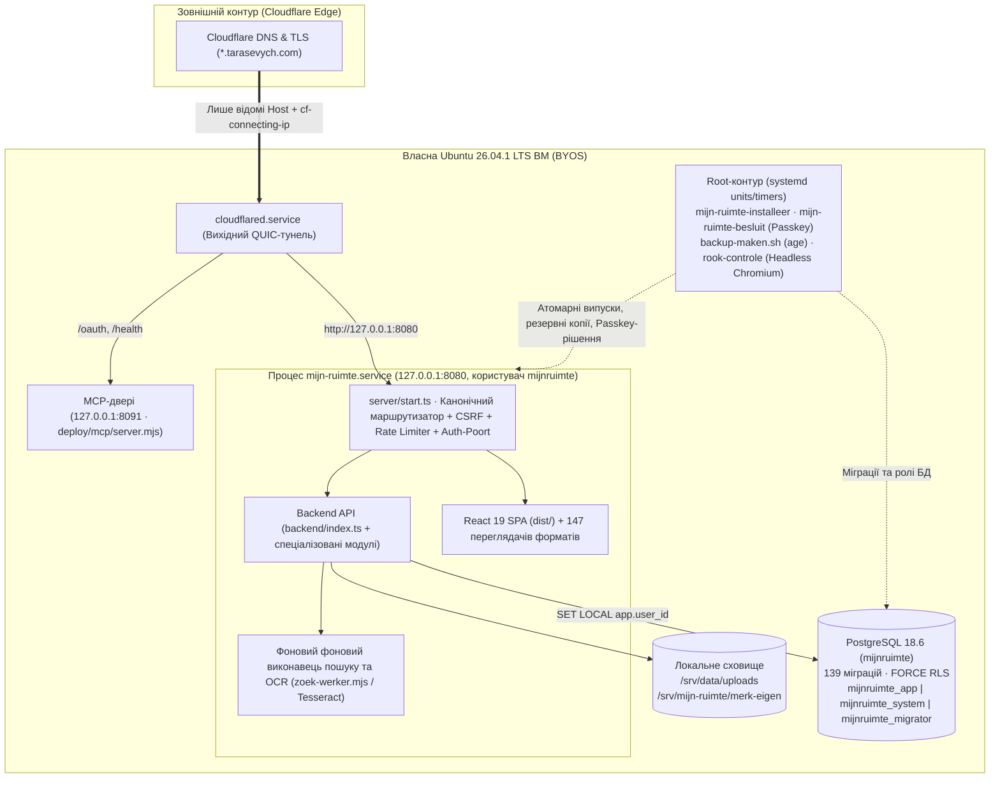

> 🌐 **Мова / Taal:** **Українська** · [Nederlands](PROJECTOVERZICHT.nl.md) | [Головна](README.md) · [Покажчик документації](docs/ПОКАЖЧИК-ДОКУМЕНТАЦІЇ.uk.md)

# Мій простір · Mijn Ruimte (`Tarasevych/hub`)

> **Приватна автономна BYOS (власний сервер) платформа цифрового робочого простору, пошти, хмарного сховища, ідентичності, розумного дому та мультиагентної координації ШІ.**

---

## Двомовна навігація по сторінках хабу (🇺🇦 Українська ↔ 🇳🇱 Nederlands)

Кожна стаття та сторінка документації в репозиторії має дві повноцінні мовні версії — **українську (`🇺🇦 .uk.md`)** та **нідерландську (`🇳🇱 .nl.md`)** із взаємними посиланнями в шапці кожної сторінки:

| Розділ / Тематична сторінка | 🇺🇦 Українська версія | 🇳🇱 Нідерландська версія (Nederlands) |
|---|---|---|
| **Головна робоча сторінка репозиторію** | **[`README.md`](./README.md)** · [`ОГЛЯД-ПРОЄКТУ.uk.md`](./ОГЛЯД-ПРОЄКТУ.uk.md) | **[`LEESMIJ.md`](./LEESMIJ.md)** · [`PROJECTOVERZICHT.nl.md`](./PROJECTOVERZICHT.nl.md) |
| **Повний реєстр усіх статей і сторінок (140+ документів)** | **[`docs/ПОКАЖЧИК-ДОКУМЕНТАЦІЇ.md`](./docs/ПОКАЖЧИК-ДОКУМЕНТАЦІЇ.md)** · [`docs/ПОКАЖЧИК-ДОКУМЕНТАЦІЇ.uk.md`](./docs/ПОКАЖЧИК-ДОКУМЕНТАЦІЇ.uk.md) | **[`docs/INDEX.nl.md`](./docs/INDEX.nl.md)** |
| **1. Архітектура та 11 піддоменів (`*.tarasevych.com`)** | [`docs/hub/АРХІТЕКТУРА-ЦЕНТРУ.uk.md`](./docs/hub/АРХІТЕКТУРА-ЦЕНТРУ.uk.md) | [`docs/hub/ARCHITECTUUR.nl.md`](./docs/hub/ARCHITECTUUR.nl.md) |
| **2. Історія розвитку проєкту (Етапи I–VI)** | [`docs/hub/ІСТОРІЯ-РОЗВИТКУ.uk.md`](./docs/hub/ІСТОРІЯ-РОЗВИТКУ.uk.md) | [`docs/hub/GESCHIEDENIS.nl.md`](./docs/hub/GESCHIEDENIS.nl.md) |
| **3. Путівник по 71 гілці, 27 PR та 18 випусках** | [`docs/hub/ГІЛКИ-ТА-ЗАПИТИ-НА-ЗЛИТТЯ.uk.md`](./docs/hub/ГІЛКИ-ТА-ЗАПИТИ-НА-ЗЛИТТЯ.uk.md) | [`docs/hub/TAKKEN-EN-SAMENVOEGVERZOEKEN.nl.md`](./docs/hub/TAKKEN-EN-SAMENVOEGVERZOEKEN.nl.md) |
| **4. Структура репозиторію та карта коду** | [`docs/hub/СТРУКТУРА-ТЕК.uk.md`](./docs/hub/СТРУКТУРА-ТЕК.uk.md) | [`docs/hub/MAP-STRUCTUUR.nl.md`](./docs/hub/MAP-STRUCTUUR.nl.md) |
| **5. Змінні середовища та ключі шифрування** | [`docs/hub/ЗМІННІ-СЕРЕДОВИЩА-ЦЕНТРУ.uk.md`](./docs/hub/ЗМІННІ-СЕРЕДОВИЩА-ЦЕНТРУ.uk.md) · [`ЗМІННІ-СЕРЕДОВИЩА.uk.md`](./ЗМІННІ-СЕРЕДОВИЩА.uk.md) | [`docs/hub/OMGEVINGSVARIABELEN.nl.md`](./docs/hub/OMGEVINGSVARIABELEN.nl.md) · [`OMGEVINGSVARIABELEN.nl.md`](./OMGEVINGSVARIABELEN.nl.md) |
| **6. Оркестрація `ORCH-001`, `TRACE-001`, стек `B-009` та розгортання** | [`docs/hub/КООРДИНАЦІЯ-ТА-РОЗГОРТАННЯ.uk.md`](./docs/hub/КООРДИНАЦІЯ-ТА-РОЗГОРТАННЯ.uk.md) | [`docs/hub/ORCHESTRATIE-EN-UITROL.nl.md`](./docs/hub/ORCHESTRATIE-EN-UITROL.nl.md) |
| **Канонічні правила агентів та реєстр рішень** | [`ПРАВИЛА-АГЕНТІВ.uk.md`](./ПРАВИЛА-АГЕНТІВ.uk.md) · [`orchestratie/РІШЕННЯ.uk.md`](./orchestratie/РІШЕННЯ.uk.md) | [`AGENTENREGELS.nl.md`](./AGENTENREGELS.nl.md) · [`orchestratie/BESLUITEN.nl.md`](./orchestratie/BESLUITEN.nl.md) |
| **Безпека та план портування (Self-Hosting)** | [`НОТАТКИ-БЕЗПЕКИ.uk.md`](./НОТАТКИ-БЕЗПЕКИ.uk.md) · [`ПЛАН-ПЕРЕНЕСЕННЯ.uk.md`](./ПЛАН-ПЕРЕНЕСЕННЯ.uk.md) | [`BEVEILIGINGSNOTITIES.nl.md`](./BEVEILIGINGSNOTITIES.nl.md) · [`PORTEERPLAN.nl.md`](./PORTEERPLAN.nl.md) |

---

## Паспорт проєкту

| Параметр | Значення |
|---|---|
| **Репозиторій** | [`Tarasevych/hub`](https://github.com/Tarasevych/hub) |
| **Головна гілка (Основна гілка)** | [`voornaamst`](https://github.com/Tarasevych/hub/tree/voornaamst) *(синхронізована з інтеграційною гілкою [`integratie`](https://github.com/Tarasevych/hub/tree/integratie))* |
| **Публічна точка входу** | [https://hub.tarasevych.com](https://hub.tarasevych.com) *(основний домен: `tarasevych.com`)* |
| **Архітектурна модель** | Self-hosted BYOS на власній Ubuntu LTS ВМ за вихідним Cloudflare Tunnel (`127.0.0.1:8080`), без сторонніх хмарних хостингів |
| **Технологічний стек** | TypeScript 5.7 · React 19 · Vite 6 · Tailwind CSS 3 · Node.js 26 LTS (`node:http` + `esbuild`) · PostgreSQL 18 (JSONB + реляційні таблиці + FORCE RLS) · Systemd · Caddy · OPA · `age` |
| **Канонічні правила (ORCH-001)** | [`AGENTS.md`](AGENTS.md) ([🇺🇦 UK](ПРАВИЛА-АГЕНТІВ.uk.md) · [🇳🇱 NL](AGENTENREGELS.nl.md)) · [`orchestratie/beleid.json`](orchestratie/beleid.json) · [`orchestratie/BESLUITEN.md`](orchestratie/BESLUITEN.md) ([🇺🇦 UK](orchestratie/РІШЕННЯ.uk.md) · [🇳🇱 NL](orchestratie/BESLUITEN.nl.md)) |
| **Мовна конвенція** | Спілкування, документація, звіти — **українською (`uk`) та нідерландською (`nl`)**; шляхи URL/API та назви модулів у коді — **нідерландською (`nl`)**; інтерфейс користувача — **двомовний (`uk` / `nl`)** |
| **Карта кодової бази** | [`docs/kaart/КАРТА-ФАЙЛІВ.md`](docs/kaart/КАРТА-ФАЙЛІВ.md) ([🇺🇦 UK](docs/kaart/КАРТА-ФАЙЛІВ.uk.md) · [🇳🇱 NL](docs/kaart/KAART-BESTANDEN.nl.md)) та [`docs/kaart/bestandskaart.json`](docs/kaart/bestandskaart.json) *(531 перейменований модуль + нові модулі з автоматичною перевіркою складання)* |

---

## Зміст (Навігація по головній сторінці)

1. [Про проєкт та архітектура екосистеми (11 сервісних піддоменів)](#1-про-проєкт-та-архітектура-екосистеми-11-сервісних-піддоменів)
2. [Історія розвитку проєкту (Хронологія етапів)](#2-історія-розвитку-проєкту-хронологія-етапів)
3. [Повний путівник по гілках репозиторію (71 гілка: що де шукати)](#3-повний-путівник-по-гілках-репозиторію-71-гілка-що-де-шукати)
   - [3.1. Головні та інтеграційні гілки](#31-головні-та-інтеграційні-гілки)
   - [3.2. Активні гілки в роботі та кандидати на злиття (Листопад 2026)](#32-активні-гілки-в-роботі-та-кандидати-на-злиття-листопад-2026)
   - [3.3. Злиті у `voornaamst` функціональні та випускні гілки (Жовтень–Листопад 2026)](#33-злиті-у-voornaamst-функціональні-та-випускові-гілки-жовтеньлистопад-2026)
   - [3.4. Історичні та архівні гілки ранньої розробки (Вересень — 16 Жовтня 2026)](#34-історичні-та-архівні-гілки-ранньої-розробки-вересень--16-жовтня-2026)
4. [Реєстр Pull Requests (#1–#27) та Випусків (GitHub Releases)](#4-реєстр-pull-requests-127-та-випусків-github-releases)
5. [Структура репозиторію: де що лежить у коді](#5-структура-репозиторію-де-що-лежить-у-коді)
6. [Змінні середовища, ключі шифрування та конфігурація (`ЗМІННІ-СЕРЕДОВИЩА.md`)](#6-змінні-середовища-ключі-шифрування-та-конфігурація-env-varsmd)
7. [Інфраструктура, серверний стек (`B-009`), безпека та резервне копіювання](#7-інфраструктура-серверний-стек-b-009-безпека-та-резервне-копіювання)
8. [Координація ШІ-агентів (`ORCH-001` / `TRACE-001`) та команди розробки](#8-координація-ші-агентів-orch-001--trace-001-та-команди-розробки)

---

## 1. Про проєкт та архітектура екосистеми (11 сервісних піддоменів)

**Мій простір (Mijn Ruimte)** — це єдина самодостатня платформа персонального й командного цифрового простору, побудована за принципом **BYOS (власний сервер)** та **Zero-Knowledge / суворої ізоляції просторів**. Платформа об'єднує робочий стіл (хаб), поштовий клієнт із підтримкою десятків інженерних/медійних форматів вкладень, захищене хмарне сховище, календар (агенду), систему керування розумним домом, інтеграцію з GitHub та центр управління ШІ-агентами за протоколом MCP (Model Context Protocol).

### Сервісні хости екосистеми (`*.tarasevych.com`)

Усі піддомени (визначені в [`backend/deployment-identity.ts`](backend/deployment-identity.ts) та маршрутизовані через [`deploy/cloudflared-config.yml`](deploy/cloudflared-config.yml)) обслуговуються єдиним серверним ядром на `127.0.0.1:8080` зі спільним захищеним контуром сеансів (`Domain=.tarasevych.com; Secure; HttpOnly; SameSite=Lax`):

| Піддомен | Служба | Призначення та ключові можливості | Основні модулі в коді |
|---|---|---|---|
| **[`hub.tarasevych.com`](https://hub.tarasevych.com)** | **Хаб (`hub`)** | Головне робоче полотно (**Werkblad v3**), блоки інтерфейсу, швидкі дії, дошки, сповіщення (**Meldingen v2/v3**), глобальне **Меню v2** (док праворуч/угорі/унизу), глобальний пошук `/zoek`. | [`src/VerenigdDienstApp.tsx`](src/VerenigdDienstApp.tsx), [`backend/werkblad-v3.ts`](backend/werkblad-v3.ts), [`shared/menu-model.ts`](shared/menu-model.ts) |
| **[`mail.tarasevych.com`](https://mail.tarasevych.com)** | **Пошта (`mail`)** | **Adaptive Mail Полотно**: Gmail (OAuth + Pub/Sub), Outlook (Microsoft Graph), IMAP/SMTP (iCloud, Ukr.net, Yahoo, I.ua). Орбіта сервісів, мобільні шторки, **147 спеціалізованих переглядачів і редакторів вкладень** (CAD, DICOM/медичні, біоінформатика, фінанси, музика, архіви, бази даних, PDF/Office), контекст гілки без ШІ та верифікований ШІ-переклад/вижимка з дослівними цитатами. | [`src/GoogleMailWerkruimte.tsx`](src/GoogleMailWerkruimte.tsx), [`src/mail/`](src/mail/), [`backend/mail-imap.ts`](backend/mail-imap.ts), [`backend/mail-microsoft.ts`](backend/mail-microsoft.ts) |
| **[`id.tarasevych.com`](https://id.tarasevych.com)** | **Ідентичність (`id`)** | Єдиний центр входу та безпеки облікових записів: Google OIDC (PKCE + nonce + `__Secure-tsv_aanmeld_binding`), пароль + TOTP (`AES-256-GCM`) + коди відновлення, **WebAuthn Ключі доступу**, гостьові коди доступу (`/toegang`), Step-Up підтвердження чутливих дій, перемикання облікових записів та **12 розділів профілю**. | [`src/ToegangslaagWeergave.tsx`](src/ToegangslaagWeergave.tsx), [`backend/toegangslaag.ts`](backend/toegangslaag.ts), [`backend/toegangssleutels.ts`](backend/toegangssleutels.ts), [`backend/stap-op.ts`](backend/stap-op.ts) |
| **[`cloud.tarasevych.com`](https://cloud.tarasevych.com)** | **Хмара (`cloud`)** | **Cloud vNext (M1–M11)**: робочі простори файлів, Google Drive проекція, клієнтське нульове розголошення шифрування (**M7 архітектура приватності** на базі WebAuthn PRF та ключа відновлення), універсальний переглядач файлів, фото-сервіс. | [`backend/cloud-platform.ts`](backend/cloud-platform.ts), [`backend/cloud-google-drive.ts`](backend/cloud-google-drive.ts), [`docs/АРХІТЕКТУРА-ПРИВАТНОСТІ-ХМАРИ-М7.uk.md`](docs/АРХІТЕКТУРА-ПРИВАТНОСТІ-ХМАРИ-М7.uk.md) |
| **[`ai.tarasevych.com`](https://ai.tarasevych.com)** | **ШІ-простір (`ai`)** | Робота з приватними та технічними ШІ-моделями, дошка ШІ-агентів, гранулярні дозволи **«Доступ ШІ»** (обсяги повноважень по інструментах і чутливих даних), єдиний хаб під'єднань `/verbindingen`. | [`src/agenten/`](src/agenten/), [`backend/ai-beleid.ts`](backend/ai-beleid.ts), [`backend/connector-v2.ts`](backend/connector-v2.ts) |
| **[`mcp.tarasevych.com`](https://mcp.tarasevych.com)** | **MCP-шлюз (`mcp`)** | Окремі з'єднувальні адреси на кожного агента (`/claude`, `/gpt`, `/grok`, `/gemini`, `/copilot`, `/cursor`), OAuth 2.0 метадані, під'єднання зовнішніх MCP-серверів (`backend/mcp-klant/`), вебпанель **«Координація»** (`/agents` → `TabOrch.tsx`) та ізольовані двері порту `8091`. | [`src/agenten/TabOrch.tsx`](src/agenten/TabOrch.tsx), [`backend/orch-routes.ts`](backend/orch-routes.ts), [`deploy/ЄДИНИЙ-ШЛЯХ-ЗЄДНУВАЧА.md`](deploy/ЄДИНИЙ-ШЛЯХ-ЗЄДНУВАЧА.md) |
| **[`github.tarasevych.com`](https://github.tarasevych.com)** | **GitHub (`github`)** | Під'єднання GitHub OAuth / GitHub App, огляд репозиторіїв, гілок, Pull Requests, фіксацій змін і випусків, індексація коду та задач у глобальний пошук `/zoek`. | [`shared/github-koppeling.ts`](shared/github-koppeling.ts), [`backend/uitrol-github.ts`](backend/uitrol-github.ts) |
| **[`huis.tarasevych.com`](https://huis.tarasevych.com)** | **Розумний дім (`huis`)** | **Huis vNext**: інтеграція з Home Assistant та локальними шлюзами, управління кімнатами, пристроями й автоматизаціями, шифрування маркерів доступу перехідників (`HUIS_ADAPTER_SLEUTEL_V1`), захист підмережі управління. | [`shared/huis-model.ts`](shared/huis-model.ts), [`deploy/ЗМІНИ-20261028-ДІМ-ОНОВЛЕННЯ.md`](deploy/ЗМІНИ-20261028-ДІМ-ОНОВЛЕННЯ.md) |
| **[`api.tarasevych.com`](https://api.tarasevych.com)** | **API та Сховище (`api`)** | Управління машинними маркерами доступу (`tsv_`), API-під'єднаннями, вебвикликами та захищеним **Сховищем секретів власника (Sleutelkluis / Сховище)**. | [`src/ApiPlatformWeergave.tsx`](src/ApiPlatformWeergave.tsx), [`backend/api-platform-kluis.ts`](backend/api-platform-kluis.ts), [`shared/sleutelkluis.ts`](shared/sleutelkluis.ts) |
| **[`admin.tarasevych.com`](https://admin.tarasevych.com)** | **Адмін (`admin`)** | **Технічний простір**: керування користувачами й ролями, журнал безпеки `app.audit` (лише дописування хеш-ланцюг), стан RLS-ізоляції, діагностика сервера й відмальовування (`rook-controle`), **Майстер під'єднань**, управління SSH-CA, термінал у оглядачі та центр **«Оновлення»** з криптографічним підтвердженням власника через Ключ доступу. | [`backend/server-beheer.ts`](backend/server-beheer.ts), [`backend/uitrol-goedkeuring.ts`](backend/uitrol-goedkeuring.ts), [`backend/eigenaar-besluit.ts`](backend/eigenaar-besluit.ts) |
| **[`dashboard.tarasevych.com`](https://dashboard.tarasevych.com)** | **Панель керування (`dashboard`)** | Статична панель огляду з `/srv/mijn-ruimte/dashboard` (повністю відокремлена від сеансів та API). | [`server/start.ts`](server/start.ts), [`deploy/ОГЛЯД-РОЗГОРТАННЯ.md`](deploy/ОГЛЯД-РОЗГОРТАННЯ.md) |

### Архітектурна схема платформи



---

## 2. Історія розвитку проєкту (Хронологія етапів)

Щоб розуміти структуру коду та походження всіх 71 гілки в репозиторії, нижче наведено повну хронологію еволюції **Mijn Ruimte**:

### Етап I. Зародження та прототип на AppDeploy (Серпень — Вересень 2026)
- Проєкт розпочався 29.08.2026 як комплексна екосистема під назвою **«Мій простір / Tarasevych Hub»** на платформі AppDeploy (`APP_ID = migrated-bg2v4h`).
- 24.09.2026 у гілці [`Mijn-ruimte-reservekopieën`](https://github.com/Tarasevych/hub/tree/Mijn-ruimte-reservekopie%C3%ABn) зафіксовано першу публічну точку відліку репозиторію.

### Етап II. Портування на Self-Hosted BYOS та Криптографічне Ядро (2–6 Жовтня 2026)
- **План портування ([`ПЛАН-ПЕРЕНЕСЕННЯ.md`](ПЛАН-ПЕРЕНЕСЕННЯ.md), 03.10.2026):** ухвалено рішення повністю відмовитися від хмарної залежності AppDeploy (`@appdeploy/sdk` та `@appdeploy/client`) і перенести систему на власний сервер власника за Cloudflare Tunnel.
- Написано сумісний платформний шар `@platform/server` ([`server/platform/`](server/platform/)) та `@platform/client` ([`src/platform/`](src/platform/)) поверх PostgreSQL (`app.records` з GIN-індексами JSONB), файлової системи `/srv/data/uploads` та змінних `/etc/mijn-ruimte/geheimen.env` (гілки [`basis-voor-zelf-hosten`](https://github.com/Tarasevych/hub/tree/basis-voor-zelf-hosten), [`zelf-hosten`](https://github.com/Tarasevych/hub/tree/zelf-hosten), [`sync-actief`](https://github.com/Tarasevych/hub/tree/sync-actief)).
- **Безпекова реформа (Фази A, B, Auth Fase 1, Fase 2–3, Audit Fixes — див. [`НОТАТКИ-БЕЗПЕКИ.md`](НОТАТКИ-БЕЗПЕКИ.md)):**
  - Гілка [`auth-fase-1`](https://github.com/Tarasevych/hub/tree/auth-fase-1) (03.10.2026): усунено застарілий спадок-маршрути входу, впроваджено строгий PKCE (`oauth_pkce_v1`), прив'язку транзакцій входу до вкладки (`__Secure-tsv_aanmeld_binding_*`) та одноразовий атомарний передача контексту між піддоменами (`tsv_handoff_binding`).
  - Гілка [`beveiliging-fase-2-3`](https://github.com/Tarasevych/hub/tree/beveiliging-fase-2-3) (03.10.2026): впроваджено **захист на рівні рядків (RLS)** на рівні PostgreSQL, розділення на 3 ролі БД (`mijnruimte_migrator`, `mijnruimte_app` з `NOBYPASSRLS`, `mijnruimte_system`), центральний шлюз авторизації `auth-poort.ts` та Step-Up підтвердження (`STEP_UP_REQUIRED`).
  - Гілка [`beveiliging-fixes-audit`](https://github.com/Tarasevych/hub/tree/beveiliging-fixes-audit) (04.10.2026): захищено журнал аудиту `app.audit` криптографічним хеш-ланцюгом (`SECURITY DEFINER` функція `app.audit_toevoegen`), розділено `geheimen.env` і `migratie.env`, додано двомовні статичні сторінки `/privacy` та `/terms` без JS.

### Етап III. WebAuthn Ключі доступу, Меню v2, Технічний Простір і З'єднувачі ШІ (7–16 Жовтня 2026)
- **Власне WebAuthn-ядро та Ключ доступу-схвалення оновлень (08–09.10.2026):**
  - У гілці [`passkey-schvalennya`](https://github.com/Tarasevych/hub/tree/passkey-schvalennya) реалізовано незалежне WebAuthn-ядро без сторонніх npm-залежностей ([`deploy/goedkeuring/webauthn-kern.mjs`](deploy/goedkeuring/webauthn-kern.mjs), підтримка ES256/EdDSA/RS256), яке використовується і додатком, і root-сценарієм для криптографічного підтвердження оновлень сервера на вкладці `Admin → Оновлення`.
  - У гілці [`aanmeldmethoden`](https://github.com/Tarasevych/hub/tree/aanmeldmethoden) додано повноцінні користувацькі Ключі доступу у розділі «Способи входу» (`rpId: tarasevych.com`), а в [`bevestig-toegang`](https://github.com/Tarasevych/hub/tree/bevestig-toegang) — тимчасові коди доступу та гостьові сеансу (`/toegang`).
- **Глобальне Меню v2 ([`menu-v2`](https://github.com/Tarasevych/hub/tree/menu-v2), 09.10.2026):** створено нову навігаційну оболонку з доком (праворуч/угорі/унизу), швидкою панеллю та режимом редагування перетягуванням.
- **Технічний профіль та MCP-Екосистема (12–16.10.2026):**
  - Серія гілок `claude/*` та `cursor/*-8d4d` побудувала **розділення Приватного й Технічного просторів** ([`claude/tech-profiel-2026-10-13`](https://github.com/Tarasevych/hub/tree/claude/tech-profiel-2026-10-13), [`cursor/mcp-spiegel-na-b-8d4d`](https://github.com/Tarasevych/hub/tree/cursor/mcp-spiegel-na-b-8d4d)), **під'єднання ШІ одним натисканням** ([`claude/mcp-een-klik-2026-10-13`](https://github.com/Tarasevych/hub/tree/claude/mcp-een-klik-2026-10-13)), **термінал у оглядачі на базі xterm** ([`cursor/terminal-etap-c-8d4d`](https://github.com/Tarasevych/hub/tree/cursor/terminal-etap-c-8d4d)), **Дошку ШІ-агентів і гранулярні обсяги повноважень** ([`cursor/ai-agent-board-8d4d`](https://github.com/Tarasevych/hub/tree/cursor/ai-agent-board-8d4d)) та **З'єднувач v2 з реальними діями** ([`claude/connector-v2-2026-10-15`](https://github.com/Tarasevych/hub/tree/claude/connector-v2-2026-10-15), [`cursor/connector-functies-8d4d`](https://github.com/Tarasevych/hub/tree/cursor/connector-functies-8d4d)).

### Етап IV. Масштабне Розширення Модулів та Нідерландська Канонізація (17–30 Жовтня 2026)
- **Sleutelkluis (Сховище ключів, 21.10.2026, міграція `0092`):** ключі даних користувача (DEK) ніколи не зберігаються на диску відкритими; для MCP-з'єднань агентів формуються криптографічні HKDF-конверти з `SLEUTELKLUIS_SLEUTEL_V1`.
- **Глобальний пошук `/zoek` та OCR (22.10.2026, міграції `0100`–`0104`):** повнотекстовий пошук по інтерфейсу, пошті, вкладеннях, хмарі, календарях, дошці та GitHub із фоновим фоновим виконавцем вилучення тексту з PDF/Office/архівів (`zoek-werker.mjs`), OCR через Tesseract (`ukr+nld+eng+rus`) та автоматичним маскуванням секретів (`shared/geheim-patronen.ts`).
- **Перевірка відмальовування при випуску (`rook-controle`, 22.10.2026):** після активації кожного випуску встановлювач запускає headless Chromium на ізольованій БД і перевіряє реальний відмальовування сторінок; при збої випуск автоматично повертається до попереднього стану (`ROOK_TERUGGEDRAAID`).
- **Нідерландська канонізація коду (24.10.2026):** 531 файл у `src/`, `backend/`, `shared/`, `server/`, `tests/`, `scripts/` перейменовано нідерландською за єдиним словником ([`docs/kaart/КАРТА-ФАЙЛІВ.md`](docs/kaart/КАРТА-ФАЙЛІВ.md)), а сценарій [`scripts/kaart-controle.mjs`](scripts/kaart-controle.mjs) інтегровано в `npm run build`.
- **Adaptive Mail Полотно (пакети 1–3, 24–25.10.2026):** єдина рамка читання листа (`LeesVenster.tsx`), панель контексту гілки без ШІ (`ContextPaneel.tsx`: хронологія, групи версій вкладень, SPF/DKIM/DMARC, події `.ics`), верифікований блок «Що від вас потрібно?» (`WatNodigBlok.tsx`) із перевіркою цитат за оригіналом (`shared/ai-bronnen.ts`), поабзацне порівняння перекладу (`VergelijkTabel.tsx`) та порівняння версій документів PDF/DOCX (`VersieVergelijk.tsx`).
- **Зони й гнізда рухомих кнопок (`shared/plaatsing.ts`, 25.10.2026):** математична модель розміщення всіх рухомих елементів інтерфейсу без перекриттів для телефона, планшета й комп'ютера.
- **Cloud vNext (M1–M11), Huis vNext (`0128`), Notities vNext (`0129`), Werkblad v3 (`0114`), Agenda v3 (27–29.10.2026):** повне оновлення хмарного сховища (включно з архітектурою приватності M7), інтеграції Home Assistant, полотна робочого столу v3 та двосторонньої синхронізації календарів.

### Етап V. Аудит `SEC-001`, Оркестрація Агентів `ORCH-001` та `UX-AI-VAULT-001` (30 Жовтня — 1 Листопада 2026)
- **Консолідація та аудит безпеки `SEC-001` (30–31.10.2026):** актуальний робоче середовище-код імпортовано в [`audit/sec-001-20261030`](https://github.com/Tarasevych/hub/tree/audit/sec-001-20261030), проведено аудит і виправлення у [`fix/sec-001-20261031-000224`](https://github.com/Tarasevych/hub/tree/fix/sec-001-20261031-000224) та базовий випуск [`release/sec-001-20261031-084138`](https://github.com/Tarasevych/hub/tree/release/sec-001-20261031-084138).
- **Система мультиагентної координації `ORCH-001` (31.10.2026, рішення `B-001`–`B-006`):** створено єдине джерело правил [`AGENTS.md`](AGENTS.md), машинну політику [`orchestratie/beleid.json`](orchestratie/beleid.json), криптографічний відбиток [`orchestratie/regels.lock.json`](orchestratie/regels.lock.json) та CLI/MCP/веб-конвеєр [`scripts/orch.mjs`](scripts/orch.mjs) для узгодженої роботи 8 ШІ-агентів (Claude, Antigravity, ChatGPT, Codex, Grok, Copilot, Gemini, Cursor).
- **`MCP-ACCESS-001` та `UX-AI-VAULT-001` (01.11.2026):** впроваджено точну діагностику доступу ШІ з ізоляцією за під'єднанням, керування агентом в одному місці з підтвердженням Ключ доступу та єдине адаптивне Сховище секретів (PR #17, #18, #19).

### Етап VI. `LOGIN-001`, Інтеграція `INTEG-001`, `TRACE-001`, Мобільна Орбіта Пошти, `PRIVACY-001` та `IDENTITY-ACCOUNT` (1–4 Листопада 2026)
- **`LOGIN-001` (01–02.11.2026):** мінімалістичний адаптивний багатомовний екран входу та оновлене меню збережених облікових записів.
- **`INTEG-001` (03.11.2026):** масштабне зведення 9 паралельних гілок функціональності (сповіщення з поясненнями, дошка ШІ, смуга простору, прапорці мов, друк із перевіркою в Chrome, пошукове меню у верхній панелі, ремонт тестів) у єдину гілку [`feature/integ-001-zvedennia-20261103-102243`](https://github.com/Tarasevych/hub/tree/feature/integ-001-zvedennia-20261103-102243).
- **`TRACE-001` (03.11.2026, рішення `B-007`/`B-008`, правила `1.4.1`):** обов'язковий незмінний журнал розробки `orchestratie/ontwikkelarchieven/<TASK-ID>.json` у кожному фіксації змін випуску та жорстка перевірка SHA-256 випускного архіву `.tar.gz` через GitHub API як на сайті (`voorcontrole`), так і в root-встановлювачі.
- **Серія оновлень Пошти (`MAILORBIT-001` → `MAILMOB-001` → `MAILPOLISH-001` → `MAILFIX-001` → `MAILFIT-001`/`002`, 03–04.11.2026):** інтерактивна орбіта поштових сервісів на порожній сторінці пошти, мобільні шторки під'єднання для екранів 320px+, синхронізація 12-годинного Step-Up дозволу («Не питати знову») та виправлення мобільної верстки.
- **Оновлення серверного стека `B-009` (04.11.2026, правила `1.4.2`):** фіксація переходу робоче середовище ВМ на `Ubuntu 26.04.1 LTS`, `Node.js 26.13.0 LTS`, `PostgreSQL 18.6`, `Caddy 2.11.7` та вирішення проблеми seccomp-фільтра `systemd 259` з викликом `openat2` у `GNU tar 1.35` (`RestrictSUIDSGID=no`).
- **`PRIVACY-001` (04.11.2026, рішення `B-010`/`B-011`, правила `1.4.6`):** повне видалення персональних даних та реальних IP-адрес із коду, тестів, документації та історії git; винесення реквізитів у серверні змінні `MR_EIGENAAR_NAAM`, `MR_CONTACT_EMAIL`, `MR_BEHEERSUBNET`, `MR_VM_SSH`.
- **`IDENTITY-ACCOUNT` / `IDENTITY-001` / `IDENTITY-002` (04.11.2026):** проєктування та реалізація єдиного екрана облікового запису з 12 розділами та діалогом керування фото профілю.

---

## 3. Повний путівник по гілках репозиторію (71 гілка: що де шукати)

У репозиторії `Tarasevych/hub` налічується **71 гілка**. Щоб кожен учасник чи ШІ-агент миттєво розумів, які гілки є канонічними, які перебувають в активній розробці, які вже повністю злиті у `voornaamst`, а які є історичним архівом жовтня 2026 року, нижче наведено повну класифікацію з прямими посиланнями.

> [!IMPORTANT]
> **Головне правило навігації по гілках:**
> 1. Поточний канонічний стан проєкту знаходиться у гілках **[`voornaamst`](https://github.com/Tarasevych/hub/tree/voornaamst)** та **[`integratie`](https://github.com/Tarasevych/hub/tree/integratie)** (вони вказують на один і той самий фіксація змін `3095e5f` станом на синхронізацію `B-009`).
> 2. Усі **28 гілок Категорії 3.3** вже **повністю влиті** (`✅ Злито`) в історію `voornaamst` — їхній код уже є у головній гілці.
> 3. **9 гілок Категорії 3.2** містять **нові незлиті фіксації змін від 04.11.2026** (`🔄 Активна / Кандидат`) поверх або паралельно з `voornaamst`.
> 4. **30 гілок Категорії 3.4** (вересень — 16 жовтня 2026) — це **архівні гілки до консолідації робоче середовище-знімка `SEC-001` (30.10.2026)** (`📦 Архів`). Їхні напрацювання вже увійшли до кодової бази через знімок `016093f`, тому напряму зливати їх у `integratie` або `voornaamst` **не потрібно**.

---

### 3.1. Головні та інтеграційні гілки

| Гілка | Фіксація змін | Дата | Статус | Роль та призначення |
|---|---|---|---|---|
| **[`voornaamst`](https://github.com/Tarasevych/hub/tree/voornaamst)** | `3095e5f` | 2026-11-04 | 🌟 **Основна гілка** | Головна публічна гілка репозиторію. Містить повний злитий код платформи (179 фіксацій змін після консолідації), систему оркестрації `ORCH-001`, `TRACE-001`, `INTEG-001`, `MAILORBIT/MOB/POLISH-001` та правила `B-009` (`regelsVersie 1.4.2`). |
| **[`integratie`](https://github.com/Tarasevych/hub/tree/integratie)** | `3095e5f` | 2026-11-04 | 🛡️ **Інтеграційна** | Цільова гілка послідовної черги інтеграції агентів (`orchestratie/wachtrij.json`). Злиття відбувається виключно через `--no-ff` без force-push. |

---

### 3.2. Активні гілки в роботі та кандидати на злиття (Листопад 2026)

Ці **9 гілок** містять свіжу роботу за **04.11.2026**, яка випереджає поточний HEAD `voornaamst` (`3095e5f`) і готується до інтеграції за напрямами **Приватність (`PRIVACY-001`)**, **Пошта (`MAILFIX` / `MAILFIT`)** та **Обліковий запис (`IDENTITY-ACCOUNT`)**:

#### А. Приватність, очищення персональних даних та правила `1.4.6` (`PRIVACY-001`)
| Гілка | Фіксація змін | Відносно `voornaamst` | Агент / Автор | Що всередині та де шукати |
|---|---|---|---|---|
| **[`release/persoonsgegevens-20261104-164147`](https://github.com/Tarasevych/hub/tree/release/persoonsgegevens-20261104-164147)** | `6483f3f` | **+7 фіксацій змін** (0 позаду) | Claude | **Головний випускний кандидат `PRIVACY-001` (рішення `B-010` та `B-011`, `regelsVersie 1.4.6`).** Повне видалення персональних даних та IP-адрес із коду, тестів і документації; змінні `MR_EIGENAAR_NAAM`, `MR_CONTACT_EMAIL`, `MR_BEHEERSUBNET`, `MR_VM_SSH`; фіксація `*.sh text eol=lf` у `.gitattributes` та `git -c core.autocrlf=false archive` у `maak-voorstelpakket.sh`; оновлений `regels.lock.json` та досьє `orchestratie/ontwikkelarchieven/PRIVACY-001.json`. |
| **[`fix/persoonsgegevens-uit-code-20261104`](https://github.com/Tarasevych/hub/tree/fix/persoonsgegevens-uit-code-20261104)** | `8d2580d` | **+1 фіксація змін** (0 позаду) | Claude | Проміжна гілка першого кроку `FIX-PERSOONSGEGEVENS` (винесення даних власника з коду в конфігурацію; увійшла та розширена у `release/persoonsgegevens-20261104-164147`). |

#### Б. Пошта: мобільна адаптивність, порожній стан та OAuth (`MAILFIX-001` / `MAILFIT-001` / `MAILFIT-002`)
| Гілка | Фіксація змін | Відносно `voornaamst` | PR / Випуск | Що всередині та де шукати |
|---|---|---|---|---|
| **[`fix/mailfit-002-20261104-170000`](https://github.com/Tarasevych/hub/tree/fix/mailfit-002-20261104-170000)** | `98beb2a` | **+47 фіксацій змін** (1 позаду) | Кандидат `MAILFIT-002` | **Найновіша гілка поштової серії `MAILFIT`.** Містить усі виправлення `MAILFIX-001` та `MAILFIT-001`, плюс сумісність із серверним контрактом `TRACE-001` без перезапису файлів `integratie`, оновлені тестові зразки регресійних тестів `ORCH` та досьє `orchestratie/ontwikkelarchieven/MAILFIT-002.json`. |
| **[`fix/mailfit-001-20261104-110700`](https://github.com/Tarasevych/hub/tree/fix/mailfit-001-20261104-110700)** | `c3eb3f8` | **+21 фіксація змін** (1 позаду) | [PR #27](https://github.com/Tarasevych/hub/pull/27) · Випуск `20261104-160049` | **`MAILFIT-001`:** центрований адаптивний порожній стан пошти (empty-скринька вхідних початкове ознайомлення), чітка дія під'єднання Gmail, захист елементів керування вже під'єднаної скриньки. |
| **[`fix/mailfix-001-20261104-095000`](https://github.com/Tarasevych/hub/tree/fix/mailfix-001-20261104-095000)** | `1d1d28b` | **+18 фіксацій змін** (1 позаду) | [PR #26](https://github.com/Tarasevych/hub/pull/26) | **`MAILFIX-001`:** виправлення мобільної ширини пошти, усунення дубльованої смуги сервісів, діагностика збою Gmail OAuth, живі оглядачеві DOM-перевірки (`tests/visueel/mailfix-screen.mjs`). |

#### В. Обліковий запис та ідентичність: 12 розділів профілю (`IDENTITY-ACCOUNT` / `IDENTITY-001` / `IDENTITY-002`)
| Гілка | Фіксація змін | Відносно `voornaamst` | Випуск | Що всередині та де шукати |
|---|---|---|---|---|
| **[`feature/identity-account-ui-20261104-180000`](https://github.com/Tarasevych/hub/tree/feature/identity-account-ui-20261104-180000)** | `6e815a0` | **+7 власних фіксацій змін** *(база до 2-го rewrite)* | Випуск `20261104-204906` | **`IDENTITY-002` (повна реалізація UI):** єдиний екран облікового запису з **12 розділами** та діалогом керування фото профілю (`796223b`), плюс випуск із власної гілки (`6e815a0`). |
| **[`fix/identity-release-guard-20261104-171500`](https://github.com/Tarasevych/hub/tree/fix/identity-release-guard-20261104-171500)** | `fb56cae` | **+8 фіксацій змін** (0 позаду) | — | **`IDENTITY-ACCOUNT` (захист CI та план інтеграції):** покрокова складання пакета в CI, усунення `SIGPIPE` (`tar \| grep -q` під `pipefail`), блок `privacy` у журналі розробки та план інтеграції `IDENTITY-002` (побудована безпосередньо поверх `voornaamst` `3095e5f`). |
| **[`feature/identity-account-20261104-120000`](https://github.com/Tarasevych/hub/tree/feature/identity-account-20261104-120000)** | `50e6373` | **+5 фіксацій змін** (0 позаду) | Випуск `20261104-191935` | **`IDENTITY-001`:** дизайн, прототип і ТЗ 12 екранів облікового запису, реєстрація задачі `IDENTITY-001` та журнал розробки за стандартом `TRACE-001` поверх `voornaamst` `3095e5f`. |
| **[`feature/identity-account-ui-20261104-1200`](https://github.com/Tarasevych/hub/tree/feature/identity-account-ui-20261104-1200)** | `db4ba84` | **+2 фіксації змін** (1 позаду) | — | Початкова гілка документації та дизайну 12 екранів `IDENTITY-ACCOUNT` (замінена на `feature/identity-account-20261104-120000`). |

---

### 3.3. Злиті у `voornaamst` функціональні та випускні гілки (Жовтень–Листопад 2026)

Усі перелічені нижче **28 гілок** (`✅ Злито`) є прямими предками `voornaamst` (`3095e5f`), а також охоплюють 3 допоміжні гілки-кандидати цього ж циклу:

#### 1. Трасування випусків та Мобільна Орбіта Пошти (03–04.11.2026)
| Гілка | Фіксація змін | Статус у `voornaamst` | PR / Тег | Зміст гілки |
|---|---|---|---|---|
| **[`feature/mailpolish-001-20261104-084133`](https://github.com/Tarasevych/hub/tree/feature/mailpolish-001-20261104-084133)** | `7ba7a0d` | ✅ **Злито** | [PR #25](https://github.com/Tarasevych/hub/pull/25) · `20261104-075953` | **`MAILPOLISH-001`:** дизайнерське доопрацювання `MailKoppelVenster.tsx`, `MailOrbitIntro.tsx`, мобільних шторок `mail-koppel-mobile-sheet.css`, візуальні попередній перегляд та Chromium-знімки. |
| **[`feature/mailmob-001-20261104-073200`](https://github.com/Tarasevych/hub/tree/feature/mailmob-001-20261104-073200)** | `2b418cf` | ✅ **Злито** | [PR #24](https://github.com/Tarasevych/hub/pull/24) · `20261104-063430` | **`MAILMOB-001`:** анімована 320px мобільна орбіта пошти, доступні вікна під'єднання та синхронізація 12-годинного Step-Up дозволу («Не питати знову» для Ключ доступу/TOTP/Google). |
| **[`feature/trace-001-20261103-214810`](https://github.com/Tarasevych/hub/tree/feature/trace-001-20261103-214810)** | `017b8e1` | ✅ **Злито** | [PR #23](https://github.com/Tarasevych/hub/pull/23) | **`TRACE-001` (`B-007` / `B-008`, правила `1.4.1`):** обов'язковий `ONTWIKKELARCHIEF.json` у кожному пакеті випуску та перевірка SHA-256 архіву в GitHub Випуск на сайті й у root-встановлювачі. |
| **[`feature/mailorbit-001-20261103-205354`](https://github.com/Tarasevych/hub/tree/feature/mailorbit-001-20261103-205354)** | `14698ac` | ✅ **Злито** | [PR #22](https://github.com/Tarasevych/hub/pull/22) · `20261103-211554` | **`MAILORBIT-001`:** жива інтерактивна орбіта поштових сервісів і справжні внутрішні вікна під'єднання при порожньому списку облікових записів або порожній скриньці. |

#### 2. Велика інтеграція `INTEG-001` (03.11.2026 — 10 гілок)
| Гілка | Фіксація змін | Статус у `voornaamst` | Зміст гілки |
|---|---|---|---|
| **[`feature/integ-001-zvedennia-20261103-102243`](https://github.com/Tarasevych/hub/tree/feature/integ-001-zvedennia-20261103-102243)** | `78fbcf5` | ✅ **Злито** | **Зведена гілка `INTEG-001`:** об'єднує всі 9 тематичних гілок `integ-001-*`, повний GDPR/AVG-експорт облікового запису без обрізання (`4ddf24d`), реєстрацію нових модулів (`cloud-vnext`, `foto-dienst`) у реєстрі шлюзу та `NoNewPrivileges=yes` для `besluit`-служби. |
| **[`feature/integ-001-meld-20261103-083755`](https://github.com/Tarasevych/hub/tree/feature/integ-001-meld-20261103-083755)** | `ff46129` | ✅ **Злито** | Тихі сповіщення з поясненнями у вкладці «Прочитані», оновлення Наскрізні та UI-каталогу. |
| **[`feature/integ-001-agpag1-20261103-083758`](https://github.com/Tarasevych/hub/tree/feature/integ-001-agpag1-20261103-083758)** | `e25b5a7` | ✅ **Злито** | Дошка ШІ: двомовні назви вкладок і блоків українською та нідерландською. |
| **[`feature/integ-001-band-20261103-083753`](https://github.com/Tarasevych/hub/tree/feature/integ-001-band-20261103-083753)** | `b98bb2b` | ✅ **Злито** | Узгодження тестів `ui-audit-g` (8a) та фіксованої рамки (`vast-kader`) за рішенням щодо верхньої смуги. |
| **[`feature/integ-001-agpag2-20261103-083749`](https://github.com/Tarasevych/hub/tree/feature/integ-001-agpag2-20261103-083749)** | `d4df21b` | ✅ **Злито** | Уніфікація шапок блоків сторінки агентів відповідно до `agenten-pagina.css`. |
| **[`feature/integ-001-login-20261103-083803`](https://github.com/Tarasevych/hub/tree/feature/integ-001-login-20261103-083803)** | `6bbb685` | ✅ **Злито** | Перегенерація канонічного UI-каталогу після інтеграції нового екрана входу. |
| **[`feature/integ-001-menu-20261103-083746`](https://github.com/Tarasevych/hub/tree/feature/integ-001-menu-20261103-083746)** | `ed46b36` | ✅ **Злито** | Виправлення відображення прапорця мови в меню (`object-fit: fill`, без обрізання). |
| **[`feature/integ-001-print-20261103-083745`](https://github.com/Tarasevych/hub/tree/feature/integ-001-print-20261103-083745)** | `4de3780` | ✅ **Злито** | Cтатичні тести друку (76 перевірок) та перевірка друку у реальному Chrome (`scripts/afdruk-proef.mjs`). |
| **[`feature/integ-001-zoek-20261103-083752`](https://github.com/Tarasevych/hub/tree/feature/integ-001-zoek-20261103-083752)** | `c15e6ae` | ✅ **Злито** | Розкривне меню пошуку у верхній панелі (нещодавні запити, миттєві результати, навігація клавіатурою `Esc`/`Enter`/стрілки). |
| **[`feature/integ-001-test-20261103-083753`](https://github.com/Tarasevych/hub/tree/feature/integ-001-test-20261103-083753)** | `feb9f1b` | ✅ **Злито** | Стабілізація модульних тестів (`afstemming-kern`, `agent-apps`, `apparaat-inrichten`). |
| **[`wip/hub-voor-integratie-20261103`](https://github.com/Tarasevych/hub/tree/wip/hub-voor-integratie-20261103)** | `0ca4cad` | 📌 *Резервний знімок* | Страхувальний фіксація змін незафіксованої локальної роботи (сповіщення, MCP) перед стартом інтеграції `INTEG-001`. |

#### 3. Екран входу `LOGIN-001` (01–03.11.2026)
| Гілка | Фіксація змін | Статус у `voornaamst` | PR | Зміст гілки |
|---|---|---|---|---|
| **[`feature/login-001-plus-hub`](https://github.com/Tarasevych/hub/tree/feature/login-001-plus-hub)** | `3be89e0` | ✅ **Злито** | — | Інтеграція `LOGIN-001` із основними змінами хабу та виправлення тестів. |
| **[`feature/login-001-20261101-184800-chatgpt`](https://github.com/Tarasevych/hub/tree/feature/login-001-20261101-184800-chatgpt)** | `6952f8e` | ✅ **Злито** | [PR #20](https://github.com/Tarasevych/hub/pull/20) (об’єднано) | Мінімалістичний багатомовний екран входу без зайвих логотипів та безпечний GitHub CI для складання непідписаних кандидатів. |
| **[`feature/login-001-20261101-195230`](https://github.com/Tarasevych/hub/tree/feature/login-001-20261101-195230)** | `8209000` | 📦 *Закритий кандидат* | [PR #21](https://github.com/Tarasevych/hub/pull/21) (закрито) | Альтернативна чернетка-гілка кандидата `LOGIN-001` (її напрацювання по меню облікових записів та кольорах технічної смуги перенесено у `feature/login-001-plus-hub`). |

#### 4. Безпека `SEC-001`, Оркестрація `ORCH-001`, `MCP-ACCESS-001` та `UX-AI-VAULT-001` (30.10–01.11.2026)
| Гілка | Фіксація змін | Статус у `voornaamst` | PR | Зміст гілки |
|---|---|---|---|---|
| **[`release/ux-ai-vault-001-20261101-160600`](https://github.com/Tarasevych/hub/tree/release/ux-ai-vault-001-20261101-160600)** | `80716ac` | ✅ **Злито** | [PR #19](https://github.com/Tarasevych/hub/pull/19) (об’єднано) | **`UX-AI-VAULT-001`:** керування ШІ-агентом в одному місці з підтвердженням Ключ доступу на місці та єдине адаптивне Сховище секретів. |
| **[`release/sec-001-20261031-084138`](https://github.com/Tarasevych/hub/tree/release/sec-001-20261031-084138)** | `80716ac` | ✅ **Злито** | [PR #12](https://github.com/Tarasevych/hub/pull/12) (об’єднано) | Базова випускна гілка після злиття `SEC-001`, `ORCH-001`, `MCP-ACCESS-001` та `UX-AI-VAULT-001`. |
| **[`claude/project-thread-99x4j9`](https://github.com/Tarasevych/hub/tree/claude/project-thread-99x4j9)** | `3dea7c1` | ✅ **Злито** | [PR #17](https://github.com/Tarasevych/hub/pull/17) (об’єднано) | Доопрацювання `ORCH-001` після PR #16: заборона здачі чужої задачі, ізоляція технічних MCP-під'єднань від приватного «Доступу ШІ». |
| **[`fix/mcp-access-001-20261101-125530`](https://github.com/Tarasevych/hub/tree/fix/mcp-access-001-20261101-125530)** | `b864308` | ✅ **Злито** | [PR #18](https://github.com/Tarasevych/hub/pull/18) (об’єднано) | **`MCP-ACCESS-001`:** точна серверна діагностика доступу ШІ, ізоляція за під'єднанням, прямі дії в 1 натискання та живе оновлення дозволів. |
| **[`release/orch-001-mcp-20261031`](https://github.com/Tarasevych/hub/tree/release/orch-001-mcp-20261031)** | `d33d068` | ✅ **Злито** | [PR #16](https://github.com/Tarasevych/hub/pull/16) (об’єднано) | Спільний інтеграційний кандидат `ORCH-001` (PR #11 + PR #13) + `MCP-001` (PR #14) + `MCP-DEUR 8091` (PR #15). |
| **[`fix/mcp-deur-uitrol-20261031-204604`](https://github.com/Tarasevych/hub/tree/fix/mcp-deur-uitrol-20261031-204604)** | `ebc3736` | ✅ **Злито** | [PR #15](https://github.com/Tarasevych/hub/pull/15) | Синхронізація `deploy/mcp/server.mjs` та автоматичний перезапуск служби порту `8091` під час встановлення і повернення стану. |
| **[`fix/mcp-tools-catalog-20261031-192004`](https://github.com/Tarasevych/hub/tree/fix/mcp-tools-catalog-20261031-192004)** | `0b0b67c` | ✅ **Злито** | [PR #14](https://github.com/Tarasevych/hub/pull/14) | **`MCP-001`:** відновлення каталогу MCP-інструментів для Cursor Cloud / GitHub OAuth / Streamable HTTP. |
| **[`feature/orch-001-20261031-112355`](https://github.com/Tarasevych/hub/tree/feature/orch-001-20261031-112355)** | `7176e95` | ✅ **Злито** | [PR #11](https://github.com/Tarasevych/hub/pull/11) | **`ORCH-001` (етапи 0–4):** створення `AGENTS.md`, `orchestratie/*`, `scripts/orch.mjs`, керування з сайту/MCP та затвердження правил через Ключ доступу. |
| **[`fix/orch-001-review-20261031-165744`](https://github.com/Tarasevych/hub/tree/fix/orch-001-review-20261031-165744)** | `1203048` | ✅ **Злито** | — | Виправлення безпеки `ORCH-001`: блокування виконання довільних тестових команд з пакета (RCE), перевірка SSHSIG у GitOps. |
| **[`fix/orch-001-audit-20261031-170250`](https://github.com/Tarasevych/hub/tree/fix/orch-001-audit-20261031-170250)** | `315cebf` | 📦 *Інтегровано в PR #16* | [PR #13](https://github.com/Tarasevych/hub/pull/13) (закрито) | Тести перевірки безпеки `ORCH-001` (перенесені в `fix/orch-001-review-20261031-165744` та `release/orch-001-mcp-20261031`). |
| **[`fix/sec-001-20261031-000224`](https://github.com/Tarasevych/hub/tree/fix/sec-001-20261031-000224)** | `fd52dca` | ✅ **Злито** | — | Усунення вразливостей за результатами аудиту `SEC-001` та набір верифікаційних тестів. |
| **[`audit/sec-001-20261030`](https://github.com/Tarasevych/hub/tree/audit/sec-001-20261030)** | `016093f` | ✅ **Злито** | — | Імпорт повного робоче середовище-знімка від 30.10.2026 для проведення аудиту `SEC-001`. |

---

### 3.4. Історичні та архівні гілки ранньої розробки (Вересень — 16 Жовтня 2026)

Ці **30 гілок** відображають еволюцію платформи від міграції з AppDeploy до створення MCP-з'єднувачів v2. Усі напрацювання цих гілок увійшли до консолідованого робоче середовище-знімка `016093f` (`30.10.2026`), тому вони зберігаються як історичний довідник етапів розробки:

#### 1. Фундамент Self-Hosting, Авторизація та Фази Безпеки (Вересень — 6 Жовтня 2026)
| Гілка | Фіксація змін | Дата | Опис етапу |
|---|---|---|---|
| **[`Mijn-ruimte-reservekopieën`](https://github.com/Tarasevych/hub/tree/Mijn-ruimte-reservekopie%C3%ABn)** | `1f377ca` | 2026-09-24 | ✅ Початкова гілка репозиторію (предок `voornaamst`). |
| **[`basis-voor-zelf-hosten`](https://github.com/Tarasevych/hub/tree/basis-voor-zelf-hosten)** | `722542c` | 2026-10-02 | Вихідний знімок коду з першими виправленнями безпеки перед відмовою від AppDeploy. |
| **[`auth-fase-1`](https://github.com/Tarasevych/hub/tree/auth-fase-1)** | `a60525a` | 2026-10-03 | **Auth Fase 1:** прив'язка облікових записів за `(provider, subject)`, захист Google OAuth перенаправлення-потік від Login-CSRF, видалення застарілих маршрутів сеансів (міграція `0002`). |
| **[`beveiliging-fase-2-3`](https://github.com/Tarasevych/hub/tree/beveiliging-fase-2-3)** | `77cddc6` | 2026-10-03 | **Beveiliging Fase 2 & 3:** PostgreSQL RLS (`0003`–`0005`), три ролі БД (`db-rollen.sql`), `auth-poort.ts`, лише дописування аудит (`0006`), Step-Up (`stap-op.ts`), GDPR-експорт. |
| **[`beveiliging-fixes-audit`](https://github.com/Tarasevych/hub/tree/beveiliging-fixes-audit)** | `0f0cab4` | 2026-10-04 | **Audit Fixes (A1–A11):** зміцнення хеш-ланцюга `app.audit` (`0008`), RLS по таблицях (`0007`), публічні сторінки `/privacy` і `/terms`. |
| **[`sync-actief`](https://github.com/Tarasevych/hub/tree/sync-actief)** | `cb130fd` | 2026-10-06 | Синхронізація стану активного випуску `20261006-124427` із робоче середовище ВМ. |
| **[`zelf-hosten`](https://github.com/Tarasevych/hub/tree/zelf-hosten)** | `f30ea67` | 2026-10-06 | Основна гілка переходу на self-hosting (`ПЛАН-ПЕРЕНЕСЕННЯ.md`, `server/platform/*`, `deploy/installeer-app.sh`). |

#### 2. Ключі доступу, Гостьовий Доступ та Меню v2 (6–9 Жовтня 2026)
| Гілка | Фіксація змін | Дата | Опис етапу |
|---|---|---|---|
| **[`feature/connectors-agent`](https://github.com/Tarasevych/hub/tree/feature/connectors-agent)** | `c318679` | 2026-10-06 | Початкова архітектура під'єднання ШІ-агентів та операційна інструкція пакування. |
| **[`feature/connectors-agent-v2`](https://github.com/Tarasevych/hub/tree/feature/connectors-agent-v2)** | `053a29f` | 2026-10-08 | Розвиток з'єднувачів агентів v2 та адаптивний редактор відповіді в мобільній пошті. |
| **[`veilig-agenten-0.4`](https://github.com/Tarasevych/hub/tree/veilig-agenten-0.4)** | `f89d34f` | 2026-10-08 | Контур безпеки для ШІ-агентів версії 0.4 (`deploy/ІНСТРУКЦІЯ-АГЕНТІВ-0.4.md`). |
| **[`passkey-schvalennya`](https://github.com/Tarasevych/hub/tree/passkey-schvalennya)** | `3cd66f4` | 2026-10-08 | Власне WebAuthn-ядро (`deploy/goedkeuring/webauthn-kern.mjs`) та схвалення серверних оновлень власником через Ключ доступу (`Admin → Оновлення`). |
| **[`aanmeldmethoden`](https://github.com/Tarasevych/hub/tree/aanmeldmethoden)** | `a22ed85` | 2026-10-09 | Користувацькі Ключі доступу у розділі «Способи входу» (міграція `0023`, `rpId: tarasevych.com`). |
| **[`bevestig-toegang`](https://github.com/Tarasevych/hub/tree/bevestig-toegang)** | `3d449e7` | 2026-10-09 | Тимчасові коди доступу для гостей, гостьові сеансу (`/toegang`) та управління сеансами (міграція `0025`). |
| **[`menu-v2`](https://github.com/Tarasevych/hub/tree/menu-v2)** | `b77f8d5` | 2026-10-09 | **Menu v2 (Stage 2):** швидка панель, секції, док праворуч/угорі/унизу з прозорістю і масштабуванням, режим редагування перетягування мишею. |

#### 3. Гілки Claude та Cursor Agent: MCP, Техпрофіль і З'єднувачі (9–16 Жовтня 2026)
| Гілка | Фіксація змін | Дата | PR | Опис етапу |
|---|---|---|---|---|
| **[`claude/plan-2026-10-09`](https://github.com/Tarasevych/hub/tree/claude/plan-2026-10-09)** | `0c18e79` | 2026-10-12 | — | Виправлення пошти за QA-звітами від 12.10 (десктоп і мобільний телефон). |
| **[`claude/mcp-een-klik-2026-10-13`](https://github.com/Tarasevych/hub/tree/claude/mcp-een-klik-2026-10-13)** | `c503db1` | 2026-10-13 | — | Під'єднання ШІ по MCP «одним натисканням» або вручну, підтвердження дверей на сайті з вибором терміну дії. |
| **[`cursor/terminal-etap-c-8d4d`](https://github.com/Tarasevych/hub/tree/cursor/terminal-etap-c-8d4d)** | `e9128e4` | 2026-10-13 | [PR #1](https://github.com/Tarasevych/hub/pull/1) | **Етап C:** вбудований термінал у оглядачі на базі `@xterm/xterm` (вимкнений типово). |
| **[`cursor/ssh-uitrol-audit-8d4d`](https://github.com/Tarasevych/hub/tree/cursor/ssh-uitrol-audit-8d4d)** | `596cd4a` | 2026-10-13 | [PR #2](https://github.com/Tarasevych/hub/pull/2) | Запис SSH-встановлення в історію оновлень та журнал аудиту. |
| **[`cursor/mcp-spiegel-tools-8d4d`](https://github.com/Tarasevych/hub/tree/cursor/mcp-spiegel-tools-8d4d)** | `30b45a4` | 2026-10-14 | [PR #3](https://github.com/Tarasevych/hub/pull/3) | Відображення інструментів дверей у MCP-з'єднувачі (випуск, дошка, карта сервісів). |
| **[`claude/tech-profiel-2026-10-13`](https://github.com/Tarasevych/hub/tree/claude/tech-profiel-2026-10-13)** | `363fa72` | 2026-10-14 | — | **Етап B:** ізоляція адмін-прав виключно в активному Технічному профілі (`deploy/КЕРУВАННЯ-ЛИШЕ-ТЕХНІЧНЕ.md`). |
| **[`cursor/mcp-spiegel-na-b-8d4d`](https://github.com/Tarasevych/hub/tree/cursor/mcp-spiegel-na-b-8d4d)** | `2c947c6` | 2026-10-14 | [PR #4](https://github.com/Tarasevych/hub/pull/4) | Розділення двох вебпросторів: обліковий запис без адмін-управління, технічний профіль без приватних даних. |
| **[`cursor/ai-vertaling-context-8d4d`](https://github.com/Tarasevych/hub/tree/cursor/ai-vertaling-context-8d4d)** | `dda7668` | 2026-10-14 | [PR #5](https://github.com/Tarasevych/hub/pull/5) | ШІ-переклад листів на місці, стисла вижимка та міжскриньковий контекст листів і документів. |
| **[`cursor/ai-agent-scopes-8d4d`](https://github.com/Tarasevych/hub/tree/cursor/ai-agent-scopes-8d4d)** | `013eaa5` | 2026-10-14 | [PR #7](https://github.com/Tarasevych/hub/pull/7) | Гранулярні дозволи «Доступ ШІ» (обсяги повноважень інструментів каталогу та чутливих даних, міграція `0044`). |
| **[`cursor/ai-agent-board-8d4d`](https://github.com/Tarasevych/hub/tree/cursor/ai-agent-board-8d4d)** | `11f5232` | 2026-10-15 | [PR #6](https://github.com/Tarasevych/hub/pull/6) | Об'єднання Дошки ШІ-агентів (`0043`), гранулярних дозволів (`0044`) та ШІ-перекладу/контексту. |
| **[`cursor/connector-integraties-8d4d`](https://github.com/Tarasevych/hub/tree/cursor/connector-integraties-8d4d)** | `796b78f` | 2026-10-15 | [PR #8](https://github.com/Tarasevych/hub/pull/8) | Окремі адреси з'єднувачів ШІ, нідерландські назви маршрутів та покрокове під'єднання з грантами. |
| **[`cursor/connector-uitvoeren-8d4d`](https://github.com/Tarasevych/hub/tree/cursor/connector-uitvoeren-8d4d)** | `65cfeb9` | 2026-10-15 | [PR #9](https://github.com/Tarasevych/hub/pull/9) | Реальні дії з'єднувача: надсилання пошти, запис Диска й календаря, дошка, пошук, GitHub. |
| **[`cursor/connector-functies-8d4d`](https://github.com/Tarasevych/hub/tree/cursor/connector-functies-8d4d)** | `9d5a4be` | 2026-10-15 | [PR #10](https://github.com/Tarasevych/hub/pull/10) | Повний каталог з'єднувача як реальні дії (Figma, Notion, GitHub, Wix, Stripe, випуски). |
| **[`cursor/release-tar-8d4d`](https://github.com/Tarasevych/hub/tree/cursor/release-tar-8d4d)** | `63a7d48` | 2026-10-15 | — | Гілка пакета випуску `mijn-ruimte-20261015-123546` (реальні дії з'єднувачів). |
| **[`claude/connector-v2-2026-10-15`](https://github.com/Tarasevych/hub/tree/claude/connector-v2-2026-10-15)** | `4135dfd` | 2026-10-15 | — | Зведення A2/A3: `ai/verbindingen` як єдиний хаб під'єднань ШІ з підвкладками (`deploy/ЗЄДНУВАЧ-В2.md`). |
| **[`fix/mail-compose-float-independent`](https://github.com/Tarasevych/hub/tree/fix/mail-compose-float-independent)** | `f7de4d8` | 2026-10-16 | — | Незалежне рухоме вікно написання листа та автооновлення статусів адмін-панелі кожні 10 с. |

---

## 4. Реєстр Pull Requests (#1–#27) та Випусків (GitHub Releases)

### Стан Pull Requests у репозиторії

| PR | Статус | Заголовок | Гілка-джерело → База | Пояснення фактичного стану |
|---|---|---|---|---|
| **[#27](https://github.com/Tarasevych/hub/pull/27)** | 🟢 OPEN | `MAILFIT-001 — centered responsive empty Mail onboarding` | `fix/mailfit-001-20261104-110700` → `fix/mailfix-001-20261104-095000` | 🔄 Активний кандидат (розширений у `fix/mailfit-002-20261104-170000`). |
| **[#26](https://github.com/Tarasevych/hub/pull/26)** | 🟢 OPEN | `MAILFIX-001 — mobile width, remove duplicate service strip, diagnose broken Gmail OAuth` | `fix/mailfix-001-20261104-095000` → `feature/mailpolish-001-20261104-084133` | 🔄 Активний кандидат (база для PR #27 та `MAILFIT-002`). |
| **[#25](https://github.com/Tarasevych/hub/pull/25)** | 🟢 OPEN* | `MAILPOLISH-001: відтворити дизайнерську концепцію в реальній мобільній пошті` | `feature/mailpolish-001-20261104-084133` → `feature/mailmob-001-20261104-073200` | ✅ **Вже злито у `voornaamst` (`7ba7a0d`)**; PR лишився відкритим через каскадну базу. |
| **[#24](https://github.com/Tarasevych/hub/pull/24)** | 🟢 OPEN* | `MAILMOB-001: жива мобільна пошта й виправлення «Не питати знову»` | `feature/mailmob-001-20261104-073200` → `feature/trace-001-20261103-214810` | ✅ **Вже злито у `voornaamst` (`2b418cf`)**. |
| **[#23](https://github.com/Tarasevych/hub/pull/23)** | 🟢 OPEN* | `TRACE-001: обов'язковий GitHub-журнал і SHA-256 кожного пакета` | `feature/trace-001-20261103-214810` → `feature/mailorbit-001-20261103-205354` | ✅ **Вже злито у `voornaamst` (`017b8e1`)**. |
| **[#22](https://github.com/Tarasevych/hub/pull/22)** | 🟢 OPEN* | `MAILORBIT-001: інтерактивні поштові сервіси на порожній сторінці` | `feature/mailorbit-001-20261103-205354` → `feature/integ-001-zvedennia-20261103-102243` | ✅ **Вже злито у `voornaamst` (`14698ac`)**. |
| **[#20](https://github.com/Tarasevych/hub/pull/20)** | 🟣 MERGED | `LOGIN-001: minimalistische meertalige aanmeldweergave zonder logo` | `feature/login-001-20261101-184800-chatgpt` → `integratie` | ✅ Злито 04.11.2026. |
| **[#19](https://github.com/Tarasevych/hub/pull/19)** | 🟣 MERGED | `UX-AI-VAULT-001 + PR #17: керування ШІ-агентом в 1 місці з Passkey та Сховище секретів` | `release/ux-ai-vault-001-20261101-160600` → `release/sec-001-20261031-084138` | ✅ Злито 01.11.2026. |
| **[#18](https://github.com/Tarasevych/hub/pull/18)** | 🟣 MERGED | `MCP-ACCESS-001: точна серверна діагностика доступу ШІ, ізоляція за під'єднанням` | `fix/mcp-access-001-20261101-125530` → `release/sec-001-20261031-084138` | ✅ Злито 01.11.2026. |
| **[#17](https://github.com/Tarasevych/hub/pull/17)** | 🟣 MERGED | `ORCH-001 після злиття PR #16: чужу задачу не здати, розділені простори «Доступу ШІ»` | `claude/project-thread-99x4j9` → `release/sec-001-20261031-084138` | ✅ Злито 01.11.2026. |
| **[#16](https://github.com/Tarasevych/hub/pull/16)** | 🟣 MERGED | `INTEGRATIE: спільний кандидат ORCH-001 (PR #11 + #13) + MCP-001 (#14) + MCP-DEUR 8091 (#15)` | `release/orch-001-mcp-20261031` → `release/sec-001-20261031-084138` | ✅ Злито 01.11.2026 (закриває PR #11, #13, #14, #15). |
| **[#12](https://github.com/Tarasevych/hub/pull/12)** | 🟣 MERGED | `Add comprehensive backend modules and deployment documentation` | `release/sec-001-20261031-084138` → `voornaamst` | ✅ Злито 04.11.2026. |
| **[#1](https://github.com/Tarasevych/hub/pull/1)–[#10](https://github.com/Tarasevych/hub/pull/10)** | 📦 OPEN (Архів) | Жовтневі PR гілок `cursor/*-8d4d` у старі базові гілки `claude/tech-profiel-2026-10-13` та `claude/connector-v2-2026-10-15` | `cursor/*-8d4d` → `claude/*` | 📦 Історичні PR від 13–15.10.2026 (код уже увійшов до консолідованого знімка 30.10.2026). |

### Останні випуски (GitHub Releases)

За стандартом **TRACE-001**, кожен випуск публікується у [GitHub Releases](https://github.com/Tarasevych/hub/releases) і містить встановлювальний архів `mijn-ruimte-<versie>.tar.gz`, контрольний хеш `.tar.gz.sha256` та (для агентських передач) пакет `-overdracht.zip`:

| Тег випуску | Назва випуску | Дата (UTC) | Задача / Гілка |
|---|---|---|---|
| [`20261104-204906`](https://github.com/Tarasevych/hub/releases/tag/20261104-204906) | `IDENTITY-ACCOUNT · 20261104-204906` | 2026-11-04 20:49 | `IDENTITY-002` (`feature/identity-account-ui-20261104-180000`) |
| [`20261104-191935`](https://github.com/Tarasevych/hub/releases/tag/20261104-191935) | `IDENTITY-ACCOUNT · 20261104-191935` | 2026-11-04 19:19 | `IDENTITY-001` (`feature/identity-account-20261104-120000`) |
| [`20261104-160049`](https://github.com/Tarasevych/hub/releases/tag/20261104-160049) | `MAILFIT-001 · 20261104-160049 (unsigned)` | 2026-11-04 16:00 | `MAILFIT-001` (`fix/mailfit-001-20261104-110700`) |
| [`20261104-075953`](https://github.com/Tarasevych/hub/releases/tag/20261104-075953) | `MAILPOLISH-001 · 20261104-075953 (unsigned)` | 2026-11-04 08:00 | `MAILPOLISH-001` (`feature/mailpolish-001-20261104-084133` — у `voornaamst`) |
| [`20261104-063430`](https://github.com/Tarasevych/hub/releases/tag/20261104-063430) | `MAILMOB-001 · 20261104-063430 (unsigned)` | 2026-11-04 06:34 | `MAILMOB-001` (`feature/mailmob-001-20261104-073200` — у `voornaamst`) |
| [`20261103-211554`](https://github.com/Tarasevych/hub/releases/tag/20261103-211554) | `MAILORBIT-001 · 20261103-211554 (unsigned)` | 2026-11-03 21:16 | `MAILORBIT-001` (`feature/mailorbit-001-20261103-205354` — у `voornaamst`) |
| [`login-001-candidate-20261102-092316`](https://github.com/Tarasevych/hub/releases/tag/login-001-candidate-20261102-092316) | `LOGIN-001 · Непідписаний кандидат 20261102-092316` | 2026-11-02 09:23 | `LOGIN-001` |
| [`20261010-ux`](https://github.com/Tarasevych/hub/releases/tag/20261010-ux) | `mijn-ruimte-20261010-ux` | 2026-10-10 19:30 | Перший базовий випуск після переходу на self-hosting |

---

## 5. Структура репозиторію: де що лежить у коді

```text
Tarasevych/hub
├── AGENTS.md                        # Канонічні правила для всіх ШІ-агентів та розробників (ORCH-001)
├── ЗМІННІ-СЕРЕДОВИЩА.md                      # Повний опис змінних середовища та ключів шифрування (/etc/mijn-ruimte/geheimen.env)
├── НОТАТКИ-БЕЗПЕКИ.md                # Аудит безпеки, виправлення фаз A/B/1/2/3/Audit/Zoek/Werkblad та відкриті питання
├── ПЛАН-ПЕРЕНЕСЕННЯ.md                   # Архітектурний план міграції з AppDeploy на self-hosted Node.js + PostgreSQL
├── cron.json                        # Визначення 6 фонових завдань (mail, google-sync, opruimen, mail-queue, diagnostiek, zoek-index)
├── package.json                     # Залежності (Node >= 24) та сценарії складання, перевірок, міграцій і тестів
│
├── orchestratie/                    # Координація ШІ-агентів (ORCH-001) та трасування випусків (TRACE-001)
│   ├── beleid.json                  # Машинна політика координації, списки агентів, каналів, обов'язкових перевірок
│   ├── BESLUITEN.md                 # Append-only реєстр архітектурних і організаційних рішень (B-001 .. B-011)
│   ├── regels.lock.json             # Криптографічний відбиток файлів правил та підпис власника (SSH / Passkey)
│   ├── CONTEXT-COMPACT.md           # Автогенерований компактний контекст (≤ 12 КБ) для агентів без прямого доступу до git
│   ├── wachtrij.json                # Послідовна черга інтеграції задач (FIFO за базою)
│   ├── eigenaar-ondertekenaars      # Публічні ключі власника (ed25519) для перевірки підписів правил та випусків
│   ├── taken/                       # Декларації активних і виконаних задач (<TASK-ID>.json)
│   ├── ontwikkelarchieven/          # Комічені журнали розробки TRACE-001 (<TASK-ID>.json)
│   └── sjablonen/                   # Шаблони передачі результатів (ORCH-OVERDRACHT.json)
│
├── server/                          # HTTP-сервер, маршрутизатор та платформне ядро (@platform/server)
│   ├── start.ts                     # Точка входу сервера (127.0.0.1:8080, Host-перевірка, CSP, HSTS, CSRF, Rate Limits)
│   ├── migrate.ts                   # Виконавець SQL-міграцій та перевірка версії PostgreSQL
│   ├── cron.ts                      # CLI-раннер фонових завдань із pg_advisory_lock
│   └── platform/                    # Сумісний платформний шар поверх PostgreSQL та ФС
│       ├── db.ts                    # Робота з app.records (JSONB), атомарні takeOne / takeArrayValue / zetAlsHoger, RLS-контекст
│       ├── pg.ts                    # Пули з'єднань для 3 ролей БД (migrator, app, system)
│       ├── opslag.ts                # Локальне файлове сховище (/srv/data/uploads) із захистом шляхів та власника
│       ├── geheimen.ts              # Доступ до секретів середовище за білим списком
│       ├── router.ts                # HTTP-маршрутизатор із перевіркою канонічності шляхів (PATH_NOT_CANONICAL)
│       ├── auth-poort.ts            # Центральний шлюз авторизації та облік публічних маршрутів (PUBLIEKE_ROUTES)
│       ├── beveiliging.ts           # Rate limiting, блокування входів (lockouts), криптографічні хелпери
│       ├── rls-audit.ts             # Дзеркало перевірок Row-Level Security та журналювання порушень у app.rls_audit
│       └── audit.ts                 # Запис у захищений хеш-ланцюгом журнал app.audit
│
├── backend/                         # Серверна бізнес-логіка всіх 10 активних сервісів
│   ├── index.ts                     # Основний реєстр маршрутів API, сеансів, OAuth-транзакцій та робочих просторів
│   ├── deployment-identity.ts       # Єдине джерело доменів (*.tarasevych.com) та параметрів сеансових кук
│   ├── toegangslaag.ts              # Паролі, TOTP (AES-256-GCM), коди відновлення (HMAC), телефони, політики входу
│   ├── toegangssleutels.ts          # Користувацькі WebAuthn Passkeys
│   ├── stap-op.ts                   # Механізм Step-Up повторного підтвердження для чутливих дій
│   ├── eigenaar-besluit.ts          # Passkey-рішення власника для root-дій (повернення стану, правила, зовнішні MCP-хости)
│   ├── uitrol-goedkeuring.ts        # Перевірка, передконтроль (voorcontrole) та схвалення пакетів оновлень
│   ├── uitrol-github.ts             # Перевірка походження фіксації змін, гілки та SHA-256 GitHub Release-архіву (TRACE-001)
│   ├── orch-routes.ts / orch-opslag.ts / orch-hulpmiddelen.ts # Веб/HTTP/MCP-інтерфейс системи координації ORCH-001
│   ├── connector-v2.ts / mcp-klant/ # Шлюз ШІ-з'єднувачів v2 (/claude, /gpt, /grok...) та клієнт зовнішніх MCP
│   ├── google-suite-*.ts            # OAuth, Gmail, Google Drive, Google Calendar, Google Contacts (People API)
│   ├── mail-microsoft.ts / mail-imap.ts # Інтеграція Outlook (Microsoft Graph) та універсального IMAP/SMTP
│   ├── globaal-zoek.ts / zoek-index.ts / zoek/ # Глобальний пошук /zoek, індексатор, фоновий виконавець текстів та OCR
│   ├── cloud-platform.ts / cloud-google-drive.ts # Хмарне сховище Cloud vNext
│   ├── werkblad-v3.ts               # Серверне ядро робочого полотна Werkblad v3
│   └── juridisch.ts                 # Статичні двомовні юридичні сторінки GET /privacy та GET /terms
│
├── src/                             # Клієнтська частина (React 19 + TypeScript + Tailwind CSS)
│   ├── main.tsx / App.tsx           # Точка входу SPA
│   ├── VerenigdDienstApp.tsx        # Об'єднана оболонка сервісів, меню v2, перемикач просторів
│   ├── GoogleMailWerkruimte.tsx     # Головний робочий простір пошти
│   ├── mail/                        # Модулі Adaptive Mail Canvas (LeesVenster, ContextPaneel, WatNodigBlok, MailOrbitIntro, MailKoppelVenster)
│   ├── Mail*Bewerker.tsx / Mail*Voorbeeld.tsx # 147 спеціалізованих переглядачів і редакторів форматів вкладень
│   ├── plaatsing/                   # Система рухомих кнопок «Зони й гнізда» (Plek.tsx, plaats-slepen.ts)
│   ├── agenten/                     # Інтерфейс керування ШІ-агентами, дозволами та вкладка «Координація» (TabOrch.tsx)
│   ├── afstemming-vnext/            # Інтерфейс узгодження задач, конфліктів і випусків
│   ├── merk/                        # Система офіційних та власних логотипів брендів (CC0/MIT + очищений SVG)
│   └── zoek/                        # Інтерфейс глобального пошуку /zoek та управління індексацією
│
├── shared/                          # Спільні типи, моделі, правила та константи (доступні і на сервері, і в оглядачі)
│   ├── orch-model.ts                # Модель даних та коди помилок координації агентів (ORCH_CODES)
│   ├── ontwikkelarchief.ts          # Схема та валідатор журналу розробки TRACE-001 (ONTWIKKELARCHIEF.json)
│   ├── uitrol-manifest.ts / uitrol-codes.ts # Маніфест пакета розгортання та коди відмов встановлювача
│   ├── plaatsing.ts                 # Математична модель зон і гнізд рухомих кнопок
│   ├── mail-acties.ts               # Єдиний реєстр 39 дій над листами (тексти uk/nl, клавіші, кольорові тони)
│   ├── ai-bronnen.ts                # Верифікація цитат і дат ШІ за оригінальним текстом листа
│   ├── sleutelkluis.ts              # Типи та константи Сховища ключів (Sleutelkluis)
│   └── geheim-patronen.ts           # Регулярні вирази для автоматичного приховування секретів у пошуковому індексі
│
├── migrations/                      # 139 SQL-міграцій PostgreSQL (0001_basis.sql .. 0198_aanmeldmethoden_vnext.sql + rechten.sql)
├── deploy/                          # Сценарії встановлення (installeer-app.sh), systemd-юніти, таймери, резервні копії, runbooks
├── docs/                            # Архітектурна документація, специфікації та карта файлів (docs/kaart/КАРТА-ФАЙЛІВ.md)
├── scripts/                         # CLI-утиліти складання, перевірок (kaart-controle, plaatsing-controle, l002-audit) та orch.mjs
├── tests/                           # Модульні (tests/eenheid/), візуальні (tests/visueel/) та E2E (tests/e2e/) тести
└── extension/                       # Оглядачеве розширення Mijn Ruimte (Chrome / Edge)
```

---

## 6. Змінні середовища, ключі шифрування та конфігурація (`ЗМІННІ-СЕРЕДОВИЩА.md`)

Усі секрети на робоче середовище ВМ зберігаються виключно у файлі **`/etc/mijn-ruimte/geheimen.env`** (права `0600 root:root` або `0640 root:mijnruimte`), який завантажується через `EnvironmentFile=` у systemd-юнітах. Жоден секрет ніколи не фіксується у сховищі в Git і не потрапляє у клієнтську складання. Повна документація: [`ЗМІННІ-СЕРЕДОВИЩА.md`](ЗМІННІ-СЕРЕДОВИЩА.md) та [`deploy/ОГЛЯД-РОЗГОРТАННЯ.md`](deploy/ОГЛЯД-РОЗГОРТАННЯ.md).

> [!TIP]
> **Автоматична генерація відсутніх ключів на ВМ:**
> Команда `sudo /usr/local/sbin/mijn-ruimte-installeer geheimen` ([`deploy/geheimen-aanmaken.sh`](deploy/geheimen-aanmaken.sh)) автоматично створює всі відсутні ключі шифрування за допомогою `openssl rand`, не перезаписуючи наявні, і записує лише відбитки (fingerprints) у журнал.

### 6.1. Обов'язкові змінні та ключі шифрування (`/etc/mijn-ruimte/geheimen.env`)

| Змінна | Призначення | Формат / Генерація |
|---|---|---|
| `DATABASE_URL` | Основне під'єднання до PostgreSQL (БД `mijnruimte`, версія PG ≥ 16, на робочому середовищі PG 18.6). Після розділення ролей переноситься у `/etc/mijn-ruimte/migratie.env`. | `postgres://mijnruimte:<пароль>@127.0.0.1:5432/mijnruimte` |
| `OWNER_EMAIL` | E-mail адреса власника платформи (super-admin). Сервер не запуститься без цієї змінної. | E-mail у нижньому регістрі |
| `AUDIT_IP_PEPPER` | Таємний pepper (`HMAC-SHA256`, мін. 32 символи) для хешування IP-адрес у `app.audit` (`ip_hash`). Сервер не стартує без нього. | `openssl rand -base64 48 \| tr -d '\n'` |
| `TOTP_ENCRYPTION_KEY_V1` | Ключ `AES-256-GCM` (32 байти, AAD = `userId`) для шифрування секретів TOTP двофакторної автентифікації. | `openssl rand -base64 32` |
| `RECOVERY_CODE_PEPPER` | Таємний pepper (`HMAC-SHA256`, мін. 32 символи) для одноразових кодів відновлення входу. | `openssl rand -base64 48` |
| `GOOGLE_OAUTH_GRANT_ENCRYPTION_KEY_V1` | Шифрує збережені Google OAuth гранти та оновлення-маркери доступу. | `openssl rand -base64 32` |
| `OWNER_VAULT_ENCRYPTION_KEY_V1` | Шифрує секрети в API-сховищі власника (`admin` / `api`). | `openssl rand -base64 32` |
| `MAIL_TOKEN_ENCRYPTION_KEY_V1` | Шифрує OAuth-маркери доступу поштових постачальників (рівно 32 байти). | `openssl rand -base64 32` |
| `MAIL_APP_WACHTWOORD_SLEUTEL_V1` | Шифрує паролі додатків IMAP/SMTP-скриньок (iCloud, Ukr.net, Yahoo, I.ua), прив'язані до `user + row + ruimte`. Без ключа під'єднання відхиляється (жодного резервний варіант). | `openssl rand -base64 32` |
| `AGENDA_ABONNEMENT_SLEUTEL_V1` | Шифрує паролі додатків CalDAV-календарів (iCloud, Fastmail, Nextcloud). | `openssl rand -base64 32` |
| `SLEUTELKLUIS_SLEUTEL_V1` | Серверний pepper Сховища ключів (міграція `0092`) для обгортання ключа даних (DEK) користувача при створенні MCP-конвертів ШІ-агентів через `HKDF(agent_token + pepper)`. **Не видаляти і не ротувати без перевипуску конвертів.** | `openssl rand -base64 32` |
| `GITHUB_KOPPELING_SLEUTEL_V1` | Шифрує збережені маркери доступу інтеграції GitHub (OAuth, оновлення, installation token). За відсутності використовує `TOTP_ENCRYPTION_KEY_V1`. | `openssl rand -base64 32` |
| `HUIS_ADAPTER_SLEUTEL_V1` | Шифрує маркери доступу Home Assistant у Huis vNext (міграція `0128`, `app.huis_integraties.geheim`). За відсутності використовує `TOTP_ENCRYPTION_KEY_V1`. | `openssl rand -base64 32` |

### 6.2. Додаткові ключі, ролі БД та перемикачі безпеки

| Змінна | Категорія | Типово | Призначення |
|---|---|---|---|
| `AGENT_SLEUTEL_V1` | Криптографія | резервний варіант на TOTP | Окремий ключ для маркерів доступу ШІ-агентів (`backend/connectors-crypto.ts`). |
| `AI_ARCHIEF_SLEUTEL_V1` | Криптографія | резервний варіант на TOTP | Шифрування архіву оглядачевої діагностики (`backend/browser-diag-archief.ts`). |
| `AFZENDER_BEELD_PEPPER` | Криптографія | резервний варіант на `AUDIT_IP_PEPPER` | HMAC-pepper для хешування адрес відправників у таблиці аватарів `app.afzender_beeld` (міграція `0093`). |
| `SCIM_BEARER_TOKEN` | Проویжинінг | порожньо (вимк.) | Маркер доступу для вхідного SCIM-провижинінгу користувачів. |
| `DATABASE_URL_MIGRATIE` | Ролі БД (`migratie.env`) | — | Роль `mijnruimte_migrator` (власник схеми `app`), завантажується лише під час міграцій. |
| `DATABASE_URL_APP` | Ролі БД (`geheimen.env`) | — | Роль `mijnruimte_app` (`NOBYPASSRLS`, лише DML під політиками RLS для запитів користувачів). |
| `DATABASE_URL_SYSTEM` | Ролі БД (`geheimen.env`) | — | Роль `mijnruimte_system` (`BYPASSRLS` для сеансів, входу, планувальник розкладу, резервних копій, але без права зміни `app.audit`). |
| `AUTH_POORT_AFDWINGEN` | Безпека | `0` (журнал) | `1` = центральний шлюз `auth-poort.ts` блокує (`401`) будь-яку анонімну 2xx-відповідь поза `PUBLIEKE_ROUTES`. |
| `STAP_OP_UIT` | Безпека | `0` | Аварійне вимкнення вимоги Step-Up (`STEP_UP_REQUIRED`) для чутливих дій. |
| `STAP_OP_GOOGLE_ZONDER_AUTH_TIME` | Безпека | `0` | `1` = дозволити Google Step-Up без `auth_time` у маркері доступу, якщо OAuth-потік завершено менш ніж за 5 хв. |
| `ACCOUNT_DEFINITIEF_WISSEN` | Приватність | `0` (пробний запуск) | `1` = фонова задача `opruimen` остаточно видаляє облікові записи після завершення 30-денного періоду відновлення. |

### 6.3. Зовнішні інтеграції (Google, Microsoft Graph, Gmail Pub/Sub)

| Змінна | Призначення |
|---|---|
| `GOOGLE_OAUTH_CLIENT_ID` / `GOOGLE_OAUTH_CLIENT_SECRET` | OAuth 2.0 клієнт Google (Redirect URI: `https://id.tarasevych.com/`). Може також задаватися через Сховище власника у `Admin → Інтеграції → Майстер під'єднань` без перезапуску сервера. |
| `GOOGLE_SUITE_CLIENT_ID` / `GOOGLE_SUITE_CLIENT_SECRET` | Аліас клієнта для Google Suite (якщо заданий, має збігатися з `GOOGLE_OAUTH_CLIENT_ID`). |
| `GOOGLE_GMAIL_PUBSUB_TOPIC` / `_AUDIENCE` / `_SERVICE_ACCOUNT_EMAIL` | Параметри миттєвих push-сповіщень Gmail через Google Cloud Pub/Sub (`deploy/МИТТЄВІ-СПОВІЩЕННЯ-ПОШТИ.md`). |
| `MICROSOFT_GRAPH_CLIENT_ID` / `_CLIENT_SECRET` / `_TENANT_ID` | Дані реєстрації додатка в Microsoft Entra ID для пошти Outlook (`mijn-ruimte-installeer oauth-client microsoft`). |
| `MICROSOFT_GRAPH_WEBHOOK_URL` / `_WEBHOOK_CLIENT_STATE` | URL та спільний секрет для вебвиклик-сповіщень про нові листи Microsoft Graph. |

### 6.4. Параметри часу виконання (Середовище виконання), Пошуку `/zoek`, Координації та Приватності

| Змінна | Стандартне значення | Призначення |
|---|---|---|
| `HOST` / `PORT` | `127.0.0.1` / `8080` | Локальна адреса і порт HTTP-сервера (трафік надходить виключно через `cloudflared`). |
| `DIST_DIR` / `MIGRATIONS_DIR` | `<release>/dist` / `<release>/migrations` | Шляхи до зібраного клієнтської частини та SQL-міграцій активного випуску. |
| `UPLOADS_DIR` | `/srv/data/uploads` | Єдина директорія, відкрита на запис для основного сервісу (`ReadWritePaths`). |
| `DASHBOARD_DIR` | `/srv/mijn-ruimte/dashboard` | Директорія статичного панелі керування для `dashboard.tarasevych.com`. |
| `MERK_EIGEN_MAP` | `/srv/mijn-ruimte/merk-eigen` | Директорія власних офіційних логотипів брендів (`.svg`/`.png` ≤ 200 КБ). |
| `MAX_BODY_BYTES` / `PG_POOL_MAX` | `12582912` (12 MiB) / `10` | Ліміт розміру HTTP-тіла запиту та розмір пулу з'єднань PostgreSQL. |
| `API_RATE_LIMIT_PER_MIN` | `600` | Загальний ліміт запитів до `/api/*` з одного IP на хвилину (для входу/MFA діють жорсткіші ліміти: 10–20/хв). |
| `ZOEK_TEKST_MAX_BYTES` / `ZOEK_TEKST_TIMEOUT_MS` / `ZOEK_TEKST_WERKER_MB` | `26214400` (25 MiB) / `60000` / `512` | Обмеження фонового виконавця `zoek-werker.mjs` при вилученні тексту з PDF, Office та архівів. |
| `ZOEK_OCR_ENGINE` / `ZOEK_OCR_TALEN` / `ZOEK_OCR_TALEN_MAP` | `auto` / `ukr+nld+eng+rus` / `/srv/mijn-ruimte/ocr/tessdata` | Налаштування OCR-рушія (`tesseract-cli` / `tesseract-js` / `platform-ai`) та мовних пакетів. |
| `ZOEK_INDEX_RUN_MS` / `ZOEK_INDEX_ITEMS` / `ZOEK_INDEX_SCAN_RIJEN` | `120000` / `60` / `400` | Бюджет часу та кількість елементів за один запуск індексатора `zoek-index` (кожні 5 хв). |
| `CHAT_MODEL` | `claude-sonnet-5-5` | Типова модель чату на `ai.*` (API-ключ кожен користувач зберігає у власному сховищі). |
| `EXTERNE_MCP_HOSTS` / `MCP_RECHTEN_PAD` | порожньо / `/etc/mijn-ruimte/mcp-rechten.json` | Білий список хостів зовнішніх MCP-серверів (також керується власником через Ключ доступу на сайті). |
| `ORCH_WORTEL` / `ORCH_INBOX` | `/srv/mijn-ruimte/orch-repo` / `/srv/mijn-ruimte/orch-inbox` | Серверна робоча копія репозиторію координації `ORCH-001` та директорія прийому пакетів від агентів. |
| `BESLUIT_INBOX` / `BESLUIT_APP_ROOT` | `/srv/mijn-ruimte/besluit-inbox` / `/srv/mijn-ruimte` | Шляхи обміну підписаними Ключ доступу-рішеннями власника між вебдодатком та root-службою `mijn-ruimte-besluit`. |
| `ROOK_CHROMIUM` | автопошук `/srv/mijn-ruimte/browser/chrome-headless-shell` | Шлях до headless-оглядача для автоматичної перевірки відмальовування сторінок після випуску. |
| `MR_EIGENAAR_NAAM` / `MR_CONTACT_EMAIL` | `власник / eigenaar` / `op aanvraag` | Ім'я контролера даних та контактний e-mail для публічних сторінок `/privacy` і `/terms` (`PRIVACY-001` / B-010). |
| `MR_BEHEERSUBNET` / `MR_VM_SSH` | `10.0.0.0/8` / `mijn-ruimte-vm` | Підмережа управління для захисту шлюзів Huis vNext та SSH-ціль для адміністративних сценаріїв (`B-010`). |

---

## 7. Інфраструктура, серверний стек (`B-009`), безпека та резервне копіювання

### 7.1. Поточний стек робоче середовище ВМ (рішення `B-009` від 04.11.2026)

| Компонент | Версія та конфігурація |
|---|---|
| **Операційна система** | `Ubuntu 26.04.1 LTS (Resolute)` · ядро `Linux 7.0.0-42-generic` · `glibc 2.43` · `systemd 259.9` · шифрування диска LUKS + `clevis-tpm2` (vTPM) |
| **Середовище виконання** | `Node.js v26.13.0 LTS` (`npm 11.20.0`) |
| **База даних** | `PostgreSQL 18.6` (`/srv/data/postgresql/18/main` з увімкненим `--data-checksums`) |
| **Мережа та шлюзи** | `Cloudflare Tunnel (cloudflared 2026.10.7)` · `Caddy v2.11.7` (`admin unix//run/caddy/admin.sock\|0660`) · `OPA v1.22.0` (`127.0.0.1:8181`) |
| **Контейнери та криптографія** | `Docker 29.9.2` (`containerd 2.4.2`) · `age v1.3.2` (асиметричне шифрування резервних копій) |
| **Особливість `systemd 259` + `GNU tar 1.35`** | У `Ubuntu 26.04.1 LTS` `tar --extract` викликає `openat2(..., RESOLVE_BENEATH)`. Щоб seccomp-фільтр `systemd 259` не блокував його з `-ENOSYS`, у всіх `deploy/*.service` та серверних drop-in встановлено `RestrictSUIDSGID=no` (при збереженні `NoNewPrivileges=yes`, `ProtectSystem=strict`, `PrivateTmp=yes`). |

### 7.2. Фонові завдання (`cron.json` та systemd-таймери)

Усі періодичні задачі виконуються ізольованими `Type=oneshot` юнітами `mijn-ruimte-cron@<назва>.service` під захистом `pg_advisory_lock`:

| Завдання (`cron.json` / таймер) | Розклад | Функція |
|---|---|---|
| `mail-provider-maintenance` | `*/5 * * * *` (кожні 5 хв) | Синхронізація та обслуговування поштових скриньок (`mailMaintenanceCron`, `batchLimit: 3`). |
| `google-suite-bplus-sync` | `*/5 * * * *` (кожні 5 хв) | Фонова синхронізація Google Suite — пошта, календар, диск (`googleSuiteSyncCron`, `accountLimit: 10`). |
| `zoek-index` | `*/5 * * * *` (кожні 5 хв) | Індексація нових та змінених об'єктів у глобальний пошук `/zoek` (`zoekIndexCron`, `limiet: 60`). |
| `mail-queue-send` | `* * * * *` (щохвилини) | Надсилання листів із черги вихідної пошти (`mailQueueCron`). |
| `diagnostiek-server` | `*/15 * * * *` (кожні 15 хв) | Збір показників здоров'я сервера та перевірок безпеки (`diagnostiekServerCron`). |
| `opruimen` | `17 * * * *` (щогодини) | Очищення прострочених OAuth-станів, PKCE, сеансів, передача контексту-кодів, лімітів та старих журналів (`opruimCron`). |
| `mijn-ruimte-backup.timer` | Щодня о `03:30` | Дамп PostgreSQL (`pg_dump -Fc`) + архів `/srv/data/uploads`, зашифровані напряму через `age -R` публічним ключем (`/etc/mijn-ruimte/backup-ontvanger.age.pub`) у `/srv/backups/mijn-ruimte/<дата>/`. |

---

## 8. Координація ШІ-Агентів (`ORCH-001` / `TRACE-001`) та команди розробки

Над репозиторієм паралельно працюють 8 ШІ-агентів (**Claude, Antigravity, ChatGPT, Codex, Grok, GitHub Copilot, Gemini, Cursor**). Для запобігання конфліктам і перезапису чужої роботи діє обов'язковий протокол **ORCH-001** ([`AGENTS.md`](AGENTS.md)):

1. **Єдине джерело правил:** [`AGENTS.md`](AGENTS.md) + [`orchestratie/beleid.json`](orchestratie/beleid.json) + [`orchestratie/BESLUITEN.md`](orchestratie/BESLUITEN.md). Файли `CLAUDE.md`, `ANTIGRAVITY.md`, `GEMINI.md`, `CODEX.md`, `CHATGPT.md`, `GROK.md`, `.cursorrules`, `.github/copilot-instructions.md` — це лише короткі вказівники (≤ 25 рядків) з маркером `<!-- orch-adapter -->`.
2. **Ізоляція задач:** кожна задача має унікальний ідентифікатор (`ABC-001`), власну гілку за шаблоном `feature|fix|audit|release/<тема>-YYYYMMDD-HHMMSS`, файл декларації `orchestratie/taken/<TASK-ID>.json` та комічений журнал розробки `orchestratie/ontwikkelarchieven/<TASK-ID>.json` (**TRACE-001**).
3. **Захищені гілки:** агентам заборонено писати напряму в `voornaamst`, `integratie`, `release/*` або чужі гілки без явного доручення власника.

### Основні команди розробки, перевірки та оркестрації

```bash
# 1. Локальний запуск та повна перевірка складання
npm run dev                                          # Запуск Vite dev-сервера клієнтської частини
npm run build                                        # Повний конвеєр складання:
                                                     #   kaart-controle → plaatsing-controle → hulp-vraagtekens-controle →
                                                     #   zoek-ui-catalogus → l002-audit → mail-slimme-inbox-audit →
                                                     #   kleur-contrast-controle → vite build → tech-bundels-controle →
                                                     #   bouw-extensie → build:server
npm run typecheck:server                             # Перевірка типів серверного коду (tsc -p tsconfig.server.json)

# 2. Запуск модульних та візуальних тестів
node scripts/eenheidstests.mjs                       # Усі модульні тести (або з фільтром, напр.: node scripts/eenheidstests.mjs orch)
node scripts/kaart-controle.mjs                      # Перевірка цілісності карти нідерландських назв файлів
node scripts/plaatsing-controle.mjs                  # Перевірка зон і гнізд рухомих кнопок та відсутності несанкціонованих position:fixed
node scripts/kleur-contrast-controle.mjs             # Перевірка контрастності кольорових палітр

# 3. Команди оркестрації ШІ-агентів (ORCH-001)
node scripts/orch.mjs controleer                     # Комплексна перевірка beleid.json, regels.lock.json, перехідників, задач і черги
node scripts/orch.mjs status                         # Поточний статус усіх зареєстрованих задач (in_progress / integrated / released / installed)
node scripts/orch.mjs context                        # Генерація компактного контексту orchestratie/CONTEXT-COMPACT.md
node scripts/orch.mjs taak-start --id <TASK-ID> --agent <agent> --basis <sha40> --tak <branch>
node scripts/orch.mjs versheid --taak <TASK-ID> --fase start|overdracht
node scripts/orch.mjs pakket --taak <TASK-ID> --auteur "<Ім'я>"   # Складання mijn-ruimte-<versie>.tar.gz + <versie>-<agent>-overdracht.zip
node scripts/orch.mjs pakket-controleer --bron uitvoer/mijn-ruimte-<versie>-<agent>-overdracht.zip
node scripts/orch.mjs inleveren --bron <zip|tar.gz|patch|тека|гілка>
node scripts/orch.mjs wachtrij toon|volgende|klaar|terugtrekken
```

---

## Ключова документація в репозиторії (Двомовні посилання: 🇺🇦 UK ↔ 🇳🇱 NL)

> 📚 **Повний каталог усіх 140+ статей репозиторію:** [🇺🇦 **Український індекс (`docs/ПОКАЖЧИК-ДОКУМЕНТАЦІЇ.md`)**](docs/ПОКАЖЧИК-ДОКУМЕНТАЦІЇ.md) · [🇳🇱 **Nederlandse index (`docs/INDEX.nl.md`)**](docs/INDEX.nl.md)

- **Головна та тематичні сторінки Хабу:**
  - Головна сторінка: [🇺🇦 `README.md`](README.md) ([`ОГЛЯД-ПРОЄКТУ.uk.md`](ОГЛЯД-ПРОЄКТУ.uk.md)) ↔ [🇳🇱 `LEESMIJ.md`](LEESMIJ.md) ([`PROJECTOVERZICHT.nl.md`](PROJECTOVERZICHT.nl.md))
  - Архітектура (11 піддоменів): [🇺🇦 UK](docs/hub/АРХІТЕКТУРА-ЦЕНТРУ.uk.md) ↔ [🇳🇱 NL](docs/hub/ARCHITECTUUR.nl.md)
  - Історія розвитку (Етапи I–VI): [🇺🇦 UK](docs/hub/ІСТОРІЯ-РОЗВИТКУ.uk.md) ↔ [🇳🇱 NL](docs/hub/GESCHIEDENIS.nl.md)
  - Гілки (71), PR (#1–#27) та Випуски (18): [🇺🇦 UK](docs/hub/ГІЛКИ-ТА-ЗАПИТИ-НА-ЗЛИТТЯ.uk.md) ↔ [🇳🇱 NL](docs/hub/TAKKEN-EN-SAMENVOEGVERZOEKEN.nl.md)
  - Структура репозиторію та карта коду: [🇺🇦 UK](docs/hub/СТРУКТУРА-ТЕК.uk.md) ↔ [🇳🇱 NL](docs/hub/MAP-STRUCTUUR.nl.md)
  - Змінні середовища та ключі: [🇺🇦 UK](docs/hub/ЗМІННІ-СЕРЕДОВИЩА-ЦЕНТРУ.uk.md) ↔ [🇳🇱 NL](docs/hub/OMGEVINGSVARIABELEN.nl.md)
  - Оркестрація та розгортання: [🇺🇦 UK](docs/hub/КООРДИНАЦІЯ-ТА-РОЗГОРТАННЯ.uk.md) ↔ [🇳🇱 NL](docs/hub/ORCHESTRATIE-EN-UITROL.nl.md)
- **Правила та управління (`ORCH-001`):**
  - [`AGENTS.md`](AGENTS.md) ([🇺🇦 UK](ПРАВИЛА-АГЕНТІВ.uk.md) ↔ [🇳🇱 NL](AGENTENREGELS.nl.md)) · [`orchestratie/beleid.json`](orchestratie/beleid.json) · [`orchestratie/BESLUITEN.md`](orchestratie/BESLUITEN.md) ([🇺🇦 UK](orchestratie/РІШЕННЯ.uk.md) ↔ [🇳🇱 NL](orchestratie/BESLUITEN.nl.md))
- **Карта файлів (EN → NL):**
  - [`docs/kaart/КАРТА-ФАЙЛІВ.md`](docs/kaart/КАРТА-ФАЙЛІВ.md) ([🇺🇦 UK](docs/kaart/КАРТА-ФАЙЛІВ.uk.md) ↔ [🇳🇱 NL](docs/kaart/KAART-BESTANDEN.nl.md))
- **Змінні середовища та секрети:**
  - [`ЗМІННІ-СЕРЕДОВИЩА.md`](ЗМІННІ-СЕРЕДОВИЩА.md) ([🇺🇦 UK](ЗМІННІ-СЕРЕДОВИЩА.uk.md) ↔ [🇳🇱 NL](OMGEVINGSVARIABELEN.nl.md)) · [`deploy/РЕЄСТР-ТАЄМНИЦЬ.md`](deploy/РЕЄСТР-ТАЄМНИЦЬ.md) ([🇺🇦 UK](deploy/РЕЄСТР-ТАЄМНИЦЬ.uk.md) ↔ [🇳🇱 NL](deploy/GEHEIMEN-REGISTER.nl.md)) · [`deploy/КЛЮЧІ-ТА-ШИФРУВАННЯ.md`](deploy/КЛЮЧІ-ТА-ШИФРУВАННЯ.md) ([🇺🇦 UK](deploy/КЛЮЧІ-ТА-ШИФРУВАННЯ.uk.md) ↔ [🇳🇱 NL](deploy/SLEUTELS-EN-VERSLEUTELING.nl.md))
- **Безпека, порт-план та аудит:**
  - [`НОТАТКИ-БЕЗПЕКИ.md`](НОТАТКИ-БЕЗПЕКИ.md) ([🇺🇦 UK](НОТАТКИ-БЕЗПЕКИ.uk.md) ↔ [🇳🇱 NL](BEVEILIGINGSNOTITIES.nl.md)) · [`ПЛАН-ПЕРЕНЕСЕННЯ.md`](ПЛАН-ПЕРЕНЕСЕННЯ.md) ([🇺🇦 UK](ПЛАН-ПЕРЕНЕСЕННЯ.uk.md) ↔ [🇳🇱 NL](PORTEERPLAN.nl.md)) · [`docs/ontwerp/ПРОЄКТ-ОБЛІКОВИХ-ЗАПИСІВ-І-БЕЗПЕКИ.md`](docs/ontwerp/ПРОЄКТ-ОБЛІКОВИХ-ЗАПИСІВ-І-БЕЗПЕКИ.md) ([🇺🇦 UK](docs/ontwerp/ПРОЄКТ-ОБЛІКОВИХ-ЗАПИСІВ-І-БЕЗПЕКИ.uk.md) ↔ [🇳🇱 NL](docs/ontwerp/ONTWERP-ACCOUNTS-EN-BEVEILIGING.nl.md)) · [`docs/beveiliging/ЗАХОДИ-БЕЗПЕКИ-ЗА-МАРШРУТАМИ-20261022.md`](docs/beveiliging/ЗАХОДИ-БЕЗПЕКИ-ЗА-МАРШРУТАМИ-20261022.md) ([🇺🇦 UK](docs/beveiliging/ЗАХОДИ-БЕЗПЕКИ-ЗА-МАРШРУТАМИ-20261022.uk.md) ↔ [🇳🇱 NL](docs/beveiliging/MAATREGELEN-PER-ROUTE-20261022.nl.md))
- **Розгортання, оновлення та відновлення:**
  - [`deploy/ОГЛЯД-РОЗГОРТАННЯ.md`](deploy/ОГЛЯД-РОЗГОРТАННЯ.md) ([🇺🇦 UK](deploy/ОГЛЯД-РОЗГОРТАННЯ.uk.md) ↔ [🇳🇱 NL](deploy/LEESMIJ.nl.md)) · [`deploy/ПРАВИЛА-ПАКЕТА-РОЗГОРТАННЯ.md`](deploy/ПРАВИЛА-ПАКЕТА-РОЗГОРТАННЯ.md) ([🇺🇦 UK](deploy/ПРАВИЛА-ПАКЕТА-РОЗГОРТАННЯ.uk.md) ↔ [🇳🇱 NL](deploy/REGELS-UITROLPAKKET.nl.md)) · [`deploy/ІНСТРУКЦІЯ-БЕЗПЕЧНОГО-РОЗГОРТАННЯ.md`](deploy/ІНСТРУКЦІЯ-БЕЗПЕЧНОГО-РОЗГОРТАННЯ.md) ([🇺🇦 UK](deploy/ІНСТРУКЦІЯ-БЕЗПЕЧНОГО-РОЗГОРТАННЯ.uk.md) ↔ [🇳🇱 NL](deploy/DRAAIBOEK-VEILIGE-UITROL.nl.md)) · [`deploy/ВІДНОВЛЕННЯ.md`](deploy/ВІДНОВЛЕННЯ.md) ([🇺🇦 UK](deploy/ВІДНОВЛЕННЯ.uk.md) ↔ [🇳🇱 NL](deploy/HERSTEL.nl.md)) · [`deploy/ПОВНА-КОПІЯ-ВІДНОВЛЕННЯ.md`](deploy/ПОВНА-КОПІЯ-ВІДНОВЛЕННЯ.md) ([🇺🇦 UK](deploy/ПОВНА-КОПІЯ-ВІДНОВЛЕННЯ.uk.md) ↔ [🇳🇱 NL](deploy/VOLLEDIGE-KOPIE-HERSTEL.nl.md))
- **ШІ-агенти та MCP:**
  - [`deploy/ІНСТРУКЦІЯ-АГЕНТІВ-0.4.md`](deploy/ІНСТРУКЦІЯ-АГЕНТІВ-0.4.md) ([🇺🇦 UK](deploy/ІНСТРУКЦІЯ-АГЕНТІВ-0.4.uk.md) ↔ [🇳🇱 NL](deploy/DRAAIBOEK-AGENTEN-0.4.nl.md)) · [`deploy/ЗЄДНУВАЧ-ПРОТОКОЛУ-КОНТЕКСТУ.md`](deploy/ЗЄДНУВАЧ-ПРОТОКОЛУ-КОНТЕКСТУ.md) ([🇺🇦 UK](deploy/ЗЄДНУВАЧ-ПРОТОКОЛУ-КОНТЕКСТУ.uk.md) ↔ [🇳🇱 NL](deploy/MCP-VERBINDER.nl.md)) · [`deploy/ЗЄДНУВАЧ-В2.md`](deploy/ЗЄДНУВАЧ-В2.md) ([🇺🇦 UK](deploy/ЗЄДНУВАЧ-В2.uk.md) ↔ [🇳🇱 NL](deploy/VERBINDER-V2.nl.md)) · [`deploy/ЄДИНИЙ-ШЛЯХ-ЗЄДНУВАЧА.md`](deploy/ЄДИНИЙ-ШЛЯХ-ЗЄДНУВАЧА.md) ([🇺🇦 UK](deploy/ЄДИНИЙ-ШЛЯХ-ЗЄДНУВАЧА.uk.md) ↔ [🇳🇱 NL](deploy/VERBINDER-EEN-PAD.nl.md))
- **Глобальний пошук `/zoek`:**
  - [`docs/zoek/ПОШУК.md`](docs/zoek/ПОШУК.md) ([🇺🇦 UK](docs/zoek/ПОШУК.uk.md) ↔ [🇳🇱 NL](docs/zoek/ZOEKEN.nl.md)) · [`docs/zoek/КЕРУВАННЯ-ПОШУКОМ.md`](docs/zoek/КЕРУВАННЯ-ПОШУКОМ.md) ([🇺🇦 UK](docs/zoek/КЕРУВАННЯ-ПОШУКОМ.uk.md) ↔ [🇳🇱 NL](docs/zoek/ZOEK-BEHEER.nl.md)) · [`docs/zoek/БЕЗПЕКА-ПОШУКУ.md`](docs/zoek/БЕЗПЕКА-ПОШУКУ.md) ([🇺🇦 UK](docs/zoek/БЕЗПЕКА-ПОШУКУ.uk.md) ↔ [🇳🇱 NL](docs/zoek/ZOEK-BEVEILIGING.nl.md))
- **Пошта та Хмара:**
  - [`docs/post/АРХІТЕКТУРА-ПЛАТФОРМИ-ПОШТИ.md`](docs/post/АРХІТЕКТУРА-ПЛАТФОРМИ-ПОШТИ.md) ([🇺🇦 UK](docs/post/АРХІТЕКТУРА-ПЛАТФОРМИ-ПОШТИ.uk.md) ↔ [🇳🇱 NL](docs/post/POST-PLATFORMARCHITECTUUR.nl.md)) · [`docs/wolk/АРХІТЕКТУРА-ПЛАТФОРМИ-ХМАРИ.md`](docs/wolk/АРХІТЕКТУРА-ПЛАТФОРМИ-ХМАРИ.md) ([🇺🇦 UK](docs/wolk/АРХІТЕКТУРА-ПЛАТФОРМИ-ХМАРИ.uk.md) ↔ [🇳🇱 NL](docs/wolk/WOLK-PLATFORMARCHITECTUUR.nl.md)) · [`docs/АРХІТЕКТУРА-ПРИВАТНОСТІ-ХМАРИ-М7.uk.md`](docs/АРХІТЕКТУРА-ПРИВАТНОСТІ-ХМАРИ-М7.uk.md) ↔ [🇳🇱 NL](docs/WOLK-M7-PRIVACY-ARCHITECTUUR.nl.md)
- **Ізоляція просторів та Робоче полотно:**
  - [`docs/ontwerp/ІЗОЛЯЦІЯ-ПРОСТОРІВ.md`](docs/ontwerp/ІЗОЛЯЦІЯ-ПРОСТОРІВ.md) ([🇺🇦 UK](docs/ontwerp/ІЗОЛЯЦІЯ-ПРОСТОРІВ.uk.md) ↔ [🇳🇱 NL](docs/ontwerp/RUIMTES-ISOLATIE.nl.md)) · [`docs/werkblad/РОБОЧИЙ-АРКУШ.md`](docs/werkblad/РОБОЧИЙ-АРКУШ.md) ([🇺🇦 UK](docs/werkblad/РОБОЧИЙ-АРКУШ.uk.md) ↔ [🇳🇱 NL](docs/werkblad/WERKBLAD.nl.md)) · [`deploy/ІНСТРУКЦІЯ-ПОЛОТНА-РОБОЧОГО-АРКУША-В3.md`](deploy/ІНСТРУКЦІЯ-ПОЛОТНА-РОБОЧОГО-АРКУША-В3.md) ([🇺🇦 UK](deploy/ІНСТРУКЦІЯ-ПОЛОТНА-РОБОЧОГО-АРКУША-В3.uk.md) ↔ [🇳🇱 NL](deploy/DRAAIBOEK-WERKBLAD-V3-WERKVLAK.nl.md))

