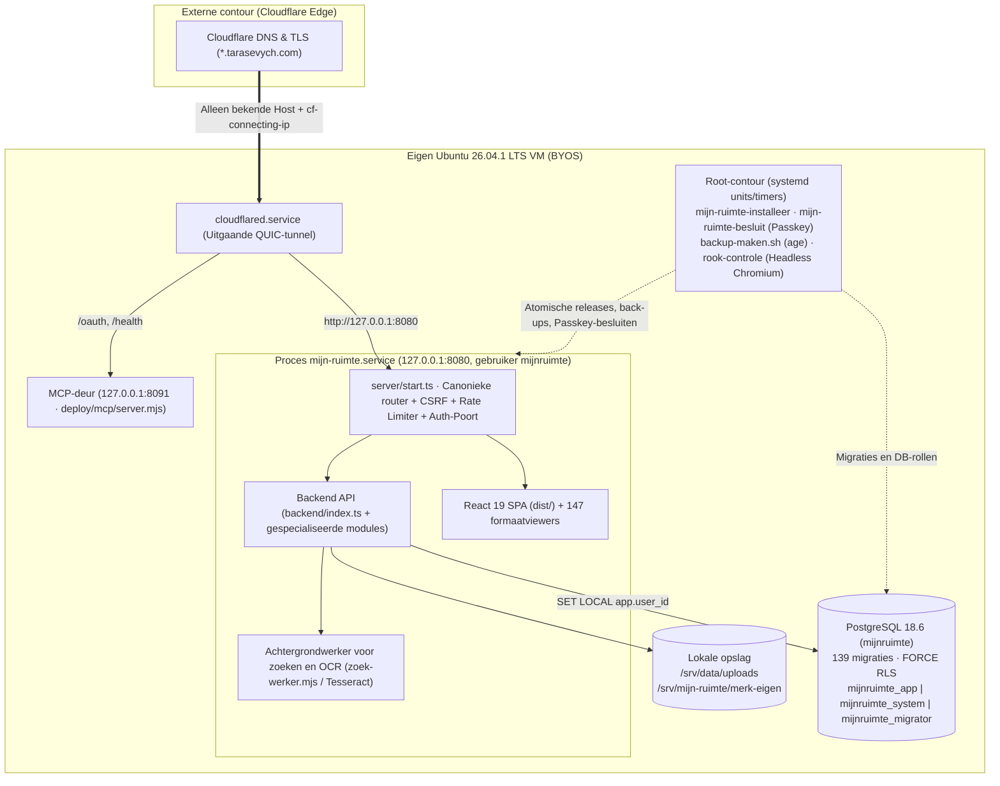

> 🌐 **Taal / Мова:** [🇺🇦 **Українська версія**](./ARCHITECTUUR.uk.md) · **🇳🇱 Nederlands** ([origineel](./ARCHITECTUUR.md)) · [🏠 Hoofdpagina (NL)](../../LEESMIJ.md) · [🏠 Головна (UK)](../../README.md) · [📚 Documentatie-index](../INDEX.nl.md)
> 🧭 **Hub-secties (`docs/hub/`):** **1. Architectuur** · [2. Geschiedenis](./GESCHIEDENIS.nl.md) · [3. Takken, PR's & Releases](./TAKKEN-EN-PRS.nl.md) · [4. Mapstructuur](./MAP-STRUCTUUR.nl.md) · [5. Omgevingsvariabelen](./OMGEVINGSVARIABELEN.nl.md) · [6. Orchestratie & Uitrol](./ORCHESTRATIE-EN-UITROL.nl.md)

# Architectuur van het platform «Mijn Ruimte · Мій простір»

**Mijn Ruimte (Мій простір)** is een zelfstandig, self-hosted platform voor persoonlijke en gedeelde digitale werkruimtes, gebouwd volgens het principe **BYOS (Bring Your Own Server)** en **Zero-Knowledge / strikte ruimte-isolatie**. Het platform verenigt het werkblad (de hub), een mailclient met ondersteuning voor 147 gespecialiseerde bijlageformaten, versleutelde cloudopslag, een agenda, slimme woningaansturing (Huis vNext), GitHub-integratie en een beheercentrum voor AI-agenten via het Model Context Protocol (MCP).

---

## 1. Architectuurpaspoort

| Parameter | Waarde |
|---|---|
| **Repository** | [`Tarasevych/hub`](https://github.com/Tarasevych/hub) |
| **Hoofd- en integratietakken** | [`voornaamst`](https://github.com/Tarasevych/hub/tree/voornaamst) ↔ [`integratie`](https://github.com/Tarasevych/hub/tree/integratie) |
| **Publiek toegangspunt** | [https://hub.tarasevych.com](https://hub.tarasevych.com) *(hoofddomein: `tarasevych.com`)* |
| **Architectuurmodel** | Self-hosted BYOS op een eigen Ubuntu 26.04.1 LTS VM achter een uitgaande Cloudflare Tunnel (`127.0.0.1:8080`), zonder externe cloudhosting |
| **Technologiestack** | TypeScript 5.7 · React 19 · Vite 6 · Tailwind CSS 3 · Node.js 26.13.0 LTS (`node:http` + `esbuild`) · PostgreSQL 18.6 (JSONB + relationele tabellen + `FORCE RLS`) · Systemd 259.9 · Caddy 2.11.7 · OPA 1.22.0 · `age` 1.3.2 |
| **Taalconventie** | Communicatie en rapporten in het **Oekraïens (`uk`)**; URL-/API-paden en modulenamen in de code in het **Nederlands (`nl`)**; gebruikersinterface **tweetalig (`uk` / `nl`)** |

---

## 2. De 11 subdomeinen van het ecosysteem (`*.tarasevych.com`)

Alle subdomeinen (vastgelegd in [`backend/deployment-identity.ts`](../../backend/deployment-identity.ts) en gerouteerd via [`deploy/cloudflared-config.yml`](../../deploy/cloudflared-config.yml)) worden bediend door één serverkern [`server/start.ts`](../../server/start.ts) op `127.0.0.1:8080` met een gedeelde beveiligde sessiecontour (`Domain=.tarasevych.com; Secure; HttpOnly; SameSite=Lax`):

| Subdomein | Dienst | Doel en belangrijkste mogelijkheden | Belangrijkste modules in de code |
|---|---|---|---|
| **[`hub.tarasevych.com`](https://hub.tarasevych.com)** | **Hub (`hub`)** | Hoofdwerkblad (**Werkblad v3**), widgets, snelle acties, borden, meldingen (**Meldingen v2/v3**), globaal **Menu v2** (dock rechts/boven/onder), globaal zoeken `/zoek`. | [`src/VerenigdDienstApp.tsx`](../../src/VerenigdDienstApp.tsx), [`backend/werkblad-v3.ts`](../../backend/werkblad-v3.ts), [`shared/menu-model.ts`](../../shared/menu-model.ts) |
| **[`mail.tarasevych.com`](https://mail.tarasevych.com)** | **Post (`mail`)** | **Adaptive Mail Canvas**: Gmail (OAuth + Pub/Sub), Outlook (Microsoft Graph), IMAP/SMTP (iCloud, Ukr.net, Yahoo, I.ua). Interactieve diensten-orbita, mobiele bladen, **147 gespecialiseerde bijlageviewers en -bewerkers** (CAD, DICOM/medisch, bio-informatica, financiën, muziek, archieven, databases, PDF/Office), threadcontext zonder AI en geverifieerde AI-vertaling/samenvatting met letterlijke citaten. | [`src/GoogleMailWerkruimte.tsx`](../../src/GoogleMailWerkruimte.tsx), [`src/mail/`](../../src/mail/), [`backend/mail-imap.ts`](../../backend/mail-imap.ts), [`backend/mail-microsoft.ts`](../../backend/mail-microsoft.ts) |
| **[`id.tarasevych.com`](https://id.tarasevych.com)** | **Identiteit (`id`)** | Centraal aanmeld- en beveiligingscentrum: Google OIDC (PKCE + nonce + `__Secure-tsv_aanmeld_binding`), wachtwoord + TOTP (`AES-256-GCM`) + herstelcodes, **WebAuthn Passkeys**, gasttoegangscodes (`/toegang`), Step-Up bevestiging voor gevoelige acties, wisselen tussen accounts en **12 profielsecties**. | [`src/ToegangslaagWeergave.tsx`](../../src/ToegangslaagWeergave.tsx), [`backend/toegangslaag.ts`](../../backend/toegangslaag.ts), [`backend/toegangssleutels.ts`](../../backend/toegangssleutels.ts), [`backend/stap-op.ts`](../../backend/stap-op.ts) |
| **[`cloud.tarasevych.com`](https://cloud.tarasevych.com)** | **Cloud (`cloud`)** | **Cloud vNext (M1–M11)**: bestandswerkruimtes, Google Drive-projectie, client-side zero-knowledge versleuteling (**M7 Privacy Architecture** op basis van WebAuthn PRF en herstelsleutel), universele bestandsviewer en fotodienst. | [`backend/cloud-platform.ts`](../../backend/cloud-platform.ts), [`backend/cloud-google-drive.ts`](../../backend/cloud-google-drive.ts), [`docs/CLOUD-M7-PRIVACY-ARCHITECTURE.nl.md`](../CLOUD-M7-PRIVACY-ARCHITECTURE.nl.md) |
| **[`ai.tarasevych.com`](https://ai.tarasevych.com)** | **AI-ruimte (`ai`)** | Werken met persoonlijke en technische AI-modellen, AI-agentenbord, fijnmazige rechten **«AI-toegang»** (scopes per hulpmiddel en gevoelige gegevens), centrale verbindingshub `/verbindingen`. | [`src/agenten/`](../../src/agenten/), [`backend/ai-beleid.ts`](../../backend/ai-beleid.ts), [`backend/connector-v2.ts`](../../backend/connector-v2.ts) |
| **[`mcp.tarasevych.com`](https://mcp.tarasevych.com)** | **MCP-poort (`mcp`)** | Eigen connectorpaden per agent (`/claude`, `/gpt`, `/grok`, `/gemini`, `/copilot`, `/cursor`), OAuth 2.0-metadata, koppeling van externe MCP-servers (`backend/mcp-klant/`), webpaneel **«Coördinatie»** (`/agents` → `TabOrch.tsx`) en de geïsoleerde deur op poort `8091`. | [`src/agenten/TabOrch.tsx`](../../src/agenten/TabOrch.tsx), [`backend/orch-routes.ts`](../../backend/orch-routes.ts), [`deploy/CONNECTOR-EEN-PAD.nl.md`](../../deploy/CONNECTOR-EEN-PAD.nl.md) |
| **[`github.tarasevych.com`](https://github.tarasevych.com)** | **GitHub (`github`)** | Koppeling met GitHub OAuth / GitHub App, overzicht van repositories, takken, Pull Requests, commits en releases, indexering van code en issues in `/zoek`. | [`shared/github-koppeling.ts`](../../shared/github-koppeling.ts), [`backend/uitrol-github.ts`](../../backend/uitrol-github.ts) |
| **[`huis.tarasevych.com`](https://huis.tarasevych.com)** | **Slimme woning (`huis`)** | **Huis vNext**: integratie met Home Assistant en lokale gateways, beheer van kamers, apparaten en automatiseringen, versleuteling van adaptertokens (`HUIS_ADAPTER_SLEUTEL_V1`), beveiliging van het beheersubnet. | [`shared/huis-model.ts`](../../shared/huis-model.ts), [`deploy/WIJZIGINGEN-20261028-HUIS-VNEXT.nl.md`](../../deploy/WIJZIGINGEN-20261028-HUIS-VNEXT.nl.md) |
| **[`api.tarasevych.com`](https://api.tarasevych.com)** | **API & Kluis (`api`)** | Beheer van machinetokens (`tsv_`), API-koppelingen, webhooks en de versleutelde **Sleutelkluis / Eigenaarskluis (Vault)**. | [`src/ApiPlatformWeergave.tsx`](../../src/ApiPlatformWeergave.tsx), [`backend/api-platform-kluis.ts`](../../backend/api-platform-kluis.ts), [`shared/sleutelkluis.ts`](../../shared/sleutelkluis.ts) |
| **[`admin.tarasevych.com`](https://admin.tarasevych.com)** | **Beheer (`admin`)** | **Technische ruimte**: beheer van gebruikers en rollen, beveiligingslogboek `app.audit` (append-only hashketen), status van RLS-isolatie, server- en renderdiagnostiek (`rook-controle`), **Koppelingswizard**, SSH-CA-beheer, browserterminal en het centrum **«Updates»** met cryptografische goedkeuring door de eigenaar via Passkey. | [`backend/server-beheer.ts`](../../backend/server-beheer.ts), [`backend/uitrol-goedkeuring.ts`](../../backend/uitrol-goedkeuring.ts), [`backend/eigenaar-besluit.ts`](../../backend/eigenaar-besluit.ts) |
| **[`dashboard.tarasevych.com`](https://dashboard.tarasevych.com)** | **Dashboard (`dashboard`)** | Statisch overzichtspaneel uit `/srv/mijn-ruimte/dashboard` (volledig gescheiden van sessies en API). | [`server/start.ts`](../../server/start.ts), [`deploy/LEESMIJ.nl.md`](../../deploy/LEESMIJ.nl.md) |

---

## 3. Schema van de server- en netwerkcontour

---

## 4. Routebepaling op `Host`, SSO, sessies en ruimte-isolatie

### 4.1. `Host`-validatie, canonieke paden en bescherming tegen header-spoofing
- De VM accepteert geen rechtstreekse inkomende HTTP/HTTPS-verbindingen vanaf het internet: al het verkeer komt binnen via de uitgaande `cloudflared`-tunnel op de lokale socket `127.0.0.1:8080`.
- De server [`server/start.ts`](../../server/start.ts) controleert de `Host`-header tegen de strikte allowlist van dienstdomeinen ([`backend/deployment-identity.ts`](../../backend/deployment-identity.ts)). Een onbekende `Host` wordt direct geweigerd met `421 Misdirected Request`.
- Alle door de client meegestuurde headers `x-forwarded-host`, `forwarded` en `x-real-ip` worden verwijderd; het werkelijke client-IP komt uitsluitend uit de geverifieerde Cloudflare-header `cf-connecting-ip`.
- De router [`server/platform/router.ts`](../../server/platform/router.ts) controleert vóór elke CSRF- of rate-limitcheck of het pad canoniek is: verzoeken met dubbele slashes (`/api//...`) of een afsluitende slash krijgen `404 PATH_NOT_CANONICAL`.

### 4.2. Sessiecontour, multi-account en Handoff
- **Ecosysteemsessie (`__Secure-tsv_ecosystem`):** cookie met `Domain=.tarasevych.com; Path=/; Secure; HttpOnly; SameSite=Lax`, waarmee één aanmelding (SSO) over alle subdomeinen werkt.
- **Tabbladsessies (Tab-overlays):** maken het mogelijk om in naast elkaar geopende browsertabbladen onder verschillende accounts of in verschillende ruimtes te werken zonder de rootcookie te overschrijven (`SameSite=Strict`).
- **Atomische Handoff (`backend/eigenaar-sessie-overdracht.ts`):** overdracht tussen diensten is gebonden aan de browsercookie `tsv_handoff_binding` (SHA-256) en wordt in PostgreSQL atomisch en eenmalig ingewisseld via `DELETE … RETURNING` met `FOR UPDATE SKIP LOCKED` (`db.takeOne`).
- **Step-Up herbevestiging (`backend/stap-op.ts`):** gevoelige acties (wachtwoord wijzigen, geheimen in de kluis onthullen, rollen beheren, account exporteren of verwijderen) vereisen een verse bevestiging (Passkey, TOTP of een recente Google OIDC-login met `auth_time < 5 min`), anders volgt `403 STEP_UP_REQUIRED`. Ondersteunt een gesynchroniseerd vertrouwensvenster van 12 uur («Niet opnieuw vragen»).

### 4.3. Scheiding tussen Persoonlijke en Technische ruimte en de Sleutelkluis
- Elke gebruiker en de eigenaar hebben een strikte scheiding tussen de **Persoonlijke ruimte** (`persoonlijk`: post, bestanden, agenda, notities) en de **Technische ruimte** (`technisch` / `admin`: serverbeheer, auditlog, updates, agentencoördinatie).
- **Sleutelkluis (migratie `0092`, [`shared/sleutelkluis.ts`](../../shared/sleutelkluis.ts)):** de gegevenssleutel (DEK) van een gebruiker wordt bij het aanmelden afgeleid en staat nooit onversleuteld op schijf. Voor MCP-verbindingen van AI-agenten worden cryptografische omslagen gemaakt met `HKDF(agent_token + SLEUTELKLUIS_SLEUTEL_V1)`.

---

## 5. Drie PostgreSQL-rollen, Row-Level Security (RLS) en Append-Only Audit

De PostgreSQL-database (`mijnruimte`, 139 migraties in [`migrations/`](../../migrations/)) is gesplitst in drie geïsoleerde rollen ([`server/platform/pg.ts`](../../server/platform/pg.ts), [`deploy/db-rollen-instellen.sh`](../../deploy/db-rollen-instellen.sh)):

| DB-rol | Omgevingsvariabele | Waar opgeslagen | Rechten en doel |
|---|---|---|---|
| `mijnruimte_migrator` | `DATABASE_URL_MIGRATIE` | `/etc/mijn-ruimte/migratie.env` (`0600 root:root`) | Eigenaar van schema `app`. Wordt **uitsluitend** geladen tijdens de migratiestap (`dist-server/migrate.mjs`) en is nooit zichtbaar voor het hoofdproces. |
| `mijnruimte_app` | `DATABASE_URL_APP` | `/etc/mijn-ruimte/geheimen.env` | Draait met `NOBYPASSRLS` onder `FORCE ROW LEVEL SECURITY`. Voert alle verzoeken van ingelogde gebruikers uit met transactiecontext `SET LOCAL app.user_id = '<id>'`. |
| `mijnruimte_system` | `DATABASE_URL_SYSTEM` | `/etc/mijn-ruimte/geheimen.env` | Draait met `BYPASSRLS` voor systeemtaken (sessiecontrole bij aanmelden, webhooks, cron-taken, back-ups), maar **mag geen** rijen wijzigen of wissen in `app.audit`, `app.rls_instellingen` of `app.schema_migrations`. |

- **Beveiligingsjournaal `app.audit` (migratie `0006` en `0008`):** elke rij bevat een cryptografische hashketen per account (`seq`, `prev_hash`, `hash`). Directe `INSERT`/`UPDATE`/`DELETE`/`TRUNCATE` is geblokkeerd door triggers en rechten; toevoegen kan uitsluitend via de `SECURITY DEFINER`-functie `app.audit_toevoegen` onder een `pg_advisory_xact_lock`. IP-adressen staan alleen opgeslagen als `HMAC-SHA256` met `AUDIT_IP_PEPPER`.

---

> 🔗 **Lees verder:** [2. Geschiedenis van het project](./GESCHIEDENIS.nl.md) · [3. Takken, PR's & Releases](./TAKKEN-EN-PRS.nl.md) · [4. Mapstructuur](./MAP-STRUCTUUR.nl.md) · [5. Omgevingsvariabelen](./OMGEVINGSVARIABELEN.nl.md) · [6. Orchestratie & Uitrol](./ORCHESTRATIE-EN-UITROL.nl.md)
