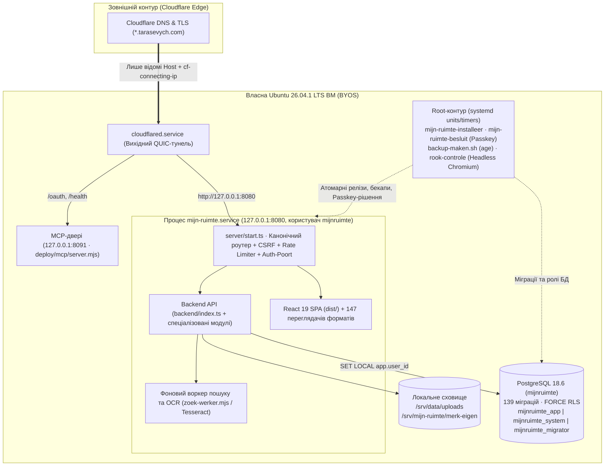

> 🌐 **Мова / Taal:** **🇺🇦 Українська** ([оригінал](./ARCHITECTUUR.md)) · [🇳🇱 **Nederlandse versie**](./ARCHITECTUUR.nl.md) · [🏠 Головна (UK)](../../README.md) · [🏠 Hoofdpagina (NL)](../../LEESMIJ.md) · [📚 Каталог статей](../INDEX.md)
> 🧭 **Розділи Хабу (`docs/hub/`):** **1. Архітектура** · [2. Історія](./GESCHIEDENIS.uk.md) · [3. Гілки, PR та Випуски](./TAKKEN-EN-PRS.uk.md) · [4. Структура коду](./MAP-STRUCTUUR.uk.md) · [5. Змінні оточення](./OMGEVINGSVARIABELEN.uk.md) · [6. Оркестрація та Розгортання](./ORCHESTRATIE-EN-UITROL.uk.md)

# Архітектура платформи «Мій простір · Mijn Ruimte»

**Мій простір (Mijn Ruimte)** — приватна самодостатня платформа персонального й командного цифрового робочого простору, побудована за принципом **BYOS (Bring Your Own Server)** та **Zero-Knowledge / суворої ізоляції просторів**. Платформа об'єднує робочий стіл (хаб), поштовий клієнт із підтримкою 147 спеціалізованих форматів вкладень, захищене хмарне сховище, календар (агенду), систему керування розумним домом, інтеграцію з GitHub та центр управління ШІ-агентами за протоколом MCP (Model Context Protocol).

---

## 1. Паспорт архітектури

| Параметр | Значення |
|---|---|
| **Репозиторій** | [`Tarasevych/hub`](https://github.com/Tarasevych/hub) |
| **Головна та інтеграційна гілки** | [`voornaamst`](https://github.com/Tarasevych/hub/tree/voornaamst) ↔ [`integratie`](https://github.com/Tarasevych/hub/tree/integratie) |
| **Публічна точка входу** | [https://hub.tarasevych.com](https://hub.tarasevych.com) *(основний домен: `tarasevych.com`)* |
| **Архітектурна модель** | Self-hosted BYOS на власній Ubuntu 26.04.1 LTS ВМ за вихідним Cloudflare Tunnel (`127.0.0.1:8080`), без сторонніх хмарних хостингів |
| **Технологічний стек** | TypeScript 5.7 · React 19 · Vite 6 · Tailwind CSS 3 · Node.js 26.13.0 LTS (`node:http` + `esbuild`) · PostgreSQL 18.6 (JSONB + реляційні таблиці + `FORCE RLS`) · Systemd 259.9 · Caddy 2.11.7 · OPA 1.22.0 · `age` 1.3.2 |
| **Мовна конвенція** | Документація та звіти — **українською (`uk`)**; шляхи URL/API та назви модулів у коді — **нідерландською (`nl`)**; інтерфейс користувача — **двомовний (`uk` / `nl`)** |

---

## 2. 11 сервісних піддоменів екосистеми (`*.tarasevych.com`)

Усі піддомени (визначені в [`backend/deployment-identity.ts`](../../backend/deployment-identity.ts) та маршрутизовані через [`deploy/cloudflared-config.yml`](../../deploy/cloudflared-config.yml)) обслуговуються єдиним серверним ядром [`server/start.ts`](../../server/start.ts) на `127.0.0.1:8080` зі спільним захищеним контуром сесій (`Domain=.tarasevych.com; Secure; HttpOnly; SameSite=Lax`):

| Піддомен | Служба | Призначення та ключові можливості | Основні модулі в коді |
|---|---|---|---|
| **[`hub.tarasevych.com`](https://hub.tarasevych.com)** | **Хаб (`hub`)** | Головне робоче полотно (**Werkblad v3**), віджети, швидкі дії, дошки, сповіщення (**Meldingen v2/v3**), глобальне **Меню v2** (док праворуч/угорі/унизу), глобальний пошук `/zoek`. | [`src/VerenigdDienstApp.tsx`](../../src/VerenigdDienstApp.tsx), [`backend/werkblad-v3.ts`](../../backend/werkblad-v3.ts), [`shared/menu-model.ts`](../../shared/menu-model.ts) |
| **[`mail.tarasevych.com`](https://mail.tarasevych.com)** | **Пошта (`mail`)** | **Adaptive Mail Canvas**: Gmail (OAuth + Pub/Sub), Outlook (Microsoft Graph), IMAP/SMTP (iCloud, Ukr.net, Yahoo, I.ua). Інтерактивна орбіта сервісів, мобільні шторки, **147 спеціалізованих переглядачів і редакторів вкладень** (CAD, DICOM/медичні, біоінформатика, фінанси, музика, архіви, бази даних, PDF/Office), контекст гілки без ШІ та верифікований ШІ-переклад/вижимка з дослівними цитатами. | [`src/GoogleMailWerkruimte.tsx`](../../src/GoogleMailWerkruimte.tsx), [`src/mail/`](../../src/mail/), [`backend/mail-imap.ts`](../../backend/mail-imap.ts), [`backend/mail-microsoft.ts`](../../backend/mail-microsoft.ts) |
| **[`id.tarasevych.com`](https://id.tarasevych.com)** | **Ідентичність (`id`)** | Єдиний центр входу та безпеки акаунтів: Google OIDC (PKCE + nonce + `__Secure-tsv_aanmeld_binding`), пароль + TOTP (`AES-256-GCM`) + коди відновлення, **WebAuthn Passkeys**, гостьові коди доступу (`/toegang`), Step-Up підтвердження чутливих дій, перемикання акаунтів та **12 розділів профілю**. | [`src/ToegangslaagWeergave.tsx`](../../src/ToegangslaagWeergave.tsx), [`backend/toegangslaag.ts`](../../backend/toegangslaag.ts), [`backend/toegangssleutels.ts`](../../backend/toegangssleutels.ts), [`backend/stap-op.ts`](../../backend/stap-op.ts) |
| **[`cloud.tarasevych.com`](https://cloud.tarasevych.com)** | **Хмара (`cloud`)** | **Cloud vNext (M1–M11)**: робочі простори файлів, Google Drive проекція, клієнтське zero-knowledge шифрування (**M7 Privacy Architecture** на базі WebAuthn PRF та ключа відновлення), універсальний переглядач файлів, фото-сервіс. | [`backend/cloud-platform.ts`](../../backend/cloud-platform.ts), [`backend/cloud-google-drive.ts`](../../backend/cloud-google-drive.ts), [`docs/CLOUD-M7-PRIVACY-ARCHITECTURE.uk.md`](../CLOUD-M7-PRIVACY-ARCHITECTURE.uk.md) |
| **[`ai.tarasevych.com`](https://ai.tarasevych.com)** | **ШІ-простір (`ai`)** | Робота з приватними та технічними ШІ-моделями, дошка ШІ-агентів, гранулярні дозволи **«Доступ ШІ»** (скоупи по інструментах і чутливих даних), єдиний хаб підключень `/verbindingen`. | [`src/agenten/`](../../src/agenten/), [`backend/ai-beleid.ts`](../../backend/ai-beleid.ts), [`backend/connector-v2.ts`](../../backend/connector-v2.ts) |
| **[`mcp.tarasevych.com`](https://mcp.tarasevych.com)** | **MCP-шлюз (`mcp`)** | Окремі конекторні адреси на кожного агента (`/claude`, `/gpt`, `/grok`, `/gemini`, `/copilot`, `/cursor`), OAuth 2.0 метадані, підключення зовнішніх MCP-серверів (`backend/mcp-klant/`), вебпанель **«Координація»** (`/agents` → `TabOrch.tsx`) та ізольовані двері порту `8091`. | [`src/agenten/TabOrch.tsx`](../../src/agenten/TabOrch.tsx), [`backend/orch-routes.ts`](../../backend/orch-routes.ts), [`deploy/CONNECTOR-EEN-PAD.uk.md`](../../deploy/CONNECTOR-EEN-PAD.uk.md) |
| **[`github.tarasevych.com`](https://github.tarasevych.com)** | **GitHub (`github`)** | Підключення GitHub OAuth / GitHub App, огляд репозиторіїв, гілок, Pull Requests, комітів і випусків, індексація коду та задач у глобальний пошук `/zoek`. | [`shared/github-koppeling.ts`](../../shared/github-koppeling.ts), [`backend/uitrol-github.ts`](../../backend/uitrol-github.ts) |
| **[`huis.tarasevych.com`](https://huis.tarasevych.com)** | **Розумний дім (`huis`)** | **Huis vNext**: інтеграція з Home Assistant та локальними шлюзами, управління кімнатами, пристроями й автоматизаціями, шифрування токенів адаптерів (`HUIS_ADAPTER_SLEUTEL_V1`), захист підмережі управління. | [`shared/huis-model.ts`](../../shared/huis-model.ts), [`deploy/WIJZIGINGEN-20261028-HUIS-VNEXT.uk.md`](../../deploy/WIJZIGINGEN-20261028-HUIS-VNEXT.uk.md) |
| **[`api.tarasevych.com`](https://api.tarasevych.com)** | **API та Сховище (`api`)** | Управління машинними токенами (`tsv_`), API-підключеннями, вебхуками та захищеним **Сховищем секретів власника (Sleutelkluis / Vault)**. | [`src/ApiPlatformWeergave.tsx`](../../src/ApiPlatformWeergave.tsx), [`backend/api-platform-kluis.ts`](../../backend/api-platform-kluis.ts), [`shared/sleutelkluis.ts`](../../shared/sleutelkluis.ts) |
| **[`admin.tarasevych.com`](https://admin.tarasevych.com)** | **Адмін (`admin`)** | **Технічний простір**: керування користувачами й ролями, журнал безпеки `app.audit` (append-only хеш-ланцюг), стан RLS-ізоляції, діагностика сервера й рендерингу (`rook-controle`), **Майстер підключень**, управління SSH-CA, термінал у браузері та центр **«Оновлення»** з криптографічним підтвердженням власника через Passkey. | [`backend/server-beheer.ts`](../../backend/server-beheer.ts), [`backend/uitrol-goedkeuring.ts`](../../backend/uitrol-goedkeuring.ts), [`backend/eigenaar-besluit.ts`](../../backend/eigenaar-besluit.ts) |
| **[`dashboard.tarasevych.com`](https://dashboard.tarasevych.com)** | **Дашборд (`dashboard`)** | Статична панель огляду з `/srv/mijn-ruimte/dashboard` (повністю відокремлена від сесій та API). | [`server/start.ts`](../../server/start.ts), [`deploy/LEESMIJ.uk.md`](../../deploy/LEESMIJ.uk.md) |

---

## 3. Схема серверного та мережевого контуру

---

## 4. Маршрутизація за `Host`, SSO, сесії та ізоляція просторів

### 4.1. Перевірка `Host`, канонічність шляхів та захист від підробки заголовків
- ВМ не приймає вхідних HTTP/HTTPS-з'єднань з інтернету напряму: весь трафік надходить через вихідний тунель `cloudflared` на локальний сокет `127.0.0.1:8080`.
- Сервер [`server/start.ts`](../../server/start.ts) перевіряє заголовок `Host` за суворим білим списком дозволених сервісних доменів ([`backend/deployment-identity.ts`](../../backend/deployment-identity.ts)). Невідомий `Host` негайно відхиляється зі статусом `421 Misdirected Request`.
- Будь-які клієнтські заголовки `x-forwarded-host`, `forwarded`, `x-real-ip` примусово очищуються; справжня IP-адреса клієнта береться виключно з перевіреного заголовка Cloudflare `cf-connecting-ip`.
- Маршрутизатор [`server/platform/router.ts`](../../server/platform/router.ts) перевіряє канонічність шляху перед будь-якими перевірками CSRF/Rate Limit: запити з подвійними слешами (`/api//...`) або зайвим кінцевим слешем отримують `404 PATH_NOT_CANONICAL`.

### 4.2. Контур сесій, багатоакаунтність та Handoff
- **Екосистемна сесія (`__Secure-tsv_ecosystem`):** кука з атрибутами `Domain=.tarasevych.com; Path=/; Secure; HttpOnly; SameSite=Lax`, що забезпечує єдиний вхід (SSO) між усіма сервісними піддоменами.
- **Сесії вкладок (Tab-overlays):** дозволяють одночасно працювати під різними обліковими записами або в різних просторах у сусідніх вкладках браузера без перезапису кореневої куки (`SameSite=Strict`).
- **Атомарний Handoff (`backend/eigenaar-sessie-overdracht.ts`):** перехід між службами захищений браузерною кукою прив'язки `tsv_handoff_binding` (SHA-256) та атомарним одноразовим вилученням у PostgreSQL через `DELETE … RETURNING` із `FOR UPDATE SKIP LOCKED` (`db.takeOne`).
- **Step-Up підтвердження (`backend/stap-op.ts`):** чутливі дії (зміна пароля, розкриття секретів у сховищі, керування ролями, експорт або видалення акаунта) вимагають свіжого підтвердження (Passkey, TOTP або повторний Google OIDC із `auth_time < 5 хв`), інакше повертають `403 STEP_UP_REQUIRED`. Підтримується синхронізоване 12-годинне вікно довіри («Не питати знову»).

### 4.3. Розділення Приватного й Технічного просторів та Sleutelkluis (Сховище ключів)
- Кожен користувач і власник мають чітке розділення між **Приватним простором** (`persoonlijk`: пошта, файли, календар, нотатки) та **Технічним простором** (`technisch` / `admin`: адміністрування сервера, журнал аудиту, оновлення, координація агентів).
- **Sleutelkluis (міграція `0092`, [`shared/sleutelkluis.ts`](../../shared/sleutelkluis.ts)):** ключ шифрування даних користувача (DEK) виводиться під час входу й ніколи не зберігається на диску у відкритому вигляді. Для роботи MCP-агентів створюються криптографічні конверти `HKDF(токен_агента + SLEUTELKLUIS_SLEUTEL_V1)`.

---

## 5. Три ролі PostgreSQL, Row-Level Security (RLS) та Append-Only Аудит

База даних PostgreSQL (`mijnruimte`, 139 міграцій у [`migrations/`](../../migrations/)) розділена на три ізольовані ролі ([`server/platform/pg.ts`](../../server/platform/pg.ts), [`deploy/db-rollen-instellen.sh`](../../deploy/db-rollen-instellen.sh)):

| Роль БД | Змінна оточення | Де зберігається | Привілеї та призначення |
|---|---|---|---|
| `mijnruimte_migrator` | `DATABASE_URL_MIGRATIE` | `/etc/mijn-ruimte/migratie.env` (`0600 root:root`) | Власник схеми `app`. Використовується **лише** під час виконання міграцій (`dist-server/migrate.mjs`), недоступний для основного процесу сервера. |
| `mijnruimte_app` | `DATABASE_URL_APP` | `/etc/mijn-ruimte/geheimen.env` | Працює в режимі `NOBYPASSRLS` під `FORCE ROW LEVEL SECURITY`. Виконує всі запити авторизованих користувачів із прив'язкою контексту транзакції `SET LOCAL app.user_id = '<id>'`. |
| `mijnruimte_system` | `DATABASE_URL_SYSTEM` | `/etc/mijn-ruimte/geheimen.env` | Працює з `BYPASSRLS` для системних операцій (перевірка сесій при вході, вебхуки, фонові cron-задачі, бекапи), але **не має права** змінювати або видаляти записи в `app.audit`, `app.rls_instellingen` чи `app.schema_migrations`. |

- **Журнал безпеки `app.audit` (міграція `0006` та `0008`):** кожен запис містить криптографічний хеш-ланцюг на акаунт (`seq`, `prev_hash`, `hash`). Прямий `INSERT`/`UPDATE`/`DELETE`/`TRUNCATE` заблоковано тригерами та правами; додавання записів можливе виключно через `SECURITY DEFINER`-функцію `app.audit_toevoegen` під `pg_advisory_xact_lock`. IP-адреси зберігаються лише як `HMAC-SHA256` з `AUDIT_IP_PEPPER`.

---

> 🔗 **Читати далі:** [2. Історія розвитку проєкту](./GESCHIEDENIS.uk.md) · [3. Гілки, PR та Випуски](./TAKKEN-EN-PRS.uk.md) · [4. Структура коду](./MAP-STRUCTUUR.uk.md) · [5. Змінні оточення](./OMGEVINGSVARIABELEN.uk.md) · [6. Оркестрація та Розгортання](./ORCHESTRATIE-EN-UITROL.uk.md)
