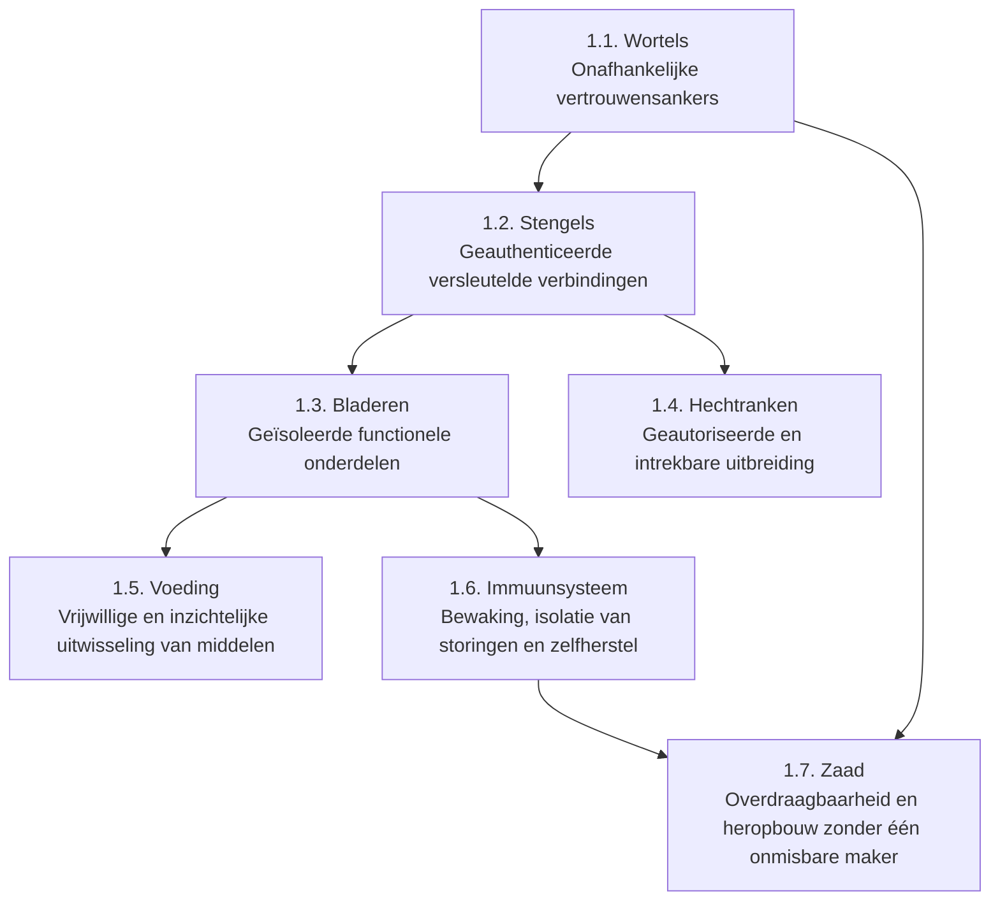

> 🌐 **Taal / Мова:** [Українська](АРХІТЕКТУРНИЙ-МАНІФЕСТ-ПЛЮЩ.uk.md) · **Nederlands** | [Hoofdpagina](../../LEESMIJ.md) · [Documentatie-index](../INDEX.nl.md)
> 🧭 **Onderdelen van de Hub (`docs/hub/`):** **0. Architectuurmanifest «Klimop»** · [1. Architectuur](./ARCHITECTUUR.nl.md) · [2. Geschiedenis](./GESCHIEDENIS.nl.md) · [3. Takken, samenvoegverzoeken en uitgaven](./TAKKEN-EN-SAMENVOEGVERZOEKEN.nl.md) · [4. Mapstructuur](./MAP-STRUCTUUR.nl.md) · [5. Omgevingsvariabelen](./OMGEVINGSVARIABELEN.nl.md) · [6. Coördinatie en uitrol](./ORCHESTRATIE-EN-UITROL.nl.md)

# HOOFDARCHITECTUURMANIFEST: «MIJN RUIMTE» — LEVEND DIGITAAL ECOSYSTEEM «KLIMOP»

- **Initiatief- en besluitcode:** `KLIMOP-001` · `B-024` (`regelsVersie 1.5.0`, 20-11-2026)
- **Doel:** volledige technische opdracht voor de heropbouw van de architectuur, beveiliging, gegevensopslag, samenwerking tussen diensten, besturing en verdere ontwikkeling van het platform «Mijn Ruimte» (*Мій простір*).
- **Object:** de volledige projectomgeving, broncode, servers, gebruikersapparaten, subdomeinen, gegevensbanken, gekoppelde diensten, AI-agenten, beveiligingsmiddelen en mechanismen voor het installeren van updates.
- **Status:** **doelarchitectuurconcept**. **Geen toestemming voor onmiddellijke wijziging van de productie-infrastructuur.** De eerste stap is de afgestemde bijwerking van alle hoofdbestanden die het plan, de beschrijving en de regels voor alle integraties van AI-agenten vastleggen ([`AGENTS.md`](../../AGENTS.md), [`AGENTENREGELS.nl.md`](../../AGENTENREGELS.nl.md), [`orchestratie/beleid.json`](../../orchestratie/beleid.json), de adapters van alle 14 agenten, de vaardigheden in [`.agents/skills/`](../../.agents/skills/) en de kerndocumentatie).
- **Hoofdopdracht:** het huidige gecentraliseerde platform omvormen tot een gedistribueerd, zelfherstellend en cryptografisch beveiligd ecosysteem met onafhankelijke knopen, verifieerbare verbindingen, gescheiden bevoegdheden en het vermogen om zonder voortdurende tussenkomst van de oorspronkelijke maker te blijven werken.

> [!IMPORTANT]
> **Bevoegdheidsgrens voor alle integraties van AI-agenten:** dit manifest legt de verplichte doelrichting, architecturale waarborgen (§42–§43) en werkvolgorde (§45) vast, maar **geeft geen enkel recht om eigenmachtig draaiende servers uit te schakelen, de productieomgeving te wijzigen, de gegevensbank te herschrijven of de geldende uitrolprocedure en bevestiging door de eigenaar te omzeilen**. Elk vervolgwerk begint uitsluitend met **Fase 0 (volledige audit)** en verloopt via kleine, toetsbare stappen.

---

## DEEL I. FILOSOFIE EN ARCHITECTURALE GRONDSLAGEN

### 1. Het beginsel van de digitale klimop

Klimop bestaat niet dankzij één enkele tak, één enkel blad of één enkele steun. Hij groeit uit, vormt talrijke verbindingen, past zich aan obstakels aan, wortelt waar dat mogelijk is en behoudt de levensvatbaarheid van afzonderlijke delen na het verlies van sommige verbindingen.

Juist deze eigenschap vormt het fundament van de nieuwe architectuur.

De digitale klimop mag echter geen onbeheerst netwerk zijn, maar een geheel van onafhankelijke, beveiligde en vrijwillig verbonden onderdelen.

Zeven structurele elementen worden vastgesteld:

#### 1.1. Wortels — onafhankelijke vertrouwensankers

De wortels bestaan uit cryptografische verklaringen, vertrouwde apparaten, onafhankelijke herstelwijzen, verifieerbare regels en gespreide bronnen van beschikbaarheid.

Geen enkel afzonderlijk wortelelement mag onbeperkt gezag over het gehele ecosysteem verlenen.

#### 1.2. Stengels — beveiligde verbindingen

De stengels zijn geauthenticeerde, versleutelde overdrachtskanalen tussen apparaten, knopen en diensten.

Zij moeten alternatieve routes hebben, de echtheid van beide zijden controleren en beschadigde trajecten kunnen afkoppelen.

#### 1.3. Bladeren — functionele onderdelen

Elk apparaat of elke dienst vervult een vastgestelde rol: opslag, rekenwerk, verbinding, synchronisatie, controle, herstel of wisselwerking met andere systemen.

Het verlies van één blad mag nooit het gehele netwerk stilleggen.

#### 1.4. Hechtranken — beheerste uitbreiding

Nieuwe knopen vinden beschikbare verbindingen, bouwen wederzijds vertrouwen op en treden toe tot het ecosysteem overeenkomstig de verleende bevoegdheden.

Eigenmachtige installatie van programmatuur, verborgen gebruik van apparaten of ongecontroleerde gegevensoverdracht zijn strikt verboden.

#### 1.5. Voeding — uitwisseling van middelen

De middelen van het ecosysteem zijn rekenkracht, beschikbaarheid van knopen, opslagruimte, netwerkverbinding en vrijwillige deelname van mensen.

De verdeling van belasting moet eerlijk, spaarzaam en inzichtelijk zijn.

#### 1.6. Immuunsysteem — beveiliging en zelfherstel

Het systeem spoort gevaarlijke wijzigingen op, isoleert aangetaste onderdelen, herstelt verloren kopieën en begrenst de verspreiding van ondeugdelijke updates.

De beschermingsmechanismen zelf moeten eveneens verifieerbaar zijn.

#### 1.7. Zaad — overdraagbaarheid en voortbestaan

Het ecosysteem moet opnieuw kunnen worden opgebouwd uit onafhankelijk bewaarde, gecontroleerde onderdelen.

Het verlies van de hoofdserver of het wegvallen van de maker mag het herstel van het netwerk door andere gemachtigde deelnemers niet onmogelijk maken.

---

### 2. Hoofdregel

Geen enkele afzonderlijke deelnemer, apparaat, server, sleutel, beheerder, aanbieder of AI-agent mag alleenheerschappij of onbeperkte macht over het gehele ecosysteem bezitten.

Deze regel geldt voor:

- opslag en ontsleuteling van gegevens;
- verlening en intrekking van toestemmingen;
- installatie van updates;
- wijziging van bestuursregels;
- toegangsherstel;
- routering van kritieke handelingen;
- verwijdering en verplaatsing van gegevens;
- koppeling van externe diensten;
- aansturing van AI-agenten;
- herstel na noodsituaties.

Tegelijk mag alleenheerschappij niet worden vervangen door onbeheerste macht van een toevallige meerderheid van knopen.

De rechten van de eigenaar van persoonlijke gegevens, de bevoegdheden van een knoopbeheerder en het recht om de regels van het gedeelde netwerk te wijzigen moeten strikt gescheiden zijn.

---

## DEEL II. HEROPBOUW VAN HET HUIDIGE PROJECT

### 3. Uitgangsinfrastructuur

Het object van de heropbouw is het huidige «Mijn Ruimte» met de opslagplaats [`Tarasevych/hub`](https://github.com/Tarasevych/hub).

Het bestaande systeem gebruikt een eigen serveromgeving, PostgreSQL, serverdiensten, een webinterface, aanmeldmiddelen, subdomeinen, cryptografische voorzieningen, koppelingen met externe aanbieders en coördinatie van AI-agenten.

Behoud de functionaliteit van de diensten:

- de centrale werkruimte;
- elektronische post;
- accounts en identiteit;
- wolkopslag;
- agenda en afspraken;
- AI-ruimte;
- poort voor het Model Context Protocol;
- ontwikkelhulpmiddelen;
- slim huis;
- programmatische verbinders;
- beheer en diagnostiek.

De volledige lijst en de feitelijke staat van elke dienst moeten via een audit van de huidige broncode en productieomgeving worden vastgesteld.

#### 3.1. Wat moet veranderen

Overgaan van het model:

> Één hoofdserver → gedeelde serverkern → centrale gegevensbank → alle diensten.

Naar het model:

> Onafhankelijke knopen ↔ beveiligd netwerk ↔ verdeelde opslag ↔ geïsoleerde diensten ↔ onafhankelijk bestuur.

#### 3.2. Wat behouden moet blijven

Niets verliezen van:

- persoonlijke gegevens;
- bestaande functies;
- gebruikersinstellingen;
- wijzigingsgeschiedenis;
- geldende isolatieregels;
- uitgave-archieven;
- herstelmiddelen;
- beveiligingslogboeken;
- compatibiliteit met gekoppelde diensten;
- de goedgekeurde werkwijze van AI-agenten.

#### 3.3. Aanvangscontrole

Stel vóór het ontwerpen van de nieuwe architectuur de feitelijke staat vast van serverafhankelijkheden, geheimen, versleutelingswijzen, gegevensbankmigraties, bestandsopslag en beheerdersbevoegdheden.

Besteed bijzondere aandacht aan de M7-privacyarchitectuur van de privéopslag, toegangssleutels, de huidige uitrolprocedure en de regels voor agentcoördinatie.

Beschouw een mogelijkheid nooit als ingevoerd louter omdat het bijbehorende codeonderdeel in de opslagplaats aanwezig is.

---

## DEEL III. BEVEILIGD NETWERK «KLIMOP»

### 4. Meerknoopsarchitectuur

Vorm één logisch netwerk dat draait op onafhankelijke fysieke apparaten en servers.

Voorzie daarin vier soorten deelnemers:

#### 4.1. Vaste onafhankelijke knopen

Vervullen taken waarvoor doorlopende beschikbaarheid vereist is.

Kunnen instaan voor:

- bewaring van versleutelde kopieën;
- doorgifte van berichten;
- opbouw van netwerkverbindingen;
- beschikbaarheid van gedeelde gegevens;
- statuscontrole;
- herstel van beschadigde delen.

Plaats hen in onafhankelijke omgevingen met uiteenlopende uitvalrisico's.

#### 4.2. Persoonlijke knopen

Computers, smartphones, tablets en andere vertrouwde apparaten van gebruikers.

Ondersteunen lokaal werken, versleuteling, synchronisatie, opslag van eigen gegevens en toegestane vormen van deelname aan het netwerk.

#### 4.3. Gespecialiseerde knopen

Verzorgen specifieke taken: cryptografische bevestigingen, rekenwerk, koppeling met aanbieders, opslag of controle van uitgaven.

Elke knoop heeft strikt begrensde bevoegdheden.

#### 4.4. Overgangsknopen

Helpen nieuwe deelnemers om tot het netwerk toe te treden.

Zij mogen nooit de enige manier zijn om andere knopen te vinden.

Na uitbreiding van het netwerk kan hun rol worden verkleind, maar zij mogen niet worden uitgeschakeld zonder voorafgaande controle van onafhankelijke toegangswegen.

---

### 5. Herstelbare verbindingen

Bouw een mechanisme waarbij elke knoop meerdere toegestane wegen kent om een benodigde dienst te bereiken.

Elke verbinding moet gegevens bevatten over:

- de echtheid van de andere knoop;
- toegestane handelingen;
- geldigheidsduur van het vertrouwen;
- cryptografische kanaalbeveiliging;
- mogelijkheid tot intrekking;
- netwerkbeschikbaarheid;
- belastingsgrenzen;
- herstelvolgorde na verbindingsverlies.

Wanneer één route onbereikbaar wordt, moet het systeem een andere geschikte route kiezen zonder beveiligingsregels te omzeilen.

Het is verboden een naburige knoop automatisch te vertrouwen louter vanwege netwerknabijheid.

#### 5.1. Bescherming van het netwerk zelf

Voorzie verweer tegen:

- knoopvervalsing;
- massale aanmaak van schijndeelnemers;
- onderschepping van overdracht;
- herhaling van oude berichten;
- opzettelijke routevervorming;
- dienstweigering door overbelasting;
- overbelasting van zwakke apparaten;
- verspreiding van ongeldige beschikbaarheidsgegevens;
- gedwongen omleiding van al het verkeer langs knopen van een aanvaller.

Onderzoek beveiligde knoop-tot-knoop-protocollen, waaronder `libp2p`, met inbegrip van hun beperkingen.

#### 5.2. Bescherming tegen gevaarlijke woekering

De klimoparchitectuur mag zich nooit gedragen als een computerworm.

Verbied:

- eigenmachtige installatie op apparaten;
- kopiëren van privé-inhoud zonder toestemming;
- ongeoorloofd gebruik van rekenmiddelen;
- onbegrensde vermenigvuldiging van kopieën;
- automatische uitbreiding van rechten via nieuwe verbindingen.

Elke toetreding moet geautoriseerd, begrensd en intrekbaar zijn.

---

## DEEL IV. DIEPE GEGEVENSBEVEILIGING

### 6. Meerlaagse versleuteling

Pas onafhankelijke beschermingslagen toe:

- **Laag 1 — apparaat.** Lokale beveiligde aanmaak en aanwending van sleutels.
- **Laag 2 — gegevens.** Afzonderlijke versleuteling van bestanden, berichten en andere privéobjecten.
- **Laag 3 — overdracht.** Geauthenticeerde beveiligde kanalen tussen knopen.
- **Laag 4 — opslag.** Plaatsing van versleutelde delen op onafhankelijke dragers.
- **Laag 5 — bevoegdheid.** Onafhankelijke controle van het recht om gegevens te ontsleutelen, te wijzigen of door te geven.
- **Laag 6 — herstel.** Beveiligde wijzen om toegang terug te krijgen na verlies van apparaten.
- **Laag 7 — bestuur.** Drempelbevestigingen voor wijzigingen in kritieke regels.

Gebruik bewezen methoden voor geauthenticeerde versleuteling, zoals `AES-256-GCM` of `ChaCha20-Poly1305`, passend bij de eigenschappen van de omgeving.

Controleer afzonderlijk de uniciteit van eenmalige waarden, de herkomst van toevalsgetallen, sleutelscheiding per gebruiksdoel en de koppeling van cijfertekst aan eigenaar en versie.

---

### 7. Geheimsplitsing van Shamir

Pas drempelsplitsing uitsluitend toe voor geheimen waar dat werkelijk noodzakelijk is.

Voorzie een instelbaar schema met een minimumaantal delen voor herstel.

Bepaal de drempel op basis van:

- het aantal onafhankelijke deelnemers;
- de beschikbaarheid van apparaten;
- het risico op samenspanning;
- het risico op gelijktijdig verlies;
- de noodherstelprocedure.

Gebruik niet dezelfde groep deelnemers voor alle geheimen van het ecosysteem.

---

### 8. Verifieerbare geheimsplitsing

Onderzoek de schema's van Feldman en Pedersen.

Zij moeten het mogelijk maken de juistheid van uitgegeven delen te verifiëren zonder het geheim zelf prijs te geven.

Behandel afzonderlijk de bescherming tegen:

- een oneerlijke uitdeler van delen;
- vervalsing van delen;
- tegenstrijdige uitdeling;
- verborgen verwisseling;
- gebruik van verouderde delen.

Houd rekening met de verschillen tussen verifieerbaarheid en informatieverberging in concrete cryptografische schema's.

---

### 9. Proactieve vernieuwing van delen

Bouw een mechanisme voor periodieke vernieuwing van verspreide delen zonder het geheim zelf te wijzigen, voor zover het gekozen protocol dat ondersteunt.

Leg daarvoor vast:

- cryptografische tijdvakken;
- vernieuwingsregels;
- beveiligde afstemming;
- controle van de uitkomst;
- afhandeling van onbereikbare knopen;
- buitenwerkingstelling van oude delen;
- herstel na een onderbroken vernieuwingsronde.

Het doel is te voorkomen dat een aanvaller gedurende lange tijd gestolen delen kan verzamelen.

Vernieuwing beschermt niet tegen een aanvaller die binnen één enkel tijdvak reeds voldoende geldige delen heeft bemachtigd.

---

### 10. Meerpartijenberekening en drempelhandtekeningen

Onderzoek voor geschikte handelingen het gebruik van cryptografische meerpartijenberekening en digitale drempelhandtekeningen.

Het doel is de volledige privésleutel tijdens het aanmaken of zetten van een handtekening nooit op één plaats samen te brengen.

Bestudeer het FROST-protocol voor compatibele Schnorr-handtekeningen en beproefde methoden voor gedistribueerde sleutelaanmaak.

Gebruik drempelondertekening in de eerste plaats voor:

- bevestiging van kritieke wijzigingen;
- beheer van uitgavehandtekeningen;
- afgebakende beheerhandelingen;
- beschermd gebruik van geselecteerde systeemsleutels.

Beschouw een drempelhandtekening nooit als een universele methode voor gegevensversleuteling.

---

### 11. Verdeelde opslag

Combineer versleuteling met herstelcodes voor verloren fragmenten (*erasure coding*).

Versleutelde gegevens kunnen in fragmenten worden opgedeeld en over onafhankelijke knopen worden verspreid.

Het systeem moet bijhouden of er voldoende bereikbare fragmenten zijn voor volledig herstel.

Voorzie:

- integriteitscontrole van elk fragment;
- toezicht op feitelijke beschikbaarheid;
- wederopbouw van verloren delen;
- plaatsing in onafhankelijke omgevingen;
- bescherming tegen gelijktijdig verlies van meerdere knopen;
- veilige beëindiging van opslag;
- rechtmatige gegevensverwijdering;
- begrenzing van bewaartermijnen van kopieën.

Gebruik het schema van Shamir niet als hoofdmethode voor het opdelen van grote bestanden zonder sluitende technische onderbouwing.

---

### 12. Bescherming van verbindingsgegevens

Versleuteling van de inhoud alleen volstaat niet.

Het moet eveneens worden begrensd hoeveel zichtbaar wordt over:

- wie met wie communiceert;
- wanneer een verbinding plaatsvindt;
- welke diensten worden gebruikt;
- welke knopen informatie bewaren;
- waar verzoeken vandaan komen;
- hoe vaak een gebruiker een bepaalde dienst aanspreekt.

Onderzoek:

- minimalisatie van metagegevens;
- beperking van de zichtbaarheid van netwerkadressen;
- scheiding van persoonlijke en netwerkidentiteit;
- minimalisatie van logboeken;
- beveiligde groepscommunicatie;
- bescherming tegen routeanalyse.

Beoordeel voor eigen groepsberichten het beveiligingsprotocol voor groepsberichten uit standaard 9420 (*RFC 9420*).

Beloof nooit anonimiteit waar die technisch niet wordt waargemaakt.

---

### 13. Cryptografische wendbaarheid

De architectuur moet toelaten cryptografische algoritmen te vervangen zonder gegevensverlies of vervanging van het gehele ecosysteem.

Voorzie:

- versiebeheer van cryptografische indelingen;
- onderhandeling over ondersteunde algoritmen;
- verbod op onveilige afzwakking van het beschermingsniveau;
- geleidelijke sleutelvernieuwing;
- compatibiliteitscontrole tussen knopen;
- voorbereiding op gestandaardiseerde postkwantumcryptografie waar die noodzakelijk is.

Beschouw niet alle onderdelen als kwantumbestendig enkel omdat het schema van Shamir informatietheoretische veiligheid bezit.

---

## DEEL V. BESCHERMING VAN DE MENS

### 14. Onafhankelijkheid van geheugen en lichamelijke toestand

Het systeem mag niet afhangen van het vermogen van één persoon om alle wachtwoorden te onthouden, fysiek aanwezig te zijn of voortdurend beslissingen te nemen.

Ontwikkel afzonderlijke procedures voor:

- verlies van een apparaat;
- verlies van aanmeldgegevens;
- langdurige onbereikbaarheid;
- ernstige ziekte;
- geheugenuitval;
- overlijden van de eigenaar;
- fysieke dwang;
- psychologische druk;
- overname van beheerbevoegdheden.

Herstelprocedures moeten onafhankelijke bevestigingen, vastgestelde wachttijden en bescherming tegen misbruik door een aanvaller bevatten.

---

### 15. Dwang en verborgen noodsignalen

Onderzoek een facultatieve beschermingsstand voor gebruikers onder dwang.

Mogelijke middelen:

- een bijzondere noodbevestiging;
- stille beperking van kritieke bevoegdheden;
- tijdelijke vertraging van risicovolle handelingen;
- waarschuwing van vooraf aangewezen vertrouwenspersonen;
- gescheiden kluizen met uiteenlopende rechten;
- voorzieningen voor geloofwaardige ontkenning.

Voer afzonderlijk een risicobeoordeling uit voor fysiek geweld.

Beweer nooit dat verborgen kluizen of noodcodes een aanvaller gegarandeerd tegenhouden.

Sta nooit toe dat persoonlijke gegevens automatisch worden vernietigd enkel op verdenking van dwang.

---

### 16. Contextuele gevaarbeoordeling

Maak het mogelijk het risico van een handeling te beoordelen aan de hand van technische signalen:

- plotselinge wisseling van apparaat;
- ongebruikelijke poging tot rechtenuitbreiding;
- aanmelding vanuit een nieuwe omgeving;
- afwijkende reeksen handelingen;
- massale gegevensextractie;
- gelijktijdige pogingen om sleutels te vervangen;
- verdachte wijzigingen van herstelregels.

Gebruik biometrische of fysiologische gegevens uitsluitend na afzonderlijke toestemming en met heldere onderbouwing.

Trek nooit automatische conclusies over dwang, geestelijke gesteldheid of middelengebruik op basis van louter gedragssignalen.

De uitkomst van een beoordeling mag een aanvullende controle of tijdelijke begrenzing van een kritieke actie zijn, maar nooit willekeurige ontzegging van toegang tot eigen gegevens.

---

### 17. Protocol bij langdurige afwezigheid

Voorzie een vooraf overeengekomen reactiemechanisme wanneer de eigenaar langdurig onbereikbaar is.

Het moet onderscheid maken tussen:

- gewone afwezigheid;
- tijdelijk verbindingsverlies;
- verlies van een apparaat;
- bevestigde noodsituatie;
- langdurige wilsonbekwaamheid;
- noodzaak van wettelijke erfopvolging.

Enkel het feit van afwezigheid mag nooit automatisch privégegevens blootgeven of alle beheerrechten overdragen.

Kritiek herstel is uitsluitend mogelijk via een vooraf vastgelegde procedure met onafhankelijke controles en bezwaartermijnen.

---

## DEEL VI. BESCHERMING TEGEN EIGENAAR, BEHEERDER EN AUTEUR

### 18. Afwezigheid van verborgen onbeperkt gezag

Na behoorlijke goedkeuring van het nieuwe model mag de eigenaar van een fysieke server niet zelfstandig in staat zijn om:

- andermans privégegevens te ontsleutelen;
- een vertrouwde toepassing stilletjes te vervangen;
- de regels van het cryptografisch bestuur eenzijdig te wijzigen;
- een gevaarlijke update aan alle knopen op te leggen;
- alle onafhankelijke kopieën te wissen;
- de instemming van andere deelnemers te vervalsen;
- de vastgestelde herstelprocedure te omzeilen.

Voorzie hiervoor:

- onafhankelijke vertrouwensankers;
- scheiding van bevoegdheden;
- drempelgoedkeuring;
- ondertekening van uitgaven;
- verifieerbare geschiedenis van kritieke besluiten;
- onafhankelijke knopen;
- cryptografische controle van wijzigingen;
- uitgestelde inwerkingtreding voor bijzonder ingrijpende besluiten.

Sta geen eenzijdige omzeiling toe via een technisch account of verborgen sleutel.

Tegelijk behoudt de eigenaar van een afzonderlijke fysieke server altijd het recht de werking van zijn eigen apparatuur te beëindigen. De zelfstandigheid van het ecosysteem moet voortkomen uit het bestaan van andere knopen, niet uit het ontnemen van zeggenschap over eigen apparaten.

---

### 19. Gedeeld bestuur

Stel zeven onafhankelijke categorieën bevoegdheden vast:

1. Gebruikersrechten over eigen gegevens.
2. Beheer van persoonlijke apparaten.
3. Operationeel beheer van een specifieke knoop.
4. Onderhoud van de programmatuur.
5. Cryptografische bevestiging van kritieke wijzigingen.
6. Noodherstel.
7. Wijziging van de regels van het gehele ecosysteem.

Bepaal voor elke categorie een eigen wijze van bevestiging, intrekking en controle.

Kies het drempelmodel in verhouding tot het risico van de desbetreffende handeling.

Draag kritieke bevoegdheden nooit over aan willekeurige knopen op basis van enkel stemmenaantal.

Bescherm het bestuur tegen samenspanning, vervanging van deelnemers, massale aanmaak van schijnidentiteiten en kaping van de herstelprocedure.

---

### 20. Tijdsgrenzen

Voer voor aangewezen kritieke handelingen verplichte wachttijden in.

Voorbeelden zijn:

- vervanging van vertrouwde wortelsleutels;
- wijziging van fundamentele bestuursregels;
- overdracht van systeembrede bevoegdheden;
- bijzonder risicovolle vormen van herstel.

Onderzoek cryptografische verifieerbare vertragingsfuncties en onafhankelijke tijdsgrenzen.

Veronderstel niet dat een wiskundig tijdsmechanisme op zichzelf beschermt tegen wijziging van de regels waarmee het wordt toegepast.

Gewoon dagelijks gebruik van post, bestanden en agenda mag niet van langdurige wachttijden afhangen.

---

## DEEL VII. IMMUUNSYSTEEM VAN DE «KLIMOP»

### 21. Doorlopende statusbewaking

Bouw een onafhankelijk waarnemingsmechanisme voor de gezondheid van het ecosysteem.

Het moet toezien op:

- de toestand van knopen;
- beschikbaarheid van versleutelde delen;
- integriteit van programmatuur;
- echtheid van verbindingen;
- stand van cryptografische tijdvakken;
- aantal onafhankelijke kopieën;
- netwerkvertragingen;
- overbelasting;
- bereikbaarheid van herstelwegen;
- gevaarlijke rechtenwijzigingen;
- staat van beproevingen en updates.

Waarnemingsgegevens mogen nooit privé-inhoud van gebruikers onthullen.

---

### 22. Zelfherstel

Bij een vastgestelde storing moet het systeem automatisch kunnen:

- een onbereikbare knoop omzeilen;
- toegestane versleutelde fragmenten opnieuw opbouwen;
- de overdrachtsroute verleggen;
- het gebruik van een beschadigde kopie staken;
- een ondeugdelijk onderdeel inperken;
- een compatibele dienst herstellen;
- de uitrol van een onveilige versie opschorten.

Elke automatische ingreep moet binnen vooraf goedgekeurde regels blijven.

Zelfherstel mag zichzelf nooit nieuwe bevoegdheden toekennen of cryptografische verboden doorbreken.

---

### 23. Veilige beproevingsnetwerken

Richt onafhankelijke omgevingen in voor het toetsen van nieuwe versies.

Volgorde van doorstroming:

> Ontwikkeling → controles → geïsoleerd netwerk → onafhankelijke beoordeling → gefaseerde verspreiding → hoofdnetwerk.

Beproef:

- fouten in broncode;
- verbindingsverlies;
- gelijktijdige uitval van knopen;
- schaarste aan middelen;
- vervalste berichten;
- beschadiging van opgeslagen fragmenten;
- onverenigbaarheid van versies;
- gevaarlijke rechtenwijzigingen;
- herstel na compromittering.

---

### 24. Automatische stopzetting van gevaarlijke uitgaven

Nieuwe versies moeten geleidelijk worden verspreid.

Zodra een schending van vastgestelde gezondheids- of veiligheidswaarden wordt gemeten, moet verdere verspreiding onmiddellijk stoppen.

Keer veilig terug naar de vorige versie waar gegevensindeling en systeemstaat dat toelaten.

Voorzie voor onomkeerbare wijzigingen vooraf een afzonderlijke herstelprocedure.

Meet succes nooit uitsluitend aan het percentage apparaten waarop het programma opstart.

Controleer eveneens de gegevensintegriteit, de juistheid van rechten en het uitblijven van geheimlekken.

---

### 25. Verifieerbaarheid van programmatuur

Kritieke onderdelen moeten ondersteunen:

- onafhankelijke codecontrole;
- reproduceerbare opbouw;
- herkomstverklaringen;
- afhankelijkheidscontrole;
- cryptografische handtekeningen;
- bescherming tegen vervalsing van uitgaven;
- bescherming tegen onveilig terugzetten van verouderde versies;
- verifieerbare besluitgeschiedenis.

Onderzoek een model voor veilige updates met rolscheiding bij ondertekening, drempelhandtekeningen en versheidscontrole van uitgavegegevens.

Bescherm in het bijzonder de webclient: versleuteling in de browser waarborgt geen geheimhouding als een server ongemerkt de uitgevoerde code kan vervangen.

Voorzie voor een hoger vertrouwensniveau een onafhankelijk verifieerbare, ondertekende toepassing.

---

## DEEL VIII. MIDDELENECONOMIE

### 26. Vrijwillige bijdrage van apparaten

Elke gebruiker bepaalt zelf of zijn apparaat andere deelnemers mag ondersteunen.

Voorzie:

- werking uitsluitend tijdens opladen;
- toestemming enkel voor gekozen netwerken;
- bovengrens voor geheugengebruik;
- begrenzing van overgedragen gegevens;
- begrenzing van processorbelasting;
- pauzering bij lage acculading;
- mogelijkheid tot onmiddellijke stopzetting van deelname;
- veilige uittreding van het apparaat uit het netwerk.

Stel standaardwaarden vast op grond van metingen op uiteenlopende apparaten.

Beloof geen gelijk verbruik van middelen op alle telefoons.

---

### 27. Eerlijke wederzijdse uitwisseling

Onderzoek een mechanisme voor wederzijdse terbeschikkingstelling van middelen.

Dit kan rekening houden met:

- de hoeveelheid beschikbaar gestelde opslagruimte;
- de duur van beschikbaarheid;
- daadwerkelijk doorgegeven versleutelde gegevens;
- betrouwbaarheid van de knoop;
- uitgevoerde gecontroleerde handelingen;
- onderhoudslasten voor het netwerk.

Maak toegang tot eigen gegevens nooit afhankelijk van een beloning voor geleverde middelen.

Houd rekening met deelnemers die geen voortdurend actieve apparaten kunnen aanhouden.

Het netwerk moet bruikbaar blijven zonder dwang om rekenkracht af te staan.

---

## DEEL IX. ÉÉN UNIFORME DIGITALE RUIMTE

### 28. Universele wisselwerking tussen diensten

Het hoofddoel van «Mijn Ruimte» is uiteenlopende digitale diensten samen te brengen in één begrijpelijke omgeving zonder verlies van persoonlijke levenssfeer.

Het systeem moet samenwerking ondersteunen tussen:

- berichten;
- post;
- bestanden;
- agenda's;
- persoonlijke notities;
- zoeken;
- financiële diensten;
- slim huis;
- externe toepassingen;
- AI-agenten;
- samenwerkingsomgevingen.

Elke dienst moet een geïsoleerd onderdeel met eigen toestemmingen zijn.

Één gezamenlijke interface betekent nooit gedeelde onbeperkte toegang tot alle gegevens.

---

### 29. Verbinders met het reguliere internet

Ontwikkel beveiligde verbinders voor diensten die zelf geen gedistribueerde architectuur ondersteunen.

Een verbinder moet:

- werken via een officieel ondersteunde koppelingswijze;
- uitsluitend minimaal benodigde rechten vragen;
- zijn eigen aanmeldgegevens isoleren;
- de geldigheidsduur van toegang begrenzen;
- intrekking ondersteunen;
- antwoorden van de aanbieder valideren;
- een logboek van toegestane handelingen bijhouden;
- geen rechten aan andere diensten doorgeven zonder instemming.

Stel een externe dienst nooit voor als volledig privé of gedecentraliseerd wanneer haar eigen architectuur dat niet waarmaakt.

---

### 30. Samenhangende identiteit

Ontwerp een gemeenschappelijke wijze om persoonlijke identiteiten en toestemmingen te beheren zonder één enkele almachtige sleutel te scheppen.

Het koppelen van verschillende diensten moet begrensde verklaringen en rechten gebruiken.

Bij compromittering van één verbinder moeten alle overige diensten hun eigen vertrouwensgrenzen behouden.

---

### 31. Beveiligd gezamenlijk zoeken

Onderzoek verenigd zoeken over alle toegestane bronnen.

Voorzie strikte scheiding tussen:

- openbare gegevens;
- dienstmetagegevens;
- versleuteld privémateriaal;
- gegevens van externe aanbieders.

Geef voor privé-inhoud de voorkeur aan zoeken op een vertrouwd apparaat.

Deel nooit ontsleutelde zoekindexen, brieven of documenten met het algemene netwerk enkel voor zoekgemak.

---

## DEEL X. AI-AGENTEN EN EVOLUTIE VAN HET ECOSYSTEEM

### 32. Onafhankelijke maar afgestemde agenten

Behoud het bestaande coördinatiemodel voor agenten en breid het uit voor de meerknoopsarchitectuur.

Elke agent moet beschikken over:

- een eigen rol;
- een onafhankelijke identiteit;
- begrensde bevoegdheden;
- een lijst toegestane hulpmiddelen;
- een logboek van feitelijk uitgevoerde acties;
- koppeling aan de geldende regelversie;
- verplichte controles;
- een vastgelegde wijze van resultaatoverdracht.

Sta nooit toe dat één enkele agent zelfstandig een kritieke wijziging ontwerpt, goedkeurt én installeert.

---

### 33. Gespecialiseerde ontwikkelrichtingen

Voorzie afzonderlijke verantwoordelijkheid voor zestien richtingen:

1. Algemene architectuur.
2. Knoop-tot-knoop-verbindingen.
3. Cryptografie.
4. Verdeelde opslag.
5. Identiteit.
6. Herstel.
7. Bescherming van de mens.
8. Stelsel van gedeeld bestuur.
9. Verbinders met externe diensten.
10. Zelfherstel.
11. Uitgavebeveiliging.
12. Beveiligingstoetsing.
13. Snelheid en middelenverbruik.
14. Persoonlijke levenssfeer en gegevensbescherming.
15. Compatibiliteit en migratie.
16. Documentatie en beheerondersteuning.

Agenten moeten elkaars resultaten kruiselings controleren en wijzigingen afstemmen via de geldende coördinatieketen.

---

### 34. Autonome ontwikkeling zonder onbegrensde autonomie

Agenten mogen zelfstandig:

- fouten opsporen;
- nieuwe technologieën onderzoeken;
- voorstellen opstellen;
- beproevingen uitvoeren;
- herstelwijzigingen voorbereiden;
- architectuurverbeteringen aandragen.

Zij mogen echter nooit zelfstandig algemene cryptografische regels wijzigen, geheimen prijsgeven, hun eigen rechten verruimen of installatieprocedures omzeilen.

Automatisering van ontwikkeling mag nooit neerkomen op automatische goedkeuring van gevaarlijke handelingen.

---

## DEEL XI. MIGRATIE ZONDER GEGEVENSVERLIES

### 35. Geleidelijke ombouw

Bouw het nieuwe systeem nooit door het oude in één klap te verwijderen.

Voer de overgang uit in kleine, onafhankelijke uitgaven.

Behoud tijdens elke fase de mogelijkheid om:

- het resultaat te verifiëren;
- met het bestaande systeem te vergelijken;
- gegevensverlies te ontdekken;
- de migratie stil te zetten;
- terug te keren naar de vorige werkende versie;
- de juistheid van rechten te toetsen.

Blijf de bestaande PostgreSQL gebruiken totdat een onafhankelijk mechanisme voor de betrokken gegevens is gebouwd én bewezen.

Verspreid uitsluitend soorten toestand waarvoor synchronisatie- en conflictoplossingsregels formeel zijn vastgelegd.

---

### 36. Ontwikkelvolgorde (Fasen 0–12)

- **Fase 0 — audit.** Onderzoek volledig de huidige architectuur, afhankelijkheden, cryptografie, gegevensbanken, diensten, agentregels en uitgaven. *Resultaat:* geverifieerde toestandsschets en risicolijst.
- **Fase 1 — architectuurkern.** Stel de specificatie op van knopen, identiteiten, beveiligde verbindingen, rechten en herstelwijzen. *Resultaat:* goedgekeurde doelarchitectuur.
- **Fase 2 — beproevingsnetwerk.** Zet meerdere onafhankelijke knopen op met kunstmatige proefgegevens. *Resultaat:* bewezen beveiligde verbinding en onafhankelijkheid van één enkele knoop.
- **Fase 3 — versleuteling en opslag.** Voer clientversleuteling, spreiding van versleutelde fragmenten en verifieerbaar herstel in. *Resultaat:* bestanden herstellen betrouwbaar na vastgestelde storingen.
- **Fase 4 — gespreide sleutels.** Voer verifieerbare splitsing, drempelbewerkingen en proactieve vernieuwing van delen in waar dat nodig is. *Resultaat:* bewezen levenscyclus van kritieke sleutels.
- **Fase 5 — onafhankelijke identiteit.** Bouw apparaatbevestiging, begrensde rechten en herstelprocedures. *Resultaat:* geen enkel universeel account waarvan compromittering het gehele ecosysteem blootlegt.
- **Fase 6 — verdeeld bestuur.** Voer onafhankelijke goedkeuring van kritieke wijzigingen en bescherming tegen eenzijdige overname in. *Resultaat:* getoetste bestuursregels.
- **Fase 7 — zelfherstel.** Voer statusbewaking, fragmentheropbouw, alternatieve routering en gefaseerde veilige uitgaven in. *Resultaat:* vastgestelde storingen worden automatisch verholpen.
- **Fase 8 — overzetten van diensten.** Zet interne diensten stap voor stap over naar het nieuwe fundament met behoud van de vertrouwde interface en koppelingen. *Resultaat:* de gebruiker werkt met één ecosysteem zonder verplichte afhankelijkheid van de aanvangsserver voor gemigreerde functies.
- **Fase 9 — bescherming tegen dwang.** Voer beproefde vormen van vertraagde kritieke handelingen, onafhankelijk herstel en facultatieve noodsignalen in. *Resultaat:* gedefinieerde dreigingen van fysieke dwang geven een aanvaller geen alleenheerschappij.
- **Fase 10 — bredere uitrol.** Sluit geleidelijk onafhankelijke knopen en vrijwillige deelnemers aan. *Resultaat:* bewezen meerknoopsbeschikbaarheid, middelenbeheersing en gegevensbescherming.
- **Fase 11 — onafhankelijke audit.** Betrek onafhankelijke toetsing van cryptografie, netwerk, bestuur, persoonlijke levenssfeer en herstel. *Resultaat:* gedocumenteerde bewezen waarborgen en restrisico's.
- **Fase 12 — doorlopende ontwikkeling.** Richt voortdurend dreigingsonderzoek, cryptografisch onderhoud, architectuurtoetsing en weerbaarheidsverbetering in. *Resultaat:* het systeem kan zich ontwikkelen zonder constante betrokkenheid van de oorspronkelijke auteur.

---

## DEEL XII. VERPLICHTE BEPROEVINGSSCENARIO'S

### 37. Overlevingsproeven

Toets verplicht:

1. Uitschakeling van de hoofdserver.
2. Verlies van één onafhankelijke knoop.
3. Gelijktijdig verlies van meerdere knopen binnen het vastgestelde uitvalmodel.
4. Netwerksplitsing.
5. Uitval van een verbindingsaanbieder.
6. Onbereikbaarheid van aanvankelijke toetredingsknopen.
7. Beschadiging van versleutelde fragmenten.
8. Tekort aan onafhankelijke kopieën.
9. Wegvallen van de eigenaar uit het bestuursproces.
10. Verlies van gebruikersapparaten.

Meet bij elk geval de beschikbaarheid, herstelduur, gegevensverlies en juistheid van rechten.

---

### 38. Cryptografische proeven

Beproef:

- diefstal van afzonderlijke delen;
- vervalsing van delen;
- opeenhoping van verouderde delen;
- afgebroken vernieuwing;
- knoopvervalsing;
- hergebruik van oude berichten;
- manipulatie van ondertekende gegevens;
- poging om de drempel te omzeilen;
- poging om een nieuwe sleutel voor een oude te laten doorgaan;
- wegvallen van een deel van de gemachtigde deelnemers.

Toets afzonderlijk de getrouwheid van de implementatie en de overeenstemming met het gekozen protocol.

---

### 39. Proeven voor mensbescherming

Toets uitsluitend in veilige nabootscenario's:

- diefstal van een apparaat;
- gedwongen afgifte van één reeks aanmeldgegevens;
- langdurige onbereikbaarheid van de eigenaar;
- vals alarm van een noodsignaal;
- verlies van alle persoonlijke apparaten;
- rechtmatig herstel;
- poging tot onrechtmatige erfopvolging;
- poging tot kaping van de herstelprocedure.

Voer nooit proeven uit die werkelijk gevaar voor een mens opleveren.

---

### 40. Autonomieproeven

Bewijs dat vastgestelde kernfuncties behouden blijven wanneer:

- de hoofdserver niet draait;
- de oorspronkelijke auteur onbereikbaar is;
- één beheerder gecompromitteerd is;
- één dienst uitvalt;
- één updatekanaal wordt overgenomen;
- meerdere knopen op verschillende programmaversies draaien.

Bewijs autonomie met praktische beproevingen, niet met het loutere aantal knopen.

---

## DEEL XIII. MEETBARE WAARBORGEN

### 41. Vast te stellen kengetallen

Stel vóór ingebruikname in productie afzonderlijke eisen vast voor elke kritieke dienst.

Verplichte kengetallen:

- maximaal toegestane hersteltijd;
- maximaal toegestaan verlies van recente wijzigingen;
- minimumaantal onafhankelijke beschikbare kopieën;
- compromitteringsdrempel voor elke kritieke handeling;
- toelaatbaar aandeel onbereikbare knopen;
- maximale belasting van een gebruikersapparaat;
- uiterste termijn voor intrekking van rechten;
- detectietijd van een onveilige uitgave;
- tijd tot stopzetting van haar verspreiding;
- herstelduur na sleutelverlies;
- controlefrequentie van reservekopieën;
- toegestane afwijkingen tijdens netwerksplitsing.

Elk kengetal moet een meetmethode en onafhankelijke verificatie hebben.

Stel geen willekeurige getalsmatige beloften vast zonder beproeving.

---

## DEEL XIV. NIEUWE REGELS VOOR ALLE AGENTEN

### 42. Verplichte architectuurcontrole bij elke wijziging

Vóór het aanmaken of wijzigen van een programmaonderdeel moet elke agent vijftien vragen beantwoorden:

1. Ontstaat er een nieuw enkel uitvalpunt?
2. Worden verborgen bevoegdheden uitgebreid?
3. Blijft rechtmatig herstel beschikbaar?
4. Zijn gegevens beschermd op het apparaat, tijdens overdracht én in opslag?
5. Worden onnodige metagegevens blootgegeven?
6. Kunnen aangemaakte rechten worden ingetrokken?
7. Wordt de compatibiliteit tussen knopen geschaad?
8. Blijft het mogelijk een defect onderdeel te isoleren?
9. Verslechtert de bescherming van de mens?
10. Blijft de wijziging verifieerbaar?
11. Bestaat er een veilige terugkeerweg?
12. Neemt de afhankelijkheid van de oorspronkelijke auteur toe?
13. Worden middelen van gebruikers verbruikt zonder hun instemming?
14. Worden rechten van gegevenseigenaren geschonden?
15. Ontstaat er een nieuw gevaar voor het gehele netwerk via één enkele verbinder?

Schendt een wijziging de kernwaarborgen, dan moet zij vóór invoering worden herzien.

---

### 43. Verboden vereenvoudigingen

Het is verboden om:

- het systeem volstrekt onkwetsbaar te noemen;
- meerdere kopieën op één enkele server als onafhankelijke knopen te tellen;
- geheimsplitsing te verwarren met bestandsopdeling;
- gewone serverversleuteling gelijk te stellen aan nulkennis-geheimhouding;
- een drempelhandtekening als universele versleuteling te beschouwen;
- knopen te vertrouwen enkel omdat zij deelnemen;
- rechten automatisch aan een toevallige meerderheid toe te kennen;
- hardware-isolatie als absolute bescherming te beschouwen;
- toegang automatisch te herstellen zonder behoorlijke bevestigingen;
- apparaten van gebruikers heimelijk te benutten;
- bestaande servers uit te schakelen vóórdat onafhankelijke alternatieven werken;
- beproefde protocollen te vervangen door eigen ongetoetste algoritmen;
- beproevingen geslaagd te verklaren zonder bewijs;
- kritieke updates te installeren zonder behoorlijke goedkeuring.

---

## DEEL XV. DOCUMENTATIE EN EERSTE OPLEVERINGEN

### 44. Verplichte documenten

Bereid vijfentwintig documenten voor (tweetalig in het Oekraïens en Nederlands):

1. Volledige audit van het huidige «Mijn Ruimte».
2. Architectuurschema «Klimop».
3. Knoop- en verbindingsmodel.
4. Dreigingsmodel.
5. Vertrouwensmodel.
6. Cryptografische regels.
7. Schema voor verdeelde opslag.
8. Identiteitsmodel.
9. Procedure voor toegangsherstel.
10. Model voor bescherming van de mens.
11. Regeling voor verdeeld bestuur.
12. Specificatie van zelfherstel.
13. Regels voor veilige uitgaven.
14. Regels voor deelname van gebruikersapparaten.
15. Middelen- en waarderingsmodel.
16. Specificatie van externe verbinders.
17. Migratieplan voor de gegevensbank.
18. Migratieplan voor elke bestaande dienst.
19. Overzicht van technische afhankelijkheden.
20. Beproevingsprogramma.
21. Register van onopgeloste risico's.
22. Plan voor onafhankelijke toetsing.
23. Gefaseerd uitgaveplan.
24. Herziene regels voor AI-agenten.
25. Plan voor verdere ontwikkeling.

---

### 45. Eerste stappen van agenten

Start het werk strikt in deze volgorde:

1. **Eerst — audit.** Onderzoek het feitelijke project, zijn opslagplaatsen, dienstafhankelijkheden, beveiligingsmiddelen en de huidige installatiewijze.
2. **Daarna — doelarchitectuur.** Teken het schema «Klimop» met scherp afgebakende knopen, vertrouwensgrenzen en verbindingen.
3. **Vervolgens — technologievergelijking.** Kies voor elk onderdeel bewezen oplossingen met uitleg van voordelen, beperkingen en compatibiliteit.
4. **Daarna — uitgaveplan.** Verdeel de ombouw in onafhankelijke taken met toetsbare opleveringen.
5. **Pas daarna — uitvoering.** Begin met geïsoleerde beproevingen zonder de productieomgeving zonder goedkeuring aan te raken.

Alle handelingen moeten voldoen aan de geldende coördinatie- en uitrolregels van «Mijn Ruimte» zolang het nieuwe bestuursmodel niet formeel is bekrachtigd.

---

## DEEL XVI. EINDVISIE

### 46. Hoe het ecosysteem eruit moet zien

In de voltooide doelarchitectuur geldt:

- Elk mens is onafhankelijk eigenaar van zijn digitale gegevens en toestemmingen.
- Elk vertrouwd apparaat kan een deel van de toegestane netwerkfuncties vervullen zonder onbeperkte macht.
- Elke knoop heeft een begrensde rol, een bevestigde identiteit en middelen voor onafhankelijke controle.
- Elke dienst draait in een geïsoleerde omgeving en werkt uitsluitend met geldige toestemmingen samen met andere diensten.
- Elke kritieke sleutel heeft vastgelegde voorwaarden voor aanmaak, gebruik, vernieuwing, intrekking en herstel.
- Elk gewichtig besluit heeft een verifieerbare herkomst en een sluitende goedkeuringsgang.
- Elke kritieke verbinding heeft vastgelegde alternatieven of eerlijk gedocumenteerde onbeschikbaarheidsvoorwaarden.
- Elke update wordt vóór verspreiding getoetst en kan de vertrouwensankers nooit ongemerkt wijzigen.
- Elke vastgestelde storing wekt een begrensde, verifieerbare reactie op in plaats van ongecontroleerde wijzigingen door het hele netwerk.
- Elke gebruiker kan zijn deelname beëindigen, toegang intrekken en zijn rechten over eigen informatie uitoefenen.
- Elke AI-agent draagt bij aan de vooruitgang, maar bezit geen onbeperkte macht over het ecosysteem.
- Elke toekomstige ontwikkelaar kan het werk voortzetten op basis van open regels, documentatie en onafhankelijk verifieerbare programmatuur.

---

## SLOTRICHTLIJN VOOR DE ARCHITECTUUR

Wij bouwen «Mijn Ruimte» als een levend, gedistribueerd digitaal ecosysteem naar het beginsel van de klimop.

Zijn kracht mag niet berusten op één onneembare server, één geheime sleutel, één persoon of één uitzonderlijk ingewikkeld algoritme.

Zij moet voortkomen uit het samenspel van onafhankelijke beveiligde knopen, verifieerbare verbindingen, gespreide cryptografische bevoegdheden, geïsoleerde diensten, vrijwillige deelname van apparaten, veilig herstel en een open bestuursstelsel.

- Klimop kan uitgroeien, maar elke nieuwe verbinding moet veilig zijn.
- Klimop kan het verlies van afzonderlijke takken overleven, maar moet genoeg onafhankelijke wortels hebben voor herstel.
- Klimop kan zichzelf in stand houden, maar mag nooit andermans apparaten, gegevens of middelen zonder toestemming opslokken.
- Klimop kan veranderen, maar mag tijdens zijn groei nooit zijn eigen vertrouwensgrondslagen aantasten.

Het hoofddoel is niet een onsterfelijk of volstrekt onkwetsbaar systeem te beloven, maar een ecosysteem te bouwen met maximaal onderbouwde veerkracht, beschermde persoonlijke levenssfeer, onafhankelijk herstel, beheerste ontwikkeling en de mogelijkheid om voort te bestaan zonder één enkele onvervangbare maker.

**Doorlopende eis voor alle agenten:** elke nieuwe functie, elk beschermingsmechanisme, elke wijziging en elke uitgave moet «Mijn Ruimte» veiliger, onafhankelijker, beter herstelbaar én tegelijk praktisch bruikbaar maken.
