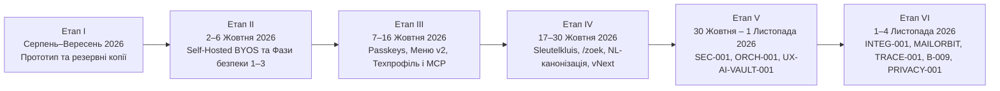

> 🌐 **Мова / Taal:** [🇺🇦 **Українська версія**](./GESCHIEDENIS.uk.md) · [🇳🇱 **Nederlandse versie**](./GESCHIEDENIS.nl.md) · [🏠 Головна (UK)](../../README.md) · [🏠 Hoofdpagina (NL)](../../LEESMIJ.md) · [📚 Каталог статей / Index](../INDEX.md)
> 🧭 **Розділи Хабу (`docs/hub/`):** [1. Архітектура](./ARCHITECTUUR.uk.md) · **2. Історія** · [3. Гілки, PR та Випуски](./TAKKEN-EN-PRS.uk.md) · [4. Структура коду](./MAP-STRUCTUUR.uk.md) · [5. Змінні середовища](./OMGEVINGSVARIABELEN.uk.md) · [6. Оркестрація та Розгортання](./ORCHESTRATIE-EN-UITROL.uk.md)

# Хронологічна історія розвитку проєкту «Мій простір · Mijn Ruimte»

Цей документ описує повну хронологію розвитку платформи **Mijn Ruimte (`Tarasevych/hub`)** у шести послідовних етапах: від першого прототипу та відмови від зовнішніх хмарних платформ (Render / AppDeploy) до криптографічної ізоляції даних, схвалення оновлень через WebAuthn Passkeys, нідерландської канонізації 531 модуля, консолідації головної гілки `voornaamst`, мультиагентної оркестрації `ORCH-001`, трасування `TRACE-001`, інфраструктурного оновлення `B-009` та стандарту приватності `PRIVACY-001`.

---

## Огляд хронології за етапами

---

## Етап I. Зародження, переїзд із хмарних PaaS (Render / AppDeploy) та перша точка відліку (Серпень — Вересень 2026)

- **Старт розробки (29.08.2026):** проєкт зародився як єдина екосистема цифрового робочого простору **«Мій простір / Tarasevych Hub»**. На ранніх ітераціях використовувалися зовнішні хмарні PaaS-середовища (зокрема Render та AppDeploy із `APP_ID = migrated-bg2v4h`).
- **Перший архівний знімок у GitHub (24.09.2026):** у гілці [`Mijn-ruimte-reservekopieën`](https://github.com/Tarasevych/hub/tree/Mijn-ruimte-reservekopie%C3%ABn) (`1f377ca`) зафіксовано першу публічну точку відліку репозиторію `Tarasevych/hub`.
- **Усвідомлення потреби у повному суверенітеті (BYOS):** залежність від сторонніх хмарних рантаймів, пропрієтарних SDK та крос-доменних кук не відповідала вимогам безпеки та Zero-Knowledge ізоляції, що призвело до ухвалення рішення про повний переїзд на власну інфраструктуру.

---

## Етап II. Портування на Self-Hosted BYOS та Безпекова Реформа Фаз 1–3 (2–6 Жовтня 2026)

- **План портування ([`PORTEERPLAN.uk.md`](../../PORTEERPLAN.uk.md) / [`PORTEERPLAN.md`](../../PORTEERPLAN.md), 03.10.2026):** повна відмова від `@appdeploy/sdk` (28 серверних файлів) та `@appdeploy/client` (33 клієнтські файли) і перенесення всієї платформи на власну віртуальну машину Ubuntu LTS за вихідним тунелем Cloudflare (`cloudflared` → `127.0.0.1:8080`).
- **Власне платформне ядро (`@platform/server` та `@platform/client`):**
  - Реалізовано сумісний шар бази даних [`server/platform/db.ts`](../../server/platform/db.ts) поверх PostgreSQL (`app.records` із GIN-індексами JSONB, keyset-пагінацією за `seq` та атомарними операціями `takeOne`, `takeArrayValue`, `zetAlsHoger`).
  - Реалізовано локальне файлове сховище [`server/platform/opslag.ts`](../../server/platform/opslag.ts) (`/srv/data/uploads`), білий список секретів [`server/platform/geheimen.ts`](../../server/platform/geheimen.ts) (`/etc/mijn-ruimte/geheimen.env`), канонічний HTTP-сервер [`server/start.ts`](../../server/start.ts) та зашифровані резервні копії через `age` (гілки [`basis-voor-zelf-hosten`](https://github.com/Tarasevych/hub/tree/basis-voor-zelf-hosten), [`zelf-hosten`](https://github.com/Tarasevych/hub/tree/zelf-hosten), [`sync-actief`](https://github.com/Tarasevych/hub/tree/sync-actief)).
- **Безпекова реформа (Фази A, B, Auth Fase 1, Beveiliging Fase 2–3, Audit Fixes — див. [`SECURITY-NOTES.uk.md`](../../SECURITY-NOTES.uk.md)):**
  - **Фази A та B (02–03.10.2026):** повна ротація всіх ключів шифрування, впровадження суворого Rate Limiting та прогресивного блокування (`app.rate_limits`, `app.login_lockouts`), білого списку `Origin` для захисту від CSRF, випадкового PKCE (`oauth_pkce_v1`), шифрування TOTP (`AES-256-GCM`), SSRF-захисту з DNS-pinning (`backend/veilige-fetch.ts`) та санітизації пошти через DOMPurify.
  - **Auth Fase 1 ([`auth-fase-1`](https://github.com/Tarasevych/hub/tree/auth-fase-1), 03.10.2026):** видалення всіх застарілих маршрутів сесій (`410 Gone`, міграція `0002`), сувора ідентифікація облікових записів за `(provider, subject)` без тихого злиття за e-mail, прив'язка транзакцій входу до вкладки (`__Secure-tsv_aanmeld_binding_*`) та прив'язка міжсервісного handoff до браузера (`tsv_handoff_binding`).
  - **Beveiliging Fase 2 & 3 ([`beveiliging-fase-2-3`](https://github.com/Tarasevych/hub/tree/beveiliging-fase-2-3), 03.10.2026):** впровадження **захист на рівні рядків (RLS)** на рівні PostgreSQL (`migrations/0003`–`0005`), розділення на 3 ролі БД (`mijnruimte_migrator`, `mijnruimte_app` з `NOBYPASSRLS`, `mijnruimte_system`), центральний шлюз авторизації [`server/platform/auth-poort.ts`](../../server/platform/auth-poort.ts), Step-Up підтвердження чутливих дій ([`backend/stap-op.ts`](../../backend/stap-op.ts)) та GDPR-експорт.
  - **Audit Fixes A1–A11 ([`beveiliging-fixes-audit`](https://github.com/Tarasevych/hub/tree/beveiliging-fixes-audit), 04.10.2026):** захист журналу `app.audit` криптографічним хеш-ланцюгом через `SECURITY DEFINER`-функцію `app.audit_toevoegen` (`0008`), винесення `DATABASE_URL_MIGRATIE` в окремий файл `/etc/mijn-ruimte/migratie.env` та створення статичних двомовних сторінок `/privacy` і `/terms` без JavaScript ([`backend/juridisch.ts`](../../backend/juridisch.ts)).

---

## Етап III. WebAuthn Passkeys, Глобальне Меню v2, Технічний Простір і Конектори ШІ (7–16 Жовтня 2026)

- **Власне WebAuthn-ядро та Passkey-схвалення оновлень (08–09.10.2026):**
  - У гілці [`passkey-schvalennya`](https://github.com/Tarasevych/hub/tree/passkey-schvalennya) створено власне WebAuthn-ядро без жодних сторонніх npm-залежностей ([`deploy/goedkeuring/webauthn-kern.mjs`](../../deploy/goedkeuring/webauthn-kern.mjs), підтримка `ES256`, `EdDSA`, `RS256`, обов'язкова перевірка присутності та верифікації користувача `UV`), яке використовується як додатком, так і root-службою для криптографічного затвердження серверних оновлень на вкладці `Admin → Оновлення`.
  - У гілці [`aanmeldmethoden`](https://github.com/Tarasevych/hub/tree/aanmeldmethoden) додано користувацькі Passkeys у розділі «Способи входу» (міграція `0023` з RLS, `rpId: tarasevych.com`), а в [`bevestig-toegang`](https://github.com/Tarasevych/hub/tree/bevestig-toegang) — тимчасові коди доступу та гостьові сесії (`/toegang`, міграція `0025`).
- **Глобальне Меню v2 ([`menu-v2`](https://github.com/Tarasevych/hub/tree/menu-v2), 09.10.2026):** створено нову навігаційну оболонку з доком (праворуч/угорі/унизу), налаштуванням прозорості й масштабу, швидкою панеллю та режимом редагування перетягуванням (drag-and-drop).
- **Технічний профіль та MCP-Екосистема (12–16.10.2026):**
  - Серія гілок `claude/*` та `cursor/*-8d4d` побудувала **суворе розділення Приватного й Технічного просторів** ([`claude/tech-profiel-2026-10-13`](https://github.com/Tarasevych/hub/tree/claude/tech-profiel-2026-10-13), [`cursor/mcp-spiegel-na-b-8d4d`](https://github.com/Tarasevych/hub/tree/cursor/mcp-spiegel-na-b-8d4d)), **під'єднання ШІ по MCP одним натисканням** ([`claude/mcp-een-klik-2026-10-13`](https://github.com/Tarasevych/hub/tree/claude/mcp-een-klik-2026-10-13)), **вбудований термінал у браузері на базі xterm** ([`cursor/terminal-etap-c-8d4d`](https://github.com/Tarasevych/hub/tree/cursor/terminal-etap-c-8d4d)), **Дошку ШІ-агентів і гранулярні скоупи «Доступ ШІ»** ([`cursor/ai-agent-board-8d4d`](https://github.com/Tarasevych/hub/tree/cursor/ai-agent-board-8d4d)) та **Конектор v2 з реальними діями** ([`claude/connector-v2-2026-10-15`](https://github.com/Tarasevych/hub/tree/claude/connector-v2-2026-10-15), [`cursor/connector-functies-8d4d`](https://github.com/Tarasevych/hub/tree/cursor/connector-functies-8d4d)).

---

## Етап IV. Масштабне Розширення Модулів та Нідерландська Канонізація (17–30 Жовтня 2026)

- **Sleutelkluis (Сховище ключів, 21.10.2026, міграція `0092`):** ключі даних користувача (DEK) ніколи не зберігаються на диску відкритими; для MCP-з'єднань агентів формуються криптографічні HKDF-конверти з `SLEUTELKLUIS_SLEUTEL_V1`.
- **Глобальний пошук `/zoek` та OCR (22.10.2026, міграції `0100`–`0104`):** повнотекстовий пошук по інтерфейсу, пошті, вкладеннях, хмарі, календарях, дошці та GitHub із фоновим воркером вилучення тексту з PDF/Office/архівів (`zoek-werker.mjs`), OCR через Tesseract (`ukr+nld+eng+rus`) та автоматичним маскуванням секретів ([`shared/geheim-patronen.ts`](../../shared/geheim-patronen.ts)).
- **Автоматична перевірка відмальовування при випуску (`rook-controle`, 22.10.2026):** після активації кожного релізу інсталятор запускає headless Chromium на ізольованій БД і перевіряє реальний відмальовування сторінок; при збої реліз автоматично повертається до попереднього стану (`ROOK_TERUGGEDRAAID`).
- **Нідерландська канонізація коду (24.10.2026):** **531 файл** у `src/`, `backend/`, `shared/`, `server/`, `tests/`, `scripts/` перейменовано нідерландською за єдиним словником ([`docs/kaart/KAART-BESTANDEN.uk.md`](../kaart/KAART-BESTANDEN.uk.md)), а скрипт [`scripts/kaart-controle.mjs`](../../scripts/kaart-controle.mjs) інтегровано безпосередньо в `npm run build`.
- **Adaptive Mail Canvas (пакети 1–3, 24–25.10.2026):** єдина рамка читання листа (`LeesVenster.tsx`), панель контексту гілки без ШІ (`ContextPaneel.tsx`: хронологія, групи версій вкладень, SPF/DKIM/DMARC, події `.ics`), верифікований блок «Що від вас потрібно?» (`WatNodigBlok.tsx`) із перевіркою цитат за оригіналом ([`shared/ai-bronnen.ts`](../../shared/ai-bronnen.ts)), поабзацне порівняння перекладу (`VergelijkTabel.tsx`) та порівняння версій документів PDF/DOCX (`VersieVergelijk.tsx`).
- **Зони й гнізда рухомих кнопок ([`shared/plaatsing.ts`](../../shared/plaatsing.ts), 25.10.2026):** математична модель розміщення всіх рухомих елементів інтерфейсу без перекриттів для телефона, планшета й комп'ютера.
- **Cloud vNext (M1–M11), Huis vNext (`0128`), Notities vNext (`0129`), Werkblad v3 (`0114`), Agenda v3 (27–29.10.2026):** комплексне оновлення хмарного сховища (включно з архітектурою приватності M7), інтеграції Home Assistant, полотна робочого столу v3 та двосторонньої синхронізації календарів.

---

## Етап V. Консолідація `SEC-001`, Оркестрація Агентів `ORCH-001` та `UX-AI-VAULT-001` (30 Жовтня — 1 Листопада 2026)

- **Консолідація та аудит безпеки `SEC-001` (30–31.10.2026):** актуальний production-знімок імпортовано в [`audit/sec-001-20261030`](https://github.com/Tarasevych/hub/tree/audit/sec-001-20261030) (`016093f`), проведено глибокий аудит і виправлення у [`fix/sec-001-20261031-000224`](https://github.com/Tarasevych/hub/tree/fix/sec-001-20261031-000224) та базовий випуск [`release/sec-001-20261031-084138`](https://github.com/Tarasevych/hub/tree/release/sec-001-20261031-084138).
- **Система мультиагентної координації `ORCH-001` (31.10.2026, рішення `B-001`–`B-006`):** створено єдине джерело правил [`AGENTS.md`](../../AGENTS.md) ([🇺🇦 UK](../../AGENTS.uk.md) · [🇳🇱 NL](../../AGENTS.nl.md)), машинну політику [`orchestratie/beleid.json`](../../orchestratie/beleid.json), криптографічний відбиток [`orchestratie/regels.lock.json`](../../orchestratie/regels.lock.json) та CLI/MCP/веб-конвеєр [`scripts/orch.mjs`](../../scripts/orch.mjs) для узгодженої роботи 8 ШІ-агентів (Claude, Antigravity, ChatGPT, Codex, Grok, Copilot, Gemini, Cursor).
- **`MCP-ACCESS-001` та `UX-AI-VAULT-001` (01.11.2026):** впроваджено точну серверну діагностику доступу ШІ з ізоляцією за під'єднанням, керування агентом в одному місці з підтвердженням Passkey та єдине адаптивне Сховище секретів (PR #17, #18, #19).

---

## Етап VI. Консолідація `voornaamst`, `LOGIN-001`, `INTEG-001`, `MAILORBIT-001`, `TRACE-001`, `B-009` та `PRIVACY-001` (1–4 Листопада 2026)

- **`LOGIN-001` (01–02.11.2026, PR #20):** мінімалістичний адаптивний багатомовний екран входу та оновлене меню збережених облікових записів.
- **Зведення `INTEG-001` (03.11.2026):** масштабна інтеграція 9 паралельних функціональних гілок (тихі сповіщення з поясненнями, двомовна дошка ШІ, верхня смуга простору, прапорці мов без обрізання, друк із перевіркою в Chrome, пошукове меню у верхній панелі, стабілізація тестів та повний GDPR/AVG-експорт облікового запису) у єдину гілку [`feature/integ-001-zvedennia-20261103-102243`](https://github.com/Tarasevych/hub/tree/feature/integ-001-zvedennia-20261103-102243).
- **`TRACE-001` (03.11.2026, рішення `B-007`/`B-008`, правила `1.4.1`, PR #23):** обов'язковий незмінний журнал розробки `orchestratie/ontwikkelarchieven/<TASK-ID>.json` у кожному коміті випуску та жорстка перевірка SHA-256 релізного архіву `.tar.gz` через GitHub API як на сайті (`voorcontrole`), так і в root-інсталяторі.
- **Серія оновлень Пошти (`MAILORBIT-001` → `MAILMOB-001` → `MAILPOLISH-001` → `MAILFIX-001` → `MAILFIT-001`/`002`, 03–04.11.2026, PR #22, #24–#27):** інтерактивна орбіта поштових сервісів на порожній сторінці пошти (`MailOrbitIntro.tsx`), мобільні шторки під'єднання для екранів 320px+ (`MailKoppelVenster.tsx`), синхронізація 12-годинного Step-Up дозволу («Не питати знову») та виправлення мобільної верстки й OAuth-діагностики.
- **Оновлення серверного стека та синхронізація `voornaamst` (`B-009`, 04.11.2026, правила `1.4.2`):** фіксація переходу production ВМ на `Ubuntu 26.04.1 LTS`, `Node.js 26.13.0 LTS`, `PostgreSQL 18.6`, `Caddy 2.11.7`, усунення блокування `openat2` у `GNU tar 1.35` seccomp-фільтром `systemd 259` (`RestrictSUIDSGID=no`) та повна синхронізація головної гілки `voornaamst` з `integratie`.
- **`PRIVACY-001` (04.11.2026, рішення `B-010`/`B-011`, правила `1.4.6`):** повне видалення персональних даних та реальних IP-адрес із коду, тестів, документації та історії git; винесення реквізитів у серверні змінні `MR_EIGENAAR_NAAM`, `MR_CONTACT_EMAIL`, `MR_BEHEERSUBNET`, `MR_VM_SSH`.
- **`IDENTITY-ACCOUNT` / `IDENTITY-001` / `IDENTITY-002` (04.11.2026):** проєктування та реалізація єдиного екрана облікового запису з 12 розділами та діалогом керування фото профілю.

---

> 🔗 **Читати далі:** [1. Архітектура](./ARCHITECTUUR.uk.md) · [3. Гілки, PR та Випуски](./TAKKEN-EN-PRS.uk.md) · [4. Структура коду](./MAP-STRUCTUUR.uk.md) · [5. Змінні середовища](./OMGEVINGSVARIABELEN.uk.md) · [6. Оркестрація та Розгортання](./ORCHESTRATIE-EN-UITROL.uk.md)
