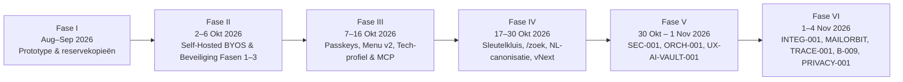

> 🌐 **Taal / Мова:** [Українська](ІСТОРІЯ-РОЗВИТКУ.uk.md) · **Nederlands** | [Hoofdpagina](../../LEESMIJ.md) · [Documentatie-index](../INDEX.nl.md)
> 🧭 **Hub-secties (`docs/hub/`):** [1. Architectuur](./ARCHITECTUUR.nl.md) · **2. Geschiedenis** · [3. Takken, PR's & Releases](./TAKKEN-EN-SAMENVOEGVERZOEKEN.nl.md) · [4. Mapstructuur](./MAP-STRUCTUUR.nl.md) · [5. Omgevingsvariabelen](./OMGEVINGSVARIABELEN.nl.md) · [6. Orchestratie & Uitrol](./ORCHESTRATIE-EN-UITROL.nl.md)

# Chronologische geschiedenis van het project «Mijn Ruimte · Мій простір»

Dit document beschrijft de volledige ontwikkelgeschiedenis van het platform **Mijn Ruimte (`Tarasevych/hub`)** in zes opeenvolgende fasen: van het eerste prototype en het verlaten van externe PaaS-omgevingen (Render / AppDeploy) tot cryptografische gegevensisolatie, goedkeuring van updates via WebAuthn Passkeys, de Nederlandse canonisering van 531 modules, de consolidatie van de hoofdtak `voornaamst`, multi-agent-orchestratie `ORCH-001`, release-traceerbaarheid `TRACE-001`, de infrastructuurupgrade `B-009` en de privacystandaard `PRIVACY-001`.

---

## Overzicht van de tijdlijn per fase

---

## Fase I. Ontstaan, verhuizing vanaf externe PaaS (Render / AppDeploy) en eerste ijkpunt (Augustus — September 2026)

- **Start van de ontwikkeling (29.08.2026):** het project begon als een geïntegreerd digitaal ecosysteem onder de naam **«Мій простір / Tarasevych Hub»**. In de vroege iteraties werd gebruikgemaakt van externe cloud-PaaS-omgevingen (waaronder Render en AppDeploy met `APP_ID = migrated-bg2v4h`).
- **Eerste archiefopname op GitHub (24.09.2026):** in de tak [`Mijn-ruimte-reservekopieën`](https://github.com/Tarasevych/hub/tree/Mijn-ruimte-reservekopie%C3%ABn) (`1f377ca`) is het eerste publieke ijkpunt van de repository `Tarasevych/hub` vastgelegd.
- **Keuze voor volledige soevereiniteit (BYOS):** de afhankelijkheid van externe cloudruntimes, propriëtaire SDK's en cross-site cookies voldeed niet aan de eisen voor beveiliging en Zero-Knowledge isolatie, wat leidde tot het besluit om volledig over te stappen op een eigen server.

---

## Fase II. Port naar Self-Hosted BYOS en Beveiligingshervorming Fasen 1–3 (2–6 Oktober 2026)

- **Porteerplan ([`PORTEERPLAN.nl.md`](../../PORTEERPLAN.nl.md) / [`PORTEERPLAN.nl.md`](../../PORTEERPLAN.nl.md), 03.10.2026):** volledige verwijdering van `@appdeploy/sdk` (28 serverbestanden) en `@appdeploy/client` (33 clientbestanden) en verhuizing van het gehele platform naar een eigen Ubuntu LTS VM achter een uitgaande Cloudflare Tunnel (`cloudflared` → `127.0.0.1:8080`).
- **Eigen platformkern (`@platform/server` en `@platform/client`):**
  - Compatibele databaselaag [`server/platform/db.ts`](../../server/platform/db.ts) bovenop PostgreSQL (`app.records` met JSONB GIN-indexen, keyset-paginering op `seq` en atomaire operaties `takeOne`, `takeArrayValue`, `zetAlsHoger`).
  - Lokale bestandsopslag [`server/platform/opslag.ts`](../../server/platform/opslag.ts) (`/srv/data/uploads`), allowlist voor geheimen [`server/platform/geheimen.ts`](../../server/platform/geheimen.ts) (`/etc/mijn-ruimte/geheimen.env`), canonieke HTTP-server [`server/start.ts`](../../server/start.ts) en versleutelde back-ups via `age` (takken [`basis-voor-zelf-hosten`](https://github.com/Tarasevych/hub/tree/basis-voor-zelf-hosten), [`zelf-hosten`](https://github.com/Tarasevych/hub/tree/zelf-hosten), [`sync-actief`](https://github.com/Tarasevych/hub/tree/sync-actief)).
- **Beveiligingshervorming (Fasen A, B, Auth Fase 1, Beveiliging Fase 2–3, Audit Fixes — zie [`BEVEILIGINGSNOTITIES.nl.md`](../../BEVEILIGINGSNOTITIES.nl.md)):**
  - **Fasen A en B (02–03.10.2026):** volledige rotatie van alle sleutels, strikte rate limiting en progressieve lockout (`app.rate_limits`, `app.login_lockouts`), `Origin`-allowlist tegen CSRF, willekeurige PKCE (`oauth_pkce_v1`), TOTP-versleuteling (`AES-256-GCM`), SSRF-bescherming met DNS-pinning (`backend/veilige-fetch.ts`) en e-mailsanitisatie met DOMPurify.
  - **Auth Fase 1 ([`auth-fase-1`](https://github.com/Tarasevych/hub/tree/auth-fase-1), 03.10.2026):** verwijdering van alle verouderde sessieroutes (`410 Gone`, migratie `0002`), strikte accountkoppeling op `(provider, subject)` zonder stille samenvoeging op e-mail, binding van aanmeldtransacties aan het tabblad (`__Secure-tsv_aanmeld_binding_*`) en binding van sessie-handoffs aan de browser (`tsv_handoff_binding`).
  - **Beveiliging Fase 2 & 3 ([`beveiliging-fase-2-3`](https://github.com/Tarasevych/hub/tree/beveiliging-fase-2-3), 03.10.2026):** invoering van **rijniveaubeveiliging (RLS)** in PostgreSQL (`migrations/0003`–`0005`), splitsing in 3 databaserollen (`mijnruimte_migrator`, `mijnruimte_app` met `NOBYPASSRLS`, `mijnruimte_system`), centrale authenticatiepoort [`server/platform/auth-poort.ts`](../../server/platform/auth-poort.ts), Step-Up bevestiging voor gevoelige acties ([`backend/stap-op.ts`](../../backend/stap-op.ts)) en AVG/GDPR-export.
  - **Audit Fixes A1–A11 ([`beveiliging-fixes-audit`](https://github.com/Tarasevych/hub/tree/beveiliging-fixes-audit), 04.10.2026):** verharding van de hashketen in `app.audit` via de `SECURITY DEFINER`-functie `app.audit_toevoegen` (`0008`), afsplitsing van `DATABASE_URL_MIGRATIE` naar `/etc/mijn-ruimte/migratie.env` en tweetalige statische pagina's `/privacy` en `/terms` zonder JavaScript ([`backend/juridisch.ts`](../../backend/juridisch.ts)).

---

## Fase III. WebAuthn Passkeys, Globaal Menu v2, Technische Ruimte en AI-connectoren (7–16 Oktober 2026)

- **Eigen WebAuthn-kern en Passkey-goedkeuring voor updates (08–09.10.2026):**
  - In tak [`passkey-schvalennya`](https://github.com/Tarasevych/hub/tree/passkey-schvalennya) is een zelfstandige WebAuthn-kern zonder externe npm-afhankelijkheden gebouwd ([`deploy/goedkeuring/webauthn-kern.mjs`](../../deploy/goedkeuring/webauthn-kern.mjs), ondersteuning voor `ES256`, `EdDSA`, `RS256`, verplichte gebruikersverificatie `UV`), gebruikt door zowel de app als het root-script voor cryptografische goedkeuring van serverupdates onder `Admin → Оновлення`.
  - In tak [`aanmeldmethoden`](https://github.com/Tarasevych/hub/tree/aanmeldmethoden) zijn echte gebruikers-passkeys toegevoegd in «Способи входу» (migratie `0023` met RLS, `rpId: tarasevych.com`), en in [`bevestig-toegang`](https://github.com/Tarasevych/hub/tree/bevestig-toegang) tijdelijke toegangscodes en gastsessies (`/toegang`, migratie `0025`).
- **Globaal Menu v2 ([`menu-v2`](https://github.com/Tarasevych/hub/tree/menu-v2), 09.10.2026):** nieuwe navigatieschil met dock (rechts/boven/onder), instelbare transparantie en schaal, snelbalk en drag-and-drop bewerkmodus.
- **Technisch profiel en MCP-ecosysteem (12–16.10.2026):**
  - De reeks takken `claude/*` en `cursor/*-8d4d` realiseerde de **strikte scheiding tussen Persoonlijke en Technische ruimte** ([`claude/tech-profiel-2026-10-13`](https://github.com/Tarasevych/hub/tree/claude/tech-profiel-2026-10-13), [`cursor/mcp-spiegel-na-b-8d4d`](https://github.com/Tarasevych/hub/tree/cursor/mcp-spiegel-na-b-8d4d)), **één-klik MCP-koppeling voor AI** ([`claude/mcp-een-klik-2026-10-13`](https://github.com/Tarasevych/hub/tree/claude/mcp-een-klik-2026-10-13)), **ingebouwde browserterminal op basis van xterm** ([`cursor/terminal-etap-c-8d4d`](https://github.com/Tarasevych/hub/tree/cursor/terminal-etap-c-8d4d)), **AI-agentenbord en fijnmazige scopes «AI-toegang»** ([`cursor/ai-agent-board-8d4d`](https://github.com/Tarasevych/hub/tree/cursor/ai-agent-board-8d4d)) en **Connector v2 met echte acties** ([`claude/connector-v2-2026-10-15`](https://github.com/Tarasevych/hub/tree/claude/connector-v2-2026-10-15), [`cursor/connector-functies-8d4d`](https://github.com/Tarasevych/hub/tree/cursor/connector-functies-8d4d)).

---

## Fase IV. Grootschalige Module-uitbreiding en Nederlandse Canonisatie (17–30 Oktober 2026)

- **Sleutelkluis (21.10.2026, migratie `0092`):** gegevenssleutels (DEK) van gebruikers staan nooit onversleuteld op schijf; voor MCP-verbindingen van agenten worden cryptografische HKDF-omslagen gemaakt met `SLEUTELKLUIS_SLEUTEL_V1`.
- **Globaal zoeken `/zoek` en OCR (22.10.2026, migraties `0100`–`0104`):** full-text zoeken over UI, post, bijlagen, cloud, agenda, borden en GitHub met achtergrondwerker voor tekstextractie uit PDF/Office/archieven (`zoek-werker.mjs`), OCR via Tesseract (`ukr+nld+eng+rus`) en automatische maskering van geheimen ([`shared/geheim-patronen.ts`](../../shared/geheim-patronen.ts)).
- **Automatische rendercontrole bij uitrol (`rook-controle`, 22.10.2026):** na activatie van elke release start de installer headless Chromium tegen een geïsoleerde DB en controleert de daadwerkelijke paginarendering; bij een fout wordt de release automatisch teruggedraaid (`ROOK_TERUGGEDRAAID`).
- **Nederlandse canonisatie van de code (24.10.2026):** **531 bestanden** in `src/`, `backend/`, `shared/`, `server/`, `tests/` en `scripts/` zijn hernoemd naar het Nederlands volgens een vaste woordenlijst ([`docs/kaart/KAART-BESTANDEN.nl.md`](../kaart/KAART-BESTANDEN.nl.md)), en [`scripts/kaart-controle.mjs`](../../scripts/kaart-controle.mjs) is opgenomen in `npm run build`.
- **Adaptive Mail Canvas (pakketten 1–3, 24–25.10.2026):** uniform leesvenster (`LeesVenster.tsx`), threadcontextpaneel zonder AI (`ContextPaneel.tsx`: tijdlijn, bijlageversiegroepen, SPF/DKIM/DMARC, `.ics`-afspraken), geverifieerd blok «Wat wordt er van u verwacht?» (`WatNodigBlok.tsx`) met citaatcontrole tegen het origineel ([`shared/ai-bronnen.ts`](../../shared/ai-bronnen.ts)), vertalingsvergelijking per alinea (`VergelijkTabel.tsx`) en PDF/DOCX-versievergelijking (`VersieVergelijk.tsx`).
- **Zones en sleuven voor zwevende knoppen ([`shared/plaatsing.ts`](../../shared/plaatsing.ts), 25.10.2026):** wiskundig plaatsingsmodel voor alle zwevende UI-elementen zonder overlapping op telefoon, tablet en desktop.
- **Cloud vNext (M1–M11), Huis vNext (`0128`), Notities vNext (`0129`), Werkblad v3 (`0114`), Agenda v3 (27–29.10.2026):** volledige vernieuwing van cloudopslag (incl. M7 privacy-architectuur), Home Assistant-koppeling, werkbladcanvas v3 en tweewegs agendasynchronisatie.

---

## Fase V. Consolidatie `SEC-001`, Agenten-orchestratie `ORCH-001` en `UX-AI-VAULT-001` (30 Oktober — 1 November 2026)

- **Consolidatie en beveiligingsaudit `SEC-001` (30–31.10.2026):** de actuele productiesnapshot is geïmporteerd in [`audit/sec-001-20261030`](https://github.com/Tarasevych/hub/tree/audit/sec-001-20261030) (`016093f`), gevolgd door beveiligingsfixes in [`fix/sec-001-20261031-000224`](https://github.com/Tarasevych/hub/tree/fix/sec-001-20261031-000224) en de basisrelease [`release/sec-001-20261031-084138`](https://github.com/Tarasevych/hub/tree/release/sec-001-20261031-084138).
- **Multi-agent coördinatiesysteem `ORCH-001` (31.10.2026, besluiten `B-001`–`B-006`):** één canonieke regelbron [`AGENTS.md`](../../AGENTS.md) ([🇳🇱 NL](../../AGENTENREGELS.nl.md) · [🇺🇦 UK](../../ПРАВИЛА-АГЕНТІВ.uk.md)), machinebeleid [`orchestratie/beleid.json`](../../orchestratie/beleid.json), cryptografische vingerafdruk [`orchestratie/regels.lock.json`](../../orchestratie/regels.lock.json) en de CLI/MCP/web-pijplijn [`scripts/orch.mjs`](../../scripts/orch.mjs) voor afgestemd samenwerken van 8 AI-agenten (Claude, Antigravity, ChatGPT, Codex, Grok, Copilot, Gemini, Cursor).
- **`MCP-ACCESS-001` en `UX-AI-VAULT-001` (01.11.2026):** exacte serverdiagnostiek voor AI-toegang met isolatie per verbinding, agentbeheer op één plek met Passkey-bevestiging en de uniforme adaptieve Sleutelkluis (PR #17, #18, #19).

---

## Fase VI. Consolidatie `voornaamst`, `LOGIN-001`, `INTEG-001`, `MAILORBIT-001`, `TRACE-001`, `B-009` en `PRIVACY-001` (1–4 November 2026)

- **`LOGIN-001` (01–02.11.2026, PR #20):** minimalistisch, responsief meertalig aanmeldscherm en vernieuwd menu voor opgeslagen accounts.
- **Samenvoeging `INTEG-001` (03.11.2026):** grootschalige integratie van 9 parallelle functionele takken (stille meldingen met uitleg, tweetalig AI-bord, bovenste ruimtebalk, taalvlaggetjes zonder bijsnijden, afdrukken met Chrome-proef, zoekmenu in de bovenbalk, teststabilisatie en volledige AVG/GDPR-accountexport) in [`feature/integ-001-zvedennia-20261103-102243`](https://github.com/Tarasevych/hub/tree/feature/integ-001-zvedennia-20261103-102243).
- **`TRACE-001` (03.11.2026, besluiten `B-007`/`B-008`, regels `1.4.1`, PR #23):** verplicht onveranderlijk ontwikkelarchief `orchestratie/ontwikkelarchieven/<TASK-ID>.json` in elke releasecommit en strikte SHA-256-verificatie van het `.tar.gz`-release-asset via de GitHub API door zowel de site (`voorcontrole`) als de root-installer.
- **Mail-updatereeks (`MAILORBIT-001` → `MAILMOB-001` → `MAILPOLISH-001` → `MAILFIX-001` → `MAILFIT-001`/`002`, 03–04.11.2026, PR #22, #24–#27):** interactieve orbita van mailproviders op de lege postpagina (`MailOrbitIntro.tsx`), mobiele koppelbladen voor 320px+ schermen (`MailKoppelVenster.tsx`), synchronisatie van de 12-uurs Step-Up toestemming («Niet opnieuw vragen») en fixes voor mobiele breedte en Gmail OAuth-diagnostiek.
- **Upgrade van de serverstack en synchronisatie van `voornaamst` (`B-009`, 04.11.2026, regels `1.4.2`):** vastlegging van de overstap van de productie-VM naar `Ubuntu 26.04.1 LTS`, `Node.js 26.13.0 LTS`, `PostgreSQL 18.6`, `Caddy 2.11.7`, oplossing voor het seccomp-filter van `systemd 259` bij `openat2` in `GNU tar 1.35` (`RestrictSUIDSGID=no`) en volledige synchronisatie van `voornaamst` met `integratie`.
- **`PRIVACY-001` (04.11.2026, besluiten `B-010`/`B-011`, regels `1.4.6`):** volledige verwijdering van persoonsgegevens en echte IP-adressen uit code, tests, documentatie en git-geschiedenis; verplaatsing naar servervariabelen `MR_EIGENAAR_NAAM`, `MR_CONTACT_EMAIL`, `MR_BEHEERSUBNET`, `MR_VM_SSH`.
- **`IDENTITY-ACCOUNT` / `IDENTITY-001` / `IDENTITY-002` (04.11.2026):** ontwerp en implementatie van het uniforme accountscherm met 12 secties en dialoog voor profielfotobeheer.

---

> 🔗 **Lees verder:** [1. Architectuur](./ARCHITECTUUR.nl.md) · [3. Takken, PR's & Releases](./TAKKEN-EN-SAMENVOEGVERZOEKEN.nl.md) · [4. Mapstructuur](./MAP-STRUCTUUR.nl.md) · [5. Omgevingsvariabelen](./OMGEVINGSVARIABELEN.nl.md) · [6. Orchestratie & Uitrol](./ORCHESTRATIE-EN-UITROL.nl.md)

---

<!-- HISTORIE-001:aanvulling-20261113 -->
## Fase VII. Accountcentrum, «Ontwerp», beveiliging SEC-002 en MCP (5–13 november 2026)

> Aanvulling van 13-11-2026 (HISTORIE-001). Eerdere fasen hierboven zijn ongewijzigd. Volledige kroniek met voorganger en opvolger per tak: [KRONIEK-TAKKEN](./KRONIEK-TAKKEN.nl.md).

- **IDENTITEIT-003…007, MOBIEL-001 (07–09.11):** accountcentrum: vormgeving met veilige terugkeer, versie 49, «Studio», weergave «Ontwerp» naar het ontwerp van de eigenaar, aanpassing aan smartphones.
- **TRACE-002, UITROL-001, PERF-001 (08–09.11):** beschermde herkomst van pakketten, vernieuwde update met proefmigraties, snellere paginastart.
- **APPARAAT-001, TELEGRAM-001 (09.11):** bevestigen vanaf een ander apparaat, aanmelden en bevestigen via Telegram, plaatsing van aanmeldmethoden.
- **MAILBG-001, MAILSCAN-002 (09–10.11):** bewegende mailachtergrond met lens, vrijwillige adrescontrole.
- **HUIS-001 (10–12.11):** slim huis «Levend huis»: specificatie en klikbaar ontwerp.
- **IDENTITEIT-008…010 (11–12.11):** accountmenu v3, mobiele aanpassing van drie weergaven, samenhangend aanmelden op alle subdomeinen.
- **GITHUB-010…012, CLOUD-001 (11–12.11):** tweerichtings-GitHub-omgeving en aanpassing, mappen uploaden en delen in de cloud.
- **MCP-001 (12.11):** ondersteuning van MCP 2026-07-28 en 2025-11-25, OAuth 2.1-beveiliging.
- **SEC-002 (12–13.11):** diepe beveiligingsaudit; release 20261113-121403 is de huidige live versie.
- **MAQUETTE-001, HISTORIE-001, IDENTITEIT-011 (13.11):** in uitvoering: thema «Ontwerp» (Golf 0), kroniek van takken, plan voor het «Ontwerp» (PR #76).

Live versie op 13-11-2026: `20261113-121403` (commit [`5f2325d`](https://github.com/Tarasevych/hub/commit/5f2325d788e29c5126f9ede6975afbbac7e5aae2)). De tak `voornaamst` bevat die nog niet — zie «Achterstand» in de kroniek.
