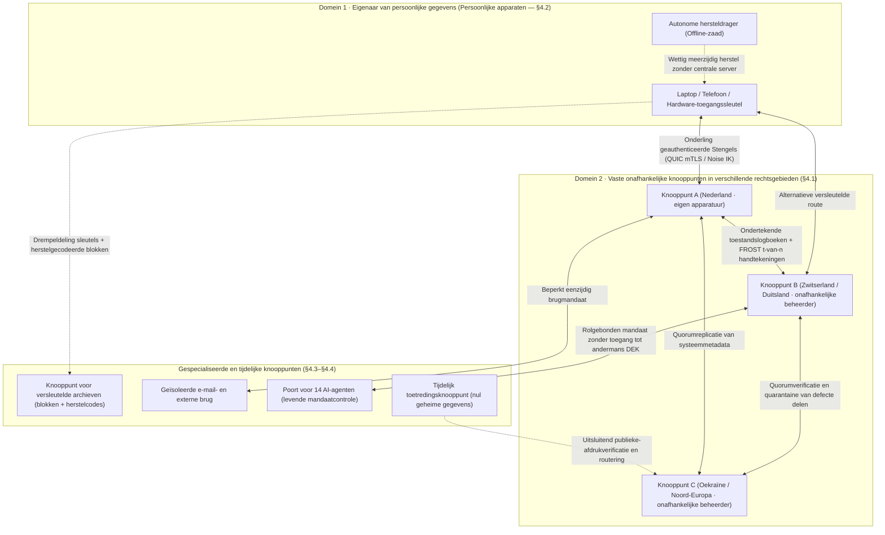

> 🌐 **Taal / Мова:** [Українська](ПЛЮЩ-ЕТАП-1-АРХІТЕКТУРНЕ-ЯДРО-ТА-ПЛАН-ВИПУСКІВ.uk.md) · **Nederlands** | [Hoofdpagina](../../LEESMIJ.md) · [Documentatie-index](../INDEX.nl.md) · [Hoofdarchitectuurmanifest «Klimop»](ARCHITECTUURMANIFEST-KLIMOP.nl.md) · [Auditrapport Fase 0](KLIMOP-FASE-0-AUDIT-FEITELIJKE-STAAT.nl.md)

# Fase 1 van het ecosysteem «Klimop» — Specificatie van de architectuurkern, keuze van bewezen technologieën en gefaseerd uitgaveplan (`KLIMOP-002`)

- **Vaststellingsdatum kernontwerp:** 20.11.2026
- **Coördinatietaak:** `KLIMOP-002` (voortbouwend op de [bewijsaudit van Fase 0](KLIMOP-FASE-0-AUDIT-FEITELIJKE-STAAT.nl.md))
- **Geïsoleerd programmatisch kerncontract:** [`shared/klimop/kern.ts`](../../shared/klimop/kern.ts) (wijzigt de draaiende server niet en schakelt `PostgreSQL 18.6` niet uit)
- **Normatieve grondslag:** secties `§1–§2`, `§4–§25`, `§35–§36 (Fase 1)`, `§42–§45` van het [Hoofdarchitectuurmanifest «Klimop»](ARCHITECTUURMANIFEST-KLIMOP.nl.md)

---

## 1. Doelarchitectuurschema van de «Klimop»-kern (§45 stap 2)

Ter vervanging van het huidige éénservermodel (`Cloudflare Tunnel → 127.0.0.1:8080 → één PostgreSQL 18.6`) legt Fase 1 een gelaagde topologie zonder enkel punt van uitval vast waarin **drie machtsdomeinen** (`persoonlijke_gegevens`, `knooppunt_beheer`, `netwerk_regels`) cryptografisch van elkaar gescheiden zijn:

### 1.1. Drie gescheiden machtsdomeinen in [`shared/klimop/kern.ts`](../../shared/klimop/kern.ts)

1. **`persoonlijke_gegevens` (Recht van de eigenaar van persoonlijke gegevens):** uitsluitend recht om persoonlijke gegevens (opslaglagen `1–3`) te versleutelen, lezen, delen en in te trekken. Geen enkele knooppuntbeheerder of netwerkquorum kan deze gegevens ontsleutelen zonder de sleutels van de eigenaar.
2. **`knooppunt_beheer` (Bevoegdheid van de knooppuntbeheerder):** beheer van rekenquota, schijfruimte en netwerkpoorten van het eigen knooppunt. De kernfunctie `verifieerKlimopMandaat()` weigert elk `knooppunt_beheer`-mandaat dat toegang claimt tot `persoonlijke_geheime_gegevens` (`SCHEIDING_VAN_MACHTEN_GESCHONDEN_PERSOONLIJKE_GEGEVENS`).
3. **`netwerk_regels` (Gedeelde netwerkregels en uitgaven):** wijziging van canonieke regels, vertrouwde ondertekenaars of kritieke uitgaven. `verifieerKlimopMandaat()` dwingt een drempelquorum $k \ge 2$ met $k$ onafhankelijke cryptografische handtekeningen af (`GEEN_ALLEENHEERSCHAPPIJ_DREMPEL_VEREIST`), terwijl `controleerKnooppuntOnafhankelijkheid()` groepen afwijst die bij één aanbieder of in één rechtsgebied zijn geconcentreerd.

---

## 2. Vergelijking en keuze van bewezen standaardtechnologieën (§45 stap 3)

Conform §12–§15 en §43 punt 12 van het manifest (strikt verbod op eigen ongeteste cryptografie) zijn voor elke laag open internationale standaarden met cryptografische wendbaarheid gekozen:

| Laag van het ecosysteem «Klimop» | Afgewogen bewezen kandidaten | Gekozen canonieke standaard voor Fasen 2–9 | Technische onderbouwing |
|---|---|---|---|
| **1. Cryptografische knooppuntidentiteit en mandaathandtekeningen (`Wortels`)** | `Ed25519 (RFC 8032)` tegenover `ECDSA P-256` tegenover hybride `Ed25519 + ML-DSA-65 (FIPS 204)` | **`Ed25519` nu** + veld `postkwantumPubliekeSleutelB64u` voor hybride **`Ed25519 + ML-DSA-65`** | Deterministische handtekeningen zonder toevalsgeneratorlek, ingebouwd in `Node.js` (`node:crypto`) en `ssh-keygen`, volledig verenigbaar met bestaand `SSHSIG` en klaar voor postkwantumuitbreiding. |
| **2. Drempelgoedkeuring van regels en uitgaven zonder één verzamelsleutel** | Losse multihandtekeningen `Ed25519` ($k$ handtekeningen) tegenover **`FROST` (`RFC 9591`, Schnorr/Ed25519-drempelhandtekening)** | **Fase 4a:** $k$-van-$n$ onafhankelijke `Ed25519`-handtekeningen (reeds in `shared/klimop/kern.ts`); **Fase 4b:** **`FROST (RFC 9591)`** | Een $k$-handtekeningenset geeft directe controleerbaarheid per deelnemer zonder externe afhankelijkheid; `FROST (RFC 9591)` voegt drempelopwekking toe zonder dat ooit één samengestelde privésleutel bestaat. `FROST` dient **uitsluitend als handtekening**, nooit als versleuteling (§43 punt 5). |
| **3. Deling van kleine geheimen (herstelsleutels, wortel-KEK's)** | Klassieke Shamir over $\mathrm{GF}(256)$ tegenover **verifieerbare Shamir-geheimdeling met Feldman/Pedersen-toezeggingen (`VSS`)** | Bestaande kern `shared/verdeelde-opslag.ts` ($\mathrm{GF}(256)$) in Fase 4 uitgebreid met **Feldman/Pedersen-toezeggingen** | Gewone Shamir laat een deelhouder pas bij reconstructie zien of een deel geldig is; verifieerbare toezeggingen (`VSS`) sporen beschadigde of vervalste delen bij elke proactieve rotatie op zonder het geheim te onthullen. |
| **4. Opslag van grote versleutelde bestanden en archieven (§11 laag 3, §43 punt 3)** | Shamir over het gehele bestand (verboden door §43 punt 3!) tegenover **envelopversleuteling `XChaCha20-Poly1305` / `AES-256-GCM` + inhoudsadressering `BLAKE3` / `SHA-256` + `Reed-Solomon (k+m)` herstelcodering** | **Stroomgewijze blokopdeling (1–4 MiB) → versleuteling `XChaCha20-Poly1305` (of `AES-256-GCM`) → `Reed-Solomon` uitwistolerante codering (bijv. 4+2)** | Shamir vermenigvuldigt grote bestanden met factor $n$; blokversleuteling met `Reed-Solomon` vraagt slechts ~1,5× ruimte en herstelt het volledige bestand bij verlies van willekeurige $m$ knooppunten. |
| **5. Sleutelafleiding uit codes/zinnen en sleutelhiërarchie** | `PBKDF2` tegenover `scrypt` tegenover **`Argon2id (RFC 9106)` + `HKDF-SHA-256 (RFC 5869)`** | **`Argon2id`** (voor menselijke codes/zinnen, met blijvende leesondersteuning voor bestaande `scrypt N=2^16`-omslagen) + **`HKDF-SHA-256`** + **`WebAuthn PRF`** | Weerstand tegen geheugenparallelle aanvallers en strikte domeinscheiding per sleuteldoel (`omslagAad` / `HKDF`-info). |
| **6. Beveiligde verbindingen tussen knooppunten (`Stengels`) en postkwantumuitwisseling** | Eenzijdige Cloudflare-rand tegenover **`QUIC / TLS 1.3 mTLS` met hybride `X25519MLKEM768 (FIPS 203)`** of **`WireGuard` + `Noise IK`** | **`TLS 1.3 / QUIC` met wederzijdse authenticatie op `Ed25519`-knooppuntpaspoorten + hybride `X25519MLKEM768`**, met `WireGuard` als terugvalroute | Eind-tot-eind versleuteld transport tussen knooppunten zonder ontsleuteling bij een tussenpartij (lost `SPOF-2` op) en bescherming tegen «nu onderscheppen, later met kwantumcomputer ontsleutelen» (§15). |
| **7. Groepsbeveiliging voor gedeelde ruimtes (gezin, woning `huis.*`, teams)** | Eén gedeelde statische sleutel zonder rotatie tegenover **`MLS (RFC 9420)`** | **`MLS (RFC 9420)`** voor groepssleutels van gedeelde ruimtes en de slimme woning (`app.huis_leden`) | Biedt voorwaartse geheimhouding en herstel na compromittering bij toevoegen of verwijderen van leden en apparaten (§14 manifest). |
| **8. Gegevensafstemming na tijdelijke verbindingsbreuk (§10, §11)** | Centrale blokkerende database tegenover **ondertekende hash-geketende gebeurtenislogboeken + conflictvrije datastructuren (`CRDT`) voor notities/taken en een quorumregister voor mandaten** | **Ondertekende operatielogboeken + `CRDT`** voor werkgegevens (laag 2); **deterministisch quorumregister** voor systeemmandaten (laag 4) | Laat persoonlijke apparaten offline doorwerken en zonder gegevensverlies samenvoegen, terwijl intrekkingen en rechten eenduidig geordend blijven. |

---

## 3. Register en voortgang van alle 25 verplichte tweetalige documenten (§44 van het manifest)

| Nr. (§44) | Documentnaam volgens het manifest | Canoniek pad (`nl` / `uk`) of doelfase | Status |
|---|---|---|---|
| 1 | Auditrapport van het huidige systeem | `docs/hub/KLIMOP-FASE-0-AUDIT-FEITELIJKE-STAAT.nl.md` · `ПЛЮЩ-ЕТАП-0-АУДИТ-ДІЙСНОГО-СТАНУ.uk.md` | **Gereed (`KLIMOP-002`)** |
| 2 | Hoofdarchitectuurbeschrijving van «Klimop» | `docs/hub/ARCHITECTUURMANIFEST-KLIMOP.nl.md` · `АРХІТЕКТУРНИЙ-МАНІФЕСТ-ПЛЮЩ.uk.md` | **Gereed (`KLIMOP-001`)** |
| 3 | Specificatie van knooppunten en rollen | `docs/hub/KLIMOP-FASE-1-ARCHITECTUURKERN-EN-UITGAVEPLAN.nl.md` (§1) + `shared/klimop/kern.ts` | **Gereed (`KLIMOP-002`)** |
| 4 | Beschrijving van netwerkprotocollen en routering | `docs/hub/KLIMOP-FASE-2-BEPROEVINGSNETWERK-EN-STENGELS.nl.md` (§1) + `shared/klimop/stengels.ts` | **Gereed (`KLIMOP-003`)** |
| 5 | Schema van versleutelingslagen en sleutelbeheer | `docs/hub/KLIMOP-FASE-3-VERSLEUTELING-EN-VERDEELDE-OPSLAG.nl.md` + `KLIMOP-FASE-4-GEDISTRIBUEERDE-SLEUTELS-EN-DREMPELHANDTEKENINGEN.nl.md` | **Gereed (`KLIMOP-004`..`005`)** |
| 6 | Specificatie van gedistribueerde opslag | `docs/hub/KLIMOP-FASE-3-VERSLEUTELING-EN-VERDEELDE-OPSLAG.nl.md` (§2) + `backend/klimop-opslag-client.ts` | **Gereed (`KLIMOP-004`)** |
| 7 | Regels voor identiteit en apparaten | `docs/hub/KLIMOP-FASE-5-ONAFHANKELIJKE-IDENTITEIT-EN-GROEPSRUIMTES.nl.md` (§1, §3) + `shared/klimop/identiteit.ts` | **Gereed (`KLIMOP-006`)** |
| 8 | Bevoegdheids- en gezamenlijk bestuursmodel | `docs/hub/KLIMOP-FASE-6-DREMPELBESTUUR-EN-VEILIGE-UITGAVEN.nl.md` (§1) + `shared/klimop/bestuur.ts` | **Gereed (`KLIMOP-007`)** |
| 9 | Procedure voor toegangsherstel | `docs/hub/KLIMOP-FASE-5-ONAFHANKELIJKE-IDENTITEIT-EN-GROEPSRUIMTES.nl.md` (§2) + `shared/klimop/identiteit.ts` (`KLIMOP-006`) | **Gereed (`KLIMOP-006`)** |
| 10 | Handelingsprotocol bij uitval van knooppunten | `docs/hub/KLIMOP-FASE-7-IMMUUNSYSTEEM-EN-ZELFHERSTEL.nl.md` (§1) + `shared/klimop/immuunsysteem.ts` | **Gereed (`KLIMOP-008`)** |
| 11 | Handelingsprotocol bij compromittering | `docs/hub/KLIMOP-FASE-7-IMMUUNSYSTEEM-EN-ZELFHERSTEL.nl.md` (§2) + `backend/klimop-immuunsysteem-client.ts` | **Gereed (`KLIMOP-008`)** |
| 12 | Protocol voor menselijke bescherming onder gevaar | `docs/hub/KLIMOP-FASE-9-MENSBESCHERMING-EN-DWANGBESTENDIGHEID.nl.md` + `shared/klimop/mensbescherming.ts` + `beoordeelDwangSignaal` in `kern.ts` | **Gereed (`KLIMOP-002`, `KLIMOP-010`)** |
| 13 | Regels voor koppeling van externe diensten | `docs/hub/KLIMOP-FASE-8-DIENSTENOVERDRACHT-EN-GEISOLEERDE-VERBINDERS.nl.md` (§2) + `valideerExterneVerbinder` in `shared/klimop/diensten.ts` | **Gereed (`KLIMOP-009`)** |
| 14 | Regels voor veilige installatie van updates | `docs/hub/KLIMOP-FASE-6-DREMPELBESTUUR-EN-VEILIGE-UITGAVEN.nl.md` (§2) + `backend/klimop-bestuur-client.ts` | **Gereed (`KLIMOP-007`)** |
| 15 | Handleiding voor het opzetten van een nieuw knooppunt | `docs/hub/KLIMOP-FASE-10-BEHEERSTE-UITBREIDING-EN-MIDDELENUITWISSELING.nl.md` (§1–§2) + `shared/klimop/hechtranken.ts` + `backend/klimop-knooppunt-agent.ts` | **Gereed (`KLIMOP-003`, `KLIMOP-011`)** |
| 16 | Handleiding voor alle 14 AI-agenten | `AGENTENREGELS.nl.md` / `AGENTS.md` (`1.5.0`), 14 adapters en `.agents/skills/klimop-architectuur/` | **Gereed (`KLIMOP-001`..`013`)** |
| 17 | Gefaseerd overzettingsplan voor bestaande diensten | `docs/hub/KLIMOP-FASE-8-DIENSTENOVERDRACHT-EN-GEISOLEERDE-VERBINDERS.nl.md` (§1, §3) + `PORTEERPLAN.nl.md` + `shared/klimop/diensten.ts` | **Gereed (`KLIMOP-002`, `KLIMOP-009`)** |
| 18 | Beproevings- en storingsprogramma | `docs/hub/KLIMOP-FASE-7-IMMUUNSYSTEEM-EN-ZELFHERSTEL.nl.md` (§3) + `KLIMOP-FASE-9-MENSBESCHERMING-EN-DWANGBESTENDIGHEID.nl.md` (§3) + `KLIMOP-FASE-11-ONAFHANKELIJKE-BEVEILIGINGSAUDIT-EN-DREIGINGSMODEL.nl.md` (§3) | **Gereed (`KLIMOP-003`..`013`)** |
| 19 | Handleiding voor onafhankelijke reproductie («Zaden») | `docs/hub/KLIMOP-FASE-12-ZADEN-OPVOLGING-EN-DUURZAME-ONTWIKKELING.nl.md` (§1) + `shared/klimop/zaden.ts` + `backend/klimop-zaden-client.ts` | **Gereed (`KLIMOP-013`)** |
| 20 | Dreigingsmodel en tegenmaatregelen | `docs/hub/KLIMOP-FASE-11-ONAFHANKELIJKE-BEVEILIGINGSAUDIT-EN-DREIGINGSMODEL.nl.md` (§2) + `KLIMOP_DREIGINGS_MODEL` in `shared/klimop/beveiligingsaudit.ts` + §4 van het Fase 0-rapport | **Gereed (`KLIMOP-002`, `KLIMOP-012`)** |
| 21 | Beschrijving van cryptografische wendbaarheid | `docs/hub/KLIMOP-FASE-3-VERSLEUTELING-EN-VERDEELDE-OPSLAG.nl.md` (§3) + `onderhandelKlimopProfiel` in `shared/klimop/opslag.ts` | **Gereed (`KLIMOP-004`)** |
| 22 | Regels voor privacy en beperking van metadata | `docs/hub/KLIMOP-FASE-2-BEPROEVINGSNETWERK-EN-STENGELS.nl.md` (§2, kaderopvulling tot 256 bytes, blinde opslag) | **Gereed (`KLIMOP-003`)** |
| 23 | Overdrachtsprocedure voor nieuwe bevoegde deelnemers | `docs/hub/KLIMOP-FASE-12-ZADEN-OPVOLGING-EN-DUURZAME-ONTWIKKELING.nl.md` (§2) + `stelOpvolgingsOverdrachtSamen` in `shared/klimop/zaden.ts` | **Gereed (`KLIMOP-013`)** |
| 24 | Architectuurbesluitenregister | `orchestratie/BESLUITEN.nl.md` · `BESLUITEN.md` (`B-001` .. `B-024`) | **Gereed en doorlopend** |
| 25 | Gefaseerd ontwikkelplan zonder centrale afhankelijkheid | Dit document (`KLIMOP-FASE-1-ARCHITECTUURKERN-EN-UITGAVEPLAN.nl.md`, §4) + `valideerKlimopEindvisie46` in `shared/klimop/zaden.ts` | **Gereed (`KLIMOP-002`..`013`)** |

---

## 4. Gefaseerd plan van kleine, onafhankelijke en achterwaarts verenigbare uitgaven (§36, §45 stap 4)

Geen enkele uitgave schakelt de bestaande server of `PostgreSQL 18.6` uit vóór volledige verificatie van de onafhankelijke vervanging en afzonderlijke toestemming van de eigenaar:

| Manifestfase | Doeltaak | Kern van de kleine onafhankelijke uitgave | Welk `SPOF` wordt opgelost | Terugdraaivoorwaarde |
|---|---|---|---|---|
| **Fase 0 + Fase 1 *(voltooid)*** | `KLIMOP-001`, `KLIMOP-002` | Manifestcanon, regels `1.5.0`, adapters voor 14 agenten, Fase 0-inspecteur, technologiekeuze, geïsoleerde kern `shared/klimop/kern.ts`. | Heft afstemmingsverschillen tussen 14 agenten en architectuuronzekerheid op. | Zuiver documentatie en bibliotheek; 0 invloed op de actieve server. |
| **Fase 2 — Beproevingsnetwerk *(voltooid)*** | `KLIMOP-003` | «Stengels»-protocol `shared/klimop/stengels.ts` (`X25519 + Ed25519 + HKDF + ChaCha20-Poly1305`), geïsoleerd knooppunt `backend/klimop-knooppunt-agent.ts`, proefopstelling van 3 knooppunten `NL/CH/UA` met estafette en quarantaine (`scripts/klimop-proefnetwerk.mjs`, `docker-compose.proef.yml`). | Legt werkende netwerkvervanging voor `SPOF-1` en `SPOF-2`. | Draait volledig los van de productieserver; met één opdracht te stoppen. |
| **Fase 3 — Eind-tot-eind versleuteling en blokopslag *(voltooid)*** | `KLIMOP-004` | Envelopversleuteling van segmenten (`ChaCha20-Poly1305` / `AES-256-GCM`), sleutelhiërarchie `HKDF-SHA-256`, `Reed-Solomon (k+m)` herstelcodes over $\mathrm{GF}(2^8)$ (`shared/klimop/opslag.ts`), netwerkverdeler met sleutelloze herbouw en wettige verwijdering (`backend/klimop-opslag-client.ts`) en blinde zoektermen `HMAC-SHA-256`. | Lost `SPOF-3` op (geen geopende `DEK` nodig op een opslagknooppunt). | Parallel lezen van oude en nieuwe enveloppen zonder toegangsverlies. |
| **Fase 4 — Verifieerbare delen en drempelhandtekeningen *(voltooid)*** | `KLIMOP-005` | Verifieerbare geheimdeling (Feldman en Pedersen op `Ed25519`), tweefasige proactieve epocheverversing, dealerloze `DKG` en tweeronde-drempelhandtekeningen `FROST (RFC 9591)` $t$-van-$n$ (`shared/klimop/drempelsleutels.ts`, `backend/klimop-drempel-client.ts`), rechtstreeks verenigbaar met `node:crypto.verify`. | Lost de cryptografische kern van `SPOF-4` op. | Bestaande eigenaarshandtekeningen blijven parallel geldig. |
| **Fase 5 — Onafhankelijke identiteit en apparaten *(voltooid)*** | `KLIMOP-006` | Zelfsoevereine identiteit `klid1_…`, gescheiden dienstpseudoniemen `psid1_…`, apparaatcertificaten zonder overdracht van de wortelsleutel, quorumintrekking, wettig Pedersen-herstel met betwistingstermijn en `MLS (RFC 9420)` groepssleutels (`shared/klimop/identiteit.ts`, `backend/klimop-identiteit-client.ts`). | Maakt identiteit los van één enkele database (`SPOF-1`). | Ondertekende tweerichtingskoppeling tussen huidig `userId` en `persoonsId`. |
| **Fase 6 — Drempelbestuur en gefaseerde uitrol *(voltooid)*** | `KLIMOP-007` | Zeven bevoegdheidscategorieën, tijdsloten (24/48/72 uur bij 0 uur voor dagelijks gebruik), `FROST`-besluiten, rollenscheiding met webclienthandtekening en golfgewijze uitrol met automatische stop bij schending van 4 veiligheidseisen (`shared/klimop/bestuur.ts`, `backend/klimop-bestuur-client.ts`). | Heft `SPOF-4` volledig op voor regels en uitgaven. | Eigenaar behoudt noodveto tijdens de overgangsperiode. |
| **Fase 7 — Immuunsysteem en zelfherstel *(voltooid)*** | `KLIMOP-008` | Blinde integriteitscontrole zonder inzage (`controleer_blok_integriteit`), directe quarantaine van een beschadigd knooppunt, sleutelloze opbouw van ontbrekende `Reed-Solomon`-strepen binnen quotagrenzen zonder bevoegdheidsuitbreiding en toetsing van alle 10 overlevingsscenario's §37 (`shared/klimop/immuunsysteem.ts`, `backend/klimop-immuunsysteem-client.ts`). | Waarborgt voortbestaan bij knooppuntverlies (`SPOF-1`). | Snelheidsbegrenzing op herstelverkeer en eerbiediging van apparaatgrenzen. |
| **Fase 8 — Gefaseerde overzetting van de 11 diensten *(voltooid)*** | `KLIMOP-009` | Isolatie van alle 11 diensten via `psid1_…`-pseudoniemen en `HKDF-SHA-256`-sleutels, blinde replicatie van versleutelde `CRDT`, geïsoleerde externe verbinders zonder netwerkrisico, lokaal zoeken over 4 bronklassen en tweezijdige pariteitstoetsing met automatische terugval (`shared/klimop/diensten.ts`, `backend/klimop-diensten-client.ts`). | Bouwt afhankelijkheid van de centrale kern voor werkgegevens af (`SPOF-1`, `SPOF-2`). | Bestaande `PostgreSQL 18.6` blijft warme terugvallijn tot volledige aanvaarding. |
| **Fase 9 — Bescherming van de mens tegen dwang *(voltooid)*** | `KLIMOP-010` | Beleid voor 9 noodomstandigheden, scheidbare kluizen zonder verlies van hoofdgegevens, 256-byte onopvallende noodsignalen naar vertrouwenspersonen, contextuele toetsing van 7 technische risicosignalen, herroepbare 72-uurs tijdsloten op quorum en toetsing van alle 8 scenario's van §39 (`shared/klimop/mensbescherming.ts`, `backend/klimop-mensbescherming-client.ts`). | Lost `SPOF-5` op zonder enige automatische vernietiging van gegevens. | Tweezijdig herstel na vals alarm met `0` bytes verlies. |
| **Fase 10 — Spreiding over rechtsgebieden en «Voeding» *(voltooid)*** | `KLIMOP-011` | Beheerste toetreding van nieuwe knooppunten via tweezijdige bewijzen zonder computerwormgedrag en zonder kosten > 0 euro zonder goedkeuring van de eigenaar, samenvoegen van Sybil-klonen bij dezelfde aanbieder/subnet tot 1 stem, profielen voor 5 apparaatklassen, ondertekende middelenkwitanties met onvoorwaardelijke toegang voor passieve leden tot eigen gegevens en veilige uittreding (`shared/klimop/hechtranken.ts`, `backend/klimop-hechtranken-client.ts`). | Verankert de mechanismen voor opheffing van `SPOF-1` en `SPOF-2` bij schaalvergroting. | Elk knooppunt kan na herplaatsing van strepen veilig uit het quorum treden; een persoonlijk apparaat stopt achtergrondwerk onmiddellijk. |
| **Fase 11 — Onafhankelijke audit en storingsproeven *(voltooid)*** | `KLIMOP-012` | Gestandaardiseerde hybride postkwantumcryptografie `Ed25519 + ML-DSA-65` en `X25519 + ML-KEM-768` (`FIPS 203/204`), samengevat dreigingsmodel met eerlijke restrisico's (Document nr. 20), 10 cryptocontroles §38, 6 praktische autonomie-oefeningen §40, 12 gemeten garanties §41 en quorumvrijgave voor Fase 12 (`shared/klimop/beveiligingsaudit.ts`, `backend/klimop-audit-client.ts`). | Bevestigt afwezigheid van verborgen uitvalpunten over alle `SPOF-1..5`. | Elke openstaande kritieke zwakte blokkeert automatisch `vrijgegevenVoorEtappe12`. |
| **Fase 12 — «Zaden» en autonome doorontwikkeling *(voltooid)*** | `KLIMOP-013` | Zelfstandig reproductiepakket «Zaden» met `SHA-256`-Merkle-wortel over de 12 modules onder dubbel zegel `FROST RFC 9591` + `Ed25519 + ML-DSA-65` (Document nr. 19), schone heropbouw van Generatie 2 zonder oude server, tweezijdige 72-uurs opvolgingsakte zonder de oorspronkelijke auteur (Document nr. 23), bewaking van 16 AI-richtingen en alle 12 pijlers van §46 (`shared/klimop/zaden.ts`, `backend/klimop-zaden-client.ts`). | Voltooit de geïsoleerde bouw van het levende ecosysteem «Klimop» zonder afhankelijkheid van één server of aanvankelijke auteur. | Beproefde schone opbouw vanaf nul terwijl de actieve productie-infrastructuur volledig onaangetast blijft. |

---

## 5. Toetsing van de Fase 1-besluiten aan de 15 architectuurcontrolevragen (§42)

Alle 15 antwoorden worden programmatisch getoetst door `beoordeelKlimopWijziging()` in [`shared/klimop/kern.ts`](../../shared/klimop/kern.ts):

1. **Ontstaat er een nieuw enkel punt van uitval?** Nee — de kernmodule is een zuivere bibliotheek zonder centrale coördinator en vereist ten minste 2 rechtsgebieden en verschillende aanbieders voor een quorum.
2. **Worden verborgen bevoegdheden niet uitgebreid?** Nee — elk mandaat heeft een expliciet machtsdomein (`machtDomein`), rollijst en harde vervaltijd `verlooptOp`.
3. **Blijft wettig herstel beschikbaar?** Ja — bestaande 20-teken herstelcodes en Shamir-delen blijven behouden en meerzijdig drempelherstel is ingebouwd.
4. **Is informatie beschermd op het apparaat, tijdens overdracht en in opslag?** Ja — eind-tot-eind envelopversleuteling, wederzijds geauthenticeerde kanalen en verifieerbare delen zijn vastgelegd.
5. **Worden er geen onnodige metadata blootgegeven?** Nee — het `klm1_…`-knooppunt-ID is een eenrichtings-`SHA-256`-afdruk van de publieke sleutel zonder persoonsgegevens.
6. **Kunnen aangemaakte toestemmingen worden ingetrokken?** Ja — `verifieerKlimopMandaat()` controleert zowel `ingetrokkenMandaatIds` als `ingetrokkenKnooppuntIds` vóór rechtentoekenning.
7. **Wordt de compatibiliteit tussen knooppunten niet geschonden?** Nee — alle structuren dragen `schema: 1` en deterministische JSON-serialisatie `canoniekeJson()`.
8. **Blijft het mogelijk om een defect onderdeel te isoleren?** Ja — een gecompromitteerd knooppunt wordt direct geïsoleerd via opname in de intrekkingslijst zonder het overige netwerk te stoppen.
9. **Verslechtert de bescherming van de mens niet (verlies, ziekte, dwang)?** Nee — `beoordeelDwangSignaal()` schakelt over naar de veilige beperkte modus met een wachttijd van 72 uur voor gevaarlijke acties en verbiedt elke automatische gegevensvernietiging.
10. **Blijft de wijziging verifieerbaar?** Ja — elk knooppuntpaspoort, elke `Ed25519`-handtekening en de Fase 0-audituitvoer worden door open eenheidstests gecontroleerd.
11. **Is er een veilige manier om terug te keren naar de vorige toestand?** Ja — de productieserver en `PostgreSQL 18.6` blijven in deze stap volledig ongewijzigd.
12. **Neemt de afhankelijkheid van de aanvankelijke auteur niet toe?** Nee — het éénpersoonsmodel in `netwerk_regels` maakt plaats voor een drempelquorum $k \ge 2$.
13. **Worden middelen van gebruikers niet zonder hun toestemming verbruikt?** Nee — tijdelijke en persoonlijke apparaten krijgen uitsluitend uitdrukkelijk ondertekende rollen zonder verborgen achtergrondtaken.
14. **Worden de rechten van eigenaren van persoonlijke gegevens niet geschonden?** Nee — een knooppuntbeheerder wordt in `verifieerKlimopMandaat()` technisch uitgesloten van `persoonlijke_geheime_gegevens`.
15. **Ontstaat er geen nieuw gevaar voor het gehele netwerk via één enkele verbinder?** Nee — de rol `brug` is geïsoleerd van netwerkregels en persoonlijke geheimen.
