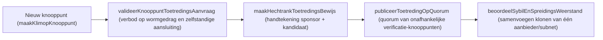

> 🌐 **Taal / Мова:** [Українська](ПЛЮЩ-ЕТАП-10-КЕРОВАНЕ-РОЗШИРЕННЯ-ТА-ОБМІН-РЕСУРСАМИ.uk.md) · **Nederlands** | [Startpagina](../../LEESMIJ.md) · [Documentatie-index](../INDEX.nl.md) · [Hoofdarchitectuurmanifest «Klimop»](ARCHITECTUURMANIFEST-KLIMOP.nl.md) · [Fase 1 — Kern en uitgaveplan](KLIMOP-FASE-1-ARCHITECTUURKERN-EN-UITGAVEPLAN.nl.md) · [Fase 2 — «Stengels»](KLIMOP-FASE-2-BEPROEVINGSNETWERK-EN-STENGELS.nl.md) · [Fase 3 — Versleuteling en opslag](KLIMOP-FASE-3-VERSLEUTELING-EN-VERDEELDE-OPSLAG.nl.md) · [Fase 4 — FROST](KLIMOP-FASE-4-GEDISTRIBUEERDE-SLEUTELS-EN-DREMPELHANDTEKENINGEN.nl.md) · [Fase 5 — Identiteit en `MLS`](KLIMOP-FASE-5-ONAFHANKELIJKE-IDENTITEIT-EN-GROEPSRUIMTES.nl.md) · [Fase 6 — Bestuur en uitgaven](KLIMOP-FASE-6-DREMPELBESTUUR-EN-VEILIGE-UITGAVEN.nl.md) · [Fase 7 — Immuunsysteem](KLIMOP-FASE-7-IMMUUNSYSTEEM-EN-ZELFHERSTEL.nl.md) · [Fase 8 — Dienstenoverdracht](KLIMOP-FASE-8-DIENSTENOVERDRACHT-EN-GEISOLEERDE-VERBINDERS.nl.md) · [Fase 9 — Mensbescherming](KLIMOP-FASE-9-MENSBESCHERMING-EN-DWANGBESTENDIGHEID.nl.md)

# Fase 10 van het ecosysteem «Klimop» — Beheerste uitbreiding («Hechtranken»), spreiding over rechtsgebieden en middelenuitwisseling («Voeding») (`KLIMOP-011`)

- **Uitvoeringsdatum:** 21-11-2026
- **Coördinatietaak:** `KLIMOP-011` (bouwt voort op het in `integratie` samengevoegde verzoek nr. 192 `KLIMOP-010`, samenvoeging `f1ef34bc2d871f6d47e7122e70bb83f695085bfc`)
- **Programmatische realisatie:**
  - Toetsing van toetredingsaanvragen zonder wormgedrag (`valideerKnooppuntToetredingsAanvraag`), tweezijdig ondertekende toetredingsbewijzen (`maakHechtrankToetredingsBewijs`, `verifieerHechtrankToetredingsBewijs`), Sybil- en spreidingsfilter (`beoordeelSybilEnSpreidingsWeerstand`), verbod op één enkel toetredingsknooppunt (`controleerGeenEnkelToetredingsknooppunt`), eerlijke profielen voor 5 apparaatklassen (`APPARAAT_KLASSE_RICHTWAARDEN`), ondertekende middelenkwitanties (`maakMiddelenBijdrageKwitantie`), eerlijke balans van «Voeding» (`berekenEerlijkeMiddelenBalans`) en veilige uittreding (`planVeiligeKnooppuntUittreding`): [`shared/klimop/hechtranken.ts`](../../shared/klimop/hechtranken.ts)
  - Quorumcoördinator voor uitbreiding en middelenadministratie (`KlimopHechtrankenEnVoedingClient`): [`backend/klimop-hechtranken-client.ts`](../../backend/klimop-hechtranken-client.ts)
  - Netwerkopdrachten onder het `verificatie`-mandaat binnen `knooppunt_beheer` (`registreer_knooppunt_toetreding`, `registreer_middelen_kwitantie`, `registreer_veilige_uittreding`, `raadpleeg_uitbreiding_en_voeding`): [`backend/klimop-knooppunt-agent.ts`](../../backend/klimop-knooppunt-agent.ts)
  - Herhaalbare proeftuin voor spreiding over rechtsgebieden (`NL`, `CH`, `UA` + `SE`, `IS`) en afweer tegen Sybil-aanvallen: [`scripts/klimop-etappe10-hechtranken-proef.mjs`](../../scripts/klimop-etappe10-hechtranken-proef.mjs)
- **Normatieve grondslag:** hoofdstukken `§1.4–1.5`, `§4–§5.2`, `§26–§27`, `§36 (Fase 10)`, `§42 punt 6, 13`, `§43 punt 2, 6, 7, 10`, verplicht **Document nr. 15** uit het Fase 1-register en punten 14–15 uit `§44` van het [Hoofdarchitectuurmanifest «Klimop»](ARCHITECTUURMANIFEST-KLIMOP.nl.md)
- **Bevoegdheidsgrens:** de actieve productie-infrastructuur (`PostgreSQL 18.6`, `mijn-ruimte.service`, `*.tarasevych.com`) wordt niet zonder afzonderlijk besluit van de eigenaar gewijzigd of uitgeschakeld.

---

## 1. Handleiding voor het opzetten en aansluiten van een nieuw knooppunt zonder wormgedrag (Document nr. 15, §5, §5.2)

1. **Uitdrukkelijke toestemming en verbod op computerwormgedrag (§5.2):** `valideerKnooppuntToetredingsAanvraag` weigert direct elke aanvraag zonder toestemming van de apparaateigenaar (`WORMGEDRAG_ZELFSTANDIGE_INSTALLATIE_VERBODEN`), met verborgen rekenkrachtverbruik (`WORMGEDRAG_VERBORGEN_MIDDELENVERBRUIK_VERBODEN`), onbegrensde kopieën (`WORMGEDRAG_ONBEGRENSDE_REPLICATIE_VERBODEN`), automatische rechtenuitbreiding via een verbinding (`WORMGEDRAG_AUTOMATISCHE_RECHTENUITBREIDING_VERBODEN`) of vertrouwen op louter netwerknabijheid (`NETWERKNABIJHEID_GEEN_GROND_VOOR_VERTROUWEN`).
2. **Verbod op zelfstandige inschakeling van externe voorzieningen:** elke aansluiting van externe middelen zonder uitdrukkelijke bevestiging van de eigenaar wordt bij de aanvraagtoetsing geweigerd.
3. **Tweezijdig bewijs en beperking van tijdelijke knooppunten (§4.4, §5):** `maakHechtrankToetredingsBewijs` verankert rollen, opslag- en bandbreedtegrenzen en vervaltijd met twee `Ed25519`-handtekeningen (sponsor én nieuw knooppunt), terwijl tijdelijke toetredingsknooppunten uitsluitend de rol `verbinding` mogen voeren.

---

## 2. Spreiding over rechtsgebieden, Sybil-afweer en verbod op één enkel toetredingsknooppunt (§4.4, §5.1, §43 punt 2, 7)

- **Samenvoegen van Sybil-klonen (`beoordeelSybilEnSpreidingsWeerstand`):** een toevallige meerderheid van knooppunten krijgt nooit kritieke macht — alle knooppunten bij dezelfde aanbieder (`aanbieder`) of binnen hetzelfde netwerk-voorvoegsel (`netwerkVoorvoegsel`) tellen samen voor hoogstens **1** onafhankelijke stem, en tijdelijke toetredingsknooppunten tellen voor **0** drempelstemmen.
- **Verbod op één enkel toetredingsknooppunt (`controleerGeenEnkelToetredingsknooppunt`, §4.4):** geen enkel overgangsknooppunt mag de enige ingang blijven; sluiting is pas toegestaan wanneer ten minste **2** onafhankelijke ingangen in verschillende rechtsgebieden en bij verschillende aanbieders beschikbaar blijven.

---

## 3. Middeleneconomie («Voeding») en veilige uittreding van knooppunten (§26–§27)

| Apparaatklasse (`APPARAAT_KLASSE_RICHTWAARDEN`) | Achtergrondwerk standaard alleen tijdens opladen | Geheugengrens (MiB) | Maximale processorbelasting (%) | Dagelijks verkeer (MiB) | Belofte van gelijk verbruik op alle telefoons |
|---|---|---|---|---|---|
| `ouder_zuinig_toestel` | `true` | `64` | `10%` | `50` | `false` |
| `moderne_telefoon` | `true` | `192` | `20%` | `250` | `false` |
| `persoonlijke_laptop` | `false` | `512` | `25%` | `2048` | `false` |
| `thuis_miniserver` | `false` | `2048` | `50%` | `20480` | `false` |
| `vast_knooppunt_server` | `false` | `8192` | `75%` | `102400` | `false` |

- **Onvoorwaardelijk recht op eigen gegevens (§27 lid 3–5):** toegang tot eigen persoonsgegevens is nooit afhankelijk van geleverde rekenkracht of opslag (`toegangTotEigenGegevensOnvoorwaardelijk: true`, `verplichteRekenkrachtDeelname: false`). Zelfs een passieve deelnemer zonder continu actief toestel (`0` bijdragepunten) behoudt volledige toegang tot eigen gegevens, terwijl wederzijds ondertekende kwitanties (`maakMiddelenBijdrageKwitantie`, met verbod op zelfondertekening `ZELF_ONDERTEKENDE_BIJDRAGE_ONGELDIG`) uitsluitend de voorrang voor extra netwerkreserves tussen knooppunten bepalen.
- **Veilige uittreding uit het quorum (`planVeiligeKnooppuntUittreding`):** een persoonlijk apparaat mag achtergrondwerk altijd onmiddellijk stoppen (`onmiddellijkStoppenAchtergrondToegestaan: true`), terwijl een vast quorumknooppunt pas uit het register wordt uitgeschreven nadat openstaande strepen zijn herplaatst (`openstaandeTeVerplaatsenStrepen === 0`) en een onafhankelijk quorum over rechtsgebieden behouden blijft.
