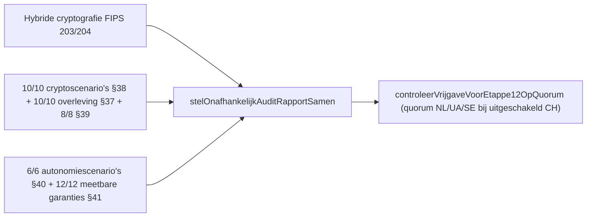

> 🌐 **Taal / Мова:** [Українська](ПЛЮЩ-ЕТАП-11-НЕЗАЛЕЖНИЙ-АУДИТ-БЕЗПЕКИ-ТА-МОДЕЛЬ-ЗАГРОЗ.uk.md) · **Nederlands** | [Startpagina](../../LEESMIJ.md) · [Documentatie-index](../INDEX.nl.md) · [Hoofdarchitectuurmanifest «Klimop»](ARCHITECTUURMANIFEST-KLIMOP.nl.md) · [Fase 1 — Kern en uitgaveplan](KLIMOP-FASE-1-ARCHITECTUURKERN-EN-UITGAVEPLAN.nl.md) · [Fase 2 — «Stengels»](KLIMOP-FASE-2-BEPROEVINGSNETWERK-EN-STENGELS.nl.md) · [Fase 3 — Versleuteling en opslag](KLIMOP-FASE-3-VERSLEUTELING-EN-VERDEELDE-OPSLAG.nl.md) · [Fase 4 — FROST](KLIMOP-FASE-4-GEDISTRIBUEERDE-SLEUTELS-EN-DREMPELHANDTEKENINGEN.nl.md) · [Fase 5 — Identiteit en `MLS`](KLIMOP-FASE-5-ONAFHANKELIJKE-IDENTITEIT-EN-GROEPSRUIMTES.nl.md) · [Fase 6 — Bestuur en uitgaven](KLIMOP-FASE-6-DREMPELBESTUUR-EN-VEILIGE-UITGAVEN.nl.md) · [Fase 7 — Immuunsysteem](KLIMOP-FASE-7-IMMUUNSYSTEEM-EN-ZELFHERSTEL.nl.md) · [Fase 8 — Dienstenoverdracht](KLIMOP-FASE-8-DIENSTENOVERDRACHT-EN-GEISOLEERDE-VERBINDERS.nl.md) · [Fase 9 — Mensbescherming](KLIMOP-FASE-9-MENSBESCHERMING-EN-DWANGBESTENDIGHEID.nl.md) · [Fase 10 — «Hechtranken» en «Voeding»](KLIMOP-FASE-10-BEHEERSTE-UITBREIDING-EN-MIDDELENUITWISSELING.nl.md)

# Fase 11 van het ecosysteem «Klimop» — Onafhankelijke beveiligingsaudit, samengevat dreigingsmodel en tegenmaatregelen (Document nr. 20) en postkwantumgereedheid (`KLIMOP-012`)

- **Uitvoeringsdatum:** 21-11-2026
- **Coördinatietaak:** `KLIMOP-012` (bouwt voort op het in `integratie` samengevoegde verzoek nr. 193 `KLIMOP-011`, samenvoeging `89293d0b4eaac12084f17c21681479e46b35aa20`)
- **Programmatische realisatie:**
  - Hybride postkwantumsleutels, dubbele handtekeningen en sleutelinkapseling (`maakHybridePostkwantumKnooppunt`, `ondertekenHybrideEd25519MlDsa65`, `verifieerHybrideEd25519MlDsa65`, `kapselHybrideX25519MlKem768In`, `ontkapselHybrideX25519MlKem768` volgens `FIPS 203` / `FIPS 204` in ingebouwd `node:crypto`), samengevat dreigingsmodel met eerlijke restrisico's (`KLIMOP_DREIGINGS_MODEL`, `valideerDreigingsModelEnRestrisicos`), toetsers voor de 10 cryptografische proeven van §38 (`beoordeelCryptografischeAudit38`), de 6 autonomiescenario's van §40 (`beoordeelAutonomieAudit40`), de 12 meetbare garanties van §41 (`beoordeelMeetbareGaranties41`) en het hybride ondertekende eindrapport (`stelOnafhankelijkAuditRapportSamen`, `verifieerOnafhankelijkAuditRapport`): [`shared/klimop/beveiligingsaudit.ts`](../../shared/klimop/beveiligingsaudit.ts)
  - Quorumclient voor onafhankelijke beveiligingsaudit en vrijgavecontrole voor Fase 12 (`KlimopBeveiligingsAuditClient`): [`backend/klimop-audit-client.ts`](../../backend/klimop-audit-client.ts)
  - Netwerkopdrachten onder het `verificatie`-mandaat binnen `knooppunt_beheer` (`registreer_beveiligingsaudit_rapport`, `raadpleeg_beveiligingsaudit_staat`): [`backend/klimop-knooppunt-agent.ts`](../../backend/klimop-knooppunt-agent.ts)
  - Herhaalbare geïsoleerde proeftuin voor hybride cryptografie, 10 cryptografische aanvallen (§38), 6 autonomie-oefeningen (§40 op knooppunten `NL`, `CH`, `UA`, `SE` bij uitgeschakeld `CH`) en 12 meetbare garanties (§41): [`scripts/klimop-etappe11-beveiligingsaudit-proef.mjs`](../../scripts/klimop-etappe11-beveiligingsaudit-proef.mjs)
- **Normatieve grondslag:** hoofdstukken `§13`, `§36 (Fase 11)`, `§37–§41`, `§42 (15 vragen)`, `§43 punt 1, 12, 13`, verplicht **Document nr. 20** uit het Fase 1-register en punten 4, 20, 21, 22 uit `§44` van het [Hoofdarchitectuurmanifest «Klimop»](ARCHITECTUURMANIFEST-KLIMOP.nl.md)
- **Bevoegdheidsgrens:** de actieve productie-infrastructuur (`PostgreSQL 18.6`, `mijn-ruimte.service`, `*.tarasevych.com`) wordt niet zonder afzonderlijk besluit van de eigenaar gewijzigd of uitgeschakeld.

---

## 1. Hybride postkwantumcryptografie zonder eigen ongeteste algoritmen (§13, §38, §43 punt 12)

In Fase 11 zijn gestandaardiseerde postkwantumprimitieven in ingebouwd `node:crypto` (`OpenSSL 3.5.9`) geactiveerd en getoetst zonder externe pakketten en zonder zelfbedachte cijfers:

1. **Hybride dubbele digitale handtekening (`Ed25519 + ML-DSA-65`, `FIPS 204`):** `ondertekenHybrideEd25519MlDsa65` bindt beide publieke sleutels cryptografisch in één transcript en ondertekent het bericht met beide algoritmen. `verifieerHybrideEd25519MlDsa65` keurt een handtekening **uitsluitend** goed wanneer zowel de klassieke `Ed25519`-controle als de postkwantum-`ML-DSA-65`-controle gelijktijdig slaagt.
2. **Hybride sleutelinkapseling (`X25519 + ML-KEM-768`, `FIPS 203`):** `kapselHybrideX25519MlKem768In` en `ontkapselHybrideX25519MlKem768` combineren efemere `X25519`-uitwisseling, `ML-KEM-768`-inkapseling en de `SHA-256`-afdruk van het volledige transcript via `HKDF-SHA-256`, als bescherming tegen «nu onderscheppen, later met een kwantumcomputer ontsleutelen» (§13).

---

## 2. Samengevat dreigingsmodel, tegenmaatregelen en eerlijke restrisico's (Verplicht Document nr. 20)

Overeenkomstig `§43 punt 1` en `§44 punt 4, 21` verbiedt het dreigingsmodel elke bewering van «absolute onkwetsbaarheid» (`beweertAbsoluteOnkwetsbaarheid: false`) en legt het voor alle 8 architectuurlagen eerlijke restrisico's vast:

| Code | Architectuurlaag | Opgeloste `SPOF` | Voornaamste dreiging | Technische tegenmaatregel in «Klimop» | Eerlijk restrisico |
|---|---|---|---|---|---|
| `DRG-01` | `netwerk_en_stengels` | `SPOF-1`, `SPOF-2` | Onderschepping, herhaling van kaders, lengte-analyse of blokkade van één route | `stengels.ts` + `klimop-knooppunt-agent.ts`: `X25519+Ed25519`, `ChaCha20-Poly1305`, opvulling tot 256 bytes, herhalingswering en blinde estafette | Een wereldwijde waarnemer van netwerkverkeer kan zonder onafhankelijke kanalen nog steeds netwerkactiviteit tussen adressen waarnemen |
| `DRG-02` | `verdeelde_opslag` | `SPOF-1`, `SPOF-3` | Diefstal van een opslagschijf of verlies van tot $m$ strepen van een object | `opslag.ts` + `immuunsysteem.ts`: clientzijdige envelopversleuteling, `Reed-Solomon (k+m)`, blinde `HMAC-SHA-256`-controle en sleutelloze herbouw | Gelijktijdig fysiek verlies van meer dan $m$ onafhankelijke knooppunten vóór zelfherstel vereist terugval op een autonome reservekopie |
| `DRG-03` | `drempelsleutels_en_postkwantum` | `SPOF-4` | Langzame diefstal van delen over epochen heen of latere kwantumontsleuteling | `drempelsleutels.ts` + `beveiligingsaudit.ts`: Feldman/Pedersen-deling, tweefasige epochen, `FROST RFC 9591` en hybride `ML-DSA-65` / `ML-KEM-768` | Gelijktijdige compromittering van $\ge k$ deelnemers binnen één epoche vóór de geplande verversing haalt de drempel |
| `DRG-04` | `identiteit_en_groepen` | `SPOF-1` | Diefstal van een vertrouwd apparaat of onrechtmatige overname van herstel | `identiteit.ts`: beperkte apparaatcertificaten zonder wortelsleutel, quorumintrekking, `MLS RFC 9420` en betwistingstermijn van `48/168` uur | Tot het intrekkingssignaal is verspreid kan een ontgrendeld gestolen apparaat reeds geopende gegevens in het geheugen lezen |
| `DRG-05` | `bestuur_en_uitgaven` | `SPOF-4` | Eenzijdige regelwijziging, pakketvervalsing of ongemerkte wijziging van de webclient | `bestuur.ts`: 7 bevoegdheidscategorieën, tijdsloten `24/48/72` uur, `FROST`-besluiten, rollenscheiding en automatische terugdraaiing van Golf 1 | Een kwaadaardige browserextensie op een reeds besmet toestel buiten de ondertekende webclient om vereist een aparte gecontroleerde toepassing |
| `DRG-06` | `immuunsysteem_en_uitbreiding` | `SPOF-1`, `SPOF-2` | Sybil-aanval met klonen bij één aanbieder of gedrag als een computerworm | `hechtranken.ts`: verbod op zelfstandige installatie en verborgen inschakeling van externe middelen, tweezijdige `Ed25519`-bewijzen en bundeling per aanbieder/subnet tot $\le 1$ stem | Verborgen juridische banden tussen formeel aparte aanbieders vragen periodieke beoordeling van het quorumregister |
| `DRG-07` | `externe_verbinders` | `SPOF-2`, `SPOF-3` | Compromittering van een externe e-mail- of cloudkoppeling of lekken van één verbindersleutel | `diensten.ts`: ongecorreleerde pseudoniemen `psid1_…`, aparte `HKDF`-sleutels voor alle 11 diensten en geïsoleerde aanmeldgegevens per verbinder | Berichten die de gebruiker bewust naar een externe gecentraliseerde ontvanger stuurt, vallen onder het beleid van die ontvanger |
| `DRG-08` | `mensbescherming_en_dwang` | `SPOF-5` | Fysieke of psychologische dwang om codes af te geven of reserves direct te wissen | `mensbescherming.ts`: scheidbare kluizen zonder zelfvernietiging, 256-byte noodsignalen, toetsing van 7 signalen en herroepbaar 72-uurs tijdslot | Geen enkel cryptografisch mechanisme garandeert op zichzelf de fysieke veiligheid van een mens tegenover een gewapende aanvaller |

---

## 3. Cryptografische toetsing (§38), praktische autonomie (§40), 12 meetbare garanties (§41) en vrijgave voor Fase 12

- **10/10 cryptografische controles (§38):** op de echte modules zijn diefstal van `< k` delen, detectie van een vervalst deel via Feldman-toezeggingen, blokkade van stapeling over epochen (`EPOCHE_VAN_DELEN_VERSCHILT`), veilig afbreken van een onderbroken epocheverversing, afwijzing van `knooppuntId`-imitatie, herhalingswering van kaders, breuk bij wijziging van ondertekende mandaten, blokkade van drempelomzeiling in `netwerk_regels`, afwijzing van valse wortelsleutelrotatie en herstel na uitval van 2 van de 5 deelnemers getoetst.
- **6/6 praktische autonomiescenario's (§40) en 12/12 geverifieerde indicatoren (§41):** op 4 lokale proeftuinknooppunten (`NL`, `CH`, `UA`, `SE`) is na volledige verbreking van het traject naar `CH` bit-exact gegevensherstel zonder verlies (`0` bytes), werking zonder de oorspronkelijke auteur, onmiddellijke quarantaine van een gecompromitteerde beheerder, zelfstandige werking van de overige diensten bij een uitgeschakelde testverbinder, automatische stop en terugdraaiing van een gevaarlijke uitgave in Golf 1 en versiecompatibiliteit aangetoond; bij elk van de 12 waarden van `§41` zijn de waardesoort (`feitelijke_meting`, `protocol_eigenschap` of `beleids_configuratie`), de eenheid en de `SHA-256`-bronafdruk vastgelegd.
- **Strikte quorumdrempel vóór Fase 12 («Zaden»):** zodra in `stelOnafhankelijkAuditRapportSamen` ook maar één onopgeloste zwakte (`openstaandeKritiekeZwaktes.length > 0`) of niet-gehaalde eis uit `§37–§42` aanwezig is, blijft `vrijgegevenVoorEtappe12` gedwongen `false`. Zonder openstaande zwaktes heeft het actieve quorum `NL + UA + SE` beide handtekeningen (`Ed25519 + ML-DSA-65`) bevestigd en de vrijgave voor de afsluitende **Fase 12 (`KLIMOP-013`)** vastgelegd.
