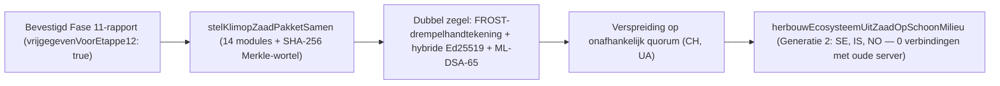

> 🌐 **Taal / Мова:** [Українська](ПЛЮЩ-ЕТАП-12-НАСІННЯ-СПАДКОЄМНІСТЬ-ТА-ПОСТІЙНИЙ-РОЗВИТОК.uk.md) · **Nederlands** | [Startpagina](../../LEESMIJ.md) · [Documentatie-index](../INDEX.nl.md) · [Hoofdarchitectuurmanifest «Klimop»](ARCHITECTUURMANIFEST-KLIMOP.nl.md) · [Fase 1 — Kern en uitgaveplan](KLIMOP-FASE-1-ARCHITECTUURKERN-EN-UITGAVEPLAN.nl.md) · [Fase 2 — «Stengels»](KLIMOP-FASE-2-BEPROEVINGSNETWERK-EN-STENGELS.nl.md) · [Fase 3 — Versleuteling en opslag](KLIMOP-FASE-3-VERSLEUTELING-EN-VERDEELDE-OPSLAG.nl.md) · [Fase 4 — FROST](KLIMOP-FASE-4-GEDISTRIBUEERDE-SLEUTELS-EN-DREMPELHANDTEKENINGEN.nl.md) · [Fase 5 — Identiteit en `MLS`](KLIMOP-FASE-5-ONAFHANKELIJKE-IDENTITEIT-EN-GROEPSRUIMTES.nl.md) · [Fase 6 — Bestuur en uitgaven](KLIMOP-FASE-6-DREMPELBESTUUR-EN-VEILIGE-UITGAVEN.nl.md) · [Fase 7 — Immuunsysteem](KLIMOP-FASE-7-IMMUUNSYSTEEM-EN-ZELFHERSTEL.nl.md) · [Fase 8 — Dienstenoverdracht](KLIMOP-FASE-8-DIENSTENOVERDRACHT-EN-GEISOLEERDE-VERBINDERS.nl.md) · [Fase 9 — Mensbescherming](KLIMOP-FASE-9-MENSBESCHERMING-EN-DWANGBESTENDIGHEID.nl.md) · [Fase 10 — «Hechtranken» en «Voeding»](KLIMOP-FASE-10-BEHEERSTE-UITBREIDING-EN-MIDDELENUITWISSELING.nl.md) · [Fase 11 — Audit en dreigingsmodel](KLIMOP-FASE-11-ONAFHANKELIJKE-BEVEILIGINGSAUDIT-EN-DREIGINGSMODEL.nl.md)

# Fase 12 van het ecosysteem «Klimop» — «Zaden» (Document nr. 19), overdracht van opvolging (Document nr. 23) en duurzame autonome doorontwikkeling (`KLIMOP-013`)

- **Uitvoeringsdatum:** 21-11-2026
- **Coördinatietaak:** `KLIMOP-013` (bouwt voort op het in `integratie` samengevoegde verzoek nr. 194 `KLIMOP-012`, samenvoeging `372c059460a8c92e4f7dbea529421eb43c862766`)
- **Programmatische realisatie:**
  - Overzicht van geverifieerde technische afhankelijkheden zonder koppeling aan gesloten cloudmonopolies (`KLIMOP_TECHNISCHE_AFHANKELIJKHEDEN`, `valideerTechnischeAfhankelijkheden`), zelfstandig reproductiepakket «Zaden» met `SHA-256`-Merkle-wortel over alle 14 kernmodules en dubbele verzegeling via `FROST RFC 9591` + `Ed25519 + ML-DSA-65 FIPS 204` (`stelKlimopZaadPakketSamen`, `verifieerKlimopZaadPakket`), schone opbouw zonder oude server (`herbouwEcosysteemUitZaadOpSchoonMilieu`), tweezijdige drempeloverdracht van opvolging (`stelOpvolgingsOverdrachtSamen`, `verifieerOpvolgingsOverdracht`), bewaking van 16 ontwikkelrichtingen voor AI-agenten (`beoordeelAutonoomOntwikkelVoorstel`) en eindtoetsing van de 12 pijlers van `§46` (`valideerKlimopEindvisie46`): [`shared/klimop/zaden.ts`](../../shared/klimop/zaden.ts)
  - Quorumclient voor verspreiding van «Zaden», schone opbouw van een nieuwe generatie knooppunten en bekrachtiging van opvolging (`KlimopZadenEnOpvolgingClient`): [`backend/klimop-zaden-client.ts`](../../backend/klimop-zaden-client.ts)
  - Netwerkopdrachten onder het `verificatie`-mandaat binnen `knooppunt_beheer` (`bewaar_gevalideerd_zaad_pakket`, `registreer_opvolgings_overdracht`, `raadpleeg_zaad_en_opvolging`): [`backend/klimop-knooppunt-agent.ts`](../../backend/klimop-knooppunt-agent.ts)
  - Herhaalbare proeftuin voor uitschakeling van de oude hoofdserver, schone heropbouw van Generatie 2 (`SE`, `IS`, `NO`) vanuit «Zaden» en overdracht van opvolging bij volledige afwezigheid van de oorspronkelijke auteur: [`scripts/klimop-etappe12-zaden-proef.mjs`](../../scripts/klimop-etappe12-zaden-proef.mjs)
- **Normatieve grondslag:** hoofdstukken `§1.7`, `§2`, `§18–§20`, `§32–§34`, `§36 (Fase 12)`, `§42 (15 vragen)`, verplichte **Documenten nr. 19 en nr. 23** uit het Fase 1-register (alle **25 van de 25** documenten van `§44` zijn voltooid!) en alle 12 pijlers van `§46` van het [Hoofdarchitectuurmanifest «Klimop»](ARCHITECTUURMANIFEST-KLIMOP.nl.md)
- **Bevoegdheidsgrens:** de actieve productie-infrastructuur (`PostgreSQL 18.6`, `mijn-ruimte.service`, `*.tarasevych.com`) wordt niet zonder afzonderlijk besluit van de eigenaar gewijzigd of uitgeschakeld.

---

## 1. Handleiding voor onafhankelijke reproductie vanaf nul — «Zaden» en technische afhankelijkheden (Document nr. 19, §1.7, §44 punt 19)

1. **Strikte ingangsdrempel en vrijwaring van geheimen:** `stelKlimopZaadPakketSamen` controleert de geldigheid van het Fase 11-rapport (`vrijgegevenVoorEtappe12 === true`), de aanwezigheid van alle 14 basismodules `shared/klimop/*.ts`, de spreiding van de startknooppunten over ten minste 2 rechtsgebieden en aanbieders en het volledig ontbreken van privésleutels of privé-inhoud (`bevatGeheimeSleutelsOfPriveInhoud: false`).
2. **Dubbel cryptografisch zegel en Merkle-boom:** de gesorteerde onderdelen worden samengevat in `merkleWortelSha256` en tegelijkertijd ondertekend met zowel een `FROST (RFC 9591)`-drempelhandtekening van de hoedersraad als een hybride postkwantumhandtekening `Ed25519 + ML-DSA-65 (FIPS 204)`. Elke wijziging van één enkele byte wordt door `verifieerKlimopZaadPakket` onmiddellijk afgewezen.
3. **Schone heropbouw zonder oorspronkelijke server:** `herbouwEcosysteemUitZaadOpSchoonMilieu` weigert elk beroep op de oude server (`VERBINDING_MET_OUDE_SERVER_VERBODEN_BIJ_SCHONE_OPBOUW`), controleert dat alle relatieve importpaden van de uitgepakte modules aanwezig zijn en bouwt een nieuwe generatie knooppunten in onafhankelijke rechtsgebieden uitsluitend vanuit het geverifieerde zaadpakket op.
4. **Technische afhankelijkheden (`KLIMOP_TECHNISCHE_AFHANKELIJKHEDEN`):** alle 6 afhankelijkheidsgroepen (`node:crypto OpenSSL 3.5+`, «Stengels», Reed-Solomon, `FROST`, `klid1_` + groepsepochen naar het idee van `RFC 9420` + `CRDT` en de warme terugvallijn `PostgreSQL 18.6` / `age`) rusten op open standaarden (`vereistProprietaireCloudDienst: false`) met een vastgelegd vervangingspad.

---

## 2. Procedure voor overdracht aan nieuwe bevoegde deelnemers zonder de oorspronkelijke auteur (Document nr. 23, §1.7, §19–§20)

- **Geen afhankelijkheid van de oorspronkelijke auteur (`oorspronkelijkeAuteurDeelnameVereist: false`):** zelfs wanneer de aanvankelijke maker of server blijvend wegvalt, kan een drempelquorum ($\ge k$) van de vorige hoedersraad samen met de nieuwe hoedersraad een tweezijdige opvolgingsakte `stelOpvolgingsOverdrachtSamen` vaststellen.
- **Bescherming tegen overname én tegen overdracht naar onbereikbare sleutels:** `verifieerOpvolgingsOverdracht` dwingt af:
  1. een doorlopen tijdslot van **`>= 72` uur** (`OPVOLGING_TIJDSLOT_72_UUR_NOG_ACTIEF`);
  2. een stijgend grondwetvolgnummer (`versieVolgnummer`);
  3. spreiding van de nieuwe hoeders over verschillende rechtsgebieden en aanbieders;
  4. geldigheid van beide `FROST`-drempelhandtekeningen (oude én nieuwe hoedersraad).
- **Scheiding tussen bestuur en persoonsgegevens (`toegangTotPersoonlijkeGegevensOvergedragen: false`):** overdracht van bestuursbevoegdheid geeft nieuwe hoeders technisch nooit toegang tot de versleutelde persoonlijke ruimtes van gebruikers (`§2`, `§19`).

---

## 3. Duurzame ontwikkeling over 16 AI-richtingen (§32–§34) en alle 12 pijlers van het eindbeeld (§46)

- **Autonome ontwikkeling zonder onbeperkte autonomie (`beoordeelAutonoomOntwikkelVoorstel`):** voor alle 16 gespecialiseerde richtingen `KLIMOP_ZESTIEN_ONTWIKKELRICHTINGEN` kunnen agenten zelfstandig getoetste verbeteringen voorbereiden met feitelijk testbewijs en de 15-vragencontrole, terwijl elke poging tot zelfgoedkeuring of eigenmachtige uitrol (`AI_ZELFGOEDKEURING_OF_UITROL_VERBODEN`), eenzijdige wijziging van cryptoregels (`EIGENMACHTIGE_CRYPTOREGEL_WIJZIGING_VERBODEN`), rechtenuitbreiding of geheimlek direct wordt geblokkeerd (`vereistMenselijkOfQuorumBesluit: true`).

| Pijler van het eindbeeld (§46) | Module met aantoonbare verwezenlijking | Status |
|---|---|---|
| 1. Elk mens is onafhankelijk eigenaar van eigen gegevens en rechten | [`shared/klimop/identiteit.ts`](../../shared/klimop/identiteit.ts) | **Bewezen** |
| 2. Vertrouwd apparaat voert uitsluitend begrensde functies uit | [`shared/klimop/identiteit.ts`](../../shared/klimop/identiteit.ts) | **Bewezen** |
| 3. Knooppunt heeft beperkte rol en verifieerbaar paspoort | [`shared/klimop/kern.ts`](../../shared/klimop/kern.ts) | **Bewezen** |
| 4. Dienst draait geïsoleerd met uitdrukkelijke toestemmingen | [`shared/klimop/diensten.ts`](../../shared/klimop/diensten.ts) | **Bewezen** |
| 5. Kritieke sleutel heeft volledige verifieerbare levenscyclus | [`shared/klimop/drempelsleutels.ts`](../../shared/klimop/drempelsleutels.ts) | **Bewezen** |
| 6. Belangrijk besluit heeft herleidbare herkomst en afstemming | [`shared/klimop/bestuur.ts`](../../shared/klimop/bestuur.ts) | **Bewezen** |
| 7. Kritieke verbinding heeft alternatieven of eerlijke grenzen | [`shared/klimop/stengels.ts`](../../shared/klimop/stengels.ts) | **Bewezen** |
| 8. Uitgave wordt vooraf getoetst zonder breuk van vertrouwen | [`shared/klimop/bestuur.ts`](../../shared/klimop/bestuur.ts) | **Bewezen** |
| 9. Storing leidt tot begrensde, controleerbare reactie | [`shared/klimop/immuunsysteem.ts`](../../shared/klimop/immuunsysteem.ts) | **Bewezen** |
| 10. Gebruiker kan deelname beëindigen en toegang intrekken | [`shared/klimop/hechtranken.ts`](../../shared/klimop/hechtranken.ts) | **Bewezen** |
| 11. AI-agent ondersteunt zonder onbeperkte macht | [`shared/klimop/zaden.ts`](../../shared/klimop/zaden.ts) | **Bewezen** |
| 12. Toekomstige ontwikkelaar bouwt voort vanuit geverifieerd «Zaad» | [`shared/klimop/zaden.ts`](../../shared/klimop/zaden.ts) | **Bewezen** |
