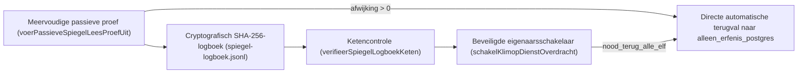

> 🌐 **Taal / Мова:** [Українська](ПЛЮЩ-ЕТАП-14-ПАСИВНЕ-ЧИТАННЯ-ЖУРНАЛ-РОЗБІЖНОСТЕЙ-ТА-ПЕРЕМИКАЧ-ПОВЕРНЕННЯ.uk.md) · **Nederlands** | [Startpagina](../../LEESMIJ.md) · [Documentatie-index](../INDEX.nl.md) · [Hoofdarchitectuurmanifest «Klimop»](ARCHITECTUURMANIFEST-KLIMOP.nl.md) · [Fase 13 — Platformintegratie en Stap 1](KLIMOP-FASE-13-PLATFORMINTEGRATIE-EN-SPIEGELVERIFICATIE.nl.md)

# Klimop — Fase 14: Stap 2 passief lezen, cryptografisch afwijkingslogboek en schakelaar voor directe terugval (`KLIMOP-015`)

> **Status:** voltooid en geïntegreerd in de hoofdcodebasis van «Mijn Ruimte» in de veilige modus van Stap 2 (§35 van het manifest).
> **Bevoegdheidsgrens (§3.2, §35):** de actieve databank `PostgreSQL 18.6`, de `systemd`-diensten, het installatieprogramma `/usr/local/sbin/mijn-ruimte-installeer`, de versleutelde `age`-reservekopieën en alle 11 draaiende subdomeinen `*.tarasevych.com` blijven volledig onaangetast.

---

## 1. Doel van deze fase en aansluiting op Fase 13 (`KLIMOP-014`)

In Fase 13 (`KLIMOP-014`) zijn de 12 cryptografische kernmodules `shared/klimop/*.ts` verbonden met de server, de `MCP`-poort voor 14 AI-agenten en het webpaneel `KlimopPaneel.tsx` op het niveau van **Stap 1** — een eenmalige controle in het werkgeheugen zonder duurzaam logboek en zonder beheerste schakelaar.

Volgens hoofdstuk 35 van het Hoofdarchitectuurmanifest (*«Geleidelijke ombouw zonder gegevensverlies»*) is de volgende veilige overgangsstap **Stap 2 — passief spiegellezen van meervoudige steekproeven, een duurzaam cryptografisch afwijkingslogboek en een directe terugvalsleutel voor alle 11 diensten**, waarbij de bestaande basis onveranderd de enige schrijfbron blijft (`primaireSchrijfBron: 'erfenis_postgres'`).

---

## 2. Gerealiseerde onderdelen in Fase 14 (`KLIMOP-015`)

1. **Serveropslag van Stap 2 (`backend/klimop-overdracht-opslag.ts`):**
   - [`voerPassieveSpiegelLeesProefUit`](../../backend/klimop-overdracht-opslag.ts) — vormt voor de gekozen dienst een geïsoleerde steekproef (`2..12` elementen onder dienstpseudoniem `psid1_…` en `HKDF-SHA-256`-sleutel), codeert elk element met `Reed-Solomon (4+2)` inclusief herstel na uitval van 2 stroken, voert ondertekende `CRDT`-samenvoeging uit tussen twee knooppunten, vergelijkt inhouds- en machtigingsafdrukken en zet de dienst bij elke vastgestelde afwijking **onmiddellijk en automatisch** terug naar `'alleen_erfenis_postgres'`;
   - [`berekenSpiegelLogboekRegelSha256`](../../backend/klimop-overdracht-opslag.ts) en [`verifieerSpiegelLogboekKeten`](../../backend/klimop-overdracht-opslag.ts) — onveranderlijk afwijkingslogboek `spiegel-logboek.jsonl` met een aaneengesloten `SHA-256`-keten vanaf `KLIMOP_GENESIS_KETEN_SHA256`, waarin **uitsluitend geanonimiseerde 16-teken sleutelafdrukken** worden opgeslagen (`bevatGeheimenOfInhoud: false`);
   - [`schakelKlimopDienstOverdracht`](../../backend/klimop-overdracht-opslag.ts) — atomaire eigenaarsschakelaar (`schakelaars.json` via tijdelijk bestand en `renameSync`): staat inschakeling van `'passief_spiegel_lezen'` uitsluitend toe bij een sluitende logboekketen en een bewezen foutloze controle, maar houdt onmiddellijke terugschakeling van één dienst (`terug_naar_erfenis`) of van alle 11 diensten tegelijk (`nood_terug_alle_elf`) altijd onvoorwaardelijk beschikbaar.
2. **Eigenaarsroutes en technische `MCP`-hulpmiddelen voor alle 14 AI-agenten:**
   - in [`backend/klimop-paden.ts`](../../backend/klimop-paden.ts) zijn de beveiligde eigenaarsroutes `POST /api/owner/klimop/passieve-spiegel`, `POST /api/owner/klimop/spiegel-logboek` en `POST /api/owner/klimop/overdracht-schakelaar` toegevoegd (met vastlegging in `app.audit`);
   - in [`backend/klimop-hulpmiddeldefinities.ts`](../../backend/klimop-hulpmiddeldefinities.ts), [`backend/klimop-hulpmiddelen.ts`](../../backend/klimop-hulpmiddelen.ts) en de Connector-v2-catalogus ([`shared/connector-v2/catalogus.ts`](../../shared/connector-v2/catalogus.ts)) zijn `klimop_passieve_spiegel` en `klimop_spiegel_logboek` geregistreerd (samen 5 `klimop_*`-hulpmiddelen, alle namen `<= 63` tekens voor alle 14 AI-agenten). Overeenkomstig `§34` hebben AI-agenten geen toegang tot `overdracht-schakelaar` en kunnen zij nooit zelfstandig een dienstmodus wijzigen.
3. **Tweetalig webpaneel en vierlaagse contexthulp:**
   - in [`src/klimop/klimop-klant.ts`](../../src/klimop/klimop-klant.ts), [`src/agenten/KlimopPaneel.tsx`](../../src/agenten/KlimopPaneel.tsx) en [`shared/klimop-overzicht-model.ts`](../../shared/klimop-overzicht-model.ts) zijn de Stap-2-bediening, de ketenstatus van het logboek, de directe terugvalsleutel voor alle 11 diensten en de hulpsleutels `klimop.passief` en `klimop.schakelaar` ingebouwd.

---

## 3. Toetsing aan de 15 architectuurvragen (§42) en 14 verboden (§43)

- **Geen enkel nieuw storingspunt en gewaarborgde terugval (vragen 1, 8, 11):** elk van de 11 diensten schakelt onafhankelijk; bij een afwijking of bij de noodschakelaar keert de dienst onmiddellijk en zonder verlies terug naar de bestaande basis, zelfs wanneer het logboekbestand beschadigd zou zijn.
- **Geen verborgen bevoegdheden of lekken van metadata (vragen 2, 4, 5, 14):** AI-agenten lezen uitsluitend geanonimiseerde diagnostiek en kunnen de schakelaar niet bedienen; het logboek bevat nooit inhoud, geheimen of onversleutelde sleutels; eenmalige sleutels worden in `finally` met nullen overschreven.
- **Geen van de 14 verboden vereenvoudigingen (§43):** de actieve `PostgreSQL 18.6`-databank wordt niet uitgeschakeld of gewijzigd (`productieDatabankGewijzigd: false`), en alle controles zijn bewezen in [`tests/eenheid/klimop-015-passieve-spiegel-terugschakeling-20261121.test.ts`](../../tests/eenheid/klimop-015-passieve-spiegel-terugschakeling-20261121.test.ts).
