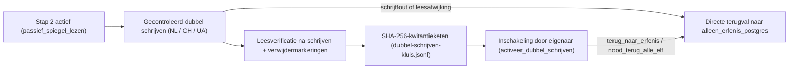

> 🌐 **Taal / Мова:** [Українська](ПЛЮЩ-ЕТАП-15-ПОДВІЙНЕ-ЗАПИСУВАННЯ-ЗВІРКА-ЧИТАННЯ-ТА-ПОВЕРНЕННЯ.uk.md) · **Nederlands** | [Hoofdpagina](../../LEESMIJ.md) · [Documentatie-index](../INDEX.nl.md) · [Hoofdarchitectuurmanifest «Klimop»](ARCHITECTUURMANIFEST-KLIMOP.nl.md) · [Fase 14 — Stap 2 passief lezen](KLIMOP-FASE-14-PASSIEF-LEZEN-AFWIJKINGSLOGBOEK-EN-TERUGSCHAKELING.nl.md)

# Klimop — Fase 15: Stap 3 gecontroleerd dubbel schrijven met leesverificatie en directe terugval (`KLIMOP-016`)

> **Status:** voltooid en opgenomen in de hoofdcodebasis van het platform «Mijn Ruimte» in de veilige, geïsoleerde stand van Stap 3 (§35 van het manifest).
> **Bevoegdheidsgrens (§3.2, §35):** de bestaande databank `PostgreSQL 18.6`, de `systemd`-diensten, het installatieprogramma `/usr/local/sbin/mijn-ruimte-installeer`, versleutelde `age`-reservekopieën en alle 11 draaiende subdomeinen `*.tarasevych.com` blijven volledig onaangetast; elke poging tot zelfstandig loskoppelen van de databank wordt geblokkeerd met `KLIMOP_LOSKOPPELING_VERBODEN` (`403`).

---

## 1. Doel van de fase en samenhang met Fase 14 (`KLIMOP-015`)

In Fase 14 (`KLIMOP-015`) werd **Stap 2** ingevoerd — meervoudig passief spiegellezen met een sluitende `SHA-256`-keten van het afwijkingslogboek en een schakelaar voor onmiddellijke terugval van één of alle 11 diensten.

Overeenkomstig hoofdstuk 35 van het Hoofdarchitectuurmanifest (*«Geleidelijke herbouw zonder gegevensverlies»*) is de volgende stap **Stap 3 — gecontroleerd dubbel schrijven met directe leesverificatie na schrijven, een cryptografisch kwitantielogboek en het onveranderlijke recht op directe terugschakeling voor alle 11 diensten**, met behoud van de bestaande databank als verplichte primaire schrijfbron (`primaireSchrijfBron: 'erfenis_postgres'`).

---

## 2. Gerealiseerde onderdelen van Fase 15 (`KLIMOP-016`)

1. **Serverkern van Stap 3 (`backend/klimop-overdracht-opslag.ts`):**
   - [`voerGecontroleerdeDubbelSchrijfProefUit`](../../backend/klimop-overdracht-opslag.ts) — voert voor de gekozen dienst een reeks van `3..12` bewerkingen uit (aanmaken `zet`, gelijktijdig bijwerken met hogere `HLC` en cryptografisch wissen met verwijdermarkering `verwijder`) op een quorum van 3 onafhankelijke knooppunten (`NL`, `CH`, `UA`), toetst Reed-Solomon-herstel `(4+2)` na verlies van 2 stroken, bevestigt zowel de verwijdermarkering als de leesgelijkheid na schrijven (`leesNaSchrijfGelijk`) en zet de dienst bij de kleinste fout **onmiddellijk en automatisch** terug naar de bestaande basis (`alleen_erfenis_postgres`);
   - [`berekenDubbelKwitantieSha256`](../../backend/klimop-overdracht-opslag.ts), [`verifieerDubbelKwitantieKeten`](../../backend/klimop-overdracht-opslag.ts) en [`leesKlimopDubbelSchrijvenLogboek`](../../backend/klimop-overdracht-opslag.ts) — beheren en controleren het onveranderlijke kwitantielogboek `dubbel-schrijven-kluis.jsonl` met een sluitende `SHA-256`-keten vanaf de nul-afdruk, waarin uitsluitend geanonimiseerde 16-tekenafdrukken worden vastgelegd (`bevatGeheimenOfInhoud: false`);
   - de uitgebreide [`schakelKlimopDienstOverdracht`](../../backend/klimop-overdracht-opslag.ts) — verbiedt het overslaan van stappen (`KLIMOP_STAP2_ACTIEF_VEREIST` — `409`), vereist een foutloze dubbelschrijfproef (`KLIMOP_DUBBEL_SCHRIJVEN_PROEF_VEREIST` — `409`) en sluitende ketens van beide logboeken, weigert elke poging tot zelfstandig loskoppelen van de databank (`KLIMOP_LOSKOPPELING_VERBODEN` — `403`) en houdt directe terugschakeling van één of alle 11 diensten altijd onvoorwaardelijk werkzaam.
2. **Eigenaarsroutes en `MCP`-hulpmiddelen voor alle 14 AI-agenten:**
   - in [`backend/klimop-paden.ts`](../../backend/klimop-paden.ts) zijn `POST /api/owner/klimop/dubbel-schrijven` en `POST /api/owner/klimop/dubbel-logboek` aangesloten met registratie in `app.audit`;
   - in [`backend/klimop-hulpmiddeldefinities.ts`](../../backend/klimop-hulpmiddeldefinities.ts), [`backend/klimop-hulpmiddelen.ts`](../../backend/klimop-hulpmiddelen.ts) en de Connector-v2-catalogus ([`shared/connector-v2/catalogus.ts`](../../shared/connector-v2/catalogus.ts)) zijn `klimop_dubbel_schrijven` en `klimop_dubbel_logboek` geregistreerd (samen 7 hulpmiddelen `klimop_*`, alle namen `<= 63` tekens voor alle 14 AI-agenten, zonder toegang voor agenten tot `overdracht-schakelaar` conform `§34`).
3. **Tweetalig webpaneel en vierlaagse uitleg:**
   - in [`src/klimop/klimop-klant.ts`](../../src/klimop/klimop-klant.ts), [`src/agenten/KlimopPaneel.tsx`](../../src/agenten/KlimopPaneel.tsx) en [`shared/klimop-overzicht-model.ts`](../../shared/klimop-overzicht-model.ts) zijn de bediening van Stap 3, het kwitantieoverzicht en de hulpsleutel `klimop.dubbel` toegevoegd.

---

## 3. Toetsing aan de 15 architectuurvragen (§42) en 14 verboden (§43)

- **Jurisdictionele spreiding en onmiddellijke terugval (vragen 1, 7, 8, 11):** dubbel schrijven controleert een quorum `NL / CH / UA` bij afzonderlijke aanbieders via `controleerKnooppuntOnafhankelijkheid`, overleeft verlies van 2 van 6 Reed-Solomon-stroken en zet één of alle 11 diensten direct terug naar de basis, ook bij een beschadigd logboekbestand.
- **Geen verborgen bevoegdheden en geen inhoudslek (vragen 2, 4, 5, 6, 14):** AI-agenten kunnen de schakelaar niet bedienen; loskoppeling van de databank is geblokkeerd; kwitanties bevatten enkel geanonimiseerde afdrukken en eenmalige sleutels worden met nullen overschreven in `finally`.
- **Geen verboden vereenvoudigingen (§43):** de draaiende databank `PostgreSQL 18.6` wordt niet uitgeschakeld of gewijzigd (`productieDatabankGewijzigd: false`), en alle waarborgen zijn bewezen met [`tests/eenheid/klimop-016-dubbel-schrijven-terugval-20261121.test.ts`](../../tests/eenheid/klimop-016-dubbel-schrijven-terugval-20261121.test.ts).
