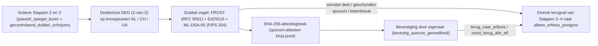

> 🌐 **Taal / Мова:** [Українська](ПЛЮЩ-ЕТАП-16-КВОРУМНИЙ-АТЕСТАТ-СХОДИНКИ-4-ТА-ПОРОГОВИЙ-ДОПУСК.uk.md) · **Nederlands** | [Hoofdpagina](../../LEESMIJ.md) · [Documentatie-index](../INDEX.nl.md) · [Hoofdarchitectuurmanifest «Klimop»](ARCHITECTUURMANIFEST-KLIMOP.nl.md) · [Fase 15 — Stap 3 dubbel schrijven](KLIMOP-FASE-15-DUBBEL-SCHRIJVEN-LEESVERIFICATIE-EN-TERUGVAL.nl.md)

# Klimop — Fase 16: Stap 4 quorumattest van gereedheid en drempelvrijgave door de eigenaar (`KLIMOP-017`)

> **Status:** voltooid en opgenomen in de hoofdcodebasis van het platform «Mijn Ruimte» in de beveiligde stand van Stap 4 (§35, §10, §13 van het manifest).
> **Bevoegdheidsgrens (§3.2, §35):** de bestaande databank `PostgreSQL 18.6`, de `systemd`-diensten, het installatieprogramma `/usr/local/sbin/mijn-ruimte-installeer`, versleutelde `age`-reservekopieën en alle 11 draaiende subdomeinen `*.tarasevych.com` blijven volledig actief en onaangetast (`productieDatabankActief: true`, `productieDatabankGewijzigd: false`); elke poging tot zelfstandig loskoppelen of uitschakelen van de databank wordt geblokkeerd met `KLIMOP_LOSKOPPELING_VERBODEN` (`403`).

---

## 1. Doel van de fase en samenhang met Fase 15 (`KLIMOP-016`)

In Fasen 13–15 (`KLIMOP-014`..`KLIMOP-016`) werden achtereenvolgens **Stap 1** (risicoloze spiegelverificatie), **Stap 2** (meervoudig passief lezen met een sluitende `SHA-256`-afwijkingsketen) en **Stap 3** (gecontroleerd dubbel schrijven met directe leesverificatie, verwijdermarkeringen en kwitantielogboek) ingebouwd.

Overeenkomstig de hoofdstukken `§35`, `§10`, `§13` en `§34` van het Hoofdarchitectuurmanifest vormt **Stap 4** het sluitstuk van aantoonbare overdrachtsgereedheid voor alle 11 diensten: **een quorumattest op onafhankelijke knooppunten in afzonderlijke rechtsgebieden (`NL / CH / UA`) onder het dubbele cryptografische zegel van `FROST (RFC 9591)` en de hybride postkwantumhandtekening `Ed25519 + ML-DSA-65 (FIPS 204)`, met expliciete bevestiging door de eigenaar zonder uitschakeling van de draaiende databank**.

---

## 2. Gerealiseerde onderdelen van Fase 16 (`KLIMOP-017`)

1. **Serverkern van Stap 4 voor quorumattesten (`backend/klimop-overdracht-opslag.ts`):**
   - [`voerStap4QuorumAttestProefUit`](../../backend/klimop-overdracht-opslag.ts) — leidt de geïsoleerde dienstcontext af (`psid1_…`, epoche `4`), richt 3 hybride postkwantumknooppunten in afzonderlijke rechtsgebieden (`NL`, `CH`, `UA`) op, toetst hun onafhankelijkheid (`controleerKnooppuntOnafhankelijkheid`), voert dealerloze sleutelopbouw uit (`DKG` `2-van-3`), berekent zowel de tweeronde-drempelhandtekening `FROST(Ed25519, SHA-512)` met aanwijzing van vervalste deelhandtekeningen (`verdachteDeelnemers`) als de hybride postkwantumhandtekening `Ed25519 + ML-DSA-65`, verankert het attest aan de ketenkoppen van Stappen 2–3 (`spiegelKetenKopSha256`, `dubbelKetenKopSha256`) en zet bij elke afwijking Stappen 2–4 **onmiddellijk en automatisch** terug naar `alleen_erfenis_postgres`;
   - [`maakQuorumAttestTekenBoodschappen`](../../backend/klimop-overdracht-opslag.ts), [`berekenQuorumAttestSha256`](../../backend/klimop-overdracht-opslag.ts), [`verifieerQuorumAttestKeten`](../../backend/klimop-overdracht-opslag.ts) en [`leesKlimopQuorumAttestLogboek`](../../backend/klimop-overdracht-opslag.ts) — beheren en herverifiëren `quorum-attesten-kluis.jsonl`: bij elke lezing worden zowel de `SHA-256`-regelhash als beide cryptografische handtekeningen (`FROST Ed25519` en `Ed25519 + ML-DSA-65`) met domeinscheiding opnieuw getoetst;
   - de uitgebreide [`schakelKlimopDienstOverdracht`](../../backend/klimop-overdracht-opslag.ts) — controleert voor `bevestig_quorum_gereedheid` alle drie de logboeken, vereist gelijktijdig een actieve Stap 2 (`KLIMOP_STAP2_ACTIEF_VEREIST`), een actieve Stap 3 (`KLIMOP_STAP3_ACTIEF_VEREIST`) en een geldig quorumattest van Stap 4 (`KLIMOP_QUORUM_ATTEST_VEREIST`), blokkeert zelfstandig loskoppelen van de databank (`KLIMOP_LOSKOPPELING_VERBODEN` — `403`) en houdt directe terugval van één of alle 11 diensten altijd werkzaam.
2. **Beveiligde eigenaarsroutes en `MCP`-hulpmiddelen voor alle 14 AI-agenten:**
   - in [`backend/klimop-paden.ts`](../../backend/klimop-paden.ts) zijn `POST /api/owner/klimop/quorum-attest` en `POST /api/owner/klimop/quorum-logboek` aangesloten met registratie in `app.audit`;
   - in [`backend/klimop-hulpmiddeldefinities.ts`](../../backend/klimop-hulpmiddeldefinities.ts), [`backend/klimop-hulpmiddelen.ts`](../../backend/klimop-hulpmiddelen.ts) en de Connector-v2-catalogus ([`shared/connector-v2/catalogus.ts`](../../shared/connector-v2/catalogus.ts)) zijn `klimop_quorum_attest` en `klimop_quorum_logboek` geregistreerd (samen 9 hulpmiddelen `klimop_*`, alle namen `<= 63` tekens voor alle 14 AI-agenten, zonder toegang voor agenten tot `overdracht-schakelaar` conform `§34`).
3. **Tweetalig webpaneel en vierlaagse uitleg:**
   - in [`src/klimop/klimop-klant.ts`](../../src/klimop/klimop-klant.ts), [`src/agenten/KlimopPaneel.tsx`](../../src/agenten/KlimopPaneel.tsx) en [`shared/klimop-overzicht-model.ts`](../../shared/klimop-overzicht-model.ts) zijn het bedieningsblok voor Stap 4 (`data-klimop-attest="1"`), het overzicht van recente quorumattesten en de hulpsleutel `klimop.attest` toegevoegd.

---

## 3. Toetsing aan de 15 architectuurvragen (§42) en 14 verboden (§43)

- **Drempelvertrouwen en postkwantumweerbaarheid (vragen 1, 2, 4, 7, 10):** geen enkel afzonderlijk knooppunt kan zelfstandig een `FROST`-groepshandtekening aanmaken (`2-van-3` na dealerloze `DKG`), en het hybride zegel `Ed25519 + ML-DSA-65` plus de volledige herverificatie in `verifieerQuorumAttestKeten` maken ongemerkte wijziging van het logboek onmogelijk, zelfs als hashes opnieuw worden berekend.
- **Geen verborgen bevoegdheden en geen inhoudslek (vragen 5, 6, 8, 11, 14):** AI-agenten kunnen de schakelaar niet bedienen; een vervalst handtekeningdeel wordt per deelnemer aangewezen en veroorzaakt onmiddellijke automatische terugval van alle stappen van de dienst naar de bestaande basis; het logboek bevat geen persoonlijke inhoud (`bevatGeheimenOfInhoud: false`) en tijdelijke sleutels worden met nullen gewist in `finally`.
- **Geen verboden vereenvoudigingen (§43):** een drempelhandtekening wordt niet voorgesteld als versleuteling, de draaiende databank `PostgreSQL 18.6` wordt niet uitgeschakeld of losgekoppeld (`productieDatabankActief: true`, `productieDatabankGewijzigd: false`), en alle waarborgen zijn bewezen met [`tests/eenheid/klimop-017-quorum-attest-stap4-20261121.test.ts`](../../tests/eenheid/klimop-017-quorum-attest-stap4-20261121.test.ts).
