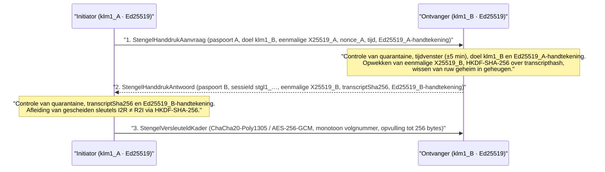

> 🌐 **Taal / Мова:** [Українська](ПЛЮЩ-ЕТАП-2-ВИПРОБУВАЛЬНА-МЕРЕЖА-ТА-СТЕБЛА.uk.md) · **Nederlands** | [Hoofdpagina](../../LEESMIJ.md) · [Documentatie-index](../INDEX.nl.md) · [Hoofdarchitectuurmanifest «Klimop»](ARCHITECTUURMANIFEST-KLIMOP.nl.md) · [Fase 1 — Kern en uitgaveplan](KLIMOP-FASE-1-ARCHITECTUURKERN-EN-UITGAVEPLAN.nl.md)

# Fase 2 van het ecosysteem «Klimop» — Beproevingsnetwerk van onafhankelijke knooppunten, het «Stengels»-verbindingsprotocol en beperking van metadata (`KLIMOP-003`)

- **Uitvoeringsdatum:** 20.11.2026
- **Coördinatietaak:** `KLIMOP-003` (voortbouwend op de in `integratie` samengevoegde resultaten van Fasen 0–1 in verzoek nr. 184, samenvoegingsvastlegging `d80e91e9be45a30ff7782ce33c14d6e147fe1650`)
- **Programmatische realisatie:**
  - Handdruk-, kaderversleutelings- en routeringsprotocol: [`shared/klimop/stengels.ts`](../../shared/klimop/stengels.ts)
  - Geïsoleerd netwerkknooppunt en routerende client: [`backend/klimop-knooppunt-agent.ts`](../../backend/klimop-knooppunt-agent.ts)
  - Herhaalbaar proefnetwerk van 3 knooppunten (`NL`, `CH`, `UA`): [`scripts/klimop-proefnetwerk.mjs`](../../scripts/klimop-proefnetwerk.mjs)
  - Geïsoleerde multicontaineropstelling (`internal: true`): [`deploy/klimop-proefnetwerk/docker-compose.proef.yml`](../../deploy/klimop-proefnetwerk/docker-compose.proef.yml)
- **Normatieve grondslag:** secties `§1.2`, `§4–§10`, `§15`, `§19`, `§36 (Fase 2)`, `§42–§44 (doc. nr. 4, 15, 18, 22)` van het [Hoofdarchitectuurmanifest «Klimop»](ARCHITECTUURMANIFEST-KLIMOP.nl.md)
- **Bevoegdheidsgrens:** het beproevingsnetwerk draait volledig gescheiden van de productieserver en `PostgreSQL 18.6` en wijzigt geen enkele actieve dienst.

---

## 1. Specificatie van het «Stengels»-netwerkprotocol en routering (document nr. 4 uit §44)

### 1.1. Wederzijds geauthenticeerde handdruk met voorwaartse geheimhouding

Elke verbinding («Stengel») tussen twee knooppunten doorloopt een driestaps cryptografische handdruk in [`shared/klimop/stengels.ts`](../../shared/klimop/stengels.ts):



Kerngaranties van het protocol:
1. **Voorwaartse geheimhouding:** voor elke sessie worden verse efemere `X25519`-sleutels aangemaakt en wordt het ruwe Diffie-Hellman-geheim onmiddellijk in het afsluitende `finally`-blok met nullen gewist (`gedeeldGeheim.fill(0)`), net als tijdelijke kaderbuffers en afgeleide sessiesleutels bij een afgewezen handdruk.
2. **Gescheiden eenrichtingssleutels:** de zendsleutel van initiator naar ontvanger (`klimop-stengel-i2r`) verschilt cryptografisch van de retoursleutel (`klimop-stengel-r2i`), waardoor spiegelaanvallen onmogelijk zijn.
3. **Bescherming tegen doelverwisseling en herhaling:** beide paspoorten, `doelKnooppuntId`, beide `nonceB64u`-waarden en tijdstempels zitten in het ondertekende transcript; elk kader draagt een oplopend `volgnummer` binnen een begrensd schuifvenster en herhaalde nummers worden geweigerd met `HERHALING_OF_VOLGORDE_FOUT`.
4. **Voorbereiding op postkwantuminkapseling:** de handdrukberichten bevatten reeds de velden `postkwantumKemB64u` en `postkwantumKemAntwoordB64u` voor naadloze koppeling van `X25519MLKEM768` (`FIPS 203`) zonder breuk in de protocolstructuur.

### 1.2. Omleiding langs defecte trajecten en eind-tot-eind estafetteroutering

Wanneer een directe stengel tussen het apparaat van de eigenaar (of knooppunt `A`) en opslagknooppunt `C` wegvalt, kiest [`KlimopRouteTabel`](../../shared/klimop/stengels.ts) automatisch een gezonde route via een vertrouwd verbindingsknooppunt `B` (`A → B → C` via `/klimop/v1/estafette`):
- Knooppunt `A` voert de handdruk en kaderversleuteling **rechtstreeks op de publieke sleutel van eindknooppunt `C`** uit.
- Tussenknooppunt `B` controleert uitsluitend dat `A` en `C` niet in quarantaine staan en stuurt het versleutelde pakket door.
- Tussenknooppunt `B` **bezit de sessiesleutels `A ↔ C` niet**, bewaart geen blokkopieën en kan de inhoud noch lezen noch vervalsen.

---

## 2. Regels voor privacy en beperking van metadata (document nr. 22 uit §44)

Ter uitvoering van §6 en §19 van het Hoofdarchitectuurmanifest «Klimop» gelden op de transportlaag vier technische maatregelen:
1. **Blokopvulling van kaders (`vulKaderLadingAan`):** elke lading wordt vóór versleuteling aangevuld tot een veelvoud van een vaste blokgrootte (standaard `256 bytes`), zodat korte beheeropdrachten en metadata niet aan hun pakketlengte te herkennen zijn.
2. **Pseudonieme knooppunt-ID's (`klm1_…`):** op de lijn staan uitsluitend eenrichtings-`SHA-256`-afdrukken van publieke knooppuntsleutels zonder e-mailadres, naam of telefoonnummer.
3. **Blinde opslag van versleutelde blokken:** een knooppunt met de rol `opslag` aanvaardt uitsluitend aan clientzijde versleutelde bytes op hun `SHA-256`-afdruk en toetst het `Ed25519`-mandaat, zonder de bestandsnaam, noch het doel van de inhoud, noch de ontsleutelingssleutel `DEK` te kennen.
4. **Minimale gezondheidscontrole (`/klimop/v1/gezondheid`):** het gezondheidseindpunt toont alleen technische knooppuntrollen en tellers zonder partnerlijsten of blok-ID's.

---

## 3. Handleiding voor het opzetten en starten van een nieuw proefknooppunt (documenten nr. 15 en 18 uit §44)

### 3.1. Directe lokale uitvoering en storingsproef met één opdracht

Op elk werkstation met `Node.js 24+` (zonder database en zonder `root`-rechten):

```bash
node scripts/klimop-proefnetwerk.mjs
# of voor machineleesbare uitvoer:
node scripts/klimop-proefnetwerk.mjs --json
```

Het script zet automatisch 3 onafhankelijke knooppunten (`NL`, `CH`, `UA`) en een persoonlijk eigenaarsapparaat op, verifieert spreiding over rechtsgebieden en aanbieders, bouwt onderling geauthenticeerde stengels op, slaat een door de client versleuteld blok onder `Ed25519`-mandaat op, **verbreekt de directe stengel naar `UA` en bewijst automatische levering via estafetteknooppunt `CH`**, plaatst knooppunt `NL` in quarantaine en bevestigt ongestoorde werking van de overige knooppunten.

### 3.2. Uitvoering in de geïsoleerde Docker-multicontaineropstelling

```bash
docker compose -f deploy/klimop-proefnetwerk/docker-compose.proef.yml up --abort-on-container-exit
docker compose -f deploy/klimop-proefnetwerk/docker-compose.proef.yml down -v
```

Alle containers draaien onder niet-geprivilegieerde gebruiker `1000:1000`, met alleen-lezen bestandssysteem (`read_only: true`), ingetrokken kernelrechten (`cap_drop: [ALL]`) en een afgesloten netwerk `internal: true`.

---

## 4. Toetsing van Fase 2 aan de 15 architectuurcontrolevragen (§42)

Alle 15 garanties worden bewezen door de eenheids- en integratietest [`tests/eenheid/klimop-003-etappe2-proefnetwerk-20261120.test.ts`](../../tests/eenheid/klimop-003-etappe2-proefnetwerk-20261120.test.ts):
- Geen nieuw enkel punt van uitval (verbindingsbreuk of quarantaine van één knooppunt stopt gezonde knooppunten niet).
- Een estafette-tussenknooppunt heeft wiskundig geen toegang tot sessiesleutels of onversleutelde gegevens.
- Herhaalde kaders, vervalste transcripten, verkeerde doelknooppunten, ingetrokken mandaten en geïsoleerde knooppunten worden geweigerd.
- De productieserver en `PostgreSQL 18.6` blijven volledig onaangeroerd.
