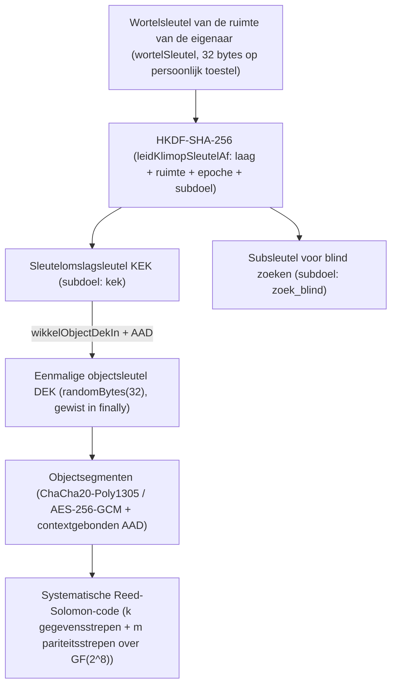

> 🌐 **Taal / Мова:** [Українська](ПЛЮЩ-ЕТАП-3-ШИФРУВАННЯ-ТА-РОЗПОДІЛЕНЕ-ЗБЕРІГАННЯ.uk.md) · **Nederlands** | [Startpagina](../../LEESMIJ.md) · [Documentatie-index](../INDEX.nl.md) · [Hoofdarchitectuurmanifest «Klimop»](ARCHITECTUURMANIFEST-KLIMOP.nl.md) · [Fase 1 — Kern en uitgaveplan](KLIMOP-FASE-1-ARCHITECTUURKERN-EN-UITGAVEPLAN.nl.md) · [Fase 2 — Beproevingsnetwerk en «Stengels»](KLIMOP-FASE-2-BEPROEVINGSNETWERK-EN-STENGELS.nl.md)

# Fase 3 van het ecosysteem «Klimop» — Clientzijdige envelopversleuteling, foutbestendige verdeelde Reed-Solomon-opslag en cryptografische wendbaarheid (`KLIMOP-004`)

- **Uitvoeringsdatum:** 20-11-2026
- **Coördinatietaak:** `KLIMOP-004` (bouwt voort op het in `integratie` samengevoegde verzoek nr. 185 `KLIMOP-003`, samenvoeging `e4ad9dc3b303b32df1147a4deca0aea06437dfdd`)
- **Programmatische realisatie:**
  - Clientversleuteling, sleutelhiërarchie, Reed-Solomon-codes en blinde zoektermen: [`shared/klimop/opslag.ts`](../../shared/klimop/opslag.ts)
  - Netwerkverdeler van fragmenten, sleutelloze herbouw en wettige verwijdering: [`backend/klimop-opslag-client.ts`](../../backend/klimop-opslag-client.ts)
  - Door mandaat geautoriseerde blokverwijdering `wis_blok`: [`backend/klimop-knooppunt-agent.ts`](../../backend/klimop-knooppunt-agent.ts)
  - Herhaalbaar Fase 3-proefscenario (4 onafhankelijke knooppunten `NL`, `CH`, `UA`, `SE`): [`scripts/klimop-etappe3-opslag-proef.mjs`](../../scripts/klimop-etappe3-opslag-proef.mjs)
- **Normatieve grondslag:** hoofdstukken `§6`, `§11`, `§12`, `§13`, `§35`, `§36 (Fase 3)`, `§42–§44 (doc. nr. 5, nr. 6, nr. 21)` van het [Hoofdarchitectuurmanifest «Klimop»](ARCHITECTUURMANIFEST-KLIMOP.nl.md)
- **Machtigingsgrens:** alle bewerkingen draaien in geïsoleerde modules en een lokale proefopstelling zonder enige wijziging aan de draaiende productieserver `*.tarasevych.com`, `systemd`-diensten of productie-`PostgreSQL 18.6`.

---

## 1. Schema van versleutelingslagen en sleutelbeheer (document nr. 5 uit §44)

Ter uitvoering van §6 van het Hoofdarchitectuurmanifest legt [`shared/klimop/opslag.ts`](../../shared/klimop/opslag.ts) een strikte sleutelhiërarchie vast met volledige doelscheiding:



Kernwaarborgen:
1. **Geen gedeelde sleutel voor verschillende doelen:** `leidKlimopSleutelAf` bindt zout en infolabel van `HKDF-SHA-256` aan de opslaglaag (`KLIMOP_OPSLAG_LAGEN`), ruimte-identificatie (`ruimteId`), cryptografische epoche (`epoche >= 1`) en subdoel (`kek`, `zoek_blind`, `manifest`).
2. **Envelopversleuteling per object:** elk bestand of archief krijgt een eigen willekeurige 32-byte `DEK`, die na afloop met nullen in het werkgeheugen wordt overschreven (`dek.fill(0)`). Het ondertekende objectmanifest bewaart uitsluitend de geauthenticeerde omslag `dekOmslag`, via `AAD` gebonden aan eigenaar, object-ID, opslaglaag, epoche en profiel.
3. **Overgangsbrug voor het sleutelkluisregister (`SLEUTELKLUIS_REGISTER`):** voor een stapsgewijze overgang van `nog-niet`-tabellen (§35) bieden `versleutelOvergangsVeld`, `ontsleutelOvergangsVeld` en `berekenBlindeZoekTermen` gelijktijdig lezen van bestaande rijen en nieuwe `klm1.<epoche>.<profiel>…`-omslagen, inclusief blinde zoektermen `bzk1_<32 hex>` via `HMAC-SHA-256` zonder onversleutelde woorden aan de database prijs te geven.

---

## 2. Specificatie van verdeelde opslag en fragmentherstel (document nr. 6 uit §44)

### 2.1. Strikte scheiding tussen Shamir-geheimdeling en Reed-Solomon-codes (§11, §43 punt 3)

Het manifest verbiedt uitdrukkelijk om geheimdeling voor korte sleutels te verwarren met bestandsverdeling:
- **Korte cryptografische sleutels (`DEK` / `KEK` / herstelwortels)** worden gesplitst met het $k$-van-$n$ Shamir-schema over $\mathrm{GF}(2^8)$ in [`shared/verdeelde-opslag.ts`](../../shared/verdeelde-opslag.ts) (informatietheoretische veiligheid voor kleine geheimen tot 4 KiB).
- **Grote versleutelde objecten, documenten en archieven** worden in Fase 3 aan clientzijde in segmenten versleuteld en gecodeerd met een systematische **Reed-Solomon-wiscode (Cauchy-matrix over $\mathrm{GF}(2^8)$ met Gauss-Jordan-inversie)** in [`shared/klimop/opslag.ts`](../../shared/klimop/opslag.ts):
  - elk versleuteld segment wordt verdeeld in $k$ gegevensstrepen plus $m$ pariteitsstrepen (samen $k + m$ fragmenten);
  - de opslagoverhead bedraagt slechts $\frac{k + m}{k}$ (bijv. $1{,}5\times$ bij $2+1$ of $4+2$), terwijl **elke willekeurige $k$ intacte fragmenten** het volledige segment exact reconstrueren na gelijktijdige uitval van tot $m$ knooppunten.

### 2.2. Waarborgen van `KlimopVerdeeldeOpslagClient`

De klasse [`KlimopVerdeeldeOpslagClient`](../../backend/klimop-opslag-client.ts) werkt boven op de beveiligde «Stengels»-verbindingen uit Fase 2 en borgt:
1. **Onafhankelijkheidstoets vóór opslag:** bij schending van jurisdictie- of aanbiedersspreiding (`controleerKnooppuntOnafhankelijkheid(doelKnooppunten, k)`) wordt opslag geweigerd met `ONAFHANKELIJKHEID_NIET_VOLDAAN`.
2. **Volledige integriteitsketen:** verificatie van `SHA-256` per fragment op knoop én client, `Ed25519`-handtekening van het objectmanifest, AEAD-authenticatietag per segment en eindhash `klareInhoudSha256`.
3. **Sleutelloze herbouw van verloren fragmenten (`herbouwVerlorenKnooppuntZonderSleutel`):** bij uitval van een opslagknoop wordt diens ontbrekende streep uitsluitend uit $k$ overlevende versleutelde fragmenten herbouwd en naar een nieuwe onafhankelijke knoop geschreven **zonder toegang tot `KEK` of `DEK` van de eigenaar**.
4. **Wettige verwijdering en beëindiging van opslag (`wis_blok`):** met een geldig mandaat van de gegevenseigenaar overschrijft de knoop het blok in het geheugen met nullen (`bestaand.fill(0)`) en verwijdert het fragment definitief.

---

## 3. Cryptografische wendbaarheid en bescherming tegen afzwakking (document nr. 21 uit §44)

Conform §13 van het manifest is de architectuur niet vastgeklonken aan één onveranderlijk algoritme:
- Elke sleutelomslag (`KlimopDekOmslag`), elk objectmanifest (`KlimopObjectManifest`) en elk overgangsveld (`klm1.<epoche>.<profiel>…`) draagt expliciete velden `schema`, `epoche` en `profiel` (`klimop-v1-chacha20-poly1305`, `klimop-v1-aes-256-gcm`, `klimop-v2-pq-voorbereid`).
- `onderhandelKlimopProfiel` kiest het sterkste gemeenschappelijke profiel en blokkeert elke poging tot afzwakking onder het vereiste beveiligingsniveau (`VERBODEN_AFZWAKKING_VAN_VERSLEUTELING`).
- Epochewisseling (`epoche + 1`) leidt nieuwe sleutels af terwijl eerdere archieven leesbaar blijven via de vastgelegde epoche in hun manifest.

---

## 4. Herhaalbare verificatie van Fase 3 en de 15 architectuurvragen (§42)

Lokale proefopdracht (4 onafhankelijke knooppunten `NL`, `CH`, `UA`, `SE` op `127.0.0.1`):
```bash
node scripts/klimop-etappe3-opslag-proef.mjs
```
Bewijst: verdeling van een meersegmentsobject over 3 knooppunten (`NL`, `CH`, `UA`), foutloos herstel na volledige isolatie van `NL`, sleutelloze herbouw van de verloren streep op de nieuwe knoop `SE`, opnieuw volledig herstel na bijkomende uitval van `CH` (vanuit `SE + UA`) en wettige verwijdering van de blokken. Alle 15 vragen uit §42 en de 14 verboden vereenvoudigingen uit §43 worden automatisch getoetst in [`tests/eenheid/klimop-004-etappe3-opslag-20261120.test.ts`](../../tests/eenheid/klimop-004-etappe3-opslag-20261120.test.ts).
