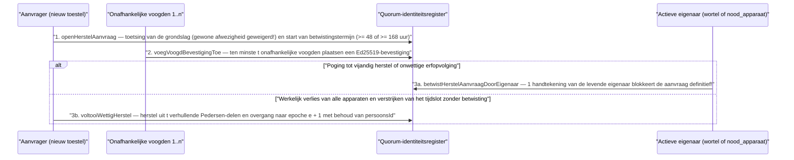

> 🌐 **Taal / Мова:** [Українська](ПЛЮЩ-ЕТАП-5-НЕЗАЛЕЖНА-ІДЕНТИЧНІСТЬ-ТА-ГРУПОВІ-ПРОСТОРИ.uk.md) · **Nederlands** | [Startpagina](../../LEESMIJ.md) · [Documentatie-index](../INDEX.nl.md) · [Hoofdarchitectuurmanifest «Klimop»](ARCHITECTUURMANIFEST-KLIMOP.nl.md) · [Fase 1 — Kern en uitgaveplan](KLIMOP-FASE-1-ARCHITECTUURKERN-EN-UITGAVEPLAN.nl.md) · [Fase 2 — «Stengels»](KLIMOP-FASE-2-BEPROEVINGSNETWERK-EN-STENGELS.nl.md) · [Fase 3 — Versleuteling en opslag](KLIMOP-FASE-3-VERSLEUTELING-EN-VERDEELDE-OPSLAG.nl.md) · [Fase 4 — Gedistribueerde sleutels en FROST](KLIMOP-FASE-4-GEDISTRIBUEERDE-SLEUTELS-EN-DREMPELHANDTEKENINGEN.nl.md)

# Fase 5 van het ecosysteem «Klimop» — Zelfsoevereine identiteit, vertrouwde apparaten, wettig toegangsherstel en `MLS`-groepsruimtes (`KLIMOP-006`)

- **Uitvoeringsdatum:** 20-11-2026
- **Coördinatietaak:** `KLIMOP-006` (bouwt voort op het in `integratie` samengevoegde verzoek nr. 187 `KLIMOP-005`, samenvoeging `5bd4bfcd7451db1dbe80b1c7b6ebece071b1b001`)
- **Programmatische realisatie:**
  - Zelfsoevereine persoonsidentiteit `klid1_…`, dienstpseudoniemen `psid1_…`, compatibiliteitsbrug met huidig `userId`, apparaatcertificaten en intrekkingen, meerzijdig toegangsherstel via Pedersen-delen en groepsbeveiliging volgens de beginselen van `RFC 9420 (MLS)`: [`shared/klimop/identiteit.ts`](../../shared/klimop/identiteit.ts)
  - Quorumcliënt voor het geheimvrije identiteits- en intrekkingsregister: [`backend/klimop-identiteit-client.ts`](../../backend/klimop-identiteit-client.ts)
  - Geïsoleerde knoopafhandeling voor het identiteitsregister met terugdraaibeveiliging op epochen: [`backend/klimop-knooppunt-agent.ts`](../../backend/klimop-knooppunt-agent.ts)
  - Herhaalbaar Fase 5-proefscenario (`NL`, `CH`, `UA`): [`scripts/klimop-etappe5-identiteit-proef.mjs`](../../scripts/klimop-etappe5-identiteit-proef.mjs)
- **Normatieve grondslag:** hoofdstukken `§1.1`, `§4.2`, `§12`, `§14`, `§17`, `§36 (Fase 5)`, `§39`, `§42–§44` (verplichte documenten **nr. 7** en **nr. 9**) van het [Hoofdarchitectuurmanifest «Klimop»](ARCHITECTUURMANIFEST-KLIMOP.nl.md)
- **Machtigingsgrens:** de identiteitslaag draait in de geïsoleerde proefketen met een ondertekende tweerichtingsbrug naar het bestaande `userId`; de actieve productieserver `*.tarasevych.com`, `systemd`-diensten en productie-`PostgreSQL 18.6` blijven volledig ongewijzigd.

---

## 1. Regels voor zelfsoevereine identiteit en vertrouwde apparaten (Document nr. 7 volgens §44 van het manifest)

In plaats van het bestaan van een persoon vast te klinken aan een primaire sleutel in één centrale database (`SPOF-1`), berust identiteit in «Klimop» bij de persoon zelf via een cryptografisch oprichtingsbewijs (`KlimopIdentiteitOprichting` in [`shared/klimop/identiteit.ts`](../../shared/klimop/identiteit.ts)):

| Identiteitsonderdeel | Vorm en controle | Geborgde waarborgen (§4.2, §12, §35) |
|---|---|---|
| **Wortelidentiteit van de persoon (`maakPersoonsIdentiteit`)** | `persoonsId = klid1_<32 hex>` als `SHA-256`-afdruk van de canonieke oprichtingskern, zelfondertekend met de aanvankelijke `Ed25519`-wortelsleutel. | De `persoonsId` wijzigt nooit tijdens geplande sleutelrotaties (`roteerPersoonsWortelSleutel`) of wettig toegangsherstel; elke epocheovergang wordt geborgd door een ononderbroken handtekeningenketen (`verifieerPersoonsStaat`). |
| **Pseudonieme dienstidentiteiten (`leidPseudoniemeDienstIdentiteitAf`)** | `psid1_<32 hex>` via `HMAC-SHA-256` uit een persoonlijk 32-byte zout en het dienstdomein (`postvak`, `wolkopslag`, `slimwoon`). | Scheidt persoonlijke identiteit van netwerkactiviteit per dienst (§12): buitenstaande knooppunten kunnen handelingen tussen e-mail, opslag en woning niet aan elkaar koppelen. |
| **Tweerichtingsbrug (`maakErfenisGebruikerKoppeling`)** | Verklaring `ErfenisGebruikerKoppeling`, ondertekend met de `Ed25519`-wortelsleutel van de persoon. | Naadloze achterwaartse verenigbaarheid met het bestaande `userId` zonder uitschakeling of herschrijving van `PostgreSQL 18.6` (§35). |
| **Certificaat van persoonlijk apparaat (`registreerVertrouwdApparaat`)** | `apparaatId = kdev1_<32 hex>` met eigen `Ed25519`-tekensleutel, `X25519`-uitwisselsleutel, begrensde rechten (`ApparaatBevoegdheid`) en middelenlimiet (`toestaanAchtergrondTaken: false`). | De wortelsleutel wordt **niet** aan dagelijkse apparaten verstrekt; een telefoon met leesrechten kan geen uitgaven goedkeuren of ongemerkt achtergrondtaken draaien (§4.2, §42 punt 13). |
| **Quorumintrekking van een apparaat (`trekApparaatIn`)** | Ondertekende intrekking `KlimopApparaatIntrekking` (door de wortelsleutel of een noodapparaat met `nood_betwisting`), gerepliceerd naar onafhankelijke registerknooppunten (`KlimopIdentiteitNetwerkClient`). | Bij diefstal van een telefoon blokkeert één handtekening vanaf de laptop het toestel netwerkbreed; registerknooppunten voegen intrekkingen uitsluitend toe en weigeren terugdraaien van epochen (`IDENTITEIT_EPOCHE_TERUGDRAAI_GEWEIGERD`). |

---

## 2. Procedure voor wettig meerzijdig toegangsherstel (Document nr. 9 volgens §44 van het manifest)

Conform §14, §17 en §39 van het manifest biedt [`shared/klimop/identiteit.ts`](../../shared/klimop/identiteit.ts) een tegen misbruik beschermde herstelprocedure zonder enige alvermogende beheerder:



1. **Verbod op overdracht wegens gewone afwezigheid (§17):** `gewone_afwezigheid` en `tijdelijk_verbindingsverlies` worden onmiddellijk afgewezen met `AFWEZIGHEID_ALLEEN_GEEN_GROND_VOOR_OVERDRACHT`.
2. **Verplichte betwistingstermijn:** ten minste **48 uur** bij verlies van alle apparaten (`verlies_alle_apparaten`) en ten minste **168 uur (7 etmalen)** bij bevestigde langdurige onbeschikbaarheid of wettige erfopvolging; vóór het verstrijken weigert `voltooiWettigHerstel` met `BETWISTINGSTERMIJN_NOG_NIET_VERSTREKEN`.
3. **Voorrang van de levende eigenaar (§39):** één geldige handtekening van de wortelsleutel of van een apparaat met `nood_betwisting` zet een vijandige aanvraag onomkeerbaar op `geblokkeerd_door_eigenaar` (`HERSTEL_BLOKKADE_KAN_NIET_WORDEN_GEWIST` op registerknooppunten).
4. **Informatietheoretische verhulling:** het herstelgeheim wordt uitsluitend gereconstrueerd uit $\ge t$ verifieerbare Pedersen-delen (`herstelUitPedersenDelen` uit Fase 4), zodat afzonderlijke voogden nul informatie over de wortelsleutels leren.

---

## 3. Groepsbeveiliging van gedeelde ruimtes en slimme woning volgens `RFC 9420 (MLS)` (§12, §36)

Voor gedeelde gezinsruimtes en woningbeheer vervangt het epochegebaseerde `MLS`-groepsprotocol een enkele statische groepssleutel:
- **Voorwaartse geheimhouding bij toevoeging van leden (`voegLidToeAanMlsGroep` + `pasMlsWelkomToe`):** elke epochestap $e \to e+1$ leidt via `HKDF-SHA-256` nieuwe sleutels af (`initGeheim` + vers `commitGeheim` + `groepsContextSha256`) en wist de vorige sleutels in het geheugen (`fill(0)`). Een nieuw toegevoegd toestel ontvangt alleen de sleutels vanaf de nieuwe epoche en kan historische berichten niet ontsleutelen.
- **Herstel na compromittering bij verwijdering van apparaten (`verwijderLidUitMlsGroep` + `pasMlsCommitToe`):** bij verwijdering van een gestolen telefoon vernieuwt de afzender zijn `X25519`-bladsleutel en versleutelt het nieuwe `commitGeheim` uitsluitend voor de overblijvende leden; het verwijderde toestel is direct buitengesloten van alle nieuwe berichten.

---

## 4. Herhaalbare verificatie van Fase 5 en de 15 architectuurvragen (§42)

Lokale proefopdracht op 3 onafhankelijke knooppunten (`NL`, `CH`, `UA` op `127.0.0.1`):
```bash
node scripts/klimop-etappe5-identiteit-proef.mjs
```
Bewijst zelfsoevereine identiteit `klid1_…`, gescheiden dienstpseudoniemen, quorumintrekking van een gestolen telefoon bij een in quarantaine geplaatst knooppunt `CH`, voorwaartse en na-compromittering-beveiliging in `MLS`, blokkade van onwettige erfopvolging door de eigenaar en wettig `2-van-3` Pedersen-herstel na het tijdslot van 48 uur. Alle §39-scenario's en de 15 vragen uit §42 worden automatisch getoetst in [`tests/eenheid/klimop-006-etappe5-identiteit-mls-20261120.test.ts`](../../tests/eenheid/klimop-006-etappe5-identiteit-mls-20261120.test.ts).
