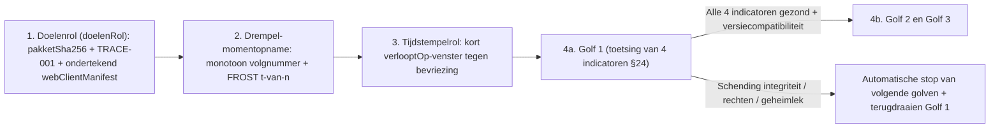

> 🌐 **Taal / Мова:** [Українська](ПЛЮЩ-ЕТАП-6-РОЗПОДІЛЕНЕ-КЕРУВАННЯ-ТА-БЕЗПЕЧНІ-ВИПУСКИ.uk.md) · **Nederlands** | [Startpagina](../../LEESMIJ.md) · [Documentatie-index](../INDEX.nl.md) · [Hoofdarchitectuurmanifest «Klimop»](ARCHITECTUURMANIFEST-KLIMOP.nl.md) · [Fase 1 — Kern en uitgaveplan](KLIMOP-FASE-1-ARCHITECTUURKERN-EN-UITGAVEPLAN.nl.md) · [Fase 2 — «Stengels»](KLIMOP-FASE-2-BEPROEVINGSNETWERK-EN-STENGELS.nl.md) · [Fase 3 — Versleuteling en opslag](KLIMOP-FASE-3-VERSLEUTELING-EN-VERDEELDE-OPSLAG.nl.md) · [Fase 4 — FROST](KLIMOP-FASE-4-GEDISTRIBUEERDE-SLEUTELS-EN-DREMPELHANDTEKENINGEN.nl.md) · [Fase 5 — Identiteit en `MLS`](KLIMOP-FASE-5-ONAFHANKELIJKE-IDENTITEIT-EN-GROEPSRUIMTES.nl.md)

# Fase 6 van het ecosysteem «Klimop» — Gedistribueerd drempelbestuur, 7 bevoegdheidscategorieën, tijdsloten en veilige gefaseerde uitgaven (`KLIMOP-007`)

- **Uitvoeringsdatum:** 20-11-2026
- **Coördinatietaak:** `KLIMOP-007` (bouwt voort op het in `integratie` samengevoegde verzoek nr. 188 `KLIMOP-006`, samenvoeging `72bc067577443de9385bcd24e23f27046767f076`)
- **Programmatische realisatie:**
  - Matrix van 7 bevoegdheidscategorieën, `FROST`-bestuursgrondwet, tijdsloten, hash-geketend besluitenlogboek, vierlaagse uitgavemetadata en ondertekende webclientcontrole: [`shared/klimop/bestuur.ts`](../../shared/klimop/bestuur.ts)
  - Netwerkcoördinator voor drempelbestuur en gefaseerde (golfgewijze) uitrol (`KlimopBestuurEnUitrolClient`, `voerGefaseerdeUitrolUit`): [`backend/klimop-bestuur-client.ts`](../../backend/klimop-bestuur-client.ts)
  - Geïsoleerde knoopcontrole op de bestuursgrondwet en automatische terugdraaiing bij ongezonde uitgaven: [`backend/klimop-knooppunt-agent.ts`](../../backend/klimop-knooppunt-agent.ts)
  - Herhaalbaar Fase 6-proefscenario (`NL`, `CH`, `UA`, `SE`): [`scripts/klimop-etappe6-bestuur-proef.mjs`](../../scripts/klimop-etappe6-bestuur-proef.mjs)
- **Normatieve grondslag:** hoofdstukken `§2`, `§18–§20`, `§23–§25`, `§32`, `§34`, `§36 (Fase 6)`, `§40`, `§42–§44` (verplichte documenten **nr. 8** en **nr. 14**) van het [Hoofdarchitectuurmanifest «Klimop»](ARCHITECTUURMANIFEST-KLIMOP.nl.md)
- **Machtigingsgrens:** het drempelbestuur en de gefaseerde uitrol draaien in de proefketen zonder wijziging aan `/usr/local/sbin/mijn-ruimte-installeer`, `systemd`-diensten of productie-`PostgreSQL 18.6`; het overgangs-noodveto van de eigenaar blijft behouden.

---

## 1. Model van de 7 onafhankelijke bevoegdheidscategorieën, tijdsloten en verbod op alleenheerschappij (Document nr. 8 volgens §44 van het manifest)

Conform §2, §18–§20, §32 en §34 van het manifest legt [`shared/klimop/bestuur.ts`](../../shared/klimop/bestuur.ts) (`STANDAARD_CATEGORIE_BELEID`, `maakBestuursGrondwet`, `bekrachtigBestuursBesluitMetFrost`) 7 strikt gescheiden bevoegdheidscategorieën vast:

| Nr. (§19) | Bevoegdheidscategorie | Bevestigingswijze en grens | Verplicht tijdslot (§20) |
|---|---|---|---|
| **1** | `eigen_gegevens_rechten` (Rechten over eigen gegevens) | Uitsluitend de zelfsoevereine sleutel van de gegevenseigenaar (`persoonsId` / apparaatcertificaat); geen knoopbeheerder of bestuursraad krijgt inzage in privé-inhoud. | **0 uur** (e-mail, bestanden en agenda zonder vertraging!) |
| **2** | `persoonlijk_apparaat_beheer` (Beheer van persoonlijke apparaten) | Wortelsleutel of `nood_betwisting`-apparaat voor onmiddellijke intrekking van een verloren toestel. | **0 uur** |
| **3** | `operationeel_knooppunt_beheer` (Operationeel beheer van één knooppunt) | Beheerder van het eigen fysieke knooppunt (inclusief het recht eigen apparatuur te stoppen, §18); geen macht over andere knooppunten. | **0 uur** |
| **4** | `software_onderhoud` (Softwareonderhoud) | Voorstel door mens of AI-agent; **zelfgoedkeuring of zelfinstallatie is strikt verboden (`EENPERSOONS_OF_AGENT_ZELFGOEDKEURING_GEWEIGERD`, §32, §34)!** | **0 uur** (voor indiening; bekrachtiging volgt nr. 5–7) |
| **5** | `cryptografische_goedkeuring_kritiek` (Goedkeuring van kritieke wijzigingen) | `FROST(Ed25519, SHA-512)` drempelhandtekening $t$-van-$n$ ($t \ge 2$) door onafhankelijke hoeders in gespreide rechtsgebieden en bij verschillende aanbieders. | **$\ge 24$ uur** |
| **6** | `noodherstel_bestuur` (Noodherstel van systeemrollen) | `FROST`-drempelhandtekening $t$-van-$n$ door onafhankelijke hoeders. | **$\ge 48$ uur** |
| **7** | `ecosysteem_regels_wijziging` (Wijziging van ecosysteemregels / wortelrotatie) | `FROST`-drempelhandtekening + hash-geketend besluit in `KlimopBekrachtigdBestuursBesluit` + eerbiediging van het overgangs-noodveto (`pasOvergangsNoodVetoToe`). | **$\ge 72$ uur** (niet te verlagen via een voorstelparameter!) |

- **Weerstand tegen willekeurige meerderheid (§2, §19, §43 punt 7):** `maakBestuursGrondwet` weigert tijdelijke (`tijdelijke_toetredingsknooppunten`) en gespecialiseerde knooppunten als hoeders (`WILLEKEURIGE_MEERDERHEID_GEEN_GROND_VOOR_BESTUUR`), zodat massaal aangemaakte schijnknooppunten nooit bestuursmacht verwerven.

---

## 2. Regels voor veilige installatie van updates, rollenscheiding en webclientintegriteit (Document nr. 14 volgens §44 van het manifest)

Conform §23–§25 en §40 doorloopt elke uitgave een vierlaagse rolverificatie (naar TUF-beginselen) en een golfgewijze uitrol:



1. **Bescherming van de webclient tegen ongemerkte serververvalsing (§25 lid 4):** doelmetadata bevatten een afzonderlijk ondertekend [`KlimopWebClientManifest`](../../shared/klimop/bestuur.ts) (`verifieerWebClientBundelIntegriteit`); elke afwijking in de browserbundel wordt direct geweigerd met `WEBCLIENT_BUNDEL_INTEGRITEIT_FOUT`.
2. **Bescherming tegen een gekaapt updatekanaal (§25, §40 punt 5):**
   - strikte rollenscheiding (`doelenRol !== tijdstempelRol` + `FROST`-quorum op `momentopname`);
   - monotoon stijgend `uitgaveVolgnummer > huidigGeinstalleerdVolgnummer` blokkeert terugdraai-aanvallen (`UITGAVE_TERUGDRAAI_AANVAL_GEWEIGERD`);
   - kortlopend `tijdstempel` blokkeert bevroren metadata (`UITGAVE_TIJDSTEMPEL_BEVROREN_OF_VERLOPEN`).
3. **Golfgewijze uitrol en de 4 gezondheids- en veiligheidseisen (§24):** succes wordt niet louter afgemeten aan een gestart proces (`procesGestart`), maar aan het gelijktijdig vervullen van alle 4 eisen in `beoordeelUitrolGezondheid`: processtart, gegevensintegriteit (`gegevensIntegriteitOk`), geldige machtigingen (`machtigingenGeldigOk`) en afwezigheid van geheimlekken (`geenGeheimLekGedetecteerd`). Bij de kleinste schending in Golf 1 rolt het knooppunt automatisch terug naar de vorige versie (of vereist voor onomkeerbare migraties de vooraf vastgelegde herstelprocedure `onomkeerbareHerstelProcedureId`), terwijl volgende golven onmiddellijk worden gestopt.

---

## 3. Herhaalbare verificatie van Fase 6 en de 15 architectuurvragen (§42)

Lokale proefopdracht op 4 onafhankelijke knooppunten (`NL`, `CH`, `UA`, `SE` op `127.0.0.1`):
```bash
node scripts/klimop-etappe6-bestuur-proef.mjs
```
Bewijst weigering van willekeurige meerderheden, het tijdslot van 72 uur (bij 0 uur voor dagelijks gebruik), `FROST`-besluitvorming zonder het in quarantaine geplaatste `CH`, 3-golven-uitrol van `v2` met versiecompatibiliteit, afweer van gekaapte updatekanalen en automatische stop en terugdraaiing van een onveilige `v3` in Golf 1. Alle controles zijn vastgelegd in [`tests/eenheid/klimop-007-etappe6-drempelbestuur-uitrol-20261120.test.ts`](../../tests/eenheid/klimop-007-etappe6-drempelbestuur-uitrol-20261120.test.ts).
