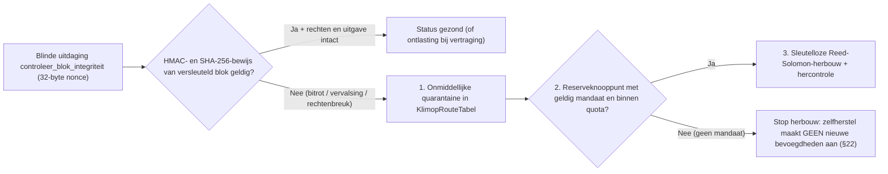

> 🌐 **Taal / Мова:** [Українська](ПЛЮЩ-ЕТАП-7-ІМУННА-СИСТЕМА-ТА-САМОВІДНОВЛЕННЯ.uk.md) · **Nederlands** | [Startpagina](../../LEESMIJ.md) · [Documentatie-index](../INDEX.nl.md) · [Hoofdarchitectuurmanifest «Klimop»](ARCHITECTUURMANIFEST-KLIMOP.nl.md) · [Fase 1 — Kern en uitgaveplan](KLIMOP-FASE-1-ARCHITECTUURKERN-EN-UITGAVEPLAN.nl.md) · [Fase 2 — «Stengels»](KLIMOP-FASE-2-BEPROEVINGSNETWERK-EN-STENGELS.nl.md) · [Fase 3 — Versleuteling en opslag](KLIMOP-FASE-3-VERSLEUTELING-EN-VERDEELDE-OPSLAG.nl.md) · [Fase 4 — FROST](KLIMOP-FASE-4-GEDISTRIBUEERDE-SLEUTELS-EN-DREMPELHANDTEKENINGEN.nl.md) · [Fase 5 — Identiteit en `MLS`](KLIMOP-FASE-5-ONAFHANKELIJKE-IDENTITEIT-EN-GROEPSRUIMTES.nl.md) · [Fase 6 — Bestuur en uitgaven](KLIMOP-FASE-6-DREMPELBESTUUR-EN-VEILIGE-UITGAVEN.nl.md)

# Fase 7 van het ecosysteem «Klimop» — Immuunsysteem, zelfherstel binnen quota en toetsing van de 10 overlevingsscenario's (`KLIMOP-008`)

- **Uitvoeringsdatum:** 20-11-2026
- **Coördinatietaak:** `KLIMOP-008` (bouwt voort op het in `integratie` samengevoegde verzoek nr. 189 `KLIMOP-007`, samenvoeging `3fd6a7519705fcffa7885f140f87797516d972f6`)
- **Programmatische realisatie:**
  - Kern voor blinde integriteitscontrole zonder inzage, reactieclassificatie, quotabeleid, vrijwillige apparaatbijdrage en toetsing van alle 10 overlevingsscenario's (`beoordeelKnooppuntGezondheid`, `beoordeelOverlevingsProefProgramma`): [`shared/klimop/immuunsysteem.ts`](../../shared/klimop/immuunsysteem.ts)
  - Netwerkcoördinator voor blinde inspectie en automatisch zelfherstel (`KlimopImmuunsysteemClient`, `voerAutomatischZelfherstelUit`): [`backend/klimop-immuunsysteem-client.ts`](../../backend/klimop-immuunsysteem-client.ts)
  - Knoopopdracht voor blind bezits- en integriteitsbewijs `controleer_blok_integriteit`: [`backend/klimop-knooppunt-agent.ts`](../../backend/klimop-knooppunt-agent.ts)
  - Herhaalbare proeftuin op 5 onafhankelijke knooppunten (`NL`, `CH`, `UA`, `SE`, `IS`) voor alle 10 noodscenario's: [`scripts/klimop-etappe7-immuunsysteem-proef.mjs`](../../scripts/klimop-etappe7-immuunsysteem-proef.mjs)
- **Normatieve grondslag:** hoofdstukken `§1.5–§1.6`, `§21–§22`, `§26–§27`, `§36 (Fase 7)`, `§37`, `§41–§44` (verplichte documenten **nr. 10**, **nr. 11** en **nr. 18**) van het [Hoofdarchitectuurmanifest «Klimop»](ARCHITECTUURMANIFEST-KLIMOP.nl.md)
- **Machtigingsgrens:** het immuunsysteem en zelfherstel draaien uitsluitend in de geïsoleerde proefketen zonder wijzigingen aan `systemd`-diensten, productie-`PostgreSQL 18.6` of `*.tarasevych.com`.

---

## 1. Handelingsprotocol bij uitval van knooppunten en eerbiediging van apparaatgrenzen (Document nr. 10 volgens §44 van het manifest)

Conform §1.5, §21–§22 en §26–§27 maakt het systeem strikt onderscheid tussen onbereikbaarheid, tijdelijke overbelasting en compromittering:

1. **Continue waarneming zonder inzage in privé-inhoud (§21):** `inspecteerObjectZonderInzage` en `maakBlindeIntegriteitUitdaging` sturen 32-byte eenmalige uitdagingen `uitdagingNonceHex`. Het opslagknooppunt bewijst via `HMAC-SHA-256` dat het exacte versleutelde fragment onbeschadigd aanwezig is zonder klare inhoud, bestandsnamen of sleutels vrij te geven (`geenPersoonlijkeInhoudInTelemetrie: true`).
2. **Stappen bij knooppuntuitval (`omleid_en_plan_herbouw`):**
   - het verkeer schakelt direct over op gezonde `Reed-Solomon`-strepen of een estafetteroute van de «Stengels»;
   - daalt het aantal onafhankelijke kopieën onder $k + m$, dan bouwt het systeem de ontbrekende streep sleutelloos opnieuw op een onafhankelijk reserveknooppunt in een ander rechtsgebied (`herbouwVerlorenKnooppuntZonderSleutel`);
   - snelheidsbegrenzing `controleerZelfherstelQuota` (`maxHerbouwBytesPerVenster`, `maxGelijktijdigeHerbouwTaken`) voorkomt herstelstormen.
3. **Bescherming van gebruikersapparaten en behoud van gegevenstoegang (§26–§27):** `magApparaatBijdragenAanHerstel` sluit een telefoon of laptop direct uit van achtergrondherstel bij uitgeschakelde toestemming, ontbrekende oplader, lage batterij (`minBatterijPercentage`), niet-goedgekeurd netwerk of bereikte geheugen-/CPU-grens — terwijl **de toegang tot de eigen gegevens onvoorwaardelijk behouden blijft (`toegangTotEigenGegevensBlijftBehouden: true`, §27 lid 3)**.

---

## 2. Handelingsprotocol bij compromittering of stille schijfbeschadiging (Document nr. 11 volgens §44 van het manifest)

- **Directe isolatie (`onmiddellijke_quarantaine_en_herbouw`):** bij een ongeldige stengelhandtekening, beschadigd fragment (`VERSLEUTELD_FRAGMENT_BESCHADIGD_OF_VERVALST`), onbevoegde rechtenwijziging of geschonden uitgave-integriteit plaatst het systeem het knooppunt direct in quarantaine (`plaatsInQuarantaine`) en wist alle actieve sessiesleutels.
- **Verbod op zelfstandige bevoegdheidsuitbreiding (§22 lid 3):** `controleerZelfherstelQuota` en `voerAutomatischZelfherstelUit` weigeren elk reserveknooppunt zonder vooraf door de eigenaar ondertekend `Ed25519`-mandaat (`ZELFHERSTEL_MAG_GEEN_NIEUWE_BEVOEGDHEDEN_AANMAKEN`).

---

## 3. Beproevingsprogramma en resultaten van alle 10 verplichte overlevingsscenario's (Document nr. 18 volgens §37, §41, §44)

In [`scripts/klimop-etappe7-immuunsysteem-proef.mjs`](../../scripts/klimop-etappe7-immuunsysteem-proef.mjs) (5 onafhankelijke knooppunten `NL`, `CH`, `UA`, `SE`, `IS` op `127.0.0.1`) zijn alle 10 scenario's uit §37 feitelijk uitgevoerd en getoetst door `beoordeelOverlevingsProefProgramma`:

| Nr. (§37) | Scenario-ID | Getoetste storing in de proeftuin | Beschikbaarheid | Gegevensverlies | Machtigingen |
|---|---|---|---|---|---|
| **1** | `uitschakeling_hoofdserver` | Volledige uitschakeling van hoofdknooppunt `NL` | Behouden (`CH + UA`) | **0 bytes** | Intact |
| **2** | `verlies_een_onafhankelijk_knooppunt` | Uitval van onafhankelijk knooppunt `CH` | Behouden (`NL + UA`) | **0 bytes** | Intact |
| **3** | `gelijktijdig_verlies_meerdere_knooppunten` | Gelijktijdige uitval van $m = 2$ knooppunten (`NL` + `CH`) | Behouden (`UA + SE`) | **0 bytes** | Intact |
| **4** | `netwerk_splitsing` | Verbroken directe lijnen naar `NL`, `UA`, `SE`; eind-tot-eind estafette via `CH -> UA` | Behouden | **0 bytes** | Intact |
| **5** | `uitval_verbindingsaanbieder` | Volledige uitval van verbindingsaanbieder `CH` | Behouden (`NL, UA, SE`) | **0 bytes** | Intact |
| **6** | `onbereikbaarheid_opstartknooppunten` | Nieuwe client bij onbereikbare opstartpunten `NL` en `CH` (rechtstreeks via `UA + SE`) | Behouden | **0 bytes** | Intact |
| **7** | `beschadiging_versleutelde_fragmenten` | Stille bitbeschadiging op `SE` → blinde detectie en quarantaine van `SE` | Behouden | **0 bytes** | Intact |
| **8** | `tekort_aan_onafhankelijke_kopieen` | Overslaan van telefoon `DE` (18% accu) en sleutelloze herbouw van 4e streep op `IS` | Behouden (`4/4` strepen) | **0 bytes** | Intact |
| **9** | `verdwijning_eigenaar_uit_bestuur` | `FROST` 2-van-3 quorumgoedkeuring door hoeders (`NL, CH, UA`) na 48-uurs tijdslot zonder eigenaar | Behouden | **0 bytes** | Intact |
| **10** | `verlies_gebruikersapparaten` | Wettig meerzijdig Pedersen-herstel 2-van-3 na 48-uurs betwistingsvenster met behoud van `persoonsId` | Behouden | **0 bytes** | Intact |

Alle eenheids- en netwerkcontroles zijn vastgelegd in [`tests/eenheid/klimop-008-etappe7-immuunsysteem-zelfherstel-20261120.test.ts`](../../tests/eenheid/klimop-008-etappe7-immuunsysteem-zelfherstel-20261120.test.ts).
