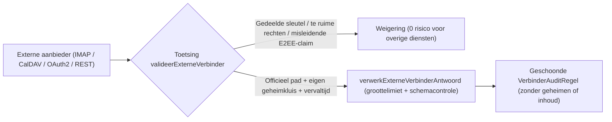

> 🌐 **Taal / Мова:** [Українська](ПЛЮЩ-ЕТАП-8-ПЕРЕНЕСЕННЯ-СЛУЖБ-ТА-ІЗОЛЬОВАНІ-ЗЄДНУВАЧІ.uk.md) · **Nederlands** | [Startpagina](../../LEESMIJ.md) · [Documentatie-index](../INDEX.nl.md) · [Hoofdarchitectuurmanifest «Klimop»](ARCHITECTUURMANIFEST-KLIMOP.nl.md) · [Fase 1 — Kern en uitgaveplan](KLIMOP-FASE-1-ARCHITECTUURKERN-EN-UITGAVEPLAN.nl.md) · [Fase 2 — «Stengels»](KLIMOP-FASE-2-BEPROEVINGSNETWERK-EN-STENGELS.nl.md) · [Fase 3 — Versleuteling en opslag](KLIMOP-FASE-3-VERSLEUTELING-EN-VERDEELDE-OPSLAG.nl.md) · [Fase 4 — FROST](KLIMOP-FASE-4-GEDISTRIBUEERDE-SLEUTELS-EN-DREMPELHANDTEKENINGEN.nl.md) · [Fase 5 — Identiteit en `MLS`](KLIMOP-FASE-5-ONAFHANKELIJKE-IDENTITEIT-EN-GROEPSRUIMTES.nl.md) · [Fase 6 — Bestuur en uitgaven](KLIMOP-FASE-6-DREMPELBESTUUR-EN-VEILIGE-UITGAVEN.nl.md) · [Fase 7 — Immuunsysteem](KLIMOP-FASE-7-IMMUUNSYSTEEM-EN-ZELFHERSTEL.nl.md)

# Fase 8 van het ecosysteem «Klimop» — Gefaseerde overzetting van de 11 diensten, versleutelde `CRDT`, geïsoleerde verbinders en lokaal zoeken (`KLIMOP-009`)

- **Uitvoeringsdatum:** 20-11-2026
- **Coördinatietaak:** `KLIMOP-009` (bouwt voort op het in `integratie` samengevoegde verzoek nr. 190 `KLIMOP-008`, samenvoeging `27c67c79949d6a9f772f2b9fe8942731e6a85f23`)
- **Programmatische realisatie:**
  - Isolatie van alle 11 diensten via `psid1_…`-pseudoniemen en `HKDF-SHA-256`-sleutels, versleutelde `CRDT` (`voegCrdtStatenSamen`), externe verbinders (`valideerExterneVerbinder`), lokaal zoeken (`zoekLokaalOverBronnen`) en tweezijdige pariteitstoetsing (`beslisOverDienstOverdrachtStap`): [`shared/klimop/diensten.ts`](../../shared/klimop/diensten.ts)
  - Quorumcoördinator voor blinde `CRDT`-replicatie van diensten (`KlimopDienstenOverdrachtClient`, `synchroniseerDienstStaatOpNetwerk`): [`backend/klimop-diensten-client.ts`](../../backend/klimop-diensten-client.ts)
  - Knoopopdrachten onder het rol-mandaat `synchronisatie` (`synchroniseer_dienst_crdt`, `raadpleeg_dienst_crdt`): [`backend/klimop-knooppunt-agent.ts`](../../backend/klimop-knooppunt-agent.ts)
  - Herhaalbare proeftuin op 3 onafhankelijke knooppunten (`NL`, `CH`, `UA`): [`scripts/klimop-etappe8-diensten-proef.mjs`](../../scripts/klimop-etappe8-diensten-proef.mjs)
- **Normatieve grondslag:** hoofdstukken `§3`, `§10–§11`, `§28–§31`, `§35–§36 (Fase 8)`, `§42–§44` (verplichte documenten **nr. 13** en **nr. 17**) van het [Hoofdarchitectuurmanifest «Klimop»](ARCHITECTUURMANIFEST-KLIMOP.nl.md)
- **Machtigingsgrens:** de actieve database `PostgreSQL 18.6`, `mijn-ruimte.service` en de 11 draaiende subdomeinen `*.tarasevych.com` blijven ongewijzigd en worden niet uitgeschakeld (§35).

---

## 1. Isolatie van de 11 diensten, versleutelde `CRDT` en beschermd lokaal zoeken (§28, §30–§31)

1. **Één begrijpelijke omgeving zonder gedeelde onbeperkte toegang (§28, §30):** voor elk van de 11 diensten (`KLIMOP_ELF_DIENSTEN`: `werkblad`, `postvak`, `identiteit`, `wolkopslag`, `agenda`, `ai_ruimte`, `mcp_poort`, `ontwikkelmiddelen`, `slimwoon`, `verbinders`, `beheer_en_diagnose`) leidt `leidGeisoleerdeDienstContextAf` een ongecorreleerd `psid1_<32 hex>`-pseudoniem en een afzonderlijke 32-byte `HKDF-SHA-256`-sleutel af. Kruiselingse ontsleuteling (bijv. `slimwoon` → `postvak`) wordt cryptografisch geweigerd (`DIENST_ISOLATIE_GRENS_GEWEIGERD`), tenzij een expliciete `KlimopKruisDienstToestemming` van de eigenaar aanwezig is.
2. **Offline apparaatwerk en blinde `CRDT`-samenvoeging (§10–§11):** elke mutatie wordt op het apparaat versleuteld met `ChaCha20-Poly1305`, voorzien van een hybride logische klok (`HLC`) en ondertekend met `Ed25519` (`maakOndertekendeCrdtOperatie`). Synchronisatieknooppunten controleren handtekeningen en voeren `voegCrdtStatenSamen` blind uit zonder ontsleutelingssleutels en zonder verlies van gelijktijdige wijzigingen.
3. **Beschermd lokaal zoeken over 4 bronklassen (§31):** `zoekLokaalOverBronnen` scheidt `openbare_gegevens`, `dienst_metadata`, `prive_versleuteld_materiaal` en `externe_aanbieder_gegevens` uitsluitend in het geheugen van het vertrouwde apparaat, terwijl `controleerGeenKlareIndexOpNetwerk` elke verzending van een onversleutelde zoekindex naar het netwerk blokkeert (`KLARE_ZOEKINDEX_OP_NETWERK_VERBODEN`).

---

## 2. Regels voor geïsoleerde externe verbinders van het gewone internet (Document nr. 13 volgens Fase 1 en §29–§30)

- Elke externe verbinder in `valideerExterneVerbinder` vereist een officieel ondersteund koppelingspad, een eigen geïsoleerde kluisreferentie (`eigenGeisoleerdeGeheimKluisId`), minimale rechten zonder `*`, een vervaltijd `verlooptOp` en een verbod op het doorgeven van rechten (`magRechtenDoorgevenZonderToestemming: false`).
- **Verbod op misleidende privacyclaims (§29 lid 3):** een gecentraliseerde externe dienst mag nooit aan de gebruiker worden voorgesteld als volledig privaat of gedecentraliseerd (`VERBINDER_MISLEIDENDE_PRIVACY_CLAIM_GEWEIGERD`).

---

## 3. Overzettingstrappen voor bestaande diensten met tweezijdige pariteitscontrole (Document nr. 17 volgens §35–§36)

| Overzettingsmodus (`KLIMOP_OVERDRACHT_MODI`) | Lees- en schrijfgedrag | Voorwaarde en automatische terugval (`beslisOverDienstOverdrachtStap`) |
|---|---|---|
| **0. `alleen_erfenis_postgres`** | Bestaande `PostgreSQL 18.6` (huidige productiestatus van alle 11 diensten). | Startlijn zonder enige invloed op de productieserver. |
| **1. `schaduw_dubbel_schrijven`** | Primair in `PostgreSQL 18.6` + versleutelde schaduwreplicatie naar «Klimop»-knooppunten. | Alleen toegestaan bij 100% gelijkheid in `vergelijkErfenisEnKlimopStaat` (aantal, inhouds- en rechtenhashes). |
| **2. `klimop_primair_met_erfenis_terugval`** | Primair lezen uit «Klimop» met warme terugvallijn naar `PostgreSQL 18.6`. | Bij het minste verschil zet het systeem de dienst direct terug (`AUTOMATISCH_TERUGGEZET_WEGENS_PARITEITSAFWIJKING`). |
| **3. `volledig_onafhankelijk_geverifieerd`** | Volledig zelfstandige werking op onafhankelijke knooppunten. | Vereist bewezen pariteit **én** uitdrukkelijke goedkeuring van de eigenaar (`VOLLEDIGE_LOSKOPPELING_VEREIST_GOEDKEURING_EIGENAAR`). |

De proeftuin [`scripts/klimop-etappe8-diensten-proef.mjs`](../../scripts/klimop-etappe8-diensten-proef.mjs) en [`tests/eenheid/klimop-009-etappe8-diensten-overdracht-20261120.test.ts`](../../tests/eenheid/klimop-009-etappe8-diensten-overdracht-20261120.test.ts) verifiëren al deze waarborgen automatisch.
