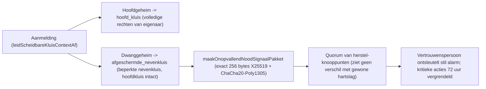

> 🌐 **Taal / Мова:** [Українська](ПЛЮЩ-ЕТАП-9-ЗАХИСТ-ЛЮДИНИ-ТА-ПРОТИДІЯ-ПРИМУСУ.uk.md) · **Nederlands** | [Startpagina](../../LEESMIJ.md) · [Documentatie-index](../INDEX.nl.md) · [Hoofdarchitectuurmanifest «Klimop»](ARCHITECTUURMANIFEST-KLIMOP.nl.md) · [Fase 1 — Kern en uitgaveplan](KLIMOP-FASE-1-ARCHITECTUURKERN-EN-UITGAVEPLAN.nl.md) · [Fase 2 — «Stengels»](KLIMOP-FASE-2-BEPROEVINGSNETWERK-EN-STENGELS.nl.md) · [Fase 3 — Versleuteling en opslag](KLIMOP-FASE-3-VERSLEUTELING-EN-VERDEELDE-OPSLAG.nl.md) · [Fase 4 — FROST](KLIMOP-FASE-4-GEDISTRIBUEERDE-SLEUTELS-EN-DREMPELHANDTEKENINGEN.nl.md) · [Fase 5 — Identiteit en `MLS`](KLIMOP-FASE-5-ONAFHANKELIJKE-IDENTITEIT-EN-GROEPSRUIMTES.nl.md) · [Fase 6 — Bestuur en uitgaven](KLIMOP-FASE-6-DREMPELBESTUUR-EN-VEILIGE-UITGAVEN.nl.md) · [Fase 7 — Immuunsysteem](KLIMOP-FASE-7-IMMUUNSYSTEEM-EN-ZELFHERSTEL.nl.md) · [Fase 8 — Dienstenoverdracht](KLIMOP-FASE-8-DIENSTENOVERDRACHT-EN-GEISOLEERDE-VERBINDERS.nl.md)

# Fase 9 van het ecosysteem «Klimop» — Protocol voor menselijke bescherming, dwangbestendigheid, contextueel risico en de 8 scenario's van §39 (`KLIMOP-010`)

- **Uitvoeringsdatum:** 20-11-2026
- **Coördinatietaak:** `KLIMOP-010` (bouwt voort op het in `integratie` samengevoegde verzoek nr. 191 `KLIMOP-009`, samenvoeging `5c5cf3c292186ee6040e21c78bb4dab7184e77ad`)
- **Programmatische realisatie:**
  - Beleid voor 9 noodomstandigheden (`STANDAARD_MENS_NOODBELEID`), scheidbare kluizen (`leidScheidbareKluisContextAf`), onopvallende 256-byte hartslag- en alarmpakketten (`maakOnopvallendNoodSignaalPakket`), tweezijdig herstel na vals alarm (`herstelNaValsDwangAlarm`), contextuele risicobeoordeling over 7 signalen (`beoordeelContextueelOperatieRisico`), uitgestelde operaties (`maakUitgesteldeKritiekeOperatie`), afwezigheidsprotocol (`beoordeelLangdurigeAfwezigheidProtocol`) en toetser voor 8 scenario's (`beoordeelMensbeschermingsProgramma`): [`shared/klimop/mensbescherming.ts`](../../shared/klimop/mensbescherming.ts)
  - Quorumcoördinator voor knooppunten met de rol `herstel` (`KlimopMensbeschermingClient`): [`backend/klimop-mensbescherming-client.ts`](../../backend/klimop-mensbescherming-client.ts)
  - Netwerkopdrachten onder het `herstel`-mandaat (`ontvang_onopvallend_signaal`, `registreer_uitgestelde_operatie`, `annuleer_uitgestelde_operatie`): [`backend/klimop-knooppunt-agent.ts`](../../backend/klimop-knooppunt-agent.ts)
  - Herhaalbare proeftuin op 3 onafhankelijke knooppunten (`NL`, `CH`, `UA`): [`scripts/klimop-etappe9-mensbescherming-proef.mjs`](../../scripts/klimop-etappe9-mensbescherming-proef.mjs)
- **Normatieve grondslag:** hoofdstukken `§14–§17`, `§36 (Fase 9)`, `§39`, `§42 punt 9`, `§43 punt 9` en verplicht **Document nr. 12** uit het Fase 1-register van het [Hoofdarchitectuurmanifest «Klimop»](ARCHITECTUURMANIFEST-KLIMOP.nl.md)
- **Machtigingsgrens:** de actieve productie-infrastructuur (`PostgreSQL 18.6`, `mijn-ruimte.service`, `*.tarasevych.com`) wordt niet gewijzigd of uitgeschakeld.

---

## 1. Onafhankelijkheid van het geheugen van één mens en 9 noodomstandigheden (§14, §17)

1. **Volledige scheiding van 9 levensomstandigheden (`KLIMOP_MENS_NOODOMSTANDIGHEDEN`):** voor apparaatverlies, verlies van inloggegevens, langdurige onbeschikbaarheid, ernstige ziekte, geheugenstoornis, overlijden van de eigenaar, fysieke dwang, psychologische druk en overname van beheerrechten legt `STANDAARD_MENS_NOODBELEID` afzonderlijke voogdendrempels (`k >= 2` of `3`) en betwistingstermijnen (`48`, `72` of `168` uur) vast.
2. **Protocol bij langdurige afwezigheid (`beoordeelLangdurigeAfwezigheidProtocol`, §17):** gewone afwezigheid of tijdelijk verbindingsverlies onthult nooit automatisch privé-inhoud en draagt nooit beheerrechten over (`geen_overdracht_alleen_bewaring`, `priveGegevensAutomatischOnthuldDoorStilte: false`).

---

## 2. Dwangbestendigheid, niet-onderscheidbare noodsignalen en eerlijke fysieke grenzen (Document nr. 12, §15)

- **Verbod op automatische gegevensvernietiging (§15 lid 5, §43 punt 9):** elke instelling met automatische zelfvernietiging van persoonsgegevens bij dwang wordt door `valideerDwangBeschermingsProfiel` direct geweigerd (`AUTOMATISCHE_GEGEVENSVERNIETIGING_VERBODEN`).
- **Eerlijke waarschuwing over fysieke veiligheid (§15 lid 3–4):** inschakeling vereist een uitdrukkelijke beoordeling van het risico op fysiek geweld en legt `garandeertFysiekeVeiligheidTegenAanvaller: false` vast — verborgen nevenkluizen of noodsleutels voorkomen alleenheerschappij over het netwerk, maar worden nooit voorgesteld als garantie tegen een fysieke aanvaller.
- **Veilig herstel na vals alarm (§39 punt 4):** bij een onbedoeld noodsignaal herstelt `herstelNaValsDwangAlarm` de normale modus met `0` bytes gegevensverlies uitsluitend na een gezamenlijke `Ed25519`-handtekening van de eigenaar **én** een erkende vertrouwenspersoon.

---

## 3. Contextuele risicobeoordeling (§16) en de 8 simulatiescenario's van §39

- `beoordeelContextueelOperatieRisico` toetst uitsluitend de **7 technische signalen van §16**, weigert biometrie zonder afzonderlijke toestemming (`BIOMETRIE_ZONDER_UITDRUKKELIJKE_TOESTEMMING_VERBODEN`), trekt geen automatische conclusies over geestestoestand of middelengebruik (`automatischeConclusieOverGeestestoestandOfDwang: false`) en behoudt altijd toegang tot eigen gegevens (`toegangTotEigenGegevensBehouden: true`), terwijl verdachte sleutel- of herstelwijzigingen 72 uur in een herroepbare quorumwachtrij worden geplaatst (`annuleerUitgesteldeOperatieOpQuorum`).
- De proeftuin [`scripts/klimop-etappe9-mensbescherming-proef.mjs`](../../scripts/klimop-etappe9-mensbescherming-proef.mjs) en [`tests/eenheid/klimop-010-etappe9-mensbescherming-dwang-20261120.test.ts`](../../tests/eenheid/klimop-010-etappe9-mensbescherming-dwang-20261120.test.ts) bewijzen alle **8 verplichte veilige simulatiescenario's van §39** met `0` bytes verlies.
