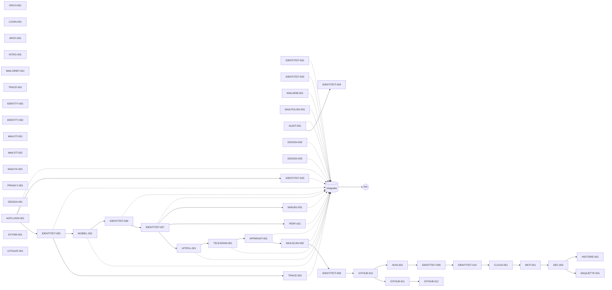

> 🌐 **Мова / Taal:** **Nederlands** · [Українська](ХРОНОЛОГІЯ-ГІЛОК.uk.md) | [Start](../../LEESMIJ.md) · [Documentatie-index](../INDEX.nl.md) · [Takken, PR’s en releases](./TAKKEN-EN-SAMENVOEGVERZOEKEN.nl.md) · [Geschiedenis](./GESCHIEDENIS.nl.md)

# Kroniek van takken en taken

Dit document wordt **alleen aangevuld**: de generator `scripts/geschiedenis/kroniek.mjs` (HISTORIE-001) voegt onderaan een nieuwe momentopname toe met taken die hier nog niet staan, of waarvan de top van de tak veranderd is. Bestaande regels worden nooit gewijzigd of verwijderd.

Elke taak heeft **← Voorganger** (op welke basis en bovenop welke eerdere taak ze begon) en **→ Opvolger** (waar ze is samengevoegd, of ze in de live versie zit, welke taken erop voortbouwen). Bronnen: alleen git, `orchestratie/taken/*.json`, `orchestratie/ontwikkelarchieven/*.json` en de momentopname van PR’s `scripts/geschiedenis/samenvoegverzoeken.json`.

Lezen: «vorige taak» is de recentste andere taak waarvan de top al in de basis van deze taak zat. «Volgende taken» kozen deze taak als voorganger.

---
## Momentopname 2026-11-13 · live versie `20261113-121403` · commit [`5f2325d`](https://github.com/Tarasevych/hub/commit/5f2325d788e29c5126f9ede6975afbbac7e5aae2) · takken op GitHub: 123

### Achterstand `voornaamst` ↔ live versie <!-- r:5f2325d788e29c5126f9ede6975afbbac7e5aae2:95ecef1a79d43c58e1dd045739a918e029d505a2 -->

De standaardtak `voornaamst` mist **132** commits van de live versie: **88** staan al in `integratie`, nog **44** liggen bovenop `integratie` in de releasetak. Alleen **de eigenaar** werkt `voornaamst` bij (fast-forward of samenvoegen met `integratie`); agenten wijzigen geen beschermde takken (AGENTS.md).

Commits per taak

- **[IDENTITEIT-004](#t-identiteit-004)** — 6 · 2026-11-08 → 2026-11-08
  - [`3dd0daaf`](https://github.com/Tarasevych/hub/commit/3dd0daaf) 2026-11-08 ІДЕНТИЧНІСТЬ-004: відтворено оформлення версії 49 з чинними діями та перемикачем
  - [`5c1b5871`](https://github.com/Tarasevych/hub/commit/5c1b5871) 2026-11-08 ІДЕНТИЧНІСТЬ-004 · усунуто повтори входу, безпеки та відновлення
  - [`1610efa5`](https://github.com/Tarasevych/hub/commit/1610efa5) 2026-11-08 ІДЕНТИЧНІСТЬ-004 · виправлено запис робочої гілки
  - [`7935b80c`](https://github.com/Tarasevych/hub/commit/7935b80c) 2026-11-08 ІДЕНТИЧНІСТЬ-004 · звірено встановлену основу випуску 20261107-195618
  - [`5cec9a84`](https://github.com/Tarasevych/hub/commit/5cec9a84) 2026-11-08 ІДЕНТИЧНІСТЬ-004 · додано журнал розробки й опис завдання перед об’єднанням
  - [`26d705c8`](https://github.com/Tarasevych/hub/commit/26d705c8) 2026-11-08 ІДЕНТИЧНІСТЬ-004 · позначено успішне об’єднання в integratie
- **[IDENTITEIT-005](#t-identiteit-005)** — 1 · 2026-11-08 → 2026-11-08
  - [`f1eceebf`](https://github.com/Tarasevych/hub/commit/f1eceebf) 2026-11-08 ІДЕНТИЧНІСТЬ-005 · узгоджено шари оформлення з перевіркою складання
- **[IDENTITEIT-006](#t-identiteit-006)** — 6 · 2026-11-08 → 2026-11-08
  - [`5846625a`](https://github.com/Tarasevych/hub/commit/5846625a) 2026-11-08 IDENTITEIT-006 · «Студія»: новий дизайн центру налаштувань акаунта
  - [`8d52b354`](https://github.com/Tarasevych/hub/commit/8d52b354) 2026-11-08 IDENTITEIT-006 · ілюстрації без обрізання, аркуш на всю ширину
  - [`877406d4`](https://github.com/Tarasevych/hub/commit/877406d4) 2026-11-08 IDENTITEIT-006 · журнал розробки, задача і процес випуску
  - [`ea351399`](https://github.com/Tarasevych/hub/commit/ea351399) 2026-11-08 IDENTITEIT-006 · модель ШІ для пакета задає власник змінною сховища
  - [`3de2e714`](https://github.com/Tarasevych/hub/commit/3de2e714) 2026-11-08 IDENTITEIT-006 · журнал: пробне пакування пройшло перевірку
  - [`9a040c6c`](https://github.com/Tarasevych/hub/commit/9a040c6c) 2026-11-08 IDENTITEIT-006 · нова група черги процесу випуску (завислий перезапуск блокував її)
- **[IDENTITEIT-007](#t-identiteit-007)** — 16 · 2026-11-08 → 2026-11-09
  - [`d693b8b7`](https://github.com/Tarasevych/hub/commit/d693b8b7) 2026-11-08 IDENTITEIT-007 · користувач сам обирає вигляд центру облікового запису («Студія» або класичний)
  - [`a8dbe05b`](https://github.com/Tarasevych/hub/commit/a8dbe05b) 2026-11-08 IDENTITEIT-007: вигляд «Макет» центру облікового запису за дизайном власника
  - [`4b56b720`](https://github.com/Tarasevych/hub/commit/4b56b720) 2026-11-08 IDENTITEIT-007: вигляд «Макет» один в один з макетом власника
  - [`619450a9`](https://github.com/Tarasevych/hub/commit/619450a9) 2026-11-09 IDENTITEIT-007 · журнал розробки, задача і процес випуску
  - [`8392ceb2`](https://github.com/Tarasevych/hub/commit/8392ceb2) 2026-11-09 IDENTITEIT-007 · журнал: пробне пакування пройшло перевірку
  - [`14ef8dc6`](https://github.com/Tarasevych/hub/commit/14ef8dc6) 2026-11-09 IDENTITEIT-007 · перемикач вигляду видно з класичної сторінки
  - [`d3d49286`](https://github.com/Tarasevych/hub/commit/d3d49286) 2026-11-09 IDENTITEIT-007 · на вузькому екрані компактний перемикач не дублює повний
  - [`a714cc52`](https://github.com/Tarasevych/hub/commit/a714cc52) 2026-11-09 IDENTITEIT-007 · перемикач вигляду видно з класичної сторінки
  - [`965f5199`](https://github.com/Tarasevych/hub/commit/965f5199) 2026-11-09 IDENTITEIT-007 · на вузькому екрані компактний перемикач не дублює повний
  - [`4d71a818`](https://github.com/Tarasevych/hub/commit/4d71a818) 2026-11-09 IDENTITEIT-007 · друга гілка випуску від коміту першого випуску: перемикач вигляду в класичному вигляді
  - [`fd95af01`](https://github.com/Tarasevych/hub/commit/fd95af01) 2026-11-09 IDENTITEIT-007 · «Макет» завжди в списку виглядів, перемикач функції створює міграція
  - [`0f905e03`](https://github.com/Tarasevych/hub/commit/0f905e03) 2026-11-09 IDENTITEIT-007 · «Макет» завжди в списку виглядів, перемикач функції створює міграція
  - [`bc16016a`](https://github.com/Tarasevych/hub/commit/bc16016a) 2026-11-09 IDENTITEIT-007 · третя гілка випуску від коміту другого випуску: «Макет» завжди в списку, перемикач функції з міграції
  - [`4c9786c5`](https://github.com/Tarasevych/hub/commit/4c9786c5) 2026-11-09 orch: IDENTITEIT-007 released · три випуски (051901, 060206, 065647) опубліковано, код злито в integratie за дозволом власника
  - [`c829351a`](https://github.com/Tarasevych/hub/commit/c829351a) 2026-11-09 IDENTITEIT-007 · міграція 0200: опис перемикача вкладається в межу CHECK (≤ 300 знаків)
  - [`a92ef438`](https://github.com/Tarasevych/hub/commit/a92ef438) 2026-11-09 IDENTITEIT-007 · міграція 0200: опис перемикача вкладається в межу CHECK (≤ 300 знаків)
- **[MOBIEL-001](#t-mobiel-001)** — 10 · 2026-11-08 → 2026-11-08
  - [`f1526698`](https://github.com/Tarasevych/hub/commit/f1526698) 2026-11-08 MOBIEL-001 · виправлено відображення налаштувань на смартфоні
  - [`2f793645`](https://github.com/Tarasevych/hub/commit/2f793645) 2026-11-08 MOBIEL-001 · додано перевірку смартфонів перед випуском
  - [`45388921`](https://github.com/Tarasevych/hub/commit/45388921) 2026-11-08 MOBIEL-001 · діагностика відображення під час браузерної перевірки
  - [`8b8aee15`](https://github.com/Tarasevych/hub/commit/8b8aee15) 2026-11-08 MOBIEL-001 · відтворено службовий модуль у браузерних перевірках
  - [`974f9c85`](https://github.com/Tarasevych/hub/commit/974f9c85) 2026-11-08 MOBIEL-001 · відновлено пункти верхньої та нижньої навігації
  - [`7abfa6ce`](https://github.com/Tarasevych/hub/commit/7abfa6ce) 2026-11-08 MOBIEL-001 · розгорнути всі групи навігації на телефоні
  - [`ab684f7e`](https://github.com/Tarasevych/hub/commit/ab684f7e) 2026-11-08 MOBIEL-001 · зберігати точні відомості про невдалі натискання
  - [`787613ad`](https://github.com/Tarasevych/hub/commit/787613ad) 2026-11-08 MOBIEL-001 · узгодити нижнє меню з висувною навігацією
  - [`ee88cf97`](https://github.com/Tarasevych/hub/commit/ee88cf97) 2026-11-08 MOBIEL-001 · прибрати приховані зовнішні відступи нижнього меню
  - [`944336a2`](https://github.com/Tarasevych/hub/commit/944336a2) 2026-11-08 MOBIEL-001 · перевірити також світле оформлення на смартфонах
- **[TRACE-002](#t-trace-002)** — 1 · 2026-11-08 → 2026-11-08
  - [`41d47ce8`](https://github.com/Tarasevych/hub/commit/41d47ce8) 2026-11-08 TRACE-002 · перевірка допустимої гілки перед пакуванням
- **[APPARAAT-001](#t-apparaat-001)** — 3 · 2026-11-09 → 2026-11-09
  - [`7006e93b`](https://github.com/Tarasevych/hub/commit/7006e93b) 2026-11-09 APPARAAT-001 · підтвердження з іншого пристрою: вкладки «Інший пристрій» і «У Telegram» у вікні «Підтвердіть доступ», плаваюче вікно «Це ви?» з тими самими символами, одна спроба, відлік, «Це не я» перемагає; четвертий метод «apparaat» у матриці TELEGRAM-001 і один поріг для step-up; символи в картці Telegram; налаштування користувача й адміністратора; прапорець apparaat-bevestiging-v1 типово увімкнено · bevestigen vanaf een ander apparaat: tabbladen in «Toegang bevestigen», zwevend venster «Bent u het?» met dezelfde symbolen, één poging, aftelling, «Dit ben ik niet» wint; vierde methode «apparaat» in de bevestigingstabel en één poort; symbolen in de Telegram-kaart; instellingen gebruiker en beheer; vlag standaard aan
  - [`623da0f1`](https://github.com/Tarasevych/hub/commit/623da0f1) 2026-11-09 APPARAAT-001 · кольори стану з палітри (--ok/--fout/--waarschuwing) замість шістнадцяткових; процес випуску GitHub Actions за зразком UITROL-001 (перевірки, міграції на чистій базі, стрім-тести, пакет, оприлюднення без встановлення) · statuskleuren uit het palet; uitgaveproces in GitHub Actions
  - [`29052626`](https://github.com/Tarasevych/hub/commit/29052626) 2026-11-09 APPARAAT-001 · таблиця apparaat_instellingen у реєстрі видалення облікового запису (стовпець door — рядок сайту, як tg_instellingen); журнал розробки доповнено результатами випуску · apparaat_instellingen in het register voor account wissen; ontwikkeldossier aangevuld
- **[MAILBG-001](#t-mailbg-001)** — 7 · 2026-11-09 → 2026-11-10
  - [`f0eee5a1`](https://github.com/Tarasevych/hub/commit/f0eee5a1) 2026-11-09 MAILBG-001 · рухоме тло пошти, лінза та налаштування
  - [`01a6bca1`](https://github.com/Tarasevych/hub/commit/01a6bca1) 2026-11-09 MAILBG-001 · додати перевірене посилання на злиття №60
  - [`7e7f606a`](https://github.com/Tarasevych/hub/commit/7e7f606a) 2026-11-09 MAILBG-001 · виправити двомовний підсумок для підготовки пакета
  - [`2cc45b1f`](https://github.com/Tarasevych/hub/commit/2cc45b1f) 2026-11-09 MAILBG-001 · дотикова лінза й остаточні перевірки
  - [`336e0f04`](https://github.com/Tarasevych/hub/commit/336e0f04) 2026-11-10 MAILBG-001 · зберегти виправлення дотику та походження випуску
  - [`566a4ba1`](https://github.com/Tarasevych/hub/commit/566a4ba1) 2026-11-10 MAILBG-001 · зберегти виправлення дотику та походження випуску
  - [`017b5a3d`](https://github.com/Tarasevych/hub/commit/017b5a3d) 2026-11-10 MAILBG-001 · зберегти виправлення дотику та походження випуску
- **[PERF-001](#t-perf-001)** — 8 · 2026-11-09 → 2026-11-09
  - [`5f451f8d`](https://github.com/Tarasevych/hub/commit/5f451f8d) 2026-11-09 PERF-001 · швидший старт сторінок: менший стартовий бандл, менше запитів, стиснення
  - [`6729abb6`](https://github.com/Tarasevych/hub/commit/6729abb6) 2026-11-09 PERF-001 · гілка випуску від встановленого коміту bc16016a: процес випуску, журнал розробки, задача
  - [`beebe27c`](https://github.com/Tarasevych/hub/commit/beebe27c) 2026-11-09 PERF-001 · стара вада: синтаксична помилка в presentation-init (апостроф у «під'єднань»)
  - [`35373228`](https://github.com/Tarasevych/hub/commit/35373228) 2026-11-09 PERF-001 · випуск: стара вада presentation-init у журналі, ще три перевірки в процесі
  - [`b31cea2d`](https://github.com/Tarasevych/hub/commit/b31cea2d) 2026-11-09 PERF-001 · смуга інтеграцій лишається публічною після лінивого завантаження
  - [`0cd11723`](https://github.com/Tarasevych/hub/commit/0cd11723) 2026-11-09 PERF-001 · журнал розробки: перевірка технічних бандлів і виправлення
  - [`2820fc4a`](https://github.com/Tarasevych/hub/commit/2820fc4a) 2026-11-09 PERF-001 · випуск: міграція 0200 виправлена (з IDENTITEIT-007), прогін усіх міграцій на чистій базі в процесі
  - [`b025c713`](https://github.com/Tarasevych/hub/commit/b025c713) 2026-11-09 PERF-001 · процес випуску: запуск і при зміні стану задач
- **[TELEGRAM-001](#t-telegram-001)** — 3 · 2026-11-09 → 2026-11-09
  - [`7228a5e3`](https://github.com/Tarasevych/hub/commit/7228a5e3) 2026-11-09 TELEGRAM-001 · вхід і підтвердження через Telegram (@MijnRuimte_Bot), прапорець telegram-aanmelden-v1 типово вимкнено · aanmelden en bevestigen via Telegram, vlag standaard uit
  - [`832b9ddb`](https://github.com/Tarasevych/hub/commit/832b9ddb) 2026-11-09 TELEGRAM-001 · мовна правка: без англіцизмів у текстах (адреса зворотного виклику, обліковий запис, ім’я користувача, випуск), читабельні назви кодів стану · taalcorrectie zonder anglicismen, leesbare namen voor statuscodes
  - [`8fe8b97f`](https://github.com/Tarasevych/hub/commit/8fe8b97f) 2026-11-09 TELEGRAM-001 · розміщення способів входу адміністратором (0203), «Єдиний вхід» замість «SSO», без англійської в нових текстах, нідерландські префікси гілок · plaatsing van aanmeldmethoden door de beheerder, «Eenmalige aanmelding», geen Engels, Nederlandse takvoorvoegsels
- **[UITROL-001](#t-uitrol-001)** — 6 · 2026-11-09 → 2026-11-09
  - [`d28daa41`](https://github.com/Tarasevych/hub/commit/d28daa41) 2026-11-09 UITROL-001 · перевірка вимог до завантаження: проба нових міграцій на тимчасовій копії схеми
  - [`55f543e0`](https://github.com/Tarasevych/hub/commit/55f543e0) 2026-11-09 UITROL-001 · перевірка вимог у браузері до завантаження: картка вимог, причина, журнал, звіт про проблему
  - [`1ede6765`](https://github.com/Tarasevych/hub/commit/1ede6765) 2026-11-09 UITROL-001: зупинка власником, конвеєр етапів, термінал-вікно з мітками, прив'язка проби до sha256
  - [`737d8796`](https://github.com/Tarasevych/hub/commit/737d8796) 2026-11-09 UITROL-001 · процес випуску, задача та досьє розробки · uitgaveproces, taak en ontwikkeldossier
  - [`4a371c64`](https://github.com/Tarasevych/hub/commit/4a371c64) 2026-11-09 UITROL-001 · тест передперевірки: добрий пакет має пробу, прив'язану до SQL; без проби — попередження, чужа міграція — помилка
  - [`22742811`](https://github.com/Tarasevych/hub/commit/22742811) 2026-11-09 UITROL-001 · каталог елементів інтерфейсу оновлено (нові кнопки термінала й зупинки) · UI-catalogus bijgewerkt
- **[HUIS-001](#t-huis-001)** — 18 · 2026-11-10 → 2026-11-12
  - [`879d4fcb`](https://github.com/Tarasevych/hub/commit/879d4fcb) 2026-11-10 HUIS-001: старі помилки розділу «Дім» — підписи вкладок, часові пояси, сповіщення
  - [`fa0b618a`](https://github.com/Tarasevych/hub/commit/fa0b618a) 2026-11-10 HUIS-001: змінні середовища розділу «Дім» у документах (uk + nl)
  - [`09ae25ca`](https://github.com/Tarasevych/hub/commit/09ae25ca) 2026-11-10 HUIS-001: тести виправлень і запуск набору huis-vnext у хмарному контейнері
  - [`ec5af93e`](https://github.com/Tarasevych/hub/commit/ec5af93e) 2026-11-10 HUIS-001: реєстрація задачі (розумний будинок, етап 0 — дизайн і макет)
  - [`a8ceded7`](https://github.com/Tarasevych/hub/commit/a8ceded7) 2026-11-10 HUIS-001: дизайн-мова «Живий дім / Levend huis» — робоча версія
  - [`0305f27e`](https://github.com/Tarasevych/hub/commit/0305f27e) 2026-11-10 HUIS-001: дизайн-мова — правки за зауваженнями перевірки (проміжний стан)
  - [`0f8e95b5`](https://github.com/Tarasevych/hub/commit/0f8e95b5) 2026-11-10 HUIS-001: проміжний стан дизайн-мови та ядра макета
  - [`fa7592aa`](https://github.com/Tarasevych/hub/commit/fa7592aa) 2026-11-10 HUIS-001: проміжний стан дизайн-мови та ядра макета
  - [`edc95ca5`](https://github.com/Tarasevych/hub/commit/edc95ca5) 2026-11-10 HUIS-001: проміжний стан дизайн-мови та ядра макета
  - [`43ac3bab`](https://github.com/Tarasevych/hub/commit/43ac3bab) 2026-11-10 HUIS-001: складальник макета — власні стилі екранів і збірка в окремий файл
  - [`6f5a9a1f`](https://github.com/Tarasevych/hub/commit/6f5a9a1f) 2026-11-12 HUIS-001: макет «Живий дім» — екрани всіх зон, аркуші керування, специфікація двома мовами
  - [`b9503ae1`](https://github.com/Tarasevych/hub/commit/b9503ae1) 2026-11-12 HUIS-001: макет «Живий дім» на сайті — «Вітрина» і статична сторінка /huis-maquette/
  - [`fc7de141`](https://github.com/Tarasevych/hub/commit/fc7de141) 2026-11-12 HUIS-001: тест макета, журнал розробки, покажчик документації, каталог пошуку
  - [`f9db5074`](https://github.com/Tarasevych/hub/commit/f9db5074) 2026-11-12 HUIS-001: робочий процес випуску (макет «Живий дім», специфікація, виправлення розділу «Дім»)
  - [`06186dee`](https://github.com/Tarasevych/hub/commit/06186dee) 2026-11-12 HUIS-001: завершальна перевірка макета й специфікації — перше коло виправлень
  - [`c612fd7c`](https://github.com/Tarasevych/hub/commit/c612fd7c) 2026-11-12 HUIS-001: завершальна перевірка — друге коло (залишки між файлами, перевірка змін, доопрацювання)
  - [`8c98dc1a`](https://github.com/Tarasevych/hub/commit/8c98dc1a) 2026-11-12 HUIS-001: другий випуск — основа за встановленою версією, журнал розробки другого кола
  - [`fd772f57`](https://github.com/Tarasevych/hub/commit/fd772f57) 2026-11-12 HUIS-001: основа другого випуску — встановлена версія 20261112-043627 (GITHUB-012)
- **[MAILSCAN-002](#t-mailscan-002)** — 6 · 2026-11-10 → 2026-11-10
  - [`427b300b`](https://github.com/Tarasevych/hub/commit/427b300b) 2026-11-10 MAILSCAN-002 · згода на перевірку й живе рідинне тло пошти
  - [`e02ee8b8`](https://github.com/Tarasevych/hub/commit/e02ee8b8) 2026-11-10 MAILSCAN-002 · перевірити мобільне тло та пробну базу перед випуском
  - [`7dedc366`](https://github.com/Tarasevych/hub/commit/7dedc366) 2026-11-10 MAILSCAN-002 · узгодити розміщення та каталог дій
  - [`d01a7a60`](https://github.com/Tarasevych/hub/commit/d01a7a60) 2026-11-10 MAILSCAN-002 · Узгодити давні перевірки з добровільною згодою
  - [`212749f8`](https://github.com/Tarasevych/hub/commit/212749f8) 2026-11-10 MAILSCAN-002 · Розділити перевірку вибору та згоди скриньок
  - [`89a6b55f`](https://github.com/Tarasevych/hub/commit/89a6b55f) 2026-11-10 MAILSCAN-002 · Зберегти успішні перевірки та знімки випуску
- **[GITHUB-010](#t-github-010)** — 1 · 2026-11-11 → 2026-11-11
  - [`3e18d5b3`](https://github.com/Tarasevych/hub/commit/3e18d5b3) 2026-11-11 GITHUB-010: повноцінне двостороннє робоче середовище GitHub, однонатискове підключення та екосистемні мости · volledige tweerichtings-GitHub-werkruimte
- **[IDENTITEIT-008](#t-identiteit-008)** — 5 · 2026-11-11 → 2026-11-11
  - [`d24de76c`](https://github.com/Tarasevych/hub/commit/d24de76c) 2026-11-11 IDENTITEIT-008: спадне меню облікового запису v3 (орбіта світлин, палітра за Моделлю В, доступ і масштаб)
  - [`b21dcae8`](https://github.com/Tarasevych/hub/commit/b21dcae8) 2026-11-11 IDENTITEIT-008: виправлення іменованого імпорту AccountMenuV3Instellingen для перевірки типів
  - [`66cab752`](https://github.com/Tarasevych/hub/commit/66cab752) 2026-11-11 IDENTITEIT-008: розумний захист повноти застосованих міграцій (MIGRATIES_ONTBREKEN) та розпізнавання жовтневих перейменувань
  - [`730d9f81`](https://github.com/Tarasevych/hub/commit/730d9f81) 2026-11-11 IDENTITEIT-008: незалежне поверхневе вікно AccountMenuV3 на всю ширину смартфона · onafhankelijk mobiel bovenvenster
  - [`7734fc3b`](https://github.com/Tarasevych/hub/commit/7734fc3b) 2026-11-11 IDENTITEIT-008: виправлення входу пошти Google і меню v3 та відкрита агентна екосистема ШІ · open AI-ecosysteem
- **[CLOUD-001](#t-cloud-001)** — 4 · 2026-11-12 → 2026-11-12
  - [`036b7c06`](https://github.com/Tarasevych/hub/commit/036b7c06) 2026-11-12 CLOUD-001: виправлено перевірку діапазону хмарних міграцій 0117..0122 у тесті послідовності
  - [`77747424`](https://github.com/Tarasevych/hub/commit/77747424) 2026-11-12 CLOUD-001: завантаження тек, архівів і будь-яких файлів у хмару, спільний доступ до папок, файлів і частин файла та керування посиланнями зі статистикою
  - [`04178943`](https://github.com/Tarasevych/hub/commit/04178943) 2026-11-12 CLOUD-001: узгоджено назви колонок і порожнє значення wachtwoord_hash у маршрутах спільного доступу зі схемою 0210
  - [`11e0aad8`](https://github.com/Tarasevych/hub/commit/11e0aad8) 2026-11-12 CLOUD-001: додано стійкість звірки основи випуску до тимчасової недоступності тунелю Cloudflare
- **[GITHUB-011](#t-github-011)** — 1 · 2026-11-12 → 2026-11-12
  - [`f2626def`](https://github.com/Tarasevych/hub/commit/f2626def) 2026-11-12 GITHUB-011: виправити зворотний виклик OAuth та однонатискове підключення GitHub при закритому сховищі ключів на основі 20261112-024707
- **[GITHUB-012](#t-github-012)** — 1 · 2026-11-12 → 2026-11-12
  - [`61cc2541`](https://github.com/Tarasevych/hub/commit/61cc2541) 2026-11-12 GITHUB-012: повна адаптація мобільної, планшетної та настільної версій розділу GitHub у всіх 13 підрозділах і просторах
- **[IDENTITEIT-009](#t-identiteit-009)** — 1 · 2026-11-12 → 2026-11-12
  - [`18262724`](https://github.com/Tarasevych/hub/commit/18262724) 2026-11-12 IDENTITEIT-009: повна мобільна адаптація всіх трьох режимів id.tarasevych.com та зміцнення безпеки, швидкодії й клієнтської стійкості поверх версії 20261112-090824
- **[IDENTITEIT-010](#t-identiteit-010)** — 1 · 2026-11-12 → 2026-11-12
  - [`2ee0cc3e`](https://github.com/Tarasevych/hub/commit/2ee0cc3e) 2026-11-12 IDENTITEIT-010: цілісний вхід на всіх піддоменах, єдиний сеанс простору, Telegram і сповіщення
- **[MCP-001](#t-mcp-001)** — 2 · 2026-11-12 → 2026-11-12
  - [`bfd4c5d8`](https://github.com/Tarasevych/hub/commit/bfd4c5d8) 2026-11-12 MCP-001: повна підтримка протоколу MCP 2026-07-28 + 2025-11-25, OAuth 2.1 (Origin, CIMD, RFC 9207) та вбудована студія-інспектор
  - [`1f101224`](https://github.com/Tarasevych/hub/commit/1f101224) 2026-11-12 MCP-001: уточнення назви тесту connector-v2.test.ts у робочому процесі випуску
- **[SEC-002](#t-sec-002)** — 6 · 2026-11-12 → 2026-11-13
  - [`c3d64f1a`](https://github.com/Tarasevych/hub/commit/c3d64f1a) 2026-11-12 SEC-002: зареєстровано завдання — глибокий аудит безпеки всього сховища й патчі
  - [`a85f7578`](https://github.com/Tarasevych/hub/commit/a85f7578) 2026-11-12 SEC-002: навичка й сценарій проєкту «beveiligingsaudit» для аудиту безпеки
  - [`bff49658`](https://github.com/Tarasevych/hub/commit/bff49658) 2026-11-13 SEC-002: умови тестів у CI — тимчасова тека сховища, root-сценарії g09/g10f через sudo · CI-testomgeving
  - [`705350c2`](https://github.com/Tarasevych/hub/commit/705350c2) 2026-11-13 SEC-002: тест g10f — копія помічника passkey у тимчасовій теці (CI: /home/runner 0750)
  - [`22c3b73b`](https://github.com/Tarasevych/hub/commit/22c3b73b) 2026-11-13 SEC-002: журнал розробки — узгодження умов тестів із GitHub Actions
  - [`5f2325d7`](https://github.com/Tarasevych/hub/commit/5f2325d7) 2026-11-13 SEC-002: справжній Chrome для перевірок інтерфейсу g10g у CI (закріплений playwright-core)

### Taken op startdatum

#### ORCH-001 · 2026-10-31 · agent claude <!-- k:ORCH-001@99b03ec19bd9fdad26fe0685069a4d6def04b89d -->

Єдина система координації AI-агентів (етапи 0–4)

- **Tak:** [`feature/orch-001-20261031-112355`](https://github.com/Tarasevych/hub/tree/feature/orch-001-20261031-112355) · top [`99b03ec`](https://github.com/Tarasevych/hub/commit/99b03ec19bd9fdad26fe0685069a4d6def04b89d) (2026-11-07) · status in record: `in_progress`
- **Andere takken van deze taak:** [`release/orch-001-mcp-20261031`](https://github.com/Tarasevych/hub/tree/release/orch-001-mcp-20261031), [`fix/orch-001-review-20261031-165744`](https://github.com/Tarasevych/hub/tree/fix/orch-001-review-20261031-165744), [`fix/orch-001-audit-20261031-170250`](https://github.com/Tarasevych/hub/tree/fix/orch-001-audit-20261031-170250)
- **← Voorganger:** basis [`b279cca`](https://github.com/Tarasevych/hub/commit/b279ccabe31a27139b337822162653ccc13b6a5a) · versie `20261031-093842`
- **→ Opvolger:** nog niet in `integratie` · volgende taken: geen
- **PR:** [#11](https://github.com/Tarasevych/hub/pull/11) → `release/sec-001-20261031-084138` (gesloten zonder samenvoegen) · [#13](https://github.com/Tarasevych/hub/pull/13) → `feature/orch-001-20261031-112355` (gesloten zonder samenvoegen) · [#16](https://github.com/Tarasevych/hub/pull/16) → `release/sec-001-20261031-084138` (samengevoegd 2026-11-01)

#### LOGIN-001 · 2026-11-01 · agent chatgpt <!-- k:LOGIN-001@603d3fad87b6940b332c76157dc8324b8cc6ed0a -->

Модерний мінімалістичний адаптивний екран авторизації Mijn Ruimte та меню збережених акаунтів

- **Tak:** [`feature/login-001-20261101-195230`](https://github.com/Tarasevych/hub/tree/feature/login-001-20261101-195230) · top [`603d3fa`](https://github.com/Tarasevych/hub/commit/603d3fad87b6940b332c76157dc8324b8cc6ed0a) (2026-11-07) · status in record: `in_progress`
- **Andere takken van deze taak:** [`feature/login-001-plus-hub`](https://github.com/Tarasevych/hub/tree/feature/login-001-plus-hub), [`feature/login-001-20261101-184800-chatgpt`](https://github.com/Tarasevych/hub/tree/feature/login-001-20261101-184800-chatgpt)
- **← Voorganger:** basis [`10a9278`](https://github.com/Tarasevych/hub/commit/10a92781b4fb5e03825caebcb63aa74c4206eefc) · versie `20261101-185530`
- **→ Opvolger:** deels in `integratie` (PR samengevoegd, maar de tak liep verder) · volgende taken: geen
- **PR:** [#20](https://github.com/Tarasevych/hub/pull/20) → `integratie` (samengevoegd 2026-11-04) · [#21](https://github.com/Tarasevych/hub/pull/21) → `integratie` (gesloten zonder samenvoegen)

#### ARCH-001 · 2026-11-02 · agent claude <!-- k:ARCH-001@geen -->

- **Tak:** [`feature/archief-f1-20261102-203129`](https://github.com/Tarasevych/hub/tree/feature/archief-f1-20261102-203129) · tak niet op GitHub (verwijderd of niet gepubliceerd) · status in record: `in_progress`
- **← Voorganger:** basis [`4a9e10b`](https://github.com/Tarasevych/hub/commit/4a9e10be51f37748b3d803de9ca8813bebd143b4) · versie `20261031-093842`
- **→ Opvolger:** volgende taken: geen

#### INTEG-001 · 2026-11-03 · agent claude <!-- k:INTEG-001@7cfd001db3f018ee67696eff7ecc4216c5a27ee6 -->

- **Tak:** [`feature/integ-001-20261103-083441`](https://github.com/Tarasevych/hub/tree/feature/integ-001-20261103-083441) · top [`7cfd001`](https://github.com/Tarasevych/hub/commit/7cfd001db3f018ee67696eff7ecc4216c5a27ee6) (2026-11-07) · status in record: `in_progress`
- **Andere takken van deze taak:** [`feature/integ-001-zoek-20261103-083752`](https://github.com/Tarasevych/hub/tree/feature/integ-001-zoek-20261103-083752), [`feature/integ-001-test-20261103-083753`](https://github.com/Tarasevych/hub/tree/feature/integ-001-test-20261103-083753), [`feature/integ-001-samenvatting-20261103-102243`](https://github.com/Tarasevych/hub/tree/feature/integ-001-samenvatting-20261103-102243), [`feature/integ-001-print-20261103-083745`](https://github.com/Tarasevych/hub/tree/feature/integ-001-print-20261103-083745), [`feature/integ-001-menu-20261103-083746`](https://github.com/Tarasevych/hub/tree/feature/integ-001-menu-20261103-083746), [`feature/integ-001-meld-20261103-083755`](https://github.com/Tarasevych/hub/tree/feature/integ-001-meld-20261103-083755), [`feature/integ-001-login-20261103-083803`](https://github.com/Tarasevych/hub/tree/feature/integ-001-login-20261103-083803), [`feature/integ-001-band-20261103-083753`](https://github.com/Tarasevych/hub/tree/feature/integ-001-band-20261103-083753), [`feature/integ-001-agpag2-20261103-083749`](https://github.com/Tarasevych/hub/tree/feature/integ-001-agpag2-20261103-083749), [`feature/integ-001-agpag1-20261103-083758`](https://github.com/Tarasevych/hub/tree/feature/integ-001-agpag1-20261103-083758)
- **← Voorganger:** basis [`067cec9`](https://github.com/Tarasevych/hub/commit/067cec9f1f41429763688d9f07a25f1ad29f6635) · versie `20261031-093842`
- **→ Opvolger:** nog niet in `integratie` · volgende taken: geen

#### MAILORBIT-001 · 2026-11-03 · agent codex <!-- k:MAILORBIT-001@223945ba7f0d298b563f07b5b42aa63c3ed6c68d -->

Анімована доступна орбіта поштових сервісів і справжнє внутрішнє вікно підключення

- **Tak:** [`feature/mailorbit-001-20261103-205354`](https://github.com/Tarasevych/hub/tree/feature/mailorbit-001-20261103-205354) · top [`223945b`](https://github.com/Tarasevych/hub/commit/223945ba7f0d298b563f07b5b42aa63c3ed6c68d) (2026-11-07) · status in record: `in_progress`
- **← Voorganger:** basis [`15025c3`](https://github.com/Tarasevych/hub/commit/15025c3e9c8466b650f0a5488b18c42f54ab9d3a) · versie `20261031-093842`
- **→ Opvolger:** nog niet in `integratie` · volgende taken: geen
- **PR:** [#22](https://github.com/Tarasevych/hub/pull/22) → `feature/integ-001-zvedennia-20261103-102243` (gesloten zonder samenvoegen)

#### TRACE-001 · 2026-11-03 · agent codex <!-- k:TRACE-001@772a1a374a757c0f355567f1ff42e59b950b8056 -->

Обов’язкова відтворювана історія розробки у GitHub та перевірка на сайті й в інсталяторі

- **Tak:** [`feature/trace-001-20261103-214810`](https://github.com/Tarasevych/hub/tree/feature/trace-001-20261103-214810) · top [`772a1a3`](https://github.com/Tarasevych/hub/commit/772a1a374a757c0f355567f1ff42e59b950b8056) (2026-11-07) · status in record: `in_progress`
- **← Voorganger:** basis [`a643431`](https://github.com/Tarasevych/hub/commit/a643431743eb1e7e64947bf747018aac55d69750) · versie `20261031-093842`
- **→ Opvolger:** nog niet in `integratie` · volgende taken: geen
- **PR:** [#23](https://github.com/Tarasevych/hub/pull/23) → `feature/mailorbit-001-20261103-205354` (open)

#### IDENTITEIT-001 · 2026-11-04 · agent claude <!-- k:IDENTITEIT-001@d9118a704cb5f45a63fa5278931a14ceac5030ee -->

Дизайн сторінки керування обліковим записом (категорія identity, 12 екранів): живий прототип, ТЗ, матриця покриття; код застосунку не змінюється.

- **Tak:** [`fix/identiteit-account-namen-20261107-140000`](https://github.com/Tarasevych/hub/tree/fix/identiteit-account-namen-20261107-140000) · top [`d9118a7`](https://github.com/Tarasevych/hub/commit/d9118a704cb5f45a63fa5278931a14ceac5030ee) (2026-11-07) · status in record: `in_progress`
- **← Voorganger:** basis [`c1a4375`](https://github.com/Tarasevych/hub/commit/c1a4375e091c9b48d4c2a980bd4c70ab47e5a90b) · versie `20261031-093842`
- **→ Opvolger:** samengevoegd in `integratie` · zit in de live versie · zit in `voornaamst` · eerste release die haar bevat: [`20261107-162216`](https://github.com/Tarasevych/hub/releases/tag/20261107-162216) · volgende taken: geen

#### IDENTITEIT-002 · 2026-11-04 · agent claude <!-- k:IDENTITEIT-002@d9118a704cb5f45a63fa5278931a14ceac5030ee -->

Сторінка облікового запису: 12 розділів identity на одній сторінці з меню-змістом і прокруткою, діалог фото з трьох джерел, виправлення аудиту 05.11.2026 (cbeb3d0 і a318ba0).

- **Tak:** [`fix/identiteit-account-namen-20261107-140000`](https://github.com/Tarasevych/hub/tree/fix/identiteit-account-namen-20261107-140000) · top [`d9118a7`](https://github.com/Tarasevych/hub/commit/d9118a704cb5f45a63fa5278931a14ceac5030ee) (2026-11-07) · status in record: `in_progress`
- **← Voorganger:** basis [`50e6373`](https://github.com/Tarasevych/hub/commit/50e63737ddb3f7b032f8fc74dc343ed28fda0af8) · versie `20261104-164906` · [`20261104-164906`](https://github.com/Tarasevych/hub/releases/tag/20261104-164906), [`20261104-191935`](https://github.com/Tarasevych/hub/releases/tag/20261104-191935)
- **→ Opvolger:** samengevoegd in `integratie` · zit in de live versie · zit in `voornaamst` · eerste release die haar bevat: [`20261107-162216`](https://github.com/Tarasevych/hub/releases/tag/20261107-162216) · volgende taken: geen

#### IDENTITY-001 · 2026-11-04 · agent claude <!-- k:IDENTITY-001@geen -->

Дизайн сторінки керування обліковим записом (категорія identity, 12 екранів): живий прототип, ТЗ, матриця покриття; код застосунку не змінюється.

- **Tak:** [`feature/identity-account-20261104-120000`](https://github.com/Tarasevych/hub/tree/feature/identity-account-20261104-120000) · tak niet op GitHub (verwijderd of niet gepubliceerd) · status in record: `in_progress`
- **← Voorganger:** basis [`c1a4375`](https://github.com/Tarasevych/hub/commit/c1a4375e091c9b48d4c2a980bd4c70ab47e5a90b) · versie `20261031-093842`
- **→ Opvolger:** volgende taken: geen

#### IDENTITY-002 · 2026-11-04 · agent claude <!-- k:IDENTITY-002@geen -->

Сторінка облікового запису: 12 розділів identity на одній сторінці з меню-змістом і прокруткою, діалог фото з трьох джерел, виправлення аудиту 05.11.2026 (cbeb3d0 і a318ba0).

- **Tak:** [`feature/identity-account-ui-20261104-180000`](https://github.com/Tarasevych/hub/tree/feature/identity-account-ui-20261104-180000) · tak niet op GitHub (verwijderd of niet gepubliceerd) · status in record: `in_progress`
- **← Voorganger:** basis [`50e6373`](https://github.com/Tarasevych/hub/commit/50e63737ddb3f7b032f8fc74dc343ed28fda0af8) · versie `20261104-164906` · [`20261104-164906`](https://github.com/Tarasevych/hub/releases/tag/20261104-164906), [`20261104-191935`](https://github.com/Tarasevych/hub/releases/tag/20261104-191935)
- **→ Opvolger:** volgende taken: geen

#### MAILFIT-001 · 2026-11-04 · agent codex <!-- k:MAILFIT-001@024fa94eada86993ff1e66f7ff63c7af757fc8a4 -->

Адаптивний центрований екран першого підключення пошти, без зайвої навігації

- **Tak:** [`fix/mailfit-001-20261104-110700`](https://github.com/Tarasevych/hub/tree/fix/mailfit-001-20261104-110700) · top [`024fa94`](https://github.com/Tarasevych/hub/commit/024fa94eada86993ff1e66f7ff63c7af757fc8a4) (2026-11-07) · status in record: `in_progress`
- **← Voorganger:** basis [`0ba1fc6`](https://github.com/Tarasevych/hub/commit/0ba1fc61f4c2d9a1cba1f45a764982d113cfd8bf) · versie `20261031-093842`
- **→ Opvolger:** nog niet in `integratie` · volgende taken: geen
- **PR:** [#27](https://github.com/Tarasevych/hub/pull/27) → `fix/mailfix-001-20261104-095000` (open)

#### MAILFIT-002 · 2026-11-04 · agent codex <!-- k:MAILFIT-002@842767226624cf15b7b0190b78d20b717a6e0818 -->

Адаптивний центрований екран першого підключення пошти, без зайвої навігації

- **Tak:** [`fix/mailfit-002-20261104-170000`](https://github.com/Tarasevych/hub/tree/fix/mailfit-002-20261104-170000) · top [`8427672`](https://github.com/Tarasevych/hub/commit/842767226624cf15b7b0190b78d20b717a6e0818) (2026-11-07) · status in record: `in_progress`
- **← Voorganger:** basis [`034e34f`](https://github.com/Tarasevych/hub/commit/034e34f95a86fed056a545f61c774cd91400dd32) · versie `20261031-093842`
- **→ Opvolger:** nog niet in `integratie` · volgende taken: geen

#### MAILFIX-001 · 2026-11-04 · agent codex <!-- k:MAILFIX-001@2696c4fead71b3b81195b1e65415108c6da5e5f5 -->

Виправити дубльований каталог, вузьку мобільну пошту та діагностику реального Google OAuth

- **Tak:** [`fix/mailfix-001-20261104-095000`](https://github.com/Tarasevych/hub/tree/fix/mailfix-001-20261104-095000) · top [`2696c4f`](https://github.com/Tarasevych/hub/commit/2696c4fead71b3b81195b1e65415108c6da5e5f5) (2026-11-07) · status in record: `in_progress`
- **← Voorganger:** basis [`e97a58c`](https://github.com/Tarasevych/hub/commit/e97a58ceaf70f6a4a8d63608541d47e455ddb66a) · versie `20261031-093842`
- **→ Opvolger:** nog niet in `integratie` · volgende taken: geen
- **PR:** [#26](https://github.com/Tarasevych/hub/pull/26) → `feature/mailpolish-001-20261104-084133` (open)

#### MAILMOB-001 · 2026-11-04 · agent codex <!-- k:MAILMOB-001@d23f3a1a77c985eaf474e5c6a8326081e8e1afdc -->

Мобільна пошта та діагностика 12-годинного Passkey

- **Tak:** [`feature/mailmob-001-20261104-073200`](https://github.com/Tarasevych/hub/tree/feature/mailmob-001-20261104-073200) · top [`d23f3a1`](https://github.com/Tarasevych/hub/commit/d23f3a1a77c985eaf474e5c6a8326081e8e1afdc) (2026-11-07) · status in record: `in_progress`
- **← Voorganger:** basis [`b20a5b2`](https://github.com/Tarasevych/hub/commit/b20a5b25cb7b640dd636c86bce7ed139a8225fbd) · versie `20261031-093842`
- **→ Opvolger:** samengevoegd in `integratie` · zit in de live versie · zit in `voornaamst` · eerste release die haar bevat: [`20261107-121500`](https://github.com/Tarasevych/hub/releases/tag/20261107-121500) · volgende taken: geen
- **PR:** [#24](https://github.com/Tarasevych/hub/pull/24) → `feature/trace-001-20261103-214810` (samengevoegd 2026-11-07)

#### MAILPOLISH-001 · 2026-11-04 · agent codex <!-- k:MAILPOLISH-001@d23f3a1a77c985eaf474e5c6a8326081e8e1afdc -->

Відтворення дизайнерської концепції мобільного підключення пошти

- **Tak:** [`feature/mailpolish-001-20261104-084133`](https://github.com/Tarasevych/hub/tree/feature/mailpolish-001-20261104-084133) · top [`d23f3a1`](https://github.com/Tarasevych/hub/commit/d23f3a1a77c985eaf474e5c6a8326081e8e1afdc) (2026-11-07) · status in record: `in_progress`
- **← Voorganger:** basis [`90f0d73`](https://github.com/Tarasevych/hub/commit/90f0d737a6007d401ded790e6a27d018e34eb890) · versie `20261031-093842`
- **→ Opvolger:** samengevoegd in `integratie` · zit in de live versie · zit in `voornaamst` · eerste release die haar bevat: [`20261107-121500`](https://github.com/Tarasevych/hub/releases/tag/20261107-121500) · volgende taken: geen
- **PR:** [#25](https://github.com/Tarasevych/hub/pull/25) → `feature/mailmob-001-20261104-073200` (samengevoegd 2026-11-07)

#### PRIVACY-001 · 2026-11-04 · agent claude <!-- k:PRIVACY-001@dadc6d2b75a2923f9439d2c72d0deef08b81923a -->

Прибрати персональні дані з публічного репозиторію (код, тести, CI, документація, правила, журнали, історія), прибрати адреси сервера з коду й скриптів, зробити так, щоб скрипти й сайт брали дані з конфігурації сервера, і підготувати архів для встановлення через сайт.

- **Tak:** [`release/persoonsgegevens-20261104-164147`](https://github.com/Tarasevych/hub/tree/release/persoonsgegevens-20261104-164147) · top [`dadc6d2`](https://github.com/Tarasevych/hub/commit/dadc6d2b75a2923f9439d2c72d0deef08b81923a) (2026-11-07) · status in record: `in_progress`
- **← Voorganger:** basis [`e547381`](https://github.com/Tarasevych/hub/commit/e5473812d547385378a278d91c24fb4e5389467f) · versie `20261031-093842`
- **→ Opvolger:** nog niet in `integratie` · volgende taken: geen

#### AUDIT-001 · 2026-11-05 · agent antigravity <!-- k:AUDIT-001@7bb8765df3ac5e38d8185a94fc5d22c30a46d345 -->

Виправлення проблем аудиту 2026-11-05, безконфліктна інтеграція PRIVACY-001, MAILFIT-002, IDENTITY-002, DESIGN-001, AGPLUGIN-001 та повна мовна вичитка української й нідерландської документації

- **Tak:** [`audit/audit-2026-11-05-20261105-070523`](https://github.com/Tarasevych/hub/tree/audit/audit-2026-11-05-20261105-070523) · top [`7bb8765`](https://github.com/Tarasevych/hub/commit/7bb8765df3ac5e38d8185a94fc5d22c30a46d345) (2026-11-07) · status in record: `integrated`
- **← Voorganger:** basis [`f3f3fab`](https://github.com/Tarasevych/hub/commit/f3f3fabb2f3b5209b1ee8eba3078e403de831844) · versie `20261105-061659`
- **→ Opvolger:** samengevoegd in `integratie` · zit in de live versie · zit in `voornaamst` · eerste release die haar bevat: [`20261107-203000`](https://github.com/Tarasevych/hub/releases/tag/20261107-203000) · volgende taken: [IDENTITEIT-004](#t-identiteit-004)

#### DESIGN-001 · 2026-11-05 · agent codex <!-- k:DESIGN-001@02dff82ab5493281ce607b25b65e94fda12c54b1 -->

Адаптивне оновлення візуальної системи

- **Tak:** [`feature/design-001-20261105-140000`](https://github.com/Tarasevych/hub/tree/feature/design-001-20261105-140000) · top [`02dff82`](https://github.com/Tarasevych/hub/commit/02dff82ab5493281ce607b25b65e94fda12c54b1) (2026-11-07) · status in record: `in_progress`
- **← Voorganger:** basis [`6e815a0`](https://github.com/Tarasevych/hub/commit/6e815a00307dd9c00a0b2907838be099be8c5610) · versie `20261104-204906` · [`20261104-204906`](https://github.com/Tarasevych/hub/releases/tag/20261104-204906)
- **→ Opvolger:** nog niet in `integratie` · volgende taken: geen
- **PR:** [#28](https://github.com/Tarasevych/hub/pull/28) → `feature/identity-account-ui-20261104-180000` (gesloten zonder samenvoegen)

#### DESIGN-002 · 2026-11-05 · agent codex <!-- k:DESIGN-002@d23f3a1a77c985eaf474e5c6a8326081e8e1afdc -->

Адаптивний інтерфейс і завершення попередніх покращень

- **Tak:** [`feature/design-002-20261105-134500`](https://github.com/Tarasevych/hub/tree/feature/design-002-20261105-134500) · top [`d23f3a1`](https://github.com/Tarasevych/hub/commit/d23f3a1a77c985eaf474e5c6a8326081e8e1afdc) (2026-11-07) · status in record: `in_progress`
- **Andere takken van deze taak:** [`feature/design-002-publish-20261105-153921`](https://github.com/Tarasevych/hub/tree/feature/design-002-publish-20261105-153921), [`audit/design-002-trace-20261105-154228`](https://github.com/Tarasevych/hub/tree/audit/design-002-trace-20261105-154228)
- **← Voorganger:** basis [`53a7b91`](https://github.com/Tarasevych/hub/commit/53a7b918038c9a0657e76c170415de4151885fcf) · versie `20261105-101500` · [`20261105-101500`](https://github.com/Tarasevych/hub/releases/tag/20261105-101500) · ∈ `integratie` ∈ `voornaamst`
- **→ Opvolger:** samengevoegd in `integratie` · zit in de live versie · zit in `voornaamst` · eerste release die haar bevat: [`20261107-121500`](https://github.com/Tarasevych/hub/releases/tag/20261107-121500) · volgende taken: geen
- **PR:** [#29](https://github.com/Tarasevych/hub/pull/29) → `integratie` (samengevoegd 2026-11-05)

#### AGPLUGIN-001 · 2026-11-06 · agent antigravity <!-- k:AGPLUGIN-001@d23f3a1a77c985eaf474e5c6a8326081e8e1afdc -->

Плагін і двосторонній конектор Google Antigravity (/antigravity, AGPLUGIN-001 від antigravity) з 4-канальним UI-мостом, плюс виправлення root-інсталятора UTF-8 (UITROL-UTF8-001, PR №40 від claude) поверх випуску 20261106-092612

- **Tak:** [`feature/agplugin-001-20261106-072500`](https://github.com/Tarasevych/hub/tree/feature/agplugin-001-20261106-072500) · top [`d23f3a1`](https://github.com/Tarasevych/hub/commit/d23f3a1a77c985eaf474e5c6a8326081e8e1afdc) (2026-11-07) · status in record: `in_progress`
- **← Voorganger:** basis [`49760d8`](https://github.com/Tarasevych/hub/commit/49760d814be61c460a219070471407534e1829f2) · versie `20261105-061659` · [`20261106-092612`](https://github.com/Tarasevych/hub/releases/tag/20261106-092612) · ∈ `integratie` ∈ `voornaamst`
- **→ Opvolger:** samengevoegd in `integratie` · zit in de live versie · zit in `voornaamst` · eerste release die haar bevat: [`20261107-121500`](https://github.com/Tarasevych/hub/releases/tag/20261107-121500) · volgende taken: [IDENTITEIT-003](#t-identiteit-003), [IDENTITEIT-005](#t-identiteit-005)

#### DESIGN-003 · 2026-11-06 · agent codex <!-- k:DESIGN-003@d23f3a1a77c985eaf474e5c6a8326081e8e1afdc -->

Адаптивні картки профілів ШІ й чотири канали Antigravity на встановленій версії

- **Tak:** [`feature/design-003-20261106-103743`](https://github.com/Tarasevych/hub/tree/feature/design-003-20261106-103743) · top [`d23f3a1`](https://github.com/Tarasevych/hub/commit/d23f3a1a77c985eaf474e5c6a8326081e8e1afdc) (2026-11-07) · status in record: `in_progress`
- **← Voorganger:** basis [`b14a59e`](https://github.com/Tarasevych/hub/commit/b14a59e3c4b259b57d413be498281d49f1e6969c) · versie `20261106-141500` · ∈ `integratie` ∈ `voornaamst`
- **→ Opvolger:** samengevoegd in `integratie` · zit in de live versie · zit in `voornaamst` · eerste release die haar bevat: [`20261107-121500`](https://github.com/Tarasevych/hub/releases/tag/20261107-121500) · volgende taken: geen
- **PR:** [#41](https://github.com/Tarasevych/hub/pull/41) → `integratie` (samengevoegd 2026-11-06)

#### EXT090-001 · 2026-11-06 · agent claude <!-- k:EXT090-001@56ca725a112d0569582d4ad0634b4f2a196952c6 -->

Випуск 20261106-164109: розширення 0.9.2 (вбудований ШІ Chrome, offscreen.html, під'єднання без F5, кнопка «Увійти») і підтримка на сайті

- **Tak:** [`feature/ext090-001-20261106-142448`](https://github.com/Tarasevych/hub/tree/feature/ext090-001-20261106-142448) · top [`56ca725`](https://github.com/Tarasevych/hub/commit/56ca725a112d0569582d4ad0634b4f2a196952c6) (2026-11-07) · status in record: `in_progress`
- **Andere takken van deze taak:** [`feature/ext090-001-20261106-163840`](https://github.com/Tarasevych/hub/tree/feature/ext090-001-20261106-163840)
- **← Voorganger:** basis [`b14a59e`](https://github.com/Tarasevych/hub/commit/b14a59e3c4b259b57d413be498281d49f1e6969c) · versie `20261105-061659` · ∈ `integratie` ∈ `voornaamst`
- **→ Opvolger:** deels in `integratie` (PR samengevoegd, maar de tak liep verder) · volgende taken: geen
- **PR:** [#42](https://github.com/Tarasevych/hub/pull/42) → `integratie` (gesloten zonder samenvoegen) · [#43](https://github.com/Tarasevych/hub/pull/43) → `integratie` (samengevoegd 2026-11-06)

#### UITGAVE-001 · 2026-11-06 · agent claude <!-- k:UITGAVE-001@d969aa2855cdadace7725edf7374813f9bb1808a -->

Випуск оновлення сайту з integratie: ORCH-001 (PR №30, №33, №36) і ZOEKDIEP-001 (PR №32, №34, №35)

- **Tak:** [`feature/uitgave-001-20261106-081134`](https://github.com/Tarasevych/hub/tree/feature/uitgave-001-20261106-081134) · top [`d969aa2`](https://github.com/Tarasevych/hub/commit/d969aa2855cdadace7725edf7374813f9bb1808a) (2026-11-07) · status in record: `in_progress`
- **Andere takken van deze taak:** [`feature/uitgave-001-20261106-092612`](https://github.com/Tarasevych/hub/tree/feature/uitgave-001-20261106-092612)
- **← Voorganger:** basis [`c9b4e6f`](https://github.com/Tarasevych/hub/commit/c9b4e6fb8b2e0a77c6d54438a2e840bf35218f2b) · versie `20261105-061659` · ∈ `integratie` ∈ `voornaamst`
- **→ Opvolger:** deels in `integratie` (PR samengevoegd, maar de tak liep verder) · volgende taken: geen
- **PR:** [#37](https://github.com/Tarasevych/hub/pull/37) → `integratie` (open) · [#39](https://github.com/Tarasevych/hub/pull/39) → `integratie` (samengevoegd 2026-11-06)

#### IDENTITEIT-003 · 2026-11-07 · agent codex <!-- k:IDENTITEIT-003@70d2d2175aa402445b41d2f98beef4b4fdbd1b9c -->

Оформлення центру облікового запису з перемикачем і миттєвим поверненням попереднього вигляду

- **Tak:** [`feature/identiteit-003-account-atelier-20261107-190805`](https://github.com/Tarasevych/hub/tree/feature/identiteit-003-account-atelier-20261107-190805) · top [`70d2d21`](https://github.com/Tarasevych/hub/commit/70d2d2175aa402445b41d2f98beef4b4fdbd1b9c) (2026-11-07) · status in record: `ter_integratie`
- **← Voorganger:** basis [`f7965fc`](https://github.com/Tarasevych/hub/commit/f7965fc747ecec7b28aa870d093ee514977f8793) · versie `20261105-061659` · ∈ `integratie` ∈ `voornaamst` · vorige taak: [AGPLUGIN-001](#t-agplugin-001) (bevat haar top)
- **→ Opvolger:** samengevoegd in `integratie` · zit in de live versie · zit in `voornaamst` · eerste release die haar bevat: [`20261107-195618`](https://github.com/Tarasevych/hub/releases/tag/20261107-195618) · volgende taken: geen
- **PR:** [#44](https://github.com/Tarasevych/hub/pull/44) → `integratie` (samengevoegd 2026-11-07)

#### IDENTITEIT-005 · 2026-11-08 · agent codex <!-- k:IDENTITEIT-005@f1eceebf8865c8f4afdae8bcf999e988074a1fc2 -->

Завершити підготовку погодженого оформлення облікового запису версії 49 до випуску: узгодити правила розташування декоративних шарів і вікон із перевірником складання без змін зовнішнього вигляду.

- **Tak:** [`fix/identiteit-005-20261108-083100`](https://github.com/Tarasevych/hub/tree/fix/identiteit-005-20261108-083100) · top [`f1eceeb`](https://github.com/Tarasevych/hub/commit/f1eceebf8865c8f4afdae8bcf999e988074a1fc2) (2026-11-08) · status in record: `in_progress`
- **← Voorganger:** basis [`26d705c`](https://github.com/Tarasevych/hub/commit/26d705c8195d892def7ce12430131320bf588ebf) · versie `20261107-195618` · ∈ `integratie` · vorige taak: [AGPLUGIN-001](#t-agplugin-001) (bevat haar top)
- **→ Opvolger:** samengevoegd in `integratie` · zit in de live versie · eerste release die haar bevat: [`20261108-083831`](https://github.com/Tarasevych/hub/releases/tag/20261108-083831) · volgende taken: [MOBIEL-001](#t-mobiel-001), [TRACE-002](#t-trace-002)
- **PR:** [#47](https://github.com/Tarasevych/hub/pull/47) → `integratie` (samengevoegd 2026-11-08)

#### IDENTITEIT-006 · 2026-11-08 · agent claude <!-- k:IDENTITEIT-006@9a040c6cd6450d0b63c47391fd9dc1972de33e70 -->

Новий дизайн центру налаштувань акаунта «Студія» на ідеях прототипу v49: один розділ на екрані, аркуш розділів на телефоні, панель на ПК, пошук по 153 налаштуваннях; без зміни прав, даних і дій.

- **Tak:** [`feature/identiteit-006-20261108-162906`](https://github.com/Tarasevych/hub/tree/feature/identiteit-006-20261108-162906) · top [`9a040c6`](https://github.com/Tarasevych/hub/commit/9a040c6cd6450d0b63c47391fd9dc1972de33e70) (2026-11-08) · status in record: `in_progress`
- **← Voorganger:** basis [`944336a`](https://github.com/Tarasevych/hub/commit/944336a259731cd9b90afb29a191e896f48cec38) · versie `20261108-111700` · [`20261108-111700`](https://github.com/Tarasevych/hub/releases/tag/20261108-111700) · ∈ `integratie` · vorige taak: [MOBIEL-001](#t-mobiel-001) (precies op haar top)
- **→ Opvolger:** samengevoegd in `integratie` · zit in de live versie · eerste release die haar bevat: [`20261108-180527`](https://github.com/Tarasevych/hub/releases/tag/20261108-180527) · volgende taken: [IDENTITEIT-007](#t-identiteit-007)
- **PR:** [#51](https://github.com/Tarasevych/hub/pull/51) → `voornaamst` (open)

#### MOBIEL-001 · 2026-11-08 · agent codex <!-- k:MOBIEL-001@944336a259731cd9b90afb29a191e896f48cec38 -->

Пристосувати оформлення центру облікового запису до екранів смартфонів: усунути обрізання, зсуви, накладання плаваючої навігації, завеликі ілюстрації та недоступні елементи керування без зміни прав і даних.

- **Tak:** [`fix/mobiel-001-20261108-100838`](https://github.com/Tarasevych/hub/tree/fix/mobiel-001-20261108-100838) · top [`944336a`](https://github.com/Tarasevych/hub/commit/944336a259731cd9b90afb29a191e896f48cec38) (2026-11-08) · status in record: `in_progress`
- **← Voorganger:** basis [`6c7f9f0`](https://github.com/Tarasevych/hub/commit/6c7f9f0049e26512aac938fc746f7957391ff9f1) · versie `20261108-091200` · [`20261108-091200`](https://github.com/Tarasevych/hub/releases/tag/20261108-091200) · ∈ `integratie` · vorige taak: [IDENTITEIT-005](#t-identiteit-005) (bevat haar top)
- **→ Opvolger:** samengevoegd in `integratie` · zit in de live versie · eerste release die haar bevat: [`20261108-111700`](https://github.com/Tarasevych/hub/releases/tag/20261108-111700) · volgende taken: [IDENTITEIT-006](#t-identiteit-006)
- **PR:** [#49](https://github.com/Tarasevych/hub/pull/49) → `integratie` (samengevoegd 2026-11-08)

#### TRACE-002 · 2026-11-08 · agent codex <!-- k:TRACE-002@41d47ce87192617bb4ecf323f04a80bab6155795 -->

Унеможливити створення архіву з недозволеною гілкою походження та випустити виправлений пакет після перевірки всіх вимог TRACE-001.

- **Tak:** [`fix/trace-002-20261108-090548`](https://github.com/Tarasevych/hub/tree/fix/trace-002-20261108-090548) · top [`41d47ce`](https://github.com/Tarasevych/hub/commit/41d47ce87192617bb4ecf323f04a80bab6155795) (2026-11-08) · status in record: `in_progress`
- **Andere takken van deze taak:** [`fix/trace-002-uitgave-20261108-091125`](https://github.com/Tarasevych/hub/tree/fix/trace-002-uitgave-20261108-091125)
- **← Voorganger:** basis [`2b665a8`](https://github.com/Tarasevych/hub/commit/2b665a8bc427a1c28e9b8f4003393cbc255c8628) · versie `20261105-061659` · [`20261108-083831`](https://github.com/Tarasevych/hub/releases/tag/20261108-083831) · ∈ `integratie` · vorige taak: [IDENTITEIT-005](#t-identiteit-005) (bevat haar top)
- **→ Opvolger:** samengevoegd in `integratie` · zit in de live versie · eerste release die haar bevat: [`20261108-091200`](https://github.com/Tarasevych/hub/releases/tag/20261108-091200) · volgende taken: geen
- **PR:** [#48](https://github.com/Tarasevych/hub/pull/48) → `integratie` (samengevoegd 2026-11-08)

#### APPARAAT-001 · 2026-11-09 · agent claude <!-- k:APPARAAT-001@2905262640ea379abaf14caa879b6acee3f4b6eb -->

Підтвердження з іншого пристрою: вкладки «Інший пристрій» і «У Telegram» у вікні «Підтвердіть доступ», плаваюче вікно «Це ви?» з тими самими символами (піктограми/цифри/літери, один виділений на запитувачі), одна спроба, відлік, «Це не я» перемагає; четвертий метод «apparaat» у матриці TELEGRAM-001 і один поріг для класичного step-up; символи в картці Telegram; налаштування користувача й адміністратора; прапорець …

- **Tak:** [`feature/apparaat-001-20261109-164219`](https://github.com/Tarasevych/hub/tree/feature/apparaat-001-20261109-164219) · top [`2905262`](https://github.com/Tarasevych/hub/commit/2905262640ea379abaf14caa879b6acee3f4b6eb) (2026-11-09) · status in record: `in_progress`
- **← Voorganger:** basis [`8fe8b97`](https://github.com/Tarasevych/hub/commit/8fe8b97f3b542e20fec01b80797ec24fc7c5548b) · versie `20261105-061659` · [`20261109-150705`](https://github.com/Tarasevych/hub/releases/tag/20261109-150705) · ∈ `integratie` · vorige taak: [TELEGRAM-001](#t-telegram-001) (precies op haar top)
- **→ Opvolger:** samengevoegd in `integratie` · zit in de live versie · eerste release die haar bevat: [`20261109-165754`](https://github.com/Tarasevych/hub/releases/tag/20261109-165754) · volgende taken: [MAILSCAN-002](#t-mailscan-002)

#### IDENTITEIT-007 · 2026-11-09 · agent claude <!-- k:IDENTITEIT-007@8392ceb2fb4cec4ea6bbf1c30f1092fcba27fd91 -->

Вигляд «Макет» центру облікового запису за макетом власника один в один: власна шапка й смуга сервісів макета, герой, картки чотирьох груп з елементами макета і згортаним блоком чинних налаштувань, якірне меню, пошук Ctrl+K; за прапорцем identiteit-account-maquette; «Студія» і класичний вигляд лишаються; права, дані й дії без змін.

- **Tak:** [`feature/identiteit-007-20261109-051209`](https://github.com/Tarasevych/hub/tree/feature/identiteit-007-20261109-051209) · top [`8392ceb`](https://github.com/Tarasevych/hub/commit/8392ceb2fb4cec4ea6bbf1c30f1092fcba27fd91) (2026-11-09) · status in record: `in_progress`
- **Andere takken van deze taak:** [`feature/identiteit-007-20261109-065225`](https://github.com/Tarasevych/hub/tree/feature/identiteit-007-20261109-065225), [`feature/identiteit-007-20261109-055709`](https://github.com/Tarasevych/hub/tree/feature/identiteit-007-20261109-055709)
- **← Voorganger:** basis [`9a040c6`](https://github.com/Tarasevych/hub/commit/9a040c6cd6450d0b63c47391fd9dc1972de33e70) · versie `20261105-061659` · [`20261108-180527`](https://github.com/Tarasevych/hub/releases/tag/20261108-180527) · ∈ `integratie` · vorige taak: [IDENTITEIT-006](#t-identiteit-006) (precies op haar top)
- **→ Opvolger:** samengevoegd in `integratie` · zit in de live versie · eerste release die haar bevat: [`20261109-051901`](https://github.com/Tarasevych/hub/releases/tag/20261109-051901) · volgende taken: [MAILBG-001](#t-mailbg-001), [PERF-001](#t-perf-001), [UITROL-001](#t-uitrol-001)
- **PR:** [#52](https://github.com/Tarasevych/hub/pull/52) → `integratie` (samengevoegd 2026-11-09) · [#53](https://github.com/Tarasevych/hub/pull/53) → `integratie` (samengevoegd 2026-11-09) · [#54](https://github.com/Tarasevych/hub/pull/54) → `integratie` (samengevoegd 2026-11-09)

#### MAILBG-001 · 2026-11-09 · agent codex <!-- k:MAILBG-001@f0eee5a1297469a57a779c35926087f503c6ab59 -->

Рухоме тло пошти, збільшувальна лінза та власні налаштування

- **Tak:** [`feature/mailbg-001-20261109-161500`](https://github.com/Tarasevych/hub/tree/feature/mailbg-001-20261109-161500) · top [`f0eee5a`](https://github.com/Tarasevych/hub/commit/f0eee5a1297469a57a779c35926087f503c6ab59) (2026-11-09) · status in record: `in_progress`
- **Andere takken van deze taak:** [`feature/mailbg-001-aanraking-20261110`](https://github.com/Tarasevych/hub/tree/feature/mailbg-001-aanraking-20261110), [`release/mailbg-001-samenvoegen-20261109-215500`](https://github.com/Tarasevych/hub/tree/release/mailbg-001-samenvoegen-20261109-215500)
- **← Voorganger:** basis [`4c9786c`](https://github.com/Tarasevych/hub/commit/4c9786c5d46b99e3d3bfa7be7fdb4279f75e8e57) · versie `20261105-061659` · ∈ `integratie` · vorige taak: [IDENTITEIT-007](#t-identiteit-007) (bevat haar top)
- **→ Opvolger:** samengevoegd in `integratie` · zit in de live versie · eerste release die haar bevat: [`20261109-210107`](https://github.com/Tarasevych/hub/releases/tag/20261109-210107) · volgende taken: geen
- **PR:** [#59](https://github.com/Tarasevych/hub/pull/59) → `integratie` (samengevoegd 2026-11-09) · [#60](https://github.com/Tarasevych/hub/pull/60) → `integratie` (samengevoegd 2026-11-09) · [#63](https://github.com/Tarasevych/hub/pull/63) → `integratie` (samengevoegd 2026-11-10)

#### PERF-001 · 2026-11-09 · agent claude <!-- k:PERF-001@b025c713ebee642d44f099157837608024fb2054 -->

Прискорити сайт без втрати функцій: заміряти причини повільного старту й завмирань, зменшити стартовий бандл (ліниве завантаження), прибрати дублікати API-запитів, об’єднати запити прапорців, стиснення статичних файлів на сервері, діагностика блокувань головного потоку.

- **Tak:** [`feature/perf-001-20261109-073257`](https://github.com/Tarasevych/hub/tree/feature/perf-001-20261109-073257) · top [`b025c71`](https://github.com/Tarasevych/hub/commit/b025c713ebee642d44f099157837608024fb2054) (2026-11-09) · status in record: `in_progress`
- **← Voorganger:** basis [`bc16016`](https://github.com/Tarasevych/hub/commit/bc16016af3a96b61f58e81b13bf50bb9b76ff07e) · versie `20261105-061659` · [`20261109-065647`](https://github.com/Tarasevych/hub/releases/tag/20261109-065647) · ∈ `integratie` · vorige taak: [IDENTITEIT-007](#t-identiteit-007) (bevat haar top)
- **→ Opvolger:** samengevoegd in `integratie` · zit in de live versie · eerste release die haar bevat: [`20261109-083614`](https://github.com/Tarasevych/hub/releases/tag/20261109-083614) · volgende taken: geen

#### TELEGRAM-001 · 2026-11-09 · agent grok <!-- k:TELEGRAM-001@8fe8b97f3b542e20fec01b80797ec24fc7c5548b -->

Вхід і підтвердження через Telegram (бот @MijnRuimte_Bot) і розміщення способів входу адміністратором: картки, виявлення змін, таблиця підтверджень, таємний і тривожний код, служба стану, розділ адміністрування; прапорець telegram-aanmelden-v1 типово вимкнено.

- **Tak:** [`feature/telegram-001-20261109-150500`](https://github.com/Tarasevych/hub/tree/feature/telegram-001-20261109-150500) · top [`8fe8b97`](https://github.com/Tarasevych/hub/commit/8fe8b97f3b542e20fec01b80797ec24fc7c5548b) (2026-11-09) · status in record: `in_progress`
- **← Voorganger:** basis [`2274281`](https://github.com/Tarasevych/hub/commit/22742811cbb10dda3030faae607720d41236be2e) · versie `20261109-105221` · [`20261109-105221`](https://github.com/Tarasevych/hub/releases/tag/20261109-105221) · ∈ `integratie` · vorige taak: [UITROL-001](#t-uitrol-001) (precies op haar top)
- **→ Opvolger:** samengevoegd in `integratie` · zit in de live versie · eerste release die haar bevat: [`20261109-150705`](https://github.com/Tarasevych/hub/releases/tag/20261109-150705) · volgende taken: [APPARAAT-001](#t-apparaat-001)

#### UITROL-001 · 2026-11-09 · agent claude <!-- k:UITROL-001@22742811cbb10dda3030faae607720d41236be2e -->

Модернізація Admin → Оновлення: перевірка вимог до завантаження з пробою міграцій на копії схеми, конвеєр етапів із реальними тривалостями, термінал-вікно з кольоровими мітками, зупинка встановлення власником на кожному етапі, прив'язка проби до sha256 архіву, автоматичне закриття сповіщень про схвалення.

- **Tak:** [`feature/uitrol-001-20261109-102608`](https://github.com/Tarasevych/hub/tree/feature/uitrol-001-20261109-102608) · top [`2274281`](https://github.com/Tarasevych/hub/commit/22742811cbb10dda3030faae607720d41236be2e) (2026-11-09) · status in record: `in_progress`
- **← Voorganger:** basis [`4c9786c`](https://github.com/Tarasevych/hub/commit/4c9786c5d46b99e3d3bfa7be7fdb4279f75e8e57) · versie `20261105-061659` · ∈ `integratie` · vorige taak: [IDENTITEIT-007](#t-identiteit-007) (bevat haar top)
- **→ Opvolger:** samengevoegd in `integratie` · zit in de live versie · eerste release die haar bevat: [`20261109-105221`](https://github.com/Tarasevych/hub/releases/tag/20261109-105221) · volgende taken: [TELEGRAM-001](#t-telegram-001)
- **PR:** [#58](https://github.com/Tarasevych/hub/pull/58) → `integratie` (samengevoegd 2026-11-09)

#### HUIS-001 · 2026-11-10 · agent claude <!-- k:HUIS-001@fd772f575b85a81c43195f4dba840db3c60a87b1 -->

Розумний будинок huis.tarasevych.com, етап 0: дизайн «Живий дім / Levend huis» (специфікація двома мовами), клікабельний макет на вбудованому симуляторі, доступний на сайті у «Вітрині», і виправлення старих помилок розділу «Дім»; основа — встановлена версія 20261111-220943

- **Tak:** [`feature/huis-001-20261110-072933`](https://github.com/Tarasevych/hub/tree/feature/huis-001-20261110-072933) · top [`fd772f5`](https://github.com/Tarasevych/hub/commit/fd772f575b85a81c43195f4dba840db3c60a87b1) (2026-11-12) · status in record: `in_progress`
- **← Voorganger:** basis [`3e18d5b`](https://github.com/Tarasevych/hub/commit/3e18d5b366173e602187a7264cc2b9fa326183c5) · versie `20261105-061659` · [`20261111-220943`](https://github.com/Tarasevych/hub/releases/tag/20261111-220943) · vorige taak: [GITHUB-010](#t-github-010) (precies op haar top)
- **→ Opvolger:** nog niet in `integratie` · zit in de live versie · eerste release die haar bevat: [`20261112-090824`](https://github.com/Tarasevych/hub/releases/tag/20261112-090824) · volgende taken: [IDENTITEIT-009](#t-identiteit-009)
- **PR:** [#61](https://github.com/Tarasevych/hub/pull/61) → `integratie` (open)

#### MAILSCAN-002 · 2026-11-10 · agent chatgpt <!-- k:MAILSCAN-002@89a6b55f06931ef43dad19a148bd55d6f571cec9 -->

Усунути самовільну перевірку всіх поштових адрес і велике вікно, що перекриває сторінку на телефоні. Зробити окрему згоду, спосіб, розклад, умови та короткі сповіщення для кожної скриньки. Виправити обрізані налаштування тла і додати живе рідинне тло з малюванням, дотиками, хвилями та нетривалим утворенням емблем поштових служб. Зберегти всі чинні дані та чужі зміни.

- **Tak:** [`fix/mailscan-002-20261110-082557`](https://github.com/Tarasevych/hub/tree/fix/mailscan-002-20261110-082557) · top [`89a6b55`](https://github.com/Tarasevych/hub/commit/89a6b55f06931ef43dad19a148bd55d6f571cec9) (2026-11-10) · status in record: `in_progress`
- **Andere takken van deze taak:** [`feature/mailscan-002-uitgave-20261110-120000`](https://github.com/Tarasevych/hub/tree/feature/mailscan-002-uitgave-20261110-120000)
- **← Voorganger:** basis [`b9482ef`](https://github.com/Tarasevych/hub/commit/b9482efafbcf9c4cea9197e8094045ccf6aa19ed) · versie `20261105-061659` · ∈ `integratie` · vorige taak: [APPARAAT-001](#t-apparaat-001) (bevat haar top)
- **→ Opvolger:** samengevoegd in `integratie` · zit in de live versie · eerste release die haar bevat: [`20261110-111711`](https://github.com/Tarasevych/hub/releases/tag/20261110-111711) · volgende taken: [IDENTITEIT-008](#t-identiteit-008)
- **PR:** [#62](https://github.com/Tarasevych/hub/pull/62) → `integratie` (samengevoegd 2026-11-10)

#### GITHUB-010 · 2026-11-11 · agent gemini <!-- k:GITHUB-010@3e18d5b366173e602187a7264cc2b9fa326183c5 -->

Повноцінне двостороннє робоче середовище GitHub (github.tarasevych.com): сучасний дизайн усіх сторінок і спливних вікон, дерево файлів і вебредактор коду, задачі, запити на злиття, конвеєри дій, випуски, одноклікове підключення без додаткових ключів, двостороннє дзеркало та повна інтеграція з пристроями й екосистемою ШІ.

- **Tak:** [`feature/github-010-volledige-omgeving-20261111-210000`](https://github.com/Tarasevych/hub/tree/feature/github-010-volledige-omgeving-20261111-210000) · top [`3e18d5b`](https://github.com/Tarasevych/hub/commit/3e18d5b366173e602187a7264cc2b9fa326183c5) (2026-11-11) · status in record: `in_progress`
- **← Voorganger:** basis [`7734fc3`](https://github.com/Tarasevych/hub/commit/7734fc3b779b78cac79fc7bb3d55e03a4b183937) · versie `20261105-061659` · [`20261111-191818`](https://github.com/Tarasevych/hub/releases/tag/20261111-191818) · vorige taak: [IDENTITEIT-008](#t-identiteit-008) (precies op haar top)
- **→ Opvolger:** nog niet in `integratie` · zit in de live versie · eerste release die haar bevat: [`20261111-220943`](https://github.com/Tarasevych/hub/releases/tag/20261111-220943) · volgende taken: [HUIS-001](#t-huis-001), [GITHUB-011](#t-github-011)
- **PR:** [#66](https://github.com/Tarasevych/hub/pull/66) → `integratie` (open)

#### IDENTITEIT-004 · 2026-11-11 · agent gemini <!-- k:IDENTITEIT-004@a817a14738d7c2d3017d77fccbd61584c7b13a27 -->

Сучасне меню облікового запису v3 (Орбіта світлин та Секційна картка, палітри за моделлю В, умови технічного простору й масштабування панелі) за перемикачем можливості accountmenu-v3

- **Tak:** [`feature/identiteit-004-accountmenu-v3-20261111-133930`](https://github.com/Tarasevych/hub/tree/feature/identiteit-004-accountmenu-v3-20261111-133930) · top [`a817a14`](https://github.com/Tarasevych/hub/commit/a817a14738d7c2d3017d77fccbd61584c7b13a27) (2026-11-11) · status in record: `in_progress`
- **← Voorganger:** basis [`7bb8765`](https://github.com/Tarasevych/hub/commit/7bb8765df3ac5e38d8185a94fc5d22c30a46d345) · versie `20261105-061659` · [`20261107-203000`](https://github.com/Tarasevych/hub/releases/tag/20261107-203000) · ∈ `integratie` ∈ `voornaamst` · vorige taak: [AUDIT-001](#t-audit-001) (precies op haar top)
- **→ Opvolger:** nog niet in `integratie` · volgende taken: geen

#### IDENTITEIT-008 · 2026-11-11 · agent gemini <!-- k:IDENTITEIT-008@7734fc3b779b78cac79fc7bb3d55e03a4b183937 -->

Спадне меню облікового запису (v3) для ПК і смартфона, виправлення входу пошти Google та дотикових зон меню, а також відкрита агентна екосистема розділу ШІ (ізольовані простори агентів, спільний контекст, взаємодія агентів, Codex/Claude і самостійне розгортання).

- **Tak:** [`feature/identiteit-008-accountmenu-v3-20261111-142500`](https://github.com/Tarasevych/hub/tree/feature/identiteit-008-accountmenu-v3-20261111-142500) · top [`7734fc3`](https://github.com/Tarasevych/hub/commit/7734fc3b779b78cac79fc7bb3d55e03a4b183937) (2026-11-11) · status in record: `in_progress`
- **← Voorganger:** basis [`3219123`](https://github.com/Tarasevych/hub/commit/3219123ea8b00f27460922ae075ee3c7f32cecda) · versie `20261105-061659` · ∈ `integratie` · vorige taak: [MAILSCAN-002](#t-mailscan-002) (bevat haar top)
- **→ Opvolger:** nog niet in `integratie` · zit in de live versie · eerste release die haar bevat: [`20261111-191818`](https://github.com/Tarasevych/hub/releases/tag/20261111-191818) · volgende taken: [GITHUB-010](#t-github-010)
- **PR:** [#65](https://github.com/Tarasevych/hub/pull/65) → `integratie` (open)

#### CLOUD-001 · 2026-11-12 · agent gemini <!-- k:CLOUD-001@11e0aad8b641b62412d2efcf1382d117339d251f -->

Завантаження тек, архівів і будь-яких файлів у хмару, спільний доступ до папок, файлів і точних частин файла та керування посиланнями зі статистикою

- **Tak:** [`feature/cloud-001-delen-mappen-20261112-174242`](https://github.com/Tarasevych/hub/tree/feature/cloud-001-delen-mappen-20261112-174242) · top [`11e0aad`](https://github.com/Tarasevych/hub/commit/11e0aad8b641b62412d2efcf1382d117339d251f) (2026-11-12) · status in record: `in_progress`
- **← Voorganger:** basis [`2ee0cc3`](https://github.com/Tarasevych/hub/commit/2ee0cc3ec1e15c86835dc9f952096a3aef89ab5f) · versie `20261105-061659` · [`20261112-135406`](https://github.com/Tarasevych/hub/releases/tag/20261112-135406) · vorige taak: [IDENTITEIT-010](#t-identiteit-010) (precies op haar top)
- **→ Opvolger:** nog niet in `integratie` · zit in de live versie · eerste release die haar bevat: [`20261112-192752`](https://github.com/Tarasevych/hub/releases/tag/20261112-192752) · volgende taken: [MCP-001](#t-mcp-001)
- **PR:** [#72](https://github.com/Tarasevych/hub/pull/72) → `integratie` (open)

#### GITHUB-011 · 2026-11-12 · agent gemini <!-- k:GITHUB-011@f2626def3d793e9170f4a6b36a616072f95c829f -->

Виправлення зворотного виклику OAuth та однонатискового підключення GitHub при закритому сховищі ключів (SLEUTELKLUIS_GESLOTEN), передача простору (prive/technisch) і підтримка маркерів GitHub App на основі встановленої версії 20261112-024707

- **Tak:** [`fix/github-011-oauth-sleutelkluis-20261112-032000`](https://github.com/Tarasevych/hub/tree/fix/github-011-oauth-sleutelkluis-20261112-032000) · top [`f2626de`](https://github.com/Tarasevych/hub/commit/f2626def3d793e9170f4a6b36a616072f95c829f) (2026-11-12) · status in record: `in_progress`
- **← Voorganger:** basis [`f9db507`](https://github.com/Tarasevych/hub/commit/f9db50747048f7dc7a6937fff65b0ae4c1058f72) · versie `20261105-061659` · [`20261112-024707`](https://github.com/Tarasevych/hub/releases/tag/20261112-024707) · vorige taak: [GITHUB-010](#t-github-010) (bevat haar top)
- **→ Opvolger:** nog niet in `integratie` · zit in de live versie · eerste release die haar bevat: [`20261112-034214`](https://github.com/Tarasevych/hub/releases/tag/20261112-034214) · volgende taken: [GITHUB-012](#t-github-012)
- **PR:** [#67](https://github.com/Tarasevych/hub/pull/67) → `integratie` (open)

#### GITHUB-012 · 2026-11-12 · agent gemini <!-- k:GITHUB-012@61cc2541e2deb54a902ac00eb5bcc16f54bc4d9b -->

Повна адаптація мобільної, планшетної та настільної версій розділу GitHub (https://github.tarasevych.com/) у всіх 13 підрозділах і просторах

- **Tak:** [`fix/github-012-mobiele-weergave-20261112-041500`](https://github.com/Tarasevych/hub/tree/fix/github-012-mobiele-weergave-20261112-041500) · top [`61cc254`](https://github.com/Tarasevych/hub/commit/61cc2541e2deb54a902ac00eb5bcc16f54bc4d9b) (2026-11-12) · status in record: `in_progress`
- **← Voorganger:** basis [`f2626de`](https://github.com/Tarasevych/hub/commit/f2626def3d793e9170f4a6b36a616072f95c829f) · versie `20261105-061659` · [`20261112-034214`](https://github.com/Tarasevych/hub/releases/tag/20261112-034214) · vorige taak: [GITHUB-011](#t-github-011) (precies op haar top)
- **→ Opvolger:** nog niet in `integratie` · zit in de live versie · eerste release die haar bevat: [`20261112-043627`](https://github.com/Tarasevych/hub/releases/tag/20261112-043627) · volgende taken: geen
- **PR:** [#68](https://github.com/Tarasevych/hub/pull/68) → `integratie` (open)

#### IDENTITEIT-009 · 2026-11-12 · agent gemini <!-- k:IDENTITEIT-009@18262724e58d4e282793633ae0d066e056acdc6e -->

Мобільна адаптація всіх трьох режимів id.tarasevych.com («Макет», «Студія», «Класичний») та екрана входу, безпека світлини профілю, швидкодія запитів і клієнтська стійкість на основі 20261112-090824.

- **Tak:** [`fix/identiteit-009-mobiel-veiligheid-20261112-080000`](https://github.com/Tarasevych/hub/tree/fix/identiteit-009-mobiel-veiligheid-20261112-080000) · top [`1826272`](https://github.com/Tarasevych/hub/commit/18262724e58d4e282793633ae0d066e056acdc6e) (2026-11-12) · status in record: `in_progress`
- **← Voorganger:** basis [`fd772f5`](https://github.com/Tarasevych/hub/commit/fd772f575b85a81c43195f4dba840db3c60a87b1) · versie `20261105-061659` · [`20261112-090824`](https://github.com/Tarasevych/hub/releases/tag/20261112-090824) · vorige taak: [HUIS-001](#t-huis-001) (precies op haar top)
- **→ Opvolger:** nog niet in `integratie` · zit in de live versie · eerste release die haar bevat: [`20261112-095131`](https://github.com/Tarasevych/hub/releases/tag/20261112-095131) · volgende taken: [IDENTITEIT-010](#t-identiteit-010)
- **PR:** [#70](https://github.com/Tarasevych/hub/pull/70) → `integratie` (open)

#### IDENTITEIT-010 · 2026-11-12 · agent gemini <!-- k:IDENTITEIT-010@2ee0cc3ec1e15c86835dc9f952096a3aef89ab5f -->

Цілісний вхід на всіх піддоменах (включно з Telegram і живим зворотним відліком обмеження спроб), простір як єдине джерело правди для активного облікового запису, єдине вікно AccountMenuV3 до та після входу, світлини 1:1, сповіщення 2000 мс із утриманням, навігація й пошук у «Макеті», єдині векторні стрілки та оновлення розділів безпеки поверх версії 20261112-095131.

- **Tak:** [`fix/identiteit-010-aanmelden-ecosysteem-20261112-103500`](https://github.com/Tarasevych/hub/tree/fix/identiteit-010-aanmelden-ecosysteem-20261112-103500) · top [`2ee0cc3`](https://github.com/Tarasevych/hub/commit/2ee0cc3ec1e15c86835dc9f952096a3aef89ab5f) (2026-11-12) · status in record: `in_progress`
- **← Voorganger:** basis [`1826272`](https://github.com/Tarasevych/hub/commit/18262724e58d4e282793633ae0d066e056acdc6e) · versie `20261105-061659` · [`20261112-095131`](https://github.com/Tarasevych/hub/releases/tag/20261112-095131) · vorige taak: [IDENTITEIT-009](#t-identiteit-009) (precies op haar top)
- **→ Opvolger:** nog niet in `integratie` · zit in de live versie · eerste release die haar bevat: [`20261112-135406`](https://github.com/Tarasevych/hub/releases/tag/20261112-135406) · volgende taken: [CLOUD-001](#t-cloud-001)
- **PR:** [#71](https://github.com/Tarasevych/hub/pull/71) → `integratie` (open)

#### MCP-001 · 2026-11-12 · agent gemini <!-- k:MCP-001@1f101224e2e896d78485c79edf615b47d7c2d373 -->

Повна підтримка MCP 2026-07-28 та 2025-11-25, безпека OAuth 2.1 (Origin 403, CIMD із захистом від SSRF, RFC 9207 iss), ресурси, шаблони запитів, автодоповнення, server/discover, Server Card, реєстр і вбудована студія-інспектор на mcp.tarasevych.com

- **Tak:** [`feature/mcp-001-platform-20261112-210500`](https://github.com/Tarasevych/hub/tree/feature/mcp-001-platform-20261112-210500) · top [`1f10122`](https://github.com/Tarasevych/hub/commit/1f101224e2e896d78485c79edf615b47d7c2d373) (2026-11-12) · status in record: `in_progress`
- **← Voorganger:** basis [`11e0aad`](https://github.com/Tarasevych/hub/commit/11e0aad8b641b62412d2efcf1382d117339d251f) · versie `20261105-061659` · [`20261112-192752`](https://github.com/Tarasevych/hub/releases/tag/20261112-192752) · vorige taak: [CLOUD-001](#t-cloud-001) (precies op haar top)
- **→ Opvolger:** nog niet in `integratie` · zit in de live versie · eerste release die haar bevat: [`20261112-215622`](https://github.com/Tarasevych/hub/releases/tag/20261112-215622) · volgende taken: [SEC-002](#t-sec-002)
- **PR:** [#74](https://github.com/Tarasevych/hub/pull/74) → `integratie` (open)

#### SEC-002 · 2026-11-12 · agent claude <!-- k:SEC-002@5f2325d788e29c5126f9ede6975afbbac7e5aae2 -->

Глибокий захисний аудит безпеки всього сховища й виправлення всіх знайдених вразливостей одним випуском

- **Tak:** [`fix/sec-002-20261112-121623`](https://github.com/Tarasevych/hub/tree/fix/sec-002-20261112-121623) · top [`5f2325d`](https://github.com/Tarasevych/hub/commit/5f2325d788e29c5126f9ede6975afbbac7e5aae2) (2026-11-13) · status in record: `in_progress`
- **← Voorganger:** basis [`1f10122`](https://github.com/Tarasevych/hub/commit/1f101224e2e896d78485c79edf615b47d7c2d373) · versie `20261112-215622` · [`20261112-215622`](https://github.com/Tarasevych/hub/releases/tag/20261112-215622) · vorige taak: [MCP-001](#t-mcp-001) (precies op haar top)
- **→ Opvolger:** nog niet in `integratie` · zit in de live versie · eerste release die haar bevat: [`20261113-121403`](https://github.com/Tarasevych/hub/releases/tag/20261113-121403) · volgende taken: [HISTORIE-001](#t-historie-001), [MAQUETTE-001](#t-maquette-001)
- **PR:** [#75](https://github.com/Tarasevych/hub/pull/75) → `integratie` (open)

#### HISTORIE-001 · 2026-11-13 · agent claude <!-- k:HISTORIE-001@44a7c2117ada656c2933b3da672368404b56e1b8 -->

Хронологія гілок і робіт із посиланнями «← попередник / → наступник», знімок розриву voornaamst ↔ жива версія та доповнення оглядових документів проєкту; документи лише доповнюються, історія не переписується.

- **Tak:** [`feature/historie-001-kroniek-20261113-191947`](https://github.com/Tarasevych/hub/tree/feature/historie-001-kroniek-20261113-191947) · top [`44a7c21`](https://github.com/Tarasevych/hub/commit/44a7c2117ada656c2933b3da672368404b56e1b8) (2026-11-13) · status in record: `in_progress`
- **← Voorganger:** basis [`5f2325d`](https://github.com/Tarasevych/hub/commit/5f2325d788e29c5126f9ede6975afbbac7e5aae2) · versie `20261105-061659` · [`20261113-121403`](https://github.com/Tarasevych/hub/releases/tag/20261113-121403) · vorige taak: [SEC-002](#t-sec-002) (precies op haar top)
- **→ Opvolger:** nog niet in `integratie` · volgende taken: geen

#### MAQUETTE-001 · 2026-11-13 · agent antigravity <!-- k:MAQUETTE-001@86b38455d17d8a77655e977be1a58e6fd226465a -->

Хвиля 0 теми «Макет»: загальносистемна палітра maquette (нічна студія та світлий ранковий туман), спільна художня система src/maquette-kern/ і перевтілення центру ідентичності id.tarasevych.com та екранів входу.

- **Tak:** [`feature/maquette-001-20261113-174500`](https://github.com/Tarasevych/hub/tree/feature/maquette-001-20261113-174500) · top [`86b3845`](https://github.com/Tarasevych/hub/commit/86b38455d17d8a77655e977be1a58e6fd226465a) (2026-11-13) · status in record: `in_progress`
- **← Voorganger:** basis [`5f2325d`](https://github.com/Tarasevych/hub/commit/5f2325d788e29c5126f9ede6975afbbac7e5aae2) · versie `20261105-061659` · [`20261113-121403`](https://github.com/Tarasevych/hub/releases/tag/20261113-121403) · vorige taak: [SEC-002](#t-sec-002) (precies op haar top)
- **→ Opvolger:** nog niet in `integratie` · eerste release die haar bevat: [`20261113-190847`](https://github.com/Tarasevych/hub/releases/tag/20261113-190847) · volgende taken: geen

### Opvolgingsschema

### Takken zonder taakrecord

Agenttakken (`claude/*`), afhankelijkheidsupdates en takken zonder `orchestratie/taken/<ID>.json`. Alleen feiten uit git.

| Tak | Top | Basis in `integratie` | In `integratie` | In live versie | PR |
|---|---|---|---|---|---|
| [`claude/confident-keller-jpspct`](https://github.com/Tarasevych/hub/tree/claude/confident-keller-jpspct) <!-- b:claude/confident-keller-jpspct@5f2325d788e29c5126f9ede6975afbbac7e5aae2 --> | [`5f2325d`](https://github.com/Tarasevych/hub/commit/5f2325d788e29c5126f9ede6975afbbac7e5aae2) 2026-11-13 | [`3219123`](https://github.com/Tarasevych/hub/commit/3219123ea8b00f27460922ae075ee3c7f32cecda) | nee | ja | — |
| [`claude/optimistic-mayer-exvf2p`](https://github.com/Tarasevych/hub/tree/claude/optimistic-mayer-exvf2p) <!-- b:claude/optimistic-mayer-exvf2p@7ae8c40350f421795ec3a1f295ed9c354b5632be --> | [`7ae8c40`](https://github.com/Tarasevych/hub/commit/7ae8c40350f421795ec3a1f295ed9c354b5632be) 2026-11-13 | [`7bb8765`](https://github.com/Tarasevych/hub/commit/7bb8765df3ac5e38d8185a94fc5d22c30a46d345) | nee | nee | [#76](https://github.com/Tarasevych/hub/pull/76) → `voornaamst` (open) |
| [`voornaamst`](https://github.com/Tarasevych/hub/tree/voornaamst) <!-- b:voornaamst@95ecef1a79d43c58e1dd045739a918e029d505a2 --> | [`95ecef1`](https://github.com/Tarasevych/hub/commit/95ecef1a79d43c58e1dd045739a918e029d505a2) 2026-11-13 | [`7bb8765`](https://github.com/Tarasevych/hub/commit/7bb8765df3ac5e38d8185a94fc5d22c30a46d345) | nee | nee | — |
| [`claude/admiring-wozniak-gahlxr`](https://github.com/Tarasevych/hub/tree/claude/admiring-wozniak-gahlxr) <!-- b:claude/admiring-wozniak-gahlxr@4a894c45bd1c2d6b70556548065d0ceecc2111e2 --> | [`4a894c4`](https://github.com/Tarasevych/hub/commit/4a894c45bd1c2d6b70556548065d0ceecc2111e2) 2026-11-12 | [`3219123`](https://github.com/Tarasevych/hub/commit/3219123ea8b00f27460922ae075ee3c7f32cecda) | nee | nee | [#73](https://github.com/Tarasevych/hub/pull/73) → `integratie` (open) |
| [`dependabot/npm_and_yarn/npm_and_yarn-78234950ac`](https://github.com/Tarasevych/hub/tree/dependabot/npm_and_yarn/npm_and_yarn-78234950ac) <!-- b:dependabot/npm_and_yarn/npm_and_yarn-78234950ac@4e9fdfcf098bedc2eb21ede36f390fa1b4516bf0 --> | [`4e9fdfc`](https://github.com/Tarasevych/hub/commit/4e9fdfcf098bedc2eb21ede36f390fa1b4516bf0) 2026-11-12 | [`7bb8765`](https://github.com/Tarasevych/hub/commit/7bb8765df3ac5e38d8185a94fc5d22c30a46d345) | nee | nee | [#69](https://github.com/Tarasevych/hub/pull/69) → `voornaamst` (open) |
| [`integratie`](https://github.com/Tarasevych/hub/tree/integratie) <!-- b:integratie@3219123ea8b00f27460922ae075ee3c7f32cecda --> | [`3219123`](https://github.com/Tarasevych/hub/commit/3219123ea8b00f27460922ae075ee3c7f32cecda) 2026-11-10 | [`3219123`](https://github.com/Tarasevych/hub/commit/3219123ea8b00f27460922ae075ee3c7f32cecda) | ja | ja | [#31](https://github.com/Tarasevych/hub/pull/31) → `voornaamst` (samengevoegd 2026-11-06) [#64](https://github.com/Tarasevych/hub/pull/64) → `feature/mailscan-002-uitgave-20261110-120000` (samengevoegd 2026-11-10) |
| [`claude/project-thread-3y80yu`](https://github.com/Tarasevych/hub/tree/claude/project-thread-3y80yu) <!-- b:claude/project-thread-3y80yu@e0c8007fc4ec0011267e2d2c84015ba7f024d347 --> | [`e0c8007`](https://github.com/Tarasevych/hub/commit/e0c8007fc4ec0011267e2d2c84015ba7f024d347) 2026-11-09 | [`4c9786c`](https://github.com/Tarasevych/hub/commit/4c9786c5d46b99e3d3bfa7be7fdb4279f75e8e57) | nee | nee | [#50](https://github.com/Tarasevych/hub/pull/50) → `integratie` (samengevoegd 2026-11-09) [#56](https://github.com/Tarasevych/hub/pull/56) → `integratie` (open) |
| [`claude/project-thread-4pq3u6`](https://github.com/Tarasevych/hub/tree/claude/project-thread-4pq3u6) <!-- b:claude/project-thread-4pq3u6@2a955243664b619dfd1ae5da7c6d15ca995f9297 --> | [`2a95524`](https://github.com/Tarasevych/hub/commit/2a955243664b619dfd1ae5da7c6d15ca995f9297) 2026-11-09 | [`1ede676`](https://github.com/Tarasevych/hub/commit/1ede6765b00eb19aa453a0b29fe575ebf6fc125e) | nee | nee | [#57](https://github.com/Tarasevych/hub/pull/57) → `integratie` (gesloten zonder samenvoegen) |
| [`claude/project-thread-qtn620`](https://github.com/Tarasevych/hub/tree/claude/project-thread-qtn620) <!-- b:claude/project-thread-qtn620@fed7a7413af148354481e1c794c5286027920a13 --> | [`fed7a74`](https://github.com/Tarasevych/hub/commit/fed7a7413af148354481e1c794c5286027920a13) 2026-11-09 | [`d819cb7`](https://github.com/Tarasevych/hub/commit/d819cb721cd7f8e9f3ca1b801f1b426ff99ce3b3) | nee | nee | [#55](https://github.com/Tarasevych/hub/pull/55) → `integratie` (open) |
| [`feature/identiteit-atelier-v49-20261108-071906`](https://github.com/Tarasevych/hub/tree/feature/identiteit-atelier-v49-20261108-071906) <!-- b:feature/identiteit-atelier-v49-20261108-071906@5cec9a84d022a82d0a01389f8733d0628479b3bc --> | [`5cec9a8`](https://github.com/Tarasevych/hub/commit/5cec9a84d022a82d0a01389f8733d0628479b3bc) 2026-11-08 | [`5cec9a8`](https://github.com/Tarasevych/hub/commit/5cec9a84d022a82d0a01389f8733d0628479b3bc) | ja | ja | [#46](https://github.com/Tarasevych/hub/pull/46) → `integratie` (samengevoegd 2026-11-08) |
| [`feature/identiteit-atelier-v49-nieuwste-20261108`](https://github.com/Tarasevych/hub/tree/feature/identiteit-atelier-v49-nieuwste-20261108) <!-- b:feature/identiteit-atelier-v49-nieuwste-20261108@5c1b5871a07861f42c5e87febe9f586fd5e28880 --> | [`5c1b587`](https://github.com/Tarasevych/hub/commit/5c1b5871a07861f42c5e87febe9f586fd5e28880) 2026-11-08 | [`5c1b587`](https://github.com/Tarasevych/hub/commit/5c1b5871a07861f42c5e87febe9f586fd5e28880) | ja | ja | [#45](https://github.com/Tarasevych/hub/pull/45) → `integratie` (gesloten zonder samenvoegen) |
| [`aanmeldmethoden`](https://github.com/Tarasevych/hub/tree/aanmeldmethoden) <!-- b:aanmeldmethoden@189d3a150ee3ff8497507c86eaec1268dd9f021f --> | [`189d3a1`](https://github.com/Tarasevych/hub/commit/189d3a150ee3ff8497507c86eaec1268dd9f021f) 2026-11-07 | — | nee | nee | — |
| [`audit/sec-001-20261030`](https://github.com/Tarasevych/hub/tree/audit/sec-001-20261030) <!-- b:audit/sec-001-20261030@11768d16e0b6ed32a9feaa4d6fe7e562e9f89ed5 --> | [`11768d1`](https://github.com/Tarasevych/hub/commit/11768d16e0b6ed32a9feaa4d6fe7e562e9f89ed5) 2026-11-07 | — | nee | nee | — |
| [`auth-fase-1`](https://github.com/Tarasevych/hub/tree/auth-fase-1) <!-- b:auth-fase-1@8b997ec382a8b22cd3f8e9be473ccb4a7ba69a81 --> | [`8b997ec`](https://github.com/Tarasevych/hub/commit/8b997ec382a8b22cd3f8e9be473ccb4a7ba69a81) 2026-11-07 | — | nee | nee | — |
| [`basis-voor-zelf-hosten`](https://github.com/Tarasevych/hub/tree/basis-voor-zelf-hosten) <!-- b:basis-voor-zelf-hosten@ebd79c97cb7d372a0beb901538ad4eec49bb3a6d --> | [`ebd79c9`](https://github.com/Tarasevych/hub/commit/ebd79c97cb7d372a0beb901538ad4eec49bb3a6d) 2026-11-07 | — | nee | nee | — |
| [`beveiliging-fase-2-3`](https://github.com/Tarasevych/hub/tree/beveiliging-fase-2-3) <!-- b:beveiliging-fase-2-3@c5145c3c071feac45a6e27cb70016413526615b8 --> | [`c5145c3`](https://github.com/Tarasevych/hub/commit/c5145c3c071feac45a6e27cb70016413526615b8) 2026-11-07 | — | nee | nee | — |
| [`bevestig-toegang`](https://github.com/Tarasevych/hub/tree/bevestig-toegang) <!-- b:bevestig-toegang@01bed3dd7b3f6d93131099f66dd5c2970a5a889c --> | [`01bed3d`](https://github.com/Tarasevych/hub/commit/01bed3dd7b3f6d93131099f66dd5c2970a5a889c) 2026-11-07 | — | nee | nee | — |
| [`claude/connector-v2-2026-10-15`](https://github.com/Tarasevych/hub/tree/claude/connector-v2-2026-10-15) <!-- b:claude/connector-v2-2026-10-15@c5297c7d88a4abbcd7ccd84bf394590ed63fd043 --> | [`c5297c7`](https://github.com/Tarasevych/hub/commit/c5297c7d88a4abbcd7ccd84bf394590ed63fd043) 2026-11-07 | — | nee | nee | — |
| [`claude/mcp-een-klik-2026-10-13`](https://github.com/Tarasevych/hub/tree/claude/mcp-een-klik-2026-10-13) <!-- b:claude/mcp-een-klik-2026-10-13@2047dca68421b581424fbb5d80e3d38776d52177 --> | [`2047dca`](https://github.com/Tarasevych/hub/commit/2047dca68421b581424fbb5d80e3d38776d52177) 2026-11-07 | — | nee | nee | — |
| [`claude/plan-2026-10-09`](https://github.com/Tarasevych/hub/tree/claude/plan-2026-10-09) <!-- b:claude/plan-2026-10-09@9d3dc67a3bd9d8ba2a9b0d75fd07b13f489ce71e --> | [`9d3dc67`](https://github.com/Tarasevych/hub/commit/9d3dc67a3bd9d8ba2a9b0d75fd07b13f489ce71e) 2026-11-07 | — | nee | nee | — |
| [`claude/project-thread-3fl2lm`](https://github.com/Tarasevych/hub/tree/claude/project-thread-3fl2lm) <!-- b:claude/project-thread-3fl2lm@d23f3a1a77c985eaf474e5c6a8326081e8e1afdc --> | [`d23f3a1`](https://github.com/Tarasevych/hub/commit/d23f3a1a77c985eaf474e5c6a8326081e8e1afdc) 2026-11-07 | [`d23f3a1`](https://github.com/Tarasevych/hub/commit/d23f3a1a77c985eaf474e5c6a8326081e8e1afdc) | ja | ja | [#40](https://github.com/Tarasevych/hub/pull/40) → `integratie` (samengevoegd 2026-11-06) |
| [`claude/project-thread-99x4j9`](https://github.com/Tarasevych/hub/tree/claude/project-thread-99x4j9) <!-- b:claude/project-thread-99x4j9@d23f3a1a77c985eaf474e5c6a8326081e8e1afdc --> | [`d23f3a1`](https://github.com/Tarasevych/hub/commit/d23f3a1a77c985eaf474e5c6a8326081e8e1afdc) 2026-11-07 | [`d23f3a1`](https://github.com/Tarasevych/hub/commit/d23f3a1a77c985eaf474e5c6a8326081e8e1afdc) | ja | ja | [#17](https://github.com/Tarasevych/hub/pull/17) → `release/sec-001-20261031-084138` (samengevoegd 2026-11-01) [#30](https://github.com/Tarasevych/hub/pull/30) → `integratie` (samengevoegd 2026-11-06) [#33](https://github.com/Tarasevych/hub/pull/33) → `integratie` (samengevoegd 2026-11-06) [#36](https://github.com/Tarasevych/hub/pull/36) → `integratie` (samengevoegd 2026-11-06) [#38](https://github.com/Tarasevych/hub/pull/38) → `integratie` (samengevoegd 2026-11-06) |
| [`claude/project-thread-ocqmeu`](https://github.com/Tarasevych/hub/tree/claude/project-thread-ocqmeu) <!-- b:claude/project-thread-ocqmeu@d23f3a1a77c985eaf474e5c6a8326081e8e1afdc --> | [`d23f3a1`](https://github.com/Tarasevych/hub/commit/d23f3a1a77c985eaf474e5c6a8326081e8e1afdc) 2026-11-07 | [`d23f3a1`](https://github.com/Tarasevych/hub/commit/d23f3a1a77c985eaf474e5c6a8326081e8e1afdc) | ja | ja | [#32](https://github.com/Tarasevych/hub/pull/32) → `integratie` (samengevoegd 2026-11-06) [#34](https://github.com/Tarasevych/hub/pull/34) → `integratie` (samengevoegd 2026-11-06) [#35](https://github.com/Tarasevych/hub/pull/35) → `integratie` (samengevoegd 2026-11-06) |
| [`claude/tech-profiel-2026-10-13`](https://github.com/Tarasevych/hub/tree/claude/tech-profiel-2026-10-13) <!-- b:claude/tech-profiel-2026-10-13@5dba2cb358170cd1bcdb3e9d92ba419bdaf79078 --> | [`5dba2cb`](https://github.com/Tarasevych/hub/commit/5dba2cb358170cd1bcdb3e9d92ba419bdaf79078) 2026-11-07 | — | nee | nee | — |
| [`cursor/ai-agent-board-8d4d`](https://github.com/Tarasevych/hub/tree/cursor/ai-agent-board-8d4d) <!-- b:cursor/ai-agent-board-8d4d@739fde5d8e6ae8db1105b91b59bcb7b98488b3ed --> | [`739fde5`](https://github.com/Tarasevych/hub/commit/739fde5d8e6ae8db1105b91b59bcb7b98488b3ed) 2026-11-07 | — | nee | nee | [#6](https://github.com/Tarasevych/hub/pull/6) → `cursor/mcp-spiegel-na-b-8d4d` (open) |
| [`cursor/ai-agent-scopes-8d4d`](https://github.com/Tarasevych/hub/tree/cursor/ai-agent-scopes-8d4d) <!-- b:cursor/ai-agent-scopes-8d4d@7d4a0616049b92ce06cee8fc89fa25bc6a78de7b --> | [`7d4a061`](https://github.com/Tarasevych/hub/commit/7d4a0616049b92ce06cee8fc89fa25bc6a78de7b) 2026-11-07 | — | nee | nee | [#7](https://github.com/Tarasevych/hub/pull/7) → `cursor/mcp-spiegel-na-b-8d4d` (open) |
| [`cursor/ai-vertaling-context-8d4d`](https://github.com/Tarasevych/hub/tree/cursor/ai-vertaling-context-8d4d) <!-- b:cursor/ai-vertaling-context-8d4d@cfa5ed90387d739023976252aad06307fab3f7b7 --> | [`cfa5ed9`](https://github.com/Tarasevych/hub/commit/cfa5ed90387d739023976252aad06307fab3f7b7) 2026-11-07 | — | nee | nee | [#5](https://github.com/Tarasevych/hub/pull/5) → `cursor/mcp-spiegel-na-b-8d4d` (open) |
| [`cursor/connector-functies-8d4d`](https://github.com/Tarasevych/hub/tree/cursor/connector-functies-8d4d) <!-- b:cursor/connector-functies-8d4d@538489ee9f722693f4f103063e38893327d0e078 --> | [`538489e`](https://github.com/Tarasevych/hub/commit/538489ee9f722693f4f103063e38893327d0e078) 2026-11-07 | — | nee | nee | [#10](https://github.com/Tarasevych/hub/pull/10) → `claude/connector-v2-2026-10-15` (open) |
| [`cursor/connector-integraties-8d4d`](https://github.com/Tarasevych/hub/tree/cursor/connector-integraties-8d4d) <!-- b:cursor/connector-integraties-8d4d@e3b82adff9d113de21d46d2f4165343f87f7f73e --> | [`e3b82ad`](https://github.com/Tarasevych/hub/commit/e3b82adff9d113de21d46d2f4165343f87f7f73e) 2026-11-07 | — | nee | nee | [#8](https://github.com/Tarasevych/hub/pull/8) → `claude/connector-v2-2026-10-15` (open) |
| [`cursor/connector-uitvoeren-8d4d`](https://github.com/Tarasevych/hub/tree/cursor/connector-uitvoeren-8d4d) <!-- b:cursor/connector-uitvoeren-8d4d@219f7ad45a52d9414137bf3431e88fc97b5d3a51 --> | [`219f7ad`](https://github.com/Tarasevych/hub/commit/219f7ad45a52d9414137bf3431e88fc97b5d3a51) 2026-11-07 | — | nee | nee | [#9](https://github.com/Tarasevych/hub/pull/9) → `claude/connector-v2-2026-10-15` (open) |
| [`cursor/mcp-spiegel-na-b-8d4d`](https://github.com/Tarasevych/hub/tree/cursor/mcp-spiegel-na-b-8d4d) <!-- b:cursor/mcp-spiegel-na-b-8d4d@b76f17dffd6fde0066d40d2397260f519e0cd078 --> | [`b76f17d`](https://github.com/Tarasevych/hub/commit/b76f17dffd6fde0066d40d2397260f519e0cd078) 2026-11-07 | — | nee | nee | [#4](https://github.com/Tarasevych/hub/pull/4) → `claude/tech-profiel-2026-10-13` (open) |
| [`cursor/mcp-spiegel-tools-8d4d`](https://github.com/Tarasevych/hub/tree/cursor/mcp-spiegel-tools-8d4d) <!-- b:cursor/mcp-spiegel-tools-8d4d@20b8ae7e705a331a799aa8879f31d1869fbc18fe --> | [`20b8ae7`](https://github.com/Tarasevych/hub/commit/20b8ae7e705a331a799aa8879f31d1869fbc18fe) 2026-11-07 | — | nee | nee | [#3](https://github.com/Tarasevych/hub/pull/3) → `claude/tech-profiel-2026-10-13` (open) |
| [`cursor/ssh-uitrol-audit-8d4d`](https://github.com/Tarasevych/hub/tree/cursor/ssh-uitrol-audit-8d4d) <!-- b:cursor/ssh-uitrol-audit-8d4d@0bf60856a2a51245c31d7096ecb78d0f8e0fa670 --> | [`0bf6085`](https://github.com/Tarasevych/hub/commit/0bf60856a2a51245c31d7096ecb78d0f8e0fa670) 2026-11-07 | — | nee | nee | [#2](https://github.com/Tarasevych/hub/pull/2) → `cursor/terminal-etap-c-8d4d` (open) |
| [`cursor/terminal-etap-c-8d4d`](https://github.com/Tarasevych/hub/tree/cursor/terminal-etap-c-8d4d) <!-- b:cursor/terminal-etap-c-8d4d@4c9d15f4e4ffa4a1133ec6abc676971d8c2abbd4 --> | [`4c9d15f`](https://github.com/Tarasevych/hub/commit/4c9d15f4e4ffa4a1133ec6abc676971d8c2abbd4) 2026-11-07 | — | nee | nee | [#1](https://github.com/Tarasevych/hub/pull/1) → `claude/tech-profiel-2026-10-13` (open) |
| [`feature/connectors-agent`](https://github.com/Tarasevych/hub/tree/feature/connectors-agent) <!-- b:feature/connectors-agent@e6afc62094cfde1eafd014ca12187abd96a696ab --> | [`e6afc62`](https://github.com/Tarasevych/hub/commit/e6afc62094cfde1eafd014ca12187abd96a696ab) 2026-11-07 | — | nee | nee | — |
| [`feature/connectors-agent-v2`](https://github.com/Tarasevych/hub/tree/feature/connectors-agent-v2) <!-- b:feature/connectors-agent-v2@5b2d51c53dc9e6d9a1f69390c9dddae3015f8d96 --> | [`5b2d51c`](https://github.com/Tarasevych/hub/commit/5b2d51c53dc9e6d9a1f69390c9dddae3015f8d96) 2026-11-07 | — | nee | nee | — |
| [`feature/identiteit-account-20261107-170000`](https://github.com/Tarasevych/hub/tree/feature/identiteit-account-20261107-170000) <!-- b:feature/identiteit-account-20261107-170000@ba5bb4e5cee376f6fafc6a22500ad96b0bea383b --> | [`ba5bb4e`](https://github.com/Tarasevych/hub/commit/ba5bb4e5cee376f6fafc6a22500ad96b0bea383b) 2026-11-07 | [`b581ea7`](https://github.com/Tarasevych/hub/commit/b581ea79fd7aebde29fd379daf11584ff8275bce) | nee | nee | — |
| [`feature/identiteit-account-20261107-190000`](https://github.com/Tarasevych/hub/tree/feature/identiteit-account-20261107-190000) <!-- b:feature/identiteit-account-20261107-190000@a2e46b8dd3503231f3252a28ed7161a3f4b3d04b --> | [`a2e46b8`](https://github.com/Tarasevych/hub/commit/a2e46b8dd3503231f3252a28ed7161a3f4b3d04b) 2026-11-07 | [`a2e46b8`](https://github.com/Tarasevych/hub/commit/a2e46b8dd3503231f3252a28ed7161a3f4b3d04b) | ja | ja | — |
| [`fix/mail-compose-float-independent`](https://github.com/Tarasevych/hub/tree/fix/mail-compose-float-independent) <!-- b:fix/mail-compose-float-independent@307f03d1255f777cc4d0833fbf35be0013165f0d --> | [`307f03d`](https://github.com/Tarasevych/hub/commit/307f03d1255f777cc4d0833fbf35be0013165f0d) 2026-11-07 | — | nee | nee | — |
| [`fix/mcp-access-001-20261101-125530`](https://github.com/Tarasevych/hub/tree/fix/mcp-access-001-20261101-125530) <!-- b:fix/mcp-access-001-20261101-125530@95745ee445bea87b9847bfeb642cfb34d6f92e17 --> | [`95745ee`](https://github.com/Tarasevych/hub/commit/95745ee445bea87b9847bfeb642cfb34d6f92e17) 2026-11-07 | — | nee | nee | [#18](https://github.com/Tarasevych/hub/pull/18) → `release/sec-001-20261031-084138` (samengevoegd 2026-11-01) |
| [`fix/mcp-deur-uitrol-20261031-204604`](https://github.com/Tarasevych/hub/tree/fix/mcp-deur-uitrol-20261031-204604) <!-- b:fix/mcp-deur-uitrol-20261031-204604@ba574378353210eb3365f0df8e923f8a8834ed0d --> | [`ba57437`](https://github.com/Tarasevych/hub/commit/ba574378353210eb3365f0df8e923f8a8834ed0d) 2026-11-07 | — | nee | nee | [#15](https://github.com/Tarasevych/hub/pull/15) → `release/sec-001-20261031-084138` (gesloten zonder samenvoegen) |
| [`fix/mcp-tools-catalog-20261031-192004`](https://github.com/Tarasevych/hub/tree/fix/mcp-tools-catalog-20261031-192004) <!-- b:fix/mcp-tools-catalog-20261031-192004@aca043a0290a0d87d1b808d660b5969a5a385e57 --> | [`aca043a`](https://github.com/Tarasevych/hub/commit/aca043a0290a0d87d1b808d660b5969a5a385e57) 2026-11-07 | — | nee | nee | [#14](https://github.com/Tarasevych/hub/pull/14) → `release/sec-001-20261031-084138` (gesloten zonder samenvoegen) |
| [`fix/persoonsgegevens-uit-code-20261104`](https://github.com/Tarasevych/hub/tree/fix/persoonsgegevens-uit-code-20261104) <!-- b:fix/persoonsgegevens-uit-code-20261104@82ec9db986a630480342f35be0cb2fcf5f9109f7 --> | [`82ec9db`](https://github.com/Tarasevych/hub/commit/82ec9db986a630480342f35be0cb2fcf5f9109f7) 2026-11-07 | — | nee | nee | — |
| [`fix/sec-001-20261031-000224`](https://github.com/Tarasevych/hub/tree/fix/sec-001-20261031-000224) <!-- b:fix/sec-001-20261031-000224@61e25be49753ce82cde56b546ac133a57878b99f --> | [`61e25be`](https://github.com/Tarasevych/hub/commit/61e25be49753ce82cde56b546ac133a57878b99f) 2026-11-07 | — | nee | nee | — |
| [`menu-v2`](https://github.com/Tarasevych/hub/tree/menu-v2) <!-- b:menu-v2@cf6f3cb6aa25044a594a3dcb1dfedf2efbcac610 --> | [`cf6f3cb`](https://github.com/Tarasevych/hub/commit/cf6f3cb6aa25044a594a3dcb1dfedf2efbcac610) 2026-11-07 | — | nee | nee | — |
| [`release/sec-001-20261031-084138`](https://github.com/Tarasevych/hub/tree/release/sec-001-20261031-084138) <!-- b:release/sec-001-20261031-084138@9eab44922518f50e6cc1fe69ab1fac3cc9a5682a --> | [`9eab449`](https://github.com/Tarasevych/hub/commit/9eab44922518f50e6cc1fe69ab1fac3cc9a5682a) 2026-11-07 | — | nee | nee | [#12](https://github.com/Tarasevych/hub/pull/12) → `voornaamst` (samengevoegd 2026-11-04) |
| [`release/ux-ai-vault-001-20261101-160600`](https://github.com/Tarasevych/hub/tree/release/ux-ai-vault-001-20261101-160600) <!-- b:release/ux-ai-vault-001-20261101-160600@e5adc39aa65876af4e654802548581d798fd6215 --> | [`e5adc39`](https://github.com/Tarasevych/hub/commit/e5adc39aa65876af4e654802548581d798fd6215) 2026-11-07 | — | nee | nee | [#19](https://github.com/Tarasevych/hub/pull/19) → `release/sec-001-20261031-084138` (samengevoegd 2026-11-01) |
| [`sync-actief`](https://github.com/Tarasevych/hub/tree/sync-actief) <!-- b:sync-actief@cafe6fd1944aca839c069012aa3262426ca510e8 --> | [`cafe6fd`](https://github.com/Tarasevych/hub/commit/cafe6fd1944aca839c069012aa3262426ca510e8) 2026-11-07 | — | nee | nee | — |
| [`veilig-agenten-0.4`](https://github.com/Tarasevych/hub/tree/veilig-agenten-0.4) <!-- b:veilig-agenten-0.4@b6f52ef1f9502b6f02b599af726117111604cb6f --> | [`b6f52ef`](https://github.com/Tarasevych/hub/commit/b6f52ef1f9502b6f02b599af726117111604cb6f) 2026-11-07 | — | nee | nee | — |
| [`wip/hub-voor-integratie-20261103`](https://github.com/Tarasevych/hub/tree/wip/hub-voor-integratie-20261103) <!-- b:wip/hub-voor-integratie-20261103@3f48f835c6e9cfaad2c715ca18826b09c38b8227 --> | [`3f48f83`](https://github.com/Tarasevych/hub/commit/3f48f835c6e9cfaad2c715ca18826b09c38b8227) 2026-11-07 | — | nee | nee | — |
| [`zelf-hosten`](https://github.com/Tarasevych/hub/tree/zelf-hosten) <!-- b:zelf-hosten@b5bf552c37748cfaff7024cd7e2ad7b8a73641e4 --> | [`b5bf552`](https://github.com/Tarasevych/hub/commit/b5bf552c37748cfaff7024cd7e2ad7b8a73641e4) 2026-11-07 | — | nee | nee | — |
| [`cursor/release-tar-8d4d`](https://github.com/Tarasevych/hub/tree/cursor/release-tar-8d4d) <!-- b:cursor/release-tar-8d4d@63a7d48eb17022fa928f6deea25fcdacd0681a8d --> | [`63a7d48`](https://github.com/Tarasevych/hub/commit/63a7d48eb17022fa928f6deea25fcdacd0681a8d) 2026-10-15 | — | nee | nee | — |
| [`sleutel-goedkeuring`](https://github.com/Tarasevych/hub/tree/sleutel-goedkeuring) <!-- b:sleutel-goedkeuring@3cd66f4fae3adb0b67f9c5c4bc0e688aa1e0ab0d --> | [`3cd66f4`](https://github.com/Tarasevych/hub/commit/3cd66f4fae3adb0b67f9c5c4bc0e688aa1e0ab0d) 2026-10-08 | — | nee | nee | — |
| [`beveiliging-herstel-audit`](https://github.com/Tarasevych/hub/tree/beveiliging-herstel-audit) <!-- b:beveiliging-herstel-audit@0f0cab42ced3adfc363abddd01a1764c1fc638e0 --> | [`0f0cab4`](https://github.com/Tarasevych/hub/commit/0f0cab42ced3adfc363abddd01a1764c1fc638e0) 2026-10-04 | — | nee | nee | — |
| [`Mijn-ruimte-reservekopieën`](https://github.com/Tarasevych/hub/tree/Mijn-ruimte-reservekopie%C3%ABn) <!-- b:Mijn-ruimte-reservekopieën@1f377caf2eb4de20418b569d08a4029aa6583d59 --> | [`1f377ca`](https://github.com/Tarasevych/hub/commit/1f377caf2eb4de20418b569d08a4029aa6583d59) 2026-09-24 | — | nee | nee | — |

> Aanvullingslogboek: 2026-11-13 — +48 / +55 / Δ
