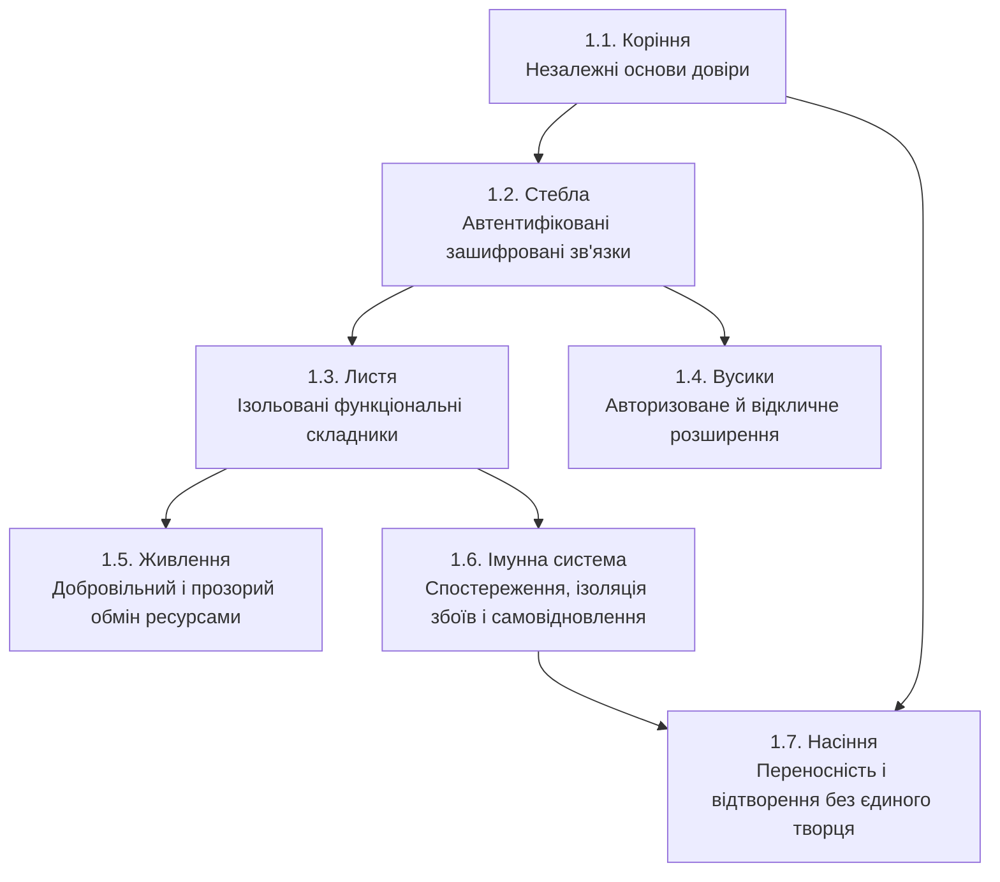

> 🌐 **Мова / Taal:** **Українська** · [Nederlands](ARCHITECTUURMANIFEST-KLIMOP.nl.md) | [Головна](../../README.md) · [Покажчик документації](../ПОКАЖЧИК-ДОКУМЕНТАЦІЇ.uk.md)
> 🧭 **Розділи центру (`docs/hub/`):** **0. Архітектурний маніфест «Плющ»** · [1. Архітектура](./АРХІТЕКТУРА-ЦЕНТРУ.uk.md) · [2. Історія](./ІСТОРІЯ-РОЗВИТКУ.uk.md) · [3. Гілки, запити та випуски](./ГІЛКИ-ТА-ЗАПИТИ-НА-ЗЛИТТЯ.uk.md) · [4. Структура тек](./СТРУКТУРА-ТЕК.uk.md) · [5. Змінні середовища](./ЗМІННІ-СЕРЕДОВИЩА-ЦЕНТРУ.uk.md) · [6. Координація та розгортання](./КООРДИНАЦІЯ-ТА-РОЗГОРТАННЯ.uk.md)

# ГОЛОВНИЙ АРХІТЕКТУРНИЙ МАНІФЕСТ: «МІЙ ПРОСТІР» — ЖИВА ЦИФРОВА ЕКОСИСТЕМА «ПЛЮЩ»

- **Код ініціативи та рішення:** `KLIMOP-001` · `B-024` (`regelsVersie 1.5.0`, 20.11.2026)
- **Призначення:** повне технічне завдання для перебудови архітектури, безпеки, способів зберігання інформації, взаємодії служб, керування й подальшого розвитку платформи «Мій простір» (*Mijn Ruimte*).
- **Об'єкт:** усе середовище проєкту, його програмний код, сервери, користувацькі пристрої, піддомени, бази даних, під'єднані служби, ШІ-агенти, засоби захисту та механізми встановлення оновлень.
- **Статус:** **цільова архітектурна концепція**. **Не є дозволом на негайну зміну робочої інфраструктури.** Перший крок — узгоджена зміна всіх головних файлів, які описують план, будову та правила для всіх інтеграцій ШІ-агентів ([`AGENTS.md`](../../AGENTS.md), [`orchestratie/beleid.json`](../../orchestratie/beleid.json), перехідники всіх 14 агентів, навички [`.agents/skills/`](../../.agents/skills/) і засаднича документація).
- **Головне завдання:** перетворити нинішню централізовану платформу на розподілену, самовідновлювану, криптографічно захищену екосистему з незалежними вузлами, перевірюваними зв'язками, розмежованими повноваженнями та можливістю продовжувати роботу без постійної участі її творця.

> [!IMPORTANT]
> **Межа повноважень для всіх інтеграцій ШІ-агентів:** цей маніфест визначає обов'язковий цільовий напрям розвитку, архітектурні запобіжники (§42–§43) і порядок дій (§45), але **не надає права самовільно зупиняти чинні сервери, змінювати робоче середовище, переписувати базу даних або обходити чинний порядок випусків і підтвердження власника**. Будь-яка подальша робота починається виключно з **Етапу 0 (повний аудит)** і рухається малими перевірюваними кроками.

---

## ЧАСТИНА I. ФІЛОСОФІЯ ТА АРХІТЕКТУРНІ ЗАСАДИ

### 1. Принцип цифрового плюща

Плющ не існує завдяки одній гілці, одному листку чи одній опорі. Він розростається, утворює численні зв'язки, пристосовується до перешкод, укорінюється там, де це можливо, та здатний зберігати життєздатність окремих частин після втрати деяких зв'язків.

Саме цю властивість покласти в основу нової архітектури.

Але цифровий плющ має бути не неконтрольованою мережею, а сукупністю незалежних, захищених і добровільно об'єднаних складників.

Визначити сім структурних елементів:

#### 1.1. Коріння — незалежні основи довіри

Корінням виступають криптографічні посвідчення, довірені пристрої, незалежні способи відновлення, перевірювані правила та розподілені джерела доступності.

Жоден окремий кореневий елемент не повинен надавати необмежене керування всією екосистемою.

#### 1.2. Стебла — захищені зв'язки

Стеблами є автентифіковані, зашифровані канали передавання між пристроями, вузлами й службами.

Вони повинні мати альтернативні маршрути, перевірку справжності сторін і можливість від'єднання пошкоджених ділянок.

#### 1.3. Листя — функціональні складники

Кожен пристрій або служба виконує визначену роль: зберігання, обчислення, зв'язок, синхронізацію, перевірку, відновлення чи взаємодію з іншими системами.

Втрата одного листка не повинна зупиняти всю мережу.

#### 1.4. Вусики — кероване розширення

Нові вузли знаходять доступні зв'язки, встановлюють взаємну довіру та долучаються до екосистеми відповідно до наданих повноважень.

Заборонено самовільне встановлення програм, приховане використання пристроїв або неконтрольоване передавання інформації.

#### 1.5. Живлення — обмін ресурсами

Ресурсами екосистеми є обчислювальні можливості, доступність вузлів, простір зберігання, мережевий зв'язок і добровільна участь людей.

Розподіл навантаження повинен бути справедливим, ощадливим і прозорим.

#### 1.6. Імунна система — безпека й самовідновлення

Система виявляє небезпечні зміни, ізолює скомпрометовані складники, відновлює втрачені копії та обмежує поширення несправних оновлень.

Її захисні механізми самі повинні підлягати перевірці.

#### 1.7. Насіння — переносність і продовження існування

Екосистема повинна мати можливість відтворення з незалежно збережених, перевірених складників.

Втрата головного сервера чи припинення діяльності творця не повинні унеможливлювати відновлення мережі іншими уповноваженими учасниками.

---

### 2. Головне правило

Жоден окремий учасник, пристрій, сервер, ключ, адміністратор, постачальник чи ШІ-агент не повинен мати одноосібної необмеженої влади над усією екосистемою.

Це правило поширюється на:

- зберігання й розшифрування даних;
- видання та відкликання дозволів;
- встановлення оновлень;
- зміну правил керування;
- відновлення доступу;
- маршрутизацію критичних операцій;
- видалення й переміщення даних;
- під'єднання сторонніх служб;
- управління ШІ-агентами;
- відновлення після надзвичайних подій.

Водночас не допускається заміна одноосібної влади неконтрольованою владою випадкової більшості вузлів.

Права власника особистих даних, повноваження оператора вузла та право змінювати правила спільної мережі повинні бути відокремлені.

---

## ЧАСТИНА II. ПЕРЕБУДОВА ЧИННОГО ПРОЄКТУ

### 3. Вихідна інфраструктура

Об'єктом перебудови є чинний «Мій простір» зі сховищем [`Tarasevych/hub`](https://github.com/Tarasevych/hub).

Наявна система використовує власне серверне середовище, PostgreSQL, серверні служби, вебінтерфейс, засоби входу, піддомени, криптографічні механізми, під'єднання зовнішніх постачальників та координацію ШІ-агентів.

Зберегти функціональність служб:

- головного робочого простору;
- електронної пошти;
- облікових записів та ідентичності;
- хмарного сховища;
- календаря й подій;
- ШІ-простору;
- шлюзу протоколу контексту моделі;
- засобів розробки;
- розумного дому;
- програмних з'єднувачів;
- адміністрування та діагностики.

Повний перелік і справжній стан кожної служби встановити через аудит чинного коду й робочого середовища.

#### 3.1. Що необхідно змінити

Перейти від моделі:

> Один головний сервер → спільне серверне ядро → центральна база → усі служби.

До моделі:

> Незалежні вузли ↔ захищена мережа ↔ розподілене зберігання ↔ ізольовані служби ↔ незалежне керування.

#### 3.2. Що необхідно зберегти

Не втрачати:

- жодних особистих даних;
- чинних функцій;
- налаштувань користувачів;
- історії змін;
- наявних правил ізоляції;
- архівів випусків;
- засобів відновлення;
- журналів безпеки;
- сумісності з під'єднаними службами;
- затвердженого порядку роботи агентів.

#### 3.3. Початкова перевірка

До створення нової архітектури з'ясувати фактичний стан серверних залежностей, секретів, способів шифрування, міграцій бази даних, розміщення файлів та повноважень адміністратора.

Особливу увагу приділити архітектурі приватного сховища М7, механізмам ключів доступу, чинному порядку випусків і правилам координації агентів.

Не вважати можливість упровадженою лише тому, що відповідний програмний складник існує у сховищі.

---

## ЧАСТИНА III. ЗАХИЩЕНА МЕРЕЖА «ПЛЮЩ»

### 4. Багатовузлова архітектура

Створити єдину логічну мережу, що працює на незалежних фізичних пристроях і серверах.

У ній передбачити чотири типи учасників:

#### 4.1. Постійні незалежні вузли

Виконують функції, для яких потрібна постійна доступність.

Можуть відповідати за:

- збереження зашифрованих копій;
- передавання повідомлень;
- встановлення мережевих з'єднань;
- доступність спільних відомостей;
- перевірку стану;
- відновлення пошкоджених частин.

Розміщувати їх у незалежних середовищах із різними ризиками відмови.

#### 4.2. Особисті вузли

Комп'ютери, смартфони, планшети та інші довірені пристрої користувачів.

Підтримують локальну роботу, шифрування, синхронізацію, зберігання власних даних та дозволені форми участі в мережі.

#### 4.3. Спеціалізовані вузли

Забезпечують окремі функції: криптографічні підтвердження, обчислення, під'єднання постачальників, зберігання чи перевірку випусків.

Кожен має обмежені повноваження.

#### 4.4. Перехідні вузли

Допомагають новим учасникам долучитися до мережі.

Не повинні бути єдиним способом знайти інші вузли.

Після розширення мережі їхню роль можна зменшувати, але не вимикати без перевірки незалежних шляхів доступу.

---

### 5. Відновлювані зв'язки

Створити механізм, за яким кожен вузол знає кілька дозволених способів досягти потрібної служби.

Кожен зв'язок має містити відомості про:

- справжність іншого вузла;
- дозволені операції;
- строк дії довіри;
- криптографічний захист каналу;
- можливість відкликання;
- мережеву доступність;
- обмеження навантаження;
- порядок відновлення після втрати зв'язку.

Якщо один маршрут стає недоступним, система повинна знайти інший придатний маршрут без обходу правил безпеки.

Заборонено автоматично вважати сусідній вузол довіреним лише через його мережеву близькість.

#### 5.1. Захист самої мережі

Передбачити протидію:

- підміні вузлів;
- масовому створенню фальшивих учасників;
- перехопленню передавання;
- повторенню старих повідомлень;
- навмисному викривленню маршрутів;
- відмові в обслуговуванні;
- перевантаженню слабких пристроїв;
- поширенню недійсних відомостей про доступність;
- примусовому спрямуванню всього руху через вузли нападника.

Дослідити захищені міжвузлові протоколи, зокрема `libp2p`, з урахуванням їхніх обмежень.

#### 5.2. Захист від небезпечного розростання

Архітектура плюща не повинна поводитися як комп'ютерний хробак.

Заборонити:

- самовільне встановлення на пристрої;
- копіювання приватного вмісту без дозволу;
- непогоджене використання обчислювальних ресурсів;
- безмежне розмноження копій;
- автоматичне розширення прав через нові зв'язки.

Кожне приєднання має бути авторизованим, обмеженим і відкличним.

---

## ЧАСТИНА IV. ГЛИБОКИЙ ЗАХИСТ ІНФОРМАЦІЇ

### 6. Багаторівневе шифрування

Застосувати незалежні захисні рівні:

- **Рівень 1 — пристрій.** Локальне захищене створення та використання ключів.
- **Рівень 2 — дані.** Окреме шифрування файлів, повідомлень та інших приватних об'єктів.
- **Рівень 3 — передавання.** Автентифіковані захищені канали між вузлами.
- **Рівень 4 — зберігання.** Розміщення зашифрованих частин на незалежних носіях.
- **Рівень 5 — повноваження.** Незалежна перевірка права розшифрувати, змінити чи передати дані.
- **Рівень 6 — відновлення.** Захищені способи повернення доступу після втрати пристроїв.
- **Рівень 7 — управління.** Порогові підтвердження змін критичних правил.

Використовувати перевірені способи автентифікованого шифрування, наприклад `AES-256-GCM` або `ChaCha20-Poly1305`, відповідно до властивостей середовища.

Окремо перевіряти унікальність одноразових значень, походження випадкових чисел, розділення призначень ключів та зв'язування шифротексту з його власником і версією.

---

### 7. Поділ секретів Шаміра

Застосовувати пороговий поділ для тих секретів, де він дійсно необхідний.

Передбачити налаштовувану схему з мінімальною кількістю часток для відновлення.

Поріг визначати з урахуванням:

- кількості незалежних учасників;
- доступності пристроїв;
- ризику змови;
- ризику одночасної втрати;
- процедури надзвичайного відновлення.

Не використовувати той самий набір учасників для всіх секретів екосистеми.

---

### 8. Перевірюваний поділ секретів

Дослідити схеми Фельдмана та Педерсена.

Вони мають забезпечити можливість перевіряти коректність виданих часток без розкриття секрету.

Окремо розглянути захист від:

- недобросовісного створювача часток;
- підроблення часток;
- суперечливого розподілу;
- прихованої підміни;
- використання застарілих часток.

Врахувати відмінності між перевірюваністю та приховуванням відомостей у конкретних криптографічних схемах.

---

### 9. Проактивне оновлення часток

Створити механізм періодичного оновлення розподілених часток без зміни самого секрету, коли це підтримує обраний протокол.

Для нього визначити:

- криптографічні епохи;
- правила оновлення;
- захищене узгодження;
- перевірку результатів;
- порядок обробки недоступних вузлів;
- виведення старих часток із використання;
- відновлення після перерваної процедури.

Завдання — обмежити можливість накопичувати вкрадені частки протягом тривалого часу.

Оновлення не захищає від нападника, який уже отримав достатню кількість чинних часток у межах однієї епохи.

---

### 10. Багатосторонні обчислення та порогові підписи

Для придатних операцій дослідити використання багатосторонніх криптографічних обчислень і порогових цифрових підписів.

Мета — не збирати повний приватний ключ в одному місці під час створення або застосування підпису.

Розглянути протокол ФРОСТ (*FROST*) для сумісних підписів Шнорра та перевірені засоби розподіленого створення ключів.

Порогове підписування застосовувати насамперед для:

- підтвердження критичних змін;
- керування підписами випусків;
- визначених адміністративних операцій;
- захищеного використання окремих системних ключів.

Не вважати пороговий підпис універсальним способом шифрування даних.

---

### 11. Розподілене зберігання

Поєднати шифрування із кодами відновлення втрачених фрагментів.

Зашифровані дані можна поділяти на частини й розміщувати на незалежних вузлах.

Система повинна знати, чи достатньо доступних фрагментів для відновлення.

Передбачити:

- перевірку цілісності кожного фрагмента;
- контроль фактичної доступності;
- відтворення втрачених частин;
- розміщення в незалежних середовищах;
- захист від одночасної втрати кількох вузлів;
- безпечне припинення зберігання;
- законне видалення даних;
- обмеження строків утримання копій.

Не застосовувати схему Шаміра як основний спосіб поділу великих файлів без відповідного технічного обґрунтування.

---

### 12. Захист інформації про зв'язки

Шифрування вмісту недостатньо.

Необхідно також обмежувати розкриття того:

- хто з ким взаємодіє;
- коли відбувається зв'язок;
- які служби використовуються;
- які вузли зберігають інформацію;
- звідки надходять запити;
- як часто користувач звертається до певної служби.

Дослідити:

- мінімізацію метаданих;
- обмеження видимості мережевих адрес;
- розділення особистої і мережевої ідентичності;
- мінімізацію журналів;
- захищене групове спілкування;
- захист від аналізу маршрутів.

Для власних групових повідомлень оцінити протокол захисту групових повідомлень, визначений у стандарті 9420 (*RFC 9420*).

Не обіцяти анонімності там, де вона не забезпечується технічно.

---

### 13. Криптографічна гнучкість

Архітектура повинна дозволяти змінювати криптографічні алгоритми без втрати даних або заміни всієї екосистеми.

Передбачити:

- версіонування криптографічних форматів;
- узгодження підтримуваних алгоритмів;
- заборону небезпечного пониження рівня захисту;
- поступове оновлення ключів;
- контроль сумісності вузлів;
- підготовку до використання стандартизованої постквантової криптографії там, де вона необхідна.

Не вважати всі складники квантово стійкими лише тому, що схема Шаміра має теоретико-інформаційну стійкість.

---

## ЧАСТИНА V. ЗАХИСТ ЛЮДИНИ

### 14. Незалежність від пам'яті та фізичного стану

Система не повинна залежати від здатності однієї людини пам'ятати всі паролі, фізично бути присутньою чи постійно ухвалювати рішення.

Розробити окремі процедури для:

- втрати пристрою;
- втрати облікових даних;
- тривалої недоступності;
- тяжкої хвороби;
- порушення пам'яті;
- смерті власника;
- фізичного примусу;
- психологічного тиску;
- захоплення адміністративних повноважень.

Процедури відновлення повинні мати незалежні підтвердження, визначені строки та захист від використання нападником.

---

### 15. Примус і приховані сигнали небезпеки

Дослідити необов'язковий режим захисту користувача під примусом.

Можливі засоби:

- спеціальне підтвердження небезпеки;
- приховане обмеження критичних повноважень;
- тимчасова затримка ризикових операцій;
- повідомлення заздалегідь визначеним довіреним особам;
- окремі сховища з різними правами;
- механізми правдоподібного заперечення.

Окремо провести оцінку ризику фізичного насильства.

Не стверджувати, що приховані сховища або спеціальні коди гарантовано зупиняють нападника.

Не допускати автоматичного знищення особистих даних через підозру на примус.

---

### 16. Контекстна оцінка небезпеки

Дозволити оцінювати ризик операції на основі технічних ознак:

- раптової зміни пристрою;
- нетипової спроби розширити права;
- входу з нового середовища;
- незвичних послідовностей дій;
- масового вилучення даних;
- одночасних спроб змінити ключі;
- підозрілих змін правил відновлення.

Біометричні або фізіологічні відомості використовувати лише за окремої згоди й чіткого обґрунтування.

Не робити автоматичних висновків про примус, психічний стан чи дію речовин лише з поведінкових ознак.

Результатом оцінки може бути додаткова перевірка або обмеження критичної дії, але не довільне позбавлення людини доступу до її даних.

---

### 17. Протокол тривалої відсутності

Передбачити заздалегідь узгоджений механізм реагування, якщо власник тривалий час недоступний.

Він повинен розрізняти:

- звичайну відсутність;
- тимчасову втрату зв'язку;
- втрату пристрою;
- підтверджену надзвичайну подію;
- тривалу втрату дієздатності;
- необхідність законного спадкування.

Сам факт відсутності не повинен автоматично розкривати приватні дані чи передавати всі адміністративні права.

Критичне відновлення можливе лише за попередньо визначеною процедурою з незалежними перевірками та строками оскарження.

---

## ЧАСТИНА VI. ЗАХИСТ ВІД ВЛАСНИКА, АДМІНІСТРАТОРА ТА АВТОРА

### 18. Відсутність прихованого необмеженого керування

Після належного затвердження нової моделі власник фізичного сервера не повинен мати змоги одноосібно:

- розшифрувати чужі приватні дані;
- підмінити довірений застосунок;
- змінити правила криптографічного керування;
- випустити небезпечне оновлення для всіх вузлів;
- видалити всі незалежні копії;
- підробити згоду інших учасників;
- обійти встановлену процедуру відновлення.

Для цього передбачити:

- незалежні основи довіри;
- розділення повноважень;
- порогове погодження;
- підписування випусків;
- перевірювану історію критичних рішень;
- незалежні вузли;
- криптографічну перевірку змін;
- відкладене набуття чинності особливо небезпечними рішеннями.

Не дозволяти одноосібного обходу через технічний обліковий запис або прихований ключ.

Водночас власник окремого фізичного сервера зберігає право припинити роботу свого обладнання. Незалежність екосистеми повинна забезпечуватися наявністю інших вузлів, а не позбавленням людей права керувати власними пристроями.

---

### 19. Спільне керування

Визначити незалежні категорії повноважень:

1. Користувацькі права над власними даними.
2. Керування особистими пристроями.
3. Операційне керування конкретним вузлом.
4. Супровід програмного забезпечення.
5. Криптографічне підтвердження критичних змін.
6. Надзвичайне відновлення.
7. Зміна правил усієї екосистеми.

Для кожної категорії визначити окремий спосіб підтвердження, відкликання та перевірки.

Порогову модель підбирати відповідно до ризику конкретної операції.

Не передавати критичні повноваження випадковим вузлам лише за кількістю голосів.

Захистити керування від змови, підміни учасників, масового створення фальшивих ідентичностей та захоплення процедури відновлення.

---

### 20. Часові обмеження

Для визначених критичних дій впровадити обов'язкові строки очікування.

Прикладами є:

- заміна кореневих довірених ключів;
- зміна основних правил керування;
- передавання загальносистемних повноважень;
- особливо ризикові способи відновлення.

Дослідити криптографічні функції перевірюваної затримки та незалежні часові обмеження.

Не припускати, що сам математичний часовий механізм захищає від зміни правил його застосування.

Звичайне користування поштою, файлами та календарем не повинно залежати від тривалих затримок.

---

## ЧАСТИНА VII. ІМУННА СИСТЕМА «ПЛЮЩА»

### 21. Неперервний контроль стану

Створити незалежний механізм спостереження за працездатністю екосистеми.

Він має контролювати:

- стан вузлів;
- доступність зашифрованих частин;
- цілісність програм;
- справжність зв'язків;
- стан криптографічних епох;
- кількість незалежних копій;
- мережеві затримки;
- перевантаження;
- доступність способів відновлення;
- небезпечні зміни дозволів;
- стан випробувань та оновлень.

Відомості спостереження не повинні розкривати приватний вміст користувачів.

---

### 22. Самовідновлення

За виявлення несправності система повинна мати змогу автоматично:

- обійти недоступний вузол;
- відновити дозволені зашифровані частини;
- змінити маршрут передавання;
- припинити використання пошкодженої копії;
- обмежити несправний складник;
- відновити сумісну службу;
- призупинити поширення небезпечної версії.

Кожна автоматична дія повинна відповідати заздалегідь погодженим правилам.

Самовідновлення не може надавати собі нові повноваження або обходити криптографічні заборони.

---

### 23. Безпечні випробувальні мережі

Створити незалежні середовища для перевірки нових версій.

Порядок переходу:

> Розробка → перевірки → ізольована мережа → незалежна оцінка → обмежене поширення → основна мережа.

Випробовувати:

- помилки програмного коду;
- втрату зв'язку;
- одночасне відключення вузлів;
- нестачу ресурсів;
- підроблені повідомлення;
- пошкодження збережених фрагментів;
- несумісність версій;
- небезпечні зміни прав;
- відновлення після компрометації.

---

### 24. Автоматичне припинення небезпечних випусків

Нові версії повинні поширюватися поступово.

Якщо зафіксовано порушення визначених показників працездатності або безпеки, припинити подальше поширення.

Безпечно повернути попередню версію там, де формат даних і стан системи це дозволяють.

Для незворотних змін заздалегідь передбачити окрему процедуру відновлення.

Не визначати успішність лише за відсотком пристроїв, на яких програма запускається.

Перевіряти також цілісність даних, правильність дозволів і відсутність витоку секретів.

---

### 25. Перевірюваність програмного забезпечення

Критичні складники повинні підтримувати:

- незалежну перевірку коду;
- відтворюване складання;
- засвідчення походження;
- перевірку залежностей;
- криптографічні підписи;
- захист від підміни випусків;
- захист від небезпечного повернення старих версій;
- перевірювану історію рішень.

Дослідити модель безпечних оновлень із розділенням ролей підписування, пороговими підписами та перевіркою свіжості відомостей про випуски.

Особливо захистити вебклієнт: шифрування в оглядачі не гарантує таємності, якщо сервер може непомітно підмінити виконуваний код.

Для підвищеного рівня довіри передбачити незалежно перевірюваний підписаний застосунок.

---

## ЧАСТИНА VIII. ЕКОНОМІКА РЕСУРСІВ

### 26. Добровільний внесок пристроїв

Кожен користувач сам визначає, чи дозволяти своєму пристрою підтримувати інших учасників.

Передбачити:

- роботу лише під час заряджання;
- дозвіл лише для обраних мереж;
- граничне використання пам'яті;
- обмеження переданих відомостей;
- обмеження навантаження на процесор;
- призупинення за низького заряду;
- можливість негайного припинення участі;
- безпечне виведення пристрою з мережі.

Типові значення встановлювати за результатами вимірювань для різних пристроїв.

Не обіцяти однакове споживання ресурсів усіма телефонами.

---

### 27. Справедливий взаємний обмін

Дослідити механізм взаємного надання ресурсів.

Він може враховувати:

- обсяг наданого місця;
- тривалість доступності;
- фактично передані зашифровані відомості;
- надійність вузла;
- виконані перевірені операції;
- витрати на підтримку мережі.

Не перетворювати доступ до власних даних на винагороду за надання ресурсів.

Передбачити участь людей, які не можуть утримувати постійно активні пристрої.

Мережа повинна залишатися корисною без примусу до надання обчислювальних потужностей.

---

## ЧАСТИНА IX. ЄДИНИЙ ЦИФРОВИЙ ПРОСТІР

### 28. Універсальна взаємодія служб

Головне призначення «Мого простору» — об'єднати різні цифрові служби в одному зрозумілому середовищі без втрати приватності.

Система повинна підтримувати взаємодію між:

- повідомленнями;
- поштою;
- файлами;
- календарями;
- особистими нотатками;
- пошуком;
- фінансовими службами;
- розумним домом;
- зовнішніми застосунками;
- ШІ-агентами;
- системами спільної роботи.

Кожна служба повинна бути ізольованим складником із власними дозволами.

Єдиний інтерфейс не означає спільного необмеженого доступу до всіх даних.

---

### 29. З'єднувачі звичайного інтернету

Для служб, які не підтримують розподілену архітектуру, створити захищені з'єднувачі.

З'єднувач повинен:

- працювати з офіційно підтримуваним способом під'єднання;
- отримувати мінімально необхідні дозволи;
- ізолювати власні облікові дані;
- обмежувати строк дії доступу;
- підтримувати відкликання;
- перевіряти відповіді постачальника;
- зберігати журнал дозволених дій;
- не передавати права іншим службам без погодження.

Не представляти сторонню службу як повністю приватну або децентралізовану, якщо її власна архітектура цього не забезпечує.

---

### 30. Узгоджена ідентичність

Розробити спільний спосіб керувати особистими ідентичностями та дозволами, не створюючи єдиного необмеженого ключа.

Під'єднання різних служб повинно використовувати обмежені посвідчення та дозволи.

За компрометації одного з'єднувача решта служб повинні зберігати власні межі довіри.

---

### 31. Захищений спільний пошук

Дослідити можливість об'єднаного пошуку в усіх дозволених джерелах.

Передбачити відокремлення:

- відкритих відомостей;
- службових метаданих;
- приватних зашифрованих матеріалів;
- даних зовнішніх постачальників.

Для приватного вмісту перевагу надавати пошуку на довіреному пристрої.

Не передавати розшифровані індекси, листи або документи загальній мережі заради зручності пошуку.

---

## ЧАСТИНА X. ШІ-АГЕНТИ ТА РОЗВИТОК ЕКОСИСТЕМИ

### 32. Незалежні, але узгоджені агенти

Зберегти наявну модель координації агентів і розширити її для багатовузлової архітектури.

Кожен агент повинен мати:

- власну роль;
- незалежну ідентичність;
- обмежені повноваження;
- перелік доступних інструментів;
- журнал фактично виконаних дій;
- прив'язку до версії правил;
- обов'язкові перевірки;
- визначений спосіб передавання результатів.

Не дозволяти одному агентові одноосібно створювати, затверджувати й встановлювати критичну зміну.

---

### 33. Спеціалізовані напрями розробки

Передбачити окрему відповідальність за:

1. Загальну архітектуру.
2. Міжвузловий зв'язок.
3. Криптографію.
4. Розподілене зберігання.
5. Ідентичність.
6. Відновлення.
7. Захист людини.
8. Систему спільного керування.
9. З'єднувачі зовнішніх служб.
10. Самовідновлення.
11. Захист випусків.
12. Перевірку безпеки.
13. Швидкодію та ресурси.
14. Приватність.
15. Сумісність і перенесення.
16. Документацію та супровід.

Агенти повинні взаємно перевіряти результати й узгоджувати зміни через чинний порядок координації.

---

### 34. Автономний розвиток без необмеженої автономії

Агенти можуть самостійно:

- знаходити вади;
- досліджувати нові технології;
- створювати пропозиції;
- виконувати випробування;
- готувати виправлення;
- пропонувати вдосконалення архітектури.

Проте вони не можуть самостійно змінювати загальні криптографічні правила, розкривати секрети, розширювати власні дозволи або обходити процедури встановлення.

Автоматизація розробки не повинна означати автоматичного схвалення небезпечних дій.

---

## ЧАСТИНА XI. ПЕРЕНЕСЕННЯ БЕЗ ВТРАТИ ДАНИХ

### 35. Поступова перебудова

Не створювати нову систему шляхом одночасного видалення старої.

Перехід виконувати малими незалежними випусками.

Під час кожного етапу зберігати можливість:

- перевірити результат;
- порівняти зі старою системою;
- виявити втрату даних;
- припинити перенесення;
- відновити попередню працездатну версію;
- перевірити правильність дозволів.

Наявну PostgreSQL використовувати доти, доки не буде створено й перевірено незалежний механізм роботи відповідних даних.

Розподіляти лише ті види стану, для яких визначено правила синхронізації та вирішення суперечностей.

---

### 36. Послідовність розвитку

- **Етап 0 — аудит.** Повністю дослідити чинну архітектуру, залежності, криптографію, бази даних, служби, правила агентів і випуски. *Результат:* перевірена карта стану та перелік ризиків.
- **Етап 1 — архітектурне ядро.** Створити специфікацію вузлів, ідентичностей, захищених зв'язків, дозволів і способів відновлення. *Результат:* затверджена цільова архітектура.
- **Етап 2 — випробувальна мережа.** Розгорнути кілька незалежних вузлів на випробувальних даних. *Результат:* перевірений захищений зв'язок і незалежність від одного вузла.
- **Етап 3 — шифрування та зберігання.** Упровадити клієнтське шифрування, розподіл зашифрованих даних і перевірюване відновлення. *Результат:* файли відновлюються після визначених відмов.
- **Етап 4 — розподілені ключі.** Упровадити перевірюваний поділ, порогові операції та проактивне оновлення часток там, де воно потрібне. *Результат:* перевірений життєвий цикл критичних ключів.
- **Етап 5 — незалежна ідентичність.** Створити підтвердження пристроїв, обмежені дозволи та процедури відновлення. *Результат:* немає єдиного універсального облікового запису, компрометація якого розкриває всю екосистему.
- **Етап 6 — розподілене керування.** Упровадити незалежне погодження критичних змін і захист від одноосібного захоплення. *Результат:* перевірені правила керування.
- **Етап 7 — самовідновлення.** Упровадити контроль стану, відтворення фрагментів, альтернативну маршрутизацію та безпечні випуски. *Результат:* визначені несправності усуваються автоматично.
- **Етап 8 — перенесення служб.** Поступово перевести внутрішні служби на нову основу, зберігаючи звичний інтерфейс і під'єднання. *Результат:* користувач працює з єдиною екосистемою без обов'язкової залежності від початкового сервера для перенесених функцій.
- **Етап 9 — захист від примусу.** Упровадити перевірені способи відкладених критичних операцій, незалежного відновлення та необов'язкових сигналів небезпеки. *Результат:* визначені загрози фізичного примусу не надають нападникові одноосібного керування.
- **Етап 10 — ширше розгортання.** Поступово під'єднувати незалежні вузли та добровільних учасників. *Результат:* перевірена багатовузлова доступність, контроль ресурсів та захист приватності.
- **Етап 11 — незалежний аудит.** Залучити незалежну оцінку криптографії, мережі, керування, приватності й відновлення. *Результат:* задокументовані підтверджені гарантії та залишкові ризики.
- **Етап 12 — постійний розвиток.** Налагодити безперервне дослідження загроз, оновлення криптографічних засобів, перевірку архітектури й поліпшення стійкості. *Результат:* система може розвиватися без постійної участі початкового автора.

---

## ЧАСТИНА XII. ОБОВ'ЯЗКОВІ СЦЕНАРІЇ ВИПРОБУВАНЬ

### 37. Перевірка живучості

Обов'язково перевірити:

1. Вимкнення головного сервера.
2. Втрату одного незалежного вузла.
3. Одночасну втрату кількох вузлів у межах визначеної моделі відмов.
4. Розділення мережі.
5. Втрату постачальника зв'язку.
6. Недоступність початкових вузлів під'єднання.
7. Пошкодження зашифрованих частин.
8. Нестачу незалежних копій.
9. Зникнення власника з процесу керування.
10. Втрату пристроїв користувача.

Для кожного випадку вимірювати доступність, тривалість відновлення, втрату даних і правильність дозволів.

---

### 38. Перевірка криптографії

Випробувати:

- викрадення окремих часток;
- підміну часток;
- накопичення старих часток;
- перерване оновлення;
- підміну вузла;
- повторне використання старих повідомлень;
- зміну підписаних відомостей;
- спробу обійти поріг;
- спробу видати новий ключ за старий;
- втрату частини уповноважених учасників.

Окремо перевірити справжність реалізації та відповідність обраному протоколу.

---

### 39. Перевірка захисту людини

Перевірити на безпечних імітаційних сценаріях:

- викрадення пристрою;
- примусове розкриття одного набору облікових даних;
- тривалу недоступність власника;
- помилкове спрацювання сигналу небезпеки;
- втрату всіх особистих пристроїв;
- законне відновлення;
- спробу незаконного спадкування;
- спробу захопити процедуру відновлення.

Не проводити випробувань, які створюють реальну небезпеку для людини.

---

### 40. Перевірка автономності

Довести, що визначені основні функції зберігаються, якщо:

- головний сервер не працює;
- первісний автор недоступний;
- одна адміністративна особа скомпрометована;
- одна служба недоступна;
- один із засобів оновлення захоплено;
- кілька вузлів працюють на різних версіях програми.

Автономність підтверджувати практичними випробуваннями, а не загальною кількістю вузлів.

---

## ЧАСТИНА XIII. ВИМІРЮВАНІ ГАРАНТІЇ

### 41. Визначити показники

Перед початком робочого впровадження встановити окремі вимоги для кожної критичної служби.

Обов'язкові показники:

- максимально допустимий час відновлення;
- максимально допустима втрата останніх змін;
- мінімальна кількість незалежних доступних копій;
- поріг компрометації для кожної критичної операції;
- допустима частка недоступних вузлів;
- максимальне навантаження користувацького пристрою;
- граничний час відкликання прав;
- строк виявлення небезпечного випуску;
- строк припинення його поширення;
- тривалість відновлення після втрати ключів;
- частота перевірки запасних копій;
- допустимі відхилення під час мережевого розділення.

Кожен показник повинен мати спосіб вимірювання та незалежну перевірку.

Не встановлювати довільні числові гарантії без випробувань.

---

## ЧАСТИНА XIV. НОВІ ПРАВИЛА ДЛЯ ВСІХ АГЕНТІВ

### 42. Обов'язкова архітектурна перевірка кожної зміни

Перед створенням чи зміною програмного складника агент повинен з'ясувати:

1. Чи виникає нова єдина точка відмови?
2. Чи не розширюються приховані повноваження?
3. Чи залишається доступним законне відновлення?
4. Чи захищено інформацію на пристрої, під час передавання й у сховищі?
5. Чи не розкриваються непотрібні метадані?
6. Чи можна відкликати створені дозволи?
7. Чи не порушується сумісність між вузлами?
8. Чи зберігається можливість ізолювати несправний складник?
9. Чи не погіршується захист людини?
10. Чи залишається зміна перевірюваною?
11. Чи є спосіб безпечного повернення?
12. Чи не збільшується залежність від початкового автора?
13. Чи не витрачаються ресурси користувачів без їхньої згоди?
14. Чи не порушуються права власників даних?
15. Чи не створюється нова небезпека для всієї мережі через один з'єднувач?

Якщо зміна порушує основні гарантії, її потрібно переглянути до впровадження.

---

### 43. Заборонені спрощення

Заборонено:

- називати систему абсолютно невразливою;
- вважати кілька копій на одному сервері незалежними вузлами;
- плутати поділ секретів із поділом файлів;
- називати звичайне серверне шифрування повним нерозголошенням;
- вважати пороговий підпис універсальним шифруванням;
- довіряти вузлам лише за фактом участі;
- автоматично надавати права випадковій більшості;
- вважати апаратну ізоляцію абсолютним захистом;
- автоматично відновлювати доступ без належних підтверджень;
- приховано використовувати пристрої користувачів;
- вимикати чинні сервери до створення незалежних альтернатив;
- замінювати перевірені протоколи власними неперевіреними алгоритмами;
- позначати випробування успішними без доказів;
- встановлювати критичні оновлення без належного погодження.

---

## ЧАСТИНА XV. ДОКУМЕНТАЦІЯ ТА ПЕРШІ РЕЗУЛЬТАТИ

### 44. Обов'язкові документи

Підготувати:

1. Повний аудит чинного «Мого простору».
2. Архітектурну схему «Плющ».
3. Модель вузлів і зв'язків.
4. Модель загроз.
5. Модель довіри.
6. Правила криптографії.
7. Схему розподіленого зберігання.
8. Модель ідентичності.
9. Порядок відновлення доступу.
10. Модель захисту людини.
11. Порядок розподіленого керування.
12. Специфікацію самовідновлення.
13. Правила безпечних випусків.
14. Правила участі користувацьких пристроїв.
15. Модель ресурсів і винагород.
16. Специфікацію зовнішніх з'єднувачів.
17. План перенесення бази даних.
18. План перенесення кожної чинної служби.
19. Перелік технічних залежностей.
20. Програму випробувань.
21. Перелік невирішених ризиків.
22. План незалежної перевірки.
23. Поетапний план випусків.
24. Переглянуті правила ШІ-агентів.
25. План подальшого розвитку.

Документацію вести українською та нідерландською.

---

### 45. Перші дії агентів

Роботу розпочати в такій послідовності:

1. **Спочатку — аудит.** Дослідити дійсний проєкт, його сховища, службові залежності, механізми захисту та поточний спосіб встановлення.
2. **Потім — цільова архітектура.** Побудувати схему «Плющ» із чітко визначеними вузлами, межами довіри й зв'язками.
3. **Далі — порівняння технологій.** Для кожного складника обрати перевірені рішення з поясненням їхніх переваг, обмежень і сумісності.
4. **Після цього — план випусків.** Розподілити перебудову на незалежні завдання з перевірюваними результатами.
5. **Лише потім — реалізація.** Розпочинати ізольовані випробування, не змінюючи робоче середовище без затвердження.

Усі дії повинні відповідати чинним правилам координації та випусків «Мого простору», доки нову модель не буде належним чином погоджено.

---

## ЧАСТИНА XVI. КІНЦЕВЕ БАЧЕННЯ

### 46. Якою має стати екосистема

У завершеній цільовій архітектурі:

- Кожна людина є незалежним власником своїх цифрових даних і дозволів.
- Кожен довірений пристрій може виконувати частину дозволених функцій мережі без необмежених повноважень.
- Кожен вузол має обмежену роль, підтверджену ідентичність і способи незалежної перевірки.
- Кожна служба працює в ізольованому середовищі та взаємодіє з іншими лише за належними дозволами.
- Кожен критичний ключ має визначені умови створення, використання, оновлення, відкликання та відновлення.
- Кожне важливе рішення має перевірюване походження та належний порядок погодження.
- Кожен критичний зв'язок має визначені альтернативи або чесно задокументовані умови недоступності.
- Кожне оновлення перевіряється до поширення та не може непомітно змінити основи довіри.
- Кожна виявлена несправність спричиняє обмежену, перевірювану реакцію, а не неконтрольовані зміни всієї мережі.
- Кожен користувач має можливість припинити участь, відкликати доступ і реалізувати права щодо власної інформації.
- Кожен ШІ-агент сприяє розвиткові, але не має необмеженої влади над екосистемою.
- Кожен майбутній розробник може продовжити роботу на основі відкритих правил, документації та незалежно перевірюваного програмного забезпечення.

---

## ПІДСУМКОВА АРХІТЕКТУРНА ДИРЕКТИВА

Ми створюємо «Мій простір» як живу розподілену цифрову екосистему за принципом плюща.

Її сила повинна полягати не в одному неприступному сервері, не в одному секретному ключі, не в одній людині та не в одному винятково складному алгоритмі.

Вона повинна виникати з поєднання незалежних захищених вузлів, перевірюваних зв'язків, розподілених криптографічних повноважень, ізольованих служб, добровільної участі пристроїв, безпечного відновлення та відкритої системи керування.

- Плющ здатний розростатися, але кожен його новий зв'язок має бути безпечним.
- Плющ здатний переживати втрату окремих гілок, але повинен мати достатньо незалежних основ для відновлення.
- Плющ здатний підтримувати себе, але не повинен поглинати чужі пристрої, дані чи ресурси без дозволу.
- Плющ здатний змінюватися, але не повинен руйнувати власні засади довіри під час розвитку.

Головна мета — створити не безсмертну чи абсолютно невразливу систему, а екосистему з максимально обґрунтованою стійкістю, захищеною приватністю, незалежним відновленням, контрольованим розвитком та можливістю продовжувати існування без єдиного незамінного творця.

**Наскрізна вимога для всіх агентів:** кожна нова функція, кожен захисний механізм, кожна зміна та кожен випуск повинні робити «Мій простір» безпечнішим, незалежнішим, відновлюванішим і водночас придатним для реального користування.
