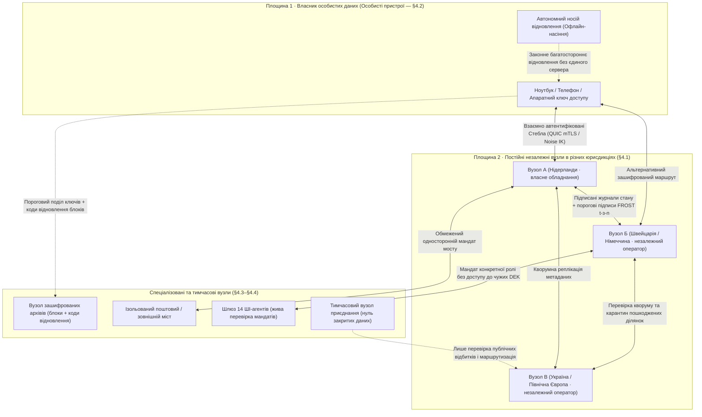

> 🌐 **Мова / Taal:** **Українська** · [Nederlands](KLIMOP-FASE-1-ARCHITECTUURKERN-EN-UITGAVEPLAN.nl.md) | [Головна](../../README.md) · [Покажчик документації](../ПОКАЖЧИК-ДОКУМЕНТАЦІЇ.uk.md) · [Головний архітектурний маніфест «Плющ»](АРХІТЕКТУРНИЙ-МАНІФЕСТ-ПЛЮЩ.uk.md) · [Звіт аудиту Етапу 0](ПЛЮЩ-ЕТАП-0-АУДИТ-ДІЙСНОГО-СТАНУ.uk.md)

# Етап 1 екосистеми «Плющ» — Специфікація архітектурного ядра, вибір перевірених технологій та поетапний план випусків (`KLIMOP-002`)

- **Дата затвердження проєкту ядра:** 20.11.2026
- **Задача координації:** `KLIMOP-002` (спирається на результати [доказового аудиту Етапу 0](ПЛЮЩ-ЕТАП-0-АУДИТ-ДІЙСНОГО-СТАНУ.uk.md))
- **Ізольований програмний контракт ядра:** [`shared/klimop/kern.ts`](../../shared/klimop/kern.ts) (не змінює живий сервер і не вимикає `PostgreSQL 18.6`)
- **Нормативна підстава:** розділи `§1–§2`, `§4–§25`, `§35–§36 (Етап 1)`, `§42–§45` [Головного архітектурного маніфесту «Плющ»](АРХІТЕКТУРНИЙ-МАНІФЕСТ-ПЛЮЩ.uk.md)

---

## 1. Цільова архітектурна схема ядра «Плющ» (§45 крок 2)

На зміну нинішній односерверній схемі (`Cloudflare Tunnel → 127.0.0.1:8080 → єдиний PostgreSQL 18.6`) Етап 1 закріплює багатошарову топологію без одноосібної точки відмови, де **три площини повноважень** (`persoonlijke_gegevens`, `knooppunt_beheer`, `netwerk_regels`) криптографічно відокремлені одна від одної:

### 1.1. Три відокремлені площини повноважень у [`shared/klimop/kern.ts`](../../shared/klimop/kern.ts)

1. **`persoonlijke_gegevens` (Право власника особистих даних):** виключне право створювати, читати, ділити й відкликати доступ до особистих даних (рівні зберігання `1–3`). Жоден оператор вузла й жоден кворум мережі не може розшифрувати ці дані без ключів власника.
2. **`knooppunt_beheer` (Повноваження оператора вузла):** керування обчислювальними квотами, диском і мережевими інтерфейсами власного вузла. Програмне ядро `verifieerKlimopMandaat()` примусово відхиляє будь-який мандат `knooppunt_beheer`, який намагається заявити доступ до `persoonlijke_geheime_gegevens` (`SCHEIDING_VAN_MACHTEN_GESCHONDEN_PERSOONLIJKE_GEGEVENS`).
3. **`netwerk_regels` (Спільні правила та випуски мережі):** зміна канонічних правил, реєстру довірених підписантів або критичних випусків. Програмне ядро `verifieerKlimopMandaat()` примусово вимагає порогового кворуму $k \ge 2$ із $k$ незалежними криптографічними підписами (`GEEN_ALLEENHEERSCHAPPIJ_DREMPEL_VEREIST`), а `controleerKnooppuntOnafhankelijkheid()` відхиляє групи вузлів, зосереджені в одного постачальника або в одній юрисдикції.

---

## 2. Порівняння та вибір перевірених стандартизованих технологій (§45 крок 3)

Відповідно до §12–§15 та §43 п. 12 маніфесту (категорична заборона вигадувати власні неперевірені шифри), для кожного шару обрано відкриті міжнародні стандарти з криптографічною гнучкістю (можливістю плавної заміни алгоритму без втрати даних):

| Шар екосистеми «Плющ» | Розглянуті перевірені кандидати | Обраний канонічний стандарт для Етапів 2–9 | Інженерне обґрунтування вибору |
|---|---|---|---|
| **1. Криптографічна ідентичність вузлів та підписи мандатів (`Коріння`)** | `Ed25519 (RFC 8032)` проти `ECDSA P-256` проти гібридного `Ed25519 + ML-DSA-65 (FIPS 204)` | **`Ed25519` зараз** + поле `postkwantumPubliekeSleutelB64u` для гібридного **`Ed25519 + ML-DSA-65`** | Детерміновані підписи без ризику витоку секрету через генератор випадкових чисел, вбудована підтримка в `Node.js` (`node:crypto`) та `ssh-keygen`, повна сумісність із чинним `SSHSIG` і готова структура паспорта для постквантового підпису. |
| **2. Порогове затвердження правил і випусків без збирання ключа в одній точці** | Окремі мультипідписи `Ed25519` ($k$ підписів у списку) проти **`FROST` (`RFC 9591`, пороговий підпис Шнорра/Ed25519)** | **Етап 4а:** набір $k$-з-$n$ незалежних підписів `Ed25519` (вже в `shared/klimop/kern.ts`); **Етап 4б:** **`FROST (RFC 9591)`** | Набір $k$ підписів дає негайну прозору перевірюваність кожного учасника без нової зовнішньої залежності, а `FROST (RFC 9591)` додає порогову генерацію й підписування без існування єдиного зібраного закритого ключа. При цьому `FROST` використовується **виключно як підпис**, ніколи не як шифрування (§43 п. 5). |
| **3. Поділ малих таємниць (ключі відновлення, кореневі KEK)** | Класичний поділ Шаміра над $\mathrm{GF}(256)$ проти **перевірюваного поділу Шаміра з криптографічними зобов'язаннями Фельдмана / Педерсена (`VSS`)** | Наявне ядро `shared/verdeelde-opslag.ts` ($\mathrm{GF}(256)$) розширюється на Етапі 4 **зобов'язаннями Фельдмана/Педерсена** | Звичайний Шамір не дозволяє утримувачу частки перевірити її справжність до моменту повного збирання; додавання перевірюваних зобов'язань (`VSS`) дозволяє виявляти пошкоджені чи підроблені частки під час кожної фонової ротації без розкриття секрету. |
| **4. Зберігання великих зашифрованих файлів та архівів (§11 рівень 3, §43 п. 3)** | Поділ Шаміра по всьому файлу (заборонено §43 п. 3!) проти **конвертного шифрування `XChaCha20-Poly1305` / `AES-256-GCM` + адресації блоків за `BLAKE3` / `SHA-256` + кодування відновлення `Reed-Solomon (k+m)`** | **Потокове розбиття на блоки (1–4 МіБ) → шифрування `XChaCha20-Poly1305` (або `AES-256-GCM`) → коди відновлення `Reed-Solomon` (напр. 4+2)** | Поділ Шаміра помножує обсяг великого файла в $n$ разів; натомість шифрування кожного блока унікальним ключем конверта + завадостійке кодування `Reed-Solomon` дає лише ~1,5× накладних витрат при здатності відновити файл після втрати будь-яких $m$ вузлів. |
| **5. Виведення ключів із паролів/кодів та ієрархія ключів** | `PBKDF2` проти `scrypt` проти **`Argon2id (RFC 9106)` + `HKDF-SHA-256 (RFC 5869)`** | **`Argon2id`** (для людських фраз/кодів, зі збереженням сумісності читання наявних обгорток `scrypt N=2^16`) + **`HKDF-SHA-256`** + **`WebAuthn PRF`** | Захист від перебору на спеціалізованих графічних прискорювачах та строге розведення ключів за призначенням (`omslagAad` / контекстні мітки `HKDF`). |
| **6. Захищені канали між вузлами (`Стебла`) та постквантовий обмін** | Односторонній край Cloudflare проти **`QUIC / TLS 1.3 mTLS` з гібридним обміном `X25519MLKEM768 (FIPS 203)`** або тунелів **`WireGuard` + `Noise IK`** | **`TLS 1.3 / QUIC` із взаємною автентифікацією за паспортами вузлів `Ed25519` + гібридний обмін ключами `X25519MLKEM768`**, із запасним overlay-каналом `WireGuard` | Забезпечує пряме наскрізне шифрування між вузлами без розшифрування потоку на сторонньому посереднику (усуває `SPOF-2`) та захищає від загрози «записати трафік сьогодні — розшифрувати квантовим комп'ютером згодом» (§15). |
| **7. Груповий захист спільних просторів (родина, оселя `huis.*`, команди)** | Один спільний статичний ключ без ротації проти **протоколу захисту рівня повідомлень `MLS (RFC 9420)`** | **Цільовий стандарт — `MLS (RFC 9420)`**; у проміжній реалізації Етапу 5 — спрощене групове епохове шифрування за мотивами `RFC 9420` для просторів та оселі (`app.huis_leden`) | Забезпечує пряму та посткомпрометаційну таємницю при додаванні й вилученні учасника чи пристрою (§14 маніфесту). |
| **8. Узгодження даних між вузлами після тимчасового розриву зв'язку (§10, §11)** | Центральна блокувальна БД проти **підписаних хеш-пов'язаних журналів подій + безконфліктних структур даних (`CRDT`) для нотаток/завдань і порогового журналу консенсусу `Raft` для реєстру повноважень** | **Підписані журнали операцій + `CRDT`** для користувацьких робочих даних (рівень 2); **детермінований кворумний реєстр** для системних мандатів (рівень 4) | Дозволяє особистим пристроям працювати автономно без інтернету та зливати зміни без втрати даних після відновлення зв'язку, зберігаючи сувору однозначність для відкликання дозволів. |

---

## 3. Реєстр і стан усіх 25 обов'язкових двомовних документів (§44 маніфесту)

Нумерація 1–25 нижче точно відповідає первинному переліку §44 Головного архітектурного маніфесту ([`АРХІТЕКТУРНИЙ-МАНІФЕСТ-ПЛЮЩ.uk.md`](АРХІТЕКТУРНИЙ-МАНІФЕСТ-ПЛЮЩ.uk.md)) і програмно звіряється на диску функцією `controleerVijfentwintigVerplichteDocumenten` у [`shared/klimop/zaden.ts`](../../shared/klimop/zaden.ts):

| № (§44) | Назва документа за §44 маніфесту | Канонічний двомовний шлях (`uk` / `nl`) та програмний доказ | Стан |
|---|---|---|---|
| 1 | Повний аудит чинного «Мого простору» | `docs/hub/ПЛЮЩ-ЕТАП-0-АУДИТ-ДІЙСНОГО-СТАНУ.uk.md` · `KLIMOP-FASE-0-AUDIT-FEITELIJKE-STAAT.nl.md` (`scripts/klimop-etappe0-audit.mjs`) | **Готово (`KLIMOP-002`)** |
| 2 | Архітектурна схема «Плющ» | `docs/hub/АРХІТЕКТУРНИЙ-МАНІФЕСТ-ПЛЮЩ.uk.md` · `ARCHITECTUURMANIFEST-KLIMOP.nl.md` | **Готово (`KLIMOP-001`)** |
| 3 | Модель вузлів і зв'язків | `docs/hub/ПЛЮЩ-ЕТАП-2-ВИПРОБУВАЛЬНА-МЕРЕЖА-ТА-СТЕБЛА.uk.md` · `KLIMOP-FASE-2-BEPROEVINGSNETWERK-EN-STENGELS.nl.md` (§1–§2, обмеження метаданих) + `shared/klimop/stengels.ts` | **Готово (`KLIMOP-002`, `KLIMOP-003`)** |
| 4 | Модель загроз | `docs/hub/ПЛЮЩ-ЕТАП-11-НЕЗАЛЕЖНИЙ-АУДИТ-БЕЗПЕКИ-ТА-МОДЕЛЬ-ЗАГРОЗ.uk.md` · `KLIMOP-FASE-11-ONAFHANKELIJKE-BEVEILIGINGSAUDIT-EN-DREIGINGSMODEL.nl.md` (§2) + `KLIMOP_DREIGINGS_MODEL` у `shared/klimop/beveiligingsaudit.ts` | **Готово (`KLIMOP-002`, `KLIMOP-012`)** |
| 5 | Модель довіри | Цей документ (`ПЛЮЩ-ЕТАП-1-АРХІТЕКТУРНЕ-ЯДРО-ТА-ПЛАН-ВИПУСКІВ.uk.md` · `KLIMOP-FASE-1-ARCHITECTUURKERN-EN-UITGAVEPLAN.nl.md`, §1) + `shared/klimop/kern.ts` (`controleerKnooppuntOnafhankelijkheid`, зовнішній реєстр операторів) | **Готово (`KLIMOP-002`, `KLIMOP-021`)** |
| 6 | Правила криптографії | `docs/hub/ПЛЮЩ-ЕТАП-4-РОЗПОДІЛЕНІ-КЛЮЧІ-ТА-ПОРОГОВІ-ПІДПИСИ.uk.md` · `KLIMOP-FASE-4-GEDISTRIBUEERDE-SLEUTELS-EN-DREMPELHANDTEKENINGEN.nl.md` + криптогнучкість у `shared/klimop/opslag.ts` і `drempelsleutels.ts` | **Готово (`KLIMOP-004`..`005`, `KLIMOP-019`)** |
| 7 | Схема розподіленого зберігання | `docs/hub/ПЛЮЩ-ЕТАП-3-ШИФРУВАННЯ-ТА-РОЗПОДІЛЕНЕ-ЗБЕРІГАННЯ.uk.md` · `KLIMOP-FASE-3-VERSLEUTELING-EN-VERDEELDE-OPSLAG.nl.md` + `shared/klimop/opslag.ts` + `backend/klimop-opslag-client.ts` | **Готово (`KLIMOP-004`, `KLIMOP-021`)** |
| 8 | Модель ідентичності | `docs/hub/ПЛЮЩ-ЕТАП-5-НЕЗАЛЕЖНА-ІДЕНТИЧНІСТЬ-ТА-ГРУПОВІ-ПРОСТОРИ.uk.md` · `KLIMOP-FASE-5-ONAFHANKELIJKE-IDENTITEIT-EN-GROEPSRUIMTES.nl.md` (§1, §3) + `shared/klimop/identiteit.ts` | **Готово (`KLIMOP-006`)** |
| 9 | Порядок відновлення доступу | `docs/hub/ПЛЮЩ-ЕТАП-5-НЕЗАЛЕЖНА-ІДЕНТИЧНІСТЬ-ТА-ГРУПОВІ-ПРОСТОРИ.uk.md` · `KLIMOP-FASE-5-ONAFHANKELIJKE-IDENTITEIT-EN-GROEPSRUIMTES.nl.md` (§2) + `shared/klimop/identiteit.ts` | **Готово (`KLIMOP-006`)** |
| 10 | Модель захисту людини | `docs/hub/ПЛЮЩ-ЕТАП-9-ЗАХИСТ-ЛЮДИНИ-ТА-ПРОТИДІЯ-ПРИМУСУ.uk.md` · `KLIMOP-FASE-9-MENSBESCHERMING-EN-DWANGBESTENDIGHEID.nl.md` + `shared/klimop/mensbescherming.ts` | **Готово (`KLIMOP-002`, `KLIMOP-010`)** |
| 11 | Порядок розподіленого керування | `docs/hub/ПЛЮЩ-ЕТАП-6-РОЗПОДІЛЕНЕ-КЕРУВАННЯ-ТА-БЕЗПЕЧНІ-ВИПУСКИ.uk.md` · `KLIMOP-FASE-6-DREMPELBESTUUR-EN-VEILIGE-UITGAVEN.nl.md` (§1) + `shared/klimop/bestuur.ts` | **Готово (`KLIMOP-007`)** |
| 12 | Специфікація самовідновлення | `docs/hub/ПЛЮЩ-ЕТАП-7-ІМУННА-СИСТЕМА-ТА-САМОВІДНОВЛЕННЯ.uk.md` · `KLIMOP-FASE-7-IMMUUNSYSTEEM-EN-ZELFHERSTEL.nl.md` (§1–§2, дії під час втрати й компрометації) + `shared/klimop/immuunsysteem.ts` | **Готово (`KLIMOP-008`)** |
| 13 | Правила безпечних випусків | `docs/hub/ПЛЮЩ-ЕТАП-6-РОЗПОДІЛЕНЕ-КЕРУВАННЯ-ТА-БЕЗПЕЧНІ-ВИПУСКИ.uk.md` · `KLIMOP-FASE-6-DREMPELBESTUUR-EN-VEILIGE-UITGAVEN.nl.md` (§2) + `backend/klimop-bestuur-client.ts` | **Готово (`KLIMOP-007`, `KLIMOP-021`)** |
| 14 | Правила участі користувацьких пристроїв | `docs/hub/ПЛЮЩ-ЕТАП-10-КЕРОВАНЕ-РОЗШИРЕННЯ-ТА-ОБМІН-РЕСУРСАМИ.uk.md` · `KLIMOP-FASE-10-BEHEERSTE-UITBREIDING-EN-MIDDELENUITWISSELING.nl.md` (§1) + `shared/klimop/hechtranken.ts` | **Готово (`KLIMOP-011`)** |
| 15 | Модель ресурсів і винагород | `docs/hub/ПЛЮЩ-ЕТАП-10-КЕРОВАНЕ-РОЗШИРЕННЯ-ТА-ОБМІН-РЕСУРСАМИ.uk.md` · `KLIMOP-FASE-10-BEHEERSTE-UITBREIDING-EN-MIDDELENUITWISSELING.nl.md` (§2, «Живлення») + `berekenEerlijkeMiddelenBalans` у `shared/klimop/hechtranken.ts` | **Готово (`KLIMOP-011`)** |
| 16 | Специфікацію зовнішніх з'єднувачів | `docs/hub/ПЛЮЩ-ЕТАП-8-ПЕРЕНЕСЕННЯ-СЛУЖБ-ТА-ІЗОЛЬОВАНІ-ЗЄДНУВАЧІ.uk.md` · `KLIMOP-FASE-8-DIENSTENOVERDRACHT-EN-GEISOLEERDE-VERBINDERS.nl.md` (§2) + `valideerExterneVerbinder` у `shared/klimop/diensten.ts` | **Готово (`KLIMOP-009`)** |
| 17 | План перенесення бази даних | `docs/hub/ПЛЮЩ-ЕТАП-15-ПОДВІЙНЕ-ЗАПИСУВАННЯ-ЗВІРКА-ЧИТАННЯ-ТА-ПОВЕРНЕННЯ.uk.md` · `KLIMOP-FASE-15-DUBBEL-SCHRIJVEN-LEESVERIFICATIE-EN-TERUGVAL.nl.md` + `backend/klimop-overdracht-opslag.ts` | **Готово (`KLIMOP-016`, `KLIMOP-021`)** |
| 18 | План перенесення кожної чинної служби | `docs/hub/ПЛЮЩ-ЕТАП-14-ПАСИВНЕ-ЧИТАННЯ-ЖУРНАЛ-РОЗБІЖНОСТЕЙ-ТА-ПЕРЕМИКАЧ-ПОВЕРНЕННЯ.uk.md` · `KLIMOP-FASE-14-PASSIEF-LEZEN-AFWIJKINGSLOGBOEK-EN-TERUGSCHAKELING.nl.md` + `ПЛАН-ПЕРЕНЕСЕННЯ.uk.md` / `PORTEERPLAN.nl.md` + `shared/klimop/diensten.ts` | **Готово (`KLIMOP-009`, `KLIMOP-015`)** |
| 19 | Перелік технічних залежностей | `docs/hub/ПЛЮЩ-ЕТАП-12-НАСІННЯ-СПАДКОЄМНІСТЬ-ТА-ПОСТІЙНИЙ-РОЗВИТОК.uk.md` · `KLIMOP-FASE-12-ZADEN-OPVOLGING-EN-DUURZAME-ONTWIKKELING.nl.md` (§1, самодостатнє «Насіння» з 14 модулів + `KLIMOP_TECHNISCHE_AFHANKELIJKHEDEN` у `shared/klimop/zaden.ts`) | **Готово (`KLIMOP-013`, `KLIMOP-022`)** |
| 20 | Програма випробувань | `docs/hub/ПЛЮЩ-ЕТАП-7-ІМУННА-СИСТЕМА-ТА-САМОВІДНОВЛЕННЯ.uk.md` · `KLIMOP-FASE-7-IMMUUNSYSTEEM-EN-ZELFHERSTEL.nl.md` (§3) + випробувальні стенди `scripts/klimop-etappe*-proef.mjs` і набори `tests/eenheid/klimop-001`..`022` | **Готово (`KLIMOP-003`..`022`)** |
| 21 | Перелік невирішених ризиків | `docs/hub/ПЛЮЩ-ЕТАП-11-НЕЗАЛЕЖНИЙ-АУДИТ-БЕЗПЕКИ-ТА-МОДЕЛЬ-ЗАГРОЗ.uk.md` · `KLIMOP-FASE-11-ONAFHANKELIJKE-BEVEILIGINGSAUDIT-EN-DREIGINGSMODEL.nl.md` (§2, чесні залишкові ризики `eerlijkRestrisicoUk` у `shared/klimop/beveiligingsaudit.ts`) | **Готово (`KLIMOP-012`)** |
| 22 | План незалежної перевірки | `docs/hub/ПЛЮЩ-ВИПРАВЛЕННЯ-ЗА-НЕЗАЛЕЖНОЮ-ПЕРЕВІРКОЮ.uk.md` · `KLIMOP-HERSTEL-NA-ONAFHANKELIJKE-CONTROLE.nl.md` + кворумний контур аудиту Етапу 11 (`shared/klimop/beveiligingsaudit.ts`) | **Готово (`KLIMOP-012`, `KLIMOP-018`..`022`)** |
| 23 | Поетапний план випусків | `docs/hub/ПЛЮЩ-ЕТАП-16-КВОРУМНИЙ-АТЕСТАТ-СХОДИНКИ-4-ТА-ПОРОГОВИЙ-ДОПУСК.uk.md` · `KLIMOP-FASE-16-STAP-4-QUORUMATTEST-EN-DREMPELVRIJGAVE.nl.md` + §4 цього документа + журнал рішень `orchestratie/BESLUITEN.md` (`B-024`..`B-025`) | **Готово (`KLIMOP-002`..`017`)** |
| 24 | Переглянуті правила ШІ-агентів | `AGENTS.md` · `AGENTENREGELS.nl.md`, 14 перехідників агентів та навички `.agents/skills/klimop-architectuur/` і `.agents/skills/movnyi-zakon/` | **Готово (`KLIMOP-001`, `KLIMOP-018`, `KLIMOP-021`, `KLIMOP-022`)** |
| 25 | План подальшого розвитку | `docs/hub/ПЛЮЩ-ЕТАП-12-НАСІННЯ-СПАДКОЄМНІСТЬ-ТА-ПОСТІЙНИЙ-РОЗВИТОК.uk.md` · `KLIMOP-FASE-12-ZADEN-OPVOLGING-EN-DUURZAME-ONTWIKKELING.nl.md` (§2–§3, спадкоємність без початкового автора, 16 напрямів розвитку й `valideerKlimopEindvisie46`) | **Готово (`KLIMOP-013`, `KLIMOP-021`, `KLIMOP-022`)** |

---

## 4. Поетапний план невеликих, незалежних і зворотно сумісних випусків (§36, §45 крок 4)

Жоден випуск не вимикає чинний сервер чи `PostgreSQL 18.6` до повного підтвердження працездатності незалежної заміни та окремого дозволу власника:

| Етап маніфесту | Цільова задача | Суть невеликого незалежного випуску | Яку `SPOF` усуває | Умова повернення стану |
|---|---|---|---|---|
| **Етап 0 + Етап 1 *(виконано)*** | `KLIMOP-001`, `KLIMOP-002` | Канон маніфесту, правила `1.6.0` (`B-024`–`B-025`), перехідники 14 агентів, інспектор Етапу 0, вибір технологій, ізольоване ядро `shared/klimop/kern.ts`. | Усуває неузгодженість між 14 агентами й архітектурну невизначеність. | Чисто документально-бібліотечна зміна; 0 впливу на живий сервер. |
| **Етап 2 — Випробувальна мережа *(виконано)*** | `KLIMOP-003` | Протокол «Стебел» `shared/klimop/stengels.ts` (`X25519 + Ed25519 + HKDF + ChaCha20-Poly1305`), ізольований вузол `backend/klimop-knooppunt-agent.ts`, стенд 3 вузлів `NL/CH/UA` з естафетою й карантином (`scripts/klimop-proefnetwerk.mjs`, `docker-compose.proef.yml`). | Закладає робочу мережеву заміну для `SPOF-1` та `SPOF-2`. | Полігон працює окремо від робочого сервера; зупиняється однією командою. |
| **Етап 3 — Наскрізне шифрування й блоки даних *(виконано)*** | `KLIMOP-004` | Конвертне клієнтське шифрування сегментів (`ChaCha20-Poly1305` / `AES-256-GCM`), ієрархія ключів `HKDF-SHA-256`, коди відновлення `Reed-Solomon (k+m)` над $\mathrm{GF}(2^8)$ (`shared/klimop/opslag.ts`), мережевий розподільник з добудовою без ключа й законним видаленням (`backend/klimop-opslag-client.ts`) та перехідні сліпі пошукові відбитки `HMAC-SHA-256`. | Усуває `SPOF-3` (захист великих файлів і проєкцій без відкритого `DEK` на вузлі зберігання). | Паралельне читання старих і нових обгорток без втрати доступу. |
| **Етап 4 — Перевірювані частки й порогові підписи *(виконано)*** | `KLIMOP-005` | Перевірюваний поділ секретів Фельдмана і Педерсена над кривою `Ed25519`, двофазне проактивне оновлення епох, бездилерський `DKG` та двораундові порогові підписи `FROST (RFC 9591)` $t$-з-$n$ (`shared/klimop/drempelsleutels.ts`, `backend/klimop-drempel-client.ts`), сумісні з `node:crypto.verify`. | Усуває криптографічну основу `SPOF-4`. | Наявні одноосібні підписи власника продовжують діяти паралельно. |
| **Етап 5 — Незалежна ідентичність і пристрої *(виконано)*** | `KLIMOP-006` | Самосуверенна ідентичність `klid1_…`, розділені псевдоніми служб `psid1_…`, сертифікати пристроїв без передавання кореневого ключа, кворумне відкликання, законне відновлення за частками Педерсена з вікном оскарження та спрощене групове епохове шифрування за мотивами `RFC 9420` (`shared/klimop/identiteit.ts`, `backend/klimop-identiteit-client.ts`). | Відокремлює ідентичність від єдиної БД (`SPOF-1`). | Підписане двостороннє відображення між чинним `userId` та `persoonsId`. |
| **Етап 6 — Порогове керування й оновлення *(виконано)*** | `KLIMOP-007` | Сім категорій повноважень, захисні часові замки (24/48/72 год при 0 год для щоденних дій), кворумні рішення `FROST`, розділення ролей випуску з підписом вебклієнта та хвильове встановлення з автоматичним відкочуванням Хвилі 1 за 4 показниками безпеки (`shared/klimop/bestuur.ts`, `backend/klimop-bestuur-client.ts`). | Повністю усуває `SPOF-4` для правил і випусків. | Власник зберігає аварійне вето під час перехідного періоду. |
| **Етап 7 — Імунна система й самовідновлення *(виконано)*** | `KLIMOP-008` | Сліпе криптографічне виявлення пошкоджень без розкриття вмісту (`controleer_blok_integriteit`), миттєвий карантин скомпрометованого вузла, добудова втрачених фрагментів `Reed-Solomon` на здорових незалежних вузлах у межах квот і без розширення повноважень та перевірка всіх 10 аварійних сценаріїв живучості §37 (`shared/klimop/immuunsysteem.ts`, `backend/klimop-immuunsysteem-client.ts`). | Забезпечує живучість при втраті окремих вузлів (`SPOF-1`). | Обмеження швидкості відновлення та повага до енергоощадження пристроїв. |
| **Етап 8 — Поетапне перенесення 11 служб *(виконано)*** | `KLIMOP-009` | Ізоляція всіх 11 служб за псевдонімами `psid1_…` і ключами `HKDF-SHA-256`, безконфліктна реплікація зашифрованих `CRDT`, ізольовані зовнішні з'єднувачі без ризику для всієї мережі, локальний пошук по 4 класах джерел і двостороння звірка з автоматичним поверненням при розбіжності (`shared/klimop/diensten.ts`, `backend/klimop-diensten-client.ts`). | Знімає прив'язку робочих даних служб до єдиного ядра (`SPOF-1`, `SPOF-2`). | Чинна `PostgreSQL 18.6` лишається гарячою лінією повернення до повного приймання. |
| **Етап 9 — Захист людини від примусу *(виконано)*** | `KLIMOP-010` | Регламент 9 життєвих обставин, роздільні сховища без втрати основних даних, 256-байтні невідрізнимі сигнали тривоги довіреним особам, контекстна оцінка 7 технічних ознак ризику, кворумні 72-год часові замки з правом скасування та перевірка всіх 8 сценаріїв §39 (`shared/klimop/mensbescherming.ts`, `backend/klimop-mensbescherming-client.ts`). | Усуває `SPOF-5` без жодного автоматичного знищення даних. | Двостороннє зняття помилкової тривоги з `0` байт втрат. |
| **Етап 10 — Між'юрисдикційне розгортання та «Живлення» *(виконано)*** | `KLIMOP-011` | Кероване приєднання нових вузлів за двосторонніми свідоцтвами без поведінки комп'ютерного хробака й без самовільного залучення сторонніх ресурсів без згоди власника, згортання клонів Сивілли одного постачальника/підмережі до 1 слоту, профілі 5 класів пристроїв, підписані квитанції ресурсів із безумовним доступом пасивних учасників до власних даних і безпечне виведення вузлів (`shared/klimop/hechtranken.ts`, `backend/klimop-hechtranken-client.ts`). | Закріплює механізми усунення `SPOF-1` і `SPOF-2` при розширенні. | Кожен вузол безпечно виводиться з кворуму після перенесення смуг; особистий пристрій зупиняє фонову роботу миттєво. |
| **Етап 11 — Незалежний аудит і випробування відмов *(виконано)*** | `KLIMOP-012` | Стандартизована гібридна постквантова криптографія `Ed25519 + ML-DSA-65` і `X25519 + ML-KEM-768` (`FIPS 203/204`), зведена модель загроз із чесними залишковими ризиками (Документ №20), 10 криптоперевірок §38, 6 практичних навчань автономності §40, 12 виміряних гарантій §41 і кворумний допуск до Етапу 12 (`shared/klimop/beveiligingsaudit.ts`, `backend/klimop-audit-client.ts`). | Підтверджує відсутність прихованих точок відмови по всіх `SPOF-1..5`. | Будь-яка відкрита критична слабкість автоматично блокує `vrijgegevenVoorEtappe12`. |
| **Етап 12 — «Насіння» та автономний розвиток *(виконано)*** | `KLIMOP-013` | Самодостатній пакет незалежного відтворення «Насіння» з коренем Меркла `SHA-256` по всіх 14 модулях ядра під подвійною печаткою `FROST RFC 9591` + `Ed25519 + ML-DSA-65` (Документ №19), чиста відбудова Покоління 2 без старого сервера, двосторонній 72-год пороговий акт спадкоємності без участі початкового автора (Документ №23), контроль 16 напрямів ШІ-агентів та 12 засад §46 (`shared/klimop/zaden.ts`, `backend/klimop-zaden-client.ts`). | Повністю завершує ізольовану побудову живої екосистеми «Плющ» без залежності від одного сервера чи початкового автора. | Перевірене розгортання «з нуля» на чистому ізольованому середовищі зі збереженням чинної робочої інфраструктури недоторканною. |

---

## 5. Перевірка рішень Етапу 1 за 15 питаннями архітектурної перевірки (§42)

Усі 15 відповідей програмно підтверджуються функцією `beoordeelKlimopWijziging()` у [`shared/klimop/kern.ts`](../../shared/klimop/kern.ts):

1. **Чи виникає нова єдина точка відмови?** Ні — модуль ядра є чистою бібліотекою без центрального координатора й вимагає щонайменше 2 юрисдикцій і різних постачальників для кворуму.
2. **Чи не розширюються приховані повноваження?** Ні — кожен мандат має явну площину влади (`machtDomein`), перелік ролей і жорсткий термін дії `verlooptOp`.
3. **Чи залишається доступним законне відновлення?** Так — збережено наявні 20-значні коди відновлення, частки Шаміра й передбачено багатостороннє порогове відновлення.
4. **Чи захищено інформацію на пристрої, під час передавання й у сховищі?** Так — закріплено наскрізне конвертне шифрування, взаємно автентифіковані канали та перевірювані частки.
5. **Чи не розкриваються непотрібні метадані?** Ні — ідентифікатор вузла `klm1_…` є одностороннім відбитком публічного ключа `SHA-256` без особистих даних людини.
6. **Чи можна відкликати створені дозволи?** Так — `verifieerKlimopMandaat()` перевіряє як `ingetrokkenMandaatIds`, так і `ingetrokkenKnooppuntIds` до перевірки прав.
7. **Чи не порушується сумісність між вузлами?** Ні — усі структури мають явне поле `schema: 1` і канонічну JSON-серіалізацію `canoniekeJson()`.
8. **Чи зберігається можливість ізолювати несправний складник?** Так — скомпрометований вузол миттєво ізолюється додаванням його `knooppuntId` до списку відкликання без зупинки решти мережі.
9. **Чи не погіршується захист людини (втрата, хвороба, примус)?** Ні — `beoordeelDwangSignaal()` вмикає безпечний обмежений режим із 72-годинною затримкою небезпечних дій і примусово блокує будь-яке автоматичне знищення даних.
10. **Чи залишається зміна перевірюваною?** Так — кожен паспорт вузла, підпис `Ed25519` і висновок інспектора Етапу 0 перевіряються відкритими модульними випробуваннями.
11. **Чи є спосіб безпечного повернення попереднього стану?** Так — живий сервер і `PostgreSQL 18.6` узагалі не змінюються на цьому кроці.
12. **Чи не збільшується залежність від початкового автора?** Ні — усувається одноосібна модель у `netwerk_regels` на користь порогового кворуму $k \ge 2$.
13. **Чи не витрачаються ресурси користувачів без їхньої згоди?** Ні — тимчасові й особисті пристрої отримують лише явно підписані ролі без фонових прихованих процесів.
14. **Чи не порушуються права власників особистих даних?** Ні — оператор вузла технічно позбавлений права на шар `persoonlijke_geheime_gegevens` у `verifieerKlimopMandaat()`.
15. **Чи не створюється нова небезпека для всієї мережі через один з'єднувач?** Ні — роль `brug` ізольована від керування правилами мережі та особистих секретів.
