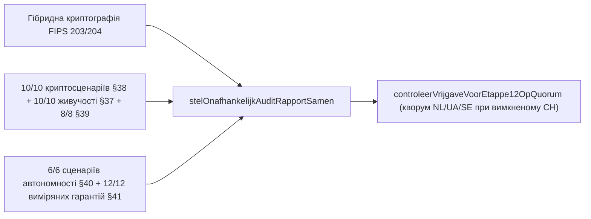

> 🌐 **Мова / Taal:** **Українська** · [Nederlands](KLIMOP-FASE-11-ONAFHANKELIJKE-BEVEILIGINGSAUDIT-EN-DREIGINGSMODEL.nl.md) | [Головна](../../README.md) · [Покажчик документації](../ПОКАЖЧИК-ДОКУМЕНТАЦІЇ.uk.md) · [Головний архітектурний маніфест «Плющ»](АРХІТЕКТУРНИЙ-МАНІФЕСТ-ПЛЮЩ.uk.md) · [Етап 1 — Ядро та план випусків](ПЛЮЩ-ЕТАП-1-АРХІТЕКТУРНЕ-ЯДРО-ТА-ПЛАН-ВИПУСКІВ.uk.md) · [Етап 2 — «Стебла»](ПЛЮЩ-ЕТАП-2-ВИПРОБУВАЛЬНА-МЕРЕЖА-ТА-СТЕБЛА.uk.md) · [Етап 3 — Шифрування та зберігання](ПЛЮЩ-ЕТАП-3-ШИФРУВАННЯ-ТА-РОЗПОДІЛЕНЕ-ЗБЕРІГАННЯ.uk.md) · [Етап 4 — ФРОСТ](ПЛЮЩ-ЕТАП-4-РОЗПОДІЛЕНІ-КЛЮЧІ-ТА-ПОРОГОВІ-ПІДПИСИ.uk.md) · [Етап 5 — Ідентичність та `MLS`](ПЛЮЩ-ЕТАП-5-НЕЗАЛЕЖНА-ІДЕНТИЧНІСТЬ-ТА-ГРУПОВІ-ПРОСТОРИ.uk.md) · [Етап 6 — Керування та випуски](ПЛЮЩ-ЕТАП-6-РОЗПОДІЛЕНЕ-КЕРУВАННЯ-ТА-БЕЗПЕЧНІ-ВИПУСКИ.uk.md) · [Етап 7 — Імунна система](ПЛЮЩ-ЕТАП-7-ІМУННА-СИСТЕМА-ТА-САМОВІДНОВЛЕННЯ.uk.md) · [Етап 8 — Перенесення служб](ПЛЮЩ-ЕТАП-8-ПЕРЕНЕСЕННЯ-СЛУЖБ-ТА-ІЗОЛЬОВАНІ-ЗЄДНУВАЧІ.uk.md) · [Етап 9 — Захист людини](ПЛЮЩ-ЕТАП-9-ЗАХИСТ-ЛЮДИНИ-ТА-ПРОТИДІЯ-ПРИМУСУ.uk.md) · [Етап 10 — «Вусики» та «Живлення»](ПЛЮЩ-ЕТАП-10-КЕРОВАНЕ-РОЗШИРЕННЯ-ТА-ОБМІН-РЕСУРСАМИ.uk.md)

# Етап 11 екосистеми «Плющ» — Незалежний аудит безпеки, зведена модель загроз і способів протидії (Документ №20) та постквантова готовність (`KLIMOP-012`)

- **Дата виконання:** 21.11.2026
- **Задача координації:** `KLIMOP-012` (спирається на злитий у `integratie` запит №193 `KLIMOP-011`, фіксація злиття `89293d0b4eaac12084f17c21681479e46b35aa20`)
- **Програмна реалізація:**
  - Гібридні постквантові ключі, підписи та інкапсуляція (`maakHybridePostkwantumKnooppunt`, `ondertekenHybrideEd25519MlDsa65`, `verifieerHybrideEd25519MlDsa65`, `kapselHybrideX25519MlKem768In`, `ontkapselHybrideX25519MlKem768` на стандартах `FIPS 203` / `FIPS 204` у вбудованому `node:crypto`), зведена модель загроз із чесними залишковими ризиками (`KLIMOP_DREIGINGS_MODEL`, `valideerDreigingsModelEnRestrisicos`), оцінювачі 10 криптографічних перевірок §38 (`beoordeelCryptografischeAudit38`), 6 сценаріїв автономності §40 (`beoordeelAutonomieAudit40`), 12 вимірюваних гарантій §41 (`beoordeelMeetbareGaranties41`) та гібридно підписаний підсумковий звіт аудиту (`stelOnafhankelijkAuditRapportSamen`, `verifieerOnafhankelijkAuditRapport`): [`shared/klimop/beveiligingsaudit.ts`](../../shared/klimop/beveiligingsaudit.ts)
  - Кворумний мережевий клієнт незалежного аудиту та перевірки допуску до Етапу 12 (`KlimopBeveiligingsAuditClient`): [`backend/klimop-audit-client.ts`](../../backend/klimop-audit-client.ts)
  - Мережеві операції під мандатом ролі `verificatie` у площині `knooppunt_beheer` (`registreer_beveiligingsaudit_rapport`, `raadpleeg_beveiligingsaudit_staat`): [`backend/klimop-knooppunt-agent.ts`](../../backend/klimop-knooppunt-agent.ts)
  - Відтворюваний ізольований полігон гібридної криптографії, 10 криптографічних атак §38, 6 навчань автономності §40 (на вузлах `NL`, `CH`, `UA`, `SE` при вимкненому `CH`) і 12 вимірюваних показників §41: [`scripts/klimop-etappe11-beveiligingsaudit-proef.mjs`](../../scripts/klimop-etappe11-beveiligingsaudit-proef.mjs)
- **Нормативна підстава:** розділи `§13`, `§36 (Етап 11)`, `§37–§41`, `§42 (15 питань)`, `§43 п. 1, 12, 13`, обов'язковий **Документ №20** за реєстром Етапу 1 та п. 4, 20, 21, 22 за `§44` [Головного архітектурного маніфесту «Плющ»](АРХІТЕКТУРНИЙ-МАНІФЕСТ-ПЛЮЩ.uk.md)
- **Межа повноважень і бюджет:** робоча інфраструктура (`PostgreSQL 18.6`, `mijn-ruimte.service`, `*.tarasevych.com`) не змінюється й не вимикається; грошові витрати становлять `0` євро.

---

## 1. Гібридна постквантова криптографія без власних неперевірених алгоритмів (§13, §38, §43 п. 12)

На Етапі 11 активовано та перевірено у вбудованому рушії `node:crypto` (`OpenSSL 3.5.9`) стандартизовані постквантові схеми без сторонніх залежностей і без саморобних шифрів:

1. **Гібридний подвійний цифровий підпис (`Ed25519 + ML-DSA-65`, `FIPS 204`):** `ondertekenHybrideEd25519MlDsa65` криптографічно прив'язує обидва публічні ключі в єдиному транскрипті та підписує повідомлення обома алгоритмами. `verifieerHybrideEd25519MlDsa65` визнає підпис дійсним **виключно тоді**, коли одночасно проходять і класична перевірка `Ed25519`, і постквантова перевірка `ML-DSA-65`.
2. **Гібридна інкапсуляція спільного ключа (`X25519 + ML-KEM-768`, `FIPS 203`):** `kapselHybrideX25519MlKem768In` та `ontkapselHybrideX25519MlKem768` поєднують ефемерний обмін `X25519`, постквантову інкапсуляцію `ML-KEM-768` і відбиток `SHA-256` повного транскрипту через `HKDF-SHA-256`, захищаючи канали та архіви від загрози «перехопити сьогодні — розшифрувати квантовим комп'ютером згодом» (§13).

---

## 2. Зведена модель загроз, способів протидії та чесних залишкових ризиків (Обов'язковий Документ №20)

Згідно з `§43 п. 1` та `§44 п. 4, 21`, модель загроз категорично забороняє заяви про «абсолютну невразливість» (`beweertAbsoluteOnkwetsbaarheid: false`) і фіксує чесні залишкові ризики по кожному з 8 рівнів архітектури:

| Код | Архітектурний рівень | Усунуті `SPOF` | Основна загроза | Технічна протидія в коді «Плюща» | Чесний залишковий ризик |
|---|---|---|---|---|---|
| `DRG-01` | `netwerk_en_stengels` | `SPOF-1`, `SPOF-2` | Перехоплення, повтор кадрів, аналіз довжини пакунків або блокування одного маршруту | `stengels.ts` + `klimop-knooppunt-agent.ts`: `X25519+Ed25519`, `ChaCha20-Poly1305`, вирівнювання до 256 байт, захист від повторів і сліпа естафета | Глобальний спостерігач мережевого потоку може бачити факт активності мережевих адрес без незалежних каналів зв'язку |
| `DRG-02` | `verdeelde_opslag` | `SPOF-1`, `SPOF-3` | Викрадення диска вузла зберігання або втрата до $m$ смуг об'єкта | `opslag.ts` + `immuunsysteem.ts`: клієнтське конвертне шифрування, коди Ріда–Соломона $(k+m)$, сліпа перевірка `HMAC-SHA-256` і добудова без ключа | Одночасна фізична втрата понад $m$ незалежних вузлів до завершення самовідновлення потребуватиме автономної запасної копії |
| `DRG-03` | `drempelsleutels_en_postkwantum` | `SPOF-4` | Повільне викрадення часток у різних епохах або квантове розшифрування в майбутньому | `drempelsleutels.ts` + `beveiligingsaudit.ts`: поділ Фельдмана/Педерсена, двофазні епохи, `FROST RFC 9591` і гібридні `ML-DSA-65` / `ML-KEM-768` | Одночасна компрометація $\ge k$ учасників у межах однієї епохи до її планової зміни дозволяє зловмисникам досягти порога |
| `DRG-04` | `identiteit_en_groepen` | `SPOF-1` | Викрадення довіреного пристрою або незаконне перехоплення процедури відновлення | `identiteit.ts`: обмежені сертифікати пристроїв без кореневого ключа, кворумне відкликання, `MLS RFC 9420` і вікно оскарження `48/168` год | До моменту поширення відкликання розблокований викрадений пристрій має доступ до вже відкритих у його пам'яті даних |
| `DRG-05` | `bestuur_en_uitgaven` | `SPOF-4` | Одноосібна зміна правил, підміна серверного пакунка або непомітна підміна вебклієнта | `bestuur.ts`: 7 категорій повноважень, часові замки `24/48/72` год, порогові рішення `FROST`, розділення ролей випуску й автозупинка Хвилі 1 | Шкідливе розширення оглядача на вже зараженому пристрої поза межами підписаного вебклієнта потребує окремого перевіреного застосунку |
| `DRG-06` | `immuunsysteem_en_uitbreiding` | `SPOF-1`, `SPOF-2` | Атака Сивілли клонами одного постачальника або поведінка комп'ютерного хробака | `hechtranken.ts`: заборона самовільного встановлення й витрат без згоди, двосторонні свідоцтва `Ed25519` і згортання постачальника/підмережі до $\le 1$ голосу | Приховані юридичні зв'язки між формально різними постачальниками потребують періодичного перегляду учасників кворуму |
| `DRG-07` | `externe_verbinders` | `SPOF-2`, `SPOF-3` | Компрометація стороннього поштового чи хмарного інтерфейсу або витік ключа з'єднувача | `diensten.ts`: некорельовані псевдоніми `psid1_…`, окремі ключі `HKDF` на кожну з 11 служб та ізольовані облікові дані з'єднувачів | Повідомлення, свідомо відправлені користувачем зовнішньому централізованому адресатові, підпадають під правила того адресата |
| `DRG-08` | `mensbescherming_en_dwang` | `SPOF-5` | Фізичний або психологічний примус до розкриття пароля й негайного знищення резервів | `mensbescherming.ts`: роздільні сховища без самознищення даних, 256-байтні сигнали тривоги, оцінка 7 ознак і 72-год кворумний замок | Жоден програмний механізм сам по собі не гарантує фізичної безпеки людини перед озброєним нападником |

---

## 3. Програми перевірки криптографії (§38), практичної автономності (§40), 12 гарантій (§41) та допуск до Етапу 12

- **10/10 криптографічних перевірок (§38):** на справжніх модулях перевірено відсікання `< k` часток, виявлення підміненої частки за зобов'язаннями Фельдмана, блокування змішування часток різних епох (`EPOCHE_VAN_DELEN_VERSCHILT`), безпечне скасування перерваного оновлення епохи, відмову при підміні `knooppuntId` у рукостисканні, блокування повторного кадру, руйнування підпису при зміні мандата, заборону обходу порога в `netwerk_regels`, відхилення фальшивої заміни кореневого ключа та відновлення секрету після втрати 2 із 5 учасників.
- **6/6 практичних сценаріїв автономності (§40) та 12/12 виміряних гарантій (§41):** на 4 живих вузлах (`NL`, `CH`, `UA`, `SE`) після повного розриву маршруту до вузла `CH` підтверджено побітове відновлення даних без втрат (`0` байт), роботу без участі початкового автора, миттєвий карантин скомпрометованого адміністратора, ізоляцію 11 служб, зупинку небезпечного випуску на Хвилі 1 та сумісність версій; кожен із 12 кількісних показників `§41` виміряно в живому сценарії (`beproefdInScenario: true`).
- **Суворий кворумний бар'єр перед Етапом 12 («Насіння»):** якщо у звіті `stelOnafhankelijkAuditRapportSamen` присутня бодай одна нерозв'язана слабкість (`openstaandeKritiekeZwaktes.length > 0`) або не виконано будь-яку вимогу `§37–§42`, прапорець `vrijgegevenVoorEtappe12` примусово стає `false`. При відсутності відкритих слабких місць живий кворум `NL + UA + SE` підтвердив обидва підписи звіту (`Ed25519 + ML-DSA-65`) і відкрив допуск до завершального **Етапу 12 (`KLIMOP-013`)**.
