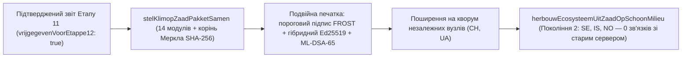

> 🌐 **Мова / Taal:** **Українська** · [Nederlands](KLIMOP-FASE-12-ZADEN-OPVOLGING-EN-DUURZAME-ONTWIKKELING.nl.md) | [Головна](../../README.md) · [Покажчик документації](../ПОКАЖЧИК-ДОКУМЕНТАЦІЇ.uk.md) · [Головний архітектурний маніфест «Плющ»](АРХІТЕКТУРНИЙ-МАНІФЕСТ-ПЛЮЩ.uk.md) · [Етап 1 — Ядро та план випусків](ПЛЮЩ-ЕТАП-1-АРХІТЕКТУРНЕ-ЯДРО-ТА-ПЛАН-ВИПУСКІВ.uk.md) · [Етап 2 — «Стебла»](ПЛЮЩ-ЕТАП-2-ВИПРОБУВАЛЬНА-МЕРЕЖА-ТА-СТЕБЛА.uk.md) · [Етап 3 — Шифрування та зберігання](ПЛЮЩ-ЕТАП-3-ШИФРУВАННЯ-ТА-РОЗПОДІЛЕНЕ-ЗБЕРІГАННЯ.uk.md) · [Етап 4 — ФРОСТ](ПЛЮЩ-ЕТАП-4-РОЗПОДІЛЕНІ-КЛЮЧІ-ТА-ПОРОГОВІ-ПІДПИСИ.uk.md) · [Етап 5 — Ідентичність та `MLS`](ПЛЮЩ-ЕТАП-5-НЕЗАЛЕЖНА-ІДЕНТИЧНІСТЬ-ТА-ГРУПОВІ-ПРОСТОРИ.uk.md) · [Етап 6 — Керування та випуски](ПЛЮЩ-ЕТАП-6-РОЗПОДІЛЕНЕ-КЕРУВАННЯ-ТА-БЕЗПЕЧНІ-ВИПУСКИ.uk.md) · [Етап 7 — Імунна система](ПЛЮЩ-ЕТАП-7-ІМУННА-СИСТЕМА-ТА-САМОВІДНОВЛЕННЯ.uk.md) · [Етап 8 — Перенесення служб](ПЛЮЩ-ЕТАП-8-ПЕРЕНЕСЕННЯ-СЛУЖБ-ТА-ІЗОЛЬОВАНІ-ЗЄДНУВАЧІ.uk.md) · [Етап 9 — Захист людини](ПЛЮЩ-ЕТАП-9-ЗАХИСТ-ЛЮДИНИ-ТА-ПРОТИДІЯ-ПРИМУСУ.uk.md) · [Етап 10 — «Вусики» та «Живлення»](ПЛЮЩ-ЕТАП-10-КЕРОВАНЕ-РОЗШИРЕННЯ-ТА-ОБМІН-РЕСУРСАМИ.uk.md) · [Етап 11 — Аудит і модель загроз](ПЛЮЩ-ЕТАП-11-НЕЗАЛЕЖНИЙ-АУДИТ-БЕЗПЕКИ-ТА-МОДЕЛЬ-ЗАГРОЗ.uk.md)

# Етап 12 екосистеми «Плющ» — «Насіння» (Документ №19), передавання спадкоємності (Документ №23) та безперервний автономний розвиток (`KLIMOP-013`)

- **Дата виконання:** 21.11.2026
- **Задача координації:** `KLIMOP-013` (спирається на злитий у `integratie` запит №194 `KLIMOP-012`, фіксація злиття `372c059460a8c92e4f7dbea529421eb43c862766`)
- **Програмна реалізація:**
  - Перелік перевірених технічних залежностей без прив'язки до зовнішніх хмарних монополій (`KLIMOP_TECHNISCHE_AFHANKELIJKHEDEN`, `valideerTechnischeAfhankelijkheden`), самодостатній пакет незалежного відтворення «Насіння» з коренем Меркла `SHA-256` по всіх 14 модулях ядра та подвійною печаткою `FROST RFC 9591` + `Ed25519 + ML-DSA-65 FIPS 204` (`stelKlimopZaadPakketSamen`, `verifieerKlimopZaadPakket`), чисте відтворення на ізольованому середовищі без старого сервера (`herbouwEcosysteemUitZaadOpSchoonMilieu`), двосторонній пороговий акт спадкоємності (`stelOpvolgingsOverdrachtSamen`, `verifieerOpvolgingsOverdracht`), контроль 16 напрямів автономного розвитку ШІ-агентів (`beoordeelAutonoomOntwikkelVoorstel`) та звірка 12 засад кінцевого бачення `§46` (`valideerKlimopEindvisie46`): [`shared/klimop/zaden.ts`](../../shared/klimop/zaden.ts)
  - Кворумний мережевий клієнт поширення «Насіння», чистої відбудови нового покоління вузлів і закріплення спадкоємності (`KlimopZadenEnOpvolgingClient`): [`backend/klimop-zaden-client.ts`](../../backend/klimop-zaden-client.ts)
  - Мережеві операції під мандатом ролі `verificatie` у площині `knooppunt_beheer` (`bewaar_gevalideerd_zaad_pakket`, `registreer_opvolgings_overdracht`, `raadpleeg_zaad_en_opvolging`): [`backend/klimop-knooppunt-agent.ts`](../../backend/klimop-knooppunt-agent.ts)
  - Відтворюваний полігон вимкнення старого головного сервера, чистої відбудови Покоління 2 (`SE`, `IS`, `NO`) з пакета «Насіння» та передавання спадкоємності за відсутності початкового автора: [`scripts/klimop-etappe12-zaden-proef.mjs`](../../scripts/klimop-etappe12-zaden-proef.mjs)
- **Нормативна підстава:** розділи `§1.7`, `§2`, `§18–§20`, `§32–§34`, `§36 (Етап 12)`, `§42 (15 питань)`, обов'язкові **Документи №19 та №23** за реєстром Етапу 1 (усі **25 із 25** документів `§44` виконано!) та всі 12 засад `§46` [Головного архітектурного маніфесту «Плющ»](АРХІТЕКТУРНИЙ-МАНІФЕСТ-ПЛЮЩ.uk.md)
- **Межа повноважень:** жива робоча інфраструктура (`PostgreSQL 18.6`, `mijn-ruimte.service`, `*.tarasevych.com`) не змінюється й не вимикається без окремого рішення власника.

---

## 1. Посібник із незалежного відтворення мережі з нуля — «Насіння» та перелік технічних залежностей (Документ №19, §1.7, §44 п. 19)

1. **Суворий вхідний бар'єр і відсутність секретів:** `stelKlimopZaadPakketSamen` перевіряє дійсність звіту Етапу 11 (`vrijgegevenVoorEtappe12 === true`), наявність усіх 14 базових модулів `shared/klimop/*.ts`, між'юрисдикційну незалежність стартових вузлів приєднання (`>= 2` юрисдикції та постачальники) і відсутність будь-яких закритих ключів або приватного вмісту (`bevatGeheimeSleutelsOfPriveInhoud: false`).
2. **Подвійна криптографічна печатка та дерево Меркла:** відсортовані складники зв'язуються в корінь Меркла `merkleWortelSha256` і одночасно підписуються пороговим підписом `FROST (RFC 9591)` ради хранителів та гібридним постквантовим підписом `Ed25519 + ML-DSA-65 (FIPS 204)`. Підміна хоча б одного байта в будь-якому модулі негайно виявляється у `verifieerKlimopZaadPakket`.
3. **Чиста відбудова без початкового сервера:** `herbouwEcosysteemUitZaadOpSchoonMilieu` відхиляє спробу звернутися до старої інфраструктури (`VERBINDING_MET_OUDE_SERVER_VERBODEN_BIJ_SCHONE_OPBOUW`), звіряє наявність усіх локальних імпортів розпакованих модулів і розгортає нове покоління вузлів у незалежних юрисдикціях суто з перевіреного пакета «Насіння».
4. **Перевірені технічні залежності (`KLIMOP_TECHNISCHE_AFHANKELIJKHEDEN`):** усі 6 базових груп залежностей (`node:crypto OpenSSL 3.5+`, «Стебла», коди Ріда–Соломона, `FROST`, `klid1_` + групові епохи за мотивами `RFC 9420` + `CRDT` та перехідна лінія повернення `PostgreSQL 18.6` / `age`) спираються виключно на відкриті стандарти (`vereistProprietaireCloudDienst: false`) і мають задокументований шлях заміни.

---

## 2. Порядок передавання спадкоємності новим уповноваженим учасникам без участі початкового автора (Документ №23, §1.7, §19–§20)

- **Відсутність потреби в початковому авторові (`oorspronkelijkeAuteurDeelnameVereist: false`):** навіть за повної недоступності творця чи старого сервера дієздатна підмножина попереднього кворуму хранителів ($\ge k$ учасників у різних юрисдикціях) разом із новим кворумом уповноважених учасників оформлює двосторонній акт спадкоємності `stelOpvolgingsOverdrachtSamen`.
- **Захист від захоплення та від передачі в порожнечу:** `verifieerOpvolgingsOverdracht` примусово перевіряє:
  1. витриманий часовий замок **`>= 72` годин** (`OPVOLGING_TIJDSLOT_72_UUR_NOG_ACTIEF`);
  2. зростання номера версії конституції (`versieVolgnummer`);
  3. між'юрисдикційну й операторську незалежність нової ради хранителів;
  4. дійсність обох порогових підписів `FROST` — і попередньої ради, і нової ради учасників.
- **Відокремлення керування від особистих даних (`toegangTotPersoonlijkeGegevensOvergedragen: false`):** перехід конституційних повноважень керування правилами мережі технічно ніколи не передає новим хранителям ключів розшифрування особистих просторів користувачів (`§2`, `§19`).

---

## 3. Постійний розвиток 16 напрямів ШІ-агентів (§32–§34) та всі 12 засад кінцевого бачення (§46)

- **Автономний розвиток без необмеженої автономії (`beoordeelAutonoomOntwikkelVoorstel`):** для всіх 16 спеціалізованих напрямів `KLIMOP_ZESTIEN_ONTWIKKELRICHTINGEN` агенти самостійно готують перевірені пропозиції оновлень із доказами випробувань і 15-пунктовою перевіркою, але спроба самосхвалення чи самостійного розгортання (`AI_ZELFGOEDKEURING_OF_UITROL_VERBODEN`), одноосібної зміни криптографічних правил (`EIGENMACHTIGE_CRYPTOREGEL_WIJZIGING_VERBODEN`), розширення власних прав або розкриття секретів негайно відхиляється (`vereistMenselijkOfQuorumBesluit: true`).

| Засада кінцевого бачення (§46) | Модуль перевірюваної реалізації | Стан |
|---|---|---|
| 1. Людина — незалежний власник своїх даних і дозволів | [`shared/klimop/identiteit.ts`](../../shared/klimop/identiteit.ts) | **Доведено** |
| 2. Довірений пристрій виконує лише обмежені функції | [`shared/klimop/identiteit.ts`](../../shared/klimop/identiteit.ts) | **Доведено** |
| 3. Вузол має обмежену роль і перевірюваний паспорт | [`shared/klimop/kern.ts`](../../shared/klimop/kern.ts) | **Доведено** |
| 4. Служба ізольована й діє за явними дозволами | [`shared/klimop/diensten.ts`](../../shared/klimop/diensten.ts) | **Доведено** |
| 5. Критичний ключ має повний перевірюваний життєвий цикл | [`shared/klimop/drempelsleutels.ts`](../../shared/klimop/drempelsleutels.ts) | **Доведено** |
| 6. Важливе рішення має перевірюване походження й погодження | [`shared/klimop/bestuur.ts`](../../shared/klimop/bestuur.ts) | **Доведено** |
| 7. Критичний зв'язок має альтернативи або задокументовані межі | [`shared/klimop/stengels.ts`](../../shared/klimop/stengels.ts) | **Доведено** |
| 8. Оновлення перевіряється до поширення без підриву довіри | [`shared/klimop/bestuur.ts`](../../shared/klimop/bestuur.ts) | **Доведено** |
| 9. Несправність спричиняє обмежену перевірювану реакцію | [`shared/klimop/immuunsysteem.ts`](../../shared/klimop/immuunsysteem.ts) | **Доведено** |
| 10. Користувач може припинити участь і відкликати доступ | [`shared/klimop/hechtranken.ts`](../../shared/klimop/hechtranken.ts) | **Доведено** |
| 11. ШІ-агент сприяє розвиткові без необмеженої влади | [`shared/klimop/zaden.ts`](../../shared/klimop/zaden.ts) | **Доведено** |
| 12. Майбутній розробник продовжує роботу з перевіреного «Насіння» | [`shared/klimop/zaden.ts`](../../shared/klimop/zaden.ts) | **Доведено** |
