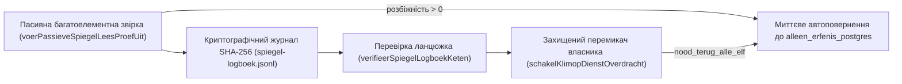

> 🌐 **Мова / Taal:** **Українська** · [Nederlands](KLIMOP-FASE-14-PASSIEF-LEZEN-AFWIJKINGSLOGBOEK-EN-TERUGSCHAKELING.nl.md) | [Головна](../../README.md) · [Покажчик документації](../ПОКАЖЧИК-ДОКУМЕНТАЦІЇ.uk.md) · [Головний архітектурний маніфест «Плющ»](АРХІТЕКТУРНИЙ-МАНІФЕСТ-ПЛЮЩ.uk.md) · [Етап 13 — Платформна інтеграція та Сходинка 1](ПЛЮЩ-ЕТАП-13-ПЛАТФОРМНА-ІНТЕГРАЦІЯ-ТА-ДЗЕРКАЛЬНА-ЗВІРКА.uk.md)

# Плющ — Етап 14: Сходинка 2 пасивного читання, криптографічний журнал розбіжностей та перемикач миттєвого повернення (`KLIMOP-015`)

> **Статус:** виконано й інтегровано в основну кодову базу платформи «Мій простір» у безпечному режимі Сходинки 2 (§35 маніфесту).
> **Межа повноважень (§3.2, §35):** чинна база даних `PostgreSQL 18.6`, служби `systemd`, встановлювач `/usr/local/sbin/mijn-ruimte-installeer`, зашифровані запасні копії `age` та всі 11 робочих піддоменів `*.tarasevych.com` залишаються повністю недоторканними.

---

## 1. Мета етапу та зв’язок із Етапом 13 (`KLIMOP-014`)

На Етапі 13 (`KLIMOP-014`) 12 криптографічних модулів ядра `shared/klimop/*.ts` було з’єднано із сервером, шлюзом `MCP` для 14 ШІ-агентів та вебпанеллю `KlimopPaneel.tsx` на рівні **Сходинки 1** — одноразової перевірки в оперативній пам’яті без збережуваного журналу й без керованого перемикача станів.

Згідно з розділом 35 Головного архітектурного маніфесту (*«Поступова перебудова без втрати даних»*), наступним кроком безпечного переходу є **Сходинка 2 — пасивне дзеркальне читання багатоелементних вибірок, збережуваний криптографічний журнал розбіжностей та перемикач миттєвого повернення для кожної з 11 служб** зі збереженням чинної основи як єдиного первинного джерела запису (`primaireSchrijfBron: 'erfenis_postgres'`).

---

## 2. Реалізовані складники Етапу 14 (`KLIMOP-015`)

1. **Серверне сховище Сходинки 2 (`backend/klimop-overdracht-opslag.ts`):**
   - [`voerPassieveSpiegelLeesProefUit`](../../backend/klimop-overdracht-opslag.ts) — для обраної з 11 служб формує ізольовану багатоелементну вибірку (`2..12` елементів під окремим псевдонімом `psid1_…` і ключем `HKDF-SHA-256`), кодує кожен елемент смугами Ріда–Соломона `(4+2)` із відновленням після втрати 2 смуг, виконує підписане узгодження `CRDT` між двома вузлами, звіряє контрольні суми вмісту й прав доступу та при будь-якій розбіжності **миттєво й автоматично** скидає службу назад до `'alleen_erfenis_postgres'`;
   - [`berekenSpiegelLogboekRegelSha256`](../../backend/klimop-overdracht-opslag.ts) та [`verifieerSpiegelLogboekKeten`](../../backend/klimop-overdracht-opslag.ts) — незмінний журнал розбіжностей `spiegel-logboek.jsonl` із нерозривним ланцюжком `SHA-256` від початкового нульового відбитка (`KLIMOP_GENESIS_KETEN_SHA256`), де зберігаються **виключно знеособлені 16-символьні відбитки ключів** (`bevatGeheimenOfInhoud: false`);
   - [`schakelKlimopDienstOverdracht`](../../backend/klimop-overdracht-opslag.ts) — атомарний перемикач власника (`schakelaars.json` через тимчасовий файл і `renameSync`): дозволяє увімкнути `'passief_spiegel_lezen'` лише при цілісному ланцюжку журналу та підтвердженій безрозбіжній перевірці, але **завжди безумовно** дозволяє миттєве повернення однієї служби (`terug_naar_erfenis`) або всіх 11 служб одним викликом (`nood_terug_alle_elf`).
2. **Маршрути власника та технічні інструменти `MCP` для 14 ШІ-агентів:**
   - у [`backend/klimop-paden.ts`](../../backend/klimop-paden.ts) додано захищені маршрути власника `POST /api/owner/klimop/passieve-spiegel`, `POST /api/owner/klimop/spiegel-logboek` та `POST /api/owner/klimop/overdracht-schakelaar` (із записом у журнал безпеки `app.audit`);
   - у [`backend/klimop-hulpmiddeldefinities.ts`](../../backend/klimop-hulpmiddeldefinities.ts), [`backend/klimop-hulpmiddelen.ts`](../../backend/klimop-hulpmiddelen.ts) та каталозі З’єднувача другої версії ([`shared/connector-v2/catalogus.ts`](../../shared/connector-v2/catalogus.ts)) зареєстровано `klimop_passieve_spiegel` і `klimop_spiegel_logboek` (разом 5 інструментів `klimop_*`, усі імена `<= 63` знаки для всіх 14 ШІ-агентів). Згідно з `§34` маніфесту, ШІ-агенти не мають доступу до перемикача `overdracht-schakelaar` і не можуть самостійно змінити режим роботи жодної служби.
3. **Двомовна вебпанель і чотиришарова довідка:**
   - у [`src/klimop/klimop-klant.ts`](../../src/klimop/klimop-klant.ts), [`src/agenten/KlimopPaneel.tsx`](../../src/agenten/KlimopPaneel.tsx) та [`shared/klimop-overzicht-model.ts`](../../shared/klimop-overzicht-model.ts) додано блок керування Сходинкою 2, стан ланцюжка журналу, кнопки перемикання та миттєвого повернення всіх 11 служб і контекстні підказки `klimop.passief` та `klimop.schakelaar`.

---

## 3. Відповідність 15 питанням архітектурної перевірки (§42) та заборонам (§43)

- **Жодної нової точки відмови й збереження повернення стану (питання 1, 8, 11):** кожна з 11 служб перемикається незалежно; при виявленні розбіжності або натисканні аварійного перемикача повернення до чинної основи виконується миттєво й без втрат, навіть якщо файл журналу звірки пошкоджено.
- **Відсутність прихованих повноважень і витоку метаданих (питання 2, 4, 5, 14):** ШІ-агенти бачать лише знеособлену діагностику й не можуть керувати перемикачем; журнал розбіжностей ніколи не зберігає вмісту повідомлень, таємниць або відкритих ідентифікаторів елементів; одноразові ключі затираються нулями в блоці `finally`.
- **Відсутність 14 заборонених спрощень (§43):** основна база `PostgreSQL 18.6` не вимикається й не зачіпається (`productieDatabankGewijzigd: false`), усі перевірки підтверджені виконуваним набором [`tests/eenheid/klimop-015-passieve-spiegel-terugschakeling-20261121.test.ts`](../../tests/eenheid/klimop-015-passieve-spiegel-terugschakeling-20261121.test.ts).
