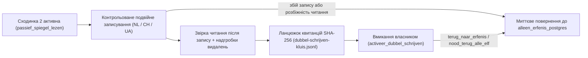

> 🌐 **Мова / Taal:** **Українська** · [Nederlands](KLIMOP-FASE-15-DUBBEL-SCHRIJVEN-LEESVERIFICATIE-EN-TERUGVAL.nl.md) | [Головна](../../README.md) · [Покажчик документації](../ПОКАЖЧИК-ДОКУМЕНТАЦІЇ.uk.md) · [Головний архітектурний маніфест «Плющ»](АРХІТЕКТУРНИЙ-МАНІФЕСТ-ПЛЮЩ.uk.md) · [Етап 14 — Сходинка 2 пасивного читання](ПЛЮЩ-ЕТАП-14-ПАСИВНЕ-ЧИТАННЯ-ЖУРНАЛ-РОЗБІЖНОСТЕЙ-ТА-ПЕРЕМИКАЧ-ПОВЕРНЕННЯ.uk.md)

# Плющ — Етап 15: Сходинка 3 контрольованого подвійного записування зі звіркою читання та миттєвим поверненням (`KLIMOP-016`)

> **Статус:** виконано й інтегровано в основну кодову базу платформи «Мій простір» у безпечному ізольованому режимі Сходинки 3 (§35 маніфесту).
> **Межа повноважень (§3.2, §35):** чинна база даних `PostgreSQL 18.6`, системні служби `systemd`, встановлювач `/usr/local/sbin/mijn-ruimte-installeer`, зашифровані запасні копії `age` та всі 11 робочих піддоменів `*.tarasevych.com` залишаються повністю недоторканними, а будь-яка спроба самовільного відокремлення чинної бази даних блокується кодом `KLIMOP_LOSKOPPELING_VERBODEN` (`403`).

---

## 1. Мета етапу та зв’язок із Етапом 14 (`KLIMOP-015`)

На Етапі 14 (`KLIMOP-015`) у платформі було запроваджено **Сходинку 2** — пасивне багатоелементне читання з ланцюжком цілісності `SHA-256` журналу розбіжностей та перемикачем миттєвого повернення однієї чи всіх 11 служб.

Відповідно до розділу 35 Головного архітектурного маніфесту (*«Поступова перебудова без втрати даних»*), наступною ланкою безпечного переходу без простоїв і без втрати інформації є **Сходинка 3 — контрольоване подвійне записування зі звіркою читання після запису, криптографічними квитанціями та незмінним правом миттєвого повернення для всіх 11 служб** зі збереженням чинної бази даних як обов’язкового первинного джерела (`primaireSchrijfBron: 'erfenis_postgres'`).

---

## 2. Реалізовані складники Етапу 15 (`KLIMOP-016`)

1. **Серверне ядро Сходинки 3 (`backend/klimop-overdracht-opslag.ts`):**
   - [`voerGecontroleerdeDubbelSchrijfProefUit`](../../backend/klimop-overdracht-opslag.ts) — виконує для обраної з 11 служб послідовність із `3..12` операцій створення (`zet`), конкурентного оновлення за вищим гібридним логічним годинником `HLC` та криптографічного видалення з надгробком (`verwijder`) на між’юрисдикційному кворумі 3 незалежних вузлів (`NL`, `CH`, `UA`), перевіряє відновлення живих об’єктів за смугами Ріда–Соломона `(4+2)` після втрати 2 смуг, підтверджує надгробок видалення й рівність читання після запису (`leesNaSchrijfGelijk`) та при найменшому збої **миттєво й автоматично** скидає службу на чинну основу (`alleen_erfenis_postgres`);
   - [`berekenDubbelKwitantieSha256`](../../backend/klimop-overdracht-opslag.ts), [`verifieerDubbelKwitantieKeten`](../../backend/klimop-overdracht-opslag.ts) та [`leesKlimopDubbelSchrijvenLogboek`](../../backend/klimop-overdracht-opslag.ts) — ведуть і перевіряють незмінний журнал квитанцій подвійного записування `dubbel-schrijven-kluis.jsonl` із ланцюжком `SHA-256` від початкового нульового відбитка, де зберігаються лише знеособлені 16-символьні відбитки ключів (`bevatGeheimenOfInhoud: false`);
   - розширений [`schakelKlimopDienstOverdracht`](../../backend/klimop-overdracht-opslag.ts) — суворо забороняє перестрибування сходинок (`KLIMOP_STAP2_ACTIEF_VEREIST` — `409`), вимагає попередньої безрозбіжної перевірки подвійного записування (`KLIMOP_DUBBEL_SCHRIJVEN_PROEF_VEREIST` — `409`) і цілісності обох криптографічних журналів, категорично відхиляє спроби самовільного відокремлення чинної бази (`KLIMOP_LOSKOPPELING_VERBODEN` — `403`) та завжди залишає працездатним миттєве повернення однієї чи всіх 11 служб.
2. **Маршрути власника та інструменти `MCP` для 14 ШІ-агентів:**
   - у [`backend/klimop-paden.ts`](../../backend/klimop-paden.ts) додано захищені маршрути власника `POST /api/owner/klimop/dubbel-schrijven` і `POST /api/owner/klimop/dubbel-logboek` із записом у журнал безпеки `app.audit`;
   - у [`backend/klimop-hulpmiddeldefinities.ts`](../../backend/klimop-hulpmiddeldefinities.ts), [`backend/klimop-hulpmiddelen.ts`](../../backend/klimop-hulpmiddelen.ts) та каталозі З’єднувача другої версії ([`shared/connector-v2/catalogus.ts`](../../shared/connector-v2/catalogus.ts)) зареєстровано діагностичні інструменти `klimop_dubbel_schrijven` і `klimop_dubbel_logboek` (разом 7 інструментів `klimop_*`, усі імена `<= 63` знаки для всіх 14 ШІ-агентів, без доступу агентів до перемикача `overdracht-schakelaar` згідно з `§34`).
3. **Двомовна вебпанель і чотиришарова довідка:**
   - у [`src/klimop/klimop-klant.ts`](../../src/klimop/klimop-klant.ts), [`src/agenten/KlimopPaneel.tsx`](../../src/agenten/KlimopPaneel.tsx) та [`shared/klimop-overzicht-model.ts`](../../shared/klimop-overzicht-model.ts) додано керування Сходинкою 3, відображення квитанцій подвійного записування та контекстну довідку `klimop.dubbel`.

---

## 3. Відповідність 15 питанням архітектурної перевірки (§42) та заборонам (§43)

- **Між’юрисдикційна незалежність і миттєве повернення (питання 1, 7, 8, 11):** подвійне записування перевіряє кворум `NL / CH / UA` різних постачальників за `controleerKnooppuntOnafhankelijkheid`, витримує втрату 2 із 6 смуг Ріда–Соломона й миттєво повертає одну чи всі 11 служб на чинну основу навіть за пошкодження журналів.
- **Відсутність прихованих повноважень і витоку вмісту (питання 2, 4, 5, 6, 14):** ШІ-агенти не можуть керувати перемикачем сходинок; самовільне відокремлення чинної бази заблоковане; у квитанціях фіксуються лише знеособлені відбитки, а всі одноразові ключі затираються нулями в блоці `finally`.
- **Відсутність 14 заборонених спрощень (§43):** жива база даних `PostgreSQL 18.6` не вимикається й не змінюється (`productieDatabankGewijzigd: false`), усі гарантії підтверджені виконуваним набором [`tests/eenheid/klimop-016-dubbel-schrijven-terugval-20261121.test.ts`](../../tests/eenheid/klimop-016-dubbel-schrijven-terugval-20261121.test.ts).
