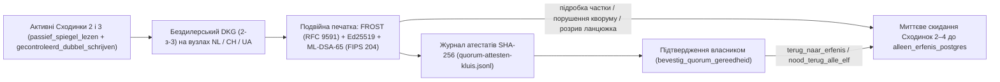

> 🌐 **Мова / Taal:** **Українська** · [Nederlands](KLIMOP-FASE-16-STAP-4-QUORUMATTEST-EN-DREMPELVRIJGAVE.nl.md) | [Головна](../../README.md) · [Покажчик документації](../ПОКАЖЧИК-ДОКУМЕНТАЦІЇ.uk.md) · [Головний архітектурний маніфест «Плющ»](АРХІТЕКТУРНИЙ-МАНІФЕСТ-ПЛЮЩ.uk.md) · [Етап 15 — Сходинка 3 подвійного записування](ПЛЮЩ-ЕТАП-15-ПОДВІЙНЕ-ЗАПИСУВАННЯ-ЗВІРКА-ЧИТАННЯ-ТА-ПОВЕРНЕННЯ.uk.md)

# Плющ — Етап 16: Сходинка 4 кворумного атестата готовності та порогового допуску власника (`KLIMOP-017`)

> **Статус:** виконано й інтегровано в основну кодову базу платформи «Мій простір» у захищеному режимі Сходинки 4 (§35, §10, §13 маніфесту).
> **Межа повноважень (§3.2, §35):** чинна база даних `PostgreSQL 18.6`, системні служби `systemd`, встановлювач `/usr/local/sbin/mijn-ruimte-installeer`, зашифровані запасні копії `age` та всі 11 робочих піддоменів `*.tarasevych.com` залишаються повністю активними й недоторканними (`productieDatabankActief: true`, `productieDatabankGewijzigd: false`), а будь-яка спроба самовільного відокремлення чи вимкнення живої бази блокується кодом `KLIMOP_LOSKOPPELING_VERBODEN` (`403`).

---

## 1. Мета етапу та зв’язок із Етапом 15 (`KLIMOP-016`)

На Етапах 13–15 (`KLIMOP-014`..`KLIMOP-016`) у платформу було послідовно вбудовано **Сходинку 1** безризикової дзеркальної звірки, **Сходинку 2** пасивного багатоелементного читання з криптографічним ланцюжком розбіжностей `SHA-256` та **Сходинку 3** контрольованого подвійного записування зі звіркою читання після запису, надгробками видалень і журналом квитанцій.

Відповідно до розділів `§35`, `§10`, `§13` та `§34` Головного архітектурного маніфесту, завершальною інженерною ланкою перевіреної готовності всіх 11 служб є **Сходинка 4 — випуск кворумного атестата готовності на незалежних вузлах у різних юрисдикціях (`NL / CH / UA`) під подвійною криптографічною печаткою порогового підпису Шнорра `FROST (RFC 9591)` і гібридного постквантового підпису `Ed25519 + ML-DSA-65 (FIPS 204)` із пороговим підтвердженням власника без самовільного вимкнення живої бази даних**.

---

## 2. Реалізовані складники Етапу 16 (`KLIMOP-017`)

1. **Серверне ядро кворумних атестатів Сходинки 4 (`backend/klimop-overdracht-opslag.ts`):**
   - [`voerStap4QuorumAttestProefUit`](../../backend/klimop-overdracht-opslag.ts) — формує ізольований контекст служби (`psid1_…`, епоха `4`), розгортає 3 гібридні постквантові вузли в різних юрисдикціях (`NL`, `CH`, `UA`), перевіряє їхню незалежність (`controleerKnooppuntOnafhankelijkheid`), виконує розподілене створення ключів без дилера (`DKG` `2-з-3`), обчислює двораундовий пороговий підпис Шнорра `FROST(Ed25519, SHA-512)` з поіменним виявленням підроблених часток (`verdachteDeelnemers`) та гібридний постквантовий підпис `Ed25519 + ML-DSA-65`, прив’язує атестат до поточних голів журналів Сходинок 2–3 (`spiegelKetenKopSha256`, `dubbelKetenKopSha256`) та за найменшого криптографічного чи мережевого збою **миттєво й автоматично** скидає Сходинки 2–4 до `alleen_erfenis_postgres`;
   - [`maakQuorumAttestTekenBoodschappen`](../../backend/klimop-overdracht-opslag.ts), [`berekenQuorumAttestSha256`](../../backend/klimop-overdracht-opslag.ts), [`verifieerQuorumAttestKeten`](../../backend/klimop-overdracht-opslag.ts) та [`leesKlimopQuorumAttestLogboek`](../../backend/klimop-overdracht-opslag.ts) — забезпечують збереження й подвійну криптографічну перевірку журналу `quorum-attesten-kluis.jsonl`: під час кожного читання перевіряються і геш `SHA-256` рядка, і справжність обох підписів (`FROST Ed25519` та `Ed25519 + ML-DSA-65`) із суворим розділенням доменів підписування;
   - розширений [`schakelKlimopDienstOverdracht`](../../backend/klimop-overdracht-opslag.ts) — для дії `bevestig_quorum_gereedheid` перевіряє цілісність усіх трьох журналів, вимагає одночасно активної Сходинки 2 (`KLIMOP_STAP2_ACTIEF_VEREIST`), активної Сходинки 3 (`KLIMOP_STAP3_ACTIEF_VEREIST`) та чинного кворумного атестата Сходинки 4 (`KLIMOP_QUORUM_ATTEST_VEREIST`), блокує самовільне відокремлення живої бази (`KLIMOP_LOSKOPPELING_VERBODEN` — `403`) і безвідмовно повертає одну чи всі 11 служб на чинну основу.
2. **Захищені маршрути власника та інструменти `MCP` для 14 ШІ-агентів:**
   - у [`backend/klimop-paden.ts`](../../backend/klimop-paden.ts) додано маршрути власника `POST /api/owner/klimop/quorum-attest` і `POST /api/owner/klimop/quorum-logboek` із записом у журнал безпеки `app.audit`;
   - у [`backend/klimop-hulpmiddeldefinities.ts`](../../backend/klimop-hulpmiddeldefinities.ts), [`backend/klimop-hulpmiddelen.ts`](../../backend/klimop-hulpmiddelen.ts) та каталозі З’єднувача другої версії ([`shared/connector-v2/catalogus.ts`](../../shared/connector-v2/catalogus.ts)) зареєстровано діагностичні інструменти `klimop_quorum_attest` і `klimop_quorum_logboek` (разом 9 інструментів `klimop_*`, усі імена `<= 63` знаки для всіх 14 ШІ-агентів, без доступу агентів до перемикача `overdracht-schakelaar` згідно з `§34`).
3. **Двомовна вебпанель і чотиришарова довідка:**
   - у [`src/klimop/klimop-klant.ts`](../../src/klimop/klimop-klant.ts), [`src/agenten/KlimopPaneel.tsx`](../../src/agenten/KlimopPaneel.tsx) та [`shared/klimop-overzicht-model.ts`](../../shared/klimop-overzicht-model.ts) додано блок керування Сходинкою 4 (`data-klimop-attest="1"`), огляд останніх кворумних атестатів із індикацією подвійної печатки та чотиришарову довідку `klimop.attest`.

---

## 3. Відповідність 15 питанням архітектурної перевірки (§42) та заборонам (§43)

- **Порогове розподілення довіри та постквантова стійкість (питання 1, 2, 4, 7, 10):** жоден окремий вузол не здатен сформувати пороговий підпис `FROST` самостійно (`2-з-3` після бездилерського `DKG`), а гібридна печатка `Ed25519 + ML-DSA-65` та повторна криптографічна перевірка підписів у `verifieerQuorumAttestKeten` унеможливлюють непомітну підміну журналу навіть за перерахунку гешів `SHA-256`.
- **Захист від прихованих повноважень і витоку метаданих (питання 5, 6, 8, 11, 14):** ШІ-агенти не мають доступу до перемикача сходинок; підроблена частка підпису виявляється поіменно й негайно запускає автоматичне повернення всіх сходинок обраної служби до чинної основи; особисті дані не потрапляють у журнал (`bevatGeheimenOfInhoud: false`), а ключовий матеріал затирається нулями в `finally`.
- **Відсутність 14 заборонених спрощень (§43):** пороговий підпис не видається за шифрування, жива база даних `PostgreSQL 18.6` не вимикається й не відокремлюється (`productieDatabankActief: true`, `productieDatabankGewijzigd: false`), а всі гарантії підтверджені виконуваним набором [`tests/eenheid/klimop-017-quorum-attest-stap4-20261121.test.ts`](../../tests/eenheid/klimop-017-quorum-attest-stap4-20261121.test.ts).
