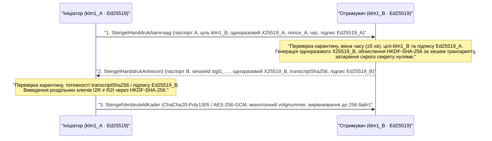

> 🌐 **Мова / Taal:** **Українська** · [Nederlands](KLIMOP-FASE-2-BEPROEVINGSNETWERK-EN-STENGELS.nl.md) | [Головна](../../README.md) · [Покажчик документації](../ПОКАЖЧИК-ДОКУМЕНТАЦІЇ.uk.md) · [Головний архітектурний маніфест «Плющ»](АРХІТЕКТУРНИЙ-МАНІФЕСТ-ПЛЮЩ.uk.md) · [Етап 1 — Ядро та план випусків](ПЛЮЩ-ЕТАП-1-АРХІТЕКТУРНЕ-ЯДРО-ТА-ПЛАН-ВИПУСКІВ.uk.md)

# Етап 2 екосистеми «Плющ» — Випробувальна мережа незалежних вузлів, протокол захищених зв'язків «Стебла» та обмеження метаданих (`KLIMOP-003`)

- **Дата виконання:** 20.11.2026
- **Задача координації:** `KLIMOP-003` (спирається на злиті у `integratie` результати Етапів 0–1 у запиті №184, фіксація злиття `d80e91e9be45a30ff7782ce33c14d6e147fe1650`)
- **Програмна реалізація:**
  - Протокол рукостискання, шифрування кадрів і маршрутизації: [`shared/klimop/stengels.ts`](../../shared/klimop/stengels.ts)
  - Ізольований мережевий вузол та маршрутизувальний клієнт: [`backend/klimop-knooppunt-agent.ts`](../../backend/klimop-knooppunt-agent.ts)
  - Відтворюваний сценарій полігона 3 вузлів (`NL`, `CH`, `UA`): [`scripts/klimop-proefnetwerk.mjs`](../../scripts/klimop-proefnetwerk.mjs)
  - Ізольований багатоконтейнерний стенд (`internal: true`): [`deploy/klimop-proefnetwerk/docker-compose.proef.yml`](../../deploy/klimop-proefnetwerk/docker-compose.proef.yml)
- **Нормативна підстава:** розділи `§1.2`, `§4–§10`, `§15`, `§19`, `§36 (Етап 2)`, `§42–§44 (док. №4, №15, №18, №22)` [Головного архітектурного маніфесту «Плющ»](АРХІТЕКТУРНИЙ-МАНІФЕСТ-ПЛЮЩ.uk.md)
- **Межа повноважень:** випробувальна мережа працює повністю окремо від робочого сервера та бази даних `PostgreSQL 18.6` і не змінює жодної живої служби.

---

## 1. Специфікація мережевого протоколу «Стебел» і маршрутизації (документ №4 із §44)

### 1.1. Взаємно автентифіковане рукостискання з прямою таємницею

Кожне з'єднання («Стебло») між двома вузлами проходить трикрокове криптографічне рукостискання у [`shared/klimop/stengels.ts`](../../shared/klimop/stengels.ts):



Основні гарантії протоколу:
1. **Пряма таємниця (*voorwaartse geheimhouding*):** на кожен сеанс створюються нові ефемерні ключі `X25519`, а сирий спільний секрет Діффі-Геллмана негайно затирається нулями у блоці `finally` (`gedeeldGeheim.fill(0)`).
2. **Роздільні односторонні ключі:** ключ передавання від ініціатора до отримувача (`klimop-stengel-i2r`) математично відокремлений від зворотного ключа (`klimop-stengel-r2i`), що унеможливлює віддзеркалення кадра назад відправникові.
3. **Захист від підміни цілі та повторного відтворення:** у підписаний транскрипт входять обидва паспорти вузлів, `doelKnooppuntId`, обидва випадкові числа `nonceB64u` та перевірені часові позначки; кожен кадр має строго зростальний `volgnummer`, і повторно отриманий номер негайно відхиляється з помилкою `HERHALING_OF_VOLGORDE_FOUT`.
4. **Підготовка до постквантової інкапсуляції:** повідомлення рукостискання вже містять узгоджені поля `postkwantumKemB64u` та `postkwantumKemAntwoordB64u` для під'єднання `X25519MLKEM768` (`FIPS 203`) без зміни структури протоколу.

### 1.2. Обхід пошкоджених ділянок і наскрізна естафетна маршрутизація

Якщо пряме стебло між пристроєм власника (або вузлом `А`) та вузлом зберігання `В` розірвано, таблиця [`KlimopRouteTabel`](../../shared/klimop/stengels.ts) автоматично обирає живий шлях через довірений вузол із роллю `verbinding` (`А → Б → В` через `/klimop/v1/estafette`):
- Вузол `А` виконує рукостискання і шифрування кадрів **безпосередньо на публічний ключ кінцевого вузла `В`**.
- Проміжний естафетний вузол `Б` перевіряє лише відсутність `А` і `В` у списку карантину та пересилає зашифрований пакет далі.
- Проміжний вузол `Б` **не володіє сеансовими ключами `А ↔ В`**, не зберігає у себе копій чужих блоків і не може розшифрувати вміст або підробити кадр.

---

## 2. Правила збереження приватності й обмеження метаданих (документ №22 із §44)

На виконання §6 та §19 Головного архітектурного маніфесту «Плющ» на мережевому рівні впроваджено чотири технічні правила мінімізації метаданих:
1. **Вирівнювання довжини кадрів (`vulKaderLadingAan`):** кожне корисне навантаження перед шифруванням вирівнюється до кратного розміру блока (типово `256 байт`), щоб за розміром мережевого пакета неможливо було відрізнити короткі запити керування від обміну метаданими.
2. **Псевдонімні криптографічні ідентифікатори вузлів (`klm1_…`):** у мережевих заголовках передаються лише односторонні відбитки `SHA-256` публічних ключів вузлів без жодної електронної адреси, імені чи номера телефону людини.
3. **Сліпе зберігання шифрованих блоків:** вузол із роллю `opslag` приймає виключно зашифровані на боці клієнта байти за їхнім відбитком `SHA-256` і перевіряє мандат повноважень `Ed25519`, не знаючи ні імені файла, ні призначення вмісту, ні ключа розшифрування `DEK`.
4. **Мінімальна точка стану здоров'я (`/klimop/v1/gezondheid`):** відкрита перевірка вузла повертає лише технічні ролі вузла й лічильники без списків партнерів або ідентифікаторів збережених блоків.

---

## 3. Посібник зі створення та запуску нового вузла у випробувальній мережі (документи №15 і №18 із §44)

### 3.1. Швидкий локальний запуск і перевірка відмов однією командою

На будь-якій робочій станції з `Node.js 24+` (без бази даних і без прав адміністратора `root`):

```bash
node scripts/klimop-proefnetwerk.mjs
# або для машиночитаного звіту:
node scripts/klimop-proefnetwerk.mjs --json
```

Сценарій автоматично створює 3 незалежні вузли (`NL`, `CH`, `UA`) та особистий пристрій власника даних, перевіряє їхню між'юрисдикційну незалежність, встановлює взаємно автентифіковані стебла, записує зашифрований клієнтом блок за підписаним мандатом, **обриває пряме стебло до вузла `UA` і перевіряє автоматичну доставку через естафетний вузол `CH`**, переводить вузол `NL` у карантин і підтверджує безперебійну роботу здорових вузлів, після чого чисто закриває всі сокети й затирає ключі в пам'яті.

### 3.2. Запуск у повністю ізольованому багатоконтейнерному стенді Docker

```bash
docker compose -f deploy/klimop-proefnetwerk/docker-compose.proef.yml up --abort-on-container-exit
docker compose -f deploy/klimop-proefnetwerk/docker-compose.proef.yml down -v
```

Усі контейнери працюють під непривілейованим користувачем `1000:1000`, із кореневою файловою системою лише для читання (`read_only: true`), скинутими привілеями ядра (`cap_drop: [ALL]`) та внутрішньою мережею `internal: true`.

---

## 4. Перевірка Етапу 2 за 15 питаннями архітектурної перевірки (§42)

Усі 15 гарантій підтверджено модульним та інтеграційним випробуванням [`tests/eenheid/klimop-003-etappe2-proefnetwerk-20261120.test.ts`](../../tests/eenheid/klimop-003-etappe2-proefnetwerk-20261120.test.ts):
- Жодної нової єдиної точки відмови не створено (обрив прямого стебла або карантин одного вузла не зупиняє обмін між здоровими вузлами).
- Проміжний естафетний вузол технічно позбавлений доступу до сеансових ключів і відкритих даних.
- Повторні кадри, підроблені транскрипти, нецільові рукостискання, відкликані мандати та ізольовані вузли гарантовано відхиляються.
- Робочий сервер і `PostgreSQL 18.6` залишаються повністю незмінними.
