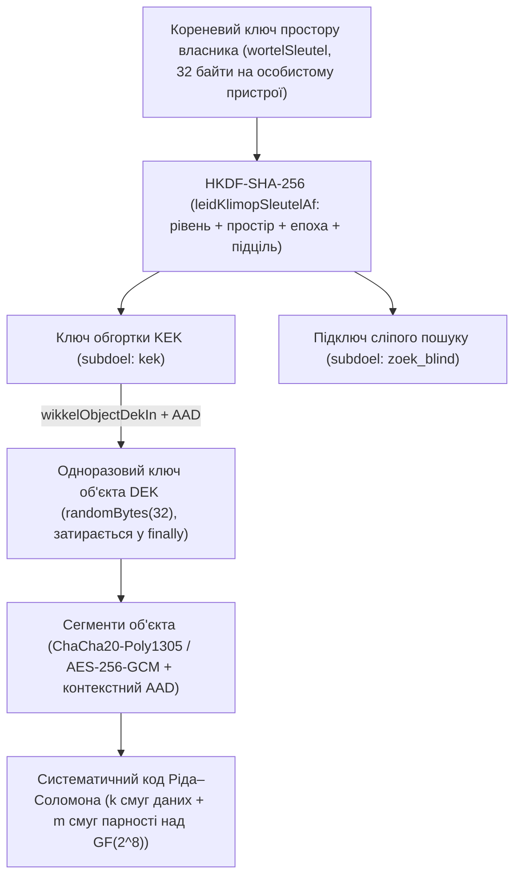

> 🌐 **Мова / Taal:** **Українська** · [Nederlands](KLIMOP-FASE-3-VERSLEUTELING-EN-VERDEELDE-OPSLAG.nl.md) | [Головна](../../README.md) · [Покажчик документації](../ПОКАЖЧИК-ДОКУМЕНТАЦІЇ.uk.md) · [Головний архітектурний маніфест «Плющ»](АРХІТЕКТУРНИЙ-МАНІФЕСТ-ПЛЮЩ.uk.md) · [Етап 1 — Ядро та план випусків](ПЛЮЩ-ЕТАП-1-АРХІТЕКТУРНЕ-ЯДРО-ТА-ПЛАН-ВИПУСКІВ.uk.md) · [Етап 2 — Випробувальна мережа та «Стебла»](ПЛЮЩ-ЕТАП-2-ВИПРОБУВАЛЬНА-МЕРЕЖА-ТА-СТЕБЛА.uk.md)

# Етап 3 екосистеми «Плющ» — Клієнтське конвертне шифрування, завадостійке розподілене зберігання Ріда–Соломона та криптографічна гнучкість (`KLIMOP-004`)

- **Дата виконання:** 20.11.2026
- **Задача координації:** `KLIMOP-004` (спирається на злитий у `integratie` запит №185 `KLIMOP-003`, фіксація злиття `e4ad9dc3b303b32df1147a4deca0aea06437dfdd`)
- **Програмна реалізація:**
  - Клієнтське шифрування, ієрархія ключів, коди Ріда–Соломона та сліпі пошукові відбитки: [`shared/klimop/opslag.ts`](../../shared/klimop/opslag.ts)
  - Мережевий розподільник фрагментів, добудова без ключа й законне видалення: [`backend/klimop-opslag-client.ts`](../../backend/klimop-opslag-client.ts)
  - Авторизована за мандатом дія видалення блока `wis_blok`: [`backend/klimop-knooppunt-agent.ts`](../../backend/klimop-knooppunt-agent.ts)
  - Відтворюваний сценарій полігона Етапу 3 (4 незалежні вузли `NL`, `CH`, `UA`, `SE`): [`scripts/klimop-etappe3-opslag-proef.mjs`](../../scripts/klimop-etappe3-opslag-proef.mjs)
- **Нормативна підстава:** розділи `§6`, `§11`, `§12`, `§13`, `§35`, `§36 (Етап 3)`, `§42–§44 (док. №5, №6, №21)` [Головного архітектурного маніфесту «Плющ»](АРХІТЕКТУРНИЙ-МАНІФЕСТ-ПЛЮЩ.uk.md)
- **Межа повноважень:** усі операції виконуються в ізольованих модулях та локальному полігоні без жодної зміни робочого сервера `*.tarasevych.com`, служб `systemd` чи живої бази даних `PostgreSQL 18.6`.

---

## 1. Схема рівнів шифрування та керування ключами (документ №5 із §44)

На виконання §6 Головного архітектурного маніфесту в [`shared/klimop/opslag.ts`](../../shared/klimop/opslag.ts) закріплено сувору ієрархію ключів із повним розділенням призначень:



Ключові властивості:
1. **Жодного спільного ключа для різних цілей:** `leidKlimopSleutelAf` зв'язує сіль та інформаційний блок `HKDF-SHA-256` з рівнем зберігання (`KLIMOP_OPSLAG_LAGEN`), ідентифікатором простору (`ruimteId`), номером криптографічної епохи (`epoche >= 1`) та підціллю (`kek`, `zoek_blind`, `manifest`).
2. **Конвертне шифрування кожного об'єкта:** кожен файл або архів шифрується власним випадковим 32-байтним ключем `DEK`, який після завершення операції примусово затирається нулями в оперативній пам'яті (`dek.fill(0)`). У підписаному маніфесті об'єкта зберігається лише автентифікована обгортка `dekOmslag`, прив'язана через `AAD` до власника, ідентифікатора об'єкта, рівня зберігання, епохи й криптографічного профілю.
3. **Перехідний міст для реєстру сховища ключів (`SLEUTELKLUIS_REGISTER`):** для плавного переведення таблиць зі статусом `nog-niet` (§35 маніфесту) функції `versleutelOvergangsVeld`, `ontsleutelOvergangsVeld` та `berekenBlindeZoekTermen` забезпечують паралельне читання наявних записів і нових обгорток `klm1.<epoche>.<profiel>…` разом зі сліпими пошуковими мітками `bzk1_<32 hex>` на `HMAC-SHA-256` без розкриття відкритих слів базі даних.

---

## 2. Специфікація розподіленого зберігання та відновлення фрагментів (документ №6 із §44)

### 2.1. Чітке розмежування схеми Шаміра та кодів Ріда–Соломона (§11, §43 п. 3)

Маніфест прямо забороняє плутати пороговий поділ коротких секретів із поділом великих файлів:
- **Короткі криптографічні ключі (`DEK` / `KEK` / корені відновлення)** розщеплюються схемою Шаміра $k$-з-$n$ над $\mathrm{GF}(2^8)$ у [`shared/verdeelde-opslag.ts`](../../shared/verdeelde-opslag.ts) (інформаційно-теоретична стійкість для малих таємниць до 4 КіБ).
- **Великі зашифровані об'єкти, документи та архіви** на Етапі 3 шифруються на пристрої власника в сегменти фіксованої межі й кодуються систематичним кодом відновлення втрачених фрагментів **Ріда–Соломона (`Reed-Solomon`, матриця Коші над $\mathrm{GF}(2^8)$ з оберненням Гауса–Жордана)** у [`shared/klimop/opslag.ts`](../../shared/klimop/opslag.ts):
  - зашифрований сегмент розрізається на $k$ смуг даних і доповнюється $m$ смугами парності (разом $k + m$ фрагментів);
  - накладні витрати простору становлять лише $\frac{k + m}{k}$ (наприклад, $1{,}5\times$ для схеми $2+1$ або $4+2$), а **будь-які $k$ непошкоджених фрагментів** математично точно відновлюють увесь сегмент після одночасної відмови до $m$ вузлів!

### 2.2. Гарантії мережевого розподільника `KlimopVerdeeldeOpslagClient`

Клас [`KlimopVerdeeldeOpslagClient`](../../backend/klimop-opslag-client.ts) працює поверх захищених зв'язків «Стебла» Етапу 2 та забезпечує:
1. **Перевірку незалежності перед записом:** якщо цільові вузли порушують юрисдикційне чи операторське рознесення (`controleerKnooppuntOnafhankelijkheid(doelKnooppunten, k)`), запис блокується з кодом `ONAFHANKELIJKHEID_NIET_VOLDAAN`.
2. **Перевірку цілісності на кожному кроці без витоку метаданих:** перевіряються `SHA-256` кожного зашифрованого фрагмента на вузлі та на клієнті, підпис маніфесту об'єкта, мітка автентичності кожного сегмента та зашифровані під ключем `DEK` власника у `versleuteldeEigenaarMeta` точна довжина й підсумковий відбиток відкритого об'єкта `klareInhoudSha256` (оператори добудови смуг їх не бачать).
3. **Добудову втрачених фрагментів без розшифрування (`herbouwVerlorenKnooppuntZonderSleutel`):** у разі втрати одного з вузлів його смуга математично відтворюється з $k$ живих зашифрованих фрагментів і записується на новий незалежний вузол **без доступу до `KEK` чи `DEK` власника** (жодного розшифрування вмісту під час ремонту надлишковості).
4. **Законне видалення та припинення зберігання (`wis_blok`):** після попередньої перевірки підпису маніфесту та мандата власника вузол затирає буфер блока нулями в пам'яті (`bestaand.fill(0)`), видаляє фрагмент зі свого сховища, а клієнт окремо обліковує стерті, уже відсутні та недосяжні блоки.

---

## 3. Криптографічна гнучкість і захист від пониження рівня шифрування (документ №21 із §44)

Згідно з §13 Головного маніфесту архітектура не прив'язана назавжди до одного зашитого алгоритму:
- Кожна обгортка ключа (`KlimopDekOmslag`), кожен маніфест об'єкта (`KlimopObjectManifest`) та кожне перехідне поле (`klm1.<epoche>.<profiel>…`) містять явні поля `schema`, `epoche` та `profiel` (`klimop-v1-chacha20-poly1305`, `klimop-v1-aes-256-gcm`, `klimop-v2-pq-voorbereid`).
- Функція `onderhandelKlimopProfiel` обирає найсильніший спільний профіль із підтримуваних сторонами та відхиляє спробу примусити вузол або клієнт перейти на слабший рівень захисту (`VERBODEN_AFZWAKKING_VAN_VERSLEUTELING`); при цьому профіль `klimop-v2-pq-voorbereid` отримує фактичний рівень `20` лише за підтвердженої наявності постквантових ключів `ML-DSA-65` (інакше його фактичний рівень дорівнює класичному `10`).
- Зміна епохи (`epoche + 1`) виводить нові ключі `KEK` і пошукові підключі, зберігаючи можливість читати архіви попередніх епох за номером епохи в маніфесті.

---

## 4. Відтворювана перевірка полігона Етапу 3 та 15 питань маніфесту (§42)

Команда локальної перевірки (4 незалежні вузли `NL`, `CH`, `UA`, `SE` на `127.0.0.1`):
```bash
node scripts/klimop-etappe3-opslag-proef.mjs
```
Підтверджує: розподіл багатосегментного об'єкта на 3 вузли (`NL`, `CH`, `UA`), безпомилкове відновлення після повної ізоляції `NL`, добудову втраченої смуги на новому вузлі `SE` **без ключа розшифрування**, повторне відновлення після додаткової відмови `CH` (із пари `SE + UA`) та повне законне видалення блоків. Усі 15 питань архітектурної перевірки §42 та 14 заборонених спрощень §43 автоматично перевіряються у [`tests/eenheid/klimop-004-etappe3-opslag-20261120.test.ts`](../../tests/eenheid/klimop-004-etappe3-opslag-20261120.test.ts).
