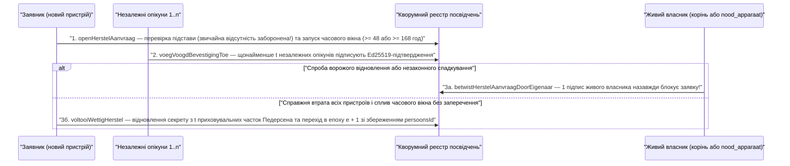

> 🌐 **Мова / Taal:** **Українська** · [Nederlands](KLIMOP-FASE-5-ONAFHANKELIJKE-IDENTITEIT-EN-GROEPSRUIMTES.nl.md) | [Головна](../../README.md) · [Покажчик документації](../ПОКАЖЧИК-ДОКУМЕНТАЦІЇ.uk.md) · [Головний архітектурний маніфест «Плющ»](АРХІТЕКТУРНИЙ-МАНІФЕСТ-ПЛЮЩ.uk.md) · [Етап 1 — Ядро та план випусків](ПЛЮЩ-ЕТАП-1-АРХІТЕКТУРНЕ-ЯДРО-ТА-ПЛАН-ВИПУСКІВ.uk.md) · [Етап 2 — «Стебла»](ПЛЮЩ-ЕТАП-2-ВИПРОБУВАЛЬНА-МЕРЕЖА-ТА-СТЕБЛА.uk.md) · [Етап 3 — Шифрування та зберігання](ПЛЮЩ-ЕТАП-3-ШИФРУВАННЯ-ТА-РОЗПОДІЛЕНЕ-ЗБЕРІГАННЯ.uk.md) · [Етап 4 — Розподілені ключі та ФРОСТ](ПЛЮЩ-ЕТАП-4-РОЗПОДІЛЕНІ-КЛЮЧІ-ТА-ПОРОГОВІ-ПІДПИСИ.uk.md)

# Етап 5 екосистеми «Плющ» — Самосуверенна ідентичність, довірені пристрої, законне відновлення доступу та групові епохові простори (`KLIMOP-006`)

- **Дата виконання:** 20.11.2026
- **Задача координації:** `KLIMOP-006` (спирається на злитий у `integratie` запит №187 `KLIMOP-005`, фіксація злиття `5bd4bfcd7451db1dbe80b1c7b6ebece071b1b001`)
- **Програмна реалізація:**
  - Самосуверенна ідентичність особи `klid1_…`, псевдоніми служб `psid1_…`, міст з чинним `userId`, сертифікати й відкликання пристроїв, багатостороннє відновлення за частками Педерсена та спрощене групове епохове шифрування за мотивами `RFC 9420` (не повна реалізація `MLS`): [`shared/klimop/identiteit.ts`](../../shared/klimop/identiteit.ts)
  - Кворумний клієнт безсекретного реєстру посвідчень і відкликань пристроїв: [`backend/klimop-identiteit-client.ts`](../../backend/klimop-identiteit-client.ts)
  - Ізольовані вузлові обробники реєстру посвідчень із захистом від відкочування епохи: [`backend/klimop-knooppunt-agent.ts`](../../backend/klimop-knooppunt-agent.ts)
  - Відтворюваний сценарій полігона Етапу 5 (`NL`, `CH`, `UA`): [`scripts/klimop-etappe5-identiteit-proef.mjs`](../../scripts/klimop-etappe5-identiteit-proef.mjs)
- **Нормативна підстава:** розділи `§1.1`, `§4.2`, `§12`, `§14`, `§17`, `§36 (Етап 5)`, `§39`, `§42–§44` (обов'язкові документи **№7** і **№9**) [Головного архітектурного маніфесту «Плющ»](АРХІТЕКТУРНИЙ-МАНІФЕСТ-ПЛЮЩ.uk.md)
- **Межа повноважень:** рівень ідентичності розгорнуто у випробувальному контурі з підписаним двостороннім мостом сумісності до чинного `userId`; бойовий сервер `*.tarasevych.com`, служби `systemd` і робоча база `PostgreSQL 18.6` не змінюються.

---

## 1. Правила самосуверенної ідентичності та довірених пристроїв (Документ №7 за §44 маніфесту)

Замість прив'язки існування людини до первинного номера рядка в одній центральній базі даних (`SPOF-1`), ідентичність у «Плющі» належить самій особі через криптографічне засновницьке свідоцтво (`KlimopIdentiteitOprichting` у [`shared/klimop/identiteit.ts`](../../shared/klimop/identiteit.ts)):

| Складник ідентичності | Формат та перевірка | Забезпечувані гарантії (§4.2, §12, §35) |
|---|---|---|
| **Кореневе посвідчення особи (`maakPersoonsIdentiteit`)** | `persoonsId = klid1_<32 hex>` як відбиток `SHA-256` від канонічного засновницького ядра, самопідписаного початковим ключем `Ed25519`. | Ідентифікатор особи ніколи не змінюється навіть під час планових ротацій кореневого ключа (`roteerPersoonsWortelSleutel`) або законного відновлення доступу; кожен перехід епохи скріплюється нерозривним ланцюжком підписів (`verifieerPersoonsStaat`). |
| **Псевдонімні службові ідентичності (`leidPseudoniemeDienstIdentiteitAf`)** | `psid1_<32 hex>` через `HMAC-SHA-256` від особистої 32-байтної солі та назви служби (`postvak`, `wolkopslag`, `slimwoon`). | Відокремлює особисту ідентичність від мережевої активності в окремих службах (§12): сторонні вузли не можуть пов'язати дії однієї людини між поштою, сховищем чи оселею. |
| **Двосторонній міст сумісності (`maakErfenisGebruikerKoppeling`)** | Заява `ErfenisGebruikerKoppeling`, підписана кореневим ключем особи `Ed25519`. | Безперервна зворотна сумісність із чинним `userId` без вимкнення чи переписування робочих таблиць `PostgreSQL 18.6` (§35). |
| **Сертифікат особистого пристрою (`registreerVertrouwdApparaat`)** | `apparaatId = kdev1_<32 hex>` з окремими ключами підпису `Ed25519` та обміну `X25519`, переліком дозволених прав (`ApparaatBevoegdheid`) і лімітами ресурсів (`toestaanAchtergrondTaken: false`). | Кореневий ключ **не передається** повсякденним пристроям; телефон із правами читання фізично не може схвалювати випуски чи виснажувати акумулятор прихованими фоновими завданнями (§4.2, §42 п. 13). |
| **Кворумне відкликання пристрою (`trekApparaatIn`)** | Підписана заява `KlimopApparaatIntrekking` (від кореня або аварійного пристрою з правом `nood_betwisting`), реплікована на незалежні вузли реєстру (`KlimopIdentiteitNetwerkClient`). | При викраденні телефона власник одним підписом з ноутбука блокує його в усій мережі; вузли реєстру приймають відкликання лише на додавання і відхиляють спроби відкотити епоху назад (`IDENTITEIT_EPOCHE_TERUGDRAAI_GEWEIGERD`). |

---

## 2. Порядок законного багатостороннього відновлення доступу (Документ №9 за §44 маніфесту)

На виконання §14, §17 та §39 маніфесту в [`shared/klimop/identiteit.ts`](../../shared/klimop/identiteit.ts) впроваджено захищену від зловживань процедуру відновлення доступу без жодного «магічного адміністратора»:



1. **Заборона передавання прав через звичайну відсутність (§17):** обставини `gewone_afwezigheid` та `tijdelijk_verbindingsverlies` негайно відхиляються з кодом `AFWEZIGHEID_ALLEEN_GEEN_GROND_VOOR_OVERDRACHT`.
2. **Обов'язкове часове вікно оскарження:** щонайменше **48 годин** при втраті всіх особистих пристроїв (`verlies_alle_apparaten`) та щонайменше **168 годин (7 діб)** при підтвердженій тривалій недоступності чи законному спадкуванні; до спливу цього терміну `voltooiWettigHerstel` повертає `BETWISTINGSTERMIJN_NOG_NIET_VERSTREKEN` навіть за наявності всіх підписів опікунів.
3. **Пріоритет живого власника (§39):** якщо заявку відкрито зловмисником або недобросовісним претендентом на спадкування, один дійсний підпис кореня чи пристрою власника з правом `nood_betwisting` переводить заявку у незворотний стан `geblokkeerd_door_eigenaar` (`HERSTEL_BLOKKADE_KAN_NIET_WORDEN_GEWIST` на вузлах реєстру).
4. **Інформаційно-теоретичне приховування секрету:** секрет відновлення збирається виключно з $\ge t$ перевірюваних часток Педерсена (`herstelUitPedersenDelen` з Етапу 4), тому окремі вузли-опікуни не дізнаються жодного біта про кореневі ключі власника.

---

## 3. Спрощене групове епохове шифрування спільних просторів (за мотивами ідей `RFC 9420`, не повна реалізація `MLS`) (§12, §36)

Для спільних сімейних просторів і керування розумною оселею замість одного статичного ключа без ротації реалізовано спрощений груповий епоховий протокол (за мотивами епох `RFC 9420`, але без повного дерева `TreeKEM` і без міжпрограмної сумісності зі стандартом `MLS RFC 9420`):
- **Виключення нового учасника з минулих епох (`voegLidToeAanMlsGroep` + `pasMlsWelkomToe`):** кожен перехід епохи $e \to e+1$ прокручує ланцюжок `HKDF-SHA-256` (`initGeheim` + свіжий `commitGeheim` + `groepsContextSha256`) та затирає секрети попередньої епохи у пам'яті (`fill(0)`). Пакет привітання скріплюється підписом чинного ініціатора групи й передає лише секрети нової епохи, тому новий пристрій не здатен розшифрувати повідомлення попередніх епох.
- **Виключення видаленого пристрою та заміна листка (`verwijderLidUitMlsGroep` + `verversEigenMlsBladSleutel` + `pasMlsCommitToe`):** при викраденні чи відкликанні телефона ініціатор оновлює власний листовий ключ `X25519` і пакує новий `commitGeheim` лише для чинних учасників групи; кожне повідомлення шифрується індивідуальним ключем відправника й номера з обліком проти повтору (`MLS_BERICHT_HERHALING_GEWEIGERD`). Відновлення таємності для учасника, чий власний листок не оновлювався, потребує явного виклику `verversEigenMlsBladSleutel`.

---

## 4. Відтворювана перевірка полігона Етапу 5 та 15 питань маніфесту (§42)

Команда локальної перевірки на 3 незалежних вузлах (`NL`, `CH`, `UA` на `127.0.0.1`):
```bash
node scripts/klimop-etappe5-identiteit-proef.mjs
```
Підтверджує самосуверенну ідентичність `klid1_…`, розділені псевдоніми служб, кворумне відкликання викраденого телефона при карантинному вузлі `CH`, пряму й посткомпрометаційну безпеку спрощеного групового епохового протоколу за мотивами `RFC 9420`, блокування незаконного спадкування власником та законне відновлення Педерсена `2-з-3` після 48-годинного часового замка. Усі сценарії §39 маніфесту та 15 питань §42 автоматично перевіряються в [`tests/eenheid/klimop-006-etappe5-identiteit-mls-20261120.test.ts`](../../tests/eenheid/klimop-006-etappe5-identiteit-mls-20261120.test.ts).
