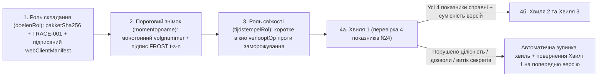

> 🌐 **Мова / Taal:** **Українська** · [Nederlands](KLIMOP-FASE-6-DREMPELBESTUUR-EN-VEILIGE-UITGAVEN.nl.md) | [Головна](../../README.md) · [Покажчик документації](../ПОКАЖЧИК-ДОКУМЕНТАЦІЇ.uk.md) · [Головний архітектурний маніфест «Плющ»](АРХІТЕКТУРНИЙ-МАНІФЕСТ-ПЛЮЩ.uk.md) · [Етап 1 — Ядро та план випусків](ПЛЮЩ-ЕТАП-1-АРХІТЕКТУРНЕ-ЯДРО-ТА-ПЛАН-ВИПУСКІВ.uk.md) · [Етап 2 — «Стебла»](ПЛЮЩ-ЕТАП-2-ВИПРОБУВАЛЬНА-МЕРЕЖА-ТА-СТЕБЛА.uk.md) · [Етап 3 — Шифрування та зберігання](ПЛЮЩ-ЕТАП-3-ШИФРУВАННЯ-ТА-РОЗПОДІЛЕНЕ-ЗБЕРІГАННЯ.uk.md) · [Етап 4 — ФРОСТ](ПЛЮЩ-ЕТАП-4-РОЗПОДІЛЕНІ-КЛЮЧІ-ТА-ПОРОГОВІ-ПІДПИСИ.uk.md) · [Етап 5 — Ідентичність та `MLS`](ПЛЮЩ-ЕТАП-5-НЕЗАЛЕЖНА-ІДЕНТИЧНІСТЬ-ТА-ГРУПОВІ-ПРОСТОРИ.uk.md)

# Етап 6 екосистеми «Плющ» — Розподілене порогове керування, 7 категорій повноважень, захисні часові замки та безпечні хвильові випуски (`KLIMOP-007`)

- **Дата виконання:** 20.11.2026
- **Задача координації:** `KLIMOP-007` (спирається на злитий у `integratie` запит №188 `KLIMOP-006`, фіксація злиття `72bc067577443de9385bcd24e23f27046767f076`)
- **Програмна реалізація:**
  - Матриця 7 категорій повноважень, конституція кворуму `FROST`, часові замки, геш-пов'язаний журнал рішень, чотирирівнева перевірка метаданих випуску та підпису вебклієнта: [`shared/klimop/bestuur.ts`](../../shared/klimop/bestuur.ts)
  - Мережевий координатор порогового керування й хвильового поширення оновлень (`KlimopBestuurEnUitrolClient`, `voerGefaseerdeUitrolUit`): [`backend/klimop-bestuur-client.ts`](../../backend/klimop-bestuur-client.ts)
  - Ізольовані вузлові перевіряльники конституції та автоматичного відкочування несправних випусків: [`backend/klimop-knooppunt-agent.ts`](../../backend/klimop-knooppunt-agent.ts)
  - Відтворюваний сценарій полігона Етапу 6 (`NL`, `CH`, `UA`, `SE`): [`scripts/klimop-etappe6-bestuur-proef.mjs`](../../scripts/klimop-etappe6-bestuur-proef.mjs)
- **Нормативна підстава:** розділи `§2`, `§18–§20`, `§23–§25`, `§32`, `§34`, `§36 (Етап 6)`, `§40`, `§42–§44` (обов'язкові документи **№8** і **№14**) [Головного архітектурного маніфесту «Плющ»](АРХІТЕКТУРНИЙ-МАНІФЕСТ-ПЛЮЩ.uk.md)
- **Межа повноважень:** контур порогового керування та хвильового оновлення працює у випробувальній мережі без зміни чинного встановлювача `/usr/local/sbin/mijn-ruimte-installeer`, служб `systemd` чи бази `PostgreSQL 18.6`; перехідне вето власника збережено.

---

## 1. Модель 7 незалежних категорій повноважень, часові замки та заборона одноосібної влади (Документ №8 за §44 маніфесту)

На виконання §2, §18–§20, §32 та §34 маніфесту в [`shared/klimop/bestuur.ts`](../../shared/klimop/bestuur.ts) (`STANDAARD_CATEGORIE_BELEID`, `maakBestuursGrondwet`, `bekrachtigBestuursBesluitMetFrost`) формалізовано 7 взаємно відокремлених категорій повноважень:

| № (§19) | Категорія повноважень | Хто підтверджує та межі дії | Обов'язковий часовий замок (§20) |
|---|---|---|---|
| **1** | `eigen_gegevens_rechten` (Права над власними даними) | Лише самосуверенний ключ власника даних (`persoonsId` / сертифікат пристрою); жоден оператор вузла чи рада мережі не мають доступу до особистих таємниць. | **0 год** (пошта, файли й календар працюють без затримок!) |
| **2** | `persoonlijk_apparaat_beheer` (Керування особистими пристроями) | Корінь особи або пристрій із правом `nood_betwisting` для миттєвого відкликання викраденого пристрою. | **0 год** |
| **3** | `operationeel_knooppunt_beheer` (Операційне керування вузлом) | Оператор конкретного фізичного вузла (включно з правом добровільно зупинити власне обладнання, §18); не дає влади над іншими вузлами. | **0 год** |
| **4** | `software_onderhoud` (Супровід програмного забезпечення) | Пропозиція зміни людиною або ШІ-агентом; **суворо заборонено самостійне затвердження чи встановлення критичної зміни (`EENPERSOONS_OF_AGENT_ZELFGOEDKEURING_GEWEIGERD`, §32, §34)!** | **0 год** (на подання пропозиції; затвердження йде за п. 5–7) |
| **5** | `cryptografische_goedkeuring_kritiek` (Підтвердження критичних змін) | Пороговий підпис `FROST(Ed25519, SHA-512)` $t$-з-$n$ ($t \ge 2$) від незалежних хранителів у різних країнах і в різних операторів. | **$\ge 24$ год** |
| **6** | `noodherstel_bestuur` (Надзвичайне відновлення системних ролей) | Пороговий підпис `FROST` $t$-з-$n$ незалежних хранителів. | **$\ge 48$ год** |
| **7** | `ecosysteem_regels_wijziging` (Зміна правил усієї екосистеми / ротація кореня) | Пороговий підпис `FROST` незалежних хранителів + незмінний запис у геш-пов'язаному журналі `KlimopBekrachtigdBestuursBesluit` + перевірка перехідного аварійного вето власника (`pasOvergangsNoodVetoToe`). | **$\ge 72$ год** (не підлягає обходу заниженням параметра у пропозиції!) |

- **Захист від випадкової більшості вузлів (§2, §19, §43 п. 7):** `maakBestuursGrondwet` відхиляє спробу включити перехідні (`tijdelijke_toetredingsknooppunten`) або вузькоспеціалізовані вузли до ради хранителів (`WILLEKEURIGE_MEERDERHEID_GEEN_GROND_VOOR_BESTUUR`), відсікаючи атаку масовим створенням фальшивих вузлів.

---

## 2. Правила безпечного встановлення оновлень, розділення ролей та підпису вебклієнта (Документ №14 за §44 маніфесту)

На виконання §23–§25 та §40 маніфесту кожен випуск у «Плющі» проходить чотирирівневу криптографічну перевірку ролей (за принципами архітектури TUF) і поступове хвильове поширення:



1. **Захист вебклієнта від непомітної підміни сервером (§25 абз. 4):** цільові метадані містять окремо підписаний [`KlimopWebClientManifest`](../../shared/klimop/bestuur.ts) (`verifieerWebClientBundelIntegriteit`); при найменшій зміні виконуваного коду оглядача вузол і клієнт відхиляють оновлення з кодом `WEBCLIENT_BUNDEL_INTEGRITEIT_FOUT`.
2. **Захист від захопленого засобу оновлень (§25, §40 п. 5):**
   - поділ ролей (`doelenRol !== tijdstempelRol` + пороговий `FROST` для `momentopname`) означає, що компрометація одного ключа складання чи дзеркала не дозволяє випустити оновлення;
   - монотонний `uitgaveVolgnummer > huidigGeinstalleerdVolgnummer` блокує відкочування на стару вразливу версію (`UITGAVE_TERUGDRAAI_AANVAL_GEWEIGERD`);
   - короткоживучий `tijdstempel` блокує повтор старих «заморожених» метаданих (`UITGAVE_TIJDSTEMPEL_BEVROREN_OF_VERLOPEN`).
3. **Хвильове поширення та 4 критерії здоров'я і безпеки (§24):** успішність хвилі визначається не самим фактом запуску процесу (`procesGestart`), а одночасним виконанням усіх 4 умов у `beoordeelUitrolGezondheid`: запуск програми, цілісність даних (`gegevensIntegriteitOk`), правильність дозволів (`machtigingenGeldigOk`) та відсутність витоку секретів (`geenGeheimLekGedetecteerd`). За найменшого порушення в першій хвилі вузол автоматично повертає попередню версію (або вимагає заздалегідь визначену процедуру `onomkeerbareHerstelProcedureId` для незворотних міграцій), а подальші хвилі миттєво зупиняються.

---

## 3. Відтворювана перевірка полігона Етапу 6 та 15 питань маніфесту (§42)

Команда локальної перевірки на 4 незалежних вузлах (`NL`, `CH`, `UA`, `SE` на `127.0.0.1`):
```bash
node scripts/klimop-etappe6-bestuur-proef.mjs
```
Підтверджує відсікання випадкової більшості вузлів, 72-годинний часовий замок (при 0 год для щоденних дій), кворумне рішення `FROST` без участі карантинного `CH`, 3-хвильове розгортання `v2` із сумісністю сусідніх версій, відбиття атак захопленого каналу оновлень та автоматичне припинення й відкочування небезпечного випуску `v3` на першій хвилі. Усі перевірки автоматизовано в [`tests/eenheid/klimop-007-etappe6-drempelbestuur-uitrol-20261120.test.ts`](../../tests/eenheid/klimop-007-etappe6-drempelbestuur-uitrol-20261120.test.ts).
