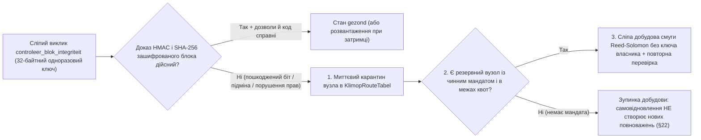

> 🌐 **Мова / Taal:** **Українська** · [Nederlands](KLIMOP-FASE-7-IMMUUNSYSTEEM-EN-ZELFHERSTEL.nl.md) | [Головна](../../README.md) · [Покажчик документації](../ПОКАЖЧИК-ДОКУМЕНТАЦІЇ.uk.md) · [Головний архітектурний маніфест «Плющ»](АРХІТЕКТУРНИЙ-МАНІФЕСТ-ПЛЮЩ.uk.md) · [Етап 1 — Ядро та план випусків](ПЛЮЩ-ЕТАП-1-АРХІТЕКТУРНЕ-ЯДРО-ТА-ПЛАН-ВИПУСКІВ.uk.md) · [Етап 2 — «Стебла»](ПЛЮЩ-ЕТАП-2-ВИПРОБУВАЛЬНА-МЕРЕЖА-ТА-СТЕБЛА.uk.md) · [Етап 3 — Шифрування та зберігання](ПЛЮЩ-ЕТАП-3-ШИФРУВАННЯ-ТА-РОЗПОДІЛЕНЕ-ЗБЕРІГАННЯ.uk.md) · [Етап 4 — ФРОСТ](ПЛЮЩ-ЕТАП-4-РОЗПОДІЛЕНІ-КЛЮЧІ-ТА-ПОРОГОВІ-ПІДПИСИ.uk.md) · [Етап 5 — Ідентичність та `MLS`](ПЛЮЩ-ЕТАП-5-НЕЗАЛЕЖНА-ІДЕНТИЧНІСТЬ-ТА-ГРУПОВІ-ПРОСТОРИ.uk.md) · [Етап 6 — Керування та випуски](ПЛЮЩ-ЕТАП-6-РОЗПОДІЛЕНЕ-КЕРУВАННЯ-ТА-БЕЗПЕЧНІ-ВИПУСКИ.uk.md)

# Етап 7 екосистеми «Плющ» — Імунна система, самовідновлення у межах квот та перевірка живучості за 10 аварійними сценаріями (`KLIMOP-008`)

- **Дата виконання:** 20.11.2026
- **Задача координації:** `KLIMOP-008` (спирається на злитий у `integratie` запит №189 `KLIMOP-007`, фіксація злиття `3fd6a7519705fcffa7885f140f87797516d972f6`)
- **Програмна реалізація:**
  - Ядро сліпої перевірки цілісності без розкриття вмісту, класифікація реакцій, політика квот і добровільної участі пристроїв та оцінювач 10 сценаріїв живучості (`beoordeelKnooppuntGezondheid`, `beoordeelOverlevingsProefProgramma`): [`shared/klimop/immuunsysteem.ts`](../../shared/klimop/immuunsysteem.ts)
  - Мережевий координатор сліпої інспекції й автоматичного самовідновлення (`KlimopImmuunsysteemClient`, `voerAutomatischZelfherstelUit`): [`backend/klimop-immuunsysteem-client.ts`](../../backend/klimop-immuunsysteem-client.ts)
  - Вузлова дія сліпого доказу цілісності блока `controleer_blok_integriteit`: [`backend/klimop-knooppunt-agent.ts`](../../backend/klimop-knooppunt-agent.ts)
  - Живий полігон 5 незалежних вузлів (`NL`, `CH`, `UA`, `SE`, `IS`) з виконанням усіх 10 аварійних сценаріїв: [`scripts/klimop-etappe7-immuunsysteem-proef.mjs`](../../scripts/klimop-etappe7-immuunsysteem-proef.mjs)
- **Нормативна підстава:** розділи `§1.5–§1.6`, `§21–§22`, `§26–§27`, `§36 (Етап 7)`, `§37`, `§41–§44` (обов'язкові документи **№10**, **№11** та **№18**) [Головного архітектурного маніфесту «Плющ»](АРХІТЕКТУРНИЙ-МАНІФЕСТ-ПЛЮЩ.uk.md)
- **Межа повноважень:** імунна система та самовідновлення працюють у випробувальному контурі без втручання в робочі служби `systemd`, чинну базу `PostgreSQL 18.6` чи тунель `*.tarasevych.com`.

---

## 1. Протокол дій під час втрати вузлів і повага до ресурсів пристроїв (Документ №10 за §44 маніфесту)

На виконання §1.5, §21–§22 та §26–§27 маніфесту система розмежовує фізичну недоступність, тимчасове перевантаження та компрометацію:

1. **Спостереження стану без розкриття особистих даних (§21):** `inspecteerObjectZonderInzage` та `maakBlindeIntegriteitUitdaging` опитують вузли зберігання 32-байтними випадковими одноразовими викликами `uitdagingNonceHex`. Вузол доводить фактичне володінням непошкодженим зашифрованим блоком через `HMAC-SHA-256` без передавання відкритого тексту, імен файлів чи ключів (`geenPersoonlijkeInhoudInTelemetrie: true`).
2. **Послідовність дій при відключенні вузла (`omleid_en_plan_herbouw`):**
   - клієнт миттєво переходить на живі смуги `Reed-Solomon` (або естафетний маршрут «Стебел») без переривання роботи користувача;
   - якщо кількість незалежних смуг падає нижче цільового $k + m$, планується сліпа добудова втраченої смуги на здоровому незалежному резервному вузлі в іншій юрисдикції (`herbouwVerlorenKnooppuntZonderSleutel` — без ключа розшифрування власника!);
   - добудова обмежується квотою швидкості `controleerZelfherstelQuota` (`maxHerbouwBytesPerVenster`, `maxGelijktijdigeHerbouwTaken`), щоб одночасна втрата вузла не спричинила мережевого перевантаження.
3. **Захист користувацьких пристроїв і збереження доступу (§26–§27):** функція `magApparaatBijdragenAanHerstel` автоматично виключає особистий телефон чи ноутбук із фонової добудови чужих або резервних смуг, якщо вимкнено добровільну згоду, пристрій не на зарядці, заряд нижчий за межу (`minBatterijPercentage`), мережа тарифікована або перевищено ліміт пам'яті/процесора — проте **доступ людини до її власних даних завжди залишається незмінним (`toegangTotEigenGegevensBlijftBehouden: true`, §27 абз. 3)**.

---

## 2. Протокол дій під час компрометації або тихого пошкодження даних (Документ №11 за §44 маніфесту)

- **Миттєва ізоляція (`onmiddellijke_quarantaine_en_herbouw`):** при виявленні підробленого рукостискання стебла, спотвореного біта у фрагменті (`VERSLEUTELD_FRAGMENT_BESCHADIGD_OF_VERVALST`), несанкціонованої спроби змінити дозволи чи порушення цілісності випуску вузол негайно вноситься до списку карантину `plaatsInQuarantaine`, усі активні сеанси з ним розриваються й обнуляються в пам'яті.
- **Сувора заборона самовільного розширення прав (§22 абз. 3):** `controleerZelfherstelQuota` та `voerAutomatischZelfherstelUit` відхиляють будь-якого резервного кандидата без заздалегідь підписаного власником дійсного мандата `Ed25519` (`ZELFHERSTEL_MAG_GEEN_NIEUWE_BEVOEGDHEDEN_AANMAKEN`).

---

## 3. Програма випробувань і результати 10 обов'язкових аварійних сценаріїв живучості (Документ №18 за §37, §41, §44)

На полігоні [`scripts/klimop-etappe7-immuunsysteem-proef.mjs`](../../scripts/klimop-etappe7-immuunsysteem-proef.mjs) (5 незалежних вузлів `NL`, `CH`, `UA`, `SE`, `IS` на `127.0.0.1`) практично відтворені й перевірені функцією `beoordeelOverlevingsProefProgramma` усі 10 сценаріїв §37 маніфесту:

| № (§37) | Ідентифікатор сценарію | Перевірений аварійний вплив на полігоні | Доступність | Втрата даних | Дозволи |
|---|---|---|---|---|---|
| **1** | `uitschakeling_hoofdserver` | Повне відключення початкового головного вузла `NL` | Збережено (`CH + UA`) | **0 байт** | Незмінні |
| **2** | `verlies_een_onafhankelijk_knooppunt` | Втрата незалежного вузла `CH` | Збережено (`NL + UA`) | **0 байт** | Незмінні |
| **3** | `gelijktijdig_verlies_meerdere_knooppunten` | Одночасна відмова $m = 2$ вузлів (`NL` + `CH`) | Збережено (`UA + SE`) | **0 байт** | Незмінні |
| **4** | `netwerk_splitsing` | Розрив прямих ліній до `NL`, `UA`, `SE`; обхід через наскрізну естафету `CH -> UA` | Збережено | **0 байт** | Незмінні |
| **5** | `uitval_verbindingsaanbieder` | Втрата всього маршрутного вузла постачальника `CH` | Збережено (`NL, UA, SE`) | **0 байт** | Незмінні |
| **6** | `onbereikbaarheid_opstartknooppunten` | Старт нового клієнта при недоступних початкових точках `NL` і `CH` (прямий вхід через `UA + SE`) | Збережено | **0 байт** | Незмінні |
| **7** | `beschadiging_versleutelde_fragmenten` | Тихе пошкодження бітів фрагмента на диску вузла `SE` → сліпе виявлення й карантин `SE` | Збережено | **0 байт** | Незмінні |
| **8** | `tekort_aan_onafhankelijke_kopieen` | Пропуск розрядженого телефона `DE` (18%) і сліпа добудова 4-ї смуги на вузлі `IS` без ключа власника | Збережено (`4/4` смуги) | **0 байт** | Незмінні |
| **9** | `verdwijning_eigenaar_uit_bestuur` | Ухвалення кворумного рішення `FROST` 2-з-3 радою хранителів (`NL, CH, UA`) після 48-год замка без власника | Збережено | **0 байт** | Незмінні |
| **10** | `verlies_gebruikersapparaten` | Законне багатостороннє відновлення доступу за частками Педерсена 2-з-3 після 48-год вікна зі сталим `persoonsId` | Збережено | **0 байт** | Незмінні |

Усі модульні та мережеві перевірки автоматизовано в [`tests/eenheid/klimop-008-etappe7-immuunsysteem-zelfherstel-20261120.test.ts`](../../tests/eenheid/klimop-008-etappe7-immuunsysteem-zelfherstel-20261120.test.ts).
