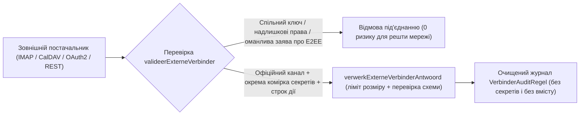

> 🌐 **Мова / Taal:** **Українська** · [Nederlands](KLIMOP-FASE-8-DIENSTENOVERDRACHT-EN-GEISOLEERDE-VERBINDERS.nl.md) | [Головна](../../README.md) · [Покажчик документації](../ПОКАЖЧИК-ДОКУМЕНТАЦІЇ.uk.md) · [Головний архітектурний маніфест «Плющ»](АРХІТЕКТУРНИЙ-МАНІФЕСТ-ПЛЮЩ.uk.md) · [Етап 1 — Ядро та план випусків](ПЛЮЩ-ЕТАП-1-АРХІТЕКТУРНЕ-ЯДРО-ТА-ПЛАН-ВИПУСКІВ.uk.md) · [Етап 2 — «Стебла»](ПЛЮЩ-ЕТАП-2-ВИПРОБУВАЛЬНА-МЕРЕЖА-ТА-СТЕБЛА.uk.md) · [Етап 3 — Шифрування та зберігання](ПЛЮЩ-ЕТАП-3-ШИФРУВАННЯ-ТА-РОЗПОДІЛЕНЕ-ЗБЕРІГАННЯ.uk.md) · [Етап 4 — ФРОСТ](ПЛЮЩ-ЕТАП-4-РОЗПОДІЛЕНІ-КЛЮЧІ-ТА-ПОРОГОВІ-ПІДПИСИ.uk.md) · [Етап 5 — Ідентичність та `MLS`](ПЛЮЩ-ЕТАП-5-НЕЗАЛЕЖНА-ІДЕНТИЧНІСТЬ-ТА-ГРУПОВІ-ПРОСТОРИ.uk.md) · [Етап 6 — Керування та випуски](ПЛЮЩ-ЕТАП-6-РОЗПОДІЛЕНЕ-КЕРУВАННЯ-ТА-БЕЗПЕЧНІ-ВИПУСКИ.uk.md) · [Етап 7 — Імунна система](ПЛЮЩ-ЕТАП-7-ІМУННА-СИСТЕМА-ТА-САМОВІДНОВЛЕННЯ.uk.md)

# Етап 8 екосистеми «Плющ» — Поетапне перенесення 11 служб, зашифровані `CRDT`, ізольовані зовнішні з'єднувачі та локальний пошук (`KLIMOP-009`)

- **Дата виконання:** 20.11.2026
- **Задача координації:** `KLIMOP-009` (спирається на злитий у `integratie` запит №190 `KLIMOP-008`, фіксація злиття `27c67c79949d6a9f772f2b9fe8942731e6a85f23`)
- **Програмна реалізація:**
  - Ізоляція 11 служб за псевдонімами `psid1_…` і ключами `HKDF-SHA-256`, зашифровані `CRDT` (`voegCrdtStatenSamen`), правила зовнішніх з'єднувачів (`valideerExterneVerbinder`), локальний спільний пошук (`zoekLokaalOverBronnen`) та двостороння звірка сходинок перенесення (`beslisOverDienstOverdrachtStap`): [`shared/klimop/diensten.ts`](../../shared/klimop/diensten.ts)
  - Кворумний мережевий координатор реплікації службових `CRDT` (`KlimopDienstenOverdrachtClient`, `synchroniseerDienstStaatOpNetwerk`): [`backend/klimop-diensten-client.ts`](../../backend/klimop-diensten-client.ts)
  - Вузлові дії сліпої синхронізації під мандатом ролі `synchronisatie` (`synchroniseer_dienst_crdt`, `raadpleeg_dienst_crdt`): [`backend/klimop-knooppunt-agent.ts`](../../backend/klimop-knooppunt-agent.ts)
  - Живий полігон 3 незалежних вузлів (`NL`, `CH`, `UA`): [`scripts/klimop-etappe8-diensten-proef.mjs`](../../scripts/klimop-etappe8-diensten-proef.mjs)
- **Нормативна підстава:** розділи `§3`, `§10–§11`, `§28–§31`, `§35–§36 (Етап 8)`, `§42–§44` (обов'язкові документи **№13** та **№17**) [Головного архітектурного маніфесту «Плющ»](АРХІТЕКТУРНИЙ-МАНІФЕСТ-ПЛЮЩ.uk.md)
- **Межа повноважень:** наявна база `PostgreSQL 18.6`, служба `mijn-ruimte.service` та 11 робочих піддоменів `*.tarasevych.com` залишаються незмінними й не вимикаються (§35).

---

## 1. Ізоляція всіх 11 служб, зашифровані `CRDT` та захищений локальний пошук (§28, §30–§31)

1. **Єдиний інтерфейс без спільного необмеженого доступу (§28, §30):** для кожної з 11 служб (`KLIMOP_ELF_DIENSTEN`: `werkblad`, `postvak`, `identiteit`, `wolkopslag`, `agenda`, `ai_ruimte`, `mcp_poort`, `ontwikkelmiddelen`, `slimwoon`, `verbinders`, `beheer_en_diagnose`) функція `leidGeisoleerdeDienstContextAf` виводить некорельований мережевий псевдонім `psid1_<32 hex>` і власний 32-байтний ключ `HKDF-SHA-256`. Доступ однієї служби до іншої (напр. `slimwoon` → `postvak`) криптографічно відхиляється (`DIENST_ISOLATIE_GRENS_GEWEIGERD`), якщо немає обмеженого в часі й підписаного власником дозволу `KlimopKruisDienstToestemming`.
2. **Автономна робота пристроїв та сліпе злиття `CRDT` (§10–§11):** кожна зміна робочого запису шифрується на пристрої через `ChaCha20-Poly1305` зі штампом гібридного логічного годинника `HLC` та підписується `Ed25519` (`maakOndertekendeCrdtOperatie`). Вузли синхронізації перевіряють підписи й виконують комутативне злиття `voegCrdtStatenSamen` наосліп — без ключів розшифрування та без втрати паралельних правок після відновлення мережі.
3. **Захищений локальний спільний пошук по 4 класах джерел (§31):** `zoekLokaalOverBronnen` розділяє `openbare_gegevens`, `dienst_metadata`, `prive_versleuteld_materiaal` та `externe_aanbieder_gegevens` у пам'яті довіреного пристрою за правами поточного сеансу, а `controleerGeenKlareIndexOpNetwerk` блокує будь-яку спробу передати розшифрований індекс чи листи в мережу (`KLARE_ZOEKINDEX_OP_NETWERK_VERBODEN`).

---

## 2. Правила ізольованих зовнішніх з'єднувачів звичайного інтернету (Документ №13 за реєстром Етапу 1 та §29–§30)

- Кожен зовнішній з'єднувач у `valideerExterneVerbinder` зобов'язаний мати офіційний спосіб під'єднання, власну ізольовану комірку облікових даних (`eigenGeisoleerdeGeheimKluisId`), мінімальні дозволи без `*`, обмежений строк дії `verlooptOp` і вимкнене передавання прав іншим службам (`magRechtenDoorgevenZonderToestemming: false`).
- **Заборона оманливих заяв (§29 абз. 3):** якщо зовнішній постачальник за своєю будовою централізований або не має доведеного наскрізного шифрування, спроба подати його користувачеві як «повністю приватний і децентралізований» блокується з кодом `VERBINDER_MISLEIDENDE_PRIVACY_CLAIM_GEWEIGERD`.

---

## 3. Сходинки перенесення чинних служб із двосторонньою звіркою цілісності (Документ №17 за §35–§36)

| Сходинка перенесення (`KLIMOP_OVERDRACHT_MODI`) | Режим читання й запису | Умова переходу та автоматичного повернення (`beslisOverDienstOverdrachtStap`) |
|---|---|---|
| **0. `alleen_erfenis_postgres`** | Чинна база `PostgreSQL 18.6` (поточний робочий стан усіх 11 служб). | Початкова базова лінія без жодних змін на живому сервері. |
| **1. `schaduw_dubbel_schrijven`** | Основний запис у `PostgreSQL 18.6` + тіньова зашифрована реплікація у вузли «Плюща». | Перехід дозволений лише за 100% збігу `vergelijkErfenisEnKlimopStaat` (кількість, контрольні суми вмісту й дозволів). |
| **2. `klimop_primair_met_erfenis_terugval`** | Первинне читання з вузлів «Плюща» при збереженні гарячої лінії повернення на `PostgreSQL 18.6`. | За найменшої втрати чи розбіжності служба миттєво відкочується на попередню сходинку (`AUTOMATISCH_TERUGGEZET_WEGENS_PARITEITSAFWIJKING`). |
| **3. `volledig_onafhankelijk_geverifieerd`** | Повна автономна робота на незалежних вузлах. | Дозволяється лише після бездоганної звірки **та** прямого окремого рішення власника (`VOLLEDIGE_LOSKOPPELING_VEREIST_GOEDKEURING_EIGENAAR`). |

Полігон [`scripts/klimop-etappe8-diensten-proef.mjs`](../../scripts/klimop-etappe8-diensten-proef.mjs) та набір випробувань [`tests/eenheid/klimop-009-etappe8-diensten-overdracht-20261120.test.ts`](../../tests/eenheid/klimop-009-etappe8-diensten-overdracht-20261120.test.ts) автоматично підтверджують усі ці гарантії.
