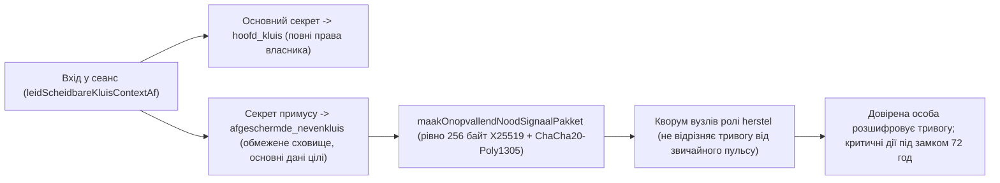

> 🌐 **Мова / Taal:** **Українська** · [Nederlands](KLIMOP-FASE-9-MENSBESCHERMING-EN-DWANGBESTENDIGHEID.nl.md) | [Головна](../../README.md) · [Покажчик документації](../ПОКАЖЧИК-ДОКУМЕНТАЦІЇ.uk.md) · [Головний архітектурний маніфест «Плющ»](АРХІТЕКТУРНИЙ-МАНІФЕСТ-ПЛЮЩ.uk.md) · [Етап 1 — Ядро та план випусків](ПЛЮЩ-ЕТАП-1-АРХІТЕКТУРНЕ-ЯДРО-ТА-ПЛАН-ВИПУСКІВ.uk.md) · [Етап 2 — «Стебла»](ПЛЮЩ-ЕТАП-2-ВИПРОБУВАЛЬНА-МЕРЕЖА-ТА-СТЕБЛА.uk.md) · [Етап 3 — Шифрування та зберігання](ПЛЮЩ-ЕТАП-3-ШИФРУВАННЯ-ТА-РОЗПОДІЛЕНЕ-ЗБЕРІГАННЯ.uk.md) · [Етап 4 — ФРОСТ](ПЛЮЩ-ЕТАП-4-РОЗПОДІЛЕНІ-КЛЮЧІ-ТА-ПОРОГОВІ-ПІДПИСИ.uk.md) · [Етап 5 — Ідентичність та `MLS`](ПЛЮЩ-ЕТАП-5-НЕЗАЛЕЖНА-ІДЕНТИЧНІСТЬ-ТА-ГРУПОВІ-ПРОСТОРИ.uk.md) · [Етап 6 — Керування та випуски](ПЛЮЩ-ЕТАП-6-РОЗПОДІЛЕНЕ-КЕРУВАННЯ-ТА-БЕЗПЕЧНІ-ВИПУСКИ.uk.md) · [Етап 7 — Імунна система](ПЛЮЩ-ЕТАП-7-ІМУННА-СИСТЕМА-ТА-САМОВІДНОВЛЕННЯ.uk.md) · [Етап 8 — Перенесення служб](ПЛЮЩ-ЕТАП-8-ПЕРЕНЕСЕННЯ-СЛУЖБ-ТА-ІЗОЛЬОВАНІ-ЗЄДНУВАЧІ.uk.md)

# Етап 9 екосистеми «Плющ» — Протокол захисту людини, протидія примусу, контекстний ризик та 8 сценаріїв §39 (`KLIMOP-010`)

- **Дата виконання:** 20.11.2026
- **Задача координації:** `KLIMOP-010` (спирається на злитий у `integratie` запит №191 `KLIMOP-009`, фіксація злиття `5c5cf3c292186ee6040e21c78bb4dab7184e77ad`)
- **Програмна реалізація:**
  - Регламент 9 життєвих обставин (`STANDAARD_MENS_NOODBELEID`), роздільні сховища (`leidScheidbareKluisContextAf`), 256-байтні невідрізнимі пакети пульсу й тихої тривоги (`maakOnopvallendNoodSignaalPakket`), двостороннє зняття помилкової тривоги (`herstelNaValsDwangAlarm`), контекстна оцінка 7 ознак (`beoordeelContextueelOperatieRisico`), відкладені операції (`maakUitgesteldeKritiekeOperatie`), протокол тривалої відсутності (`beoordeelLangdurigeAfwezigheidProtocol`) та оцінювач 8 сценаріїв (`beoordeelMensbeschermingsProgramma`): [`shared/klimop/mensbescherming.ts`](../../shared/klimop/mensbescherming.ts)
  - Кворумний мережевий координатор вузлів ролі `herstel` (`KlimopMensbeschermingClient`): [`backend/klimop-mensbescherming-client.ts`](../../backend/klimop-mensbescherming-client.ts)
  - Мережеві дії під мандатом ролі `herstel` (`ontvang_onopvallend_signaal`, `registreer_uitgestelde_operatie`, `annuleer_uitgestelde_operatie`): [`backend/klimop-knooppunt-agent.ts`](../../backend/klimop-knooppunt-agent.ts)
  - Живий полігон 3 незалежних вузлів (`NL`, `CH`, `UA`): [`scripts/klimop-etappe9-mensbescherming-proef.mjs`](../../scripts/klimop-etappe9-mensbescherming-proef.mjs)
- **Нормативна підстава:** розділи `§14–§17`, `§36 (Етап 9)`, `§39`, `§42 п. 9`, `§43 п. 9` та обов'язковий **Документ №12** за реєстром Етапу 1 [Головного архітектурного маніфесту «Плющ»](АРХІТЕКТУРНИЙ-МАНІФЕСТ-ПЛЮЩ.uk.md)
- **Межа повноважень:** жива робоча інфраструктура (`PostgreSQL 18.6`, `mijn-ruimte.service`, `*.tarasevych.com`) не змінюється й не вимикається.

---

## 1. Незалежність від пам'яті однієї людини та 9 надзвичайних обставин (§14, §17)

1. **Повне розмежування 9 життєвих обставин (`KLIMOP_MENS_NOODOMSTANDIGHEDEN`):** для втрати пристрою, втрати облікових даних, тривалої недоступності, тяжкої хвороби, порушення пам'яті, смерті власника, фізичного примусу, психологічного тиску та захоплення адміністративних прав у `STANDAARD_MENS_NOODBELEID` визначено окремий поріг незалежних опікунів (`k >= 2` або `3`) і захисне вікно оскарження (`48`, `72` або `168` годин).
2. **Протокол тривалої відсутності (`beoordeelLangdurigeAfwezigheidProtocol`, §17):** звичайна відсутність або втрата зв'язку — хоч би скільки діб вона тривала — ніколи автоматично не розкриває приватних даних і не передає прав керування (`geen_overdracht_alleen_bewaring`, `priveGegevensAutomatischOnthuldDoorStilte: false`).

---

## 2. Протидія примусу, невідрізнимі сигнали тривоги та чесні межі фізичної безпеки (Документ №12, §15)

- **Нуль автоматичного знищення даних (§15 абз. 5, §43 п. 9):** будь-яка спроба ввімкнути автоматичне самознищення особистих даних при підозрі на примус блокується в `valideerDwangBeschermingsProfiel` (`AUTOMATISCHE_GEGEVENSVERNIETIGING_VERBODEN`).
- **Чесне застереження про фізичну безпеку (§15 абз. 3–4):** активація необов'язкового профілю вимагає підтвердження оцінки ризику фізичного насильства і явно фіксує `garandeertFysiekeVeiligheidTegenAanvaller: false` — технічні засоби обмежують одноосібну владу нападника над мережею, але ніколи не подаються як абсолютна гарантія зупинення фізичного насильства.
- **Безпечне зняття помилкової тривоги (§39 п. 4):** якщо сигнал небезпеки спрацював помилково, `herstelNaValsDwangAlarm` повертає звичайний режим із `0` байт втрат лише за спільним підписом `Ed25519` власника **та** визначеної довіреної особи, щоб нападник не міг змусити людину миттєво вимкнути захист наодинці.

---

## 3. Контекстна оцінка небезпеки (§16) та 8 імітаційних сценаріїв §39

- `beoordeelContextueelOperatieRisico` оцінює виключно **7 технічних ознак §16**, блокує несанкціоновану біометрію (`BIOMETRIE_ZONDER_UITDRUKKELIJKE_TOESTEMMING_VERBODEN`), не робить висновків про психічний стан чи дію речовин (`automatischeConclusieOverGeestestoestandOfDwang: false`) і завжди зберігає доступ людини до її власних даних (`toegangTotEigenGegevensBehouden: true`), відкладаючи небезпечні зміни ключів і правил відновлення на 72-годинний часовий замок із правом скасування на кворумі вузлів (`annuleerUitgesteldeOperatieOpQuorum`).
- Полігон [`scripts/klimop-etappe9-mensbescherming-proef.mjs`](../../scripts/klimop-etappe9-mensbescherming-proef.mjs) та набір випробувань [`tests/eenheid/klimop-010-etappe9-mensbescherming-dwang-20261120.test.ts`](../../tests/eenheid/klimop-010-etappe9-mensbescherming-dwang-20261120.test.ts) підтверджують усі **8 обов'язкових безпечних імітаційних сценаріїв §39** з `0` байт втрат.
