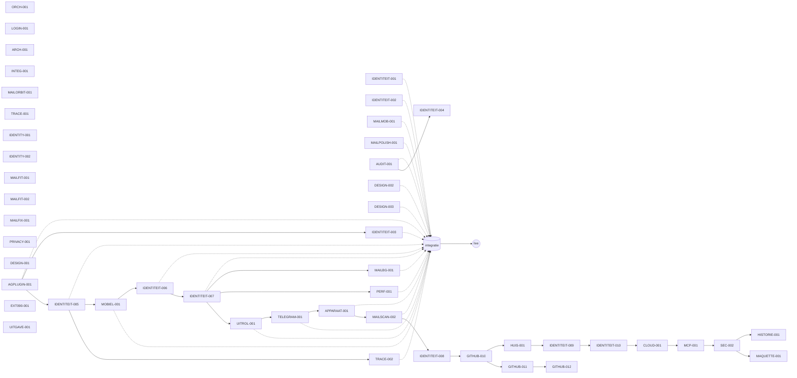
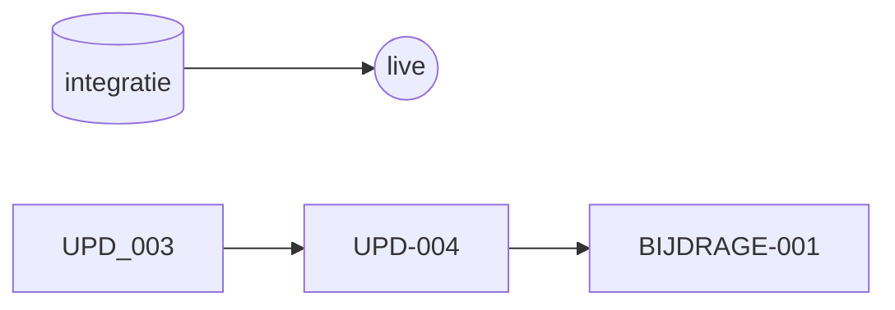
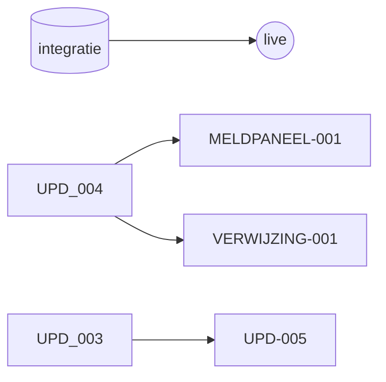
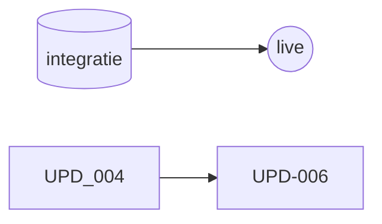

```mermaid
flowchart LR
  INT[(integratie)]
  LIVE((live))
  HISTORIE_001["HISTORIE-001"]
  SEC_002 --> HISTORIE_001
  IDENTITEIT_011["IDENTITEIT-011"]
  SEC_002 --> IDENTITEIT_011
  IDENTITEIT_012["IDENTITEIT-012"]
  SEC_002 --> IDENTITEIT_012
  MAQUETTE_002["MAQUETTE-002"]
  MAQUETTE_001 --> MAQUETTE_002
  MAQUETTE_003["MAQUETTE-003"]
  MAQUETTE_002 --> MAQUETTE_003
  MAQUETTE_004["MAQUETTE-004"]
  MAQUETTE_003 --> MAQUETTE_004
  MAQUETTE_005["MAQUETTE-005"]
  MAQUETTE_004 --> MAQUETTE_005
  MAQUETTE_006["MAQUETTE-006"]
  MAQUETTE_005 --> MAQUETTE_006
  MAQUETTE_007["MAQUETTE-007"]
  MAQUETTE_006 --> MAQUETTE_007
  MAQUETTE_008["MAQUETTE-008"]
  MAQUETTE_007 --> MAQUETTE_008
  GEMINI_001["GEMINI-001"]
  IDENTITEIT_013 --> GEMINI_001
  IDENTITEIT_013["IDENTITEIT-013"]
  SEC_002 --> IDENTITEIT_013
  IDENTITEIT_014["IDENTITEIT-014"]
  SEC_002 --> IDENTITEIT_014
  IDENTITEIT_015["IDENTITEIT-015"]
  SEC_002 --> IDENTITEIT_015
  KLASSIEK_001["KLASSIEK-001"]
  MAQUETTE_010 --> KLASSIEK_001
  KLASSIEK_002["KLASSIEK-002"]
  KLASSIEK_001 --> KLASSIEK_002
  KLASSIEK_003["KLASSIEK-003"]
  KLASSIEK_002 --> KLASSIEK_003
  KLASSIEK_004["KLASSIEK-004"]
  KLASSIEK_003 --> KLASSIEK_004
  KLASSIEK_005["KLASSIEK-005"]
  KLASSIEK_004 --> KLASSIEK_005
  KLASSIEK_006["KLASSIEK-006"]
  KLASSIEK_005 --> KLASSIEK_006
  KLASSIEK_007["KLASSIEK-007"]
  KLASSIEK_006 --> KLASSIEK_007
  KLASSIEK_008["KLASSIEK-008"]
  KLASSIEK_007 --> KLASSIEK_008
  KLASSIEK_009["KLASSIEK-009"]
  KLASSIEK_008 --> KLASSIEK_009
  KLASSIEK_010["KLASSIEK-010"]
  KLASSIEK_009 --> KLASSIEK_010
  MAQUETTE_009["MAQUETTE-009"]
  MAQUETTE_008 --> MAQUETTE_009
  MAQUETTE_010["MAQUETTE-010"]
  MAQUETTE_009 --> MAQUETTE_010
  TELEGRAM_002["TELEGRAM-002"]
  IDENTITEIT_013 --> TELEGRAM_002
  ANKERS_002["ANKERS-002"]
  UPD_001 --> ANKERS_002
  CENTR_001["CENTR-001"]
  TELEGRAM_003 --> CENTR_001
  DUBLI_001["DUBLI-001"]
  GEMINI_003 --> DUBLI_001
  GEMINI_002["GEMINI-002"]
  GEMINI_001 --> GEMINI_002
  GEMINI_003["GEMINI-003"]
  GEMINI_002 --> GEMINI_003
  POSTVAK_001["POSTVAK-001"]
  DUBLI_001 --> POSTVAK_001
  POSTVAK_002["POSTVAK-002"]
  POSTVAK_001 --> POSTVAK_002
  TELEGRAM_003["TELEGRAM-003"]
  POSTVAK_002 --> TELEGRAM_003
  UPD_001["UPD-001"]
  CENTR_001 --> UPD_001
  UPD_002["UPD-002"]
  UPD_001 --> UPD_002
  VAARD_002["VAARD-002"]
  CENTR_001 --> VAARD_002
  ELDERS_001["ELDERS-001"]
  UPD_002 --> ELDERS_001
  NAT_001["NAT-001"]
  UPD_002 --> NAT_001
  SEC_003["SEC-003"]
  AGPLUGIN_001 --> SEC_003
  TELEGRAM_004["TELEGRAM-004"]
  UPD_002 --> TELEGRAM_004
  UPD_003["UPD-003"]
  UPD_002 --> UPD_003
  FIX_001["FIX-001"]
  SEC_003 --> FIX_001
  GEMINI_004["GEMINI-004"]
  UPD_003 --> GEMINI_004
  LOKAI_001["LOKAI-001"]
  SEC_003 --> LOKAI_001
  UPD_004["UPD-004"]
  UPD_003 --> UPD_004
  WISSEL_001["WISSEL-001"]
  UPD_003 --> WISSEL_001
  INT --> LIVE
```

> 🌐 **Мова / Taal:** **Українська** · [Nederlands](KRONIEK-TAKKEN.nl.md) | [Головна](../../README.md) · [Покажчик документації](../ПОКАЖЧИК-ДОКУМЕНТАЦІЇ.uk.md) · [Гілки, PR та випуски](./ГІЛКИ-ТА-ЗАПИТИ-НА-ЗЛИТТЯ.uk.md) · [Історія розвитку](./ІСТОРІЯ-РОЗВИТКУ.uk.md)

# Хронологія гілок і робіт

Цей документ **лише доповнюється**: генератор `scripts/geschiedenis/kroniek.mjs` (HISTORIE-001) дописує в кінець новий знімок із роботами, яких тут ще немає, або з тими, у яких змінилася вершина гілки. Наявні записи не змінюються й не видаляються.

Кожна робота має позначки **← Попередник** (з якої основи й поверх якої попередньої роботи її почато) та **→ Наступник** (куди її влито, чи є вона в живій версії, які роботи продовжили її). Дані беруться лише з git, `orchestratie/taken/*.json`, `orchestratie/ontwikkelarchieven/*.json` і знімка PR `scripts/geschiedenis/samenvoegverzoeken.json`.

Як читати: «Попередня робота» — найсвіжіша інша робота, вершина гілки якої вже входила в основу цієї. «Наступні роботи» — ті, що взяли цю роботу за свого попередника.

---
## Знімок 2026-11-13 · жива версія `20261113-121403` · коміт [`5f2325d`](https://github.com/Tarasevych/hub/commit/5f2325d788e29c5126f9ede6975afbbac7e5aae2) · гілок на GitHub: 123

### Розрив `voornaamst` ↔ жива версія <!-- r:5f2325d788e29c5126f9ede6975afbbac7e5aae2:95ecef1a79d43c58e1dd045739a918e029d505a2 -->

Гілка за замовчуванням `voornaamst` не містить **132** комітів живої версії: **88** уже є в `integratie`, ще **44** лежать поверх `integratie` у гілці випуску. Оновити `voornaamst` (fast-forward або злиття з `integratie`) може **лише власник**; агенти захищених гілок не змінюють (AGENTS.md).

Коміти за роботами

- **[IDENTITEIT-004](#t-identiteit-004)** — 6 · 2026-11-08 → 2026-11-08
  - [`3dd0daaf`](https://github.com/Tarasevych/hub/commit/3dd0daaf) 2026-11-08 ІДЕНТИЧНІСТЬ-004: відтворено оформлення версії 49 з чинними діями та перемикачем
  - [`5c1b5871`](https://github.com/Tarasevych/hub/commit/5c1b5871) 2026-11-08 ІДЕНТИЧНІСТЬ-004 · усунуто повтори входу, безпеки та відновлення
  - [`1610efa5`](https://github.com/Tarasevych/hub/commit/1610efa5) 2026-11-08 ІДЕНТИЧНІСТЬ-004 · виправлено запис робочої гілки
  - [`7935b80c`](https://github.com/Tarasevych/hub/commit/7935b80c) 2026-11-08 ІДЕНТИЧНІСТЬ-004 · звірено встановлену основу випуску 20261107-195618
  - [`5cec9a84`](https://github.com/Tarasevych/hub/commit/5cec9a84) 2026-11-08 ІДЕНТИЧНІСТЬ-004 · додано журнал розробки й опис завдання перед об’єднанням
  - [`26d705c8`](https://github.com/Tarasevych/hub/commit/26d705c8) 2026-11-08 ІДЕНТИЧНІСТЬ-004 · позначено успішне об’єднання в integratie
- **[IDENTITEIT-005](#t-identiteit-005)** — 1 · 2026-11-08 → 2026-11-08
  - [`f1eceebf`](https://github.com/Tarasevych/hub/commit/f1eceebf) 2026-11-08 ІДЕНТИЧНІСТЬ-005 · узгоджено шари оформлення з перевіркою складання
- **[IDENTITEIT-006](#t-identiteit-006)** — 6 · 2026-11-08 → 2026-11-08
  - [`5846625a`](https://github.com/Tarasevych/hub/commit/5846625a) 2026-11-08 IDENTITEIT-006 · «Студія»: новий дизайн центру налаштувань акаунта
  - [`8d52b354`](https://github.com/Tarasevych/hub/commit/8d52b354) 2026-11-08 IDENTITEIT-006 · ілюстрації без обрізання, аркуш на всю ширину
  - [`877406d4`](https://github.com/Tarasevych/hub/commit/877406d4) 2026-11-08 IDENTITEIT-006 · журнал розробки, задача і процес випуску
  - [`ea351399`](https://github.com/Tarasevych/hub/commit/ea351399) 2026-11-08 IDENTITEIT-006 · модель ШІ для пакета задає власник змінною сховища
  - [`3de2e714`](https://github.com/Tarasevych/hub/commit/3de2e714) 2026-11-08 IDENTITEIT-006 · журнал: пробне пакування пройшло перевірку
  - [`9a040c6c`](https://github.com/Tarasevych/hub/commit/9a040c6c) 2026-11-08 IDENTITEIT-006 · нова група черги процесу випуску (завислий перезапуск блокував її)
- **[IDENTITEIT-007](#t-identiteit-007)** — 16 · 2026-11-08 → 2026-11-09
  - [`d693b8b7`](https://github.com/Tarasevych/hub/commit/d693b8b7) 2026-11-08 IDENTITEIT-007 · користувач сам обирає вигляд центру облікового запису («Студія» або класичний)
  - [`a8dbe05b`](https://github.com/Tarasevych/hub/commit/a8dbe05b) 2026-11-08 IDENTITEIT-007: вигляд «Макет» центру облікового запису за дизайном власника
  - [`4b56b720`](https://github.com/Tarasevych/hub/commit/4b56b720) 2026-11-08 IDENTITEIT-007: вигляд «Макет» один в один з макетом власника
  - [`619450a9`](https://github.com/Tarasevych/hub/commit/619450a9) 2026-11-09 IDENTITEIT-007 · журнал розробки, задача і процес випуску
  - [`8392ceb2`](https://github.com/Tarasevych/hub/commit/8392ceb2) 2026-11-09 IDENTITEIT-007 · журнал: пробне пакування пройшло перевірку
  - [`14ef8dc6`](https://github.com/Tarasevych/hub/commit/14ef8dc6) 2026-11-09 IDENTITEIT-007 · перемикач вигляду видно з класичної сторінки
  - [`d3d49286`](https://github.com/Tarasevych/hub/commit/d3d49286) 2026-11-09 IDENTITEIT-007 · на вузькому екрані компактний перемикач не дублює повний
  - [`a714cc52`](https://github.com/Tarasevych/hub/commit/a714cc52) 2026-11-09 IDENTITEIT-007 · перемикач вигляду видно з класичної сторінки
  - [`965f5199`](https://github.com/Tarasevych/hub/commit/965f5199) 2026-11-09 IDENTITEIT-007 · на вузькому екрані компактний перемикач не дублює повний
  - [`4d71a818`](https://github.com/Tarasevych/hub/commit/4d71a818) 2026-11-09 IDENTITEIT-007 · друга гілка випуску від коміту першого випуску: перемикач вигляду в класичному вигляді
  - [`fd95af01`](https://github.com/Tarasevych/hub/commit/fd95af01) 2026-11-09 IDENTITEIT-007 · «Макет» завжди в списку виглядів, перемикач функції створює міграція
  - [`0f905e03`](https://github.com/Tarasevych/hub/commit/0f905e03) 2026-11-09 IDENTITEIT-007 · «Макет» завжди в списку виглядів, перемикач функції створює міграція
  - [`bc16016a`](https://github.com/Tarasevych/hub/commit/bc16016a) 2026-11-09 IDENTITEIT-007 · третя гілка випуску від коміту другого випуску: «Макет» завжди в списку, перемикач функції з міграції
  - [`4c9786c5`](https://github.com/Tarasevych/hub/commit/4c9786c5) 2026-11-09 orch: IDENTITEIT-007 released · три випуски (051901, 060206, 065647) опубліковано, код злито в integratie за дозволом власника
  - [`c829351a`](https://github.com/Tarasevych/hub/commit/c829351a) 2026-11-09 IDENTITEIT-007 · міграція 0200: опис перемикача вкладається в межу CHECK (≤ 300 знаків)
  - [`a92ef438`](https://github.com/Tarasevych/hub/commit/a92ef438) 2026-11-09 IDENTITEIT-007 · міграція 0200: опис перемикача вкладається в межу CHECK (≤ 300 знаків)
- **[MOBIEL-001](#t-mobiel-001)** — 10 · 2026-11-08 → 2026-11-08
  - [`f1526698`](https://github.com/Tarasevych/hub/commit/f1526698) 2026-11-08 MOBIEL-001 · виправлено відображення налаштувань на смартфоні
  - [`2f793645`](https://github.com/Tarasevych/hub/commit/2f793645) 2026-11-08 MOBIEL-001 · додано перевірку смартфонів перед випуском
  - [`45388921`](https://github.com/Tarasevych/hub/commit/45388921) 2026-11-08 MOBIEL-001 · діагностика відображення під час браузерної перевірки
  - [`8b8aee15`](https://github.com/Tarasevych/hub/commit/8b8aee15) 2026-11-08 MOBIEL-001 · відтворено службовий модуль у браузерних перевірках
  - [`974f9c85`](https://github.com/Tarasevych/hub/commit/974f9c85) 2026-11-08 MOBIEL-001 · відновлено пункти верхньої та нижньої навігації
  - [`7abfa6ce`](https://github.com/Tarasevych/hub/commit/7abfa6ce) 2026-11-08 MOBIEL-001 · розгорнути всі групи навігації на телефоні
  - [`ab684f7e`](https://github.com/Tarasevych/hub/commit/ab684f7e) 2026-11-08 MOBIEL-001 · зберігати точні відомості про невдалі натискання
  - [`787613ad`](https://github.com/Tarasevych/hub/commit/787613ad) 2026-11-08 MOBIEL-001 · узгодити нижнє меню з висувною навігацією
  - [`ee88cf97`](https://github.com/Tarasevych/hub/commit/ee88cf97) 2026-11-08 MOBIEL-001 · прибрати приховані зовнішні відступи нижнього меню
  - [`944336a2`](https://github.com/Tarasevych/hub/commit/944336a2) 2026-11-08 MOBIEL-001 · перевірити також світле оформлення на смартфонах
- **[TRACE-002](#t-trace-002)** — 1 · 2026-11-08 → 2026-11-08
  - [`41d47ce8`](https://github.com/Tarasevych/hub/commit/41d47ce8) 2026-11-08 TRACE-002 · перевірка допустимої гілки перед пакуванням
- **[APPARAAT-001](#t-apparaat-001)** — 3 · 2026-11-09 → 2026-11-09
  - [`7006e93b`](https://github.com/Tarasevych/hub/commit/7006e93b) 2026-11-09 APPARAAT-001 · підтвердження з іншого пристрою: вкладки «Інший пристрій» і «У Telegram» у вікні «Підтвердіть доступ», плаваюче вікно «Це ви?» з тими самими символами, одна спроба, відлік, «Це не я» перемагає; четвертий метод «apparaat» у матриці TELEGRAM-001 і один поріг для step-up; символи в картці Telegram; налаштування користувача й адміністратора; прапорець apparaat-bevestiging-v1 типово увімкнено · bevestigen vanaf een ander apparaat: tabbladen in «Toegang bevestigen», zwevend venster «Bent u het?» met dezelfde symbolen, één poging, aftelling, «Dit ben ik niet» wint; vierde methode «apparaat» in de bevestigingstabel en één poort; symbolen in de Telegram-kaart; instellingen gebruiker en beheer; vlag standaard aan
  - [`623da0f1`](https://github.com/Tarasevych/hub/commit/623da0f1) 2026-11-09 APPARAAT-001 · кольори стану з палітри (--ok/--fout/--waarschuwing) замість шістнадцяткових; процес випуску GitHub Actions за зразком UITROL-001 (перевірки, міграції на чистій базі, стрім-тести, пакет, оприлюднення без встановлення) · statuskleuren uit het palet; uitgaveproces in GitHub Actions
  - [`29052626`](https://github.com/Tarasevych/hub/commit/29052626) 2026-11-09 APPARAAT-001 · таблиця apparaat_instellingen у реєстрі видалення облікового запису (стовпець door — рядок сайту, як tg_instellingen); журнал розробки доповнено результатами випуску · apparaat_instellingen in het register voor account wissen; ontwikkeldossier aangevuld
- **[MAILBG-001](#t-mailbg-001)** — 7 · 2026-11-09 → 2026-11-10
  - [`f0eee5a1`](https://github.com/Tarasevych/hub/commit/f0eee5a1) 2026-11-09 MAILBG-001 · рухоме тло пошти, лінза та налаштування
  - [`01a6bca1`](https://github.com/Tarasevych/hub/commit/01a6bca1) 2026-11-09 MAILBG-001 · додати перевірене посилання на злиття №60
  - [`7e7f606a`](https://github.com/Tarasevych/hub/commit/7e7f606a) 2026-11-09 MAILBG-001 · виправити двомовний підсумок для підготовки пакета
  - [`2cc45b1f`](https://github.com/Tarasevych/hub/commit/2cc45b1f) 2026-11-09 MAILBG-001 · дотикова лінза й остаточні перевірки
  - [`336e0f04`](https://github.com/Tarasevych/hub/commit/336e0f04) 2026-11-10 MAILBG-001 · зберегти виправлення дотику та походження випуску
  - [`566a4ba1`](https://github.com/Tarasevych/hub/commit/566a4ba1) 2026-11-10 MAILBG-001 · зберегти виправлення дотику та походження випуску
  - [`017b5a3d`](https://github.com/Tarasevych/hub/commit/017b5a3d) 2026-11-10 MAILBG-001 · зберегти виправлення дотику та походження випуску
- **[PERF-001](#t-perf-001)** — 8 · 2026-11-09 → 2026-11-09
  - [`5f451f8d`](https://github.com/Tarasevych/hub/commit/5f451f8d) 2026-11-09 PERF-001 · швидший старт сторінок: менший стартовий бандл, менше запитів, стиснення
  - [`6729abb6`](https://github.com/Tarasevych/hub/commit/6729abb6) 2026-11-09 PERF-001 · гілка випуску від встановленого коміту bc16016a: процес випуску, журнал розробки, задача
  - [`beebe27c`](https://github.com/Tarasevych/hub/commit/beebe27c) 2026-11-09 PERF-001 · стара вада: синтаксична помилка в presentation-init (апостроф у «під'єднань»)
  - [`35373228`](https://github.com/Tarasevych/hub/commit/35373228) 2026-11-09 PERF-001 · випуск: стара вада presentation-init у журналі, ще три перевірки в процесі
  - [`b31cea2d`](https://github.com/Tarasevych/hub/commit/b31cea2d) 2026-11-09 PERF-001 · смуга інтеграцій лишається публічною після лінивого завантаження
  - [`0cd11723`](https://github.com/Tarasevych/hub/commit/0cd11723) 2026-11-09 PERF-001 · журнал розробки: перевірка технічних бандлів і виправлення
  - [`2820fc4a`](https://github.com/Tarasevych/hub/commit/2820fc4a) 2026-11-09 PERF-001 · випуск: міграція 0200 виправлена (з IDENTITEIT-007), прогін усіх міграцій на чистій базі в процесі
  - [`b025c713`](https://github.com/Tarasevych/hub/commit/b025c713) 2026-11-09 PERF-001 · процес випуску: запуск і при зміні стану задач
- **[TELEGRAM-001](#t-telegram-001)** — 3 · 2026-11-09 → 2026-11-09
  - [`7228a5e3`](https://github.com/Tarasevych/hub/commit/7228a5e3) 2026-11-09 TELEGRAM-001 · вхід і підтвердження через Telegram (@MijnRuimte_Bot), прапорець telegram-aanmelden-v1 типово вимкнено · aanmelden en bevestigen via Telegram, vlag standaard uit
  - [`832b9ddb`](https://github.com/Tarasevych/hub/commit/832b9ddb) 2026-11-09 TELEGRAM-001 · мовна правка: без англіцизмів у текстах (адреса зворотного виклику, обліковий запис, ім’я користувача, випуск), читабельні назви кодів стану · taalcorrectie zonder anglicismen, leesbare namen voor statuscodes
  - [`8fe8b97f`](https://github.com/Tarasevych/hub/commit/8fe8b97f) 2026-11-09 TELEGRAM-001 · розміщення способів входу адміністратором (0203), «Єдиний вхід» замість «SSO», без англійської в нових текстах, нідерландські префікси гілок · plaatsing van aanmeldmethoden door de beheerder, «Eenmalige aanmelding», geen Engels, Nederlandse takvoorvoegsels
- **[UITROL-001](#t-uitrol-001)** — 6 · 2026-11-09 → 2026-11-09
  - [`d28daa41`](https://github.com/Tarasevych/hub/commit/d28daa41) 2026-11-09 UITROL-001 · перевірка вимог до завантаження: проба нових міграцій на тимчасовій копії схеми
  - [`55f543e0`](https://github.com/Tarasevych/hub/commit/55f543e0) 2026-11-09 UITROL-001 · перевірка вимог у браузері до завантаження: картка вимог, причина, журнал, звіт про проблему
  - [`1ede6765`](https://github.com/Tarasevych/hub/commit/1ede6765) 2026-11-09 UITROL-001: зупинка власником, конвеєр етапів, термінал-вікно з мітками, прив'язка проби до sha256
  - [`737d8796`](https://github.com/Tarasevych/hub/commit/737d8796) 2026-11-09 UITROL-001 · процес випуску, задача та досьє розробки · uitgaveproces, taak en ontwikkeldossier
  - [`4a371c64`](https://github.com/Tarasevych/hub/commit/4a371c64) 2026-11-09 UITROL-001 · тест передперевірки: добрий пакет має пробу, прив'язану до SQL; без проби — попередження, чужа міграція — помилка
  - [`22742811`](https://github.com/Tarasevych/hub/commit/22742811) 2026-11-09 UITROL-001 · каталог елементів інтерфейсу оновлено (нові кнопки термінала й зупинки) · UI-catalogus bijgewerkt
- **[HUIS-001](#t-huis-001)** — 18 · 2026-11-10 → 2026-11-12
  - [`879d4fcb`](https://github.com/Tarasevych/hub/commit/879d4fcb) 2026-11-10 HUIS-001: старі помилки розділу «Дім» — підписи вкладок, часові пояси, сповіщення
  - [`fa0b618a`](https://github.com/Tarasevych/hub/commit/fa0b618a) 2026-11-10 HUIS-001: змінні середовища розділу «Дім» у документах (uk + nl)
  - [`09ae25ca`](https://github.com/Tarasevych/hub/commit/09ae25ca) 2026-11-10 HUIS-001: тести виправлень і запуск набору huis-vnext у хмарному контейнері
  - [`ec5af93e`](https://github.com/Tarasevych/hub/commit/ec5af93e) 2026-11-10 HUIS-001: реєстрація задачі (розумний будинок, етап 0 — дизайн і макет)
  - [`a8ceded7`](https://github.com/Tarasevych/hub/commit/a8ceded7) 2026-11-10 HUIS-001: дизайн-мова «Живий дім / Levend huis» — робоча версія
  - [`0305f27e`](https://github.com/Tarasevych/hub/commit/0305f27e) 2026-11-10 HUIS-001: дизайн-мова — правки за зауваженнями перевірки (проміжний стан)
  - [`0f8e95b5`](https://github.com/Tarasevych/hub/commit/0f8e95b5) 2026-11-10 HUIS-001: проміжний стан дизайн-мови та ядра макета
  - [`fa7592aa`](https://github.com/Tarasevych/hub/commit/fa7592aa) 2026-11-10 HUIS-001: проміжний стан дизайн-мови та ядра макета
  - [`edc95ca5`](https://github.com/Tarasevych/hub/commit/edc95ca5) 2026-11-10 HUIS-001: проміжний стан дизайн-мови та ядра макета
  - [`43ac3bab`](https://github.com/Tarasevych/hub/commit/43ac3bab) 2026-11-10 HUIS-001: складальник макета — власні стилі екранів і збірка в окремий файл
  - [`6f5a9a1f`](https://github.com/Tarasevych/hub/commit/6f5a9a1f) 2026-11-12 HUIS-001: макет «Живий дім» — екрани всіх зон, аркуші керування, специфікація двома мовами
  - [`b9503ae1`](https://github.com/Tarasevych/hub/commit/b9503ae1) 2026-11-12 HUIS-001: макет «Живий дім» на сайті — «Вітрина» і статична сторінка /huis-maquette/
  - [`fc7de141`](https://github.com/Tarasevych/hub/commit/fc7de141) 2026-11-12 HUIS-001: тест макета, журнал розробки, покажчик документації, каталог пошуку
  - [`f9db5074`](https://github.com/Tarasevych/hub/commit/f9db5074) 2026-11-12 HUIS-001: робочий процес випуску (макет «Живий дім», специфікація, виправлення розділу «Дім»)
  - [`06186dee`](https://github.com/Tarasevych/hub/commit/06186dee) 2026-11-12 HUIS-001: завершальна перевірка макета й специфікації — перше коло виправлень
  - [`c612fd7c`](https://github.com/Tarasevych/hub/commit/c612fd7c) 2026-11-12 HUIS-001: завершальна перевірка — друге коло (залишки між файлами, перевірка змін, доопрацювання)
  - [`8c98dc1a`](https://github.com/Tarasevych/hub/commit/8c98dc1a) 2026-11-12 HUIS-001: другий випуск — основа за встановленою версією, журнал розробки другого кола
  - [`fd772f57`](https://github.com/Tarasevych/hub/commit/fd772f57) 2026-11-12 HUIS-001: основа другого випуску — встановлена версія 20261112-043627 (GITHUB-012)
- **[MAILSCAN-002](#t-mailscan-002)** — 6 · 2026-11-10 → 2026-11-10
  - [`427b300b`](https://github.com/Tarasevych/hub/commit/427b300b) 2026-11-10 MAILSCAN-002 · згода на перевірку й живе рідинне тло пошти
  - [`e02ee8b8`](https://github.com/Tarasevych/hub/commit/e02ee8b8) 2026-11-10 MAILSCAN-002 · перевірити мобільне тло та пробну базу перед випуском
  - [`7dedc366`](https://github.com/Tarasevych/hub/commit/7dedc366) 2026-11-10 MAILSCAN-002 · узгодити розміщення та каталог дій
  - [`d01a7a60`](https://github.com/Tarasevych/hub/commit/d01a7a60) 2026-11-10 MAILSCAN-002 · Узгодити давні перевірки з добровільною згодою
  - [`212749f8`](https://github.com/Tarasevych/hub/commit/212749f8) 2026-11-10 MAILSCAN-002 · Розділити перевірку вибору та згоди скриньок
  - [`89a6b55f`](https://github.com/Tarasevych/hub/commit/89a6b55f) 2026-11-10 MAILSCAN-002 · Зберегти успішні перевірки та знімки випуску
- **[GITHUB-010](#t-github-010)** — 1 · 2026-11-11 → 2026-11-11
  - [`3e18d5b3`](https://github.com/Tarasevych/hub/commit/3e18d5b3) 2026-11-11 GITHUB-010: повноцінне двостороннє робоче середовище GitHub, однонатискове підключення та екосистемні мости · volledige tweerichtings-GitHub-werkruimte
- **[IDENTITEIT-008](#t-identiteit-008)** — 5 · 2026-11-11 → 2026-11-11
  - [`d24de76c`](https://github.com/Tarasevych/hub/commit/d24de76c) 2026-11-11 IDENTITEIT-008: спадне меню облікового запису v3 (орбіта світлин, палітра за Моделлю В, доступ і масштаб)
  - [`b21dcae8`](https://github.com/Tarasevych/hub/commit/b21dcae8) 2026-11-11 IDENTITEIT-008: виправлення іменованого імпорту AccountMenuV3Instellingen для перевірки типів
  - [`66cab752`](https://github.com/Tarasevych/hub/commit/66cab752) 2026-11-11 IDENTITEIT-008: розумний захист повноти застосованих міграцій (MIGRATIES_ONTBREKEN) та розпізнавання жовтневих перейменувань
  - [`730d9f81`](https://github.com/Tarasevych/hub/commit/730d9f81) 2026-11-11 IDENTITEIT-008: незалежне поверхневе вікно AccountMenuV3 на всю ширину смартфона · onafhankelijk mobiel bovenvenster
  - [`7734fc3b`](https://github.com/Tarasevych/hub/commit/7734fc3b) 2026-11-11 IDENTITEIT-008: виправлення входу пошти Google і меню v3 та відкрита агентна екосистема ШІ · open AI-ecosysteem
- **[CLOUD-001](#t-cloud-001)** — 4 · 2026-11-12 → 2026-11-12
  - [`036b7c06`](https://github.com/Tarasevych/hub/commit/036b7c06) 2026-11-12 CLOUD-001: виправлено перевірку діапазону хмарних міграцій 0117..0122 у тесті послідовності
  - [`77747424`](https://github.com/Tarasevych/hub/commit/77747424) 2026-11-12 CLOUD-001: завантаження тек, архівів і будь-яких файлів у хмару, спільний доступ до папок, файлів і частин файла та керування посиланнями зі статистикою
  - [`04178943`](https://github.com/Tarasevych/hub/commit/04178943) 2026-11-12 CLOUD-001: узгоджено назви колонок і порожнє значення wachtwoord_hash у маршрутах спільного доступу зі схемою 0210
  - [`11e0aad8`](https://github.com/Tarasevych/hub/commit/11e0aad8) 2026-11-12 CLOUD-001: додано стійкість звірки основи випуску до тимчасової недоступності тунелю Cloudflare
- **[GITHUB-011](#t-github-011)** — 1 · 2026-11-12 → 2026-11-12
  - [`f2626def`](https://github.com/Tarasevych/hub/commit/f2626def) 2026-11-12 GITHUB-011: виправити зворотний виклик OAuth та однонатискове підключення GitHub при закритому сховищі ключів на основі 20261112-024707
- **[GITHUB-012](#t-github-012)** — 1 · 2026-11-12 → 2026-11-12
  - [`61cc2541`](https://github.com/Tarasevych/hub/commit/61cc2541) 2026-11-12 GITHUB-012: повна адаптація мобільної, планшетної та настільної версій розділу GitHub у всіх 13 підрозділах і просторах
- **[IDENTITEIT-009](#t-identiteit-009)** — 1 · 2026-11-12 → 2026-11-12
  - [`18262724`](https://github.com/Tarasevych/hub/commit/18262724) 2026-11-12 IDENTITEIT-009: повна мобільна адаптація всіх трьох режимів id.tarasevych.com та зміцнення безпеки, швидкодії й клієнтської стійкості поверх версії 20261112-090824
- **[IDENTITEIT-010](#t-identiteit-010)** — 1 · 2026-11-12 → 2026-11-12
  - [`2ee0cc3e`](https://github.com/Tarasevych/hub/commit/2ee0cc3e) 2026-11-12 IDENTITEIT-010: цілісний вхід на всіх піддоменах, єдиний сеанс простору, Telegram і сповіщення
- **[MCP-001](#t-mcp-001)** — 2 · 2026-11-12 → 2026-11-12
  - [`bfd4c5d8`](https://github.com/Tarasevych/hub/commit/bfd4c5d8) 2026-11-12 MCP-001: повна підтримка протоколу MCP 2026-07-28 + 2025-11-25, OAuth 2.1 (Origin, CIMD, RFC 9207) та вбудована студія-інспектор
  - [`1f101224`](https://github.com/Tarasevych/hub/commit/1f101224) 2026-11-12 MCP-001: уточнення назви тесту connector-v2.test.ts у робочому процесі випуску
- **[SEC-002](#t-sec-002)** — 6 · 2026-11-12 → 2026-11-13
  - [`c3d64f1a`](https://github.com/Tarasevych/hub/commit/c3d64f1a) 2026-11-12 SEC-002: зареєстровано завдання — глибокий аудит безпеки всього сховища й патчі
  - [`a85f7578`](https://github.com/Tarasevych/hub/commit/a85f7578) 2026-11-12 SEC-002: навичка й сценарій проєкту «beveiligingsaudit» для аудиту безпеки
  - [`bff49658`](https://github.com/Tarasevych/hub/commit/bff49658) 2026-11-13 SEC-002: умови тестів у CI — тимчасова тека сховища, root-сценарії g09/g10f через sudo · CI-testomgeving
  - [`705350c2`](https://github.com/Tarasevych/hub/commit/705350c2) 2026-11-13 SEC-002: тест g10f — копія помічника passkey у тимчасовій теці (CI: /home/runner 0750)
  - [`22c3b73b`](https://github.com/Tarasevych/hub/commit/22c3b73b) 2026-11-13 SEC-002: журнал розробки — узгодження умов тестів із GitHub Actions
  - [`5f2325d7`](https://github.com/Tarasevych/hub/commit/5f2325d7) 2026-11-13 SEC-002: справжній Chrome для перевірок інтерфейсу g10g у CI (закріплений playwright-core)

### Роботи за датою початку

#### ORCH-001 · 2026-10-31 · агент claude <!-- k:ORCH-001@99b03ec19bd9fdad26fe0685069a4d6def04b89d -->

Єдина система координації AI-агентів (етапи 0–4)

- **Гілка:** [`feature/orch-001-20261031-112355`](https://github.com/Tarasevych/hub/tree/feature/orch-001-20261031-112355) · вершина [`99b03ec`](https://github.com/Tarasevych/hub/commit/99b03ec19bd9fdad26fe0685069a4d6def04b89d) (2026-11-07) · стан у записі: `in_progress`
- **Інші гілки цієї роботи:** [`release/orch-001-mcp-20261031`](https://github.com/Tarasevych/hub/tree/release/orch-001-mcp-20261031), [`fix/orch-001-review-20261031-165744`](https://github.com/Tarasevych/hub/tree/fix/orch-001-review-20261031-165744), [`fix/orch-001-audit-20261031-170250`](https://github.com/Tarasevych/hub/tree/fix/orch-001-audit-20261031-170250)
- **← Попередник:** основа [`b279cca`](https://github.com/Tarasevych/hub/commit/b279ccabe31a27139b337822162653ccc13b6a5a) · версія `20261031-093842`
- **→ Наступник:** ще не в `integratie` · наступні роботи: немає
- **PR:** [#11](https://github.com/Tarasevych/hub/pull/11) → `release/sec-001-20261031-084138` (закритий без злиття) · [#13](https://github.com/Tarasevych/hub/pull/13) → `feature/orch-001-20261031-112355` (закритий без злиття) · [#16](https://github.com/Tarasevych/hub/pull/16) → `release/sec-001-20261031-084138` (влито 2026-11-01)

#### LOGIN-001 · 2026-11-01 · агент chatgpt <!-- k:LOGIN-001@603d3fad87b6940b332c76157dc8324b8cc6ed0a -->

Модерний мінімалістичний адаптивний екран авторизації Mijn Ruimte та меню збережених акаунтів

- **Гілка:** [`feature/login-001-20261101-195230`](https://github.com/Tarasevych/hub/tree/feature/login-001-20261101-195230) · вершина [`603d3fa`](https://github.com/Tarasevych/hub/commit/603d3fad87b6940b332c76157dc8324b8cc6ed0a) (2026-11-07) · стан у записі: `in_progress`
- **Інші гілки цієї роботи:** [`feature/login-001-plus-hub`](https://github.com/Tarasevych/hub/tree/feature/login-001-plus-hub), [`feature/login-001-20261101-184800-chatgpt`](https://github.com/Tarasevych/hub/tree/feature/login-001-20261101-184800-chatgpt)
- **← Попередник:** основа [`10a9278`](https://github.com/Tarasevych/hub/commit/10a92781b4fb5e03825caebcb63aa74c4206eefc) · версія `20261101-185530`
- **→ Наступник:** частково в `integratie` (PR влито, але вершина гілки пішла далі) · наступні роботи: немає
- **PR:** [#20](https://github.com/Tarasevych/hub/pull/20) → `integratie` (влито 2026-11-04) · [#21](https://github.com/Tarasevych/hub/pull/21) → `integratie` (закритий без злиття)

#### ARCH-001 · 2026-11-02 · агент claude <!-- k:ARCH-001@geen -->

- **Гілка:** [`feature/archief-f1-20261102-203129`](https://github.com/Tarasevych/hub/tree/feature/archief-f1-20261102-203129) · гілки на GitHub немає (видалена або не опублікована) · стан у записі: `in_progress`
- **← Попередник:** основа [`4a9e10b`](https://github.com/Tarasevych/hub/commit/4a9e10be51f37748b3d803de9ca8813bebd143b4) · версія `20261031-093842`
- **→ Наступник:** наступні роботи: немає

#### INTEG-001 · 2026-11-03 · агент claude <!-- k:INTEG-001@7cfd001db3f018ee67696eff7ecc4216c5a27ee6 -->

- **Гілка:** [`feature/integ-001-20261103-083441`](https://github.com/Tarasevych/hub/tree/feature/integ-001-20261103-083441) · вершина [`7cfd001`](https://github.com/Tarasevych/hub/commit/7cfd001db3f018ee67696eff7ecc4216c5a27ee6) (2026-11-07) · стан у записі: `in_progress`
- **Інші гілки цієї роботи:** [`feature/integ-001-zoek-20261103-083752`](https://github.com/Tarasevych/hub/tree/feature/integ-001-zoek-20261103-083752), [`feature/integ-001-test-20261103-083753`](https://github.com/Tarasevych/hub/tree/feature/integ-001-test-20261103-083753), [`feature/integ-001-samenvatting-20261103-102243`](https://github.com/Tarasevych/hub/tree/feature/integ-001-samenvatting-20261103-102243), [`feature/integ-001-print-20261103-083745`](https://github.com/Tarasevych/hub/tree/feature/integ-001-print-20261103-083745), [`feature/integ-001-menu-20261103-083746`](https://github.com/Tarasevych/hub/tree/feature/integ-001-menu-20261103-083746), [`feature/integ-001-meld-20261103-083755`](https://github.com/Tarasevych/hub/tree/feature/integ-001-meld-20261103-083755), [`feature/integ-001-login-20261103-083803`](https://github.com/Tarasevych/hub/tree/feature/integ-001-login-20261103-083803), [`feature/integ-001-band-20261103-083753`](https://github.com/Tarasevych/hub/tree/feature/integ-001-band-20261103-083753), [`feature/integ-001-agpag2-20261103-083749`](https://github.com/Tarasevych/hub/tree/feature/integ-001-agpag2-20261103-083749), [`feature/integ-001-agpag1-20261103-083758`](https://github.com/Tarasevych/hub/tree/feature/integ-001-agpag1-20261103-083758)
- **← Попередник:** основа [`067cec9`](https://github.com/Tarasevych/hub/commit/067cec9f1f41429763688d9f07a25f1ad29f6635) · версія `20261031-093842`
- **→ Наступник:** ще не в `integratie` · наступні роботи: немає

#### MAILORBIT-001 · 2026-11-03 · агент codex <!-- k:MAILORBIT-001@223945ba7f0d298b563f07b5b42aa63c3ed6c68d -->

Анімована доступна орбіта поштових сервісів і справжнє внутрішнє вікно підключення

- **Гілка:** [`feature/mailorbit-001-20261103-205354`](https://github.com/Tarasevych/hub/tree/feature/mailorbit-001-20261103-205354) · вершина [`223945b`](https://github.com/Tarasevych/hub/commit/223945ba7f0d298b563f07b5b42aa63c3ed6c68d) (2026-11-07) · стан у записі: `in_progress`
- **← Попередник:** основа [`15025c3`](https://github.com/Tarasevych/hub/commit/15025c3e9c8466b650f0a5488b18c42f54ab9d3a) · версія `20261031-093842`
- **→ Наступник:** ще не в `integratie` · наступні роботи: немає
- **PR:** [#22](https://github.com/Tarasevych/hub/pull/22) → `feature/integ-001-zvedennia-20261103-102243` (закритий без злиття)

#### TRACE-001 · 2026-11-03 · агент codex <!-- k:TRACE-001@772a1a374a757c0f355567f1ff42e59b950b8056 -->

Обов’язкова відтворювана історія розробки у GitHub та перевірка на сайті й в інсталяторі

- **Гілка:** [`feature/trace-001-20261103-214810`](https://github.com/Tarasevych/hub/tree/feature/trace-001-20261103-214810) · вершина [`772a1a3`](https://github.com/Tarasevych/hub/commit/772a1a374a757c0f355567f1ff42e59b950b8056) (2026-11-07) · стан у записі: `in_progress`
- **← Попередник:** основа [`a643431`](https://github.com/Tarasevych/hub/commit/a643431743eb1e7e64947bf747018aac55d69750) · версія `20261031-093842`
- **→ Наступник:** ще не в `integratie` · наступні роботи: немає
- **PR:** [#23](https://github.com/Tarasevych/hub/pull/23) → `feature/mailorbit-001-20261103-205354` (відкритий)

#### IDENTITEIT-001 · 2026-11-04 · агент claude <!-- k:IDENTITEIT-001@d9118a704cb5f45a63fa5278931a14ceac5030ee -->

Дизайн сторінки керування обліковим записом (категорія identity, 12 екранів): живий прототип, ТЗ, матриця покриття; код застосунку не змінюється.

- **Гілка:** [`fix/identiteit-account-namen-20261107-140000`](https://github.com/Tarasevych/hub/tree/fix/identiteit-account-namen-20261107-140000) · вершина [`d9118a7`](https://github.com/Tarasevych/hub/commit/d9118a704cb5f45a63fa5278931a14ceac5030ee) (2026-11-07) · стан у записі: `in_progress`
- **← Попередник:** основа [`c1a4375`](https://github.com/Tarasevych/hub/commit/c1a4375e091c9b48d4c2a980bd4c70ab47e5a90b) · версія `20261031-093842`
- **→ Наступник:** влито в `integratie` · є в живій версії · є в `voornaamst` · перший випуск, що її містить: [`20261107-162216`](https://github.com/Tarasevych/hub/releases/tag/20261107-162216) · наступні роботи: немає

#### IDENTITEIT-002 · 2026-11-04 · агент claude <!-- k:IDENTITEIT-002@d9118a704cb5f45a63fa5278931a14ceac5030ee -->

Сторінка облікового запису: 12 розділів identity на одній сторінці з меню-змістом і прокруткою, діалог фото з трьох джерел, виправлення аудиту 05.11.2026 (cbeb3d0 і a318ba0).

- **Гілка:** [`fix/identiteit-account-namen-20261107-140000`](https://github.com/Tarasevych/hub/tree/fix/identiteit-account-namen-20261107-140000) · вершина [`d9118a7`](https://github.com/Tarasevych/hub/commit/d9118a704cb5f45a63fa5278931a14ceac5030ee) (2026-11-07) · стан у записі: `in_progress`
- **← Попередник:** основа [`50e6373`](https://github.com/Tarasevych/hub/commit/50e63737ddb3f7b032f8fc74dc343ed28fda0af8) · версія `20261104-164906` · [`20261104-164906`](https://github.com/Tarasevych/hub/releases/tag/20261104-164906), [`20261104-191935`](https://github.com/Tarasevych/hub/releases/tag/20261104-191935)
- **→ Наступник:** влито в `integratie` · є в живій версії · є в `voornaamst` · перший випуск, що її містить: [`20261107-162216`](https://github.com/Tarasevych/hub/releases/tag/20261107-162216) · наступні роботи: немає

#### IDENTITY-001 · 2026-11-04 · агент claude <!-- k:IDENTITY-001@geen -->

Дизайн сторінки керування обліковим записом (категорія identity, 12 екранів): живий прототип, ТЗ, матриця покриття; код застосунку не змінюється.

- **Гілка:** [`feature/identity-account-20261104-120000`](https://github.com/Tarasevych/hub/tree/feature/identity-account-20261104-120000) · гілки на GitHub немає (видалена або не опублікована) · стан у записі: `in_progress`
- **← Попередник:** основа [`c1a4375`](https://github.com/Tarasevych/hub/commit/c1a4375e091c9b48d4c2a980bd4c70ab47e5a90b) · версія `20261031-093842`
- **→ Наступник:** наступні роботи: немає

#### IDENTITY-002 · 2026-11-04 · агент claude <!-- k:IDENTITY-002@geen -->

Сторінка облікового запису: 12 розділів identity на одній сторінці з меню-змістом і прокруткою, діалог фото з трьох джерел, виправлення аудиту 05.11.2026 (cbeb3d0 і a318ba0).

- **Гілка:** [`feature/identity-account-ui-20261104-180000`](https://github.com/Tarasevych/hub/tree/feature/identity-account-ui-20261104-180000) · гілки на GitHub немає (видалена або не опублікована) · стан у записі: `in_progress`
- **← Попередник:** основа [`50e6373`](https://github.com/Tarasevych/hub/commit/50e63737ddb3f7b032f8fc74dc343ed28fda0af8) · версія `20261104-164906` · [`20261104-164906`](https://github.com/Tarasevych/hub/releases/tag/20261104-164906), [`20261104-191935`](https://github.com/Tarasevych/hub/releases/tag/20261104-191935)
- **→ Наступник:** наступні роботи: немає

#### MAILFIT-001 · 2026-11-04 · агент codex <!-- k:MAILFIT-001@024fa94eada86993ff1e66f7ff63c7af757fc8a4 -->

Адаптивний центрований екран першого підключення пошти, без зайвої навігації

- **Гілка:** [`fix/mailfit-001-20261104-110700`](https://github.com/Tarasevych/hub/tree/fix/mailfit-001-20261104-110700) · вершина [`024fa94`](https://github.com/Tarasevych/hub/commit/024fa94eada86993ff1e66f7ff63c7af757fc8a4) (2026-11-07) · стан у записі: `in_progress`
- **← Попередник:** основа [`0ba1fc6`](https://github.com/Tarasevych/hub/commit/0ba1fc61f4c2d9a1cba1f45a764982d113cfd8bf) · версія `20261031-093842`
- **→ Наступник:** ще не в `integratie` · наступні роботи: немає
- **PR:** [#27](https://github.com/Tarasevych/hub/pull/27) → `fix/mailfix-001-20261104-095000` (відкритий)

#### MAILFIT-002 · 2026-11-04 · агент codex <!-- k:MAILFIT-002@842767226624cf15b7b0190b78d20b717a6e0818 -->

Адаптивний центрований екран першого підключення пошти, без зайвої навігації

- **Гілка:** [`fix/mailfit-002-20261104-170000`](https://github.com/Tarasevych/hub/tree/fix/mailfit-002-20261104-170000) · вершина [`8427672`](https://github.com/Tarasevych/hub/commit/842767226624cf15b7b0190b78d20b717a6e0818) (2026-11-07) · стан у записі: `in_progress`
- **← Попередник:** основа [`034e34f`](https://github.com/Tarasevych/hub/commit/034e34f95a86fed056a545f61c774cd91400dd32) · версія `20261031-093842`
- **→ Наступник:** ще не в `integratie` · наступні роботи: немає

#### MAILFIX-001 · 2026-11-04 · агент codex <!-- k:MAILFIX-001@2696c4fead71b3b81195b1e65415108c6da5e5f5 -->

Виправити дубльований каталог, вузьку мобільну пошту та діагностику реального Google OAuth

- **Гілка:** [`fix/mailfix-001-20261104-095000`](https://github.com/Tarasevych/hub/tree/fix/mailfix-001-20261104-095000) · вершина [`2696c4f`](https://github.com/Tarasevych/hub/commit/2696c4fead71b3b81195b1e65415108c6da5e5f5) (2026-11-07) · стан у записі: `in_progress`
- **← Попередник:** основа [`e97a58c`](https://github.com/Tarasevych/hub/commit/e97a58ceaf70f6a4a8d63608541d47e455ddb66a) · версія `20261031-093842`
- **→ Наступник:** ще не в `integratie` · наступні роботи: немає
- **PR:** [#26](https://github.com/Tarasevych/hub/pull/26) → `feature/mailpolish-001-20261104-084133` (відкритий)

#### MAILMOB-001 · 2026-11-04 · агент codex <!-- k:MAILMOB-001@d23f3a1a77c985eaf474e5c6a8326081e8e1afdc -->

Мобільна пошта та діагностика 12-годинного Passkey

- **Гілка:** [`feature/mailmob-001-20261104-073200`](https://github.com/Tarasevych/hub/tree/feature/mailmob-001-20261104-073200) · вершина [`d23f3a1`](https://github.com/Tarasevych/hub/commit/d23f3a1a77c985eaf474e5c6a8326081e8e1afdc) (2026-11-07) · стан у записі: `in_progress`
- **← Попередник:** основа [`b20a5b2`](https://github.com/Tarasevych/hub/commit/b20a5b25cb7b640dd636c86bce7ed139a8225fbd) · версія `20261031-093842`
- **→ Наступник:** влито в `integratie` · є в живій версії · є в `voornaamst` · перший випуск, що її містить: [`20261107-121500`](https://github.com/Tarasevych/hub/releases/tag/20261107-121500) · наступні роботи: немає
- **PR:** [#24](https://github.com/Tarasevych/hub/pull/24) → `feature/trace-001-20261103-214810` (влито 2026-11-07)

#### MAILPOLISH-001 · 2026-11-04 · агент codex <!-- k:MAILPOLISH-001@d23f3a1a77c985eaf474e5c6a8326081e8e1afdc -->

Відтворення дизайнерської концепції мобільного підключення пошти

- **Гілка:** [`feature/mailpolish-001-20261104-084133`](https://github.com/Tarasevych/hub/tree/feature/mailpolish-001-20261104-084133) · вершина [`d23f3a1`](https://github.com/Tarasevych/hub/commit/d23f3a1a77c985eaf474e5c6a8326081e8e1afdc) (2026-11-07) · стан у записі: `in_progress`
- **← Попередник:** основа [`90f0d73`](https://github.com/Tarasevych/hub/commit/90f0d737a6007d401ded790e6a27d018e34eb890) · версія `20261031-093842`
- **→ Наступник:** влито в `integratie` · є в живій версії · є в `voornaamst` · перший випуск, що її містить: [`20261107-121500`](https://github.com/Tarasevych/hub/releases/tag/20261107-121500) · наступні роботи: немає
- **PR:** [#25](https://github.com/Tarasevych/hub/pull/25) → `feature/mailmob-001-20261104-073200` (влито 2026-11-07)

#### PRIVACY-001 · 2026-11-04 · агент claude <!-- k:PRIVACY-001@dadc6d2b75a2923f9439d2c72d0deef08b81923a -->

Прибрати персональні дані з публічного репозиторію (код, тести, CI, документація, правила, журнали, історія), прибрати адреси сервера з коду й скриптів, зробити так, щоб скрипти й сайт брали дані з конфігурації сервера, і підготувати архів для встановлення через сайт.

- **Гілка:** [`release/persoonsgegevens-20261104-164147`](https://github.com/Tarasevych/hub/tree/release/persoonsgegevens-20261104-164147) · вершина [`dadc6d2`](https://github.com/Tarasevych/hub/commit/dadc6d2b75a2923f9439d2c72d0deef08b81923a) (2026-11-07) · стан у записі: `in_progress`
- **← Попередник:** основа [`e547381`](https://github.com/Tarasevych/hub/commit/e5473812d547385378a278d91c24fb4e5389467f) · версія `20261031-093842`
- **→ Наступник:** ще не в `integratie` · наступні роботи: немає

#### AUDIT-001 · 2026-11-05 · агент antigravity <!-- k:AUDIT-001@7bb8765df3ac5e38d8185a94fc5d22c30a46d345 -->

Виправлення проблем аудиту 2026-11-05, безконфліктна інтеграція PRIVACY-001, MAILFIT-002, IDENTITY-002, DESIGN-001, AGPLUGIN-001 та повна мовна вичитка української й нідерландської документації

- **Гілка:** [`audit/audit-2026-11-05-20261105-070523`](https://github.com/Tarasevych/hub/tree/audit/audit-2026-11-05-20261105-070523) · вершина [`7bb8765`](https://github.com/Tarasevych/hub/commit/7bb8765df3ac5e38d8185a94fc5d22c30a46d345) (2026-11-07) · стан у записі: `integrated`
- **← Попередник:** основа [`f3f3fab`](https://github.com/Tarasevych/hub/commit/f3f3fabb2f3b5209b1ee8eba3078e403de831844) · версія `20261105-061659`
- **→ Наступник:** влито в `integratie` · є в живій версії · є в `voornaamst` · перший випуск, що її містить: [`20261107-203000`](https://github.com/Tarasevych/hub/releases/tag/20261107-203000) · наступні роботи: [IDENTITEIT-004](#t-identiteit-004)

#### DESIGN-001 · 2026-11-05 · агент codex <!-- k:DESIGN-001@02dff82ab5493281ce607b25b65e94fda12c54b1 -->

Адаптивне оновлення візуальної системи

- **Гілка:** [`feature/design-001-20261105-140000`](https://github.com/Tarasevych/hub/tree/feature/design-001-20261105-140000) · вершина [`02dff82`](https://github.com/Tarasevych/hub/commit/02dff82ab5493281ce607b25b65e94fda12c54b1) (2026-11-07) · стан у записі: `in_progress`
- **← Попередник:** основа [`6e815a0`](https://github.com/Tarasevych/hub/commit/6e815a00307dd9c00a0b2907838be099be8c5610) · версія `20261104-204906` · [`20261104-204906`](https://github.com/Tarasevych/hub/releases/tag/20261104-204906)
- **→ Наступник:** ще не в `integratie` · наступні роботи: немає
- **PR:** [#28](https://github.com/Tarasevych/hub/pull/28) → `feature/identity-account-ui-20261104-180000` (закритий без злиття)

#### DESIGN-002 · 2026-11-05 · агент codex <!-- k:DESIGN-002@d23f3a1a77c985eaf474e5c6a8326081e8e1afdc -->

Адаптивний інтерфейс і завершення попередніх покращень

- **Гілка:** [`feature/design-002-20261105-134500`](https://github.com/Tarasevych/hub/tree/feature/design-002-20261105-134500) · вершина [`d23f3a1`](https://github.com/Tarasevych/hub/commit/d23f3a1a77c985eaf474e5c6a8326081e8e1afdc) (2026-11-07) · стан у записі: `in_progress`
- **Інші гілки цієї роботи:** [`feature/design-002-publish-20261105-153921`](https://github.com/Tarasevych/hub/tree/feature/design-002-publish-20261105-153921), [`audit/design-002-trace-20261105-154228`](https://github.com/Tarasevych/hub/tree/audit/design-002-trace-20261105-154228)
- **← Попередник:** основа [`53a7b91`](https://github.com/Tarasevych/hub/commit/53a7b918038c9a0657e76c170415de4151885fcf) · версія `20261105-101500` · [`20261105-101500`](https://github.com/Tarasevych/hub/releases/tag/20261105-101500) · ∈ `integratie` ∈ `voornaamst`
- **→ Наступник:** влито в `integratie` · є в живій версії · є в `voornaamst` · перший випуск, що її містить: [`20261107-121500`](https://github.com/Tarasevych/hub/releases/tag/20261107-121500) · наступні роботи: немає
- **PR:** [#29](https://github.com/Tarasevych/hub/pull/29) → `integratie` (влито 2026-11-05)

#### AGPLUGIN-001 · 2026-11-06 · агент antigravity <!-- k:AGPLUGIN-001@d23f3a1a77c985eaf474e5c6a8326081e8e1afdc -->

Плагін і двосторонній конектор Google Antigravity (/antigravity, AGPLUGIN-001 від antigravity) з 4-канальним UI-мостом, плюс виправлення root-інсталятора UTF-8 (UITROL-UTF8-001, PR №40 від claude) поверх випуску 20261106-092612

- **Гілка:** [`feature/agplugin-001-20261106-072500`](https://github.com/Tarasevych/hub/tree/feature/agplugin-001-20261106-072500) · вершина [`d23f3a1`](https://github.com/Tarasevych/hub/commit/d23f3a1a77c985eaf474e5c6a8326081e8e1afdc) (2026-11-07) · стан у записі: `in_progress`
- **← Попередник:** основа [`49760d8`](https://github.com/Tarasevych/hub/commit/49760d814be61c460a219070471407534e1829f2) · версія `20261105-061659` · [`20261106-092612`](https://github.com/Tarasevych/hub/releases/tag/20261106-092612) · ∈ `integratie` ∈ `voornaamst`
- **→ Наступник:** влито в `integratie` · є в живій версії · є в `voornaamst` · перший випуск, що її містить: [`20261107-121500`](https://github.com/Tarasevych/hub/releases/tag/20261107-121500) · наступні роботи: [IDENTITEIT-003](#t-identiteit-003), [IDENTITEIT-005](#t-identiteit-005)

#### DESIGN-003 · 2026-11-06 · агент codex <!-- k:DESIGN-003@d23f3a1a77c985eaf474e5c6a8326081e8e1afdc -->

Адаптивні картки профілів ШІ й чотири канали Antigravity на встановленій версії

- **Гілка:** [`feature/design-003-20261106-103743`](https://github.com/Tarasevych/hub/tree/feature/design-003-20261106-103743) · вершина [`d23f3a1`](https://github.com/Tarasevych/hub/commit/d23f3a1a77c985eaf474e5c6a8326081e8e1afdc) (2026-11-07) · стан у записі: `in_progress`
- **← Попередник:** основа [`b14a59e`](https://github.com/Tarasevych/hub/commit/b14a59e3c4b259b57d413be498281d49f1e6969c) · версія `20261106-141500` · ∈ `integratie` ∈ `voornaamst`
- **→ Наступник:** влито в `integratie` · є в живій версії · є в `voornaamst` · перший випуск, що її містить: [`20261107-121500`](https://github.com/Tarasevych/hub/releases/tag/20261107-121500) · наступні роботи: немає
- **PR:** [#41](https://github.com/Tarasevych/hub/pull/41) → `integratie` (влито 2026-11-06)

#### EXT090-001 · 2026-11-06 · агент claude <!-- k:EXT090-001@56ca725a112d0569582d4ad0634b4f2a196952c6 -->

Випуск 20261106-164109: розширення 0.9.2 (вбудований ШІ Chrome, offscreen.html, під'єднання без F5, кнопка «Увійти») і підтримка на сайті

- **Гілка:** [`feature/ext090-001-20261106-142448`](https://github.com/Tarasevych/hub/tree/feature/ext090-001-20261106-142448) · вершина [`56ca725`](https://github.com/Tarasevych/hub/commit/56ca725a112d0569582d4ad0634b4f2a196952c6) (2026-11-07) · стан у записі: `in_progress`
- **Інші гілки цієї роботи:** [`feature/ext090-001-20261106-163840`](https://github.com/Tarasevych/hub/tree/feature/ext090-001-20261106-163840)
- **← Попередник:** основа [`b14a59e`](https://github.com/Tarasevych/hub/commit/b14a59e3c4b259b57d413be498281d49f1e6969c) · версія `20261105-061659` · ∈ `integratie` ∈ `voornaamst`
- **→ Наступник:** частково в `integratie` (PR влито, але вершина гілки пішла далі) · наступні роботи: немає
- **PR:** [#42](https://github.com/Tarasevych/hub/pull/42) → `integratie` (закритий без злиття) · [#43](https://github.com/Tarasevych/hub/pull/43) → `integratie` (влито 2026-11-06)

#### UITGAVE-001 · 2026-11-06 · агент claude <!-- k:UITGAVE-001@d969aa2855cdadace7725edf7374813f9bb1808a -->

Випуск оновлення сайту з integratie: ORCH-001 (PR №30, №33, №36) і ZOEKDIEP-001 (PR №32, №34, №35)

- **Гілка:** [`feature/uitgave-001-20261106-081134`](https://github.com/Tarasevych/hub/tree/feature/uitgave-001-20261106-081134) · вершина [`d969aa2`](https://github.com/Tarasevych/hub/commit/d969aa2855cdadace7725edf7374813f9bb1808a) (2026-11-07) · стан у записі: `in_progress`
- **Інші гілки цієї роботи:** [`feature/uitgave-001-20261106-092612`](https://github.com/Tarasevych/hub/tree/feature/uitgave-001-20261106-092612)
- **← Попередник:** основа [`c9b4e6f`](https://github.com/Tarasevych/hub/commit/c9b4e6fb8b2e0a77c6d54438a2e840bf35218f2b) · версія `20261105-061659` · ∈ `integratie` ∈ `voornaamst`
- **→ Наступник:** частково в `integratie` (PR влито, але вершина гілки пішла далі) · наступні роботи: немає
- **PR:** [#37](https://github.com/Tarasevych/hub/pull/37) → `integratie` (відкритий) · [#39](https://github.com/Tarasevych/hub/pull/39) → `integratie` (влито 2026-11-06)

#### IDENTITEIT-003 · 2026-11-07 · агент codex <!-- k:IDENTITEIT-003@70d2d2175aa402445b41d2f98beef4b4fdbd1b9c -->

Оформлення центру облікового запису з перемикачем і миттєвим поверненням попереднього вигляду

- **Гілка:** [`feature/identiteit-003-account-atelier-20261107-190805`](https://github.com/Tarasevych/hub/tree/feature/identiteit-003-account-atelier-20261107-190805) · вершина [`70d2d21`](https://github.com/Tarasevych/hub/commit/70d2d2175aa402445b41d2f98beef4b4fdbd1b9c) (2026-11-07) · стан у записі: `ter_integratie`
- **← Попередник:** основа [`f7965fc`](https://github.com/Tarasevych/hub/commit/f7965fc747ecec7b28aa870d093ee514977f8793) · версія `20261105-061659` · ∈ `integratie` ∈ `voornaamst` · попередня робота: [AGPLUGIN-001](#t-agplugin-001) (містить її вершину)
- **→ Наступник:** влито в `integratie` · є в живій версії · є в `voornaamst` · перший випуск, що її містить: [`20261107-195618`](https://github.com/Tarasevych/hub/releases/tag/20261107-195618) · наступні роботи: немає
- **PR:** [#44](https://github.com/Tarasevych/hub/pull/44) → `integratie` (влито 2026-11-07)

#### IDENTITEIT-005 · 2026-11-08 · агент codex <!-- k:IDENTITEIT-005@f1eceebf8865c8f4afdae8bcf999e988074a1fc2 -->

Завершити підготовку погодженого оформлення облікового запису версії 49 до випуску: узгодити правила розташування декоративних шарів і вікон із перевірником складання без змін зовнішнього вигляду.

- **Гілка:** [`fix/identiteit-005-20261108-083100`](https://github.com/Tarasevych/hub/tree/fix/identiteit-005-20261108-083100) · вершина [`f1eceeb`](https://github.com/Tarasevych/hub/commit/f1eceebf8865c8f4afdae8bcf999e988074a1fc2) (2026-11-08) · стан у записі: `in_progress`
- **← Попередник:** основа [`26d705c`](https://github.com/Tarasevych/hub/commit/26d705c8195d892def7ce12430131320bf588ebf) · версія `20261107-195618` · ∈ `integratie` · попередня робота: [AGPLUGIN-001](#t-agplugin-001) (містить її вершину)
- **→ Наступник:** влито в `integratie` · є в живій версії · перший випуск, що її містить: [`20261108-083831`](https://github.com/Tarasevych/hub/releases/tag/20261108-083831) · наступні роботи: [MOBIEL-001](#t-mobiel-001), [TRACE-002](#t-trace-002)
- **PR:** [#47](https://github.com/Tarasevych/hub/pull/47) → `integratie` (влито 2026-11-08)

#### IDENTITEIT-006 · 2026-11-08 · агент claude <!-- k:IDENTITEIT-006@9a040c6cd6450d0b63c47391fd9dc1972de33e70 -->

Новий дизайн центру налаштувань акаунта «Студія» на ідеях прототипу v49: один розділ на екрані, аркуш розділів на телефоні, панель на ПК, пошук по 153 налаштуваннях; без зміни прав, даних і дій.

- **Гілка:** [`feature/identiteit-006-20261108-162906`](https://github.com/Tarasevych/hub/tree/feature/identiteit-006-20261108-162906) · вершина [`9a040c6`](https://github.com/Tarasevych/hub/commit/9a040c6cd6450d0b63c47391fd9dc1972de33e70) (2026-11-08) · стан у записі: `in_progress`
- **← Попередник:** основа [`944336a`](https://github.com/Tarasevych/hub/commit/944336a259731cd9b90afb29a191e896f48cec38) · версія `20261108-111700` · [`20261108-111700`](https://github.com/Tarasevych/hub/releases/tag/20261108-111700) · ∈ `integratie` · попередня робота: [MOBIEL-001](#t-mobiel-001) (точно на її вершині)
- **→ Наступник:** влито в `integratie` · є в живій версії · перший випуск, що її містить: [`20261108-180527`](https://github.com/Tarasevych/hub/releases/tag/20261108-180527) · наступні роботи: [IDENTITEIT-007](#t-identiteit-007)
- **PR:** [#51](https://github.com/Tarasevych/hub/pull/51) → `voornaamst` (відкритий)

#### MOBIEL-001 · 2026-11-08 · агент codex <!-- k:MOBIEL-001@944336a259731cd9b90afb29a191e896f48cec38 -->

Пристосувати оформлення центру облікового запису до екранів смартфонів: усунути обрізання, зсуви, накладання плаваючої навігації, завеликі ілюстрації та недоступні елементи керування без зміни прав і даних.

- **Гілка:** [`fix/mobiel-001-20261108-100838`](https://github.com/Tarasevych/hub/tree/fix/mobiel-001-20261108-100838) · вершина [`944336a`](https://github.com/Tarasevych/hub/commit/944336a259731cd9b90afb29a191e896f48cec38) (2026-11-08) · стан у записі: `in_progress`
- **← Попередник:** основа [`6c7f9f0`](https://github.com/Tarasevych/hub/commit/6c7f9f0049e26512aac938fc746f7957391ff9f1) · версія `20261108-091200` · [`20261108-091200`](https://github.com/Tarasevych/hub/releases/tag/20261108-091200) · ∈ `integratie` · попередня робота: [IDENTITEIT-005](#t-identiteit-005) (містить її вершину)
- **→ Наступник:** влито в `integratie` · є в живій версії · перший випуск, що її містить: [`20261108-111700`](https://github.com/Tarasevych/hub/releases/tag/20261108-111700) · наступні роботи: [IDENTITEIT-006](#t-identiteit-006)
- **PR:** [#49](https://github.com/Tarasevych/hub/pull/49) → `integratie` (влито 2026-11-08)

#### TRACE-002 · 2026-11-08 · агент codex <!-- k:TRACE-002@41d47ce87192617bb4ecf323f04a80bab6155795 -->

Унеможливити створення архіву з недозволеною гілкою походження та випустити виправлений пакет після перевірки всіх вимог TRACE-001.

- **Гілка:** [`fix/trace-002-20261108-090548`](https://github.com/Tarasevych/hub/tree/fix/trace-002-20261108-090548) · вершина [`41d47ce`](https://github.com/Tarasevych/hub/commit/41d47ce87192617bb4ecf323f04a80bab6155795) (2026-11-08) · стан у записі: `in_progress`
- **Інші гілки цієї роботи:** [`fix/trace-002-uitgave-20261108-091125`](https://github.com/Tarasevych/hub/tree/fix/trace-002-uitgave-20261108-091125)
- **← Попередник:** основа [`2b665a8`](https://github.com/Tarasevych/hub/commit/2b665a8bc427a1c28e9b8f4003393cbc255c8628) · версія `20261105-061659` · [`20261108-083831`](https://github.com/Tarasevych/hub/releases/tag/20261108-083831) · ∈ `integratie` · попередня робота: [IDENTITEIT-005](#t-identiteit-005) (містить її вершину)
- **→ Наступник:** влито в `integratie` · є в живій версії · перший випуск, що її містить: [`20261108-091200`](https://github.com/Tarasevych/hub/releases/tag/20261108-091200) · наступні роботи: немає
- **PR:** [#48](https://github.com/Tarasevych/hub/pull/48) → `integratie` (влито 2026-11-08)

#### APPARAAT-001 · 2026-11-09 · агент claude <!-- k:APPARAAT-001@2905262640ea379abaf14caa879b6acee3f4b6eb -->

Підтвердження з іншого пристрою: вкладки «Інший пристрій» і «У Telegram» у вікні «Підтвердіть доступ», плаваюче вікно «Це ви?» з тими самими символами (піктограми/цифри/літери, один виділений на запитувачі), одна спроба, відлік, «Це не я» перемагає; четвертий метод «apparaat» у матриці TELEGRAM-001 і один поріг для класичного step-up; символи в картці Telegram; налаштування користувача й адміністратора; прапорець …

- **Гілка:** [`feature/apparaat-001-20261109-164219`](https://github.com/Tarasevych/hub/tree/feature/apparaat-001-20261109-164219) · вершина [`2905262`](https://github.com/Tarasevych/hub/commit/2905262640ea379abaf14caa879b6acee3f4b6eb) (2026-11-09) · стан у записі: `in_progress`
- **← Попередник:** основа [`8fe8b97`](https://github.com/Tarasevych/hub/commit/8fe8b97f3b542e20fec01b80797ec24fc7c5548b) · версія `20261105-061659` · [`20261109-150705`](https://github.com/Tarasevych/hub/releases/tag/20261109-150705) · ∈ `integratie` · попередня робота: [TELEGRAM-001](#t-telegram-001) (точно на її вершині)
- **→ Наступник:** влито в `integratie` · є в живій версії · перший випуск, що її містить: [`20261109-165754`](https://github.com/Tarasevych/hub/releases/tag/20261109-165754) · наступні роботи: [MAILSCAN-002](#t-mailscan-002)

#### IDENTITEIT-007 · 2026-11-09 · агент claude <!-- k:IDENTITEIT-007@8392ceb2fb4cec4ea6bbf1c30f1092fcba27fd91 -->

Вигляд «Макет» центру облікового запису за макетом власника один в один: власна шапка й смуга сервісів макета, герой, картки чотирьох груп з елементами макета і згортаним блоком чинних налаштувань, якірне меню, пошук Ctrl+K; за прапорцем identiteit-account-maquette; «Студія» і класичний вигляд лишаються; права, дані й дії без змін.

- **Гілка:** [`feature/identiteit-007-20261109-051209`](https://github.com/Tarasevych/hub/tree/feature/identiteit-007-20261109-051209) · вершина [`8392ceb`](https://github.com/Tarasevych/hub/commit/8392ceb2fb4cec4ea6bbf1c30f1092fcba27fd91) (2026-11-09) · стан у записі: `in_progress`
- **Інші гілки цієї роботи:** [`feature/identiteit-007-20261109-065225`](https://github.com/Tarasevych/hub/tree/feature/identiteit-007-20261109-065225), [`feature/identiteit-007-20261109-055709`](https://github.com/Tarasevych/hub/tree/feature/identiteit-007-20261109-055709)
- **← Попередник:** основа [`9a040c6`](https://github.com/Tarasevych/hub/commit/9a040c6cd6450d0b63c47391fd9dc1972de33e70) · версія `20261105-061659` · [`20261108-180527`](https://github.com/Tarasevych/hub/releases/tag/20261108-180527) · ∈ `integratie` · попередня робота: [IDENTITEIT-006](#t-identiteit-006) (точно на її вершині)
- **→ Наступник:** влито в `integratie` · є в живій версії · перший випуск, що її містить: [`20261109-051901`](https://github.com/Tarasevych/hub/releases/tag/20261109-051901) · наступні роботи: [MAILBG-001](#t-mailbg-001), [PERF-001](#t-perf-001), [UITROL-001](#t-uitrol-001)
- **PR:** [#52](https://github.com/Tarasevych/hub/pull/52) → `integratie` (влито 2026-11-09) · [#53](https://github.com/Tarasevych/hub/pull/53) → `integratie` (влито 2026-11-09) · [#54](https://github.com/Tarasevych/hub/pull/54) → `integratie` (влито 2026-11-09)

#### MAILBG-001 · 2026-11-09 · агент codex <!-- k:MAILBG-001@f0eee5a1297469a57a779c35926087f503c6ab59 -->

Рухоме тло пошти, збільшувальна лінза та власні налаштування

- **Гілка:** [`feature/mailbg-001-20261109-161500`](https://github.com/Tarasevych/hub/tree/feature/mailbg-001-20261109-161500) · вершина [`f0eee5a`](https://github.com/Tarasevych/hub/commit/f0eee5a1297469a57a779c35926087f503c6ab59) (2026-11-09) · стан у записі: `in_progress`
- **Інші гілки цієї роботи:** [`feature/mailbg-001-aanraking-20261110`](https://github.com/Tarasevych/hub/tree/feature/mailbg-001-aanraking-20261110), [`release/mailbg-001-samenvoegen-20261109-215500`](https://github.com/Tarasevych/hub/tree/release/mailbg-001-samenvoegen-20261109-215500)
- **← Попередник:** основа [`4c9786c`](https://github.com/Tarasevych/hub/commit/4c9786c5d46b99e3d3bfa7be7fdb4279f75e8e57) · версія `20261105-061659` · ∈ `integratie` · попередня робота: [IDENTITEIT-007](#t-identiteit-007) (містить її вершину)
- **→ Наступник:** влито в `integratie` · є в живій версії · перший випуск, що її містить: [`20261109-210107`](https://github.com/Tarasevych/hub/releases/tag/20261109-210107) · наступні роботи: немає
- **PR:** [#59](https://github.com/Tarasevych/hub/pull/59) → `integratie` (влито 2026-11-09) · [#60](https://github.com/Tarasevych/hub/pull/60) → `integratie` (влито 2026-11-09) · [#63](https://github.com/Tarasevych/hub/pull/63) → `integratie` (влито 2026-11-10)

#### PERF-001 · 2026-11-09 · агент claude <!-- k:PERF-001@b025c713ebee642d44f099157837608024fb2054 -->

Прискорити сайт без втрати функцій: заміряти причини повільного старту й завмирань, зменшити стартовий бандл (ліниве завантаження), прибрати дублікати API-запитів, об’єднати запити прапорців, стиснення статичних файлів на сервері, діагностика блокувань головного потоку.

- **Гілка:** [`feature/perf-001-20261109-073257`](https://github.com/Tarasevych/hub/tree/feature/perf-001-20261109-073257) · вершина [`b025c71`](https://github.com/Tarasevych/hub/commit/b025c713ebee642d44f099157837608024fb2054) (2026-11-09) · стан у записі: `in_progress`
- **← Попередник:** основа [`bc16016`](https://github.com/Tarasevych/hub/commit/bc16016af3a96b61f58e81b13bf50bb9b76ff07e) · версія `20261105-061659` · [`20261109-065647`](https://github.com/Tarasevych/hub/releases/tag/20261109-065647) · ∈ `integratie` · попередня робота: [IDENTITEIT-007](#t-identiteit-007) (містить її вершину)
- **→ Наступник:** влито в `integratie` · є в живій версії · перший випуск, що її містить: [`20261109-083614`](https://github.com/Tarasevych/hub/releases/tag/20261109-083614) · наступні роботи: немає

#### TELEGRAM-001 · 2026-11-09 · агент grok <!-- k:TELEGRAM-001@8fe8b97f3b542e20fec01b80797ec24fc7c5548b -->

Вхід і підтвердження через Telegram (бот @MijnRuimte_Bot) і розміщення способів входу адміністратором: картки, виявлення змін, таблиця підтверджень, таємний і тривожний код, служба стану, розділ адміністрування; прапорець telegram-aanmelden-v1 типово вимкнено.

- **Гілка:** [`feature/telegram-001-20261109-150500`](https://github.com/Tarasevych/hub/tree/feature/telegram-001-20261109-150500) · вершина [`8fe8b97`](https://github.com/Tarasevych/hub/commit/8fe8b97f3b542e20fec01b80797ec24fc7c5548b) (2026-11-09) · стан у записі: `in_progress`
- **← Попередник:** основа [`2274281`](https://github.com/Tarasevych/hub/commit/22742811cbb10dda3030faae607720d41236be2e) · версія `20261109-105221` · [`20261109-105221`](https://github.com/Tarasevych/hub/releases/tag/20261109-105221) · ∈ `integratie` · попередня робота: [UITROL-001](#t-uitrol-001) (точно на її вершині)
- **→ Наступник:** влито в `integratie` · є в живій версії · перший випуск, що її містить: [`20261109-150705`](https://github.com/Tarasevych/hub/releases/tag/20261109-150705) · наступні роботи: [APPARAAT-001](#t-apparaat-001)

#### UITROL-001 · 2026-11-09 · агент claude <!-- k:UITROL-001@22742811cbb10dda3030faae607720d41236be2e -->

Модернізація Admin → Оновлення: перевірка вимог до завантаження з пробою міграцій на копії схеми, конвеєр етапів із реальними тривалостями, термінал-вікно з кольоровими мітками, зупинка встановлення власником на кожному етапі, прив'язка проби до sha256 архіву, автоматичне закриття сповіщень про схвалення.

- **Гілка:** [`feature/uitrol-001-20261109-102608`](https://github.com/Tarasevych/hub/tree/feature/uitrol-001-20261109-102608) · вершина [`2274281`](https://github.com/Tarasevych/hub/commit/22742811cbb10dda3030faae607720d41236be2e) (2026-11-09) · стан у записі: `in_progress`
- **← Попередник:** основа [`4c9786c`](https://github.com/Tarasevych/hub/commit/4c9786c5d46b99e3d3bfa7be7fdb4279f75e8e57) · версія `20261105-061659` · ∈ `integratie` · попередня робота: [IDENTITEIT-007](#t-identiteit-007) (містить її вершину)
- **→ Наступник:** влито в `integratie` · є в живій версії · перший випуск, що її містить: [`20261109-105221`](https://github.com/Tarasevych/hub/releases/tag/20261109-105221) · наступні роботи: [TELEGRAM-001](#t-telegram-001)
- **PR:** [#58](https://github.com/Tarasevych/hub/pull/58) → `integratie` (влито 2026-11-09)

#### HUIS-001 · 2026-11-10 · агент claude <!-- k:HUIS-001@fd772f575b85a81c43195f4dba840db3c60a87b1 -->

Розумний будинок huis.tarasevych.com, етап 0: дизайн «Живий дім / Levend huis» (специфікація двома мовами), клікабельний макет на вбудованому симуляторі, доступний на сайті у «Вітрині», і виправлення старих помилок розділу «Дім»; основа — встановлена версія 20261111-220943

- **Гілка:** [`feature/huis-001-20261110-072933`](https://github.com/Tarasevych/hub/tree/feature/huis-001-20261110-072933) · вершина [`fd772f5`](https://github.com/Tarasevych/hub/commit/fd772f575b85a81c43195f4dba840db3c60a87b1) (2026-11-12) · стан у записі: `in_progress`
- **← Попередник:** основа [`3e18d5b`](https://github.com/Tarasevych/hub/commit/3e18d5b366173e602187a7264cc2b9fa326183c5) · версія `20261105-061659` · [`20261111-220943`](https://github.com/Tarasevych/hub/releases/tag/20261111-220943) · попередня робота: [GITHUB-010](#t-github-010) (точно на її вершині)
- **→ Наступник:** ще не в `integratie` · є в живій версії · перший випуск, що її містить: [`20261112-090824`](https://github.com/Tarasevych/hub/releases/tag/20261112-090824) · наступні роботи: [IDENTITEIT-009](#t-identiteit-009)
- **PR:** [#61](https://github.com/Tarasevych/hub/pull/61) → `integratie` (відкритий)

#### MAILSCAN-002 · 2026-11-10 · агент chatgpt <!-- k:MAILSCAN-002@89a6b55f06931ef43dad19a148bd55d6f571cec9 -->

Усунути самовільну перевірку всіх поштових адрес і велике вікно, що перекриває сторінку на телефоні. Зробити окрему згоду, спосіб, розклад, умови та короткі сповіщення для кожної скриньки. Виправити обрізані налаштування тла і додати живе рідинне тло з малюванням, дотиками, хвилями та нетривалим утворенням емблем поштових служб. Зберегти всі чинні дані та чужі зміни.

- **Гілка:** [`fix/mailscan-002-20261110-082557`](https://github.com/Tarasevych/hub/tree/fix/mailscan-002-20261110-082557) · вершина [`89a6b55`](https://github.com/Tarasevych/hub/commit/89a6b55f06931ef43dad19a148bd55d6f571cec9) (2026-11-10) · стан у записі: `in_progress`
- **Інші гілки цієї роботи:** [`feature/mailscan-002-uitgave-20261110-120000`](https://github.com/Tarasevych/hub/tree/feature/mailscan-002-uitgave-20261110-120000)
- **← Попередник:** основа [`b9482ef`](https://github.com/Tarasevych/hub/commit/b9482efafbcf9c4cea9197e8094045ccf6aa19ed) · версія `20261105-061659` · ∈ `integratie` · попередня робота: [APPARAAT-001](#t-apparaat-001) (містить її вершину)
- **→ Наступник:** влито в `integratie` · є в живій версії · перший випуск, що її містить: [`20261110-111711`](https://github.com/Tarasevych/hub/releases/tag/20261110-111711) · наступні роботи: [IDENTITEIT-008](#t-identiteit-008)
- **PR:** [#62](https://github.com/Tarasevych/hub/pull/62) → `integratie` (влито 2026-11-10)

#### GITHUB-010 · 2026-11-11 · агент gemini <!-- k:GITHUB-010@3e18d5b366173e602187a7264cc2b9fa326183c5 -->

Повноцінне двостороннє робоче середовище GitHub (github.tarasevych.com): сучасний дизайн усіх сторінок і спливних вікон, дерево файлів і вебредактор коду, задачі, запити на злиття, конвеєри дій, випуски, одноклікове підключення без додаткових ключів, двостороннє дзеркало та повна інтеграція з пристроями й екосистемою ШІ.

- **Гілка:** [`feature/github-010-volledige-omgeving-20261111-210000`](https://github.com/Tarasevych/hub/tree/feature/github-010-volledige-omgeving-20261111-210000) · вершина [`3e18d5b`](https://github.com/Tarasevych/hub/commit/3e18d5b366173e602187a7264cc2b9fa326183c5) (2026-11-11) · стан у записі: `in_progress`
- **← Попередник:** основа [`7734fc3`](https://github.com/Tarasevych/hub/commit/7734fc3b779b78cac79fc7bb3d55e03a4b183937) · версія `20261105-061659` · [`20261111-191818`](https://github.com/Tarasevych/hub/releases/tag/20261111-191818) · попередня робота: [IDENTITEIT-008](#t-identiteit-008) (точно на її вершині)
- **→ Наступник:** ще не в `integratie` · є в живій версії · перший випуск, що її містить: [`20261111-220943`](https://github.com/Tarasevych/hub/releases/tag/20261111-220943) · наступні роботи: [HUIS-001](#t-huis-001), [GITHUB-011](#t-github-011)
- **PR:** [#66](https://github.com/Tarasevych/hub/pull/66) → `integratie` (відкритий)

#### IDENTITEIT-004 · 2026-11-11 · агент gemini <!-- k:IDENTITEIT-004@a817a14738d7c2d3017d77fccbd61584c7b13a27 -->

Сучасне меню облікового запису v3 (Орбіта світлин та Секційна картка, палітри за моделлю В, умови технічного простору й масштабування панелі) за перемикачем можливості accountmenu-v3

- **Гілка:** [`feature/identiteit-004-accountmenu-v3-20261111-133930`](https://github.com/Tarasevych/hub/tree/feature/identiteit-004-accountmenu-v3-20261111-133930) · вершина [`a817a14`](https://github.com/Tarasevych/hub/commit/a817a14738d7c2d3017d77fccbd61584c7b13a27) (2026-11-11) · стан у записі: `in_progress`
- **← Попередник:** основа [`7bb8765`](https://github.com/Tarasevych/hub/commit/7bb8765df3ac5e38d8185a94fc5d22c30a46d345) · версія `20261105-061659` · [`20261107-203000`](https://github.com/Tarasevych/hub/releases/tag/20261107-203000) · ∈ `integratie` ∈ `voornaamst` · попередня робота: [AUDIT-001](#t-audit-001) (точно на її вершині)
- **→ Наступник:** ще не в `integratie` · наступні роботи: немає

#### IDENTITEIT-008 · 2026-11-11 · агент gemini <!-- k:IDENTITEIT-008@7734fc3b779b78cac79fc7bb3d55e03a4b183937 -->

Спадне меню облікового запису (v3) для ПК і смартфона, виправлення входу пошти Google та дотикових зон меню, а також відкрита агентна екосистема розділу ШІ (ізольовані простори агентів, спільний контекст, взаємодія агентів, Codex/Claude і самостійне розгортання).

- **Гілка:** [`feature/identiteit-008-accountmenu-v3-20261111-142500`](https://github.com/Tarasevych/hub/tree/feature/identiteit-008-accountmenu-v3-20261111-142500) · вершина [`7734fc3`](https://github.com/Tarasevych/hub/commit/7734fc3b779b78cac79fc7bb3d55e03a4b183937) (2026-11-11) · стан у записі: `in_progress`
- **← Попередник:** основа [`3219123`](https://github.com/Tarasevych/hub/commit/3219123ea8b00f27460922ae075ee3c7f32cecda) · версія `20261105-061659` · ∈ `integratie` · попередня робота: [MAILSCAN-002](#t-mailscan-002) (містить її вершину)
- **→ Наступник:** ще не в `integratie` · є в живій версії · перший випуск, що її містить: [`20261111-191818`](https://github.com/Tarasevych/hub/releases/tag/20261111-191818) · наступні роботи: [GITHUB-010](#t-github-010)
- **PR:** [#65](https://github.com/Tarasevych/hub/pull/65) → `integratie` (відкритий)

#### CLOUD-001 · 2026-11-12 · агент gemini <!-- k:CLOUD-001@11e0aad8b641b62412d2efcf1382d117339d251f -->

Завантаження тек, архівів і будь-яких файлів у хмару, спільний доступ до папок, файлів і точних частин файла та керування посиланнями зі статистикою

- **Гілка:** [`feature/cloud-001-delen-mappen-20261112-174242`](https://github.com/Tarasevych/hub/tree/feature/cloud-001-delen-mappen-20261112-174242) · вершина [`11e0aad`](https://github.com/Tarasevych/hub/commit/11e0aad8b641b62412d2efcf1382d117339d251f) (2026-11-12) · стан у записі: `in_progress`
- **← Попередник:** основа [`2ee0cc3`](https://github.com/Tarasevych/hub/commit/2ee0cc3ec1e15c86835dc9f952096a3aef89ab5f) · версія `20261105-061659` · [`20261112-135406`](https://github.com/Tarasevych/hub/releases/tag/20261112-135406) · попередня робота: [IDENTITEIT-010](#t-identiteit-010) (точно на її вершині)
- **→ Наступник:** ще не в `integratie` · є в живій версії · перший випуск, що її містить: [`20261112-192752`](https://github.com/Tarasevych/hub/releases/tag/20261112-192752) · наступні роботи: [MCP-001](#t-mcp-001)
- **PR:** [#72](https://github.com/Tarasevych/hub/pull/72) → `integratie` (відкритий)

#### GITHUB-011 · 2026-11-12 · агент gemini <!-- k:GITHUB-011@f2626def3d793e9170f4a6b36a616072f95c829f -->

Виправлення зворотного виклику OAuth та однонатискового підключення GitHub при закритому сховищі ключів (SLEUTELKLUIS_GESLOTEN), передача простору (prive/technisch) і підтримка маркерів GitHub App на основі встановленої версії 20261112-024707

- **Гілка:** [`fix/github-011-oauth-sleutelkluis-20261112-032000`](https://github.com/Tarasevych/hub/tree/fix/github-011-oauth-sleutelkluis-20261112-032000) · вершина [`f2626de`](https://github.com/Tarasevych/hub/commit/f2626def3d793e9170f4a6b36a616072f95c829f) (2026-11-12) · стан у записі: `in_progress`
- **← Попередник:** основа [`f9db507`](https://github.com/Tarasevych/hub/commit/f9db50747048f7dc7a6937fff65b0ae4c1058f72) · версія `20261105-061659` · [`20261112-024707`](https://github.com/Tarasevych/hub/releases/tag/20261112-024707) · попередня робота: [GITHUB-010](#t-github-010) (містить її вершину)
- **→ Наступник:** ще не в `integratie` · є в живій версії · перший випуск, що її містить: [`20261112-034214`](https://github.com/Tarasevych/hub/releases/tag/20261112-034214) · наступні роботи: [GITHUB-012](#t-github-012)
- **PR:** [#67](https://github.com/Tarasevych/hub/pull/67) → `integratie` (відкритий)

#### GITHUB-012 · 2026-11-12 · агент gemini <!-- k:GITHUB-012@61cc2541e2deb54a902ac00eb5bcc16f54bc4d9b -->

Повна адаптація мобільної, планшетної та настільної версій розділу GitHub (https://github.tarasevych.com/) у всіх 13 підрозділах і просторах

- **Гілка:** [`fix/github-012-mobiele-weergave-20261112-041500`](https://github.com/Tarasevych/hub/tree/fix/github-012-mobiele-weergave-20261112-041500) · вершина [`61cc254`](https://github.com/Tarasevych/hub/commit/61cc2541e2deb54a902ac00eb5bcc16f54bc4d9b) (2026-11-12) · стан у записі: `in_progress`
- **← Попередник:** основа [`f2626de`](https://github.com/Tarasevych/hub/commit/f2626def3d793e9170f4a6b36a616072f95c829f) · версія `20261105-061659` · [`20261112-034214`](https://github.com/Tarasevych/hub/releases/tag/20261112-034214) · попередня робота: [GITHUB-011](#t-github-011) (точно на її вершині)
- **→ Наступник:** ще не в `integratie` · є в живій версії · перший випуск, що її містить: [`20261112-043627`](https://github.com/Tarasevych/hub/releases/tag/20261112-043627) · наступні роботи: немає
- **PR:** [#68](https://github.com/Tarasevych/hub/pull/68) → `integratie` (відкритий)

#### IDENTITEIT-009 · 2026-11-12 · агент gemini <!-- k:IDENTITEIT-009@18262724e58d4e282793633ae0d066e056acdc6e -->

Мобільна адаптація всіх трьох режимів id.tarasevych.com («Макет», «Студія», «Класичний») та екрана входу, безпека світлини профілю, швидкодія запитів і клієнтська стійкість на основі 20261112-090824.

- **Гілка:** [`fix/identiteit-009-mobiel-veiligheid-20261112-080000`](https://github.com/Tarasevych/hub/tree/fix/identiteit-009-mobiel-veiligheid-20261112-080000) · вершина [`1826272`](https://github.com/Tarasevych/hub/commit/18262724e58d4e282793633ae0d066e056acdc6e) (2026-11-12) · стан у записі: `in_progress`
- **← Попередник:** основа [`fd772f5`](https://github.com/Tarasevych/hub/commit/fd772f575b85a81c43195f4dba840db3c60a87b1) · версія `20261105-061659` · [`20261112-090824`](https://github.com/Tarasevych/hub/releases/tag/20261112-090824) · попередня робота: [HUIS-001](#t-huis-001) (точно на її вершині)
- **→ Наступник:** ще не в `integratie` · є в живій версії · перший випуск, що її містить: [`20261112-095131`](https://github.com/Tarasevych/hub/releases/tag/20261112-095131) · наступні роботи: [IDENTITEIT-010](#t-identiteit-010)
- **PR:** [#70](https://github.com/Tarasevych/hub/pull/70) → `integratie` (відкритий)

#### IDENTITEIT-010 · 2026-11-12 · агент gemini <!-- k:IDENTITEIT-010@2ee0cc3ec1e15c86835dc9f952096a3aef89ab5f -->

Цілісний вхід на всіх піддоменах (включно з Telegram і живим зворотним відліком обмеження спроб), простір як єдине джерело правди для активного облікового запису, єдине вікно AccountMenuV3 до та після входу, світлини 1:1, сповіщення 2000 мс із утриманням, навігація й пошук у «Макеті», єдині векторні стрілки та оновлення розділів безпеки поверх версії 20261112-095131.

- **Гілка:** [`fix/identiteit-010-aanmelden-ecosysteem-20261112-103500`](https://github.com/Tarasevych/hub/tree/fix/identiteit-010-aanmelden-ecosysteem-20261112-103500) · вершина [`2ee0cc3`](https://github.com/Tarasevych/hub/commit/2ee0cc3ec1e15c86835dc9f952096a3aef89ab5f) (2026-11-12) · стан у записі: `in_progress`
- **← Попередник:** основа [`1826272`](https://github.com/Tarasevych/hub/commit/18262724e58d4e282793633ae0d066e056acdc6e) · версія `20261105-061659` · [`20261112-095131`](https://github.com/Tarasevych/hub/releases/tag/20261112-095131) · попередня робота: [IDENTITEIT-009](#t-identiteit-009) (точно на її вершині)
- **→ Наступник:** ще не в `integratie` · є в живій версії · перший випуск, що її містить: [`20261112-135406`](https://github.com/Tarasevych/hub/releases/tag/20261112-135406) · наступні роботи: [CLOUD-001](#t-cloud-001)
- **PR:** [#71](https://github.com/Tarasevych/hub/pull/71) → `integratie` (відкритий)

#### MCP-001 · 2026-11-12 · агент gemini <!-- k:MCP-001@1f101224e2e896d78485c79edf615b47d7c2d373 -->

Повна підтримка MCP 2026-07-28 та 2025-11-25, безпека OAuth 2.1 (Origin 403, CIMD із захистом від SSRF, RFC 9207 iss), ресурси, шаблони запитів, автодоповнення, server/discover, Server Card, реєстр і вбудована студія-інспектор на mcp.tarasevych.com

- **Гілка:** [`feature/mcp-001-platform-20261112-210500`](https://github.com/Tarasevych/hub/tree/feature/mcp-001-platform-20261112-210500) · вершина [`1f10122`](https://github.com/Tarasevych/hub/commit/1f101224e2e896d78485c79edf615b47d7c2d373) (2026-11-12) · стан у записі: `in_progress`
- **← Попередник:** основа [`11e0aad`](https://github.com/Tarasevych/hub/commit/11e0aad8b641b62412d2efcf1382d117339d251f) · версія `20261105-061659` · [`20261112-192752`](https://github.com/Tarasevych/hub/releases/tag/20261112-192752) · попередня робота: [CLOUD-001](#t-cloud-001) (точно на її вершині)
- **→ Наступник:** ще не в `integratie` · є в живій версії · перший випуск, що її містить: [`20261112-215622`](https://github.com/Tarasevych/hub/releases/tag/20261112-215622) · наступні роботи: [SEC-002](#t-sec-002)
- **PR:** [#74](https://github.com/Tarasevych/hub/pull/74) → `integratie` (відкритий)

#### SEC-002 · 2026-11-12 · агент claude <!-- k:SEC-002@5f2325d788e29c5126f9ede6975afbbac7e5aae2 -->

Глибокий захисний аудит безпеки всього сховища й виправлення всіх знайдених вразливостей одним випуском

- **Гілка:** [`fix/sec-002-20261112-121623`](https://github.com/Tarasevych/hub/tree/fix/sec-002-20261112-121623) · вершина [`5f2325d`](https://github.com/Tarasevych/hub/commit/5f2325d788e29c5126f9ede6975afbbac7e5aae2) (2026-11-13) · стан у записі: `in_progress`
- **← Попередник:** основа [`1f10122`](https://github.com/Tarasevych/hub/commit/1f101224e2e896d78485c79edf615b47d7c2d373) · версія `20261112-215622` · [`20261112-215622`](https://github.com/Tarasevych/hub/releases/tag/20261112-215622) · попередня робота: [MCP-001](#t-mcp-001) (точно на її вершині)
- **→ Наступник:** ще не в `integratie` · є в живій версії · перший випуск, що її містить: [`20261113-121403`](https://github.com/Tarasevych/hub/releases/tag/20261113-121403) · наступні роботи: [HISTORIE-001](#t-historie-001), [MAQUETTE-001](#t-maquette-001)
- **PR:** [#75](https://github.com/Tarasevych/hub/pull/75) → `integratie` (відкритий)

#### HISTORIE-001 · 2026-11-13 · агент claude <!-- k:HISTORIE-001@44a7c2117ada656c2933b3da672368404b56e1b8 -->

Хронологія гілок і робіт із посиланнями «← попередник / → наступник», знімок розриву voornaamst ↔ жива версія та доповнення оглядових документів проєкту; документи лише доповнюються, історія не переписується.

- **Гілка:** [`feature/historie-001-kroniek-20261113-191947`](https://github.com/Tarasevych/hub/tree/feature/historie-001-kroniek-20261113-191947) · вершина [`44a7c21`](https://github.com/Tarasevych/hub/commit/44a7c2117ada656c2933b3da672368404b56e1b8) (2026-11-13) · стан у записі: `in_progress`
- **← Попередник:** основа [`5f2325d`](https://github.com/Tarasevych/hub/commit/5f2325d788e29c5126f9ede6975afbbac7e5aae2) · версія `20261105-061659` · [`20261113-121403`](https://github.com/Tarasevych/hub/releases/tag/20261113-121403) · попередня робота: [SEC-002](#t-sec-002) (точно на її вершині)
- **→ Наступник:** ще не в `integratie` · наступні роботи: немає

#### MAQUETTE-001 · 2026-11-13 · агент antigravity <!-- k:MAQUETTE-001@86b38455d17d8a77655e977be1a58e6fd226465a -->

Хвиля 0 теми «Макет»: загальносистемна палітра maquette (нічна студія та світлий ранковий туман), спільна художня система src/maquette-kern/ і перевтілення центру ідентичності id.tarasevych.com та екранів входу.

- **Гілка:** [`feature/maquette-001-20261113-174500`](https://github.com/Tarasevych/hub/tree/feature/maquette-001-20261113-174500) · вершина [`86b3845`](https://github.com/Tarasevych/hub/commit/86b38455d17d8a77655e977be1a58e6fd226465a) (2026-11-13) · стан у записі: `in_progress`
- **← Попередник:** основа [`5f2325d`](https://github.com/Tarasevych/hub/commit/5f2325d788e29c5126f9ede6975afbbac7e5aae2) · версія `20261105-061659` · [`20261113-121403`](https://github.com/Tarasevych/hub/releases/tag/20261113-121403) · попередня робота: [SEC-002](#t-sec-002) (точно на її вершині)
- **→ Наступник:** ще не в `integratie` · перший випуск, що її містить: [`20261113-190847`](https://github.com/Tarasevych/hub/releases/tag/20261113-190847) · наступні роботи: немає

### Схема спадкоємності

### Гілки без запису роботи

Гілки агентів (`claude/*`), оновлення залежностей і гілки, для яких немає `orchestratie/taken/<ID>.json`. Показано лише факти з git.

| Гілка | Вершина | Основа в `integratie` | У `integratie` | У живій версії | PR |
|---|---|---|---|---|---|
| [`claude/confident-keller-jpspct`](https://github.com/Tarasevych/hub/tree/claude/confident-keller-jpspct) <!-- b:claude/confident-keller-jpspct@5f2325d788e29c5126f9ede6975afbbac7e5aae2 --> | [`5f2325d`](https://github.com/Tarasevych/hub/commit/5f2325d788e29c5126f9ede6975afbbac7e5aae2) 2026-11-13 | [`3219123`](https://github.com/Tarasevych/hub/commit/3219123ea8b00f27460922ae075ee3c7f32cecda) | ні | так | — |
| [`claude/optimistic-mayer-exvf2p`](https://github.com/Tarasevych/hub/tree/claude/optimistic-mayer-exvf2p) <!-- b:claude/optimistic-mayer-exvf2p@7ae8c40350f421795ec3a1f295ed9c354b5632be --> | [`7ae8c40`](https://github.com/Tarasevych/hub/commit/7ae8c40350f421795ec3a1f295ed9c354b5632be) 2026-11-13 | [`7bb8765`](https://github.com/Tarasevych/hub/commit/7bb8765df3ac5e38d8185a94fc5d22c30a46d345) | ні | ні | [#76](https://github.com/Tarasevych/hub/pull/76) → `voornaamst` (відкритий) |
| [`voornaamst`](https://github.com/Tarasevych/hub/tree/voornaamst) <!-- b:voornaamst@95ecef1a79d43c58e1dd045739a918e029d505a2 --> | [`95ecef1`](https://github.com/Tarasevych/hub/commit/95ecef1a79d43c58e1dd045739a918e029d505a2) 2026-11-13 | [`7bb8765`](https://github.com/Tarasevych/hub/commit/7bb8765df3ac5e38d8185a94fc5d22c30a46d345) | ні | ні | — |
| [`claude/admiring-wozniak-gahlxr`](https://github.com/Tarasevych/hub/tree/claude/admiring-wozniak-gahlxr) <!-- b:claude/admiring-wozniak-gahlxr@4a894c45bd1c2d6b70556548065d0ceecc2111e2 --> | [`4a894c4`](https://github.com/Tarasevych/hub/commit/4a894c45bd1c2d6b70556548065d0ceecc2111e2) 2026-11-12 | [`3219123`](https://github.com/Tarasevych/hub/commit/3219123ea8b00f27460922ae075ee3c7f32cecda) | ні | ні | [#73](https://github.com/Tarasevych/hub/pull/73) → `integratie` (відкритий) |
| [`dependabot/npm_and_yarn/npm_and_yarn-78234950ac`](https://github.com/Tarasevych/hub/tree/dependabot/npm_and_yarn/npm_and_yarn-78234950ac) <!-- b:dependabot/npm_and_yarn/npm_and_yarn-78234950ac@4e9fdfcf098bedc2eb21ede36f390fa1b4516bf0 --> | [`4e9fdfc`](https://github.com/Tarasevych/hub/commit/4e9fdfcf098bedc2eb21ede36f390fa1b4516bf0) 2026-11-12 | [`7bb8765`](https://github.com/Tarasevych/hub/commit/7bb8765df3ac5e38d8185a94fc5d22c30a46d345) | ні | ні | [#69](https://github.com/Tarasevych/hub/pull/69) → `voornaamst` (відкритий) |
| [`integratie`](https://github.com/Tarasevych/hub/tree/integratie) <!-- b:integratie@3219123ea8b00f27460922ae075ee3c7f32cecda --> | [`3219123`](https://github.com/Tarasevych/hub/commit/3219123ea8b00f27460922ae075ee3c7f32cecda) 2026-11-10 | [`3219123`](https://github.com/Tarasevych/hub/commit/3219123ea8b00f27460922ae075ee3c7f32cecda) | так | так | [#31](https://github.com/Tarasevych/hub/pull/31) → `voornaamst` (влито 2026-11-06) [#64](https://github.com/Tarasevych/hub/pull/64) → `feature/mailscan-002-uitgave-20261110-120000` (влито 2026-11-10) |
| [`claude/project-thread-3y80yu`](https://github.com/Tarasevych/hub/tree/claude/project-thread-3y80yu) <!-- b:claude/project-thread-3y80yu@e0c8007fc4ec0011267e2d2c84015ba7f024d347 --> | [`e0c8007`](https://github.com/Tarasevych/hub/commit/e0c8007fc4ec0011267e2d2c84015ba7f024d347) 2026-11-09 | [`4c9786c`](https://github.com/Tarasevych/hub/commit/4c9786c5d46b99e3d3bfa7be7fdb4279f75e8e57) | ні | ні | [#50](https://github.com/Tarasevych/hub/pull/50) → `integratie` (влито 2026-11-09) [#56](https://github.com/Tarasevych/hub/pull/56) → `integratie` (відкритий) |
| [`claude/project-thread-4pq3u6`](https://github.com/Tarasevych/hub/tree/claude/project-thread-4pq3u6) <!-- b:claude/project-thread-4pq3u6@2a955243664b619dfd1ae5da7c6d15ca995f9297 --> | [`2a95524`](https://github.com/Tarasevych/hub/commit/2a955243664b619dfd1ae5da7c6d15ca995f9297) 2026-11-09 | [`1ede676`](https://github.com/Tarasevych/hub/commit/1ede6765b00eb19aa453a0b29fe575ebf6fc125e) | ні | ні | [#57](https://github.com/Tarasevych/hub/pull/57) → `integratie` (закритий без злиття) |
| [`claude/project-thread-qtn620`](https://github.com/Tarasevych/hub/tree/claude/project-thread-qtn620) <!-- b:claude/project-thread-qtn620@fed7a7413af148354481e1c794c5286027920a13 --> | [`fed7a74`](https://github.com/Tarasevych/hub/commit/fed7a7413af148354481e1c794c5286027920a13) 2026-11-09 | [`d819cb7`](https://github.com/Tarasevych/hub/commit/d819cb721cd7f8e9f3ca1b801f1b426ff99ce3b3) | ні | ні | [#55](https://github.com/Tarasevych/hub/pull/55) → `integratie` (відкритий) |
| [`feature/identiteit-atelier-v49-20261108-071906`](https://github.com/Tarasevych/hub/tree/feature/identiteit-atelier-v49-20261108-071906) <!-- b:feature/identiteit-atelier-v49-20261108-071906@5cec9a84d022a82d0a01389f8733d0628479b3bc --> | [`5cec9a8`](https://github.com/Tarasevych/hub/commit/5cec9a84d022a82d0a01389f8733d0628479b3bc) 2026-11-08 | [`5cec9a8`](https://github.com/Tarasevych/hub/commit/5cec9a84d022a82d0a01389f8733d0628479b3bc) | так | так | [#46](https://github.com/Tarasevych/hub/pull/46) → `integratie` (влито 2026-11-08) |
| [`feature/identiteit-atelier-v49-nieuwste-20261108`](https://github.com/Tarasevych/hub/tree/feature/identiteit-atelier-v49-nieuwste-20261108) <!-- b:feature/identiteit-atelier-v49-nieuwste-20261108@5c1b5871a07861f42c5e87febe9f586fd5e28880 --> | [`5c1b587`](https://github.com/Tarasevych/hub/commit/5c1b5871a07861f42c5e87febe9f586fd5e28880) 2026-11-08 | [`5c1b587`](https://github.com/Tarasevych/hub/commit/5c1b5871a07861f42c5e87febe9f586fd5e28880) | так | так | [#45](https://github.com/Tarasevych/hub/pull/45) → `integratie` (закритий без злиття) |
| [`aanmeldmethoden`](https://github.com/Tarasevych/hub/tree/aanmeldmethoden) <!-- b:aanmeldmethoden@189d3a150ee3ff8497507c86eaec1268dd9f021f --> | [`189d3a1`](https://github.com/Tarasevych/hub/commit/189d3a150ee3ff8497507c86eaec1268dd9f021f) 2026-11-07 | — | ні | ні | — |
| [`audit/sec-001-20261030`](https://github.com/Tarasevych/hub/tree/audit/sec-001-20261030) <!-- b:audit/sec-001-20261030@11768d16e0b6ed32a9feaa4d6fe7e562e9f89ed5 --> | [`11768d1`](https://github.com/Tarasevych/hub/commit/11768d16e0b6ed32a9feaa4d6fe7e562e9f89ed5) 2026-11-07 | — | ні | ні | — |
| [`auth-fase-1`](https://github.com/Tarasevych/hub/tree/auth-fase-1) <!-- b:auth-fase-1@8b997ec382a8b22cd3f8e9be473ccb4a7ba69a81 --> | [`8b997ec`](https://github.com/Tarasevych/hub/commit/8b997ec382a8b22cd3f8e9be473ccb4a7ba69a81) 2026-11-07 | — | ні | ні | — |
| [`basis-voor-zelf-hosten`](https://github.com/Tarasevych/hub/tree/basis-voor-zelf-hosten) <!-- b:basis-voor-zelf-hosten@ebd79c97cb7d372a0beb901538ad4eec49bb3a6d --> | [`ebd79c9`](https://github.com/Tarasevych/hub/commit/ebd79c97cb7d372a0beb901538ad4eec49bb3a6d) 2026-11-07 | — | ні | ні | — |
| [`beveiliging-fase-2-3`](https://github.com/Tarasevych/hub/tree/beveiliging-fase-2-3) <!-- b:beveiliging-fase-2-3@c5145c3c071feac45a6e27cb70016413526615b8 --> | [`c5145c3`](https://github.com/Tarasevych/hub/commit/c5145c3c071feac45a6e27cb70016413526615b8) 2026-11-07 | — | ні | ні | — |
| [`bevestig-toegang`](https://github.com/Tarasevych/hub/tree/bevestig-toegang) <!-- b:bevestig-toegang@01bed3dd7b3f6d93131099f66dd5c2970a5a889c --> | [`01bed3d`](https://github.com/Tarasevych/hub/commit/01bed3dd7b3f6d93131099f66dd5c2970a5a889c) 2026-11-07 | — | ні | ні | — |
| [`claude/connector-v2-2026-10-15`](https://github.com/Tarasevych/hub/tree/claude/connector-v2-2026-10-15) <!-- b:claude/connector-v2-2026-10-15@c5297c7d88a4abbcd7ccd84bf394590ed63fd043 --> | [`c5297c7`](https://github.com/Tarasevych/hub/commit/c5297c7d88a4abbcd7ccd84bf394590ed63fd043) 2026-11-07 | — | ні | ні | — |
| [`claude/mcp-een-klik-2026-10-13`](https://github.com/Tarasevych/hub/tree/claude/mcp-een-klik-2026-10-13) <!-- b:claude/mcp-een-klik-2026-10-13@2047dca68421b581424fbb5d80e3d38776d52177 --> | [`2047dca`](https://github.com/Tarasevych/hub/commit/2047dca68421b581424fbb5d80e3d38776d52177) 2026-11-07 | — | ні | ні | — |
| [`claude/plan-2026-10-09`](https://github.com/Tarasevych/hub/tree/claude/plan-2026-10-09) <!-- b:claude/plan-2026-10-09@9d3dc67a3bd9d8ba2a9b0d75fd07b13f489ce71e --> | [`9d3dc67`](https://github.com/Tarasevych/hub/commit/9d3dc67a3bd9d8ba2a9b0d75fd07b13f489ce71e) 2026-11-07 | — | ні | ні | — |
| [`claude/project-thread-3fl2lm`](https://github.com/Tarasevych/hub/tree/claude/project-thread-3fl2lm) <!-- b:claude/project-thread-3fl2lm@d23f3a1a77c985eaf474e5c6a8326081e8e1afdc --> | [`d23f3a1`](https://github.com/Tarasevych/hub/commit/d23f3a1a77c985eaf474e5c6a8326081e8e1afdc) 2026-11-07 | [`d23f3a1`](https://github.com/Tarasevych/hub/commit/d23f3a1a77c985eaf474e5c6a8326081e8e1afdc) | так | так | [#40](https://github.com/Tarasevych/hub/pull/40) → `integratie` (влито 2026-11-06) |
| [`claude/project-thread-99x4j9`](https://github.com/Tarasevych/hub/tree/claude/project-thread-99x4j9) <!-- b:claude/project-thread-99x4j9@d23f3a1a77c985eaf474e5c6a8326081e8e1afdc --> | [`d23f3a1`](https://github.com/Tarasevych/hub/commit/d23f3a1a77c985eaf474e5c6a8326081e8e1afdc) 2026-11-07 | [`d23f3a1`](https://github.com/Tarasevych/hub/commit/d23f3a1a77c985eaf474e5c6a8326081e8e1afdc) | так | так | [#17](https://github.com/Tarasevych/hub/pull/17) → `release/sec-001-20261031-084138` (влито 2026-11-01) [#30](https://github.com/Tarasevych/hub/pull/30) → `integratie` (влито 2026-11-06) [#33](https://github.com/Tarasevych/hub/pull/33) → `integratie` (влито 2026-11-06) [#36](https://github.com/Tarasevych/hub/pull/36) → `integratie` (влито 2026-11-06) [#38](https://github.com/Tarasevych/hub/pull/38) → `integratie` (влито 2026-11-06) |
| [`claude/project-thread-ocqmeu`](https://github.com/Tarasevych/hub/tree/claude/project-thread-ocqmeu) <!-- b:claude/project-thread-ocqmeu@d23f3a1a77c985eaf474e5c6a8326081e8e1afdc --> | [`d23f3a1`](https://github.com/Tarasevych/hub/commit/d23f3a1a77c985eaf474e5c6a8326081e8e1afdc) 2026-11-07 | [`d23f3a1`](https://github.com/Tarasevych/hub/commit/d23f3a1a77c985eaf474e5c6a8326081e8e1afdc) | так | так | [#32](https://github.com/Tarasevych/hub/pull/32) → `integratie` (влито 2026-11-06) [#34](https://github.com/Tarasevych/hub/pull/34) → `integratie` (влито 2026-11-06) [#35](https://github.com/Tarasevych/hub/pull/35) → `integratie` (влито 2026-11-06) |
| [`claude/tech-profiel-2026-10-13`](https://github.com/Tarasevych/hub/tree/claude/tech-profiel-2026-10-13) <!-- b:claude/tech-profiel-2026-10-13@5dba2cb358170cd1bcdb3e9d92ba419bdaf79078 --> | [`5dba2cb`](https://github.com/Tarasevych/hub/commit/5dba2cb358170cd1bcdb3e9d92ba419bdaf79078) 2026-11-07 | — | ні | ні | — |
| [`cursor/ai-agent-board-8d4d`](https://github.com/Tarasevych/hub/tree/cursor/ai-agent-board-8d4d) <!-- b:cursor/ai-agent-board-8d4d@739fde5d8e6ae8db1105b91b59bcb7b98488b3ed --> | [`739fde5`](https://github.com/Tarasevych/hub/commit/739fde5d8e6ae8db1105b91b59bcb7b98488b3ed) 2026-11-07 | — | ні | ні | [#6](https://github.com/Tarasevych/hub/pull/6) → `cursor/mcp-spiegel-na-b-8d4d` (відкритий) |
| [`cursor/ai-agent-scopes-8d4d`](https://github.com/Tarasevych/hub/tree/cursor/ai-agent-scopes-8d4d) <!-- b:cursor/ai-agent-scopes-8d4d@7d4a0616049b92ce06cee8fc89fa25bc6a78de7b --> | [`7d4a061`](https://github.com/Tarasevych/hub/commit/7d4a0616049b92ce06cee8fc89fa25bc6a78de7b) 2026-11-07 | — | ні | ні | [#7](https://github.com/Tarasevych/hub/pull/7) → `cursor/mcp-spiegel-na-b-8d4d` (відкритий) |
| [`cursor/ai-vertaling-context-8d4d`](https://github.com/Tarasevych/hub/tree/cursor/ai-vertaling-context-8d4d) <!-- b:cursor/ai-vertaling-context-8d4d@cfa5ed90387d739023976252aad06307fab3f7b7 --> | [`cfa5ed9`](https://github.com/Tarasevych/hub/commit/cfa5ed90387d739023976252aad06307fab3f7b7) 2026-11-07 | — | ні | ні | [#5](https://github.com/Tarasevych/hub/pull/5) → `cursor/mcp-spiegel-na-b-8d4d` (відкритий) |
| [`cursor/connector-functies-8d4d`](https://github.com/Tarasevych/hub/tree/cursor/connector-functies-8d4d) <!-- b:cursor/connector-functies-8d4d@538489ee9f722693f4f103063e38893327d0e078 --> | [`538489e`](https://github.com/Tarasevych/hub/commit/538489ee9f722693f4f103063e38893327d0e078) 2026-11-07 | — | ні | ні | [#10](https://github.com/Tarasevych/hub/pull/10) → `claude/connector-v2-2026-10-15` (відкритий) |
| [`cursor/connector-integraties-8d4d`](https://github.com/Tarasevych/hub/tree/cursor/connector-integraties-8d4d) <!-- b:cursor/connector-integraties-8d4d@e3b82adff9d113de21d46d2f4165343f87f7f73e --> | [`e3b82ad`](https://github.com/Tarasevych/hub/commit/e3b82adff9d113de21d46d2f4165343f87f7f73e) 2026-11-07 | — | ні | ні | [#8](https://github.com/Tarasevych/hub/pull/8) → `claude/connector-v2-2026-10-15` (відкритий) |
| [`cursor/connector-uitvoeren-8d4d`](https://github.com/Tarasevych/hub/tree/cursor/connector-uitvoeren-8d4d) <!-- b:cursor/connector-uitvoeren-8d4d@219f7ad45a52d9414137bf3431e88fc97b5d3a51 --> | [`219f7ad`](https://github.com/Tarasevych/hub/commit/219f7ad45a52d9414137bf3431e88fc97b5d3a51) 2026-11-07 | — | ні | ні | [#9](https://github.com/Tarasevych/hub/pull/9) → `claude/connector-v2-2026-10-15` (відкритий) |
| [`cursor/mcp-spiegel-na-b-8d4d`](https://github.com/Tarasevych/hub/tree/cursor/mcp-spiegel-na-b-8d4d) <!-- b:cursor/mcp-spiegel-na-b-8d4d@b76f17dffd6fde0066d40d2397260f519e0cd078 --> | [`b76f17d`](https://github.com/Tarasevych/hub/commit/b76f17dffd6fde0066d40d2397260f519e0cd078) 2026-11-07 | — | ні | ні | [#4](https://github.com/Tarasevych/hub/pull/4) → `claude/tech-profiel-2026-10-13` (відкритий) |
| [`cursor/mcp-spiegel-tools-8d4d`](https://github.com/Tarasevych/hub/tree/cursor/mcp-spiegel-tools-8d4d) <!-- b:cursor/mcp-spiegel-tools-8d4d@20b8ae7e705a331a799aa8879f31d1869fbc18fe --> | [`20b8ae7`](https://github.com/Tarasevych/hub/commit/20b8ae7e705a331a799aa8879f31d1869fbc18fe) 2026-11-07 | — | ні | ні | [#3](https://github.com/Tarasevych/hub/pull/3) → `claude/tech-profiel-2026-10-13` (відкритий) |
| [`cursor/ssh-uitrol-audit-8d4d`](https://github.com/Tarasevych/hub/tree/cursor/ssh-uitrol-audit-8d4d) <!-- b:cursor/ssh-uitrol-audit-8d4d@0bf60856a2a51245c31d7096ecb78d0f8e0fa670 --> | [`0bf6085`](https://github.com/Tarasevych/hub/commit/0bf60856a2a51245c31d7096ecb78d0f8e0fa670) 2026-11-07 | — | ні | ні | [#2](https://github.com/Tarasevych/hub/pull/2) → `cursor/terminal-etap-c-8d4d` (відкритий) |
| [`cursor/terminal-etap-c-8d4d`](https://github.com/Tarasevych/hub/tree/cursor/terminal-etap-c-8d4d) <!-- b:cursor/terminal-etap-c-8d4d@4c9d15f4e4ffa4a1133ec6abc676971d8c2abbd4 --> | [`4c9d15f`](https://github.com/Tarasevych/hub/commit/4c9d15f4e4ffa4a1133ec6abc676971d8c2abbd4) 2026-11-07 | — | ні | ні | [#1](https://github.com/Tarasevych/hub/pull/1) → `claude/tech-profiel-2026-10-13` (відкритий) |
| [`feature/connectors-agent`](https://github.com/Tarasevych/hub/tree/feature/connectors-agent) <!-- b:feature/connectors-agent@e6afc62094cfde1eafd014ca12187abd96a696ab --> | [`e6afc62`](https://github.com/Tarasevych/hub/commit/e6afc62094cfde1eafd014ca12187abd96a696ab) 2026-11-07 | — | ні | ні | — |
| [`feature/connectors-agent-v2`](https://github.com/Tarasevych/hub/tree/feature/connectors-agent-v2) <!-- b:feature/connectors-agent-v2@5b2d51c53dc9e6d9a1f69390c9dddae3015f8d96 --> | [`5b2d51c`](https://github.com/Tarasevych/hub/commit/5b2d51c53dc9e6d9a1f69390c9dddae3015f8d96) 2026-11-07 | — | ні | ні | — |
| [`feature/identiteit-account-20261107-170000`](https://github.com/Tarasevych/hub/tree/feature/identiteit-account-20261107-170000) <!-- b:feature/identiteit-account-20261107-170000@ba5bb4e5cee376f6fafc6a22500ad96b0bea383b --> | [`ba5bb4e`](https://github.com/Tarasevych/hub/commit/ba5bb4e5cee376f6fafc6a22500ad96b0bea383b) 2026-11-07 | [`b581ea7`](https://github.com/Tarasevych/hub/commit/b581ea79fd7aebde29fd379daf11584ff8275bce) | ні | ні | — |
| [`feature/identiteit-account-20261107-190000`](https://github.com/Tarasevych/hub/tree/feature/identiteit-account-20261107-190000) <!-- b:feature/identiteit-account-20261107-190000@a2e46b8dd3503231f3252a28ed7161a3f4b3d04b --> | [`a2e46b8`](https://github.com/Tarasevych/hub/commit/a2e46b8dd3503231f3252a28ed7161a3f4b3d04b) 2026-11-07 | [`a2e46b8`](https://github.com/Tarasevych/hub/commit/a2e46b8dd3503231f3252a28ed7161a3f4b3d04b) | так | так | — |
| [`fix/mail-compose-float-independent`](https://github.com/Tarasevych/hub/tree/fix/mail-compose-float-independent) <!-- b:fix/mail-compose-float-independent@307f03d1255f777cc4d0833fbf35be0013165f0d --> | [`307f03d`](https://github.com/Tarasevych/hub/commit/307f03d1255f777cc4d0833fbf35be0013165f0d) 2026-11-07 | — | ні | ні | — |
| [`fix/mcp-access-001-20261101-125530`](https://github.com/Tarasevych/hub/tree/fix/mcp-access-001-20261101-125530) <!-- b:fix/mcp-access-001-20261101-125530@95745ee445bea87b9847bfeb642cfb34d6f92e17 --> | [`95745ee`](https://github.com/Tarasevych/hub/commit/95745ee445bea87b9847bfeb642cfb34d6f92e17) 2026-11-07 | — | ні | ні | [#18](https://github.com/Tarasevych/hub/pull/18) → `release/sec-001-20261031-084138` (влито 2026-11-01) |
| [`fix/mcp-deur-uitrol-20261031-204604`](https://github.com/Tarasevych/hub/tree/fix/mcp-deur-uitrol-20261031-204604) <!-- b:fix/mcp-deur-uitrol-20261031-204604@ba574378353210eb3365f0df8e923f8a8834ed0d --> | [`ba57437`](https://github.com/Tarasevych/hub/commit/ba574378353210eb3365f0df8e923f8a8834ed0d) 2026-11-07 | — | ні | ні | [#15](https://github.com/Tarasevych/hub/pull/15) → `release/sec-001-20261031-084138` (закритий без злиття) |
| [`fix/mcp-tools-catalog-20261031-192004`](https://github.com/Tarasevych/hub/tree/fix/mcp-tools-catalog-20261031-192004) <!-- b:fix/mcp-tools-catalog-20261031-192004@aca043a0290a0d87d1b808d660b5969a5a385e57 --> | [`aca043a`](https://github.com/Tarasevych/hub/commit/aca043a0290a0d87d1b808d660b5969a5a385e57) 2026-11-07 | — | ні | ні | [#14](https://github.com/Tarasevych/hub/pull/14) → `release/sec-001-20261031-084138` (закритий без злиття) |
| [`fix/persoonsgegevens-uit-code-20261104`](https://github.com/Tarasevych/hub/tree/fix/persoonsgegevens-uit-code-20261104) <!-- b:fix/persoonsgegevens-uit-code-20261104@82ec9db986a630480342f35be0cb2fcf5f9109f7 --> | [`82ec9db`](https://github.com/Tarasevych/hub/commit/82ec9db986a630480342f35be0cb2fcf5f9109f7) 2026-11-07 | — | ні | ні | — |
| [`fix/sec-001-20261031-000224`](https://github.com/Tarasevych/hub/tree/fix/sec-001-20261031-000224) <!-- b:fix/sec-001-20261031-000224@61e25be49753ce82cde56b546ac133a57878b99f --> | [`61e25be`](https://github.com/Tarasevych/hub/commit/61e25be49753ce82cde56b546ac133a57878b99f) 2026-11-07 | — | ні | ні | — |
| [`menu-v2`](https://github.com/Tarasevych/hub/tree/menu-v2) <!-- b:menu-v2@cf6f3cb6aa25044a594a3dcb1dfedf2efbcac610 --> | [`cf6f3cb`](https://github.com/Tarasevych/hub/commit/cf6f3cb6aa25044a594a3dcb1dfedf2efbcac610) 2026-11-07 | — | ні | ні | — |
| [`release/sec-001-20261031-084138`](https://github.com/Tarasevych/hub/tree/release/sec-001-20261031-084138) <!-- b:release/sec-001-20261031-084138@9eab44922518f50e6cc1fe69ab1fac3cc9a5682a --> | [`9eab449`](https://github.com/Tarasevych/hub/commit/9eab44922518f50e6cc1fe69ab1fac3cc9a5682a) 2026-11-07 | — | ні | ні | [#12](https://github.com/Tarasevych/hub/pull/12) → `voornaamst` (влито 2026-11-04) |
| [`release/ux-ai-vault-001-20261101-160600`](https://github.com/Tarasevych/hub/tree/release/ux-ai-vault-001-20261101-160600) <!-- b:release/ux-ai-vault-001-20261101-160600@e5adc39aa65876af4e654802548581d798fd6215 --> | [`e5adc39`](https://github.com/Tarasevych/hub/commit/e5adc39aa65876af4e654802548581d798fd6215) 2026-11-07 | — | ні | ні | [#19](https://github.com/Tarasevych/hub/pull/19) → `release/sec-001-20261031-084138` (влито 2026-11-01) |
| [`sync-actief`](https://github.com/Tarasevych/hub/tree/sync-actief) <!-- b:sync-actief@cafe6fd1944aca839c069012aa3262426ca510e8 --> | [`cafe6fd`](https://github.com/Tarasevych/hub/commit/cafe6fd1944aca839c069012aa3262426ca510e8) 2026-11-07 | — | ні | ні | — |
| [`veilig-agenten-0.4`](https://github.com/Tarasevych/hub/tree/veilig-agenten-0.4) <!-- b:veilig-agenten-0.4@b6f52ef1f9502b6f02b599af726117111604cb6f --> | [`b6f52ef`](https://github.com/Tarasevych/hub/commit/b6f52ef1f9502b6f02b599af726117111604cb6f) 2026-11-07 | — | ні | ні | — |
| [`wip/hub-voor-integratie-20261103`](https://github.com/Tarasevych/hub/tree/wip/hub-voor-integratie-20261103) <!-- b:wip/hub-voor-integratie-20261103@3f48f835c6e9cfaad2c715ca18826b09c38b8227 --> | [`3f48f83`](https://github.com/Tarasevych/hub/commit/3f48f835c6e9cfaad2c715ca18826b09c38b8227) 2026-11-07 | — | ні | ні | — |
| [`zelf-hosten`](https://github.com/Tarasevych/hub/tree/zelf-hosten) <!-- b:zelf-hosten@b5bf552c37748cfaff7024cd7e2ad7b8a73641e4 --> | [`b5bf552`](https://github.com/Tarasevych/hub/commit/b5bf552c37748cfaff7024cd7e2ad7b8a73641e4) 2026-11-07 | — | ні | ні | — |
| [`cursor/release-tar-8d4d`](https://github.com/Tarasevych/hub/tree/cursor/release-tar-8d4d) <!-- b:cursor/release-tar-8d4d@63a7d48eb17022fa928f6deea25fcdacd0681a8d --> | [`63a7d48`](https://github.com/Tarasevych/hub/commit/63a7d48eb17022fa928f6deea25fcdacd0681a8d) 2026-10-15 | — | ні | ні | — |
| [`sleutel-goedkeuring`](https://github.com/Tarasevych/hub/tree/sleutel-goedkeuring) <!-- b:sleutel-goedkeuring@3cd66f4fae3adb0b67f9c5c4bc0e688aa1e0ab0d --> | [`3cd66f4`](https://github.com/Tarasevych/hub/commit/3cd66f4fae3adb0b67f9c5c4bc0e688aa1e0ab0d) 2026-10-08 | — | ні | ні | — |
| [`beveiliging-herstel-audit`](https://github.com/Tarasevych/hub/tree/beveiliging-herstel-audit) <!-- b:beveiliging-herstel-audit@0f0cab42ced3adfc363abddd01a1764c1fc638e0 --> | [`0f0cab4`](https://github.com/Tarasevych/hub/commit/0f0cab42ced3adfc363abddd01a1764c1fc638e0) 2026-10-04 | — | ні | ні | — |
| [`Mijn-ruimte-reservekopieën`](https://github.com/Tarasevych/hub/tree/Mijn-ruimte-reservekopie%C3%ABn) <!-- b:Mijn-ruimte-reservekopieën@1f377caf2eb4de20418b569d08a4029aa6583d59 --> | [`1f377ca`](https://github.com/Tarasevych/hub/commit/1f377caf2eb4de20418b569d08a4029aa6583d59) 2026-09-24 | — | ні | ні | — |

> Журнал доповнень: 2026-11-13 — +48 / +55 / Δ

## Знімок 2026-11-17 · жива версія `20261117-190154` · коміт [`14dbcb3`](https://github.com/Tarasevych/hub/commit/14dbcb3aeceb205ac6f69238f6397816bd293146) · гілок на GitHub: 226

### Розрив `voornaamst` ↔ жива версія <!-- r:14dbcb3aeceb205ac6f69238f6397816bd293146:30edd5e3081ed53d6490a37d2270f4ac6b33cd46 -->

Гілка за замовчуванням `voornaamst` не містить **616** комітів живої версії: **88** уже є в `integratie`, ще **528** лежать поверх `integratie` у гілці випуску. Оновити `voornaamst` (fast-forward або злиття з `integratie`) може **лише власник**; агенти захищених гілок не змінюють (AGENTS.md).

Коміти за роботами

- **[IDENTITEIT-004](#t-identiteit-004)** — 6 · 2026-11-08 → 2026-11-08
  - [`3dd0daaf`](https://github.com/Tarasevych/hub/commit/3dd0daaf) 2026-11-08 ІДЕНТИЧНІСТЬ-004: відтворено оформлення версії 49 з чинними діями та перемикачем
  - [`5c1b5871`](https://github.com/Tarasevych/hub/commit/5c1b5871) 2026-11-08 ІДЕНТИЧНІСТЬ-004 · усунуто повтори входу, безпеки та відновлення
  - [`1610efa5`](https://github.com/Tarasevych/hub/commit/1610efa5) 2026-11-08 ІДЕНТИЧНІСТЬ-004 · виправлено запис робочої гілки
  - [`7935b80c`](https://github.com/Tarasevych/hub/commit/7935b80c) 2026-11-08 ІДЕНТИЧНІСТЬ-004 · звірено встановлену основу випуску 20261107-195618
  - [`5cec9a84`](https://github.com/Tarasevych/hub/commit/5cec9a84) 2026-11-08 ІДЕНТИЧНІСТЬ-004 · додано журнал розробки й опис завдання перед об’єднанням
  - [`26d705c8`](https://github.com/Tarasevych/hub/commit/26d705c8) 2026-11-08 ІДЕНТИЧНІСТЬ-004 · позначено успішне об’єднання в integratie
- **[IDENTITEIT-005](#t-identiteit-005)** — 1 · 2026-11-08 → 2026-11-08
  - [`f1eceebf`](https://github.com/Tarasevych/hub/commit/f1eceebf) 2026-11-08 ІДЕНТИЧНІСТЬ-005 · узгоджено шари оформлення з перевіркою складання
- **[IDENTITEIT-006](#t-identiteit-006)** — 6 · 2026-11-08 → 2026-11-08
  - [`5846625a`](https://github.com/Tarasevych/hub/commit/5846625a) 2026-11-08 IDENTITEIT-006 · «Студія»: новий дизайн центру налаштувань акаунта
  - [`8d52b354`](https://github.com/Tarasevych/hub/commit/8d52b354) 2026-11-08 IDENTITEIT-006 · ілюстрації без обрізання, аркуш на всю ширину
  - [`877406d4`](https://github.com/Tarasevych/hub/commit/877406d4) 2026-11-08 IDENTITEIT-006 · журнал розробки, задача і процес випуску
  - [`ea351399`](https://github.com/Tarasevych/hub/commit/ea351399) 2026-11-08 IDENTITEIT-006 · модель ШІ для пакета задає власник змінною сховища
  - [`3de2e714`](https://github.com/Tarasevych/hub/commit/3de2e714) 2026-11-08 IDENTITEIT-006 · журнал: пробне пакування пройшло перевірку
  - [`9a040c6c`](https://github.com/Tarasevych/hub/commit/9a040c6c) 2026-11-08 IDENTITEIT-006 · нова група черги процесу випуску (завислий перезапуск блокував її)
- **[IDENTITEIT-007](#t-identiteit-007)** — 16 · 2026-11-08 → 2026-11-09
  - [`d693b8b7`](https://github.com/Tarasevych/hub/commit/d693b8b7) 2026-11-08 IDENTITEIT-007 · користувач сам обирає вигляд центру облікового запису («Студія» або класичний)
  - [`a8dbe05b`](https://github.com/Tarasevych/hub/commit/a8dbe05b) 2026-11-08 IDENTITEIT-007: вигляд «Макет» центру облікового запису за дизайном власника
  - [`4b56b720`](https://github.com/Tarasevych/hub/commit/4b56b720) 2026-11-08 IDENTITEIT-007: вигляд «Макет» один в один з макетом власника
  - [`619450a9`](https://github.com/Tarasevych/hub/commit/619450a9) 2026-11-09 IDENTITEIT-007 · журнал розробки, задача і процес випуску
  - [`8392ceb2`](https://github.com/Tarasevych/hub/commit/8392ceb2) 2026-11-09 IDENTITEIT-007 · журнал: пробне пакування пройшло перевірку
  - [`14ef8dc6`](https://github.com/Tarasevych/hub/commit/14ef8dc6) 2026-11-09 IDENTITEIT-007 · перемикач вигляду видно з класичної сторінки
  - [`d3d49286`](https://github.com/Tarasevych/hub/commit/d3d49286) 2026-11-09 IDENTITEIT-007 · на вузькому екрані компактний перемикач не дублює повний
  - [`a714cc52`](https://github.com/Tarasevych/hub/commit/a714cc52) 2026-11-09 IDENTITEIT-007 · перемикач вигляду видно з класичної сторінки
  - [`965f5199`](https://github.com/Tarasevych/hub/commit/965f5199) 2026-11-09 IDENTITEIT-007 · на вузькому екрані компактний перемикач не дублює повний
  - [`4d71a818`](https://github.com/Tarasevych/hub/commit/4d71a818) 2026-11-09 IDENTITEIT-007 · друга гілка випуску від коміту першого випуску: перемикач вигляду в класичному вигляді
  - [`fd95af01`](https://github.com/Tarasevych/hub/commit/fd95af01) 2026-11-09 IDENTITEIT-007 · «Макет» завжди в списку виглядів, перемикач функції створює міграція
  - [`0f905e03`](https://github.com/Tarasevych/hub/commit/0f905e03) 2026-11-09 IDENTITEIT-007 · «Макет» завжди в списку виглядів, перемикач функції створює міграція
  - [`bc16016a`](https://github.com/Tarasevych/hub/commit/bc16016a) 2026-11-09 IDENTITEIT-007 · третя гілка випуску від коміту другого випуску: «Макет» завжди в списку, перемикач функції з міграції
  - [`4c9786c5`](https://github.com/Tarasevych/hub/commit/4c9786c5) 2026-11-09 orch: IDENTITEIT-007 released · три випуски (051901, 060206, 065647) опубліковано, код злито в integratie за дозволом власника
  - [`c829351a`](https://github.com/Tarasevych/hub/commit/c829351a) 2026-11-09 IDENTITEIT-007 · міграція 0200: опис перемикача вкладається в межу CHECK (≤ 300 знаків)
  - [`a92ef438`](https://github.com/Tarasevych/hub/commit/a92ef438) 2026-11-09 IDENTITEIT-007 · міграція 0200: опис перемикача вкладається в межу CHECK (≤ 300 знаків)
- **[MOBIEL-001](#t-mobiel-001)** — 10 · 2026-11-08 → 2026-11-08
  - [`f1526698`](https://github.com/Tarasevych/hub/commit/f1526698) 2026-11-08 MOBIEL-001 · виправлено відображення налаштувань на смартфоні
  - [`2f793645`](https://github.com/Tarasevych/hub/commit/2f793645) 2026-11-08 MOBIEL-001 · додано перевірку смартфонів перед випуском
  - [`45388921`](https://github.com/Tarasevych/hub/commit/45388921) 2026-11-08 MOBIEL-001 · діагностика відображення під час браузерної перевірки
  - [`8b8aee15`](https://github.com/Tarasevych/hub/commit/8b8aee15) 2026-11-08 MOBIEL-001 · відтворено службовий модуль у браузерних перевірках
  - [`974f9c85`](https://github.com/Tarasevych/hub/commit/974f9c85) 2026-11-08 MOBIEL-001 · відновлено пункти верхньої та нижньої навігації
  - [`7abfa6ce`](https://github.com/Tarasevych/hub/commit/7abfa6ce) 2026-11-08 MOBIEL-001 · розгорнути всі групи навігації на телефоні
  - [`ab684f7e`](https://github.com/Tarasevych/hub/commit/ab684f7e) 2026-11-08 MOBIEL-001 · зберігати точні відомості про невдалі натискання
  - [`787613ad`](https://github.com/Tarasevych/hub/commit/787613ad) 2026-11-08 MOBIEL-001 · узгодити нижнє меню з висувною навігацією
  - [`ee88cf97`](https://github.com/Tarasevych/hub/commit/ee88cf97) 2026-11-08 MOBIEL-001 · прибрати приховані зовнішні відступи нижнього меню
  - [`944336a2`](https://github.com/Tarasevych/hub/commit/944336a2) 2026-11-08 MOBIEL-001 · перевірити також світле оформлення на смартфонах
- **[TRACE-002](#t-trace-002)** — 1 · 2026-11-08 → 2026-11-08
  - [`41d47ce8`](https://github.com/Tarasevych/hub/commit/41d47ce8) 2026-11-08 TRACE-002 · перевірка допустимої гілки перед пакуванням
- **[APPARAAT-001](#t-apparaat-001)** — 3 · 2026-11-09 → 2026-11-09
  - [`7006e93b`](https://github.com/Tarasevych/hub/commit/7006e93b) 2026-11-09 APPARAAT-001 · підтвердження з іншого пристрою: вкладки «Інший пристрій» і «У Telegram» у вікні «Підтвердіть доступ», плаваюче вікно «Це ви?» з тими самими символами, одна спроба, відлік, «Це не я» перемагає; четвертий метод «apparaat» у матриці TELEGRAM-001 і один поріг для step-up; символи в картці Telegram; налаштування користувача й адміністратора; прапорець apparaat-bevestiging-v1 типово увімкнено · bevestigen vanaf een ander apparaat: tabbladen in «Toegang bevestigen», zwevend venster «Bent u het?» met dezelfde symbolen, één poging, aftelling, «Dit ben ik niet» wint; vierde methode «apparaat» in de bevestigingstabel en één poort; symbolen in de Telegram-kaart; instellingen gebruiker en beheer; vlag standaard aan
  - [`623da0f1`](https://github.com/Tarasevych/hub/commit/623da0f1) 2026-11-09 APPARAAT-001 · кольори стану з палітри (--ok/--fout/--waarschuwing) замість шістнадцяткових; процес випуску GitHub Actions за зразком UITROL-001 (перевірки, міграції на чистій базі, стрім-тести, пакет, оприлюднення без встановлення) · statuskleuren uit het palet; uitgaveproces in GitHub Actions
  - [`29052626`](https://github.com/Tarasevych/hub/commit/29052626) 2026-11-09 APPARAAT-001 · таблиця apparaat_instellingen у реєстрі видалення облікового запису (стовпець door — рядок сайту, як tg_instellingen); журнал розробки доповнено результатами випуску · apparaat_instellingen in het register voor account wissen; ontwikkeldossier aangevuld
- **[MAILBG-001](#t-mailbg-001)** — 7 · 2026-11-09 → 2026-11-10
  - [`f0eee5a1`](https://github.com/Tarasevych/hub/commit/f0eee5a1) 2026-11-09 MAILBG-001 · рухоме тло пошти, лінза та налаштування
  - [`01a6bca1`](https://github.com/Tarasevych/hub/commit/01a6bca1) 2026-11-09 MAILBG-001 · додати перевірене посилання на злиття №60
  - [`7e7f606a`](https://github.com/Tarasevych/hub/commit/7e7f606a) 2026-11-09 MAILBG-001 · виправити двомовний підсумок для підготовки пакета
  - [`2cc45b1f`](https://github.com/Tarasevych/hub/commit/2cc45b1f) 2026-11-09 MAILBG-001 · дотикова лінза й остаточні перевірки
  - [`336e0f04`](https://github.com/Tarasevych/hub/commit/336e0f04) 2026-11-10 MAILBG-001 · зберегти виправлення дотику та походження випуску
  - [`566a4ba1`](https://github.com/Tarasevych/hub/commit/566a4ba1) 2026-11-10 MAILBG-001 · зберегти виправлення дотику та походження випуску
  - [`017b5a3d`](https://github.com/Tarasevych/hub/commit/017b5a3d) 2026-11-10 MAILBG-001 · зберегти виправлення дотику та походження випуску
- **[PERF-001](#t-perf-001)** — 8 · 2026-11-09 → 2026-11-09
  - [`5f451f8d`](https://github.com/Tarasevych/hub/commit/5f451f8d) 2026-11-09 PERF-001 · швидший старт сторінок: менший стартовий бандл, менше запитів, стиснення
  - [`6729abb6`](https://github.com/Tarasevych/hub/commit/6729abb6) 2026-11-09 PERF-001 · гілка випуску від встановленого коміту bc16016a: процес випуску, журнал розробки, задача
  - [`beebe27c`](https://github.com/Tarasevych/hub/commit/beebe27c) 2026-11-09 PERF-001 · стара вада: синтаксична помилка в presentation-init (апостроф у «під'єднань»)
  - [`35373228`](https://github.com/Tarasevych/hub/commit/35373228) 2026-11-09 PERF-001 · випуск: стара вада presentation-init у журналі, ще три перевірки в процесі
  - [`b31cea2d`](https://github.com/Tarasevych/hub/commit/b31cea2d) 2026-11-09 PERF-001 · смуга інтеграцій лишається публічною після лінивого завантаження
  - [`0cd11723`](https://github.com/Tarasevych/hub/commit/0cd11723) 2026-11-09 PERF-001 · журнал розробки: перевірка технічних бандлів і виправлення
  - [`2820fc4a`](https://github.com/Tarasevych/hub/commit/2820fc4a) 2026-11-09 PERF-001 · випуск: міграція 0200 виправлена (з IDENTITEIT-007), прогін усіх міграцій на чистій базі в процесі
  - [`b025c713`](https://github.com/Tarasevych/hub/commit/b025c713) 2026-11-09 PERF-001 · процес випуску: запуск і при зміні стану задач
- **[TELEGRAM-001](#t-telegram-001)** — 3 · 2026-11-09 → 2026-11-09
  - [`7228a5e3`](https://github.com/Tarasevych/hub/commit/7228a5e3) 2026-11-09 TELEGRAM-001 · вхід і підтвердження через Telegram (@MijnRuimte_Bot), прапорець telegram-aanmelden-v1 типово вимкнено · aanmelden en bevestigen via Telegram, vlag standaard uit
  - [`832b9ddb`](https://github.com/Tarasevych/hub/commit/832b9ddb) 2026-11-09 TELEGRAM-001 · мовна правка: без англіцизмів у текстах (адреса зворотного виклику, обліковий запис, ім’я користувача, випуск), читабельні назви кодів стану · taalcorrectie zonder anglicismen, leesbare namen voor statuscodes
  - [`8fe8b97f`](https://github.com/Tarasevych/hub/commit/8fe8b97f) 2026-11-09 TELEGRAM-001 · розміщення способів входу адміністратором (0203), «Єдиний вхід» замість «SSO», без англійської в нових текстах, нідерландські префікси гілок · plaatsing van aanmeldmethoden door de beheerder, «Eenmalige aanmelding», geen Engels, Nederlandse takvoorvoegsels
- **[UITROL-001](#t-uitrol-001)** — 8 · 2026-11-09 → 2026-11-09
  - [`d28daa41`](https://github.com/Tarasevych/hub/commit/d28daa41) 2026-11-09 UITROL-001 · перевірка вимог до завантаження: проба нових міграцій на тимчасовій копії схеми
  - [`55f543e0`](https://github.com/Tarasevych/hub/commit/55f543e0) 2026-11-09 UITROL-001 · перевірка вимог у браузері до завантаження: картка вимог, причина, журнал, звіт про проблему
  - [`1ede6765`](https://github.com/Tarasevych/hub/commit/1ede6765) 2026-11-09 UITROL-001: зупинка власником, конвеєр етапів, термінал-вікно з мітками, прив'язка проби до sha256
  - [`737d8796`](https://github.com/Tarasevych/hub/commit/737d8796) 2026-11-09 UITROL-001 · процес випуску, задача та досьє розробки · uitgaveproces, taak en ontwikkeldossier
  - [`0f759afa`](https://github.com/Tarasevych/hub/commit/0f759afa) 2026-11-09 UITROL-001 · тест передперевірки: добрий пакет має пробу, прив'язану до SQL; без проби — попередження, чужа міграція — помилка
  - [`4a371c64`](https://github.com/Tarasevych/hub/commit/4a371c64) 2026-11-09 UITROL-001 · тест передперевірки: добрий пакет має пробу, прив'язану до SQL; без проби — попередження, чужа міграція — помилка
  - [`2a955243`](https://github.com/Tarasevych/hub/commit/2a955243) 2026-11-09 UITROL-001 · каталог елементів інтерфейсу оновлено (нові кнопки термінала й зупинки) · UI-catalogus bijgewerkt
  - [`22742811`](https://github.com/Tarasevych/hub/commit/22742811) 2026-11-09 UITROL-001 · каталог елементів інтерфейсу оновлено (нові кнопки термінала й зупинки) · UI-catalogus bijgewerkt
- **[HUIS-001](#t-huis-001)** — 18 · 2026-11-10 → 2026-11-12
  - [`879d4fcb`](https://github.com/Tarasevych/hub/commit/879d4fcb) 2026-11-10 HUIS-001: старі помилки розділу «Дім» — підписи вкладок, часові пояси, сповіщення
  - [`fa0b618a`](https://github.com/Tarasevych/hub/commit/fa0b618a) 2026-11-10 HUIS-001: змінні середовища розділу «Дім» у документах (uk + nl)
  - [`09ae25ca`](https://github.com/Tarasevych/hub/commit/09ae25ca) 2026-11-10 HUIS-001: тести виправлень і запуск набору huis-vnext у хмарному контейнері
  - [`ec5af93e`](https://github.com/Tarasevych/hub/commit/ec5af93e) 2026-11-10 HUIS-001: реєстрація задачі (розумний будинок, етап 0 — дизайн і макет)
  - [`a8ceded7`](https://github.com/Tarasevych/hub/commit/a8ceded7) 2026-11-10 HUIS-001: дизайн-мова «Живий дім / Levend huis» — робоча версія
  - [`0305f27e`](https://github.com/Tarasevych/hub/commit/0305f27e) 2026-11-10 HUIS-001: дизайн-мова — правки за зауваженнями перевірки (проміжний стан)
  - [`0f8e95b5`](https://github.com/Tarasevych/hub/commit/0f8e95b5) 2026-11-10 HUIS-001: проміжний стан дизайн-мови та ядра макета
  - [`fa7592aa`](https://github.com/Tarasevych/hub/commit/fa7592aa) 2026-11-10 HUIS-001: проміжний стан дизайн-мови та ядра макета
  - [`edc95ca5`](https://github.com/Tarasevych/hub/commit/edc95ca5) 2026-11-10 HUIS-001: проміжний стан дизайн-мови та ядра макета
  - [`43ac3bab`](https://github.com/Tarasevych/hub/commit/43ac3bab) 2026-11-10 HUIS-001: складальник макета — власні стилі екранів і збірка в окремий файл
  - [`6f5a9a1f`](https://github.com/Tarasevych/hub/commit/6f5a9a1f) 2026-11-12 HUIS-001: макет «Живий дім» — екрани всіх зон, аркуші керування, специфікація двома мовами
  - [`b9503ae1`](https://github.com/Tarasevych/hub/commit/b9503ae1) 2026-11-12 HUIS-001: макет «Живий дім» на сайті — «Вітрина» і статична сторінка /huis-maquette/
  - [`fc7de141`](https://github.com/Tarasevych/hub/commit/fc7de141) 2026-11-12 HUIS-001: тест макета, журнал розробки, покажчик документації, каталог пошуку
  - [`f9db5074`](https://github.com/Tarasevych/hub/commit/f9db5074) 2026-11-12 HUIS-001: робочий процес випуску (макет «Живий дім», специфікація, виправлення розділу «Дім»)
  - [`06186dee`](https://github.com/Tarasevych/hub/commit/06186dee) 2026-11-12 HUIS-001: завершальна перевірка макета й специфікації — перше коло виправлень
  - [`c612fd7c`](https://github.com/Tarasevych/hub/commit/c612fd7c) 2026-11-12 HUIS-001: завершальна перевірка — друге коло (залишки між файлами, перевірка змін, доопрацювання)
  - [`8c98dc1a`](https://github.com/Tarasevych/hub/commit/8c98dc1a) 2026-11-12 HUIS-001: другий випуск — основа за встановленою версією, журнал розробки другого кола
  - [`fd772f57`](https://github.com/Tarasevych/hub/commit/fd772f57) 2026-11-12 HUIS-001: основа другого випуску — встановлена версія 20261112-043627 (GITHUB-012)
- **[MAILSCAN-002](#t-mailscan-002)** — 6 · 2026-11-10 → 2026-11-10
  - [`427b300b`](https://github.com/Tarasevych/hub/commit/427b300b) 2026-11-10 MAILSCAN-002 · згода на перевірку й живе рідинне тло пошти
  - [`e02ee8b8`](https://github.com/Tarasevych/hub/commit/e02ee8b8) 2026-11-10 MAILSCAN-002 · перевірити мобільне тло та пробну базу перед випуском
  - [`7dedc366`](https://github.com/Tarasevych/hub/commit/7dedc366) 2026-11-10 MAILSCAN-002 · узгодити розміщення та каталог дій
  - [`d01a7a60`](https://github.com/Tarasevych/hub/commit/d01a7a60) 2026-11-10 MAILSCAN-002 · Узгодити давні перевірки з добровільною згодою
  - [`212749f8`](https://github.com/Tarasevych/hub/commit/212749f8) 2026-11-10 MAILSCAN-002 · Розділити перевірку вибору та згоди скриньок
  - [`89a6b55f`](https://github.com/Tarasevych/hub/commit/89a6b55f) 2026-11-10 MAILSCAN-002 · Зберегти успішні перевірки та знімки випуску
- **[GITHUB-010](#t-github-010)** — 1 · 2026-11-11 → 2026-11-11
  - [`3e18d5b3`](https://github.com/Tarasevych/hub/commit/3e18d5b3) 2026-11-11 GITHUB-010: повноцінне двостороннє робоче середовище GitHub, однонатискове підключення та екосистемні мости · volledige tweerichtings-GitHub-werkruimte
- **[IDENTITEIT-008](#t-identiteit-008)** — 5 · 2026-11-11 → 2026-11-11
  - [`d24de76c`](https://github.com/Tarasevych/hub/commit/d24de76c) 2026-11-11 IDENTITEIT-008: спадне меню облікового запису v3 (орбіта світлин, палітра за Моделлю В, доступ і масштаб)
  - [`b21dcae8`](https://github.com/Tarasevych/hub/commit/b21dcae8) 2026-11-11 IDENTITEIT-008: виправлення іменованого імпорту AccountMenuV3Instellingen для перевірки типів
  - [`66cab752`](https://github.com/Tarasevych/hub/commit/66cab752) 2026-11-11 IDENTITEIT-008: розумний захист повноти застосованих міграцій (MIGRATIES_ONTBREKEN) та розпізнавання жовтневих перейменувань
  - [`730d9f81`](https://github.com/Tarasevych/hub/commit/730d9f81) 2026-11-11 IDENTITEIT-008: незалежне поверхневе вікно AccountMenuV3 на всю ширину смартфона · onafhankelijk mobiel bovenvenster
  - [`7734fc3b`](https://github.com/Tarasevych/hub/commit/7734fc3b) 2026-11-11 IDENTITEIT-008: виправлення входу пошти Google і меню v3 та відкрита агентна екосистема ШІ · open AI-ecosysteem
- **[CLOUD-001](#t-cloud-001)** — 4 · 2026-11-12 → 2026-11-12
  - [`036b7c06`](https://github.com/Tarasevych/hub/commit/036b7c06) 2026-11-12 CLOUD-001: виправлено перевірку діапазону хмарних міграцій 0117..0122 у тесті послідовності
  - [`77747424`](https://github.com/Tarasevych/hub/commit/77747424) 2026-11-12 CLOUD-001: завантаження тек, архівів і будь-яких файлів у хмару, спільний доступ до папок, файлів і частин файла та керування посиланнями зі статистикою
  - [`04178943`](https://github.com/Tarasevych/hub/commit/04178943) 2026-11-12 CLOUD-001: узгоджено назви колонок і порожнє значення wachtwoord_hash у маршрутах спільного доступу зі схемою 0210
  - [`11e0aad8`](https://github.com/Tarasevych/hub/commit/11e0aad8) 2026-11-12 CLOUD-001: додано стійкість звірки основи випуску до тимчасової недоступності тунелю Cloudflare
- **[GITHUB-011](#t-github-011)** — 1 · 2026-11-12 → 2026-11-12
  - [`f2626def`](https://github.com/Tarasevych/hub/commit/f2626def) 2026-11-12 GITHUB-011: виправити зворотний виклик OAuth та однонатискове підключення GitHub при закритому сховищі ключів на основі 20261112-024707
- **[GITHUB-012](#t-github-012)** — 1 · 2026-11-12 → 2026-11-12
  - [`61cc2541`](https://github.com/Tarasevych/hub/commit/61cc2541) 2026-11-12 GITHUB-012: повна адаптація мобільної, планшетної та настільної версій розділу GitHub у всіх 13 підрозділах і просторах
- **[IDENTITEIT-009](#t-identiteit-009)** — 1 · 2026-11-12 → 2026-11-12
  - [`18262724`](https://github.com/Tarasevych/hub/commit/18262724) 2026-11-12 IDENTITEIT-009: повна мобільна адаптація всіх трьох режимів id.tarasevych.com та зміцнення безпеки, швидкодії й клієнтської стійкості поверх версії 20261112-090824
- **[IDENTITEIT-010](#t-identiteit-010)** — 1 · 2026-11-12 → 2026-11-12
  - [`2ee0cc3e`](https://github.com/Tarasevych/hub/commit/2ee0cc3e) 2026-11-12 IDENTITEIT-010: цілісний вхід на всіх піддоменах, єдиний сеанс простору, Telegram і сповіщення
- **[MCP-001](#t-mcp-001)** — 2 · 2026-11-12 → 2026-11-12
  - [`bfd4c5d8`](https://github.com/Tarasevych/hub/commit/bfd4c5d8) 2026-11-12 MCP-001: повна підтримка протоколу MCP 2026-07-28 + 2025-11-25, OAuth 2.1 (Origin, CIMD, RFC 9207) та вбудована студія-інспектор
  - [`1f101224`](https://github.com/Tarasevych/hub/commit/1f101224) 2026-11-12 MCP-001: уточнення назви тесту connector-v2.test.ts у робочому процесі випуску
- **[SEC-002](#t-sec-002)** — 6 · 2026-11-12 → 2026-11-13
  - [`c3d64f1a`](https://github.com/Tarasevych/hub/commit/c3d64f1a) 2026-11-12 SEC-002: зареєстровано завдання — глибокий аудит безпеки всього сховища й патчі
  - [`a85f7578`](https://github.com/Tarasevych/hub/commit/a85f7578) 2026-11-12 SEC-002: навичка й сценарій проєкту «beveiligingsaudit» для аудиту безпеки
  - [`bff49658`](https://github.com/Tarasevych/hub/commit/bff49658) 2026-11-13 SEC-002: умови тестів у CI — тимчасова тека сховища, root-сценарії g09/g10f через sudo · CI-testomgeving
  - [`705350c2`](https://github.com/Tarasevych/hub/commit/705350c2) 2026-11-13 SEC-002: тест g10f — копія помічника passkey у тимчасовій теці (CI: /home/runner 0750)
  - [`22c3b73b`](https://github.com/Tarasevych/hub/commit/22c3b73b) 2026-11-13 SEC-002: журнал розробки — узгодження умов тестів із GitHub Actions
  - [`5f2325d7`](https://github.com/Tarasevych/hub/commit/5f2325d7) 2026-11-13 SEC-002: справжній Chrome для перевірок інтерфейсу g10g у CI (закріплений playwright-core)
- **[IDENTITEIT-011](#t-identiteit-011)** — 6 · 2026-11-13 → 2026-11-13
  - [`c0fd4448`](https://github.com/Tarasevych/hub/commit/c0fd4448) 2026-11-13 IDENTITEIT-011: план доопрацювання вигляду «Макет» центру облікового запису
  - [`8f85d179`](https://github.com/Tarasevych/hub/commit/8f85d179) 2026-11-13 IDENTITEIT-011: межі розділів «Макета», сталі контейнери порталів, коди після TOTP
  - [`81a712ec`](https://github.com/Tarasevych/hub/commit/81a712ec) 2026-11-13 IDENTITEIT-011: «Можливості для доопрацювання» → жива карта розвитку
  - [`6ac91d2e`](https://github.com/Tarasevych/hub/commit/6ac91d2e) 2026-11-13 IDENTITEIT-011: чесні демо-елементи, мобільна розкладка карти, e2e у Chromium
  - [`1c81503a`](https://github.com/Tarasevych/hub/commit/1c81503a) 2026-11-13 IDENTITEIT-011: каталог елементів інтерфейсу з новою секцією «Ключі доступу»
  - [`42693e06`](https://github.com/Tarasevych/hub/commit/42693e06) 2026-11-13 IDENTITEIT-011: журнал розробки та передавання
- **[IDENTITEIT-012](#t-identiteit-012)** — 4 · 2026-11-13 → 2026-11-13
  - [`4618fbdf`](https://github.com/Tarasevych/hub/commit/4618fbdf) 2026-11-13 IDENTITEIT-012: виправлення безпеки сервера, знайдені під час звірки «Макета»
  - [`70517491`](https://github.com/Tarasevych/hub/commit/70517491) 2026-11-13 IDENTITEIT-012: тести, що відтворюють вади (5/21 на 5f2325d7, 21/21 з виправленнями)
  - [`46ed83f1`](https://github.com/Tarasevych/hub/commit/46ed83f1) 2026-11-13 IDENTITEIT-012: опис завдання
  - [`5fd9ae21`](https://github.com/Tarasevych/hub/commit/5fd9ae21) 2026-11-13 IDENTITEIT-012: журнал розробки та передавання
- **[MAQUETTE-001](#t-maquette-001)** — 2 · 2026-11-13 → 2026-11-13
  - [`39df3504`](https://github.com/Tarasevych/hub/commit/39df3504) 2026-11-13 MAQUETTE-001: ядро теми «Макет», спільна художня система та перевтілення центру ідентичності й входу
  - [`86b38455`](https://github.com/Tarasevych/hub/commit/86b38455) 2026-11-13 MAQUETTE-001: захищений робочий процес оприлюднення випуску Хвилі 0
- **[MAQUETTE-002](#t-maquette-002)** — 1 · 2026-11-13 → 2026-11-13
  - [`5c181e68`](https://github.com/Tarasevych/hub/commit/5c181e68) 2026-11-13 MAQUETTE-002: студійне перевтілення поштового простору mail.tarasevych.com у темі «Макет»
- **[MAQUETTE-003](#t-maquette-003)** — 1 · 2026-11-13 → 2026-11-13
  - [`b83a9433`](https://github.com/Tarasevych/hub/commit/b83a9433) 2026-11-13 MAQUETTE-003: студійне перевтілення хмарного сховища cloud.tarasevych.com у темі «Макет»
- **[MAQUETTE-004](#t-maquette-004)** — 1 · 2026-11-13 → 2026-11-13
  - [`ded48f5a`](https://github.com/Tarasevych/hub/commit/ded48f5a) 2026-11-13 MAQUETTE-004: студійне перевтілення інженерного простору github.tarasevych.com у темі «Макет»
- **[MAQUETTE-005](#t-maquette-005)** — 1 · 2026-11-13 → 2026-11-13
  - [`32d52aa1`](https://github.com/Tarasevych/hub/commit/32d52aa1) 2026-11-13 MAQUETTE-005: студійне перевтілення головного простору hub.tarasevych.com у темі «Макет»
- **[MAQUETTE-006](#t-maquette-006)** — 1 · 2026-11-13 → 2026-11-13
  - [`eba4d0f7`](https://github.com/Tarasevych/hub/commit/eba4d0f7) 2026-11-13 MAQUETTE-006: студійне перевтілення простору штучного інтелекту ai.tarasevych.com у темі «Макет»
- **[MAQUETTE-007](#t-maquette-007)** — 1 · 2026-11-13 → 2026-11-13
  - [`5b4d4d4f`](https://github.com/Tarasevych/hub/commit/5b4d4d4f) 2026-11-13 MAQUETTE-007: студійне перевтілення розумної оселі huis.tarasevych.com у темі «Макет»
- **[GEMINI-001](#t-gemini-001)** — 4 · 2026-11-14 → 2026-11-15
  - [`5e79cb8b`](https://github.com/Tarasevych/hub/commit/5e79cb8b) 2026-11-14 GEMINI-001: усунено накладання меню на праву панель, перебудовано навігацію, групування користувачів, аудит та адаптивність / GEMINI-001: accountmenu-laag, ankerpaneel, groepering en controlelogboek hersteld
  - [`864a9c6f`](https://github.com/Tarasevych/hub/commit/864a9c6f) 2026-11-15 GEMINI-001: точні назви тестів orch-*-20261031 у процесі випуску / exacte testnamen in het uitgaveproces
  - [`f986ab0b`](https://github.com/Tarasevych/hub/commit/f986ab0b) 2026-11-15 GEMINI-001: ізоляція змінних BASIS_* у тестових кроках / isolatie van BASIS_*-variabelen in teststappen
  - [`949cf178`](https://github.com/Tarasevych/hub/commit/949cf178) 2026-11-15 GEMINI-001: послідовність БД-тестів на чистій базі в процесі випуску / volgorde van databasetests in het uitgaveproces
- **[IDENTITEIT-013](#t-identiteit-013)** — 6 · 2026-11-14 → 2026-11-14
  - [`70c8f5d7`](https://github.com/Tarasevych/hub/commit/70c8f5d7) 2026-11-14 IDENTITEIT-013: реєстрація завдання (фаза 2 — підтвердження й правдиві тексти)
  - [`8eff564d`](https://github.com/Tarasevych/hub/commit/8eff564d) 2026-11-14 IDENTITEIT-013: спільний діалог підтвердження, правдиві тексти видалення, зрозумілі відмови
  - [`8271418e`](https://github.com/Tarasevych/hub/commit/8271418e) 2026-11-14 IDENTITEIT-013: автотема без неправди про «на сьогодні», «Забути місце», «не зберігати браузер» діє одразу
  - [`ae9d2348`](https://github.com/Tarasevych/hub/commit/ae9d2348) 2026-11-14 IDENTITEIT-013: автозбереження меню, форма віджета, текст про втрату ключа, безпечне копіювання
  - [`7c6f970f`](https://github.com/Tarasevych/hub/commit/7c6f970f) 2026-11-14 IDENTITEIT-013: тести фази 2, вигляд діалогу, давня вада синхронізації сповіщень
  - [`d07ce6e5`](https://github.com/Tarasevych/hub/commit/d07ce6e5) 2026-11-14 IDENTITEIT-013: журнал розробки й передавання
- **[IDENTITEIT-014](#t-identiteit-014)** — 12 · 2026-11-14 → 2026-11-14
  - [`604211ab`](https://github.com/Tarasevych/hub/commit/604211ab) 2026-11-14 IDENTITEIT-014: реєстрація завдання (фаза 3 — під'єднати те, що вже працює деінде)
  - [`f947cc25`](https://github.com/Tarasevych/hub/commit/f947cc25) 2026-11-14 IDENTITEIT-014: права в спільному просторі — одна таблиця ролей, роль у кожному просторі, step-up для «адміністратора», сповіщення
  - [`c302b94a`](https://github.com/Tarasevych/hub/commit/c302b94a) 2026-11-14 IDENTITEIT-014: спільний доступ у hub і центрі налаштувань — роль у вибраному просторі, підтвердження, «Хто має доступ», посилання на hub
  - [`cb0c30d7`](https://github.com/Tarasevych/hub/commit/cb0c30d7) 2026-11-14 IDENTITEIT-014: способи входу — каталог і Telegram у старій панелі, пароль без пароля, QR і заміна автентифікатора
  - [`e9c4060d`](https://github.com/Tarasevych/hub/commit/e9c4060d) 2026-11-14 IDENTITEIT-014: відновлення доступу — огляд резерву, сценарії, наслідки втрати ключа
  - [`87623603`](https://github.com/Tarasevych/hub/commit/87623603) 2026-11-14 IDENTITEIT-014: вивантаження даних у «Акаунті» і блок «Типи сповіщень» у меню
  - [`2ce0337b`](https://github.com/Tarasevych/hub/commit/2ce0337b) 2026-11-14 IDENTITEIT-014: нагадування про резервний доступ і жива карта після фази 3
  - [`6f99bde6`](https://github.com/Tarasevych/hub/commit/6f99bde6) 2026-11-14 IDENTITEIT-014: виправлення знахідок рецензії фази 3 — чесні сповіщення, права запрошень, Telegram/каталог, посилання на коди
  - [`0d9a8a24`](https://github.com/Tarasevych/hub/commit/0d9a8a24) 2026-11-14 IDENTITEIT-014: перегенерований реєстр кнопок пошуку (нові блоки фази 3)
  - [`51adc13f`](https://github.com/Tarasevych/hub/commit/51adc13f) 2026-11-14 IDENTITEIT-014: e2e нових блоків фази 3 і вигляд попередження вивантаження
  - [`bd4fbc74`](https://github.com/Tarasevych/hub/commit/bd4fbc74) 2026-11-14 IDENTITEIT-014: два тести SEC-002 узгоджено з навмисними змінами фази 1
  - [`6d430e15`](https://github.com/Tarasevych/hub/commit/6d430e15) 2026-11-14 IDENTITEIT-014: журнал розробки й передавання
- **[IDENTITEIT-015](#t-identiteit-015)** — 71 · 2026-11-14 → 2026-11-14
  - [`6be77a27`](https://github.com/Tarasevych/hub/commit/6be77a27) 2026-11-14 IDENTITEIT-015: реєстрація завдання (повна звірка центру облікового запису); виправлено basisVersie IDENTITEIT-014 (20261113-121403)
  - [`5efa7f26`](https://github.com/Tarasevych/hub/commit/5efa7f26) 2026-11-14 IDENTITEIT-015: генератор відомості дій (156 позицій: 153 v49 + 3 живої карти) і спільний помічник приймальних e2e
  - [`ee25e8be`](https://github.com/Tarasevych/hub/commit/ee25e8be) 2026-11-14 IDENTITEIT-015: початкова відомість дій — 156 позицій, 301 дія, стан до роботи з доказами в коді
  - [`abbecd3f`](https://github.com/Tarasevych/hub/commit/abbecd3f) 2026-11-14 IDENTITEIT-015: крок risico — ризики втрати даних або доступу (етап 1)
  - [`48e71279`](https://github.com/Tarasevych/hub/commit/48e71279) 2026-11-14 IDENTITEIT-015: відомість — versie кроку risico = abbecd3f
  - [`12c48f20`](https://github.com/Tarasevych/hub/commit/12c48f20) 2026-11-14 IDENTITEIT-015: крок vormgeving — вигляд центру й демо-елементи «Макета» в обліковому записі (етап 2.1)
  - [`329d87e2`](https://github.com/Tarasevych/hub/commit/329d87e2) 2026-11-14 IDENTITEIT-015: відомість — versie кроку vormgeving = 12c48f20
  - [`1dae0b25`](https://github.com/Tarasevych/hub/commit/1dae0b25) 2026-11-14 IDENTITEIT-015: крок profiel-blokken — «Без фото», фото за посиланням через сервер, форма блоку, передача простору
  - [`33680d6f`](https://github.com/Tarasevych/hub/commit/33680d6f) 2026-11-14 IDENTITEIT-015: відомість — versie кроку profiel-blokken = 1dae0b25
  - [`ab27fdd6`](https://github.com/Tarasevych/hub/commit/ab27fdd6) 2026-11-14 IDENTITEIT-015: крок apparaten-uitvoer — попередження про новий пристрій (вибір, відомі пристрої) і вивантаження ZIP із CSV
  - [`231ec81d`](https://github.com/Tarasevych/hub/commit/231ec81d) 2026-11-14 IDENTITEIT-015: відомість — versie кроку apparaten-uitvoer = ab27fdd6
  - [`239bef74`](https://github.com/Tarasevych/hub/commit/239bef74) 2026-11-14 IDENTITEIT-015: крок aanmelden — вхід без Google (ключ доступу, пароль, Microsoft/Discord/Apple), SMS-підтвердження номера, «Повернути спосіб входу»
  - [`4dfb747a`](https://github.com/Tarasevych/hub/commit/4dfb747a) 2026-11-14 IDENTITEIT-015: відомість — versie кроку aanmelden = 239bef74
  - [`12531310`](https://github.com/Tarasevych/hub/commit/12531310) 2026-11-14 IDENTITEIT-015: крок sleutels-gasten — довіра до ключа доступу, гостьові коди для схвалених інших, переходи сценаріїв відновлення
  - [`88addc17`](https://github.com/Tarasevych/hub/commit/88addc17) 2026-11-14 IDENTITEIT-015: відомість — versie кроку sleutels-gasten = 12531310
  - [`899c96ad`](https://github.com/Tarasevych/hub/commit/899c96ad) 2026-11-14 IDENTITEIT-015: крок kaart-stille-uren — тихі години для всього центру сповіщень, зведення відомості, чесні підписи живої карти
  - [`73a10b0d`](https://github.com/Tarasevych/hub/commit/73a10b0d) 2026-11-14 IDENTITEIT-015: відомість — versie кроку kaart-stille-uren = 899c96ad
  - [`ca15a756`](https://github.com/Tarasevych/hub/commit/ca15a756) 2026-11-14 IDENTITEIT-015: крок herstel — виправлення підтверджених знахідок рецензії
  - [`ddb6c74c`](https://github.com/Tarasevych/hub/commit/ddb6c74c) 2026-11-14 IDENTITEIT-015: відомість — versie кроку herstel = ca15a756
  - [`3f7319ed`](https://github.com/Tarasevych/hub/commit/3f7319ed) 2026-11-14 IDENTITEIT-015: крок delen — перелік і відкликання приватних посилань, строк 1/7/30 днів, прив'язка до адреси (міграція 0273)
  - [`e730aa4c`](https://github.com/Tarasevych/hub/commit/e730aa4c) 2026-11-14 IDENTITEIT-015: перегенерований реєстр кнопок пошуку після кроку delen
  - [`a9d3452f`](https://github.com/Tarasevych/hub/commit/a9d3452f) 2026-11-14 IDENTITEIT-015: приймання delen — знахідки рецензії й «Вийти з простору» в центрі
  - [`e593bd16`](https://github.com/Tarasevych/hub/commit/e593bd16) 2026-11-14 IDENTITEIT-015: приймання delen — відомість (versie a9d3452f)
  - [`0f6becae`](https://github.com/Tarasevych/hub/commit/0f6becae) 2026-11-14 IDENTITEIT-015: приймання menu — e2e групи «menu» і знайдені вади
  - [`f240f11b`](https://github.com/Tarasevych/hub/commit/f240f11b) 2026-11-14 IDENTITEIT-015: приймання menu — відомість (versie 0f6becae)
  - [`d090cc65`](https://github.com/Tarasevych/hub/commit/d090cc65) 2026-11-14 IDENTITEIT-015: приймання thema — e2e групи «thema» і знайдені вади
  - [`f00c41ee`](https://github.com/Tarasevych/hub/commit/f00c41ee) 2026-11-14 IDENTITEIT-015: приймання thema — відомість (versie d090cc65)
  - [`da3bbfbc`](https://github.com/Tarasevych/hub/commit/da3bbfbc) 2026-11-14 IDENTITEIT-015: приймання blokken-profiel — e2e групи «blokken-profiel» і знайдені вади
  - [`4e413452`](https://github.com/Tarasevych/hub/commit/4e413452) 2026-11-14 IDENTITEIT-015: приймання blokken-profiel — відомість (versie da3bbfbc)
  - [`786d66db`](https://github.com/Tarasevych/hub/commit/786d66db) 2026-11-14 IDENTITEIT-015: генератор HTML-звіту для власника з відомості дій і знімків
  - [`8a5861b5`](https://github.com/Tarasevych/hub/commit/8a5861b5) 2026-11-14 IDENTITEIT-015: відомість враховує доповнення паралельних ліній (aanvulling-*.json) без конфліктів злиття
  - [`b4081d88`](https://github.com/Tarasevych/hub/commit/b4081d88) 2026-11-14 IDENTITEIT-015: журнал розробки й передавання для архіву поверх 20261114-111234
  - [`807ef08c`](https://github.com/Tarasevych/hub/commit/807ef08c) 2026-11-14 IDENTITEIT-015: реєстр кнопок пошуку, перегенерований збіркою злитого коду
  - [`87115463`](https://github.com/Tarasevych/hub/commit/87115463) 2026-11-14 IDENTITEIT-015: releaseVersie 20261114-163502 у задачі
  - [`3046127e`](https://github.com/Tarasevych/hub/commit/3046127e) 2026-11-14 IDENTITEIT-015: приймання delen — e2e власника й другого облікового запису і знайдені вади
  - [`038c4478`](https://github.com/Tarasevych/hub/commit/038c4478) 2026-11-14 IDENTITEIT-015: журнал і передавання для оновленого архіву (спільний доступ 80/80)
  - [`56ca132d`](https://github.com/Tarasevych/hub/commit/56ca132d) 2026-11-14 IDENTITEIT-015: releaseVersie 20261114-164650 у задачі
  - [`2b51d784`](https://github.com/Tarasevych/hub/commit/2b51d784) 2026-11-14 IDENTITEIT-015: приймання herstelcodes — e2e лінії C2 і виправлені вади
  - [`d386d9a8`](https://github.com/Tarasevych/hub/commit/d386d9a8) 2026-11-14 IDENTITEIT-015: приймання herstelcodes — відомість лінії C2 (versie 2b51d78)
  - [`d82895d0`](https://github.com/Tarasevych/hub/commit/d82895d0) 2026-11-14 IDENTITEIT-015: відомість після лінії C2
  - [`2e40e236`](https://github.com/Tarasevych/hub/commit/2e40e236) 2026-11-14 IDENTITEIT-015: журнал і передавання для архіву з лінією C2
  - [`b8c48161`](https://github.com/Tarasevych/hub/commit/b8c48161) 2026-11-14 IDENTITEIT-015: releaseVersie 20261114-165648 у задачі
  - [`a0475404`](https://github.com/Tarasevych/hub/commit/a0475404) 2026-11-14 IDENTITEIT-015: приймання sessies — e2e групи «sessies» і знайдені вади
  - [`c130d0b3`](https://github.com/Tarasevych/hub/commit/c130d0b3) 2026-11-14 IDENTITEIT-015: журнал і передавання для архіву з лінією B
  - [`baf9a7f1`](https://github.com/Tarasevych/hub/commit/baf9a7f1) 2026-11-14 IDENTITEIT-015: releaseVersie у задачі (архів з лінією B)
  - [`7344bfdf`](https://github.com/Tarasevych/hub/commit/7344bfdf) 2026-11-14 IDENTITEIT-015: приймання kluis-gast-herstel — e2e групи «kluis-gast-herstel» і знайдені вади
  - [`8d991884`](https://github.com/Tarasevych/hub/commit/8d991884) 2026-11-14 IDENTITEIT-015: приймання kluis-gast-herstel — відомість (versie 7344bfdf)
  - [`832d2449`](https://github.com/Tarasevych/hub/commit/832d2449) 2026-11-14 IDENTITEIT-015: знімки 12 розділів — «Макет» з відкритими «Чинними налаштуваннями»
  - [`0c45863d`](https://github.com/Tarasevych/hub/commit/0c45863d) 2026-11-14 IDENTITEIT-015: тека знімків-015 (.gitkeep)
  - [`c1e95d74`](https://github.com/Tarasevych/hub/commit/c1e95d74) 2026-11-14 IDENTITEIT-015: приймання gastcodes — e2e власника, гостя й не-власника; виправлено 4 вади
  - [`ca08c0bb`](https://github.com/Tarasevych/hub/commit/ca08c0bb) 2026-11-14 IDENTITEIT-015: приймання gastcodes — відомість (versie c1e95d7)
  - [`67f3649b`](https://github.com/Tarasevych/hub/commit/67f3649b) 2026-11-14 IDENTITEIT-015: приймання apparaten — e2e пристроїв і доступності «Макета», виправлення смуги розділів і зменшеного руху
  - [`d219a21e`](https://github.com/Tarasevych/hub/commit/d219a21e) 2026-11-14 IDENTITEIT-015: журнал і передавання для архіву з лінією E
  - [`fff90298`](https://github.com/Tarasevych/hub/commit/fff90298) 2026-11-14 IDENTITEIT-015: releaseVersie у задачі (архів з лінією E)
  - [`f8f6c260`](https://github.com/Tarasevych/hub/commit/f8f6c260) 2026-11-14 IDENTITEIT-015: приймання aanmelden-sleutels — e2e групи і знайдені вади
  - [`62b7265b`](https://github.com/Tarasevych/hub/commit/62b7265b) 2026-11-14 IDENTITEIT-015: приймання apparaten — правка смуги розділів через генератор, рух «Макета» — зона D1
  - [`1fa62bef`](https://github.com/Tarasevych/hub/commit/1fa62bef) 2026-11-14 IDENTITEIT-015: приймання aanmelden-sleutels — перевірка «Керувати» (Google)
  - [`5cca1ee5`](https://github.com/Tarasevych/hub/commit/5cca1ee5) 2026-11-14 IDENTITEIT-015: приймання aanmelden-sleutels — відомість (versie f8f6c26) і знімки
  - [`b2c7f8a6`](https://github.com/Tarasevych/hub/commit/b2c7f8a6) 2026-11-14 IDENTITEIT-015: приймання vormgeving — e2e звірки з v49 (лінія D1) і знайдені вади
  - [`01ea66b6`](https://github.com/Tarasevych/hub/commit/01ea66b6) 2026-11-14 IDENTITEIT-015: приймання vormgeving — відомість (versie b2c7f8a6)
  - [`70f34de7`](https://github.com/Tarasevych/hub/commit/70f34de7) 2026-11-14 IDENTITEIT-015: сторінка повернення Google — позначка до очищення адреси (без 401 прапорця після злиття)
  - [`4868f5d6`](https://github.com/Tarasevych/hub/commit/4868f5d6) 2026-11-14 IDENTITEIT-015: ui-audit-g HUB-03 — перевірка правила «custom → нотатки» через blokOpTab (застаріла після da3bbfb)
  - [`a5ce2a84`](https://github.com/Tarasevych/hub/commit/a5ce2a84) 2026-11-14 IDENTITEIT-015: журнал і передавання для архіву з лініями C, C2, D1, D3, E2
  - [`ef36c41e`](https://github.com/Tarasevych/hub/commit/ef36c41e) 2026-11-14 IDENTITEIT-015: releaseVersie у задачі (архів з усіма лініями, крім D2)
  - [`b5720001`](https://github.com/Tarasevych/hub/commit/b5720001) 2026-11-14 IDENTITEIT-015: приймання apparaten — знімки, відомість, адреса розділу /themas у тесті
  - [`7f0b29a9`](https://github.com/Tarasevych/hub/commit/7f0b29a9) 2026-11-14 IDENTITEIT-015: журнал і передавання для фінального архіву (усі 11 ліній)
  - [`e2ee4592`](https://github.com/Tarasevych/hub/commit/e2ee4592) 2026-11-14 IDENTITEIT-015: releaseVersie у задачі (фінальний архів)
  - [`3162e617`](https://github.com/Tarasevych/hub/commit/3162e617) 2026-11-14 IDENTITEIT-015: робочий процес випуску (GitHub Release) за зразком KLASSIEK-010
  - [`987b81a5`](https://github.com/Tarasevych/hub/commit/987b81a5) 2026-11-14 IDENTITEIT-015: випуск лише вручну з моделлю як параметром; маніфест в архіві перевіряється валідатором інсталятора
  - [`0b4db7b3`](https://github.com/Tarasevych/hub/commit/0b4db7b3) 2026-11-14 IDENTITEIT-015: заміна хибного випуску 20261114-175600 правильним 20261114-180411
  - [`4b30bb05`](https://github.com/Tarasevych/hub/commit/4b30bb05) 2026-11-14 IDENTITEIT-015: безпекове сповіщення сервера не стає прочитаним від спливного вікна · beveiligingsmelding blijft «нова»
- **[KLASSIEK-001](#t-klassiek-001)** — 2 · 2026-11-14 → 2026-11-14
  - [`2b7073d5`](https://github.com/Tarasevych/hub/commit/2b7073d5) 2026-11-14 KLASSIEK-001: узгодження змінних мініпалітри v2 у agenten-kern-maquette.css
  - [`4ec0f168`](https://github.com/Tarasevych/hub/commit/4ec0f168) 2026-11-14 KLASSIEK-001: запровадження ядра тем Біла класика і Чорна класика та паспорта id.tarasevych.com
- **[KLASSIEK-002](#t-klassiek-002)** — 2 · 2026-11-14 → 2026-11-14
  - [`1194d770`](https://github.com/Tarasevych/hub/commit/1194d770) 2026-11-14 KLASSIEK-002: відновлення ознаки сповіщення про помилку у MailKoppelVenster
  - [`0b34e1f7`](https://github.com/Tarasevych/hub/commit/0b34e1f7) 2026-11-14 KLASSIEK-002: запровадження тем Біла класика і Чорна класика для пошти mail.tarasevych.com
- **[KLASSIEK-003](#t-klassiek-003)** — 1 · 2026-11-14 → 2026-11-14
  - [`d58955c2`](https://github.com/Tarasevych/hub/commit/d58955c2) 2026-11-14 KLASSIEK-003: запровадження тем Біла класика і Чорна класика для хмари cloud.tarasevych.com
- **[KLASSIEK-004](#t-klassiek-004)** — 1 · 2026-11-14 → 2026-11-14
  - [`323690cb`](https://github.com/Tarasevych/hub/commit/323690cb) 2026-11-14 KLASSIEK-004: запровадження тем Біла класика і Чорна класика для простору github.tarasevych.com
- **[KLASSIEK-005](#t-klassiek-005)** — 1 · 2026-11-14 → 2026-11-14
  - [`a35137f2`](https://github.com/Tarasevych/hub/commit/a35137f2) 2026-11-14 KLASSIEK-005: запровадження тем Біла класика і Чорна класика для простору hub.tarasevych.com
- **[KLASSIEK-006](#t-klassiek-006)** — 1 · 2026-11-14 → 2026-11-14
  - [`e8310fc7`](https://github.com/Tarasevych/hub/commit/e8310fc7) 2026-11-14 KLASSIEK-006: запровадження тем Біла класика і Чорна класика для простору ai.tarasevych.com та Werkblad v3
- **[KLASSIEK-007](#t-klassiek-007)** — 1 · 2026-11-14 → 2026-11-14
  - [`1394fa56`](https://github.com/Tarasevych/hub/commit/1394fa56) 2026-11-14 KLASSIEK-007: запроваджено теми Біла класика та Чорна класика для розумної оселі huis.tarasevych.com
- **[KLASSIEK-008](#t-klassiek-008)** — 1 · 2026-11-14 → 2026-11-14
  - [`4ec2cbe6`](https://github.com/Tarasevych/hub/commit/4ec2cbe6) 2026-11-14 KLASSIEK-008: Хвиля 7 тем «Біла класика» та «Чорна класика» для інженерного мосту й осередку агентів mcp.tarasevych.com
- **[KLASSIEK-009](#t-klassiek-009)** — 1 · 2026-11-14 → 2026-11-14
  - [`eccce6ad`](https://github.com/Tarasevych/hub/commit/eccce6ad) 2026-11-14 KLASSIEK-009: Хвиля 8 тем «Біла класика» та «Чорна класика» для програмної брами api.tarasevych.com, звірки продукту й технічного контуру
- **[KLASSIEK-010](#t-klassiek-010)** — 1 · 2026-11-14 → 2026-11-14
  - [`6e7dac3a`](https://github.com/Tarasevych/hub/commit/6e7dac3a) 2026-11-14 KLASSIEK-010: фінальна хвиля 9 тем «Біла класика» та «Чорна класика» для admin.tarasevych.com і всіх 10 піддоменів
- **KLUIS-001** — 2 · 2026-11-14 → 2026-11-14
  - [`7dbcaaca`](https://github.com/Tarasevych/hub/commit/7dbcaaca) 2026-11-14 KLUIS-001 · розшифрування даних на місці і пам'ять ключа на знайомому пристрої · ontsleutelen waar u bent en sleutelgeheugen per apparaat
  - [`4216dc06`](https://github.com/Tarasevych/hub/commit/4216dc06) 2026-11-14 KLUIS-001 · розшифрування даних на місці і пам'ять ключа на знайомому пристрої · ontsleutelen waar u bent en sleutelgeheugen per apparaat
- **[MAQUETTE-008](#t-maquette-008)** — 1 · 2026-11-14 → 2026-11-14
  - [`c7d89542`](https://github.com/Tarasevych/hub/commit/c7d89542) 2026-11-14 MAQUETTE-008: студійне перевтілення інженерного мосту та агентів mcp.tarasevych.com у темі «Макет»
- **[MAQUETTE-009](#t-maquette-009)** — 1 · 2026-11-14 → 2026-11-14
  - [`fb350476`](https://github.com/Tarasevych/hub/commit/fb350476) 2026-11-14 MAQUETTE-009: хвиля 8 теми «Макет» для платформи API api.tarasevych.com та технічного контуру
- **[MAQUETTE-010](#t-maquette-010)** — 1 · 2026-11-14 → 2026-11-14
  - [`f07883bf`](https://github.com/Tarasevych/hub/commit/f07883bf) 2026-11-14 MAQUETTE-010: фінальна хвиля 9 теми «Макет» для admin.tarasevych.com та завершення всіх 10 піддоменів
- **[TELEGRAM-002](#t-telegram-002)** — 8 · 2026-11-14 → 2026-11-15
  - [`8ce7c925`](https://github.com/Tarasevych/hub/commit/8ce7c925) 2026-11-14 TELEGRAM-002 етап 1 · захищене вікно Telegram з однаковими піктограмами
  - [`4ff503a1`](https://github.com/Tarasevych/hub/commit/4ff503a1) 2026-11-14 TELEGRAM-002 етап 1 · виправлення за повним прогоном тестів
  - [`aad26e4a`](https://github.com/Tarasevych/hub/commit/aad26e4a) 2026-11-14 TELEGRAM-002: файли завдання, архів розробки і процес випуску (лише вручну, без встановлення)
  - [`8c1e84c8`](https://github.com/Tarasevych/hub/commit/8c1e84c8) 2026-11-14 TELEGRAM-002: випробування, яким потрібна база, перенесено в крок із PostgreSQL
  - [`352e5b8f`](https://github.com/Tarasevych/hub/commit/352e5b8f) 2026-11-14 TELEGRAM-002: набори сповіщень теж у кроці з PostgreSQL
  - [`5c2cbb89`](https://github.com/Tarasevych/hub/commit/5c2cbb89) 2026-11-14 TELEGRAM-002: звірена встановлена основа 20261114-180411 у geinstalleerd.json; перевірка готовності бази на потрібній базі даних
  - [`3dfdea15`](https://github.com/Tarasevych/hub/commit/3dfdea15) 2026-11-15 TELEGRAM-002: виправлено «Запит застарів» у вікні Telegram — поле signature входить до рядка перевірки initData
  - [`f65f8e35`](https://github.com/Tarasevych/hub/commit/f65f8e35) 2026-11-15 TELEGRAM-002: піктограми — кольори за змістом, 96 у наборі, без повторів, три в ряд
- **без Task ID** — 19 · 2026-11-15 → 2026-11-17
  - [`8ea676b3`](https://github.com/Tarasevych/hub/commit/8ea676b3) 2026-11-15 ДУБЛІ-001: власні піктограми груп у бічній навігації «Макета» замість піктограми першого розділу · eigen groepspictogrammen in de zijnavigatie
  - [`b6fcd392`](https://github.com/Tarasevych/hub/commit/b6fcd392) 2026-11-15 ДУБЛІ-001: без розділів-переходів і неправдивих текстів; справжній вибір профілю в «Ідентичності»; єдині назви · geen doorverwijskaarten, echte profielkeuze, één naam per onderdeel
  - [`5df84635`](https://github.com/Tarasevych/hub/commit/5df84635) 2026-11-15 ДУБЛІ-001: підвал і навігація «Макета» з назвами сайту; випробування правої навігації в браузері · voettekst en navigatie met de namen van de site, browsertest
  - [`d3461d75`](https://github.com/Tarasevych/hub/commit/d3461d75) 2026-11-15 ДУБЛІ-001: налаштування сповіщень лише в розділі «Сповіщення» (рішення Павла) · meldingsinstellingen alleen onder «Meldingen»
  - [`26b7d818`](https://github.com/Tarasevych/hub/commit/26b7d818) 2026-11-15 Сторінка оновлень: колонка по центру, заокруглені картки, компактне завантаження, правильне фото автора
  - [`58aa9fec`](https://github.com/Tarasevych/hub/commit/58aa9fec) 2026-11-15 «Макет»: без зайвих підкладок під налаштуваннями розділу, колонка 1240 px по центру
  - [`d9d7db01`](https://github.com/Tarasevych/hub/commit/d9d7db01) 2026-11-15 ACHTERGROND-001: «Живий фон» сторінок — розмиті плями непропорційних форм переливаються від краю до краю
  - [`68a8c8de`](https://github.com/Tarasevych/hub/commit/68a8c8de) 2026-11-15 «Макет»: справжня панель налаштувань на всю ширину картки розділу
  - [`a42ebcdf`](https://github.com/Tarasevych/hub/commit/a42ebcdf) 2026-11-15 ACHTERGROND-001: кнопка швидкого налаштування «Живого фону» вгорі сторінки (оболонка й «Макет»), рівні від ледь помітного до вражаючого
  - [`8e77a7d4`](https://github.com/Tarasevych/hub/commit/8e77a7d4) 2026-11-15 «Макет»: підкладка розгорнутої справжньої панелі звужена до її блоків, а не блоки розтягнуті
  - [`86103c81`](https://github.com/Tarasevych/hub/commit/86103c81) 2026-11-15 «Макет» 910 px по центру, справжній перемикач руху, ніжно-червоні небезпечні кнопки
  - [`6e64507c`](https://github.com/Tarasevych/hub/commit/6e64507c) 2026-11-15 ACHTERGROND-001: тест zoek-in-menu враховує кнопку «Живий фон»; кольори й шрифт панелі за правилами токенів
  - [`a80613aa`](https://github.com/Tarasevych/hub/commit/a80613aa) 2026-11-16 LAI-REDEN: PING lokaleAi.reden + redenen per API · kant-en-klare reden voor de site
  - [`876a585e`](https://github.com/Tarasevych/hub/commit/876a585e) 2026-11-16 Меню «Макет» (телефон): кнопки рядка «Тема» ділять ширину рівномірно
  - [`f2458324`](https://github.com/Tarasevych/hub/commit/f2458324) 2026-11-16 ACHTERGROND-002: компактна панель «Живого фону» і кнопка в шапці меню на телефоні в пошті
  - [`a3baa210`](https://github.com/Tarasevych/hub/commit/a3baa210) 2026-11-16 AGENTSCHEIDING-001: «Керувати Claude» змінює лише Claude, назва — саме того ШІ, опис підтвердження завжди
  - [`3e065c61`](https://github.com/Tarasevych/hub/commit/3e065c61) 2026-11-16 KLUIS-AANMELDEN: вхід паролем або passkey одразу розшифровує дані (міграція 0289)
  - [`9c03ab34`](https://github.com/Tarasevych/hub/commit/9c03ab34) 2026-11-16 Telegram як «сильне» підтвердження — вибір людини (типово вимкнено)
  - [`7311ee07`](https://github.com/Tarasevych/hub/commit/7311ee07) 2026-11-17 CRX3: автоматичний підпис розширення [skip ci]
- **ACCENT-001** — 2 · 2026-11-15 → 2026-11-15
  - [`2ab1e52a`](https://github.com/Tarasevych/hub/commit/2ab1e52a) 2026-11-15 ACCENT-001: улюблений відтінок — акцент у будь-якій палітрі; прозорий режим блоків
  - [`ae7edf00`](https://github.com/Tarasevych/hub/commit/ae7edf00) 2026-11-15 ACCENT-001: технічна смужка меню облікового запису йде по заокругленому куту
- **ANKERS-001** — 1 · 2026-11-15 → 2026-11-15
  - [`2156a240`](https://github.com/Tarasevych/hub/commit/2156a240) 2026-11-15 ANKERS-001: окремі положення й поведінка навігації якорів «Макета» і меню сайту · ankernavigatie los van het sitemenu
- **[ANKERS-002](#t-ankers-002)** — 3 · 2026-11-15 → 2026-11-15
  - [`08ead77b`](https://github.com/Tarasevych/hub/commit/08ead77b) 2026-11-15 ANKERS-002: заокруглені блоки й одне меню якорів на сторінці «Підключення ШІ»
  - [`aeaf41f9`](https://github.com/Tarasevych/hub/commit/aeaf41f9) 2026-11-15 ANKERS-002: сітка розділів оселі (huis) заокруглена ззовні у класичних палітрах
  - [`f18aafd4`](https://github.com/Tarasevych/hub/commit/f18aafd4) 2026-11-15 ANKERS-002: прокрутка меню якорів до активного пункту лише при зміні пункту чи довжини переліку, не на кожен рендер
- **BIB-002** — 2 · 2026-11-15 → 2026-11-15
  - [`614d4a2d`](https://github.com/Tarasevych/hub/commit/614d4a2d) 2026-11-15 BIB-002: ярлики технічних сторінок на приватному столі для людей із технічним доступом
  - [`4561c2cd`](https://github.com/Tarasevych/hub/commit/4561c2cd) 2026-11-15 BIB-002: бібліотека «Все на сайті» як магазин — полиці з картками замість списку
- **BLOKKEN-001** — 2 · 2026-11-15 → 2026-11-15
  - [`84d2734c`](https://github.com/Tarasevych/hub/commit/84d2734c) 2026-11-15 BLOKKEN-001: браковані блоки центру облікового запису
  - [`aeb4ada7`](https://github.com/Tarasevych/hub/commit/aeb4ada7) 2026-11-15 BLOKKEN-001: правки #128 і #130 перенесено в генератор «Макета» + тест-сторож
- **BREEDTE-001** — 4 · 2026-11-15 → 2026-11-15
  - [`b3d8d567`](https://github.com/Tarasevych/hub/commit/b3d8d567) 2026-11-15 BREEDTE-001: одна колонка 1180 px для всіх блоків сторінок служб і блок «Підключити» піктограмами
  - [`b36610f2`](https://github.com/Tarasevych/hub/commit/b36610f2) 2026-11-15 BREEDTE-001: внутрішні обгортки колонки — width:100%, щоб панель із вузьким вмістом не стискалася у flex-стовпчику
  - [`23238ca6`](https://github.com/Tarasevych/hub/commit/23238ca6) 2026-11-15 BREEDTE-001: тест — внутрішні обгортки займають усю колонку (width:100%)
  - [`3a2e6bc8`](https://github.com/Tarasevych/hub/commit/3a2e6bc8) 2026-11-15 BREEDTE-001: заголовок «Підключити» через role=heading, не h2 — на ai/agents у каталозі пошуку лише вказівник (zoek-ui-tabblad 6j)
- **BREEDTE-002** — 2 · 2026-11-15 → 2026-11-15
  - [`50143673`](https://github.com/Tarasevych/hub/commit/50143673) 2026-11-15 BREEDTE-002: каталог карток ШІ на ai.*/agenten — одна картка на агента, «Підключити» і «Розгорнути»; ізольовані простори в «Розширених налаштуваннях»
  - [`85b6ab22`](https://github.com/Tarasevych/hub/commit/85b6ab22) 2026-11-15 BREEDTE-002: справжні логотипи ШІ-агентів із вбудованої бази (CC0) мають перевагу над перемальованими фігурами
- **[CENTR-001](#t-centr-001)** — 5 · 2026-11-15 → 2026-11-15
  - [`e075aca6`](https://github.com/Tarasevych/hub/commit/e075aca6) 2026-11-15 CENTR-001: центр облікового запису по центру на широкому ПК · accountcentrum gecentreerd op brede pc
  - [`5e65c2c9`](https://github.com/Tarasevych/hub/commit/5e65c2c9) 2026-11-15 CENTR-001: процес випуску, задача й архів розробки · uitgaveproces, taak en ontwikkelarchief
  - [`acc07525`](https://github.com/Tarasevych/hub/commit/acc07525) 2026-11-15 CENTR-001: тести ANKERS-001 й IDENTITEIT-015 потребують бази — у блок БД-тестів процесу випуску
  - [`e1abb341`](https://github.com/Tarasevych/hub/commit/e1abb341) 2026-11-15 CENTR-001: identiteit-015-vormgeving потребує Chrome (CHROME_PAD) — у процесі випуску не запускається, прогнано локально 54/54
  - [`932e601d`](https://github.com/Tarasevych/hub/commit/932e601d) 2026-11-15 CENTR-001: identiteit-015-stille-uren потребує Chrome — у процесі випуску не запускається, прогнано локально 43/43
- **[DUBLI-001](#t-dubli-001)** — 3 · 2026-11-15 → 2026-11-15
  - [`aefa956a`](https://github.com/Tarasevych/hub/commit/aefa956a) 2026-11-15 DUBLI-001: процес спільного випуску PR #90 + #91 + #92 поверх 20261115-072353 · uitgaveproces
  - [`934979e3`](https://github.com/Tarasevych/hub/commit/934979e3) 2026-11-15 DUBLI-001: статичну перевірку теми в «Макеті» узгоджено з ZAVYSANNIA-001 (zetLicht лише за справжньої зміни) · test volgt de nieuwe themawaarnemer
  - [`468a2e8b`](https://github.com/Tarasevych/hub/commit/468a2e8b) 2026-11-15 DUBLI-001: identiteit-015-vormgeving потребує Chrome — поза БД-кроком процесу випуску (перевірено локально 54/54) · zonder Chrome-test in de pijplijn
- **EXT094-001** — 1 · 2026-11-15 → 2026-11-15
  - [`ee6f8043`](https://github.com/Tarasevych/hub/commit/ee6f8043) 2026-11-15 EXT094-001: розширення 0.9.4 — активна вкладка більше не умова · actief tabblad geen voorwaarde meer
- **EXTUI-001** — 12 · 2026-11-15 → 2026-11-16
  - [`4e5e73f1`](https://github.com/Tarasevych/hub/commit/4e5e73f1) 2026-11-15 EXTUI-001 (макет): сучасний вигляд розділу «Розширення браузера» і розширення 0.9.5 · modern ontwerp extensieblok en extensie 0.9.5
  - [`b8a387d2`](https://github.com/Tarasevych/hub/commit/b8a387d2) 2026-11-16 EXTUI-001: «Сайти ШІ» — опція в налаштуваннях розширення, типово «Вимкнено» · AI-sites als optie, standaard uit
  - [`826011e8`](https://github.com/Tarasevych/hub/commit/826011e8) 2026-11-16 EXTUI-001: сайти ШІ — правила на сервері й у розширенні (лише читання)
  - [`14940e64`](https://github.com/Tarasevych/hub/commit/14940e64) 2026-11-16 EXTUI-001: телефон — блок «Сайти ШІ» і «Ваші сторінки» не вилазять за рамку
  - [`a6fcd670`](https://github.com/Tarasevych/hub/commit/a6fcd670) 2026-11-16 EXTUI-001: телефон — швидка розкладка сторінки «Агенти» і пласка картка браузера
  - [`9b18823c`](https://github.com/Tarasevych/hub/commit/9b18823c) 2026-11-16 EXTUI-001: сторінки й сайти ШІ — рядки з логотипом, назвою й вмикачем
  - [`f918be9a`](https://github.com/Tarasevych/hub/commit/f918be9a) 2026-11-16 EXTUI-001: строк доступу плитками, вмикачі в кольорі сервісу
  - [`7c8f8547`](https://github.com/Tarasevych/hub/commit/7c8f8547) 2026-11-16 EXTUI-001: тест вмикача під нову щільність доріжки
  - [`8548a157`](https://github.com/Tarasevych/hub/commit/8548a157) 2026-11-16 EXTUI-001: «До дати» — календар для строку доступу
  - [`1023cc3e`](https://github.com/Tarasevych/hub/commit/1023cc3e) 2026-11-16 EXTUI-001: календар — помітний перехід до місяців і років; межа строку видна
  - [`3faa7697`](https://github.com/Tarasevych/hub/commit/3faa7697) 2026-11-16 EXTUI-001: плитки строку в один ряд; власний вибір часу в календарі
  - [`51770cef`](https://github.com/Tarasevych/hub/commit/51770cef) 2026-11-16 EXTUI-001: вибір часу — частини доби й колесо годин
- **GEHEUGEN-002** — 5 · 2026-11-15 → 2026-11-15
  - [`333bf1d9`](https://github.com/Tarasevych/hub/commit/333bf1d9) 2026-11-15 GEHEUGEN-002: Стрім пам’яті з графом знань, ізоляцією просторів, шифруванням і MCP-інструментами · Stroom van geheugen
  - [`cdbd4f07`](https://github.com/Tarasevych/hub/commit/cdbd4f07) 2026-11-15 GEHEUGEN-002: ізоляція ruimte при схваленні MCP, захист статусів та темна тема Стріму пам’яті
  - [`4ed9cf95`](https://github.com/Tarasevych/hub/commit/4ed9cf95) 2026-11-15 GEHEUGEN-002: оновлення вузлів за id, надійний RLS/DEK, журнал дій і наскрізні PG-тести · Geheugenknoop-updates en PG-RLS-verificatie
  - [`2273d757`](https://github.com/Tarasevych/hub/commit/2273d757) 2026-11-15 GEHEUGEN-002: реєстр окремих Telegram-ботів агентів, перевірка прав, ідемпотентне доставлення й інтерфейс
  - [`4fe285b0`](https://github.com/Tarasevych/hub/commit/4fe285b0) 2026-11-15 GEHEUGEN-002: розширення до 13 ШІ-агентів, міграції 0280–0284 і безперервний перехід задач між сесіями
- **[GEMINI-002](#t-gemini-002)** — 3 · 2026-11-15 → 2026-11-15
  - [`3aec3063`](https://github.com/Tarasevych/hub/commit/3aec3063) 2026-11-15 GEMINI-002: єдина екосистема споживчих сповіщень («застосунок у застосунку»), переглядач вкладень, ШІ-розбір та /melding · geïntegreerd meldingen-ecosysteem
  - [`bcf77354`](https://github.com/Tarasevych/hub/commit/bcf77354) 2026-11-15 GEMINI-002 · узгодження живої основи 20261115-001744 у geinstalleerd.json та робочому процесі випуску
  - [`dfdb7356`](https://github.com/Tarasevych/hub/commit/dfdb7356) 2026-11-15 GEMINI-002 · пробільний роздільник у BEKENDE_BASISSEN
- **[GEMINI-003](#t-gemini-003)** — 4 · 2026-11-15 → 2026-11-15
  - [`1988380d`](https://github.com/Tarasevych/hub/commit/1988380d) 2026-11-15 GEMINI-003: швидкодія режиму «Макет» на смартфонах, захист пошти та миттєві переходи · mobiele snelheid Maquette en herstel e-mailuitval
  - [`8eac6259`](https://github.com/Tarasevych/hub/commit/8eac6259) 2026-11-15 GEMINI-003: виправлено перевірку scripts.build у tech-bundels.test.ts після huis-maquette
  - [`918e9a8c`](https://github.com/Tarasevych/hub/commit/918e9a8c) 2026-11-15 GEMINI-003: оновлено доказове досьє TRACE-001
  - [`d2fe6c57`](https://github.com/Tarasevych/hub/commit/d2fe6c57) 2026-11-15 GEMINI-003: упорядкування випробувань бази даних і очищення власника в tech-bundels
- **HINT-001** — 1 · 2026-11-15 → 2026-11-15
  - [`151544c6`](https://github.com/Tarasevych/hub/commit/151544c6) 2026-11-15 HINT-001: одна підказка в навігації якорів «Макета», лише коли видно саму піктограму
- **HOEK-001** — 1 · 2026-11-15 → 2026-11-15
  - [`ba014c35`](https://github.com/Tarasevych/hub/commit/ba014c35) 2026-11-15 WB-HOEK-001: «Налаштувати робочий стіл» — кругла піктограма в куті замість смуги з великою кнопкою
- **KLAP-001** — 1 · 2026-11-15 → 2026-11-15
  - [`a52868fa`](https://github.com/Tarasevych/hub/commit/a52868fa) 2026-11-15 KLAP-001: «Згорнути все / Розгорнути все» в блоках «Приватний простір» і «Технічний доступ» на сторінці ШІ
- **KLEUREN-001** — 2 · 2026-11-15 → 2026-11-16
  - [`00c42b12`](https://github.com/Tarasevych/hub/commit/00c42b12) 2026-11-15 KLEUREN-001: один набір і одні назви відтінків у «Темах», меню облікового запису й «Макеті»
  - [`15b70f77`](https://github.com/Tarasevych/hub/commit/15b70f77) 2026-11-16 KLEUREN-001: єдина зона «Вигляд і кольори» · één zone «Weergave en kleuren»
- **KRUISJE-001** — 1 · 2026-11-15 → 2026-11-15
  - [`523edb0d`](https://github.com/Tarasevych/hub/commit/523edb0d) 2026-11-15 MENU-KRUISJE-001: «Прибрати запис» у меню облікових записів — простий хрестик замість квадратного боксу
- **LEZEN-001** — 1 · 2026-11-15 → 2026-11-15
  - [`ad240215`](https://github.com/Tarasevych/hub/commit/ad240215) 2026-11-15 MAIL-IMAP-LEZEN-001: вибір Ukr.net (IMAP) у перемикачі показує листи цієї скриньки · IMAP-mailbox kiezen toont haar berichten
- **MAILACC-002** — 1 · 2026-11-15 → 2026-11-15
  - [`a2ad24dd`](https://github.com/Tarasevych/hub/commit/a2ad24dd) 2026-11-15 MAILACC-002: «Поштові акаунти» — без блимання й без дубля каталогу · zonder flits en zonder dubbele catalogus
- **MAILAI-001** — 2 · 2026-11-15 → 2026-11-15
  - [`caabe6af`](https://github.com/Tarasevych/hub/commit/caabe6af) 2026-11-15 MAILAI-001: панель «ШІ-аналіз і переклад» лише як опція й лише з робочим ШІ
  - [`1d9a6838`](https://github.com/Tarasevych/hub/commit/1d9a6838) 2026-11-15 MAILAI-001: підказка «?» у пошті — без інвертованого тла; «Рушії перекладу» нідерландською
- **MAILANKER-001** — 1 · 2026-11-15 → 2026-11-15
  - [`cb4675dd`](https://github.com/Tarasevych/hub/commit/cb4675dd) 2026-11-15 MAILANKER-001: розділи пошти в меню якорів, налаштування вигляду — у згорнутій групі
- **MAILDOK-001** — 1 · 2026-11-15 → 2026-11-15
  - [`cac59f05`](https://github.com/Tarasevych/hub/commit/cac59f05) 2026-11-15 MAILDOK-001: смуга гортання над листами у «Макеті» — пігулки за розміром замість панелі на всю ширину
- **MAILHOEK-001** — 1 · 2026-11-15 → 2026-11-15
  - [`a5c46dca`](https://github.com/Tarasevych/hub/commit/a5c46dca) 2026-11-15 MAILHOEK-001: «Поштові акаунти» — одна заокруглена картка до й після завантаження · één afgeronde kaart vóór en na het laden
- **OMSCHR-001** — 1 · 2026-11-15 → 2026-11-15
  - [`c8c4193e`](https://github.com/Tarasevych/hub/commit/c8c4193e) 2026-11-15 STAPOP-OMSCHR-001: вікно «Підтвердіть доступ» описує кожну дію
- **[POSTVAK-001](#t-postvak-001)** — 3 · 2026-11-15 → 2026-11-15
  - [`685b4a05`](https://github.com/Tarasevych/hub/commit/685b4a05) 2026-11-15 POSTVAK-001: процес спільного випуску PR #94 + #93 + #95 поверх 20261115-094513 · uitgaveproces
  - [`51cedaf8`](https://github.com/Tarasevych/hub/commit/51cedaf8) 2026-11-15 POSTVAK-001: model_id береться зі змінної сховища власника, якщо не задано під час запуску · model_id uit repo-variabele
  - [`eb1a08ba`](https://github.com/Tarasevych/hub/commit/eb1a08ba) 2026-11-15 POSTVAK-001: zoek-ui-catalogus оновлено (нова кнопка «Підключено скриньок») · catalogus bijgewerkt
- **[POSTVAK-002](#t-postvak-002)** — 1 · 2026-11-15 → 2026-11-15
  - [`b0943390`](https://github.com/Tarasevych/hub/commit/b0943390) 2026-11-15 POSTVAK-002: процес випуску, задача й архів розробки · uitgaveproces, taak en ontwikkelarchief
- **PRIJ-001** — 1 · 2026-11-15 → 2026-11-15
  - [`38419960`](https://github.com/Tarasevych/hub/commit/38419960) 2026-11-15 PRIJ-001: тонкі «⋮» у переліку листів, меню на всю доступну висоту · dunne «⋮», menu over de hele hoogte
- **STROOK-001** — 2 · 2026-11-15 → 2026-11-15
  - [`cad78cdb`](https://github.com/Tarasevych/hub/commit/cad78cdb) 2026-11-15 STROOK-001: хрестик на смугах «Мова листа» і «Зовнішні зображення приховано» у листі
  - [`3f0051bb`](https://github.com/Tarasevych/hub/commit/3f0051bb) 2026-11-15 MENU-STROOK-001: спливне меню облікових записів без квадратної смуги тла до низу вікна
- **[TELEGRAM-003](#t-telegram-003)** — 1 · 2026-11-15 → 2026-11-15
  - [`027324eb`](https://github.com/Tarasevych/hub/commit/027324eb) 2026-11-15 TELEGRAM-003: процес випуску, задача й архів розробки · uitgaveproces, taak en ontwikkelarchief
- **TERMIJN-001** — 1 · 2026-11-15 → 2026-11-15
  - [`ebfba029`](https://github.com/Tarasevych/hub/commit/ebfba029) 2026-11-15 AI-TERMIJN-001: термін і правила скидання доступу ШІ задає власник
- **TOEGANG-001** — 1 · 2026-11-15 → 2026-11-15
  - [`666841fb`](https://github.com/Tarasevych/hub/commit/666841fb) 2026-11-15 TOEGANG-001: «Хто має доступ до підготовки» — вимкнення й термін справді зберігаються
- **UITROL-002** — 3 · 2026-11-15 → 2026-11-16
  - [`914b5268`](https://github.com/Tarasevych/hub/commit/914b5268) 2026-11-15 UITROL-002: автономний бот архіву Telegram із webhook (/status, /help) і приймання релізів GitHub · zelfstandige Telegram-archiefbot met webhook en GitHub-ontvangst
  - [`8a216ae0`](https://github.com/Tarasevych/hub/commit/8a216ae0) 2026-11-15 UITROL-002 / VAARD-002 · мовне очищення інтерфейсу, перевірка group та оновлений каталог пошуку
  - [`070e645a`](https://github.com/Tarasevych/hub/commit/070e645a) 2026-11-16 UITROL-002: продовження встановлення з місця обриву, термінал мовою сайту з ходом і темами, один запуск за раз
- **[UPD-001](#t-upd-001)** — 10 · 2026-11-15 → 2026-11-15
  - [`0e86616e`](https://github.com/Tarasevych/hub/commit/0e86616e) 2026-11-15 UPD-001: процес випуску, задача й архів розробки · uitgaveproces, taak en ontwikkelarchief
  - [`bfd96776`](https://github.com/Tarasevych/hub/commit/bfd96776) 2026-11-15 UPD-001: у випуск додано живий фон (PR #112) і його тест · levende achtergrond toegevoegd
  - [`52a8607a`](https://github.com/Tarasevych/hub/commit/52a8607a) 2026-11-15 UPD-001: архів розробки оновлено · ontwikkelarchief bijgewerkt
  - [`2ad5c58b`](https://github.com/Tarasevych/hub/commit/2ad5c58b) 2026-11-15 UPD-001: тест zoek-in-menu враховує кнопку «Живий фон» у верхній смузі (ACHTERGROND-001)
  - [`734caf20`](https://github.com/Tarasevych/hub/commit/734caf20) 2026-11-15 UPD-001: архів розробки · ontwikkelarchief
  - [`30119943`](https://github.com/Tarasevych/hub/commit/30119943) 2026-11-15 UPD-001: архів розробки без повторів · ontwikkelarchief
  - [`3cd3c555`](https://github.com/Tarasevych/hub/commit/3cd3c555) 2026-11-15 UPD-001: архів розробки · ontwikkelarchief
  - [`99dbbf0c`](https://github.com/Tarasevych/hub/commit/99dbbf0c) 2026-11-15 UPD-001: тексти випуску — колонка 910 px, перемикач, небезпечні кнопки, швидке налаштування фону
  - [`70f8648c`](https://github.com/Tarasevych/hub/commit/70f8648c) 2026-11-15 UPD-001: мітка стану «Налаштовано / Не налаштовано» для Passkeys, як в інших способів захисту
  - [`07359e0e`](https://github.com/Tarasevych/hub/commit/07359e0e) 2026-11-15 UPD-001: тексти випуску — мітка стану Passkeys
- **[UPD-002](#t-upd-002)** — 17 · 2026-11-15 → 2026-11-16
  - [`23a0735d`](https://github.com/Tarasevych/hub/commit/23a0735d) 2026-11-15 UPD-002: розумний потік розгортання — нотатки, контекстні списки й докази · slimme uitrolstroom
  - [`33b6ef83`](https://github.com/Tarasevych/hub/commit/33b6ef83) 2026-11-15 UPD-002: виправлення трьох виявлених вад основи (codex, afstemming_release_v1, тест SLEUTELKLUIS_GESLOTEN)
  - [`38ac73b1`](https://github.com/Tarasevych/hub/commit/38ac73b1) 2026-11-15 UPD-002: оновлено docs/kaart/bestandskaart.json файлами з PR #114 та PR #115
  - [`f5f5cdbc`](https://github.com/Tarasevych/hub/commit/f5f5cdbc) 2026-11-15 UPD-002: обмежити uitrol_github_ophalen рівнем v2 і узгодити тести MCP
  - [`1a8775a7`](https://github.com/Tarasevych/hub/commit/1a8775a7) 2026-11-15 UPD-002: перевірка UUID для agent_namens_sessies, категорія ecosysteem_ruimte_uitbreiding, коментар 0282
  - [`259b9835`](https://github.com/Tarasevych/hub/commit/259b9835) 2026-11-15 UPD-002: оновлено docs/kaart/bestandskaart.json новими файлами, міграціями й тестами
  - [`3a46bea6`](https://github.com/Tarasevych/hub/commit/3a46bea6) 2026-11-15 UPD-002: вичищено текстові повідомлення й коментарі тестів за вимогами мовного закону
  - [`680d732c`](https://github.com/Tarasevych/hub/commit/680d732c) 2026-11-15 UPD-002: синхронізовано висоту смуги шапки пошти R1 із динамічним відступом робочої області
  - [`1240f7ff`](https://github.com/Tarasevych/hub/commit/1240f7ff) 2026-11-15 UPD-002: виправлено очищення власників та стану прапорців у 4 модульних тестах
  - [`c9c71f95`](https://github.com/Tarasevych/hub/commit/c9c71f95) 2026-11-15 UPD-002: усунуто 5 причин збою у перевірках (RLS OAuth-стану, очищення власника, стан вкладки, CHECK команд, вивід orch, ROOK_CHROMIUM)
  - [`171e6a88`](https://github.com/Tarasevych/hub/commit/171e6a88) 2026-11-15 UPD-002: виправлено локальний імпорт typescript та залежність beveiliging у 7 модульних тестах хмарного сховища (.test.mjs)
  - [`b2e6634a`](https://github.com/Tarasevych/hub/commit/b2e6634a) 2026-11-15 UPD-002 (виправлення): контраст стилів, прив’язка входу Telegram, довідка «?» та чисті назви файлів
  - [`e3d266ad`](https://github.com/Tarasevych/hub/commit/e3d266ad) 2026-11-15 UPD-002 (тести й карта файлів): узгодження карти файлів і тестів після перейменувань та 13 агентів
  - [`aad22880`](https://github.com/Tarasevych/hub/commit/aad22880) 2026-11-16 UPD-002: консолідація випуску, доказове досьє TRACE-001, маршрути 13 агентів і мовно чистий інтерфейс
  - [`5d870ef8`](https://github.com/Tarasevych/hub/commit/5d870ef8) 2026-11-16 UPD-002: процес складання й оприлюднення випуску GitHub Actions
  - [`7ef66ad1`](https://github.com/Tarasevych/hub/commit/7ef66ad1) 2026-11-16 UPD-002: ізоляція таблиць перевірки кінцевих точок між тестами БД та оновлення досьє
  - [`bf157145`](https://github.com/Tarasevych/hub/commit/bf157145) 2026-11-16 UPD-002: ізоляція даних власника в тесті telegram-venster-20261114 та оновлення досьє
- **UX-001** — 4 · 2026-11-15 → 2026-11-16
  - [`3765ae93`](https://github.com/Tarasevych/hub/commit/3765ae93) 2026-11-15 MELDINGEN-UX-001: плаваюче вікно сповіщень без стиснутих карток, однаковий перемикач «Вікно ↔ Компактно»
  - [`3154588f`](https://github.com/Tarasevych/hub/commit/3154588f) 2026-11-15 MELDINGEN-UX-001: правила сповіщень картками, спливне сповіщення з логотипом
  - [`2e641122`](https://github.com/Tarasevych/hub/commit/2e641122) 2026-11-16 MELDINGEN-UX-001: одне число на дзвіночку — те саме, що «Нові» у вибраному вигляді
  - [`6e3c1316`](https://github.com/Tarasevych/hub/commit/6e3c1316) 2026-11-16 MELDINGEN-UX-001: мітки «Нове · 1 з N» і «Прочитане», цифра лише біля «Нові»
- **[VAARD-002](#t-vaard-002)** — 3 · 2026-11-15 → 2026-11-15
  - [`bf35a0d5`](https://github.com/Tarasevych/hub/commit/bf35a0d5) 2026-11-15 VAARD-002: навички агентів, двомовний добір і приклади · agentvaardigheden en voorbeelden
  - [`e9f04ba9`](https://github.com/Tarasevych/hub/commit/e9f04ba9) 2026-11-15 VAARD-002: екосистема модульних навичок і профілів агентів · ecosysteem van modulaire vaardigheden
  - [`fd0e0672`](https://github.com/Tarasevych/hub/commit/fd0e0672) 2026-11-15 VAARD-002: валідація 9 навичок, точні id:kant, SemVer та модульні випробування · vaardighedenvalidatie
- **VEILIG-002** — 4 · 2026-11-15 → 2026-11-15
  - [`ee60f03e`](https://github.com/Tarasevych/hub/commit/ee60f03e) 2026-11-15 VEILIG-002 (частина 1): захист URL/SVG сповіщень, ізоляція просторів і синхронізація центру сповіщень
  - [`d22abb5f`](https://github.com/Tarasevych/hub/commit/d22abb5f) 2026-11-15 VEILIG-002 (частина 2): ізоляція аудиту й сповіщень, захист URL/XSS, HTTP 429 і схвалення Telegram
  - [`90288ddd`](https://github.com/Tarasevych/hub/commit/90288ddd) 2026-11-15 VEILIG-002 (частина 3): посилення аварійної зупинки, захист підтвердження пристроїв, мобільне вікно Telegram, портали модалів та продуктивність живого фону
  - [`b2de12b1`](https://github.com/Tarasevych/hub/commit/b2de12b1) 2026-11-15 VEILIG-002 (частина 4): аварійна зупинка SSE/ПК-агента, чесні збої БД, FPS живого фону, вузький екран пошти та каталог пошуку
- **VELD-001** — 1 · 2026-11-15 → 2026-11-15
  - [`d2089447`](https://github.com/Tarasevych/hub/commit/d2089447) 2026-11-15 VELD-001: висота робочого стола змінюється ручкою знизу й кнопкою «Прибрати порожнє»
- **WISSELAAR-001** — 1 · 2026-11-15 → 2026-11-15
  - [`b70696b8`](https://github.com/Tarasevych/hub/commit/b70696b8) 2026-11-15 MAIL-WISSELAAR-001: перемикач поштових скриньок показує всі сервіси (Google, Microsoft, IMAP) і оновлюється без перезавантаження · wisselaar toont alle diensten en ververst zonder herladen
- **WOORDBREUK-001** — 1 · 2026-11-15 → 2026-11-15
  - [`762939ea`](https://github.com/Tarasevych/hub/commit/762939ea) 2026-11-15 WOORDBREUK-001: слова більше не розриваються у вузьких блоках
- **ZAVYSANNIA-001** — 3 · 2026-11-15 → 2026-11-15
  - [`2807f057`](https://github.com/Tarasevych/hub/commit/2807f057) 2026-11-15 ZAVYSANNIA-001: зміна теми без переходів, без розмиття тла в «Макеті» на сенсорних екранах, без зайвих перемальовувань · rustige themawissel op telefoons
  - [`441a2a9a`](https://github.com/Tarasevych/hub/commit/441a2a9a) 2026-11-15 ZAVYSANNIA-001: класичний вигляд монтує розділи поступово; смуга техпрофілю не перераховує стилі на кожну зміну теми; на сенсорних екранах у «Макеті» без переходів кольору · lui monteren, minder stijlherberekening
  - [`3c1b4a15`](https://github.com/Tarasevych/hub/commit/3c1b4a15) 2026-11-15 ZAVYSANNIA-001: «Макет» не перезаписує вже згорнуту навігацію й уже сховане вікно налаштувань рейки на кожне натискання · geen herschrijving bij elke klik
- **ZIJMENU-001** — 1 · 2026-11-15 → 2026-11-15
  - [`1ba927aa`](https://github.com/Tarasevych/hub/commit/1ba927aa) 2026-11-15 ZIJMENU-001: праве бокове меню розділів «Макета» на телефоні закривається одним кадром
- **ZOEK-002** — 1 · 2026-11-15 → 2026-11-15
  - [`d279e229`](https://github.com/Tarasevych/hub/commit/d279e229) 2026-11-15 ZOEK-002: поле пошуку в панелі розгортається на місці, як у Google
- **ZWEVEND-001** — 1 · 2026-11-15 → 2026-11-15
  - [`f74ce711`](https://github.com/Tarasevych/hub/commit/f74ce711) 2026-11-15 ZWEVEND-001: спливні меню на робочому столі завжди поверх вмісту
- **ANKER-001** — 2 · 2026-11-16 → 2026-11-16
  - [`0bd6d503`](https://github.com/Tarasevych/hub/commit/0bd6d503) 2026-11-16 UNIF-ANKER-001: класичний центр облікового запису — спільне меню якорів
  - [`e255f693`](https://github.com/Tarasevych/hub/commit/e255f693) 2026-11-16 UNIF-ANKER-001: вікно положення якорів — як у «Макеті», заокруглене
- **ANTISPOOF-001** — 1 · 2026-11-16 → 2026-11-16
  - [`c2455387`](https://github.com/Tarasevych/hub/commit/c2455387) 2026-11-16 ANTISPOOF-001: захист від підробки ШІ назвою чи чужим дозволом
- **BREEDTE-003** — 7 · 2026-11-16 → 2026-11-16
  - [`ebeaba4e`](https://github.com/Tarasevych/hub/commit/ebeaba4e) 2026-11-16 BREEDTE-003: справжні знаки AutoClaw і Windsurf (з власних сайтів) та Cline, Devin, OpenCode (пакет CC0) у вбудованій базі логотипів
  - [`90aefa4e`](https://github.com/Tarasevych/hub/commit/90aefa4e) 2026-11-16 BREEDTE-003: чинні знаки Copilot (файл GitHub) і OpenCode (піктограма з opencode.ai) замість варіантів із пакета
  - [`aa81bc41`](https://github.com/Tarasevych/hub/commit/aa81bc41) 2026-11-16 BREEDTE-003: картка «GitHub Copilot» у каталозі, чинний знак Cline із cline.bot
  - [`56b86a2f`](https://github.com/Tarasevych/hub/commit/56b86a2f) 2026-11-16 BREEDTE-003: чотирнадцятий агент «Microsoft Copilot» через Copilot Studio (адреса /mscopilot, міграція 0297, власний знак)
  - [`d3778213`](https://github.com/Tarasevych/hub/commit/d3778213) 2026-11-16 BREEDTE-003: тести під 14 агентів (шапка інструкцій з'єднувача, 168 записів каталогу інтеграцій)
  - [`a67b74a0`](https://github.com/Tarasevych/hub/commit/a67b74a0) 2026-11-16 BREEDTE-003: адреса /copilot для Microsoft Copilot, GitHub Copilot переїжджає на /githubcopilot
  - [`da4a9d5e`](https://github.com/Tarasevych/hub/commit/da4a9d5e) 2026-11-16 BREEDTE-003: тести під публічні адреси агентів
- **CON-001** — 6 · 2026-11-16 → 2026-11-16
  - [`eeb9a64a`](https://github.com/Tarasevych/hub/commit/eeb9a64a) 2026-11-16 LAI-CON-001 етап 1: політика «Локальний ШІ» — вимкнення лише з причиною, користувач бачить хто й чому · beleid lokale AI met verplichte reden
  - [`d38df1a0`](https://github.com/Tarasevych/hub/commit/d38df1a0) 2026-11-16 LAI-CON-001 етап 2: інструмент конектора browser_local_ai — локальний ШІ Chrome на ПК користувача · connectortool lokale AI
  - [`68316ad6`](https://github.com/Tarasevych/hub/commit/68316ad6) 2026-11-16 LAI-CON-001: зауваження перевірки PR #137 — результат не зберігається, доступно всім, квиток 10 хв, лічильники тестів
  - [`313e1e09`](https://github.com/Tarasevych/hub/commit/313e1e09) 2026-11-16 LAI-CON-001: друга перевірка PR #137 — без тексту в помилках, без залишків у пам’яті, явне вимкнення поважається
  - [`dac2c8b6`](https://github.com/Tarasevych/hub/commit/dac2c8b6) 2026-11-16 LAI-CON-001: міграція 0287 додає browser.lokale_ai до CHECK app.agent_commands + тест на справжній БД
  - [`12aa6b66`](https://github.com/Tarasevych/hub/commit/12aa6b66) 2026-11-16 LAI-CON-001: LOKALE_AI modus 'prompt' — rauw, schema й systeem для окремого запиту (прохання PR #117)
- **[ELDERS-001](#t-elders-001)** — 4 · 2026-11-16 → 2026-11-16
  - [`70180182`](https://github.com/Tarasevych/hub/commit/70180182) 2026-11-16 ELDERS-001: дзвіночок показує запити ШІ, що чекають в іншому просторі
  - [`bf130de0`](https://github.com/Tarasevych/hub/commit/bf130de0) 2026-11-16 ELDERS-001: ORCH-OVERDRACHT (передача)
  - [`e411671e`](https://github.com/Tarasevych/hub/commit/e411671e) 2026-11-16 ELDERS-001: тест усього ланцюжка через справжні маршрути (запит у «Моєму просторі» → дзвіночок технічної вкладки)
  - [`1469af9d`](https://github.com/Tarasevych/hub/commit/1469af9d) 2026-11-16 ELDERS-001: передача — оновлені результати тестів
- **ICONEN-001** — 1 · 2026-11-16 → 2026-11-16
  - [`57c324ff`](https://github.com/Tarasevych/hub/commit/57c324ff) 2026-11-16 ICONEN-001: третій стиль піктограм меню «У відтінку» · derde icoonstijl «In tint»
- **LOGO-001** — 8 · 2026-11-16 → 2026-11-16
  - [`6dad4f31`](https://github.com/Tarasevych/hub/commit/6dad4f31) 2026-11-16 REESTR-LOGO-001: єдиний реєстр логотипів і власний логотип користувача
  - [`e5e5e402`](https://github.com/Tarasevych/hub/commit/e5e5e402) 2026-11-16 REESTR-LOGO-001: блок «Логотипи сервісів» — картка, як у сусідів; навичка в розділі навичок сайту
  - [`c5dfa150`](https://github.com/Tarasevych/hub/commit/c5dfa150) 2026-11-16 REESTR-LOGO-001: кнопка «Типові значення» живого фону компактна, праворуч (стара вада: була на всю ширину)
  - [`fb655da4`](https://github.com/Tarasevych/hub/commit/fb655da4) 2026-11-16 REESTR-LOGO-001: «Типові значення» живого фону — піктограма в заголовку «Живий фон»
  - [`45bd7cb7`](https://github.com/Tarasevych/hub/commit/45bd7cb7) 2026-11-16 REESTR-LOGO-001: кожен блок має своє скидання в заголовку; спливаючі підказки в стилі сайту
  - [`ed5fd353`](https://github.com/Tarasevych/hub/commit/ed5fd353) 2026-11-16 REESTR-LOGO-001: галерея всіх логотипів — один ряд, «Показати всі» розгортає, пошук фільтрує галерею
  - [`52668222`](https://github.com/Tarasevych/hub/commit/52668222) 2026-11-16 REESTR-LOGO-001: галерея містить усі логотипи, згадані на сайті; календар, нотатки й сховища малюють знак із реєстру
  - [`016cad13`](https://github.com/Tarasevych/hub/commit/016cad13) 2026-11-16 REESTR-LOGO-001: справжні знаки з офіційних сайтів замість плиток із літерами (12 сервісів)
- **MAILAI-002** — 1 · 2026-11-16 → 2026-11-16
  - [`558e10ed`](https://github.com/Tarasevych/hub/commit/558e10ed) 2026-11-16 MAILAI-002: вибір рушія ШІ в пошті, локальний ШІ Chrome, «сховати зараз / вимкнути зовсім»
- **MAILAI-003** — 2 · 2026-11-16 → 2026-11-16
  - [`733d57cd`](https://github.com/Tarasevych/hub/commit/733d57cd) 2026-11-16 MAILAI-003: спільні рушії ШІ власника, згода користувача, ліміти, ціни, «Що від вас потрібно?» обраним рушієм
  - [`64370991`](https://github.com/Tarasevych/hub/commit/64370991) 2026-11-16 MAILAI-003: перевірка сховища спільних рушіїв на справжній PostgreSQL
- **MAILAI-004** — 1 · 2026-11-16 → 2026-11-16
  - [`3cae80f8`](https://github.com/Tarasevych/hub/commit/3cae80f8) 2026-11-16 MAILAI-004: простіший вигляд рушіїв ШІ — компактні картки, подробиці під «Докладніше»
- **MAILAI-005** — 1 · 2026-11-16 → 2026-11-16
  - [`341ee66d`](https://github.com/Tarasevych/hub/commit/341ee66d) 2026-11-16 MAILAI-005: панель ШІ над листом одним рядком «Рядок дій», вибір рушія з логотипами
- **MAILBEELD-001** — 1 · 2026-11-16 → 2026-11-16
  - [`e9c37093`](https://github.com/Tarasevych/hub/commit/e9c37093) 2026-11-16 MAILBEELD-001 + MAILPUSH-001: зображення «При отриманні (приватно)» і налаштування миттєвих сигналів Gmail
- **MAILBEELD-002** — 1 · 2026-11-16 → 2026-11-16
  - [`e6aab35b`](https://github.com/Tarasevych/hub/commit/e6aab35b) 2026-11-16 MAILBEELD-002: сучасний вигляд «Вигляд» → «Зовнішні зображення», плитки замість битих зображень, вади вікна листа
- **MAILBEELD-003** — 2 · 2026-11-16 → 2026-11-16
  - [`a1d24e9d`](https://github.com/Tarasevych/hub/commit/a1d24e9d) 2026-11-16 MAILBEELD-003: розміри показаних зображень на пристрої, плитка з точним місцем, піктограми на кнопках смуги зображень
  - [`65078114`](https://github.com/Tarasevych/hub/commit/65078114) 2026-11-16 MAILBEELD-003: зауваження рецензії — плаваючі зображення, рамки, опис для читача екрана, вихід
- **MAILBEELD-004** — 6 · 2026-11-16 → 2026-11-16
  - [`0cdb7e83`](https://github.com/Tarasevych/hub/commit/0cdb7e83) 2026-11-16 MAILBEELD-004: режим «При отриманні» тепер «Завантажити наперед» — назва без двозначності
  - [`e73133c8`](https://github.com/Tarasevych/hub/commit/e73133c8) 2026-11-16 MAILBEELD-004: кнопка «Вигляд» — піктограма вмісту (зображення + літера) замість загальних повзунків
  - [`909e1179`](https://github.com/Tarasevych/hub/commit/909e1179) 2026-11-16 MAILBEELD-004: піктограма «Вигляд» кольорова й більша (20 px) — фото з небом, горою й сонцем + літера A
  - [`e37aaf07`](https://github.com/Tarasevych/hub/commit/e37aaf07) 2026-11-16 MAILBEELD-004: піктограма «Вигляд» — велика літера A і третій елемент (глобус мови), 22 px
  - [`79f82f26`](https://github.com/Tarasevych/hub/commit/79f82f26) 2026-11-16 MAILBEELD-004: піктограма «Вигляд» — одна фігура в кольорі сайту: пейзаж, де вершина — літера A, а сонце — глобус
  - [`cc48ec5d`](https://github.com/Tarasevych/hub/commit/cc48ec5d) 2026-11-16 MAILBEELD-004: піктограма «Вигляд» — ніжки літери A трохи виступають за низ рамки
- **MELDLINK-001** — 1 · 2026-11-16 → 2026-11-16
  - [`aaf64eb4`](https://github.com/Tarasevych/hub/commit/aaf64eb4) 2026-11-16 MELDLINK-001: посилання в сповіщеннях ведуть на дійсні сторінки · links in meldingen openen een bestaande pagina
- **[NAT-001](#t-nat-001)** — 2 · 2026-11-16 → 2026-11-16
  - [`dd538f73`](https://github.com/Tarasevych/hub/commit/dd538f73) 2026-11-16 NAT-001: сторож мосту Windows для VM — автовідновлення після перезавантаження (помилка 1033)
  - [`1fd009b2`](https://github.com/Tarasevych/hub/commit/1fd009b2) 2026-11-16 NAT-001: ORCH-OVERDRACHT (передача)
- **OPSTELPIL-001** — 2 · 2026-11-16 → 2026-11-16
  - [`a62cc4e0`](https://github.com/Tarasevych/hub/commit/a62cc4e0) 2026-11-16 OPSTELPIL-001: кнопка «Написати лист» у меню пошти має вигляд одразу, а не після лінивого вікна листа
  - [`0c9bf84e`](https://github.com/Tarasevych/hub/commit/0c9bf84e) 2026-11-16 OPSTELPIL-001: «Написати лист» — конверт перетворюється на олівець, що пише, також під пальцем і з клавіатури
- **PAKKET-001** — 20 · 2026-11-16 → 2026-11-16
  - [`1f5a0a0f`](https://github.com/Tarasevych/hub/commit/1f5a0a0f) 2026-11-16 SEC-PAKKET-001: прибрати хибне «у пакеті є секрети» й посилити перевірку справжніх ключів
  - [`343a1136`](https://github.com/Tarasevych/hub/commit/343a1136) 2026-11-16 SEC-PAKKET-001: прибрати застарілий .env.example зі старого хостингу AppDeploy
  - [`8a4eeaaa`](https://github.com/Tarasevych/hub/commit/8a4eeaaa) 2026-11-16 SEC-PAKKET-001: пробний токен GitHub-OAuth — іменована стала з поясненням «не секрет»
  - [`b85f8dd2`](https://github.com/Tarasevych/hub/commit/b85f8dd2) 2026-11-16 SEC-PAKKET-001: посилити старі процеси GitHub Actions і сторож werkstromen-veilig
  - [`5d11c44c`](https://github.com/Tarasevych/hub/commit/5d11c44c) 2026-11-16 SEC-PAKKET-001: знайдений секрет блокує встановлення; понад 60 видів ключів
  - [`27c6f106`](https://github.com/Tarasevych/hub/commit/27c6f106) 2026-11-16 SEC-PAKKET-001: точне число в описі перевірки (60 шаблонів, понад 45 сервісів)
  - [`f6aa0f65`](https://github.com/Tarasevych/hub/commit/f6aa0f65) 2026-11-16 SEC-PAKKET-001: архів із випуску GitHub приймається лише, якщо його завантажив GitHub Actions
  - [`ffe5ebf3`](https://github.com/Tarasevych/hub/commit/ffe5ebf3) 2026-11-16 SEC-PAKKET-001: червоні прапорці перед схваленням оновлення
  - [`2cdb8410`](https://github.com/Tarasevych/hub/commit/2cdb8410) 2026-11-16 SEC-PAKKET-001: вручну завантажений архів не відхиляється, а дає червоний прапорець
  - [`1dabf053`](https://github.com/Tarasevych/hub/commit/1dabf053) 2026-11-16 SEC-PAKKET-001 + UITROL-002: тест схвалення не витрачає ліміт спроб, потрібний перевіркам одночасного встановлення
  - [`71af4e29`](https://github.com/Tarasevych/hub/commit/71af4e29) 2026-11-16 SEC-PAKKET-001: кожен червоний прапорець пояснено людською мовою з різницею «було → стане»
  - [`f099eda5`](https://github.com/Tarasevych/hub/commit/f099eda5) 2026-11-16 SEC-PAKKET-001: червоні прапорці зрозумілі адміну без програмування
  - [`57525bc4`](https://github.com/Tarasevych/hub/commit/57525bc4) 2026-11-16 SEC-PAKKET-001: обов'язкове пояснення автора до ризикованих змін і новий вигляд червоних прапорців
  - [`68935613`](https://github.com/Tarasevych/hub/commit/68935613) 2026-11-16 SEC-PAKKET-001: відхилення оновлення лише з причиною, яка зберігається з акаунтом і публікується автоматично
  - [`00abdc27`](https://github.com/Tarasevych/hub/commit/00abdc27) 2026-11-16 SEC-PAKKET-001: причина відхилення автоматично й на GitHub; кнопка «Назад, не відхиляти»
  - [`5b1143f1`](https://github.com/Tarasevych/hub/commit/5b1143f1) 2026-11-16 SEC-PAKKET-001: вікно відхилення з готовими причинами одним дотиком
  - [`38c2830f`](https://github.com/Tarasevych/hub/commit/38c2830f) 2026-11-16 SEC-PAKKET-001: причини відхилення плитками з кольоровими піктограмами
  - [`b9f5ffc0`](https://github.com/Tarasevych/hub/commit/b9f5ffc0) 2026-11-16 SEC-PAKKET-001: «було → стане» компактно — модулі GitHub рядком, решта зі знаком
  - [`6ff684c0`](https://github.com/Tarasevych/hub/commit/6ff684c0) 2026-11-16 SEC-PAKKET-001: перемикач файлів групи й рядки модулів, що розгортаються
  - [`afbc933a`](https://github.com/Tarasevych/hub/commit/afbc933a) 2026-11-16 SEC-PAKKET-001: кнопка «Усі N» розгортає повний список файлів групи
- **PRIJ-002** — 1 · 2026-11-16 → 2026-11-16
  - [`8ff2e7bf`](https://github.com/Tarasevych/hub/commit/8ff2e7bf) 2026-11-16 PRIJ-002: швидкі дії рядка на ПК розгортаються з «⋮» · snelle acties klappen uit vanuit «⋮»
- **PRIJ-003** — 1 · 2026-11-16 → 2026-11-16
  - [`39773865`](https://github.com/Tarasevych/hub/commit/39773865) 2026-11-16 PRIJ-003: підказка «⋮» лише за правим кліком · tooltip van «⋮» alleen na rechtsklik
- **STROOK-002** — 2 · 2026-11-16 → 2026-11-16
  - [`4fc5f00a`](https://github.com/Tarasevych/hub/commit/4fc5f00a) 2026-11-16 STROOK-002: правила для смуг листа (мова, відправник, усі листи) і пропозиції після ✕
  - [`2bffb74d`](https://github.com/Tarasevych/hub/commit/2bffb74d) 2026-11-16 STROOK-002: кнопка «Завжди показувати від цього відправника» замість неоднозначного «Завжди від цього відправника»
- **TEKST-001** — 1 · 2026-11-16 → 2026-11-16
  - [`b0b2ed2d`](https://github.com/Tarasevych/hub/commit/b0b2ed2d) 2026-11-16 MAIL-TEKST-001: під час завантаження пошти не писати «Gmail», якщо перевіряються всі скриньки · laadtekst noemt geen Gmail meer
- **[TELEGRAM-004](#t-telegram-004)** — 8 · 2026-11-16 → 2026-11-16
  - [`a0d8808f`](https://github.com/Tarasevych/hub/commit/a0d8808f) 2026-11-16 TELEGRAM-004: повна адреса облікового запису, час без назви міста, спосіб визначення місця у вікні Telegram
  - [`68cab0f0`](https://github.com/Tarasevych/hub/commit/68cab0f0) 2026-11-16 TELEGRAM-004: місце пристрою за дозволом браузера поруч із місцем за IP у вході через Telegram
  - [`ca425002`](https://github.com/Tarasevych/hub/commit/ca425002) 2026-11-16 TELEGRAM-004: «Вимагати місце пристрою» — вхід через Telegram лише з місцем пристрою (типово вимкнено)
  - [`cd6a9da7`](https://github.com/Tarasevych/hub/commit/cd6a9da7) 2026-11-16 TELEGRAM-004: «Вимагати місце пристрою» — вибір окремо для кожного способу входу
  - [`89672a8a`](https://github.com/Tarasevych/hub/commit/89672a8a) 2026-11-16 TELEGRAM-004: рядки «Вимагати місце пристрою» з логотипами способів входу й вмикачами в стилі сайту
  - [`c79baa7e`](https://github.com/Tarasevych/hub/commit/c79baa7e) 2026-11-16 TELEGRAM-004: знак Discord на кнопці «Увійти через Discord» (стара вада) — спільний компонент MethodeMerk
  - [`0e9264e7`](https://github.com/Tarasevych/hub/commit/0e9264e7) 2026-11-16 TELEGRAM-004: офіційний чотириколірний знак Google у всіх місцях сайту (стара вада)
  - [`1333d5c3`](https://github.com/Tarasevych/hub/commit/1333d5c3) 2026-11-16 TELEGRAM-004: знак без плитки більше не обрізається рамкою (Google «G» мав зрізаний верх і низ)
- **[UPD-003](#t-upd-003)** — 13 · 2026-11-16 → 2026-11-17
  - [`8de78323`](https://github.com/Tarasevych/hub/commit/8de78323) 2026-11-16 UPD-003: стиль піктограм «tint» (#125) перенесено в генератор «Макета», двигун перегенеровано
  - [`b70b9083`](https://github.com/Tarasevych/hub/commit/b70b9083) 2026-11-16 UPD-003: правки збирання — шлях підказки панелі ШІ через «Мова й ШІ» (#116+#117), Microsoft Copilot у джерелах сповіщень (#141+#143)
  - [`11b7674c`](https://github.com/Tarasevych/hub/commit/11b7674c) 2026-11-16 UPD-003: опис вікна підтвердження для спільних рушіїв ШІ (#117 разом із реєстром описів #141)
  - [`3a004c42`](https://github.com/Tarasevych/hub/commit/3a004c42) 2026-11-16 UPD-003: реєстр стирання акаунта знає нові колонки 0287 (lokale_ai_door) і таблицю 0295 (ai_dienst_motoren)
  - [`3e08018f`](https://github.com/Tarasevych/hub/commit/3e08018f) 2026-11-16 UPD-003: читабельні заливки статусу у вікні прапорців ризику (#145) у темній темі
  - [`0e4892a4`](https://github.com/Tarasevych/hub/commit/0e4892a4) 2026-11-16 UPD-003: довідка «?» для позначки підтвердження червоних прапорців (#145) за правилом реєстру довідок
  - [`a90839aa`](https://github.com/Tarasevych/hub/commit/a90839aa) 2026-11-16 UPD-003: тести й посилання узгоджено після об'єднання PR
  - [`9f5eaab7`](https://github.com/Tarasevych/hub/commit/9f5eaab7) 2026-11-16 UPD-003: завдання, досьє з поясненнями ризикованих змін, процес випуску, встановлена основа UPD-002
  - [`b5d28771`](https://github.com/Tarasevych/hub/commit/b5d28771) 2026-11-16 UPD-003: виправлення після повного прогону 553 тестів
  - [`0f230b1e`](https://github.com/Tarasevych/hub/commit/0f230b1e) 2026-11-16 UPD-003: тест sec-002-g08 під абсолютні посилання (#138); процес випуску запускає й виправлені тести
  - [`e057d7cd`](https://github.com/Tarasevych/hub/commit/e057d7cd) 2026-11-16 UPD-003: «?» у червоних прапорцях ліниво (модуль імпортується поза оглядачем); тест mailai-003 не залежить від історії бази
  - [`b00f4bd3`](https://github.com/Tarasevych/hub/commit/b00f4bd3) 2026-11-17 UPD-003: міграція 0299 лише додає; збірка вміщується в пам'ять інсталятора
  - [`454b75bf`](https://github.com/Tarasevych/hub/commit/454b75bf) 2026-11-17 UPD-003: досьє — виправлення 17.11 (міграція 0299, пам'ять збірки), перевірки й коміти
- **WEERGAVE-001** — 6 · 2026-11-16 → 2026-11-16
  - [`edc19633`](https://github.com/Tarasevych/hub/commit/edc19633) 2026-11-16 RUIMTE-WEERGAVE-001: простір у вкладці ≠ пауза технічного сеансу; окремі «Пауза / Продовжити / Завершити»
  - [`ea497d4c`](https://github.com/Tarasevych/hub/commit/ea497d4c) 2026-11-16 RUIMTE-WEERGAVE-001: «Пауза/Продовжити» і «Завершити» в справжньому меню облікового запису («Макет»)
  - [`24c5fdda`](https://github.com/Tarasevych/hub/commit/24c5fdda) 2026-11-16 RUIMTE-WEERGAVE-001: дії технічного сеансу — дві піктограми всередині пігулки «Технічний»
  - [`e2074f74`](https://github.com/Tarasevych/hub/commit/e2074f74) 2026-11-16 RUIMTE-WEERGAVE-001: на паузі кнопка «Технічний» показує позначку ⏸ (меню й бічний перемикач)
  - [`1e9fc2a2`](https://github.com/Tarasevych/hub/commit/1e9fc2a2) 2026-11-16 RUIMTE-WEERGAVE-001: контраст позначки паузи й кнопки завершення
  - [`3d41a07c`](https://github.com/Tarasevych/hub/commit/3d41a07c) 2026-11-16 RUIMTE-WEERGAVE-001: знак паузи суцільний, а не контурний (краще читається в малому розмірі)
- **[LOKAI-001](#t-lokai-001)** — 4 · 2026-11-17 → 2026-11-17
  - [`663f47e9`](https://github.com/Tarasevych/hub/commit/663f47e9) 2026-11-17 LOKAI-001: розширення 0.9.7 (Chrome 157, Gemma 4, 9 API, WebMCP, PWA), помічник налаштування, extensie-bijwerken.ts та автопідпис CRX3
  - [`49254ab4`](https://github.com/Tarasevych/hub/commit/49254ab4) 2026-11-17 LOKAI-001: журнал походження TRACE-001, оновлення тесту 0.9.7 та сценарій випуску на GitHub Actions
  - [`a3c57045`](https://github.com/Tarasevych/hub/commit/a3c57045) 2026-11-17 LOKAI-001: перенесено extensie-debugger-markering-20261019 після складання застосунку
  - [`14dbcb3a`](https://github.com/Tarasevych/hub/commit/14dbcb3a) 2026-11-17 LOKAI-001: виправлено data-hulp-vrij у панелі та безпеку onderteken-crx.yml

### Роботи за датою початку

#### HISTORIE-001 · 2026-11-13 · агент claude <!-- k:HISTORIE-001@f0dc3b7e6afe02e9b5fe6cb55a4fe16540933ff1 -->

Хронологія гілок і робіт із посиланнями «← попередник / → наступник», знімок розриву voornaamst ↔ жива версія та доповнення оглядових документів проєкту; документи лише доповнюються, історія не переписується.

- **Гілка:** [`feature/historie-001-kroniek-20261113-191947`](https://github.com/Tarasevych/hub/tree/feature/historie-001-kroniek-20261113-191947) · вершина [`f0dc3b7`](https://github.com/Tarasevych/hub/commit/f0dc3b7e6afe02e9b5fe6cb55a4fe16540933ff1) (2026-11-13) · стан у записі: `in_progress`
- **← Попередник:** основа [`5f2325d`](https://github.com/Tarasevych/hub/commit/5f2325d788e29c5126f9ede6975afbbac7e5aae2) · версія `20261105-061659` · [`20261113-121403`](https://github.com/Tarasevych/hub/releases/tag/20261113-121403) · попередня робота: [SEC-002](#t-sec-002) (точно на її вершині)
- **→ Наступник:** ще не в `integratie` · наступні роботи: немає
- **PR:** [#77](https://github.com/Tarasevych/hub/pull/77) → `integratie` (відкритий)

#### IDENTITEIT-011 · 2026-11-13 · агент claude <!-- k:IDENTITEIT-011@42693e06264f31216c88b00981648314bb9733ee -->

Фаза 0 плану «Макета»: межі розділів і сталі контейнери порталів, коди після налаштування автентифікатора, ключі доступу й коди для інших у «Безпеці», жива карта розвитку замість «Можливостей для доопрацювання», чесні демо-елементи. Попередник — план PR #76 (7ae8c40), основа — жива версія 20261113-121403.

- **Гілка:** [`feature/identiteit-011-maquette-kaart-20261113-193722`](https://github.com/Tarasevych/hub/tree/feature/identiteit-011-maquette-kaart-20261113-193722) · вершина [`42693e0`](https://github.com/Tarasevych/hub/commit/42693e06264f31216c88b00981648314bb9733ee) (2026-11-13) · стан у записі: `in_progress`
- **← Попередник:** основа [`5f2325d`](https://github.com/Tarasevych/hub/commit/5f2325d788e29c5126f9ede6975afbbac7e5aae2) · версія `20261105-061659` · [`20261113-121403`](https://github.com/Tarasevych/hub/releases/tag/20261113-121403) · попередня робота: [SEC-002](#t-sec-002) (точно на її вершині)
- **→ Наступник:** ще не в `integratie` · є в живій версії · перший випуск, що її містить: [`20261114-180411`](https://github.com/Tarasevych/hub/releases/tag/20261114-180411) · наступні роботи: немає
- **PR:** [#78](https://github.com/Tarasevych/hub/pull/78) → `integratie` (відкритий)

#### IDENTITEIT-012 · 2026-11-13 · агент claude <!-- k:IDENTITEIT-012@5fd9ae21c7de48d77c2172e0faa880848424e407 -->

Фаза 1 плану «Макета»: 11 виправлень безпеки сервера (гостьові входи під час «Вийти всюди», самоперевірка лише для власника/адміна, підтвердження прив’язки зовнішнього входу, застарілі маршрути, перевірка посилань блоків, межа пароля, обов’язковий пункт меню і mcp, підтвердження перейменування ключа й завершення входів, одна умова доступу). Попередник — IDENTITEIT-011 (PR #78).

- **Гілка:** [`fix/identiteit-012-server-veiligheid-20261113-200208`](https://github.com/Tarasevych/hub/tree/fix/identiteit-012-server-veiligheid-20261113-200208) · вершина [`5fd9ae2`](https://github.com/Tarasevych/hub/commit/5fd9ae21c7de48d77c2172e0faa880848424e407) (2026-11-13) · стан у записі: `in_progress`
- **← Попередник:** основа [`5f2325d`](https://github.com/Tarasevych/hub/commit/5f2325d788e29c5126f9ede6975afbbac7e5aae2) · версія `20261105-061659` · [`20261113-121403`](https://github.com/Tarasevych/hub/releases/tag/20261113-121403) · попередня робота: [SEC-002](#t-sec-002) (точно на її вершині)
- **→ Наступник:** ще не в `integratie` · є в живій версії · перший випуск, що її містить: [`20261114-180411`](https://github.com/Tarasevych/hub/releases/tag/20261114-180411) · наступні роботи: немає
- **PR:** [#79](https://github.com/Tarasevych/hub/pull/79) → `integratie` (відкритий)

#### MAQUETTE-002 · 2026-11-13 · агент antigravity <!-- k:MAQUETTE-002@5c181e68df3740aff6f21b6656ae70447938aabd -->

Хвиля 1 теми «Макет»: повне студійне перевтілення поштового простору mail.tarasevych.com (усі 18 канонічних вкладок, розумна скринька, читач листів, переглядач вкладень, вікно написання та хаб облікових записів).

- **Гілка:** [`feature/maquette-002-20261113-190800`](https://github.com/Tarasevych/hub/tree/feature/maquette-002-20261113-190800) · вершина [`5c181e6`](https://github.com/Tarasevych/hub/commit/5c181e68df3740aff6f21b6656ae70447938aabd) (2026-11-13) · стан у записі: `in_progress`
- **← Попередник:** основа [`86b3845`](https://github.com/Tarasevych/hub/commit/86b38455d17d8a77655e977be1a58e6fd226465a) · версія `20261105-061659` · [`20261113-190847`](https://github.com/Tarasevych/hub/releases/tag/20261113-190847) · попередня робота: [MAQUETTE-001](#t-maquette-001) (точно на її вершині)
- **→ Наступник:** ще не в `integratie` · є в живій версії · перший випуск, що її містить: [`20261113-195755`](https://github.com/Tarasevych/hub/releases/tag/20261113-195755) · наступні роботи: [MAQUETTE-003](#t-maquette-003)

#### MAQUETTE-003 · 2026-11-13 · агент antigravity <!-- k:MAQUETTE-003@b83a9433d122738b7fba20d1433d2bc3ce2f8f8c -->

Хвиля 2 теми «Макет»: повне студійне перевтілення хмарного сховища cloud.tarasevych.com (усі 14 канонічних вкладок, новий простір CloudPagina, публічне поширення GedeeldWeergave, класичний режим та універсальний переглядач файлів).

- **Гілка:** [`feature/maquette-003-20261113-195600`](https://github.com/Tarasevych/hub/tree/feature/maquette-003-20261113-195600) · вершина [`b83a943`](https://github.com/Tarasevych/hub/commit/b83a9433d122738b7fba20d1433d2bc3ce2f8f8c) (2026-11-13) · стан у записі: `in_progress`
- **← Попередник:** основа [`5c181e6`](https://github.com/Tarasevych/hub/commit/5c181e68df3740aff6f21b6656ae70447938aabd) · версія `20261105-061659` · [`20261113-195755`](https://github.com/Tarasevych/hub/releases/tag/20261113-195755) · попередня робота: [MAQUETTE-002](#t-maquette-002) (точно на її вершині)
- **→ Наступник:** ще не в `integratie` · є в живій версії · перший випуск, що її містить: [`20261113-205021`](https://github.com/Tarasevych/hub/releases/tag/20261113-205021) · наступні роботи: [MAQUETTE-004](#t-maquette-004)

#### MAQUETTE-004 · 2026-11-13 · агент antigravity <!-- k:MAQUETTE-004@ded48f5ac31bd7ef17924874eb74c89856d58ee4 -->

Хвиля 3 теми «Макет»: повне студійне перевтілення інженерного простору github.tarasevych.com (усі 13 канонічних вкладок, провідник коду й редактор, задачі та злиття, дії й випуски, дзеркало та однодотикове підключення).

- **Гілка:** [`feature/maquette-004-20261113-204900`](https://github.com/Tarasevych/hub/tree/feature/maquette-004-20261113-204900) · вершина [`ded48f5`](https://github.com/Tarasevych/hub/commit/ded48f5ac31bd7ef17924874eb74c89856d58ee4) (2026-11-13) · стан у записі: `in_progress`
- **← Попередник:** основа [`b83a943`](https://github.com/Tarasevych/hub/commit/b83a9433d122738b7fba20d1433d2bc3ce2f8f8c) · версія `20261105-061659` · [`20261113-205021`](https://github.com/Tarasevych/hub/releases/tag/20261113-205021) · попередня робота: [MAQUETTE-003](#t-maquette-003) (точно на її вершині)
- **→ Наступник:** ще не в `integratie` · є в живій версії · перший випуск, що її містить: [`20261113-213026`](https://github.com/Tarasevych/hub/releases/tag/20261113-213026) · наступні роботи: [MAQUETTE-005](#t-maquette-005)

#### MAQUETTE-005 · 2026-11-13 · агент antigravity <!-- k:MAQUETTE-005@32d52aa10fe99b6ee727272084c2906c0d69aed2 -->

Хвиля 4 теми «Макет»: повне студійне перевтілення головного вузла hub.tarasevych.com / tarasevych.com (огляд, останні, задачі, робочий стіл, календар, нотатки, наскрізний пошук та фотогалерея).

- **Гілка:** [`feature/maquette-005-20261113-212900`](https://github.com/Tarasevych/hub/tree/feature/maquette-005-20261113-212900) · вершина [`32d52aa`](https://github.com/Tarasevych/hub/commit/32d52aa10fe99b6ee727272084c2906c0d69aed2) (2026-11-13) · стан у записі: `in_progress`
- **← Попередник:** основа [`ded48f5`](https://github.com/Tarasevych/hub/commit/ded48f5ac31bd7ef17924874eb74c89856d58ee4) · версія `20261105-061659` · [`20261113-213026`](https://github.com/Tarasevych/hub/releases/tag/20261113-213026) · попередня робота: [MAQUETTE-004](#t-maquette-004) (точно на її вершині)
- **→ Наступник:** ще не в `integratie` · є в живій версії · перший випуск, що її містить: [`20261113-221203`](https://github.com/Tarasevych/hub/releases/tag/20261113-221203) · наступні роботи: [MAQUETTE-006](#t-maquette-006)

#### MAQUETTE-006 · 2026-11-13 · агент antigravity <!-- k:MAQUETTE-006@eba4d0f7b3724732cb36cf843f11943f6d700fab -->

Хвиля 5 теми «Макет»: повне студійне перевтілення простору штучного інтелекту ai.tarasevych.com (робочий чат, екосистема агентів, запуски, робочі процеси та ручні підтвердження дій).

- **Гілка:** [`feature/maquette-006-20261113-221000`](https://github.com/Tarasevych/hub/tree/feature/maquette-006-20261113-221000) · вершина [`eba4d0f`](https://github.com/Tarasevych/hub/commit/eba4d0f7b3724732cb36cf843f11943f6d700fab) (2026-11-13) · стан у записі: `in_progress`
- **← Попередник:** основа [`32d52aa`](https://github.com/Tarasevych/hub/commit/32d52aa10fe99b6ee727272084c2906c0d69aed2) · версія `20261105-061659` · [`20261113-221203`](https://github.com/Tarasevych/hub/releases/tag/20261113-221203) · попередня робота: [MAQUETTE-005](#t-maquette-005) (точно на її вершині)
- **→ Наступник:** ще не в `integratie` · є в живій версії · перший випуск, що її містить: [`20261113-224526`](https://github.com/Tarasevych/hub/releases/tag/20261113-224526) · наступні роботи: [MAQUETTE-007](#t-maquette-007)

#### MAQUETTE-007 · 2026-11-13 · агент antigravity <!-- k:MAQUETTE-007@5b4d4d4f9f694726bbe1014ba9ea47300c600a48 -->

Хвиля 6 теми «Макет»: повне студійне перевтілення розумної оселі huis.tarasevych.com (усі 13 вкладок HuisPagina та класичний вигляд DomoticaWeergave).

- **Гілка:** [`feature/maquette-007-20261113-224251`](https://github.com/Tarasevych/hub/tree/feature/maquette-007-20261113-224251) · вершина [`5b4d4d4`](https://github.com/Tarasevych/hub/commit/5b4d4d4f9f694726bbe1014ba9ea47300c600a48) (2026-11-13) · стан у записі: `in_progress`
- **← Попередник:** основа [`eba4d0f`](https://github.com/Tarasevych/hub/commit/eba4d0f7b3724732cb36cf843f11943f6d700fab) · версія `20261105-061659` · [`20261113-224526`](https://github.com/Tarasevych/hub/releases/tag/20261113-224526) · попередня робота: [MAQUETTE-006](#t-maquette-006) (точно на її вершині)
- **→ Наступник:** ще не в `integratie` · є в живій версії · перший випуск, що її містить: [`20261113-231926`](https://github.com/Tarasevych/hub/releases/tag/20261113-231926) · наступні роботи: [MAQUETTE-008](#t-maquette-008)

#### MAQUETTE-008 · 2026-11-13 · агент antigravity <!-- k:MAQUETTE-008@c7d8954299184c1354ff1e92e8221cd80bd6b90b -->

Хвиля 7 теми «Макет»: повне студійне перевтілення простору інженерного мосту та підключень агентів mcp.tarasevych.com.

- **Гілка:** [`feature/maquette-008-20261113-231805`](https://github.com/Tarasevych/hub/tree/feature/maquette-008-20261113-231805) · вершина [`c7d8954`](https://github.com/Tarasevych/hub/commit/c7d8954299184c1354ff1e92e8221cd80bd6b90b) (2026-11-14) · стан у записі: `in_progress`
- **← Попередник:** основа [`5b4d4d4`](https://github.com/Tarasevych/hub/commit/5b4d4d4f9f694726bbe1014ba9ea47300c600a48) · версія `20261105-061659` · [`20261113-231926`](https://github.com/Tarasevych/hub/releases/tag/20261113-231926) · попередня робота: [MAQUETTE-007](#t-maquette-007) (точно на її вершині)
- **→ Наступник:** ще не в `integratie` · є в живій версії · перший випуск, що її містить: [`20261114-000354`](https://github.com/Tarasevych/hub/releases/tag/20261114-000354) · наступні роботи: [MAQUETTE-009](#t-maquette-009)

#### GEMINI-001 · 2026-11-14 · агент gemini <!-- k:GEMINI-001@949cf1787cf941e85f4433965269b38b24918f77 -->

Комплексне виправлення шарування розгорнутого меню облікових записів вище правої панелі якорів (.canonical-account-portal > .mq-anker-rail), однорядної верхівки розгорнутого лівого меню без перенесення кнопки налаштувань та обрізання «ТЕХ», переведення правої панелі якорів на групування й локальну будову сторінок піддоменів, адаптивного рядка пошуку, виявлення й групування схожих облікових записів та захищеного ви…

- **Гілка:** [`fix/ui-paneel-gebruikers-audit-20261114-184932`](https://github.com/Tarasevych/hub/tree/fix/ui-paneel-gebruikers-audit-20261114-184932) · вершина [`949cf17`](https://github.com/Tarasevych/hub/commit/949cf1787cf941e85f4433965269b38b24918f77) (2026-11-15) · стан у записі: `in_progress`
- **← Попередник:** основа [`987b81a`](https://github.com/Tarasevych/hub/commit/987b81a578f120dfcf7af253a110a0d106883365) · версія `20261105-061659` · [`20261114-180411`](https://github.com/Tarasevych/hub/releases/tag/20261114-180411) · попередня робота: [IDENTITEIT-013](#t-identiteit-013) (містить її вершину)
- **→ Наступник:** ще не в `integratie` · є в живій версії · перший випуск, що її містить: [`20261115-001744`](https://github.com/Tarasevych/hub/releases/tag/20261115-001744) · наступні роботи: [GEMINI-002](#t-gemini-002)
- **PR:** [#87](https://github.com/Tarasevych/hub/pull/87) → `feature/telegram-002-20261114-225433` (відкритий)

#### IDENTITEIT-013 · 2026-11-14 · агент claude <!-- k:IDENTITEIT-013@d07ce6e536026ce4045baa767477cbcb2e51b04a -->

Фаза 2 плану «Макета»: спільний діалог підтвердження для 7 небезпечних дій, правдиві тексти видалення облікового запису (30 днів), зрозумілі відмови (foutNaarTekst), автотема й «Забути місце», «не зберігати браузер» відкликає грант одразу, автозбереження меню, форма віджета, безпечне копіювання; давня вада синхронізації сповіщень (401). Попередник — IDENTITEIT-012 (PR #79).

- **Гілка:** [`feature/identiteit-013-bevestigen-teksten-20261114-031200`](https://github.com/Tarasevych/hub/tree/feature/identiteit-013-bevestigen-teksten-20261114-031200) · вершина [`d07ce6e`](https://github.com/Tarasevych/hub/commit/d07ce6e536026ce4045baa767477cbcb2e51b04a) (2026-11-14) · стан у записі: `in_progress`
- **← Попередник:** основа [`5f2325d`](https://github.com/Tarasevych/hub/commit/5f2325d788e29c5126f9ede6975afbbac7e5aae2) · версія `20261105-061659` · [`20261113-121403`](https://github.com/Tarasevych/hub/releases/tag/20261113-121403) · попередня робота: [SEC-002](#t-sec-002) (точно на її вершині)
- **→ Наступник:** ще не в `integratie` · є в живій версії · перший випуск, що її містить: [`20261114-180411`](https://github.com/Tarasevych/hub/releases/tag/20261114-180411) · наступні роботи: [GEMINI-001](#t-gemini-001), [TELEGRAM-002](#t-telegram-002)
- **PR:** [#80](https://github.com/Tarasevych/hub/pull/80) → `integratie` (відкритий)

#### IDENTITEIT-014 · 2026-11-14 · агент claude <!-- k:IDENTITEIT-014@6d430e15349aef559be340961d6d6c35b8afedbe -->

Фаза 3 плану «Макета»: спільний доступ за роллю в просторі, «Хто має доступ», запрошення на hub, вивантаження даних, типи сповіщень, способи входу (каталог, пароль, QR, заміна автентифікатора), огляд і сценарії відновлення, нагадування про коди, жива карта. Попередник — IDENTITEIT-013 (PR #80); влито IDENTITEIT-011 (#78) і IDENTITEIT-012 (#79).

- **Гілка:** [`feature/identiteit-014-aansluiten-20261114-042516`](https://github.com/Tarasevych/hub/tree/feature/identiteit-014-aansluiten-20261114-042516) · вершина [`6d430e1`](https://github.com/Tarasevych/hub/commit/6d430e15349aef559be340961d6d6c35b8afedbe) (2026-11-14) · стан у записі: `in_progress`
- **← Попередник:** основа [`5f2325d`](https://github.com/Tarasevych/hub/commit/5f2325d788e29c5126f9ede6975afbbac7e5aae2) · версія `20261105-061659` · [`20261113-121403`](https://github.com/Tarasevych/hub/releases/tag/20261113-121403) · попередня робота: [SEC-002](#t-sec-002) (точно на її вершині)
- **→ Наступник:** ще не в `integratie` · є в живій версії · перший випуск, що її містить: [`20261114-180411`](https://github.com/Tarasevych/hub/releases/tag/20261114-180411) · наступні роботи: немає
- **PR:** [#81](https://github.com/Tarasevych/hub/pull/81) → `integratie` (відкритий)

#### IDENTITEIT-015 · 2026-11-14 · агент claude <!-- k:IDENTITEIT-015@7937aa05445c2a7dad389b93d742dcc1f8abc4e9 -->

Повна звірка 153 позицій погодженого оформлення v49 з тим, що людина може зробити на сайті, під’єднання чинного, розробка відсутнього, перевірка з боку кожної людини, відомість дій, знімки, архів для встановлення. Попередник — IDENTITEIT-014 (PR #81).

- **Гілка:** [`feature/identiteit-015-verantwoording-20261114-080023`](https://github.com/Tarasevych/hub/tree/feature/identiteit-015-verantwoording-20261114-080023) · вершина [`7937aa0`](https://github.com/Tarasevych/hub/commit/7937aa05445c2a7dad389b93d742dcc1f8abc4e9) (2026-11-14) · стан у записі: `in_progress`
- **Інші гілки цієї роботи:** [`pakket/identiteit-015-voorlopig`](https://github.com/Tarasevych/hub/tree/pakket/identiteit-015-voorlopig), [`feature/identiteit-015-uitrol-20261114-162503`](https://github.com/Tarasevych/hub/tree/feature/identiteit-015-uitrol-20261114-162503), [`feature/identiteit-015-lijn-e2-20261114-164500`](https://github.com/Tarasevych/hub/tree/feature/identiteit-015-lijn-e2-20261114-164500), [`feature/identiteit-015-lijn-e-20261114-163500`](https://github.com/Tarasevych/hub/tree/feature/identiteit-015-lijn-e-20261114-163500), [`feature/identiteit-015-lijn-d3-20261114-164500`](https://github.com/Tarasevych/hub/tree/feature/identiteit-015-lijn-d3-20261114-164500), [`feature/identiteit-015-lijn-d2-20261114-164500`](https://github.com/Tarasevych/hub/tree/feature/identiteit-015-lijn-d2-20261114-164500), [`feature/identiteit-015-lijn-d-20261114-163000`](https://github.com/Tarasevych/hub/tree/feature/identiteit-015-lijn-d-20261114-163000), [`feature/identiteit-015-lijn-c2-20261114-164500`](https://github.com/Tarasevych/hub/tree/feature/identiteit-015-lijn-c2-20261114-164500), [`feature/identiteit-015-lijn-c-20261114-163000`](https://github.com/Tarasevych/hub/tree/feature/identiteit-015-lijn-c-20261114-163000), [`feature/identiteit-015-lijn-b`](https://github.com/Tarasevych/hub/tree/feature/identiteit-015-lijn-b), [`artefact/identiteit-015-20261114-173447`](https://github.com/Tarasevych/hub/tree/artefact/identiteit-015-20261114-173447)
- **← Попередник:** основа [`5f2325d`](https://github.com/Tarasevych/hub/commit/5f2325d788e29c5126f9ede6975afbbac7e5aae2) · версія `20261113-121403` · [`20261113-121403`](https://github.com/Tarasevych/hub/releases/tag/20261113-121403) · попередня робота: [SEC-002](#t-sec-002) (точно на її вершині)
- **→ Наступник:** ще не в `integratie` · наступні роботи: немає
- **PR:** [#82](https://github.com/Tarasevych/hub/pull/82) → `integratie` (відкритий)

#### KLASSIEK-001 · 2026-11-14 · агент antigravity <!-- k:KLASSIEK-001@4ec0f168f5459a27944275b078791189434c4f3e -->

Хвиля 0 прагматичних тем «Біла класика» (klassiek-wit) та «Чорна класика» (klassiek-zwart): ядро тем, прагматичний режим maquette-kern та ділове оформлення id.tarasevych.com і екранів входу.

- **Гілка:** [`feature/klassiek-001-20261114-044130`](https://github.com/Tarasevych/hub/tree/feature/klassiek-001-20261114-044130) · вершина [`4ec0f16`](https://github.com/Tarasevych/hub/commit/4ec0f168f5459a27944275b078791189434c4f3e) (2026-11-14) · стан у записі: `in_progress`
- **← Попередник:** основа [`f07883b`](https://github.com/Tarasevych/hub/commit/f07883bfa1a890f3e71b726ccdb9e8a570e3d6e6) · версія `20261105-061659` · [`20261114-011858`](https://github.com/Tarasevych/hub/releases/tag/20261114-011858) · попередня робота: [MAQUETTE-010](#t-maquette-010) (точно на її вершині)
- **→ Наступник:** ще не в `integratie` · є в живій версії · перший випуск, що її містить: [`20261114-111234`](https://github.com/Tarasevych/hub/releases/tag/20261114-111234) · наступні роботи: [KLASSIEK-002](#t-klassiek-002)

#### KLASSIEK-002 · 2026-11-14 · агент antigravity <!-- k:KLASSIEK-002@0b34e1f778430b033bb6a4efa1f1919cbfdb8d7f -->

Хвиля 1 прагматичних тем Біла класика та Чорна класика: ділова поштова робоча область mail.tarasevych.com (18 вкладок, список листів, читач, написання листа та панелі скриньок).

- **Гілка:** [`feature/klassiek-002-20261114-054300`](https://github.com/Tarasevych/hub/tree/feature/klassiek-002-20261114-054300) · вершина [`0b34e1f`](https://github.com/Tarasevych/hub/commit/0b34e1f778430b033bb6a4efa1f1919cbfdb8d7f) (2026-11-14) · стан у записі: `in_progress`
- **← Попередник:** основа [`4ec0f16`](https://github.com/Tarasevych/hub/commit/4ec0f168f5459a27944275b078791189434c4f3e) · версія `20261105-061659` · попередня робота: [KLASSIEK-001](#t-klassiek-001) (точно на її вершині)
- **→ Наступник:** ще не в `integratie` · є в живій версії · перший випуск, що її містить: [`20261114-111234`](https://github.com/Tarasevych/hub/releases/tag/20261114-111234) · наступні роботи: [KLASSIEK-003](#t-klassiek-003)

#### KLASSIEK-003 · 2026-11-14 · агент antigravity <!-- k:KLASSIEK-003@d58955c26e64eae4ef75f222221fdc1662a0161d -->

Хвиля 2 прагматичних тем Біла класика та Чорна класика: хмарне сховище cloud.tarasevych.com (14 вкладок, провідник файлів, спільний доступ та підключення).

- **Гілка:** [`feature/klassiek-003-20261114-062607`](https://github.com/Tarasevych/hub/tree/feature/klassiek-003-20261114-062607) · вершина [`d58955c`](https://github.com/Tarasevych/hub/commit/d58955c26e64eae4ef75f222221fdc1662a0161d) (2026-11-14) · стан у записі: `in_progress`
- **← Попередник:** основа [`0b34e1f`](https://github.com/Tarasevych/hub/commit/0b34e1f778430b033bb6a4efa1f1919cbfdb8d7f) · версія `20261105-061659` · попередня робота: [KLASSIEK-002](#t-klassiek-002) (точно на її вершині)
- **→ Наступник:** ще не в `integratie` · є в живій версії · перший випуск, що її містить: [`20261114-111234`](https://github.com/Tarasevych/hub/releases/tag/20261114-111234) · наступні роботи: [KLASSIEK-004](#t-klassiek-004)

#### KLASSIEK-004 · 2026-11-14 · агент antigravity <!-- k:KLASSIEK-004@323690cb41ecc7556b3315623fe50b1a667580a3 -->

Хвиля 3 прагматичних тем Біла класика та Чорна класика: інженерний простір github.tarasevych.com (13 вкладок, провідник коду, задачі, запити на злиття, дії, випуски та міст синхронізації).

- **Гілка:** [`feature/klassiek-004-20261114-070945`](https://github.com/Tarasevych/hub/tree/feature/klassiek-004-20261114-070945) · вершина [`323690c`](https://github.com/Tarasevych/hub/commit/323690cb41ecc7556b3315623fe50b1a667580a3) (2026-11-14) · стан у записі: `in_progress`
- **← Попередник:** основа [`d58955c`](https://github.com/Tarasevych/hub/commit/d58955c26e64eae4ef75f222221fdc1662a0161d) · версія `20261105-061659` · попередня робота: [KLASSIEK-003](#t-klassiek-003) (точно на її вершині)
- **→ Наступник:** ще не в `integratie` · є в живій версії · перший випуск, що її містить: [`20261114-111234`](https://github.com/Tarasevych/hub/releases/tag/20261114-111234) · наступні роботи: [KLASSIEK-005](#t-klassiek-005)

#### KLASSIEK-005 · 2026-11-14 · агент antigravity <!-- k:KLASSIEK-005@a35137f261dfc718e5f752c1089af6ada88b42f2 -->

Хвиля 4 прагматичних тем Біла класика та Чорна класика: головний простір hub.tarasevych.com (огляд, недавнє, задачі, нотатки, календар, пошук і світлини).

- **Гілка:** [`feature/klassiek-005-20261114-074035`](https://github.com/Tarasevych/hub/tree/feature/klassiek-005-20261114-074035) · вершина [`a35137f`](https://github.com/Tarasevych/hub/commit/a35137f261dfc718e5f752c1089af6ada88b42f2) (2026-11-14) · стан у записі: `in_progress`
- **← Попередник:** основа [`323690c`](https://github.com/Tarasevych/hub/commit/323690cb41ecc7556b3315623fe50b1a667580a3) · версія `20261105-061659` · попередня робота: [KLASSIEK-004](#t-klassiek-004) (точно на її вершині)
- **→ Наступник:** ще не в `integratie` · є в живій версії · перший випуск, що її містить: [`20261114-111234`](https://github.com/Tarasevych/hub/releases/tag/20261114-111234) · наступні роботи: [KLASSIEK-006](#t-klassiek-006)

#### KLASSIEK-006 · 2026-11-14 · агент antigravity <!-- k:KLASSIEK-006@e8310fc7140b0d2203092255708e57966b354ce5 -->

Хвиля 5 прагматичних тем Біла класика та Чорна класика: простір штучного інтелекту ai.tarasevych.com та вільне полотно Werkblad v3.

- **Гілка:** [`feature/klassiek-006-20261114-081554`](https://github.com/Tarasevych/hub/tree/feature/klassiek-006-20261114-081554) · вершина [`e8310fc`](https://github.com/Tarasevych/hub/commit/e8310fc7140b0d2203092255708e57966b354ce5) (2026-11-14) · стан у записі: `in_progress`
- **← Попередник:** основа [`a35137f`](https://github.com/Tarasevych/hub/commit/a35137f261dfc718e5f752c1089af6ada88b42f2) · версія `20261105-061659` · попередня робота: [KLASSIEK-005](#t-klassiek-005) (точно на її вершині)
- **→ Наступник:** ще не в `integratie` · є в живій версії · перший випуск, що її містить: [`20261114-111234`](https://github.com/Tarasevych/hub/releases/tag/20261114-111234) · наступні роботи: [KLASSIEK-007](#t-klassiek-007)

#### KLASSIEK-007 · 2026-11-14 · агент antigravity <!-- k:KLASSIEK-007@1394fa5631884d155a822bcd9ddc694fdace5b03 -->

Хвиля 6 прагматичних тем Біла класика та Чорна класика: розумна оселя huis.tarasevych.com (усі 13 вкладок та DomoticaWeergave).

- **Гілка:** [`feature/klassiek-007-20261114-084452`](https://github.com/Tarasevych/hub/tree/feature/klassiek-007-20261114-084452) · вершина [`1394fa5`](https://github.com/Tarasevych/hub/commit/1394fa5631884d155a822bcd9ddc694fdace5b03) (2026-11-14) · стан у записі: `in_progress`
- **← Попередник:** основа [`e8310fc`](https://github.com/Tarasevych/hub/commit/e8310fc7140b0d2203092255708e57966b354ce5) · версія `20261105-061659` · попередня робота: [KLASSIEK-006](#t-klassiek-006) (точно на її вершині)
- **→ Наступник:** ще не в `integratie` · є в живій версії · перший випуск, що її містить: [`20261114-111234`](https://github.com/Tarasevych/hub/releases/tag/20261114-111234) · наступні роботи: [KLASSIEK-008](#t-klassiek-008)

#### KLASSIEK-008 · 2026-11-14 · агент antigravity <!-- k:KLASSIEK-008@4ec2cbe6a378b372e868d04881484d0bacc9e21c -->

Хвиля 7 прагматичних тем Біла класика та Чорна класика: інженерний міст і осередок агентів mcp.tarasevych.com (13 вкладок та 12 розділів AgentenPagina).

- **Гілка:** [`feature/klassiek-008-20261114-091248`](https://github.com/Tarasevych/hub/tree/feature/klassiek-008-20261114-091248) · вершина [`4ec2cbe`](https://github.com/Tarasevych/hub/commit/4ec2cbe6a378b372e868d04881484d0bacc9e21c) (2026-11-14) · стан у записі: `in_progress`
- **← Попередник:** основа [`1394fa5`](https://github.com/Tarasevych/hub/commit/1394fa5631884d155a822bcd9ddc694fdace5b03) · версія `20261105-061659` · попередня робота: [KLASSIEK-007](#t-klassiek-007) (точно на її вершині)
- **→ Наступник:** ще не в `integratie` · є в живій версії · перший випуск, що її містить: [`20261114-111234`](https://github.com/Tarasevych/hub/releases/tag/20261114-111234) · наступні роботи: [KLASSIEK-009](#t-klassiek-009)

#### KLASSIEK-009 · 2026-11-14 · агент antigravity <!-- k:KLASSIEK-009@eccce6ad8fcc815c78d013235a44a1cf668f4fe3 -->

Хвиля 8 тем оформлення «Біла класика» та «Чорна класика»: програмна брама api.tarasevych.com, звірка продукту та технічний контур

- **Гілка:** [`feature/klassiek-009-20261114-095031`](https://github.com/Tarasevych/hub/tree/feature/klassiek-009-20261114-095031) · вершина [`eccce6a`](https://github.com/Tarasevych/hub/commit/eccce6ad8fcc815c78d013235a44a1cf668f4fe3) (2026-11-14) · стан у записі: `in_progress`
- **← Попередник:** основа [`4ec2cbe`](https://github.com/Tarasevych/hub/commit/4ec2cbe6a378b372e868d04881484d0bacc9e21c) · версія `20261105-061659` · попередня робота: [KLASSIEK-008](#t-klassiek-008) (точно на її вершині)
- **→ Наступник:** ще не в `integratie` · є в живій версії · перший випуск, що її містить: [`20261114-111234`](https://github.com/Tarasevych/hub/releases/tag/20261114-111234) · наступні роботи: [KLASSIEK-010](#t-klassiek-010)

#### KLASSIEK-010 · 2026-11-14 · агент antigravity <!-- k:KLASSIEK-010@6e7dac3a783988848991a2e0af9e0ac2998a997a -->

Фінальна хвиля 9 тем оформлення «Біла класика» та «Чорна класика»: консоль керування admin.tarasevych.com та завершення 10-піддоменної системи

- **Гілка:** [`feature/klassiek-010-20261114-102358`](https://github.com/Tarasevych/hub/tree/feature/klassiek-010-20261114-102358) · вершина [`6e7dac3`](https://github.com/Tarasevych/hub/commit/6e7dac3a783988848991a2e0af9e0ac2998a997a) (2026-11-14) · стан у записі: `in_progress`
- **← Попередник:** основа [`eccce6a`](https://github.com/Tarasevych/hub/commit/eccce6ad8fcc815c78d013235a44a1cf668f4fe3) · версія `20261105-061659` · попередня робота: [KLASSIEK-009](#t-klassiek-009) (точно на її вершині)
- **→ Наступник:** ще не в `integratie` · є в живій версії · перший випуск, що її містить: [`20261114-111234`](https://github.com/Tarasevych/hub/releases/tag/20261114-111234) · наступні роботи: немає

#### MAQUETTE-009 · 2026-11-14 · агент antigravity <!-- k:MAQUETTE-009@fb350476dff3836c80b901e4203ecbee729754b5 -->

Хвиля 8 теми оформлення «Макет»: повне студійне перевтілення платформи API api.tarasevych.com та технічного контуру

- **Гілка:** [`feature/maquette-009-20261114-000851`](https://github.com/Tarasevych/hub/tree/feature/maquette-009-20261114-000851) · вершина [`fb35047`](https://github.com/Tarasevych/hub/commit/fb350476dff3836c80b901e4203ecbee729754b5) (2026-11-14) · стан у записі: `in_progress`
- **← Попередник:** основа [`c7d8954`](https://github.com/Tarasevych/hub/commit/c7d8954299184c1354ff1e92e8221cd80bd6b90b) · версія `20261105-061659` · [`20261114-000354`](https://github.com/Tarasevych/hub/releases/tag/20261114-000354) · попередня робота: [MAQUETTE-008](#t-maquette-008) (точно на її вершині)
- **→ Наступник:** ще не в `integratie` · є в живій версії · перший випуск, що її містить: [`20261114-004058`](https://github.com/Tarasevych/hub/releases/tag/20261114-004058) · наступні роботи: [MAQUETTE-010](#t-maquette-010)

#### MAQUETTE-010 · 2026-11-14 · агент antigravity <!-- k:MAQUETTE-010@f07883bfa1a890f3e71b726ccdb9e8a570e3d6e6 -->

Фінальна хвиля 9 теми оформлення «Макет»: повне студійне перевтілення консолі керування admin.tarasevych.com та завершення 10-піддоменної системи

- **Гілка:** [`feature/maquette-010-20261114-004225`](https://github.com/Tarasevych/hub/tree/feature/maquette-010-20261114-004225) · вершина [`f07883b`](https://github.com/Tarasevych/hub/commit/f07883bfa1a890f3e71b726ccdb9e8a570e3d6e6) (2026-11-14) · стан у записі: `in_progress`
- **← Попередник:** основа [`fb35047`](https://github.com/Tarasevych/hub/commit/fb350476dff3836c80b901e4203ecbee729754b5) · версія `20261105-061659` · [`20261114-004058`](https://github.com/Tarasevych/hub/releases/tag/20261114-004058) · попередня робота: [MAQUETTE-009](#t-maquette-009) (точно на її вершині)
- **→ Наступник:** ще не в `integratie` · є в живій версії · перший випуск, що її містить: [`20261114-011858`](https://github.com/Tarasevych/hub/releases/tag/20261114-011858) · наступні роботи: [KLASSIEK-001](#t-klassiek-001)

#### TELEGRAM-002 · 2026-11-14 · агент claude <!-- k:TELEGRAM-002@5c2cbb8966309557cc20421e9291ba7a3e40c762 -->

Удосконалення входу й підтверджень через Telegram, етап 1: вибір однакової піктограми в захищеному вікні Telegram, таємний код лише у вікні, фото облікових записів у запитах, логотипи пристроїв і місце мовою читача, історія фото й імен Telegram. Спільний випуск із KLUIS-001 (розшифрування на місці).

- **Гілка:** [`feature/telegram-002-20261114-225433`](https://github.com/Tarasevych/hub/tree/feature/telegram-002-20261114-225433) · вершина [`5c2cbb8`](https://github.com/Tarasevych/hub/commit/5c2cbb8966309557cc20421e9291ba7a3e40c762) (2026-11-14) · стан у записі: `in_progress`
- **← Попередник:** основа [`987b81a`](https://github.com/Tarasevych/hub/commit/987b81a578f120dfcf7af253a110a0d106883365) · версія `20261105-061659` · [`20261114-180411`](https://github.com/Tarasevych/hub/releases/tag/20261114-180411) · попередня робота: [IDENTITEIT-013](#t-identiteit-013) (містить її вершину)
- **→ Наступник:** ще не в `integratie` · є в живій версії · перший випуск, що її містить: [`20261114-222613`](https://github.com/Tarasevych/hub/releases/tag/20261114-222613) · наступні роботи: немає
- **PR:** [#86](https://github.com/Tarasevych/hub/pull/86) → `feature/identiteit-015-uitrol-20261114-162503` (відкритий)

#### ANKERS-002 · 2026-11-15 · агент claude <!-- k:ANKERS-002@49f99d2489f2a573e61df77d018426a86602915b -->

Остаточний випуск 15.11: заокруглені блоки, одне меню якорів, пошта, робочий стіл, сповіщення, акценти, терміни доступу ШІ, розширення 0.9.4 (PR #114–#118, #120–#132 без #119 і правка живого тла); поверх 20261115-162533.

- **Гілка:** [`feature/ankers-002-uitgave-20261115-193802`](https://github.com/Tarasevych/hub/tree/feature/ankers-002-uitgave-20261115-193802) · вершина [`49f99d2`](https://github.com/Tarasevych/hub/commit/49f99d2489f2a573e61df77d018426a86602915b) (2026-11-16) · стан у записі: `in_progress`
- **← Попередник:** основа [`07359e0`](https://github.com/Tarasevych/hub/commit/07359e0e0d4bbea34277cebffc17e1321ae2563c) · версія `20261105-061659` · [`20261115-162533`](https://github.com/Tarasevych/hub/releases/tag/20261115-162533) · попередня робота: [UPD-001](#t-upd-001) (точно на її вершині)
- **→ Наступник:** ще не в `integratie` · перший випуск, що її містить: [`20261116-070705`](https://github.com/Tarasevych/hub/releases/tag/20261116-070705) · наступні роботи: немає
- **PR:** [#133](https://github.com/Tarasevych/hub/pull/133) → `feature/upd-001-uitgave-20261115-151204` (відкритий)

#### CENTR-001 · 2026-11-15 · агент claude <!-- k:CENTR-001@932e601d8c15c5ec9b26be8d4888c46952b4b3b0 -->

Центр облікового запису по центру на широкому ПК у трьох виглядах (PR #108) разом з окремою навігацією якорів «Макета» (PR #107); поверх 20261115-122058.

- **Гілка:** [`feature/centr-001-uitgave-20261115-132146`](https://github.com/Tarasevych/hub/tree/feature/centr-001-uitgave-20261115-132146) · вершина [`932e601`](https://github.com/Tarasevych/hub/commit/932e601d8c15c5ec9b26be8d4888c46952b4b3b0) (2026-11-15) · стан у записі: `in_progress`
- **← Попередник:** основа [`027324e`](https://github.com/Tarasevych/hub/commit/027324eb3980b8717437b725d416a2ae4130d50e) · версія `20261105-061659` · [`20261115-122058`](https://github.com/Tarasevych/hub/releases/tag/20261115-122058) · попередня робота: [TELEGRAM-003](#t-telegram-003) (точно на її вершині)
- **→ Наступник:** ще не в `integratie` · є в живій версії · перший випуск, що її містить: [`20261115-135345`](https://github.com/Tarasevych/hub/releases/tag/20261115-135345) · наступні роботи: [UPD-001](#t-upd-001), [VAARD-002](#t-vaard-002)
- **PR:** [#109](https://github.com/Tarasevych/hub/pull/109) → `feature/telegram-003-uitgave-20261115-121500` (відкритий)

#### DUBLI-001 · 2026-11-15 · агент claude <!-- k:DUBLI-001@468a2e8b5c5f4e1046436582d4a5855d943e9331 -->

Спільний випуск трьох тредів поверх 20261115-072353 (GEMINI-003 @ d2fe6c57): ZAVYSANNIA-001 — зміна теми без переходів кольору й розмиття тла на сенсорних екранах, поступове монтування розділів класичного вигляду, без зайвих перерахунків стилів; ZIJMENU-001 — праве бокове меню розділів «Макета» на телефоні закривається миттєво; ДУБЛІ-001 — без розділів-переходів і дублів налаштувань (сповіщення лише в «Сповіщеннях…

- **Гілка:** [`feature/dubli-001-uitgave-20261115-093055`](https://github.com/Tarasevych/hub/tree/feature/dubli-001-uitgave-20261115-093055) · вершина [`468a2e8`](https://github.com/Tarasevych/hub/commit/468a2e8b5c5f4e1046436582d4a5855d943e9331) (2026-11-15) · стан у записі: `in_progress`
- **← Попередник:** основа [`d2fe6c5`](https://github.com/Tarasevych/hub/commit/d2fe6c579abcac9e19875ccc4c101fddd993fd72) · версія `20261105-061659` · [`20261115-072353`](https://github.com/Tarasevych/hub/releases/tag/20261115-072353) · попередня робота: [GEMINI-003](#t-gemini-003) (точно на її вершині)
- **→ Наступник:** ще не в `integratie` · є в живій версії · перший випуск, що її містить: [`20261115-094513`](https://github.com/Tarasevych/hub/releases/tag/20261115-094513) · наступні роботи: [POSTVAK-001](#t-postvak-001)

#### GEMINI-002 · 2026-11-15 · агент gemini <!-- k:GEMINI-002@dfdb7356703e0ace554a07f76cd48a43ed8b1aab -->

Єдина екосистема споживчих сповіщень («застосунок у застосунку»): незалежний портал у document.body поверх усіх вікон із восьмисторонньою зміною розмірів, змахами й плавучою пігулкою, уніфікована шина 5 джерел (сайт, 5 смуг, ПК-агент, розширення Chrome, ШІ/пошта/хмара/дім), вбудований конфіденційний переглядач вкладень усіх форматів, локальний і очищений від таємниць зовнішній ШІ-розбір, міграція 0278 із FORCE ROW…

- **Гілка:** [`feature/meldingen-ecosysteem-20261115-010721`](https://github.com/Tarasevych/hub/tree/feature/meldingen-ecosysteem-20261115-010721) · вершина [`dfdb735`](https://github.com/Tarasevych/hub/commit/dfdb7356703e0ace554a07f76cd48a43ed8b1aab) (2026-11-15) · стан у записі: `in_progress`
- **← Попередник:** основа [`949cf17`](https://github.com/Tarasevych/hub/commit/949cf1787cf941e85f4433965269b38b24918f77) · версія `20261105-061659` · [`20261115-001744`](https://github.com/Tarasevych/hub/releases/tag/20261115-001744) · попередня робота: [GEMINI-001](#t-gemini-001) (точно на її вершині)
- **→ Наступник:** ще не в `integratie` · є в живій версії · перший випуск, що її містить: [`20261115-044530`](https://github.com/Tarasevych/hub/releases/tag/20261115-044530) · наступні роботи: [GEMINI-003](#t-gemini-003)
- **PR:** [#88](https://github.com/Tarasevych/hub/pull/88) → `integratie` (відкритий)

#### GEMINI-003 · 2026-11-15 · агент gemini <!-- k:GEMINI-003@d2fe6c579abcac9e19875ccc4c101fddd993fd72 -->

Усунення падіння пошти (INITIAL_BOOTSTRAP і захисні звертання у MailFunctioneelWeergave.tsx), ліниве завантаження макета IdentiteitMaquette, UnifiedServiceApp і панелей центру сповіщень, спільний rAF-спостерігач перекривних шарів abonneerOpenLaag по всіх піддоменах, пакетування MutationObserver/ResizeObserver/scroll у requestAnimationFrame, винесення перевірок змахів із touchstart у touchend, прискорення міждоменн…

- **Гілка:** [`fix/maquette-mobiel-prestatie-20261115-055004`](https://github.com/Tarasevych/hub/tree/fix/maquette-mobiel-prestatie-20261115-055004) · вершина [`d2fe6c5`](https://github.com/Tarasevych/hub/commit/d2fe6c579abcac9e19875ccc4c101fddd993fd72) (2026-11-15) · стан у записі: `in_progress`
- **← Попередник:** основа [`dfdb735`](https://github.com/Tarasevych/hub/commit/dfdb7356703e0ace554a07f76cd48a43ed8b1aab) · версія `20261105-061659` · [`20261115-044530`](https://github.com/Tarasevych/hub/releases/tag/20261115-044530) · попередня робота: [GEMINI-002](#t-gemini-002) (точно на її вершині)
- **→ Наступник:** ще не в `integratie` · є в живій версії · перший випуск, що її містить: [`20261115-072353`](https://github.com/Tarasevych/hub/releases/tag/20261115-072353) · наступні роботи: [DUBLI-001](#t-dubli-001)
- **PR:** [#89](https://github.com/Tarasevych/hub/pull/89) → `integratie` (відкритий)

#### POSTVAK-001 · 2026-11-15 · агент claude <!-- k:POSTVAK-001@eb1a08ba6929e32b50adbdd7c37893bff87ef40c -->

Спільний випуск трьох тредів пошти поверх 20261115-094513 (DUBLI-001 @ 468a2e8b): MAILACC-002 — «Поштові акаунти» без блимання порожньої орбіти й без дубля переліку сервісів (PR #94); MAIL-WISSELAAR-001 — перемикач скриньок у списку листів показує всі підключені сервіси й оновлюється без перезавантаження (PR #93); PRIJ-001 — тонкі кнопки «⋮» у переліку листів, меню на всю доступну висоту (PR #95). · Gezamenlijke u…

- **Гілка:** [`feature/postvak-001-uitgave-20261115-103157`](https://github.com/Tarasevych/hub/tree/feature/postvak-001-uitgave-20261115-103157) · вершина [`eb1a08b`](https://github.com/Tarasevych/hub/commit/eb1a08ba6929e32b50adbdd7c37893bff87ef40c) (2026-11-15) · стан у записі: `in_progress`
- **← Попередник:** основа [`468a2e8`](https://github.com/Tarasevych/hub/commit/468a2e8b5c5f4e1046436582d4a5855d943e9331) · версія `20261105-061659` · [`20261115-094513`](https://github.com/Tarasevych/hub/releases/tag/20261115-094513) · попередня робота: [DUBLI-001](#t-dubli-001) (точно на її вершині)
- **→ Наступник:** ще не в `integratie` · є в живій версії · перший випуск, що її містить: [`20261115-104817`](https://github.com/Tarasevych/hub/releases/tag/20261115-104817) · наступні роботи: [POSTVAK-002](#t-postvak-002)
- **PR:** [#97](https://github.com/Tarasevych/hub/pull/97) → `feature/dubli-001-uitgave-20261115-093055` (відкритий)

#### POSTVAK-002 · 2026-11-15 · агент claude <!-- k:POSTVAK-002@b0943390a1f6eb4d7b16a09b0686bc8559c33b0b -->

Спільний випуск трьох виправлень поверх 20261115-104817 (POSTVAK-001 @ eb1a08ba): MAILHOEK-001 — «Поштові акаунти» однією заокругленою карткою до й після завантаження (PR #94, a5c46dca); MAIL-IMAP-LEZEN-001 — вибір IMAP-скриньки в перемикачі показує її листи (PR #93, ad240215); TELEGRAM-002 — «Запит застарів» у вікні входу через Telegram (PR #100, лише 3dfdea15). · Gezamenlijke uitgave van drie herstellingen.

- **Гілка:** [`feature/postvak-002-uitgave-20261115-115913`](https://github.com/Tarasevych/hub/tree/feature/postvak-002-uitgave-20261115-115913) · вершина [`b094339`](https://github.com/Tarasevych/hub/commit/b0943390a1f6eb4d7b16a09b0686bc8559c33b0b) (2026-11-15) · стан у записі: `in_progress`
- **← Попередник:** основа [`eb1a08b`](https://github.com/Tarasevych/hub/commit/eb1a08ba6929e32b50adbdd7c37893bff87ef40c) · версія `20261105-061659` · [`20261115-104817`](https://github.com/Tarasevych/hub/releases/tag/20261115-104817) · попередня робота: [POSTVAK-001](#t-postvak-001) (точно на її вершині)
- **→ Наступник:** ще не в `integratie` · є в живій версії · перший випуск, що її містить: [`20261115-121044`](https://github.com/Tarasevych/hub/releases/tag/20261115-121044) · наступні роботи: [TELEGRAM-003](#t-telegram-003)
- **PR:** [#103](https://github.com/Tarasevych/hub/pull/103) → `feature/postvak-001-uitgave-20261115-103157` (відкритий)

#### TELEGRAM-003 · 2026-11-15 · агент claude <!-- k:TELEGRAM-003@027324eb3980b8717437b725d416a2ae4130d50e -->

Піктограми підтвердження через Telegram поверх 20261115-121044: кольори за змістом, набір 96, правильна піктограма не повторюється, три плитки в ряд у вікні Telegram (PR #101).

- **Гілка:** [`feature/telegram-003-uitgave-20261115-121500`](https://github.com/Tarasevych/hub/tree/feature/telegram-003-uitgave-20261115-121500) · вершина [`027324e`](https://github.com/Tarasevych/hub/commit/027324eb3980b8717437b725d416a2ae4130d50e) (2026-11-15) · стан у записі: `in_progress`
- **← Попередник:** основа [`b094339`](https://github.com/Tarasevych/hub/commit/b0943390a1f6eb4d7b16a09b0686bc8559c33b0b) · версія `20261105-061659` · [`20261115-121044`](https://github.com/Tarasevych/hub/releases/tag/20261115-121044) · попередня робота: [POSTVAK-002](#t-postvak-002) (точно на її вершині)
- **→ Наступник:** ще не в `integratie` · є в живій версії · перший випуск, що її містить: [`20261115-122058`](https://github.com/Tarasevych/hub/releases/tag/20261115-122058) · наступні роботи: [CENTR-001](#t-centr-001)
- **PR:** [#104](https://github.com/Tarasevych/hub/pull/104) → `feature/postvak-002-uitgave-20261115-115913` (відкритий)

#### UPD-001 · 2026-11-15 · агент claude <!-- k:UPD-001@07359e0e0d4bbea34277cebffc17e1321ae2563c -->

Сторінка admin /updates по центру із заокругленими картками, компактний індикатор завантаження, правильне фото автора пакета, «Макет» без зайвих підкладок (PR #110) разом із виправленням блоку «Хто має доступ до підготовки» (PR #111) і живим фоном сторінок (PR #112); поверх 20261115-135345.

- **Гілка:** [`feature/upd-001-uitgave-20261115-151204`](https://github.com/Tarasevych/hub/tree/feature/upd-001-uitgave-20261115-151204) · вершина [`07359e0`](https://github.com/Tarasevych/hub/commit/07359e0e0d4bbea34277cebffc17e1321ae2563c) (2026-11-15) · стан у записі: `in_progress`
- **← Попередник:** основа [`932e601`](https://github.com/Tarasevych/hub/commit/932e601d8c15c5ec9b26be8d4888c46952b4b3b0) · версія `20261105-061659` · [`20261115-135345`](https://github.com/Tarasevych/hub/releases/tag/20261115-135345) · попередня робота: [CENTR-001](#t-centr-001) (точно на її вершині)
- **→ Наступник:** ще не в `integratie` · є в живій версії · перший випуск, що її містить: [`20261115-162533`](https://github.com/Tarasevych/hub/releases/tag/20261115-162533) · наступні роботи: [ANKERS-002](#t-ankers-002), [UPD-002](#t-upd-002)
- **PR:** [#113](https://github.com/Tarasevych/hub/pull/113) → `feature/centr-001-uitgave-20261115-132146` (закритий без злиття)

#### UPD-002 · 2026-11-15 · агент gemini <!-- k:UPD-002@bf1571454017f1154fc0fb8625a93cdb17f6a073 -->

Спільний випуск UPD-002 поверх живої основи 20261115-162533 (UPD-001): бібліотека навичок агентів (завдання № 96, № 106), приймання випусків із GitHub та окремий Telegram-бот оновлень (завдання № 98), «Стрім пам’яті», 13 агентів і перехід завдань між сесіями (завдання № 102, міграції 0279–0285), посилення безпеки й швидкодії, розширення оглядача 0.9.4, поліпшення «Макета», робочого столу, пошти, центру сповіщень, …

- **Гілка:** [`feature/upd-002-uitgave-20261115-181000`](https://github.com/Tarasevych/hub/tree/feature/upd-002-uitgave-20261115-181000) · вершина [`bf15714`](https://github.com/Tarasevych/hub/commit/bf1571454017f1154fc0fb8625a93cdb17f6a073) (2026-11-16) · стан у записі: `in_progress`
- **← Попередник:** основа [`07359e0`](https://github.com/Tarasevych/hub/commit/07359e0e0d4bbea34277cebffc17e1321ae2563c) · версія `20261115-162533` · [`20261115-162533`](https://github.com/Tarasevych/hub/releases/tag/20261115-162533) · попередня робота: [UPD-001](#t-upd-001) (точно на її вершині)
- **→ Наступник:** ще не в `integratie` · є в живій версії · перший випуск, що її містить: [`20261116-031827`](https://github.com/Tarasevych/hub/releases/tag/20261116-031827) · наступні роботи: [ELDERS-001](#t-elders-001), [NAT-001](#t-nat-001), [TELEGRAM-004](#t-telegram-004), [UPD-003](#t-upd-003)
- **PR:** [#134](https://github.com/Tarasevych/hub/pull/134) → `feature/upd-001-uitgave-20261115-151204` (відкритий)

#### VAARD-002 · 2026-11-15 · агент gemini <!-- k:VAARD-002@geen -->

Навички агентів для перевірки підключень на справжніх даних, виправлення вигляду зі знімка, вимірювання швидкодії, збирання та встановлення випусків.

- **Гілка:** [`feature/vaard-002-vaardigheden-20261115-160000`](https://github.com/Tarasevych/hub/tree/feature/vaard-002-vaardigheden-20261115-160000) · гілки на GitHub немає (видалена або не опублікована) · стан у записі: `in_progress`
- **← Попередник:** основа [`3011994`](https://github.com/Tarasevych/hub/commit/30119943e9b477082cb178b15c0965879a410383) · версія `20261105-061659` · [`20261115-155632`](https://github.com/Tarasevych/hub/releases/tag/20261115-155632) · попередня робота: [CENTR-001](#t-centr-001) (містить її вершину)
- **→ Наступник:** наступні роботи: немає

#### ELDERS-001 · 2026-11-16 · агент claude <!-- k:ELDERS-001@1469af9df7e7ab5a79bcd47c0197140b5d34559b -->

- **Гілка:** [`feature/elders-001-20261116-192500`](https://github.com/Tarasevych/hub/tree/feature/elders-001-20261116-192500) · вершина [`1469af9`](https://github.com/Tarasevych/hub/commit/1469af9df7e7ab5a79bcd47c0197140b5d34559b) (2026-11-16) · стан у записі: `in_progress`
- **← Попередник:** основа [`bf15714`](https://github.com/Tarasevych/hub/commit/bf1571454017f1154fc0fb8625a93cdb17f6a073) · версія `20261105-061659` · [`20261116-031827`](https://github.com/Tarasevych/hub/releases/tag/20261116-031827) · попередня робота: [UPD-002](#t-upd-002) (точно на її вершині)
- **→ Наступник:** ще не в `integratie` · є в живій версії · перший випуск, що її містить: [`20261116-221401`](https://github.com/Tarasevych/hub/releases/tag/20261116-221401) · наступні роботи: немає
- **PR:** [#148](https://github.com/Tarasevych/hub/pull/148) → `feature/upd-002-uitgave-20261115-181000` (закритий без злиття)

#### NAT-001 · 2026-11-16 · агент claude <!-- k:NAT-001@1fd009b2216e8051754e9f94d0683d8433f5dcb0 -->

- **Гілка:** [`feature/nat-001-20261116-184600`](https://github.com/Tarasevych/hub/tree/feature/nat-001-20261116-184600) · вершина [`1fd009b`](https://github.com/Tarasevych/hub/commit/1fd009b2216e8051754e9f94d0683d8433f5dcb0) (2026-11-16) · стан у записі: `in_progress`
- **← Попередник:** основа [`bf15714`](https://github.com/Tarasevych/hub/commit/bf1571454017f1154fc0fb8625a93cdb17f6a073) · версія `20261105-061659` · [`20261116-031827`](https://github.com/Tarasevych/hub/releases/tag/20261116-031827) · попередня робота: [UPD-002](#t-upd-002) (точно на її вершині)
- **→ Наступник:** ще не в `integratie` · є в живій версії · перший випуск, що її містить: [`20261116-221401`](https://github.com/Tarasevych/hub/releases/tag/20261116-221401) · наступні роботи: немає
- **PR:** [#147](https://github.com/Tarasevych/hub/pull/147) → `feature/upd-002-uitgave-20261115-181000` (закритий без злиття)

#### SEC-003 · 2026-11-16 · агент antigravity <!-- k:SEC-003@047a3bbb004842fd416f31b7616adbcdb74a4f26 -->

SEC-003: усунення помилки osv-scanner, додавання SECURITY.md, упорядкування сканерів і робочих процесів, усунення вразливостей залежностей і скриптів, перевірка таємниць і хроніка 2013 попереджень

- **Гілка:** [`fix/sec-003-20261116-222239`](https://github.com/Tarasevych/hub/tree/fix/sec-003-20261116-222239) · вершина [`047a3bb`](https://github.com/Tarasevych/hub/commit/047a3bbb004842fd416f31b7616adbcdb74a4f26) (2026-11-17) · стан у записі: `ter_integratie`
- **← Попередник:** основа [`9347c80`](https://github.com/Tarasevych/hub/commit/9347c8095c417bfe72ac4537dcfd5549ad47057b) · версія `20261105-061659` · ∈ `voornaamst` · попередня робота: [AGPLUGIN-001](#t-agplugin-001) (містить її вершину)
- **→ Наступник:** ще не в `integratie` · є в `voornaamst` · наступні роботи: [FIX-001](#t-fix-001), [LOKAI-001](#t-lokai-001)
- **PR:** [#151](https://github.com/Tarasevych/hub/pull/151) → `voornaamst` (влито 2026-11-17)

#### TELEGRAM-004 · 2026-11-16 · агент claude <!-- k:TELEGRAM-004@1333d5c3c360455a2d4e01d5d4ea98f25db0677d -->

Вікно Telegram: повна адреса облікового запису, час без назви міста, спосіб визначення місця

- **Гілка:** [`fix/telegram-venster-adres-plaats-20261116-105000`](https://github.com/Tarasevych/hub/tree/fix/telegram-venster-adres-plaats-20261116-105000) · вершина [`1333d5c`](https://github.com/Tarasevych/hub/commit/1333d5c3c360455a2d4e01d5d4ea98f25db0677d) (2026-11-16) · стан у записі: `in_progress`
- **← Попередник:** основа [`bf15714`](https://github.com/Tarasevych/hub/commit/bf1571454017f1154fc0fb8625a93cdb17f6a073) · версія `20261105-061659` · [`20261116-031827`](https://github.com/Tarasevych/hub/releases/tag/20261116-031827) · попередня робота: [UPD-002](#t-upd-002) (точно на її вершині)
- **→ Наступник:** ще не в `integratie` · є в живій версії · перший випуск, що її містить: [`20261116-221401`](https://github.com/Tarasevych/hub/releases/tag/20261116-221401) · наступні роботи: немає
- **PR:** [#139](https://github.com/Tarasevych/hub/pull/139) → `feature/upd-002-uitgave-20261115-181000` (закритий без злиття)

#### UPD-003 · 2026-11-16 · агент claude <!-- k:UPD-003@454b75bff03b8f222998e343ccc58ffb989fd281 -->

Спільний випуск UPD-003 поверх встановленої основи 20261116-031827 (UPD-002 @ bf157145): 23 погоджені запити на злиття з реєстру кандидатів (#84, #93, #95, #116, #117, #119, #125, #128, #135–#149), міграції 0286–0300, розширення оглядача 0.9.6.

- **Гілка:** [`feature/upd-003-uitgave-20261116-211659`](https://github.com/Tarasevych/hub/tree/feature/upd-003-uitgave-20261116-211659) · вершина [`454b75b`](https://github.com/Tarasevych/hub/commit/454b75bff03b8f222998e343ccc58ffb989fd281) (2026-11-17) · стан у записі: `in_progress`
- **← Попередник:** основа [`bf15714`](https://github.com/Tarasevych/hub/commit/bf1571454017f1154fc0fb8625a93cdb17f6a073) · версія `20261116-031827` · [`20261116-031827`](https://github.com/Tarasevych/hub/releases/tag/20261116-031827) · попередня робота: [UPD-002](#t-upd-002) (точно на її вершині)
- **→ Наступник:** ще не в `integratie` · є в живій версії · перший випуск, що її містить: [`20261117-063330`](https://github.com/Tarasevych/hub/releases/tag/20261117-063330) · наступні роботи: [GEMINI-004](#t-gemini-004), [UPD-004](#t-upd-004), [WISSEL-001](#t-wissel-001)
- **PR:** [#150](https://github.com/Tarasevych/hub/pull/150) → `feature/upd-002-uitgave-20261115-181000` (закритий без злиття)

#### FIX-001 · 2026-11-17 · агент gemini <!-- k:FIX-001@abd32f84ea6382e09f42f8deed06572a55bb255a -->

Виправлення перемикання акаунтів, технічного простору та сповіщень меню

- **Гілка:** [`fix/ruimtes-account-meldingen-20261117-195554`](https://github.com/Tarasevych/hub/tree/fix/ruimtes-account-meldingen-20261117-195554) · вершина [`abd32f8`](https://github.com/Tarasevych/hub/commit/abd32f84ea6382e09f42f8deed06572a55bb255a) (2026-11-17) · стан у записі: `in_progress`
- **← Попередник:** основа [`30edd5e`](https://github.com/Tarasevych/hub/commit/30edd5e3081ed53d6490a37d2270f4ac6b33cd46) · версія `20261105-061659` · ∈ `voornaamst` · попередня робота: [SEC-003](#t-sec-003) (містить її вершину)
- **→ Наступник:** ще не в `integratie` · наступні роботи: немає
- **PR:** [#156](https://github.com/Tarasevych/hub/pull/156) → `voornaamst` (відкритий)

#### GEMINI-004 · 2026-11-17 · агент gemini <!-- k:GEMINI-004@b43994f50e10eafe46c339c699b0001d49a90390 -->

Переведення розділів сторінки mcp.tarasevych.com/agenten (#overzicht…#journaal) на спільне групове меню якорів MaquetteAnkerRail за зразком id.tarasevych.com/account (UNIF-ANKER-001) у всіх палітрах (звичайних, класичних і «Макет»), із 4 змістовими розкривними групами + «Швидкі дії», збереженням банера блокування, приховуванням при відсутності прав (geenRecht) та вилученням верхньої горизонтальної смуги вкладок по…

- **Гілка:** [`feature/agenten-ankers-20261117-195520`](https://github.com/Tarasevych/hub/tree/feature/agenten-ankers-20261117-195520) · вершина [`b43994f`](https://github.com/Tarasevych/hub/commit/b43994f50e10eafe46c339c699b0001d49a90390) (2026-11-17) · стан у записі: `in_progress`
- **← Попередник:** основа [`14dbcb3`](https://github.com/Tarasevych/hub/commit/14dbcb3aeceb205ac6f69238f6397816bd293146) · версія `20261105-061659` · [`20261117-190154`](https://github.com/Tarasevych/hub/releases/tag/20261117-190154) · попередня робота: [UPD-003](#t-upd-003) (містить її вершину)
- **→ Наступник:** ще не в `integratie` · перший випуск, що її містить: [`20261117-205556`](https://github.com/Tarasevych/hub/releases/tag/20261117-205556) · наступні роботи: немає
- **PR:** [#153](https://github.com/Tarasevych/hub/pull/153) → `voornaamst` (відкритий)

#### LOKAI-001 · 2026-11-17 · агент gemini <!-- k:LOKAI-001@f79f14e72aa5e24c60906e449e9cd693c6d46933 -->

Оновлення розширення 0.9.3 і сайту: підтримка ШІ-прапорців Chrome 157, Gemma 4, нових API, WebMCP, PWA-інсталяції та розумного керування опціями із сайту

- **Гілка:** [`feature/lokai-001-20261117-154844`](https://github.com/Tarasevych/hub/tree/feature/lokai-001-20261117-154844) · вершина [`f79f14e`](https://github.com/Tarasevych/hub/commit/f79f14e72aa5e24c60906e449e9cd693c6d46933) (2026-11-17) · стан у записі: `in_progress`
- **Інші гілки цієї роботи:** [`feature/lokai-001-uitgave-20261117-181000`](https://github.com/Tarasevych/hub/tree/feature/lokai-001-uitgave-20261117-181000)
- **← Попередник:** основа [`30edd5e`](https://github.com/Tarasevych/hub/commit/30edd5e3081ed53d6490a37d2270f4ac6b33cd46) · версія `20261105-061659` · ∈ `voornaamst` · попередня робота: [SEC-003](#t-sec-003) (містить її вершину)
- **→ Наступник:** ще не в `integratie` · наступні роботи: немає
- **PR:** [#152](https://github.com/Tarasevych/hub/pull/152) → `voornaamst` (відкритий)

#### UPD-004 · 2026-11-17 · агент gemini <!-- k:UPD-004@geen -->

Спільний випуск UPD-004 поверх живої версії 20261117-190154 (14dbcb3a): узгодження PR #157 (WISSEL-001, GEMINI-004, PLAATS-TEKENS-001, MELDCAT-001, SEC-003, AI-TERMIJN-001, HISTORIE-001, VAARD-001, IDENTITEIT-007), повна інтеграція PR #156 (FIX-001) з перенесенням міграції на 0301, виправлення bandit.yml та osv-scanner.yml і перевірки TRACE-001.

- **Гілка:** [`feature/upd-004-uitgave-20261117-225600`](https://github.com/Tarasevych/hub/tree/feature/upd-004-uitgave-20261117-225600) · гілки на GitHub немає (видалена або не опублікована) · стан у записі: `in_progress`
- **← Попередник:** основа [`14dbcb3`](https://github.com/Tarasevych/hub/commit/14dbcb3aeceb205ac6f69238f6397816bd293146) · версія `20261105-061659` · [`20261117-190154`](https://github.com/Tarasevych/hub/releases/tag/20261117-190154) · попередня робота: [UPD-003](#t-upd-003) (містить її вершину)
- **→ Наступник:** наступні роботи: немає

#### WISSEL-001 · 2026-11-17 · агент gemini <!-- k:WISSEL-001@e543d013e774793de25e6b2ffbea358d6deccf04 -->

Виправлення перемикання на технічний простір в оболонці та чесного перемикання облікових записів у меню

- **Гілка:** [`fix/wissel-001-20261117-202647`](https://github.com/Tarasevych/hub/tree/fix/wissel-001-20261117-202647) · вершина [`e543d01`](https://github.com/Tarasevych/hub/commit/e543d013e774793de25e6b2ffbea358d6deccf04) (2026-11-17) · стан у записі: `in_progress`
- **← Попередник:** основа [`14dbcb3`](https://github.com/Tarasevych/hub/commit/14dbcb3aeceb205ac6f69238f6397816bd293146) · версія `20261105-061659` · [`20261117-190154`](https://github.com/Tarasevych/hub/releases/tag/20261117-190154) · попередня робота: [UPD-003](#t-upd-003) (містить її вершину)
- **→ Наступник:** ще не в `integratie` · перший випуск, що її містить: [`20261117-210237`](https://github.com/Tarasevych/hub/releases/tag/20261117-210237) · наступні роботи: немає

### Схема спадкоємності

### Гілки без запису роботи

Гілки агентів (`claude/*`), оновлення залежностей і гілки, для яких немає `orchestratie/taken/<ID>.json`. Показано лише факти з git.

| Гілка | Вершина | Основа в `integratie` | У `integratie` | У живій версії | PR |
|---|---|---|---|---|---|
| [`claude/project-thread-0fs1z2`](https://github.com/Tarasevych/hub/tree/claude/project-thread-0fs1z2) <!-- b:claude/project-thread-0fs1z2@bff39fde31bdc6154e4951af7c7ddf00d7d5c2c0 --> | [`bff39fd`](https://github.com/Tarasevych/hub/commit/bff39fde31bdc6154e4951af7c7ddf00d7d5c2c0) 2026-11-17 | [`3219123`](https://github.com/Tarasevych/hub/commit/3219123ea8b00f27460922ae075ee3c7f32cecda) | ні | ні | [#155](https://github.com/Tarasevych/hub/pull/155) → `voornaamst` (відкритий) |
| [`claude/project-thread-3rc4d3`](https://github.com/Tarasevych/hub/tree/claude/project-thread-3rc4d3) <!-- b:claude/project-thread-3rc4d3@43ba48e9112e23dd46fcdb65de36dcb8004b1235 --> | [`43ba48e`](https://github.com/Tarasevych/hub/commit/43ba48e9112e23dd46fcdb65de36dcb8004b1235) 2026-11-17 | [`3219123`](https://github.com/Tarasevych/hub/commit/3219123ea8b00f27460922ae075ee3c7f32cecda) | ні | ні | [#157](https://github.com/Tarasevych/hub/pull/157) → `feature/lokai-001-uitgave-20261117-181000` (відкритий) |
| [`claude/project-thread-t922sp`](https://github.com/Tarasevych/hub/tree/claude/project-thread-t922sp) <!-- b:claude/project-thread-t922sp@a81725fa1927457d191aa7283c28740b622825f8 --> | [`a81725f`](https://github.com/Tarasevych/hub/commit/a81725fa1927457d191aa7283c28740b622825f8) 2026-11-17 | [`3219123`](https://github.com/Tarasevych/hub/commit/3219123ea8b00f27460922ae075ee3c7f32cecda) | ні | ні | [#154](https://github.com/Tarasevych/hub/pull/154) → `feature/upd-003-uitgave-20261116-211659` (відкритий) |
| [`voornaamst`](https://github.com/Tarasevych/hub/tree/voornaamst) <!-- b:voornaamst@30edd5e3081ed53d6490a37d2270f4ac6b33cd46 --> | [`30edd5e`](https://github.com/Tarasevych/hub/commit/30edd5e3081ed53d6490a37d2270f4ac6b33cd46) 2026-11-17 | [`7bb8765`](https://github.com/Tarasevych/hub/commit/7bb8765df3ac5e38d8185a94fc5d22c30a46d345) | ні | ні | — |
| [`claude/project-thread-0u9ig1`](https://github.com/Tarasevych/hub/tree/claude/project-thread-0u9ig1) <!-- b:claude/project-thread-0u9ig1@6e3c1316f8f4f4bcd8b3ebbb9e4957b8bd1e8da9 --> | [`6e3c131`](https://github.com/Tarasevych/hub/commit/6e3c1316f8f4f4bcd8b3ebbb9e4957b8bd1e8da9) 2026-11-16 | [`3219123`](https://github.com/Tarasevych/hub/commit/3219123ea8b00f27460922ae075ee3c7f32cecda) | ні | так | [#123](https://github.com/Tarasevych/hub/pull/123) → `feature/upd-001-uitgave-20261115-151204` (закритий без злиття) [#142](https://github.com/Tarasevych/hub/pull/142) → `feature/upd-002-uitgave-20261115-181000` (закритий без злиття) |
| [`claude/project-thread-1yz0cx`](https://github.com/Tarasevych/hub/tree/claude/project-thread-1yz0cx) <!-- b:claude/project-thread-1yz0cx@341ee66d31770c531d5a04faec0a4e636a5d2958 --> | [`341ee66`](https://github.com/Tarasevych/hub/commit/341ee66d31770c531d5a04faec0a4e636a5d2958) 2026-11-16 | [`3219123`](https://github.com/Tarasevych/hub/commit/3219123ea8b00f27460922ae075ee3c7f32cecda) | ні | так | [#117](https://github.com/Tarasevych/hub/pull/117) → `feature/upd-002-uitgave-20261115-181000` (закритий без злиття) |
| [`claude/project-thread-3g2end`](https://github.com/Tarasevych/hub/tree/claude/project-thread-3g2end) <!-- b:claude/project-thread-3g2end@da4a9d5ef60a4c9a6d8c496185e2c6c2f935b514 --> | [`da4a9d5`](https://github.com/Tarasevych/hub/commit/da4a9d5ef60a4c9a6d8c496185e2c6c2f935b514) 2026-11-16 | [`3219123`](https://github.com/Tarasevych/hub/commit/3219123ea8b00f27460922ae075ee3c7f32cecda) | ні | так | [#120](https://github.com/Tarasevych/hub/pull/120) → `claude/project-thread-quj6fs` (закритий без злиття) [#143](https://github.com/Tarasevych/hub/pull/143) → `feature/upd-002-uitgave-20261115-181000` (закритий без злиття) |
| [`claude/project-thread-3ly2gu`](https://github.com/Tarasevych/hub/tree/claude/project-thread-3ly2gu) <!-- b:claude/project-thread-3ly2gu@57c324ff614386a1effe604d3f4c637ec1925523 --> | [`57c324f`](https://github.com/Tarasevych/hub/commit/57c324ff614386a1effe604d3f4c637ec1925523) 2026-11-16 | [`3219123`](https://github.com/Tarasevych/hub/commit/3219123ea8b00f27460922ae075ee3c7f32cecda) | ні | так | [#125](https://github.com/Tarasevych/hub/pull/125) → `feature/upd-002-uitgave-20261115-181000` (закритий без злиття) |
| [`claude/project-thread-4dxwbj`](https://github.com/Tarasevych/hub/tree/claude/project-thread-4dxwbj) <!-- b:claude/project-thread-4dxwbj@3d41a07c871235c94b3e44d1b88b728710cd92d2 --> | [`3d41a07`](https://github.com/Tarasevych/hub/commit/3d41a07c871235c94b3e44d1b88b728710cd92d2) 2026-11-16 | [`3219123`](https://github.com/Tarasevych/hub/commit/3219123ea8b00f27460922ae075ee3c7f32cecda) | ні | так | [#119](https://github.com/Tarasevych/hub/pull/119) → `feature/upd-002-uitgave-20261115-181000` (закритий без злиття) |
| [`claude/project-thread-4pq3u6`](https://github.com/Tarasevych/hub/tree/claude/project-thread-4pq3u6) <!-- b:claude/project-thread-4pq3u6@e78035a101043657208403865489b123139c6fc3 --> | [`e78035a`](https://github.com/Tarasevych/hub/commit/e78035a101043657208403865489b123139c6fc3) 2026-11-16 | [`3219123`](https://github.com/Tarasevych/hub/commit/3219123ea8b00f27460922ae075ee3c7f32cecda) | ні | так | [#57](https://github.com/Tarasevych/hub/pull/57) → `integratie` (закритий без злиття) [#136](https://github.com/Tarasevych/hub/pull/136) → `feature/upd-002-uitgave-20261115-181000` (закритий без злиття) |
| [`claude/project-thread-5hlhx6`](https://github.com/Tarasevych/hub/tree/claude/project-thread-5hlhx6) <!-- b:claude/project-thread-5hlhx6@c24553872d48a1364aa6b47f923b4b97de183528 --> | [`c245538`](https://github.com/Tarasevych/hub/commit/c24553872d48a1364aa6b47f923b4b97de183528) 2026-11-16 | [`3219123`](https://github.com/Tarasevych/hub/commit/3219123ea8b00f27460922ae075ee3c7f32cecda) | ні | так | [#126](https://github.com/Tarasevych/hub/pull/126) → `feature/upd-001-uitgave-20261115-151204` (відкритий) [#141](https://github.com/Tarasevych/hub/pull/141) → `feature/upd-002-uitgave-20261115-181000` (закритий без злиття) |
| [`claude/project-thread-93ylli`](https://github.com/Tarasevych/hub/tree/claude/project-thread-93ylli) <!-- b:claude/project-thread-93ylli@afbc933a35b8bc3068949da68beb6f30501f3d4a --> | [`afbc933`](https://github.com/Tarasevych/hub/commit/afbc933a35b8bc3068949da68beb6f30501f3d4a) 2026-11-16 | [`3219123`](https://github.com/Tarasevych/hub/commit/3219123ea8b00f27460922ae075ee3c7f32cecda) | ні | так | [#145](https://github.com/Tarasevych/hub/pull/145) → `feature/upd-002-uitgave-20261115-181000` (закритий без злиття) |
| [`claude/project-thread-a02niu`](https://github.com/Tarasevych/hub/tree/claude/project-thread-a02niu) <!-- b:claude/project-thread-a02niu@e255f693c96b0dbc934b3e28734a1630d93917ef --> | [`e255f69`](https://github.com/Tarasevych/hub/commit/e255f693c96b0dbc934b3e28734a1630d93917ef) 2026-11-16 | [`3219123`](https://github.com/Tarasevych/hub/commit/3219123ea8b00f27460922ae075ee3c7f32cecda) | ні | так | [#146](https://github.com/Tarasevych/hub/pull/146) → `feature/upd-002-uitgave-20261115-181000` (закритий без злиття) |
| [`claude/project-thread-bkalrx`](https://github.com/Tarasevych/hub/tree/claude/project-thread-bkalrx) <!-- b:claude/project-thread-bkalrx@0c9bf84e12ad1c7953b415407f98de5e0a2840ac --> | [`0c9bf84`](https://github.com/Tarasevych/hub/commit/0c9bf84e12ad1c7953b415407f98de5e0a2840ac) 2026-11-16 | [`3219123`](https://github.com/Tarasevych/hub/commit/3219123ea8b00f27460922ae075ee3c7f32cecda) | ні | так | [#112](https://github.com/Tarasevych/hub/pull/112) → `claude/project-thread-deqwzv` (закритий без злиття) [#140](https://github.com/Tarasevych/hub/pull/140) → `feature/upd-002-uitgave-20261115-181000` (закритий без злиття) |
| [`claude/project-thread-d8h8v1`](https://github.com/Tarasevych/hub/tree/claude/project-thread-d8h8v1) <!-- b:claude/project-thread-d8h8v1@397738651bd4088eef6c18cedf0ff3a1e436c67c --> | [`3977386`](https://github.com/Tarasevych/hub/commit/397738651bd4088eef6c18cedf0ff3a1e436c67c) 2026-11-16 | [`3219123`](https://github.com/Tarasevych/hub/commit/3219123ea8b00f27460922ae075ee3c7f32cecda) | ні | так | [#95](https://github.com/Tarasevych/hub/pull/95) → `feature/upd-002-uitgave-20261115-181000` (закритий без злиття) |
| [`claude/project-thread-gygoi0`](https://github.com/Tarasevych/hub/tree/claude/project-thread-gygoi0) <!-- b:claude/project-thread-gygoi0@9c03ab340f0a3e59fb1911fe28cb57b6b6471b59 --> | [`9c03ab3`](https://github.com/Tarasevych/hub/commit/9c03ab340f0a3e59fb1911fe28cb57b6b6471b59) 2026-11-16 | [`3219123`](https://github.com/Tarasevych/hub/commit/3219123ea8b00f27460922ae075ee3c7f32cecda) | ні | так | [#84](https://github.com/Tarasevych/hub/pull/84) → `feature/upd-002-uitgave-20261115-181000` (закритий без злиття) |
| [`claude/project-thread-isvc3j`](https://github.com/Tarasevych/hub/tree/claude/project-thread-isvc3j) <!-- b:claude/project-thread-isvc3j@cc48ec5d39b5af64771d7b163ebe939722342707 --> | [`cc48ec5`](https://github.com/Tarasevych/hub/commit/cc48ec5d39b5af64771d7b163ebe939722342707) 2026-11-16 | [`3219123`](https://github.com/Tarasevych/hub/commit/3219123ea8b00f27460922ae075ee3c7f32cecda) | ні | так | [#116](https://github.com/Tarasevych/hub/pull/116) → `feature/upd-002-uitgave-20261115-181000` (закритий без злиття) |
| [`claude/project-thread-li5kzj`](https://github.com/Tarasevych/hub/tree/claude/project-thread-li5kzj) <!-- b:claude/project-thread-li5kzj@4b30bb0557853230f5db441c60cb1e7fc93cfcc1 --> | [`4b30bb0`](https://github.com/Tarasevych/hub/commit/4b30bb0557853230f5db441c60cb1e7fc93cfcc1) 2026-11-16 | [`3219123`](https://github.com/Tarasevych/hub/commit/3219123ea8b00f27460922ae075ee3c7f32cecda) | ні | так | [#144](https://github.com/Tarasevych/hub/pull/144) → `feature/upd-002-uitgave-20261115-181000` (закритий без злиття) |
| [`claude/project-thread-m17skh`](https://github.com/Tarasevych/hub/tree/claude/project-thread-m17skh) <!-- b:claude/project-thread-m17skh@15b70f77c35513e93721b212ae287352da1b5219 --> | [`15b70f7`](https://github.com/Tarasevych/hub/commit/15b70f77c35513e93721b212ae287352da1b5219) 2026-11-16 | [`3219123`](https://github.com/Tarasevych/hub/commit/3219123ea8b00f27460922ae075ee3c7f32cecda) | ні | так | [#128](https://github.com/Tarasevych/hub/pull/128) → `feature/upd-002-uitgave-20261115-181000` (закритий без злиття) |
| [`claude/project-thread-mfmj77`](https://github.com/Tarasevych/hub/tree/claude/project-thread-mfmj77) <!-- b:claude/project-thread-mfmj77@51770cef87076660330c81b1947bbc66455e05d4 --> | [`51770ce`](https://github.com/Tarasevych/hub/commit/51770cef87076660330c81b1947bbc66455e05d4) 2026-11-16 | [`3219123`](https://github.com/Tarasevych/hub/commit/3219123ea8b00f27460922ae075ee3c7f32cecda) | ні | так | [#135](https://github.com/Tarasevych/hub/pull/135) → `feature/upd-002-uitgave-20261115-181000` (закритий без злиття) |
| [`claude/project-thread-nrb8kd`](https://github.com/Tarasevych/hub/tree/claude/project-thread-nrb8kd) <!-- b:claude/project-thread-nrb8kd@aaf64eb4758832bc52fb02dd57d5e10ed19047d6 --> | [`aaf64eb`](https://github.com/Tarasevych/hub/commit/aaf64eb4758832bc52fb02dd57d5e10ed19047d6) 2026-11-16 | [`3219123`](https://github.com/Tarasevych/hub/commit/3219123ea8b00f27460922ae075ee3c7f32cecda) | ні | так | [#138](https://github.com/Tarasevych/hub/pull/138) → `feature/upd-002-uitgave-20261115-181000` (закритий без злиття) |
| [`claude/project-thread-oeq72b`](https://github.com/Tarasevych/hub/tree/claude/project-thread-oeq72b) <!-- b:claude/project-thread-oeq72b@016cad134b9101ae2d1196798e9f01d051292dd8 --> | [`016cad1`](https://github.com/Tarasevych/hub/commit/016cad134b9101ae2d1196798e9f01d051292dd8) 2026-11-16 | [`3219123`](https://github.com/Tarasevych/hub/commit/3219123ea8b00f27460922ae075ee3c7f32cecda) | ні | так | [#149](https://github.com/Tarasevych/hub/pull/149) → `fix/telegram-venster-adres-plaats-20261116-105000` (закритий без злиття) |
| [`claude/project-thread-sjvsir`](https://github.com/Tarasevych/hub/tree/claude/project-thread-sjvsir) <!-- b:claude/project-thread-sjvsir@b0b2ed2dd546b97a699938f4d5caa9e1a20be7eb --> | [`b0b2ed2`](https://github.com/Tarasevych/hub/commit/b0b2ed2dd546b97a699938f4d5caa9e1a20be7eb) 2026-11-16 | [`3219123`](https://github.com/Tarasevych/hub/commit/3219123ea8b00f27460922ae075ee3c7f32cecda) | ні | так | [#93](https://github.com/Tarasevych/hub/pull/93) → `feature/upd-002-uitgave-20261115-181000` (закритий без злиття) |
| [`feature/lai-con-001-20261116`](https://github.com/Tarasevych/hub/tree/feature/lai-con-001-20261116) <!-- b:feature/lai-con-001-20261116@81d7501802440191e8ac3679683101326d247387 --> | [`81d7501`](https://github.com/Tarasevych/hub/commit/81d7501802440191e8ac3679683101326d247387) 2026-11-16 | [`3219123`](https://github.com/Tarasevych/hub/commit/3219123ea8b00f27460922ae075ee3c7f32cecda) | ні | так | [#137](https://github.com/Tarasevych/hub/pull/137) → `claude/project-thread-mfmj77` (закритий без злиття) |
| [`claude/project-thread-2qjaa4`](https://github.com/Tarasevych/hub/tree/claude/project-thread-2qjaa4) <!-- b:claude/project-thread-2qjaa4@ba014c353632a2384b4378004288cdbb1e881a2c --> | [`ba014c3`](https://github.com/Tarasevych/hub/commit/ba014c353632a2384b4378004288cdbb1e881a2c) 2026-11-15 | [`3219123`](https://github.com/Tarasevych/hub/commit/3219123ea8b00f27460922ae075ee3c7f32cecda) | ні | так | [#115](https://github.com/Tarasevych/hub/pull/115) → `feature/upd-001-uitgave-20261115-151204` (закритий без злиття) |
| [`claude/project-thread-2t0l91`](https://github.com/Tarasevych/hub/tree/claude/project-thread-2t0l91) <!-- b:claude/project-thread-2t0l91@666841fb361559957149a8e6a6c728aaa6f32078 --> | [`666841f`](https://github.com/Tarasevych/hub/commit/666841fb361559957149a8e6a6c728aaa6f32078) 2026-11-15 | [`3219123`](https://github.com/Tarasevych/hub/commit/3219123ea8b00f27460922ae075ee3c7f32cecda) | ні | так | [#111](https://github.com/Tarasevych/hub/pull/111) → `claude/project-thread-deqwzv` (закритий без злиття) |
| [`claude/project-thread-2varcv`](https://github.com/Tarasevych/hub/tree/claude/project-thread-2varcv) <!-- b:claude/project-thread-2varcv@f74ce71149355973c632ab2a8c08d325a0b67f86 --> | [`f74ce71`](https://github.com/Tarasevych/hub/commit/f74ce71149355973c632ab2a8c08d325a0b67f86) 2026-11-15 | [`3219123`](https://github.com/Tarasevych/hub/commit/3219123ea8b00f27460922ae075ee3c7f32cecda) | ні | так | [#121](https://github.com/Tarasevych/hub/pull/121) → `feature/upd-001-uitgave-20261115-151204` (закритий без злиття) |
| [`claude/project-thread-9qqk48`](https://github.com/Tarasevych/hub/tree/claude/project-thread-9qqk48) <!-- b:claude/project-thread-9qqk48@ee6f8043ae4aa26ef936ae7d369c1d1feb8beef3 --> | [`ee6f804`](https://github.com/Tarasevych/hub/commit/ee6f8043ae4aa26ef936ae7d369c1d1feb8beef3) 2026-11-15 | [`3219123`](https://github.com/Tarasevych/hub/commit/3219123ea8b00f27460922ae075ee3c7f32cecda) | ні | так | [#127](https://github.com/Tarasevych/hub/pull/127) → `feature/upd-001-uitgave-20261115-151204` (закритий без злиття) |
| [`claude/project-thread-deqwzv`](https://github.com/Tarasevych/hub/tree/claude/project-thread-deqwzv) <!-- b:claude/project-thread-deqwzv@ae7a8c05fe48df684723c2a00424bc23f4b83a7f --> | [`ae7a8c0`](https://github.com/Tarasevych/hub/commit/ae7a8c05fe48df684723c2a00424bc23f4b83a7f) 2026-11-15 | [`3219123`](https://github.com/Tarasevych/hub/commit/3219123ea8b00f27460922ae075ee3c7f32cecda) | ні | ні | [#108](https://github.com/Tarasevych/hub/pull/108) → `feature/telegram-003-uitgave-20261115-121500` (відкритий) [#110](https://github.com/Tarasevych/hub/pull/110) → `feature/centr-001-uitgave-20261115-132146` (закритий без злиття) |
| [`claude/project-thread-dszkum`](https://github.com/Tarasevych/hub/tree/claude/project-thread-dszkum) <!-- b:claude/project-thread-dszkum@2156a240ffb7d982ebec7d5b886c7b9f93979317 --> | [`2156a24`](https://github.com/Tarasevych/hub/commit/2156a240ffb7d982ebec7d5b886c7b9f93979317) 2026-11-15 | [`3219123`](https://github.com/Tarasevych/hub/commit/3219123ea8b00f27460922ae075ee3c7f32cecda) | ні | так | [#107](https://github.com/Tarasevych/hub/pull/107) → `feature/telegram-003-uitgave-20261115-121500` (закритий без злиття) |
| [`claude/project-thread-jg2pom`](https://github.com/Tarasevych/hub/tree/claude/project-thread-jg2pom) <!-- b:claude/project-thread-jg2pom@151544c674733666ba38f7464246cbedc3ce1abc --> | [`151544c`](https://github.com/Tarasevych/hub/commit/151544c674733666ba38f7464246cbedc3ce1abc) 2026-11-15 | [`3219123`](https://github.com/Tarasevych/hub/commit/3219123ea8b00f27460922ae075ee3c7f32cecda) | ні | так | [#130](https://github.com/Tarasevych/hub/pull/130) → `feature/upd-001-uitgave-20261115-151204` (закритий без злиття) |
| [`claude/project-thread-kb1y69`](https://github.com/Tarasevych/hub/tree/claude/project-thread-kb1y69) <!-- b:claude/project-thread-kb1y69@758889e2e7ecd7b360c363a4be699c2fed9e2543 --> | [`758889e`](https://github.com/Tarasevych/hub/commit/758889e2e7ecd7b360c363a4be699c2fed9e2543) 2026-11-15 | [`3219123`](https://github.com/Tarasevych/hub/commit/3219123ea8b00f27460922ae075ee3c7f32cecda) | ні | ні | [#90](https://github.com/Tarasevych/hub/pull/90) → `fix/maquette-mobiel-prestatie-20261115-055004` (закритий без злиття) |
| [`claude/project-thread-l7xga6`](https://github.com/Tarasevych/hub/tree/claude/project-thread-l7xga6) <!-- b:claude/project-thread-l7xga6@a5c46dca8c3b0c54edb1cb46b3fec87676cd8a07 --> | [`a5c46dc`](https://github.com/Tarasevych/hub/commit/a5c46dca8c3b0c54edb1cb46b3fec87676cd8a07) 2026-11-15 | [`3219123`](https://github.com/Tarasevych/hub/commit/3219123ea8b00f27460922ae075ee3c7f32cecda) | ні | так | [#94](https://github.com/Tarasevych/hub/pull/94) → `feature/postvak-001-uitgave-20261115-103157` (відкритий) |
| [`claude/project-thread-lv5ybj`](https://github.com/Tarasevych/hub/tree/claude/project-thread-lv5ybj) <!-- b:claude/project-thread-lv5ybj@cb4675dd9150a69a35d9c0b81495f0ae1d7da010 --> | [`cb4675d`](https://github.com/Tarasevych/hub/commit/cb4675dd9150a69a35d9c0b81495f0ae1d7da010) 2026-11-15 | [`3219123`](https://github.com/Tarasevych/hub/commit/3219123ea8b00f27460922ae075ee3c7f32cecda) | ні | так | [#118](https://github.com/Tarasevych/hub/pull/118) → `feature/upd-001-uitgave-20261115-151204` (закритий без злиття) |
| [`claude/project-thread-muiwm0`](https://github.com/Tarasevych/hub/tree/claude/project-thread-muiwm0) <!-- b:claude/project-thread-muiwm0@523edb0d07a8e7e84e85037d184d6d55d9708949 --> | [`523edb0`](https://github.com/Tarasevych/hub/commit/523edb0d07a8e7e84e85037d184d6d55d9708949) 2026-11-15 | [`3219123`](https://github.com/Tarasevych/hub/commit/3219123ea8b00f27460922ae075ee3c7f32cecda) | ні | так | [#122](https://github.com/Tarasevych/hub/pull/122) → `feature/upd-001-uitgave-20261115-151204` (закритий без злиття) |
| [`claude/project-thread-nypzti`](https://github.com/Tarasevych/hub/tree/claude/project-thread-nypzti) <!-- b:claude/project-thread-nypzti@762939ea96969b4dcfef35838f8470d360577ceb --> | [`762939e`](https://github.com/Tarasevych/hub/commit/762939ea96969b4dcfef35838f8470d360577ceb) 2026-11-15 | [`3219123`](https://github.com/Tarasevych/hub/commit/3219123ea8b00f27460922ae075ee3c7f32cecda) | ні | так | [#132](https://github.com/Tarasevych/hub/pull/132) → `feature/upd-001-uitgave-20261115-151204` (закритий без злиття) |
| [`claude/project-thread-qle9m8`](https://github.com/Tarasevych/hub/tree/claude/project-thread-qle9m8) <!-- b:claude/project-thread-qle9m8@0eec7722307a648b5e3f8f656293cefffe4a4705 --> | [`0eec772`](https://github.com/Tarasevych/hub/commit/0eec7722307a648b5e3f8f656293cefffe4a4705) 2026-11-15 | [`3219123`](https://github.com/Tarasevych/hub/commit/3219123ea8b00f27460922ae075ee3c7f32cecda) | ні | ні | [#129](https://github.com/Tarasevych/hub/pull/129) → `feature/upd-001-uitgave-20261115-151204` (закритий без злиття) |
| [`claude/project-thread-quj6fs`](https://github.com/Tarasevych/hub/tree/claude/project-thread-quj6fs) <!-- b:claude/project-thread-quj6fs@a52868fa1037de591e1bb2ee0c57d49fa8f94bfd --> | [`a52868f`](https://github.com/Tarasevych/hub/commit/a52868fa1037de591e1bb2ee0c57d49fa8f94bfd) 2026-11-15 | [`3219123`](https://github.com/Tarasevych/hub/commit/3219123ea8b00f27460922ae075ee3c7f32cecda) | ні | так | [#114](https://github.com/Tarasevych/hub/pull/114) → `feature/upd-001-uitgave-20261115-151204` (відкритий) |
| [`claude/project-thread-rqzpjn`](https://github.com/Tarasevych/hub/tree/claude/project-thread-rqzpjn) <!-- b:claude/project-thread-rqzpjn@aeb4ada702003c38b4ad3848b29c85929fa6fd51 --> | [`aeb4ada`](https://github.com/Tarasevych/hub/commit/aeb4ada702003c38b4ad3848b29c85929fa6fd51) 2026-11-15 | [`3219123`](https://github.com/Tarasevych/hub/commit/3219123ea8b00f27460922ae075ee3c7f32cecda) | ні | так | [#131](https://github.com/Tarasevych/hub/pull/131) → `feature/upd-001-uitgave-20261115-151204` (закритий без злиття) |
| [`claude/project-thread-rqzpjn-generator`](https://github.com/Tarasevych/hub/tree/claude/project-thread-rqzpjn-generator) <!-- b:claude/project-thread-rqzpjn-generator@aeb4ada702003c38b4ad3848b29c85929fa6fd51 --> | [`aeb4ada`](https://github.com/Tarasevych/hub/commit/aeb4ada702003c38b4ad3848b29c85929fa6fd51) 2026-11-15 | [`3219123`](https://github.com/Tarasevych/hub/commit/3219123ea8b00f27460922ae075ee3c7f32cecda) | ні | так | — |
| [`claude/project-thread-v1uhlc`](https://github.com/Tarasevych/hub/tree/claude/project-thread-v1uhlc) <!-- b:claude/project-thread-v1uhlc@d3461d755083e221d8901386608404d686ff1c7b --> | [`d3461d7`](https://github.com/Tarasevych/hub/commit/d3461d755083e221d8901386608404d686ff1c7b) 2026-11-15 | [`3219123`](https://github.com/Tarasevych/hub/commit/3219123ea8b00f27460922ae075ee3c7f32cecda) | ні | так | [#92](https://github.com/Tarasevych/hub/pull/92) → `fix/maquette-mobiel-prestatie-20261115-055004` (відкритий) |
| [`claude/project-thread-z43v3a`](https://github.com/Tarasevych/hub/tree/claude/project-thread-z43v3a) <!-- b:claude/project-thread-z43v3a@1ba927aac171dab3026ca49b64b828dcdadd7542 --> | [`1ba927a`](https://github.com/Tarasevych/hub/commit/1ba927aac171dab3026ca49b64b828dcdadd7542) 2026-11-15 | [`3219123`](https://github.com/Tarasevych/hub/commit/3219123ea8b00f27460922ae075ee3c7f32cecda) | ні | так | [#91](https://github.com/Tarasevych/hub/pull/91) → `fix/maquette-mobiel-prestatie-20261115-055004` (відкритий) |
| [`claude/project-thread-zx78g5`](https://github.com/Tarasevych/hub/tree/claude/project-thread-zx78g5) <!-- b:claude/project-thread-zx78g5@d279e229697b69890f00f9d0c142cf41a220706f --> | [`d279e22`](https://github.com/Tarasevych/hub/commit/d279e229697b69890f00f9d0c142cf41a220706f) 2026-11-15 | [`3219123`](https://github.com/Tarasevych/hub/commit/3219123ea8b00f27460922ae075ee3c7f32cecda) | ні | так | [#124](https://github.com/Tarasevych/hub/pull/124) → `feature/upd-001-uitgave-20261115-151204` (закритий без злиття) |
| [`feature/geheugen-001-20261115-125700`](https://github.com/Tarasevych/hub/tree/feature/geheugen-001-20261115-125700) <!-- b:feature/geheugen-001-20261115-125700@3e47941d025e538ed202d120154096fe0c5aaaf3 --> | [`3e47941`](https://github.com/Tarasevych/hub/commit/3e47941d025e538ed202d120154096fe0c5aaaf3) 2026-11-15 | [`3219123`](https://github.com/Tarasevych/hub/commit/3219123ea8b00f27460922ae075ee3c7f32cecda) | ні | ні | [#105](https://github.com/Tarasevych/hub/pull/105) → `feature/vaard-001-vaardigheden-20261115-112700` (відкритий) |
| [`feature/telegram-pictogrammen-20261115-115800`](https://github.com/Tarasevych/hub/tree/feature/telegram-pictogrammen-20261115-115800) <!-- b:feature/telegram-pictogrammen-20261115-115800@f65f8e35dbef3e75bc99a5d4491c5b77cfca5434 --> | [`f65f8e3`](https://github.com/Tarasevych/hub/commit/f65f8e35dbef3e75bc99a5d4491c5b77cfca5434) 2026-11-15 | [`3219123`](https://github.com/Tarasevych/hub/commit/3219123ea8b00f27460922ae075ee3c7f32cecda) | ні | так | [#101](https://github.com/Tarasevych/hub/pull/101) → `fix/telegram-venster-verlopen-20261115-115500` (відкритий) |
| [`feature/vaard-001-vaardigheden-20261115-112700`](https://github.com/Tarasevych/hub/tree/feature/vaard-001-vaardigheden-20261115-112700) <!-- b:feature/vaard-001-vaardigheden-20261115-112700@30a9f5ff95f6be5876bffae2059fc349d5457c56 --> | [`30a9f5f`](https://github.com/Tarasevych/hub/commit/30a9f5ff95f6be5876bffae2059fc349d5457c56) 2026-11-15 | [`3219123`](https://github.com/Tarasevych/hub/commit/3219123ea8b00f27460922ae075ee3c7f32cecda) | ні | ні | [#99](https://github.com/Tarasevych/hub/pull/99) → `integratie` (відкритий) |
| [`fix/telegram-venster-verlopen-20261115-115500`](https://github.com/Tarasevych/hub/tree/fix/telegram-venster-verlopen-20261115-115500) <!-- b:fix/telegram-venster-verlopen-20261115-115500@3dfdea152e84760aeb842deaec2274beabb86d20 --> | [`3dfdea1`](https://github.com/Tarasevych/hub/commit/3dfdea152e84760aeb842deaec2274beabb86d20) 2026-11-15 | [`3219123`](https://github.com/Tarasevych/hub/commit/3219123ea8b00f27460922ae075ee3c7f32cecda) | ні | так | [#100](https://github.com/Tarasevych/hub/pull/100) → `feature/postvak-001-uitgave-20261115-103157` (відкритий) |
| [`claude/dazzling-goodall-kbhb44`](https://github.com/Tarasevych/hub/tree/claude/dazzling-goodall-kbhb44) <!-- b:claude/dazzling-goodall-kbhb44@8661f69a539c4dcaf206bb84ac95506b56209684 --> | [`8661f69`](https://github.com/Tarasevych/hub/commit/8661f69a539c4dcaf206bb84ac95506b56209684) 2026-11-14 | [`3219123`](https://github.com/Tarasevych/hub/commit/3219123ea8b00f27460922ae075ee3c7f32cecda) | ні | ні | [#83](https://github.com/Tarasevych/hub/pull/83) → `feature/identiteit-015-lijn-e2-20261114-164500` (відкритий) |
| [`claude/project-thread-zfgzy0`](https://github.com/Tarasevych/hub/tree/claude/project-thread-zfgzy0) <!-- b:claude/project-thread-zfgzy0@4ff503a1937650fda5e933b7e5b5b6a4002452d9 --> | [`4ff503a`](https://github.com/Tarasevych/hub/commit/4ff503a1937650fda5e933b7e5b5b6a4002452d9) 2026-11-14 | [`3219123`](https://github.com/Tarasevych/hub/commit/3219123ea8b00f27460922ae075ee3c7f32cecda) | ні | так | [#85](https://github.com/Tarasevych/hub/pull/85) → `integratie` (відкритий) |

> Журнал доповнень: 2026-11-17 — +48 / +49 / Δ

## Знімок 2026-11-18 · жива версія `20261117-190154` · коміт [`14dbcb3`](https://github.com/Tarasevych/hub/commit/14dbcb3aeceb205ac6f69238f6397816bd293146) · гілок на GitHub: 227

### Роботи за датою початку

#### UPD-004 · 2026-11-17 · агент gemini <!-- k:UPD-004@697c73743723c472be25ad2cf4923b29c36864bc -->

Спільний випуск UPD-004 поверх живої версії 20261117-190154 (14dbcb3a): узгодження PR #157 (WISSEL-001, GEMINI-004, PLAATS-TEKENS-001, MELDCAT-001, SEC-003, AI-TERMIJN-001, HISTORIE-001, VAARD-001, IDENTITEIT-007), повна інтеграція PR #156 (FIX-001) з перенесенням міграції на 0301, виправлення bandit.yml та osv-scanner.yml і перевірки TRACE-001.

- **Гілка:** [`feature/upd-004-uitgave-20261117-225600`](https://github.com/Tarasevych/hub/tree/feature/upd-004-uitgave-20261117-225600) · вершина [`697c737`](https://github.com/Tarasevych/hub/commit/697c73743723c472be25ad2cf4923b29c36864bc) (2026-11-18) · стан у записі: `in_progress`
- **← Попередник:** основа [`14dbcb3`](https://github.com/Tarasevych/hub/commit/14dbcb3aeceb205ac6f69238f6397816bd293146) · версія `20261105-061659` · [`20261117-190154`](https://github.com/Tarasevych/hub/releases/tag/20261117-190154) · попередня робота: [UPD-003](#t-upd-003) (містить її вершину)
- **→ Наступник:** ще не в `integratie` · перший випуск, що її містить: [`20261118-002718`](https://github.com/Tarasevych/hub/releases/tag/20261118-002718) · наступні роботи: [BIJDRAGE-001](#t-bijdrage-001)

#### BIJDRAGE-001 · 2026-11-18 · агент claude <!-- k:BIJDRAGE-001@geen -->

Облік авторства (людина, агент, модель, що й чому) у кожній гілці й випуску, досьє функцій з усією історією, старт сеансу orch begin з автоматичним завантаженням навичок, злиття навичок і функцій без утрати можливостей.

- **Гілка:** [`feature/bijdrage-001-20261118-082100`](https://github.com/Tarasevych/hub/tree/feature/bijdrage-001-20261118-082100) · гілки на GitHub немає (видалена або не опублікована) · стан у записі: `in_progress`
- **← Попередник:** основа [`697c737`](https://github.com/Tarasevych/hub/commit/697c73743723c472be25ad2cf4923b29c36864bc) · версія `20261105-061659` · [`20261118-002718`](https://github.com/Tarasevych/hub/releases/tag/20261118-002718) · попередня робота: [UPD-004](#t-upd-004) (точно на її вершині)
- **→ Наступник:** наступні роботи: немає

### Схема спадкоємності

### Гілки без запису роботи

Гілки агентів (`claude/*`), оновлення залежностей і гілки, для яких немає `orchestratie/taken/<ID>.json`. Показано лише факти з git.

| Гілка | Вершина | Основа в `integratie` | У `integratie` | У живій версії | PR |
|---|---|---|---|---|---|
| [`claude/project-thread-3rc4d3`](https://github.com/Tarasevych/hub/tree/claude/project-thread-3rc4d3) <!-- b:claude/project-thread-3rc4d3@097aae517dee9018e924d1ab7297dc7a59bf00f7 --> | [`097aae5`](https://github.com/Tarasevych/hub/commit/097aae517dee9018e924d1ab7297dc7a59bf00f7) 2026-11-17 | [`3219123`](https://github.com/Tarasevych/hub/commit/3219123ea8b00f27460922ae075ee3c7f32cecda) | ні | ні | [#157](https://github.com/Tarasevych/hub/pull/157) → `feature/lokai-001-uitgave-20261117-181000` (відкритий) |

> Журнал доповнень: 2026-11-18 — +2 / +1

## Знімок 2026-11-19 · жива версія `20261117-190154` · коміт [`14dbcb3`](https://github.com/Tarasevych/hub/commit/14dbcb3aeceb205ac6f69238f6397816bd293146) · гілок на GitHub: 229

### Роботи за датою початку

#### MELDPANEEL-001 · 2026-11-18 · агент claude <!-- k:MELDPANEEL-001@d3bfeca5f77482617db427e4669cd3ff143e8230 -->

Одна панель сповіщень замість компактної панелі біля дзвіночка й великого вікна: досьє всієї історії панелі (хто, коли, якою моделлю), перелік можливостей, що є лише в одній панелі, суперечності, проєкт однієї панелі з X4. · Eén meldingenpaneel in plaats van het compacte paneel en het grote venster: dossier met de hele geschiedenis, wat maar in één paneel zit, tegenstrijdigheden en ontwerp met X4.

- **Гілка:** [`feature/meldpaneel-001-20261118-082300`](https://github.com/Tarasevych/hub/tree/feature/meldpaneel-001-20261118-082300) · вершина [`d3bfeca`](https://github.com/Tarasevych/hub/commit/d3bfeca5f77482617db427e4669cd3ff143e8230) (2026-11-18) · стан у записі: `in_progress`
- **← Попередник:** основа [`697c737`](https://github.com/Tarasevych/hub/commit/697c73743723c472be25ad2cf4923b29c36864bc) · версія `20261118-002718` · [`20261118-002718`](https://github.com/Tarasevych/hub/releases/tag/20261118-002718) · попередня робота: [UPD-004](#t-upd-004) (точно на її вершині)
- **→ Наступник:** ще не в `integratie` · наступні роботи: немає
- **PR:** [#159](https://github.com/Tarasevych/hub/pull/159) → `feature/upd-004-uitgave-20261117-225600` (відкритий)

#### VERWIJZING-001 · 2026-11-18 · агент claude <!-- k:VERWIJZING-001@geen -->

Посилання з людською назвою, підсумком і станом (злито, закрито, видалено: хто, коли, чому) для гілок, запитів на злиття, комітів, міграцій і задач у блоці «Хто що зробив»; підсумок зберігається у випуску, без 404.

- **Гілка:** [`feature/verwijzing-001-20261118-092000`](https://github.com/Tarasevych/hub/tree/feature/verwijzing-001-20261118-092000) · гілки на GitHub немає (видалена або не опублікована) · стан у записі: `in_progress`
- **← Попередник:** основа [`e570455`](https://github.com/Tarasevych/hub/commit/e570455cf05d1dd66bccd66daf02754c82a6be6f) · версія `20261105-061659` · попередня робота: [UPD-004](#t-upd-004) (містить її вершину)
- **→ Наступник:** наступні роботи: немає

#### UPD-005 · 2026-11-19 · агент gemini <!-- k:UPD-005@geen -->

Спільний випуск UPD-005 поверх живої версії 20261117-190154 (14dbcb3a): об’єднано UPD-004 (WISSEL-001, FIX-001 №156 із міграцією 0301, GEMINI-004 №153, PLAATS-TEKENS-001 базовий №154, MELDCAT-001 №155, SEC-003 №151, AI-TERMIJN-001, HISTORIE-001 №77), BIJDRAGE-001 (№160), VERWIJZING-001 (№161) і новий вигляд «Ланцюжок» із PLAATS-TEKENS-001 (№154, dcfe31a4); зафіксовано всі гілки, що ввійшли та що свідомо лишилися д…

- **Гілка:** [`feature/upd-005-uitgave-20261119-065100`](https://github.com/Tarasevych/hub/tree/feature/upd-005-uitgave-20261119-065100) · гілки на GitHub немає (видалена або не опублікована) · стан у записі: `in_progress`
- **← Попередник:** основа [`14dbcb3`](https://github.com/Tarasevych/hub/commit/14dbcb3aeceb205ac6f69238f6397816bd293146) · версія `20261105-061659` · [`20261117-190154`](https://github.com/Tarasevych/hub/releases/tag/20261117-190154) · попередня робота: [UPD-003](#t-upd-003) (містить її вершину)
- **→ Наступник:** наступні роботи: немає

### Схема спадкоємності

### Гілки без запису роботи

Гілки агентів (`claude/*`), оновлення залежностей і гілки, для яких немає `orchestratie/taken/<ID>.json`. Показано лише факти з git.

| Гілка | Вершина | Основа в `integratie` | У `integratie` | У живій версії | PR |
|---|---|---|---|---|---|
| [`claude/project-thread-3rc4d3`](https://github.com/Tarasevych/hub/tree/claude/project-thread-3rc4d3) <!-- b:claude/project-thread-3rc4d3@558681dc8b508e9cbde76dba3967306f30721995 --> | [`558681d`](https://github.com/Tarasevych/hub/commit/558681dc8b508e9cbde76dba3967306f30721995) 2026-11-18 | [`3219123`](https://github.com/Tarasevych/hub/commit/3219123ea8b00f27460922ae075ee3c7f32cecda) | ні | ні | [#157](https://github.com/Tarasevych/hub/pull/157) → `feature/lokai-001-uitgave-20261117-181000` (відкритий) |
| [`claude/project-thread-svlfqt`](https://github.com/Tarasevych/hub/tree/claude/project-thread-svlfqt) <!-- b:claude/project-thread-svlfqt@558681dc8b508e9cbde76dba3967306f30721995 --> | [`558681d`](https://github.com/Tarasevych/hub/commit/558681dc8b508e9cbde76dba3967306f30721995) 2026-11-18 | [`3219123`](https://github.com/Tarasevych/hub/commit/3219123ea8b00f27460922ae075ee3c7f32cecda) | ні | ні | [#160](https://github.com/Tarasevych/hub/pull/160) → `claude/project-thread-3rc4d3` (влито 2026-11-18) [#161](https://github.com/Tarasevych/hub/pull/161) → `claude/project-thread-3rc4d3` (влито 2026-11-18) |
| [`claude/project-thread-t922sp`](https://github.com/Tarasevych/hub/tree/claude/project-thread-t922sp) <!-- b:claude/project-thread-t922sp@dcfe31a4d8d7cc38b32a9e9bb703d554e069cb35 --> | [`dcfe31a`](https://github.com/Tarasevych/hub/commit/dcfe31a4d8d7cc38b32a9e9bb703d554e069cb35) 2026-11-18 | [`3219123`](https://github.com/Tarasevych/hub/commit/3219123ea8b00f27460922ae075ee3c7f32cecda) | ні | ні | [#154](https://github.com/Tarasevych/hub/pull/154) → `feature/upd-003-uitgave-20261116-211659` (відкритий) |

> Журнал доповнень: 2026-11-19 — +3 / +3

## Знімок 2026-11-19 · жива версія `20261119-080944` · коміт [`cab0acb`](https://github.com/Tarasevych/hub/commit/cab0acb9e23ceef5d17515bac5eba2f065101750) · гілок на GitHub: 234

### Розрив `voornaamst` ↔ жива версія <!-- r:cab0acb9e23ceef5d17515bac5eba2f065101750:30edd5e3081ed53d6490a37d2270f4ac6b33cd46 -->

Гілка за замовчуванням `voornaamst` не містить **777** комітів живої версії: **199** уже є в `integratie`, ще **578** лежать поверх `integratie` у гілці випуску. Оновити `voornaamst` (fast-forward або злиття з `integratie`) може **лише власник**; агенти захищених гілок не змінюють (AGENTS.md).

Коміти за роботами

- **[AUDIT-001](#t-audit-001)** — 27 · 2026-11-05 → 2026-11-07
  - [`09d618df`](https://github.com/Tarasevych/hub/commit/09d618df) 2026-11-05 AUDIT-001 (M5): додано TRACE-001 досьє розробки orchestratie/ontwikkelarchieven/AUDIT-001.json
  - [`10b7de8c`](https://github.com/Tarasevych/hub/commit/10b7de8c) 2026-11-05 AUDIT-001: стан задачі та метадані пакета випуску 20261105-080000
  - [`829e8223`](https://github.com/Tarasevych/hub/commit/829e8223) 2026-11-05 AUDIT-001 (M5): додано workflow публікації релізу .github/workflows/audit-001-release.yml
  - [`bb53b659`](https://github.com/Tarasevych/hub/commit/bb53b659) 2026-11-05 AUDIT-001: зафіксовано реліз 20261105-080000 (sha256 bdc361778737…)
  - [`6abe4367`](https://github.com/Tarasevych/hub/commit/6abe4367) 2026-11-05 AUDIT-001 (M5): запис фактичного продакшн-коміту 6e815a00 у UITROL-BASIS для встановлення на живому сервері
  - [`9b1c02e2`](https://github.com/Tarasevych/hub/commit/9b1c02e2) 2026-11-05 AUDIT-001: оновлено фінальний SHA-256 пакета 20261105-080000 (d730256e62cd…)
  - [`dfb67a9f`](https://github.com/Tarasevych/hub/commit/dfb67a9f) 2026-11-05 AUDIT-001 (M5): перевірка HEAD..integratie у doeVersheid після злиття в integratie
  - [`f20df652`](https://github.com/Tarasevych/hub/commit/f20df652) 2026-11-05 AUDIT-001 (M5): оновлено версії у приймальному тесті orch-acceptatie під поріг TRACE-001
  - [`f85afd07`](https://github.com/Tarasevych/hub/commit/f85afd07) 2026-11-05 AUDIT-001: фінальний стан задачі та пакет 20261105-080000 (sha256 4e5877bc5009…)
  - [`360092fe`](https://github.com/Tarasevych/hub/commit/360092fe) 2026-11-05 AUDIT-001 (B-014): перебазування випуску 20261105-093500 на встановлену серверну версію 20261105-061659 (a318ba0b1c73)
  - [`e8db2926`](https://github.com/Tarasevych/hub/commit/e8db2926) 2026-11-05 AUDIT-001: зафіксовано фінальний SHA-256 пакета 20261105-093500 (7ba843264e17…)
  - [`53a7b918`](https://github.com/Tarasevych/hub/commit/53a7b918) 2026-11-05 AUDIT-001: тотожність BRON-COMMIT і HEAD гілки (commit == head) та стійка перевірка TRACE-001 (20261105-101500)
  - [`b14a59e3`](https://github.com/Tarasevych/hub/commit/b14a59e3) 2026-11-06 AUDIT-001: повне мовне очищення української та нідерландської документації (0 росіянізмів/суржику/англіцизмів) та випуск 20261106-141500
  - [`2c71d117`](https://github.com/Tarasevych/hub/commit/2c71d117) 2026-11-06 AUDIT-001: повне мовне очищення коду, каталогів пошуку й документації (uk + nl, 0 росіянізмів/суржику), інтеграція EXT090-001 та випуск 20261106-171500
  - [`95a74039`](https://github.com/Tarasevych/hub/commit/95a74039) 2026-11-07 AUDIT-001: повне очищення всіх опублікованих статей і документації від русизмів, кальок та тех-сленгу (B-016, regelsVersie 1.4.11)
  - [`3a569eaf`](https://github.com/Tarasevych/hub/commit/3a569eaf) 2026-11-07 AUDIT-001: оновлення випуску 20261106-180000 та досьє TRACE-001 (B-016)
  - [`e1d8749c`](https://github.com/Tarasevych/hub/commit/e1d8749c) 2026-11-07 AUDIT-001 (B-017, 1.4.12): повне перейменування та очищення всіх статей (.md, .uk.md, .nl.md) і каталогів українською та нідерландською мовами
  - [`a43d5977`](https://github.com/Tarasevych/hub/commit/a43d5977) 2026-11-07 [AUDIT-001] Випуск 20261106-190000 для перейменованих і очищених статей (B-017 · 1.4.12)
  - [`d23f3a1a`](https://github.com/Tarasevych/hub/commit/d23f3a1a) 2026-11-07 [AUDIT-001] Випуск 20261106-193000 та повне очищення відмінюваних форм у всіх 455 статтях (B-018 · 1.4.13)
  - [`6b6757e3`](https://github.com/Tarasevych/hub/commit/6b6757e3) 2026-11-07 [AUDIT-001] Випуск 20261107-114500: автоматичний обліковий запис автора, заборона псевдонімів та фіксована модель claude-opus-4-6 для antigravity
  - [`c9c95eaa`](https://github.com/Tarasevych/hub/commit/c9c95eaa) 2026-11-07 AUDIT-001: фото профілю з особистого кабінету та логотипи агентів у меню оновлень (20261107-121500)
  - [`bbf59c08`](https://github.com/Tarasevych/hub/commit/bbf59c08) 2026-11-07 AUDIT-001 · підтримка агента AutoClaw / GLM-5.3-flashX-Legal, правнича перевірка й реєстр доказів та випуск 20261107-130000 (regelsVersie 1.4.14, B-019)
  - [`bd84ed2b`](https://github.com/Tarasevych/hub/commit/bd84ed2b) 2026-11-07 AUDIT-001 · виправлення JSON-маніфесту та оновлення бази на 20261107-121500 для випуску 20261107-130000
  - [`bf3ca648`](https://github.com/Tarasevych/hub/commit/bf3ca648) 2026-11-07 AUDIT-001 · єдиний узгоджений випуск 20261107-164500 (AutoClaw / GLM-5.3-flashX-Legal + IDENTITEIT b581ea7)
  - [`a31d21cb`](https://github.com/Tarasevych/hub/commit/a31d21cb) 2026-11-07 AUDIT-001 · усунення хибного NIET_NIEUWER у Upload.tsx після встановлення пакета та випуск 20261107-170000
  - [`d166c7a1`](https://github.com/Tarasevych/hub/commit/d166c7a1) 2026-11-07 AUDIT-001 · злиття 20261107-172451 (dca8aa3), уточнення діагностики status.json у uitrol-bron.ts та випуск 20261107-180500
  - [`7bb8765d`](https://github.com/Tarasevych/hub/commit/7bb8765d) 2026-11-07 AUDIT-001 · незалежне керування всіма ШІ-агентами (Claude, Gemini, ChatGPT, Grok, AutoClaw) за userId на базі 20261107-195618 та випуск 20261107-203000
- **[DESIGN-002](#t-design-002)** — 6 · 2026-11-05 → 2026-11-05
  - [`7216f70e`](https://github.com/Tarasevych/hub/commit/7216f70e) 2026-11-05 DESIGN-002: перевірка актуальної основи
  - [`93cb30ee`](https://github.com/Tarasevych/hub/commit/93cb30ee) 2026-11-05 DESIGN-002: зареєстровано задачу на встановленій версії
  - [`49cdf81a`](https://github.com/Tarasevych/hub/commit/49cdf81a) 2026-11-05 DESIGN-002: узгоджений адаптивний дизайн сторінок і стани без даних
  - [`984d4e65`](https://github.com/Tarasevych/hub/commit/984d4e65) 2026-11-05 DESIGN-002: візуальна перевірка пошти та уточнення вигляду
  - [`00ebc6da`](https://github.com/Tarasevych/hub/commit/00ebc6da) 2026-11-05 DESIGN-002: журнал розробки та передача перевірених змін
  - [`0909950f`](https://github.com/Tarasevych/hub/commit/0909950f) 2026-11-05 DESIGN-002: підготовка перевірюваного кандидата пакета
- **[ORCH-001](#t-orch-001)** — 25 · 2026-11-05 → 2026-11-06
  - [`a6fe48b3`](https://github.com/Tarasevych/hub/commit/a6fe48b3) 2026-11-05 ORCH-001 (стара помилка): каталог пошуку — розділ кнопки лише з її власного дерева JSX
  - [`c5de1fb0`](https://github.com/Tarasevych/hub/commit/c5de1fb0) 2026-11-05 ORCH-001 (стара помилка): каталог пошуку — лише досяжні місця: переадресаційні вкладки, мертві файли, технічний простір
  - [`e807d3b6`](https://github.com/Tarasevych/hub/commit/e807d3b6) 2026-11-05 ORCH-001 (стара помилка): недавні пошуки окремо для приватного й технічного простору
  - [`68d499e2`](https://github.com/Tarasevych/hub/commit/68d499e2) 2026-11-05 ORCH-001: журнал змін і власна декларація — повний SHA для черги, злиття 4db51b6, виправлення пошуку, відкриті питання
  - [`f774752b`](https://github.com/Tarasevych/hub/commit/f774752b) 2026-11-06 ORCH-001 (стара помилка): uitrol на Python без filter="data" розпаковує так само безпечно
  - [`cb30aea1`](https://github.com/Tarasevych/hub/commit/cb30aea1) 2026-11-06 ORCH-001 (стара помилка): тести без машинних припущень — часовий пояс, завантаження модулів, контракт раннера, playwright
  - [`eac603bc`](https://github.com/Tarasevych/hub/commit/eac603bc) 2026-11-06 ORCH-001 (стара помилка): сирі кольори сторінкового CSS — на токени теми; радіуси DESIGN-001 у тесті фундаменту
  - [`e209be72`](https://github.com/Tarasevych/hub/commit/e209be72) 2026-11-06 ORCH-001 (стара помилка): нові файли з англійськими назвами перейменовано нідерландською (правило власника, kaart-controle)
  - [`05226a2e`](https://github.com/Tarasevych/hub/commit/05226a2e) 2026-11-06 ORCH-001 (стара помилка): mcp-console-c2 стереже умову SEC-001 «агент-токен лише для схваленого акаунта»
  - [`8d708209`](https://github.com/Tarasevych/hub/commit/8d708209) 2026-11-06 ORCH-001 (стара помилка): uitrol без data-filter дає теки за umask, як і фільтр; поведінковий тест на «старому» Python
  - [`87cde666`](https://github.com/Tarasevych/hub/commit/87cde666) 2026-11-06 ORCH-001 (стара помилка): раннер eenheidstests більше не каже «зелено», коли нічого не пройшло
  - [`acdac9c2`](https://github.com/Tarasevych/hub/commit/acdac9c2) 2026-11-06 ORCH-001 (стара помилка): node-test-main рахує й помилки, що настають після кінця тесту
  - [`ab87587d`](https://github.com/Tarasevych/hub/commit/ab87587d) 2026-11-06 ORCH-001 (стара помилка): canvas робочого аркуша й cloud на токенах теми; перевірка невизначених CSS-змінних
  - [`39818348`](https://github.com/Tarasevych/hub/commit/39818348) 2026-11-06 ORCH-001 (стара помилка): сторінки-приклади mailfit/mailfix/mailpolish визначають --papier
  - [`986fdede`](https://github.com/Tarasevych/hub/commit/986fdede) 2026-11-06 ORCH-001 (стара помилка): документація сторінки облікового запису вказує на нові шляхи src/identiteit
  - [`e8b26514`](https://github.com/Tarasevych/hub/commit/e8b26514) 2026-11-06 ORCH-001 (стара помилка): гігієна тестів — pepper повертається, 0711 лише під root, сервер не отримує короткий pepper
  - [`b392f462`](https://github.com/Tarasevych/hub/commit/b392f462) 2026-11-06 ORCH-001: журнал змін — 32 набори, червоні й на базі, і рев'ю цих виправлень (uk/nl)
  - [`29e785fa`](https://github.com/Tarasevych/hub/commit/29e785fa) 2026-11-06 ORCH-001: стан координації — запис PR #11 у черзі закрито (integrated @ 4db51b6) · coördinatiestaat
  - [`18e0b8cf`](https://github.com/Tarasevych/hub/commit/18e0b8cf) 2026-11-06 ORCH-001 (стара помилка): uitrol-deur перевіряє справжній виклик ssh-keygen і скидання власника під root
  - [`1d6cbe9a`](https://github.com/Tarasevych/hub/commit/1d6cbe9a) 2026-11-06 ORCH-001 (стара помилка): раннер node:test пояснює пізні помилки, чекає на таймери й не зависає під mock.timers
  - [`41b7807c`](https://github.com/Tarasevych/hub/commit/41b7807c) 2026-11-06 ORCH-001 (стара помилка): тимчасові теки ai-kluis-тесту під root більше не відкриті всім (0777 → nobody 0700)
  - [`73652440`](https://github.com/Tarasevych/hub/commit/73652440) 2026-11-06 ORCH-001 (стара помилка): перевірка «var(--x) без визначення» більше не зараховує читання й коментарі
  - [`17df4bbe`](https://github.com/Tarasevych/hub/commit/17df4bbe) 2026-11-06 ORCH-001 (стара помилка): сторінки-приклади пошти підключають токени сайту, тож справжній CSS компонентів працює
  - [`b8f272da`](https://github.com/Tarasevych/hub/commit/b8f272da) 2026-11-06 ORCH-001: журнал змін — злиття PR #30, закриття черги й виправлення з перевірки перед злиттям (uk/nl)
  - [`ec0bc10e`](https://github.com/Tarasevych/hub/commit/ec0bc10e) 2026-11-06 ORCH-001 (стара помилка): Chrome-перевірка «Координація агентів» бере версію правил із beleid.json
- **ZOEKDIEP-001** — 7 · 2026-11-05 → 2026-11-06
  - [`420e0946`](https://github.com/Tarasevych/hub/commit/420e0946) 2026-11-05 ZOEKDIEP-001: глибокі посилання пошуку відкривають сам лист, файл, подію, нотатку чи завдання
  - [`6402a200`](https://github.com/Tarasevych/hub/commit/6402a200) 2026-11-05 ZOEKDIEP-001 (стара помилка): керування Gmail на вкладці «Акаунти» знову доступне
  - [`ee54015f`](https://github.com/Tarasevych/hub/commit/ee54015f) 2026-11-05 ZOEKDIEP-001: каталог пошуку веде в потрібний підрозділ і враховує доступ кожного елемента
  - [`9ad5ae8a`](https://github.com/Tarasevych/hub/commit/9ad5ae8a) 2026-11-05 ZOEKDIEP-001: глибокі посилання в новій хмарі й агенді v3, вкладення з пошуку в Gmail
  - [`545e210a`](https://github.com/Tarasevych/hub/commit/545e210a) 2026-11-06 ZOEKDIEP-001: oude Drive-browser — diepe link niet overschreven door hervatting, principalId getypeerd
  - [`c385b650`](https://github.com/Tarasevych/hub/commit/c385b650) 2026-11-06 ZOEKDIEP-001: oude cloudpagina opent ?open_item_id= ook buiten de bootstrap
  - [`c5afcb62`](https://github.com/Tarasevych/hub/commit/c5afcb62) 2026-11-06 ZOEKDIEP-001: oude cloud wist het resume-item niet meer na een diepe link buiten de bootstrap
- **[AGPLUGIN-001](#t-agplugin-001)** — 4 · 2026-11-06 → 2026-11-06
  - [`d5fbd5cb`](https://github.com/Tarasevych/hub/commit/d5fbd5cb) 2026-11-06 AGPLUGIN-001: плагін і двосторонній конектор Google Antigravity (/antigravity) з UI-панеллю мосту
  - [`1e3e03e1`](https://github.com/Tarasevych/hub/commit/1e3e03e1) 2026-11-06 AGPLUGIN-001: журнал TRACE-001, тест каталогу (161) і workflow випуску 20261106-101200 (antigravity + claude)
  - [`0e9c653c`](https://github.com/Tarasevych/hub/commit/0e9c653c) 2026-11-06 AGPLUGIN-001: верифікація та синхронізація v2-імен у CLI mijn-ruimte для всіх 4 каналів
  - [`78fdb9c2`](https://github.com/Tarasevych/hub/commit/78fdb9c2) 2026-11-06 AGPLUGIN-001: випуск 20261106-131500 з верифікованим CLI mijn-ruimte
- **[DESIGN-003](#t-design-003)** — 4 · 2026-11-06 → 2026-11-06
  - [`6f4af07e`](https://github.com/Tarasevych/hub/commit/6f4af07e) 2026-11-06 DESIGN-003: адаптивні картки ШІ та панель чотирьох каналів Antigravity
  - [`b97365ab`](https://github.com/Tarasevych/hub/commit/b97365ab) 2026-11-06 DESIGN-003: перевірити кожен файл установленої версії та зібрати випуск 20261106-142434
  - [`0550d072`](https://github.com/Tarasevych/hub/commit/0550d072) 2026-11-06 DESIGN-003: виправити синтаксис підстановок GitHub Actions перед збіркою
  - [`3b64d1d3`](https://github.com/Tarasevych/hub/commit/3b64d1d3) 2026-11-06 DESIGN-003: враховувати попередні випуски GitHub при звірці встановленої версії
- **[EXT090-001](#t-ext090-001)** — 4 · 2026-11-06 → 2026-11-06
  - [`501f20a6`](https://github.com/Tarasevych/hub/commit/501f20a6) 2026-11-06 EXT090-001: розширення 0.9.1 — вбудований ШІ Chrome, під'єднання без F5, кнопка «Увійти»
  - [`c6da7a34`](https://github.com/Tarasevych/hub/commit/c6da7a34) 2026-11-06 EXT090-001: стара вада тесту blok-2-8 — версія розширення числово ≥ 0.8.0 замість шаблону 0.8.x
  - [`4db9fd19`](https://github.com/Tarasevych/hub/commit/4db9fd19) 2026-11-06 EXT090-001: розширення 0.9.2 — offscreen.html, доступ сторінок сайту до локального ШІ, стан моделі на сайті
  - [`1b74a15b`](https://github.com/Tarasevych/hub/commit/1b74a15b) 2026-11-06 EXT090-001: перезбірка випуску 20261106-164109 на встановленій версії 20261106-142434 (DESIGN-003 @ 3b64d1d)
- **[UITGAVE-001](#t-uitgave-001)** — 3 · 2026-11-06 → 2026-11-06
  - [`a57595f8`](https://github.com/Tarasevych/hub/commit/a57595f8) 2026-11-06 UITGAVE-001: пакувальник більше не ріже кириличний список змін посеред символу
  - [`f716d781`](https://github.com/Tarasevych/hub/commit/f716d781) 2026-11-06 UITGAVE-001: межа на кінці рядка, не-UTF-8 локаль і підсумок diff у пакувальнику
  - [`49760d81`](https://github.com/Tarasevych/hub/commit/49760d81) 2026-11-06 UITGAVE-001: задача, журнал TRACE-001 і workflow випуску 20261106-092612 з integratie 413d726dba5a
- **UTF8-001** — 1 · 2026-11-06 → 2026-11-06
  - [`113df5a5`](https://github.com/Tarasevych/hub/commit/113df5a5) 2026-11-06 UITROL-UTF8-001: інсталятор обрізає AUTEUR/SAMENVATTING по цілому символу UTF-8
- **без Task ID** — 32 · 2026-11-07 → 2026-11-17
  - [`f2eef2fd`](https://github.com/Tarasevych/hub/commit/f2eef2fd) 2026-11-07 ІДЕНТИТЕТ-ACCOUNT: прибрати останні англійські назви й оновити посилання
  - [`2e9dcbd1`](https://github.com/Tarasevych/hub/commit/2e9dcbd1) 2026-11-07 ІДЕНТИТЕТ-ACCOUNT: журнал без англійських назв і сленгу
  - [`c8cbdd54`](https://github.com/Tarasevych/hub/commit/c8cbdd54) 2026-11-07 ІДЕНТИТЕТ-ACCOUNT: вичистити журнал від сленгу й англійських слів
  - [`4521e398`](https://github.com/Tarasevych/hub/commit/4521e398) 2026-11-07 ІДЕНТИТЕТ-ACCOUNT: виправити власні пошкодження під час вичистки журналу
  - [`d9118a70`](https://github.com/Tarasevych/hub/commit/d9118a70) 2026-11-07 ІДЕНТИТЕТ-ACCOUNT: код завдання нідерландською та єдина робоча гілка
  - [`84669ab2`](https://github.com/Tarasevych/hub/commit/84669ab2) 2026-11-07 ІДЕНТИТЕТ: упорядкувати назви минулих випусків українською
  - [`ef28ed21`](https://github.com/Tarasevych/hub/commit/ef28ed21) 2026-11-07 ІДЕНТИТЕТ: прибрати одноразовий робочий процес упорядкування назв
  - [`25033353`](https://github.com/Tarasevych/hub/commit/25033353) 2026-11-07 ІДЕНТИТЕТ: код другого завдання нідерландською
  - [`b581ea79`](https://github.com/Tarasevych/hub/commit/b581ea79) 2026-11-07 ІДЕНТИТЕТ: останній файл з англійською назвою перейменовано
  - [`dca8aa32`](https://github.com/Tarasevych/hub/commit/dca8aa32) 2026-11-07 ІДЕНТИТЕТ-ACCOUNT: випуск на основі останньої фіксації з даними про модель
  - [`94fba81d`](https://github.com/Tarasevych/hub/commit/94fba81d) 2026-11-07 ІДЕНТИТЕТ-002: символи й журнали за мовним законом
  - [`6b66f260`](https://github.com/Tarasevych/hub/commit/6b66f260) 2026-11-07 ІДЕНТИТЕТ-001: документи без застарілих назв і жаргону
  - [`a2e46b8d`](https://github.com/Tarasevych/hub/commit/a2e46b8d) 2026-11-07 ІДЕНТИТЕТ-002: коментарі сторінки без англійської
  - [`8ea676b3`](https://github.com/Tarasevych/hub/commit/8ea676b3) 2026-11-15 ДУБЛІ-001: власні піктограми груп у бічній навігації «Макета» замість піктограми першого розділу · eigen groepspictogrammen in de zijnavigatie
  - [`b6fcd392`](https://github.com/Tarasevych/hub/commit/b6fcd392) 2026-11-15 ДУБЛІ-001: без розділів-переходів і неправдивих текстів; справжній вибір профілю в «Ідентичності»; єдині назви · geen doorverwijskaarten, echte profielkeuze, één naam per onderdeel
  - [`5df84635`](https://github.com/Tarasevych/hub/commit/5df84635) 2026-11-15 ДУБЛІ-001: підвал і навігація «Макета» з назвами сайту; випробування правої навігації в браузері · voettekst en navigatie met de namen van de site, browsertest
  - [`d3461d75`](https://github.com/Tarasevych/hub/commit/d3461d75) 2026-11-15 ДУБЛІ-001: налаштування сповіщень лише в розділі «Сповіщення» (рішення Павла) · meldingsinstellingen alleen onder «Meldingen»
  - [`26b7d818`](https://github.com/Tarasevych/hub/commit/26b7d818) 2026-11-15 Сторінка оновлень: колонка по центру, заокруглені картки, компактне завантаження, правильне фото автора
  - [`58aa9fec`](https://github.com/Tarasevych/hub/commit/58aa9fec) 2026-11-15 «Макет»: без зайвих підкладок під налаштуваннями розділу, колонка 1240 px по центру
  - [`d9d7db01`](https://github.com/Tarasevych/hub/commit/d9d7db01) 2026-11-15 ACHTERGROND-001: «Живий фон» сторінок — розмиті плями непропорційних форм переливаються від краю до краю
  - [`68a8c8de`](https://github.com/Tarasevych/hub/commit/68a8c8de) 2026-11-15 «Макет»: справжня панель налаштувань на всю ширину картки розділу
  - [`a42ebcdf`](https://github.com/Tarasevych/hub/commit/a42ebcdf) 2026-11-15 ACHTERGROND-001: кнопка швидкого налаштування «Живого фону» вгорі сторінки (оболонка й «Макет»), рівні від ледь помітного до вражаючого
  - [`8e77a7d4`](https://github.com/Tarasevych/hub/commit/8e77a7d4) 2026-11-15 «Макет»: підкладка розгорнутої справжньої панелі звужена до її блоків, а не блоки розтягнуті
  - [`86103c81`](https://github.com/Tarasevych/hub/commit/86103c81) 2026-11-15 «Макет» 910 px по центру, справжній перемикач руху, ніжно-червоні небезпечні кнопки
  - [`6e64507c`](https://github.com/Tarasevych/hub/commit/6e64507c) 2026-11-15 ACHTERGROND-001: тест zoek-in-menu враховує кнопку «Живий фон»; кольори й шрифт панелі за правилами токенів
  - [`a80613aa`](https://github.com/Tarasevych/hub/commit/a80613aa) 2026-11-16 LAI-REDEN: PING lokaleAi.reden + redenen per API · kant-en-klare reden voor de site
  - [`876a585e`](https://github.com/Tarasevych/hub/commit/876a585e) 2026-11-16 Меню «Макет» (телефон): кнопки рядка «Тема» ділять ширину рівномірно
  - [`f2458324`](https://github.com/Tarasevych/hub/commit/f2458324) 2026-11-16 ACHTERGROND-002: компактна панель «Живого фону» і кнопка в шапці меню на телефоні в пошті
  - [`a3baa210`](https://github.com/Tarasevych/hub/commit/a3baa210) 2026-11-16 AGENTSCHEIDING-001: «Керувати Claude» змінює лише Claude, назва — саме того ШІ, опис підтвердження завжди
  - [`3e065c61`](https://github.com/Tarasevych/hub/commit/3e065c61) 2026-11-16 KLUIS-AANMELDEN: вхід паролем або passkey одразу розшифровує дані (міграція 0289)
  - [`9c03ab34`](https://github.com/Tarasevych/hub/commit/9c03ab34) 2026-11-16 Telegram як «сильне» підтвердження — вибір людини (типово вимкнено)
  - [`7311ee07`](https://github.com/Tarasevych/hub/commit/7311ee07) 2026-11-17 CRX3: автоматичний підпис розширення [skip ci]
- **[IDENTITEIT-003](#t-identiteit-003)** — 2 · 2026-11-07 → 2026-11-07
  - [`f88f1a9d`](https://github.com/Tarasevych/hub/commit/f88f1a9d) 2026-11-07 IDENTITEIT-003: новий вигляд облікового запису з безпечним перемикачем
  - [`70d2d217`](https://github.com/Tarasevych/hub/commit/70d2d217) 2026-11-07 IDENTITEIT-003: виправлено обмеження довжини опису можливості
- **[TRACE-001](#t-trace-001)** — 1 · 2026-11-07 → 2026-11-07
  - [`fc8251be`](https://github.com/Tarasevych/hub/commit/fc8251be) 2026-11-07 TRACE-001: orch vergrendel/context/taak-herlees [skip ci]
- **[IDENTITEIT-004](#t-identiteit-004)** — 6 · 2026-11-08 → 2026-11-08
  - [`3dd0daaf`](https://github.com/Tarasevych/hub/commit/3dd0daaf) 2026-11-08 ІДЕНТИЧНІСТЬ-004: відтворено оформлення версії 49 з чинними діями та перемикачем
  - [`5c1b5871`](https://github.com/Tarasevych/hub/commit/5c1b5871) 2026-11-08 ІДЕНТИЧНІСТЬ-004 · усунуто повтори входу, безпеки та відновлення
  - [`1610efa5`](https://github.com/Tarasevych/hub/commit/1610efa5) 2026-11-08 ІДЕНТИЧНІСТЬ-004 · виправлено запис робочої гілки
  - [`7935b80c`](https://github.com/Tarasevych/hub/commit/7935b80c) 2026-11-08 ІДЕНТИЧНІСТЬ-004 · звірено встановлену основу випуску 20261107-195618
  - [`5cec9a84`](https://github.com/Tarasevych/hub/commit/5cec9a84) 2026-11-08 ІДЕНТИЧНІСТЬ-004 · додано журнал розробки й опис завдання перед об’єднанням
  - [`26d705c8`](https://github.com/Tarasevych/hub/commit/26d705c8) 2026-11-08 ІДЕНТИЧНІСТЬ-004 · позначено успішне об’єднання в integratie
- **[IDENTITEIT-005](#t-identiteit-005)** — 1 · 2026-11-08 → 2026-11-08
  - [`f1eceebf`](https://github.com/Tarasevych/hub/commit/f1eceebf) 2026-11-08 ІДЕНТИЧНІСТЬ-005 · узгоджено шари оформлення з перевіркою складання
- **[IDENTITEIT-006](#t-identiteit-006)** — 6 · 2026-11-08 → 2026-11-08
  - [`5846625a`](https://github.com/Tarasevych/hub/commit/5846625a) 2026-11-08 IDENTITEIT-006 · «Студія»: новий дизайн центру налаштувань акаунта
  - [`8d52b354`](https://github.com/Tarasevych/hub/commit/8d52b354) 2026-11-08 IDENTITEIT-006 · ілюстрації без обрізання, аркуш на всю ширину
  - [`877406d4`](https://github.com/Tarasevych/hub/commit/877406d4) 2026-11-08 IDENTITEIT-006 · журнал розробки, задача і процес випуску
  - [`ea351399`](https://github.com/Tarasevych/hub/commit/ea351399) 2026-11-08 IDENTITEIT-006 · модель ШІ для пакета задає власник змінною сховища
  - [`3de2e714`](https://github.com/Tarasevych/hub/commit/3de2e714) 2026-11-08 IDENTITEIT-006 · журнал: пробне пакування пройшло перевірку
  - [`9a040c6c`](https://github.com/Tarasevych/hub/commit/9a040c6c) 2026-11-08 IDENTITEIT-006 · нова група черги процесу випуску (завислий перезапуск блокував її)
- **[IDENTITEIT-007](#t-identiteit-007)** — 18 · 2026-11-08 → 2026-11-09
  - [`d693b8b7`](https://github.com/Tarasevych/hub/commit/d693b8b7) 2026-11-08 IDENTITEIT-007 · користувач сам обирає вигляд центру облікового запису («Студія» або класичний)
  - [`a8dbe05b`](https://github.com/Tarasevych/hub/commit/a8dbe05b) 2026-11-08 IDENTITEIT-007: вигляд «Макет» центру облікового запису за дизайном власника
  - [`4b56b720`](https://github.com/Tarasevych/hub/commit/4b56b720) 2026-11-08 IDENTITEIT-007: вигляд «Макет» один в один з макетом власника
  - [`619450a9`](https://github.com/Tarasevych/hub/commit/619450a9) 2026-11-09 IDENTITEIT-007 · журнал розробки, задача і процес випуску
  - [`8392ceb2`](https://github.com/Tarasevych/hub/commit/8392ceb2) 2026-11-09 IDENTITEIT-007 · журнал: пробне пакування пройшло перевірку
  - [`14ef8dc6`](https://github.com/Tarasevych/hub/commit/14ef8dc6) 2026-11-09 IDENTITEIT-007 · перемикач вигляду видно з класичної сторінки
  - [`d3d49286`](https://github.com/Tarasevych/hub/commit/d3d49286) 2026-11-09 IDENTITEIT-007 · на вузькому екрані компактний перемикач не дублює повний
  - [`a714cc52`](https://github.com/Tarasevych/hub/commit/a714cc52) 2026-11-09 IDENTITEIT-007 · перемикач вигляду видно з класичної сторінки
  - [`965f5199`](https://github.com/Tarasevych/hub/commit/965f5199) 2026-11-09 IDENTITEIT-007 · на вузькому екрані компактний перемикач не дублює повний
  - [`4d71a818`](https://github.com/Tarasevych/hub/commit/4d71a818) 2026-11-09 IDENTITEIT-007 · друга гілка випуску від коміту першого випуску: перемикач вигляду в класичному вигляді
  - [`fd95af01`](https://github.com/Tarasevych/hub/commit/fd95af01) 2026-11-09 IDENTITEIT-007 · «Макет» завжди в списку виглядів, перемикач функції створює міграція
  - [`0f905e03`](https://github.com/Tarasevych/hub/commit/0f905e03) 2026-11-09 IDENTITEIT-007 · «Макет» завжди в списку виглядів, перемикач функції створює міграція
  - [`bc16016a`](https://github.com/Tarasevych/hub/commit/bc16016a) 2026-11-09 IDENTITEIT-007 · третя гілка випуску від коміту другого випуску: «Макет» завжди в списку, перемикач функції з міграції
  - [`4c9786c5`](https://github.com/Tarasevych/hub/commit/4c9786c5) 2026-11-09 orch: IDENTITEIT-007 released · три випуски (051901, 060206, 065647) опубліковано, код злито в integratie за дозволом власника
  - [`c829351a`](https://github.com/Tarasevych/hub/commit/c829351a) 2026-11-09 IDENTITEIT-007 · міграція 0200: опис перемикача вкладається в межу CHECK (≤ 300 знаків)
  - [`a92ef438`](https://github.com/Tarasevych/hub/commit/a92ef438) 2026-11-09 IDENTITEIT-007 · міграція 0200: опис перемикача вкладається в межу CHECK (≤ 300 знаків)
  - [`681f5fdd`](https://github.com/Tarasevych/hub/commit/681f5fdd) 2026-11-09 IDENTITEIT-007 · журнал: збій встановлення 065647 на міграції 0200 і виправлення
  - [`bf6c7a7d`](https://github.com/Tarasevych/hub/commit/bf6c7a7d) 2026-11-09 IDENTITEIT-007 · журнал: спільний випуск 20261109-083614 (PERF-001) містить виправлення міграції 0200
- **[MOBIEL-001](#t-mobiel-001)** — 10 · 2026-11-08 → 2026-11-08
  - [`f1526698`](https://github.com/Tarasevych/hub/commit/f1526698) 2026-11-08 MOBIEL-001 · виправлено відображення налаштувань на смартфоні
  - [`2f793645`](https://github.com/Tarasevych/hub/commit/2f793645) 2026-11-08 MOBIEL-001 · додано перевірку смартфонів перед випуском
  - [`45388921`](https://github.com/Tarasevych/hub/commit/45388921) 2026-11-08 MOBIEL-001 · діагностика відображення під час браузерної перевірки
  - [`8b8aee15`](https://github.com/Tarasevych/hub/commit/8b8aee15) 2026-11-08 MOBIEL-001 · відтворено службовий модуль у браузерних перевірках
  - [`974f9c85`](https://github.com/Tarasevych/hub/commit/974f9c85) 2026-11-08 MOBIEL-001 · відновлено пункти верхньої та нижньої навігації
  - [`7abfa6ce`](https://github.com/Tarasevych/hub/commit/7abfa6ce) 2026-11-08 MOBIEL-001 · розгорнути всі групи навігації на телефоні
  - [`ab684f7e`](https://github.com/Tarasevych/hub/commit/ab684f7e) 2026-11-08 MOBIEL-001 · зберігати точні відомості про невдалі натискання
  - [`787613ad`](https://github.com/Tarasevych/hub/commit/787613ad) 2026-11-08 MOBIEL-001 · узгодити нижнє меню з висувною навігацією
  - [`ee88cf97`](https://github.com/Tarasevych/hub/commit/ee88cf97) 2026-11-08 MOBIEL-001 · прибрати приховані зовнішні відступи нижнього меню
  - [`944336a2`](https://github.com/Tarasevych/hub/commit/944336a2) 2026-11-08 MOBIEL-001 · перевірити також світле оформлення на смартфонах
- **[TRACE-002](#t-trace-002)** — 1 · 2026-11-08 → 2026-11-08
  - [`41d47ce8`](https://github.com/Tarasevych/hub/commit/41d47ce8) 2026-11-08 TRACE-002 · перевірка допустимої гілки перед пакуванням
- **[APPARAAT-001](#t-apparaat-001)** — 3 · 2026-11-09 → 2026-11-09
  - [`7006e93b`](https://github.com/Tarasevych/hub/commit/7006e93b) 2026-11-09 APPARAAT-001 · підтвердження з іншого пристрою: вкладки «Інший пристрій» і «У Telegram» у вікні «Підтвердіть доступ», плаваюче вікно «Це ви?» з тими самими символами, одна спроба, відлік, «Це не я» перемагає; четвертий метод «apparaat» у матриці TELEGRAM-001 і один поріг для step-up; символи в картці Telegram; налаштування користувача й адміністратора; прапорець apparaat-bevestiging-v1 типово увімкнено · bevestigen vanaf een ander apparaat: tabbladen in «Toegang bevestigen», zwevend venster «Bent u het?» met dezelfde symbolen, één poging, aftelling, «Dit ben ik niet» wint; vierde methode «apparaat» in de bevestigingstabel en één poort; symbolen in de Telegram-kaart; instellingen gebruiker en beheer; vlag standaard aan
  - [`623da0f1`](https://github.com/Tarasevych/hub/commit/623da0f1) 2026-11-09 APPARAAT-001 · кольори стану з палітри (--ok/--fout/--waarschuwing) замість шістнадцяткових; процес випуску GitHub Actions за зразком UITROL-001 (перевірки, міграції на чистій базі, стрім-тести, пакет, оприлюднення без встановлення) · statuskleuren uit het palet; uitgaveproces in GitHub Actions
  - [`29052626`](https://github.com/Tarasevych/hub/commit/29052626) 2026-11-09 APPARAAT-001 · таблиця apparaat_instellingen у реєстрі видалення облікового запису (стовпець door — рядок сайту, як tg_instellingen); журнал розробки доповнено результатами випуску · apparaat_instellingen in het register voor account wissen; ontwikkeldossier aangevuld
- **[MAILBG-001](#t-mailbg-001)** — 7 · 2026-11-09 → 2026-11-10
  - [`f0eee5a1`](https://github.com/Tarasevych/hub/commit/f0eee5a1) 2026-11-09 MAILBG-001 · рухоме тло пошти, лінза та налаштування
  - [`01a6bca1`](https://github.com/Tarasevych/hub/commit/01a6bca1) 2026-11-09 MAILBG-001 · додати перевірене посилання на злиття №60
  - [`7e7f606a`](https://github.com/Tarasevych/hub/commit/7e7f606a) 2026-11-09 MAILBG-001 · виправити двомовний підсумок для підготовки пакета
  - [`2cc45b1f`](https://github.com/Tarasevych/hub/commit/2cc45b1f) 2026-11-09 MAILBG-001 · дотикова лінза й остаточні перевірки
  - [`336e0f04`](https://github.com/Tarasevych/hub/commit/336e0f04) 2026-11-10 MAILBG-001 · зберегти виправлення дотику та походження випуску
  - [`566a4ba1`](https://github.com/Tarasevych/hub/commit/566a4ba1) 2026-11-10 MAILBG-001 · зберегти виправлення дотику та походження випуску
  - [`017b5a3d`](https://github.com/Tarasevych/hub/commit/017b5a3d) 2026-11-10 MAILBG-001 · зберегти виправлення дотику та походження випуску
- **[PERF-001](#t-perf-001)** — 8 · 2026-11-09 → 2026-11-09
  - [`5f451f8d`](https://github.com/Tarasevych/hub/commit/5f451f8d) 2026-11-09 PERF-001 · швидший старт сторінок: менший стартовий бандл, менше запитів, стиснення
  - [`6729abb6`](https://github.com/Tarasevych/hub/commit/6729abb6) 2026-11-09 PERF-001 · гілка випуску від встановленого коміту bc16016a: процес випуску, журнал розробки, задача
  - [`beebe27c`](https://github.com/Tarasevych/hub/commit/beebe27c) 2026-11-09 PERF-001 · стара вада: синтаксична помилка в presentation-init (апостроф у «під'єднань»)
  - [`35373228`](https://github.com/Tarasevych/hub/commit/35373228) 2026-11-09 PERF-001 · випуск: стара вада presentation-init у журналі, ще три перевірки в процесі
  - [`b31cea2d`](https://github.com/Tarasevych/hub/commit/b31cea2d) 2026-11-09 PERF-001 · смуга інтеграцій лишається публічною після лінивого завантаження
  - [`0cd11723`](https://github.com/Tarasevych/hub/commit/0cd11723) 2026-11-09 PERF-001 · журнал розробки: перевірка технічних бандлів і виправлення
  - [`2820fc4a`](https://github.com/Tarasevych/hub/commit/2820fc4a) 2026-11-09 PERF-001 · випуск: міграція 0200 виправлена (з IDENTITEIT-007), прогін усіх міграцій на чистій базі в процесі
  - [`b025c713`](https://github.com/Tarasevych/hub/commit/b025c713) 2026-11-09 PERF-001 · процес випуску: запуск і при зміні стану задач
- **[TELEGRAM-001](#t-telegram-001)** — 3 · 2026-11-09 → 2026-11-09
  - [`7228a5e3`](https://github.com/Tarasevych/hub/commit/7228a5e3) 2026-11-09 TELEGRAM-001 · вхід і підтвердження через Telegram (@MijnRuimte_Bot), прапорець telegram-aanmelden-v1 типово вимкнено · aanmelden en bevestigen via Telegram, vlag standaard uit
  - [`832b9ddb`](https://github.com/Tarasevych/hub/commit/832b9ddb) 2026-11-09 TELEGRAM-001 · мовна правка: без англіцизмів у текстах (адреса зворотного виклику, обліковий запис, ім’я користувача, випуск), читабельні назви кодів стану · taalcorrectie zonder anglicismen, leesbare namen voor statuscodes
  - [`8fe8b97f`](https://github.com/Tarasevych/hub/commit/8fe8b97f) 2026-11-09 TELEGRAM-001 · розміщення способів входу адміністратором (0203), «Єдиний вхід» замість «SSO», без англійської в нових текстах, нідерландські префікси гілок · plaatsing van aanmeldmethoden door de beheerder, «Eenmalige aanmelding», geen Engels, Nederlandse takvoorvoegsels
- **[UITROL-001](#t-uitrol-001)** — 8 · 2026-11-09 → 2026-11-09
  - [`d28daa41`](https://github.com/Tarasevych/hub/commit/d28daa41) 2026-11-09 UITROL-001 · перевірка вимог до завантаження: проба нових міграцій на тимчасовій копії схеми
  - [`55f543e0`](https://github.com/Tarasevych/hub/commit/55f543e0) 2026-11-09 UITROL-001 · перевірка вимог у браузері до завантаження: картка вимог, причина, журнал, звіт про проблему
  - [`1ede6765`](https://github.com/Tarasevych/hub/commit/1ede6765) 2026-11-09 UITROL-001: зупинка власником, конвеєр етапів, термінал-вікно з мітками, прив'язка проби до sha256
  - [`737d8796`](https://github.com/Tarasevych/hub/commit/737d8796) 2026-11-09 UITROL-001 · процес випуску, задача та досьє розробки · uitgaveproces, taak en ontwikkeldossier
  - [`0f759afa`](https://github.com/Tarasevych/hub/commit/0f759afa) 2026-11-09 UITROL-001 · тест передперевірки: добрий пакет має пробу, прив'язану до SQL; без проби — попередження, чужа міграція — помилка
  - [`4a371c64`](https://github.com/Tarasevych/hub/commit/4a371c64) 2026-11-09 UITROL-001 · тест передперевірки: добрий пакет має пробу, прив'язану до SQL; без проби — попередження, чужа міграція — помилка
  - [`2a955243`](https://github.com/Tarasevych/hub/commit/2a955243) 2026-11-09 UITROL-001 · каталог елементів інтерфейсу оновлено (нові кнопки термінала й зупинки) · UI-catalogus bijgewerkt
  - [`22742811`](https://github.com/Tarasevych/hub/commit/22742811) 2026-11-09 UITROL-001 · каталог елементів інтерфейсу оновлено (нові кнопки термінала й зупинки) · UI-catalogus bijgewerkt
- **[HUIS-001](#t-huis-001)** — 18 · 2026-11-10 → 2026-11-12
  - [`879d4fcb`](https://github.com/Tarasevych/hub/commit/879d4fcb) 2026-11-10 HUIS-001: старі помилки розділу «Дім» — підписи вкладок, часові пояси, сповіщення
  - [`fa0b618a`](https://github.com/Tarasevych/hub/commit/fa0b618a) 2026-11-10 HUIS-001: змінні середовища розділу «Дім» у документах (uk + nl)
  - [`09ae25ca`](https://github.com/Tarasevych/hub/commit/09ae25ca) 2026-11-10 HUIS-001: тести виправлень і запуск набору huis-vnext у хмарному контейнері
  - [`ec5af93e`](https://github.com/Tarasevych/hub/commit/ec5af93e) 2026-11-10 HUIS-001: реєстрація задачі (розумний будинок, етап 0 — дизайн і макет)
  - [`a8ceded7`](https://github.com/Tarasevych/hub/commit/a8ceded7) 2026-11-10 HUIS-001: дизайн-мова «Живий дім / Levend huis» — робоча версія
  - [`0305f27e`](https://github.com/Tarasevych/hub/commit/0305f27e) 2026-11-10 HUIS-001: дизайн-мова — правки за зауваженнями перевірки (проміжний стан)
  - [`0f8e95b5`](https://github.com/Tarasevych/hub/commit/0f8e95b5) 2026-11-10 HUIS-001: проміжний стан дизайн-мови та ядра макета
  - [`fa7592aa`](https://github.com/Tarasevych/hub/commit/fa7592aa) 2026-11-10 HUIS-001: проміжний стан дизайн-мови та ядра макета
  - [`edc95ca5`](https://github.com/Tarasevych/hub/commit/edc95ca5) 2026-11-10 HUIS-001: проміжний стан дизайн-мови та ядра макета
  - [`43ac3bab`](https://github.com/Tarasevych/hub/commit/43ac3bab) 2026-11-10 HUIS-001: складальник макета — власні стилі екранів і збірка в окремий файл
  - [`6f5a9a1f`](https://github.com/Tarasevych/hub/commit/6f5a9a1f) 2026-11-12 HUIS-001: макет «Живий дім» — екрани всіх зон, аркуші керування, специфікація двома мовами
  - [`b9503ae1`](https://github.com/Tarasevych/hub/commit/b9503ae1) 2026-11-12 HUIS-001: макет «Живий дім» на сайті — «Вітрина» і статична сторінка /huis-maquette/
  - [`fc7de141`](https://github.com/Tarasevych/hub/commit/fc7de141) 2026-11-12 HUIS-001: тест макета, журнал розробки, покажчик документації, каталог пошуку
  - [`f9db5074`](https://github.com/Tarasevych/hub/commit/f9db5074) 2026-11-12 HUIS-001: робочий процес випуску (макет «Живий дім», специфікація, виправлення розділу «Дім»)
  - [`06186dee`](https://github.com/Tarasevych/hub/commit/06186dee) 2026-11-12 HUIS-001: завершальна перевірка макета й специфікації — перше коло виправлень
  - [`c612fd7c`](https://github.com/Tarasevych/hub/commit/c612fd7c) 2026-11-12 HUIS-001: завершальна перевірка — друге коло (залишки між файлами, перевірка змін, доопрацювання)
  - [`8c98dc1a`](https://github.com/Tarasevych/hub/commit/8c98dc1a) 2026-11-12 HUIS-001: другий випуск — основа за встановленою версією, журнал розробки другого кола
  - [`fd772f57`](https://github.com/Tarasevych/hub/commit/fd772f57) 2026-11-12 HUIS-001: основа другого випуску — встановлена версія 20261112-043627 (GITHUB-012)
- **[MAILSCAN-002](#t-mailscan-002)** — 6 · 2026-11-10 → 2026-11-10
  - [`427b300b`](https://github.com/Tarasevych/hub/commit/427b300b) 2026-11-10 MAILSCAN-002 · згода на перевірку й живе рідинне тло пошти
  - [`e02ee8b8`](https://github.com/Tarasevych/hub/commit/e02ee8b8) 2026-11-10 MAILSCAN-002 · перевірити мобільне тло та пробну базу перед випуском
  - [`7dedc366`](https://github.com/Tarasevych/hub/commit/7dedc366) 2026-11-10 MAILSCAN-002 · узгодити розміщення та каталог дій
  - [`d01a7a60`](https://github.com/Tarasevych/hub/commit/d01a7a60) 2026-11-10 MAILSCAN-002 · Узгодити давні перевірки з добровільною згодою
  - [`212749f8`](https://github.com/Tarasevych/hub/commit/212749f8) 2026-11-10 MAILSCAN-002 · Розділити перевірку вибору та згоди скриньок
  - [`89a6b55f`](https://github.com/Tarasevych/hub/commit/89a6b55f) 2026-11-10 MAILSCAN-002 · Зберегти успішні перевірки та знімки випуску
- **[GITHUB-010](#t-github-010)** — 1 · 2026-11-11 → 2026-11-11
  - [`3e18d5b3`](https://github.com/Tarasevych/hub/commit/3e18d5b3) 2026-11-11 GITHUB-010: повноцінне двостороннє робоче середовище GitHub, однонатискове підключення та екосистемні мости · volledige tweerichtings-GitHub-werkruimte
- **[IDENTITEIT-008](#t-identiteit-008)** — 5 · 2026-11-11 → 2026-11-11
  - [`d24de76c`](https://github.com/Tarasevych/hub/commit/d24de76c) 2026-11-11 IDENTITEIT-008: спадне меню облікового запису v3 (орбіта світлин, палітра за Моделлю В, доступ і масштаб)
  - [`b21dcae8`](https://github.com/Tarasevych/hub/commit/b21dcae8) 2026-11-11 IDENTITEIT-008: виправлення іменованого імпорту AccountMenuV3Instellingen для перевірки типів
  - [`66cab752`](https://github.com/Tarasevych/hub/commit/66cab752) 2026-11-11 IDENTITEIT-008: розумний захист повноти застосованих міграцій (MIGRATIES_ONTBREKEN) та розпізнавання жовтневих перейменувань
  - [`730d9f81`](https://github.com/Tarasevych/hub/commit/730d9f81) 2026-11-11 IDENTITEIT-008: незалежне поверхневе вікно AccountMenuV3 на всю ширину смартфона · onafhankelijk mobiel bovenvenster
  - [`7734fc3b`](https://github.com/Tarasevych/hub/commit/7734fc3b) 2026-11-11 IDENTITEIT-008: виправлення входу пошти Google і меню v3 та відкрита агентна екосистема ШІ · open AI-ecosysteem
- **[CLOUD-001](#t-cloud-001)** — 4 · 2026-11-12 → 2026-11-12
  - [`036b7c06`](https://github.com/Tarasevych/hub/commit/036b7c06) 2026-11-12 CLOUD-001: виправлено перевірку діапазону хмарних міграцій 0117..0122 у тесті послідовності
  - [`77747424`](https://github.com/Tarasevych/hub/commit/77747424) 2026-11-12 CLOUD-001: завантаження тек, архівів і будь-яких файлів у хмару, спільний доступ до папок, файлів і частин файла та керування посиланнями зі статистикою
  - [`04178943`](https://github.com/Tarasevych/hub/commit/04178943) 2026-11-12 CLOUD-001: узгоджено назви колонок і порожнє значення wachtwoord_hash у маршрутах спільного доступу зі схемою 0210
  - [`11e0aad8`](https://github.com/Tarasevych/hub/commit/11e0aad8) 2026-11-12 CLOUD-001: додано стійкість звірки основи випуску до тимчасової недоступності тунелю Cloudflare
- **[GITHUB-011](#t-github-011)** — 1 · 2026-11-12 → 2026-11-12
  - [`f2626def`](https://github.com/Tarasevych/hub/commit/f2626def) 2026-11-12 GITHUB-011: виправити зворотний виклик OAuth та однонатискове підключення GitHub при закритому сховищі ключів на основі 20261112-024707
- **[GITHUB-012](#t-github-012)** — 1 · 2026-11-12 → 2026-11-12
  - [`61cc2541`](https://github.com/Tarasevych/hub/commit/61cc2541) 2026-11-12 GITHUB-012: повна адаптація мобільної, планшетної та настільної версій розділу GitHub у всіх 13 підрозділах і просторах
- **[IDENTITEIT-009](#t-identiteit-009)** — 1 · 2026-11-12 → 2026-11-12
  - [`18262724`](https://github.com/Tarasevych/hub/commit/18262724) 2026-11-12 IDENTITEIT-009: повна мобільна адаптація всіх трьох режимів id.tarasevych.com та зміцнення безпеки, швидкодії й клієнтської стійкості поверх версії 20261112-090824
- **[IDENTITEIT-010](#t-identiteit-010)** — 1 · 2026-11-12 → 2026-11-12
  - [`2ee0cc3e`](https://github.com/Tarasevych/hub/commit/2ee0cc3e) 2026-11-12 IDENTITEIT-010: цілісний вхід на всіх піддоменах, єдиний сеанс простору, Telegram і сповіщення
- **[MCP-001](#t-mcp-001)** — 2 · 2026-11-12 → 2026-11-12
  - [`bfd4c5d8`](https://github.com/Tarasevych/hub/commit/bfd4c5d8) 2026-11-12 MCP-001: повна підтримка протоколу MCP 2026-07-28 + 2025-11-25, OAuth 2.1 (Origin, CIMD, RFC 9207) та вбудована студія-інспектор
  - [`1f101224`](https://github.com/Tarasevych/hub/commit/1f101224) 2026-11-12 MCP-001: уточнення назви тесту connector-v2.test.ts у робочому процесі випуску
- **[SEC-002](#t-sec-002)** — 6 · 2026-11-12 → 2026-11-13
  - [`c3d64f1a`](https://github.com/Tarasevych/hub/commit/c3d64f1a) 2026-11-12 SEC-002: зареєстровано завдання — глибокий аудит безпеки всього сховища й патчі
  - [`a85f7578`](https://github.com/Tarasevych/hub/commit/a85f7578) 2026-11-12 SEC-002: навичка й сценарій проєкту «beveiligingsaudit» для аудиту безпеки
  - [`bff49658`](https://github.com/Tarasevych/hub/commit/bff49658) 2026-11-13 SEC-002: умови тестів у CI — тимчасова тека сховища, root-сценарії g09/g10f через sudo · CI-testomgeving
  - [`705350c2`](https://github.com/Tarasevych/hub/commit/705350c2) 2026-11-13 SEC-002: тест g10f — копія помічника passkey у тимчасовій теці (CI: /home/runner 0750)
  - [`22c3b73b`](https://github.com/Tarasevych/hub/commit/22c3b73b) 2026-11-13 SEC-002: журнал розробки — узгодження умов тестів із GitHub Actions
  - [`5f2325d7`](https://github.com/Tarasevych/hub/commit/5f2325d7) 2026-11-13 SEC-002: справжній Chrome для перевірок інтерфейсу g10g у CI (закріплений playwright-core)
- **[HISTORIE-001](#t-historie-001)** — 2 · 2026-11-13 → 2026-11-13
  - [`c9de74dc`](https://github.com/Tarasevych/hub/commit/c9de74dc) 2026-11-13 HISTORIE-001: генератор хронології гілок із посиланнями на попередника й наступника
  - [`735c4bbf`](https://github.com/Tarasevych/hub/commit/735c4bbf) 2026-11-13 HISTORIE-001: хронологія 48 робіт і 122 гілок, етап VII історії та доповнення оглядів
- **[IDENTITEIT-011](#t-identiteit-011)** — 6 · 2026-11-13 → 2026-11-13
  - [`c0fd4448`](https://github.com/Tarasevych/hub/commit/c0fd4448) 2026-11-13 IDENTITEIT-011: план доопрацювання вигляду «Макет» центру облікового запису
  - [`8f85d179`](https://github.com/Tarasevych/hub/commit/8f85d179) 2026-11-13 IDENTITEIT-011: межі розділів «Макета», сталі контейнери порталів, коди після TOTP
  - [`81a712ec`](https://github.com/Tarasevych/hub/commit/81a712ec) 2026-11-13 IDENTITEIT-011: «Можливості для доопрацювання» → жива карта розвитку
  - [`6ac91d2e`](https://github.com/Tarasevych/hub/commit/6ac91d2e) 2026-11-13 IDENTITEIT-011: чесні демо-елементи, мобільна розкладка карти, e2e у Chromium
  - [`1c81503a`](https://github.com/Tarasevych/hub/commit/1c81503a) 2026-11-13 IDENTITEIT-011: каталог елементів інтерфейсу з новою секцією «Ключі доступу»
  - [`42693e06`](https://github.com/Tarasevych/hub/commit/42693e06) 2026-11-13 IDENTITEIT-011: журнал розробки та передавання
- **[IDENTITEIT-012](#t-identiteit-012)** — 4 · 2026-11-13 → 2026-11-13
  - [`4618fbdf`](https://github.com/Tarasevych/hub/commit/4618fbdf) 2026-11-13 IDENTITEIT-012: виправлення безпеки сервера, знайдені під час звірки «Макета»
  - [`70517491`](https://github.com/Tarasevych/hub/commit/70517491) 2026-11-13 IDENTITEIT-012: тести, що відтворюють вади (5/21 на 5f2325d7, 21/21 з виправленнями)
  - [`46ed83f1`](https://github.com/Tarasevych/hub/commit/46ed83f1) 2026-11-13 IDENTITEIT-012: опис завдання
  - [`5fd9ae21`](https://github.com/Tarasevych/hub/commit/5fd9ae21) 2026-11-13 IDENTITEIT-012: журнал розробки та передавання
- **[MAQUETTE-001](#t-maquette-001)** — 2 · 2026-11-13 → 2026-11-13
  - [`39df3504`](https://github.com/Tarasevych/hub/commit/39df3504) 2026-11-13 MAQUETTE-001: ядро теми «Макет», спільна художня система та перевтілення центру ідентичності й входу
  - [`86b38455`](https://github.com/Tarasevych/hub/commit/86b38455) 2026-11-13 MAQUETTE-001: захищений робочий процес оприлюднення випуску Хвилі 0
- **[MAQUETTE-002](#t-maquette-002)** — 1 · 2026-11-13 → 2026-11-13
  - [`5c181e68`](https://github.com/Tarasevych/hub/commit/5c181e68) 2026-11-13 MAQUETTE-002: студійне перевтілення поштового простору mail.tarasevych.com у темі «Макет»
- **[MAQUETTE-003](#t-maquette-003)** — 1 · 2026-11-13 → 2026-11-13
  - [`b83a9433`](https://github.com/Tarasevych/hub/commit/b83a9433) 2026-11-13 MAQUETTE-003: студійне перевтілення хмарного сховища cloud.tarasevych.com у темі «Макет»
- **[MAQUETTE-004](#t-maquette-004)** — 1 · 2026-11-13 → 2026-11-13
  - [`ded48f5a`](https://github.com/Tarasevych/hub/commit/ded48f5a) 2026-11-13 MAQUETTE-004: студійне перевтілення інженерного простору github.tarasevych.com у темі «Макет»
- **[MAQUETTE-005](#t-maquette-005)** — 1 · 2026-11-13 → 2026-11-13
  - [`32d52aa1`](https://github.com/Tarasevych/hub/commit/32d52aa1) 2026-11-13 MAQUETTE-005: студійне перевтілення головного простору hub.tarasevych.com у темі «Макет»
- **[MAQUETTE-006](#t-maquette-006)** — 1 · 2026-11-13 → 2026-11-13
  - [`eba4d0f7`](https://github.com/Tarasevych/hub/commit/eba4d0f7) 2026-11-13 MAQUETTE-006: студійне перевтілення простору штучного інтелекту ai.tarasevych.com у темі «Макет»
- **[MAQUETTE-007](#t-maquette-007)** — 1 · 2026-11-13 → 2026-11-13
  - [`5b4d4d4f`](https://github.com/Tarasevych/hub/commit/5b4d4d4f) 2026-11-13 MAQUETTE-007: студійне перевтілення розумної оселі huis.tarasevych.com у темі «Макет»
- **[GEMINI-001](#t-gemini-001)** — 4 · 2026-11-14 → 2026-11-15
  - [`5e79cb8b`](https://github.com/Tarasevych/hub/commit/5e79cb8b) 2026-11-14 GEMINI-001: усунено накладання меню на праву панель, перебудовано навігацію, групування користувачів, аудит та адаптивність / GEMINI-001: accountmenu-laag, ankerpaneel, groepering en controlelogboek hersteld
  - [`864a9c6f`](https://github.com/Tarasevych/hub/commit/864a9c6f) 2026-11-15 GEMINI-001: точні назви тестів orch-*-20261031 у процесі випуску / exacte testnamen in het uitgaveproces
  - [`f986ab0b`](https://github.com/Tarasevych/hub/commit/f986ab0b) 2026-11-15 GEMINI-001: ізоляція змінних BASIS_* у тестових кроках / isolatie van BASIS_*-variabelen in teststappen
  - [`949cf178`](https://github.com/Tarasevych/hub/commit/949cf178) 2026-11-15 GEMINI-001: послідовність БД-тестів на чистій базі в процесі випуску / volgorde van databasetests in het uitgaveproces
- **[IDENTITEIT-013](#t-identiteit-013)** — 6 · 2026-11-14 → 2026-11-14
  - [`70c8f5d7`](https://github.com/Tarasevych/hub/commit/70c8f5d7) 2026-11-14 IDENTITEIT-013: реєстрація завдання (фаза 2 — підтвердження й правдиві тексти)
  - [`8eff564d`](https://github.com/Tarasevych/hub/commit/8eff564d) 2026-11-14 IDENTITEIT-013: спільний діалог підтвердження, правдиві тексти видалення, зрозумілі відмови
  - [`8271418e`](https://github.com/Tarasevych/hub/commit/8271418e) 2026-11-14 IDENTITEIT-013: автотема без неправди про «на сьогодні», «Забути місце», «не зберігати браузер» діє одразу
  - [`ae9d2348`](https://github.com/Tarasevych/hub/commit/ae9d2348) 2026-11-14 IDENTITEIT-013: автозбереження меню, форма віджета, текст про втрату ключа, безпечне копіювання
  - [`7c6f970f`](https://github.com/Tarasevych/hub/commit/7c6f970f) 2026-11-14 IDENTITEIT-013: тести фази 2, вигляд діалогу, давня вада синхронізації сповіщень
  - [`d07ce6e5`](https://github.com/Tarasevych/hub/commit/d07ce6e5) 2026-11-14 IDENTITEIT-013: журнал розробки й передавання
- **[IDENTITEIT-014](#t-identiteit-014)** — 12 · 2026-11-14 → 2026-11-14
  - [`604211ab`](https://github.com/Tarasevych/hub/commit/604211ab) 2026-11-14 IDENTITEIT-014: реєстрація завдання (фаза 3 — під'єднати те, що вже працює деінде)
  - [`f947cc25`](https://github.com/Tarasevych/hub/commit/f947cc25) 2026-11-14 IDENTITEIT-014: права в спільному просторі — одна таблиця ролей, роль у кожному просторі, step-up для «адміністратора», сповіщення
  - [`c302b94a`](https://github.com/Tarasevych/hub/commit/c302b94a) 2026-11-14 IDENTITEIT-014: спільний доступ у hub і центрі налаштувань — роль у вибраному просторі, підтвердження, «Хто має доступ», посилання на hub
  - [`cb0c30d7`](https://github.com/Tarasevych/hub/commit/cb0c30d7) 2026-11-14 IDENTITEIT-014: способи входу — каталог і Telegram у старій панелі, пароль без пароля, QR і заміна автентифікатора
  - [`e9c4060d`](https://github.com/Tarasevych/hub/commit/e9c4060d) 2026-11-14 IDENTITEIT-014: відновлення доступу — огляд резерву, сценарії, наслідки втрати ключа
  - [`87623603`](https://github.com/Tarasevych/hub/commit/87623603) 2026-11-14 IDENTITEIT-014: вивантаження даних у «Акаунті» і блок «Типи сповіщень» у меню
  - [`2ce0337b`](https://github.com/Tarasevych/hub/commit/2ce0337b) 2026-11-14 IDENTITEIT-014: нагадування про резервний доступ і жива карта після фази 3
  - [`6f99bde6`](https://github.com/Tarasevych/hub/commit/6f99bde6) 2026-11-14 IDENTITEIT-014: виправлення знахідок рецензії фази 3 — чесні сповіщення, права запрошень, Telegram/каталог, посилання на коди
  - [`0d9a8a24`](https://github.com/Tarasevych/hub/commit/0d9a8a24) 2026-11-14 IDENTITEIT-014: перегенерований реєстр кнопок пошуку (нові блоки фази 3)
  - [`51adc13f`](https://github.com/Tarasevych/hub/commit/51adc13f) 2026-11-14 IDENTITEIT-014: e2e нових блоків фази 3 і вигляд попередження вивантаження
  - [`bd4fbc74`](https://github.com/Tarasevych/hub/commit/bd4fbc74) 2026-11-14 IDENTITEIT-014: два тести SEC-002 узгоджено з навмисними змінами фази 1
  - [`6d430e15`](https://github.com/Tarasevych/hub/commit/6d430e15) 2026-11-14 IDENTITEIT-014: журнал розробки й передавання
- **[IDENTITEIT-015](#t-identiteit-015)** — 71 · 2026-11-14 → 2026-11-14
  - [`6be77a27`](https://github.com/Tarasevych/hub/commit/6be77a27) 2026-11-14 IDENTITEIT-015: реєстрація завдання (повна звірка центру облікового запису); виправлено basisVersie IDENTITEIT-014 (20261113-121403)
  - [`5efa7f26`](https://github.com/Tarasevych/hub/commit/5efa7f26) 2026-11-14 IDENTITEIT-015: генератор відомості дій (156 позицій: 153 v49 + 3 живої карти) і спільний помічник приймальних e2e
  - [`ee25e8be`](https://github.com/Tarasevych/hub/commit/ee25e8be) 2026-11-14 IDENTITEIT-015: початкова відомість дій — 156 позицій, 301 дія, стан до роботи з доказами в коді
  - [`abbecd3f`](https://github.com/Tarasevych/hub/commit/abbecd3f) 2026-11-14 IDENTITEIT-015: крок risico — ризики втрати даних або доступу (етап 1)
  - [`48e71279`](https://github.com/Tarasevych/hub/commit/48e71279) 2026-11-14 IDENTITEIT-015: відомість — versie кроку risico = abbecd3f
  - [`12c48f20`](https://github.com/Tarasevych/hub/commit/12c48f20) 2026-11-14 IDENTITEIT-015: крок vormgeving — вигляд центру й демо-елементи «Макета» в обліковому записі (етап 2.1)
  - [`329d87e2`](https://github.com/Tarasevych/hub/commit/329d87e2) 2026-11-14 IDENTITEIT-015: відомість — versie кроку vormgeving = 12c48f20
  - [`1dae0b25`](https://github.com/Tarasevych/hub/commit/1dae0b25) 2026-11-14 IDENTITEIT-015: крок profiel-blokken — «Без фото», фото за посиланням через сервер, форма блоку, передача простору
  - [`33680d6f`](https://github.com/Tarasevych/hub/commit/33680d6f) 2026-11-14 IDENTITEIT-015: відомість — versie кроку profiel-blokken = 1dae0b25
  - [`ab27fdd6`](https://github.com/Tarasevych/hub/commit/ab27fdd6) 2026-11-14 IDENTITEIT-015: крок apparaten-uitvoer — попередження про новий пристрій (вибір, відомі пристрої) і вивантаження ZIP із CSV
  - [`231ec81d`](https://github.com/Tarasevych/hub/commit/231ec81d) 2026-11-14 IDENTITEIT-015: відомість — versie кроку apparaten-uitvoer = ab27fdd6
  - [`239bef74`](https://github.com/Tarasevych/hub/commit/239bef74) 2026-11-14 IDENTITEIT-015: крок aanmelden — вхід без Google (ключ доступу, пароль, Microsoft/Discord/Apple), SMS-підтвердження номера, «Повернути спосіб входу»
  - [`4dfb747a`](https://github.com/Tarasevych/hub/commit/4dfb747a) 2026-11-14 IDENTITEIT-015: відомість — versie кроку aanmelden = 239bef74
  - [`12531310`](https://github.com/Tarasevych/hub/commit/12531310) 2026-11-14 IDENTITEIT-015: крок sleutels-gasten — довіра до ключа доступу, гостьові коди для схвалених інших, переходи сценаріїв відновлення
  - [`88addc17`](https://github.com/Tarasevych/hub/commit/88addc17) 2026-11-14 IDENTITEIT-015: відомість — versie кроку sleutels-gasten = 12531310
  - [`899c96ad`](https://github.com/Tarasevych/hub/commit/899c96ad) 2026-11-14 IDENTITEIT-015: крок kaart-stille-uren — тихі години для всього центру сповіщень, зведення відомості, чесні підписи живої карти
  - [`73a10b0d`](https://github.com/Tarasevych/hub/commit/73a10b0d) 2026-11-14 IDENTITEIT-015: відомість — versie кроку kaart-stille-uren = 899c96ad
  - [`ca15a756`](https://github.com/Tarasevych/hub/commit/ca15a756) 2026-11-14 IDENTITEIT-015: крок herstel — виправлення підтверджених знахідок рецензії
  - [`ddb6c74c`](https://github.com/Tarasevych/hub/commit/ddb6c74c) 2026-11-14 IDENTITEIT-015: відомість — versie кроку herstel = ca15a756
  - [`3f7319ed`](https://github.com/Tarasevych/hub/commit/3f7319ed) 2026-11-14 IDENTITEIT-015: крок delen — перелік і відкликання приватних посилань, строк 1/7/30 днів, прив'язка до адреси (міграція 0273)
  - [`e730aa4c`](https://github.com/Tarasevych/hub/commit/e730aa4c) 2026-11-14 IDENTITEIT-015: перегенерований реєстр кнопок пошуку після кроку delen
  - [`a9d3452f`](https://github.com/Tarasevych/hub/commit/a9d3452f) 2026-11-14 IDENTITEIT-015: приймання delen — знахідки рецензії й «Вийти з простору» в центрі
  - [`e593bd16`](https://github.com/Tarasevych/hub/commit/e593bd16) 2026-11-14 IDENTITEIT-015: приймання delen — відомість (versie a9d3452f)
  - [`0f6becae`](https://github.com/Tarasevych/hub/commit/0f6becae) 2026-11-14 IDENTITEIT-015: приймання menu — e2e групи «menu» і знайдені вади
  - [`f240f11b`](https://github.com/Tarasevych/hub/commit/f240f11b) 2026-11-14 IDENTITEIT-015: приймання menu — відомість (versie 0f6becae)
  - [`d090cc65`](https://github.com/Tarasevych/hub/commit/d090cc65) 2026-11-14 IDENTITEIT-015: приймання thema — e2e групи «thema» і знайдені вади
  - [`f00c41ee`](https://github.com/Tarasevych/hub/commit/f00c41ee) 2026-11-14 IDENTITEIT-015: приймання thema — відомість (versie d090cc65)
  - [`da3bbfbc`](https://github.com/Tarasevych/hub/commit/da3bbfbc) 2026-11-14 IDENTITEIT-015: приймання blokken-profiel — e2e групи «blokken-profiel» і знайдені вади
  - [`4e413452`](https://github.com/Tarasevych/hub/commit/4e413452) 2026-11-14 IDENTITEIT-015: приймання blokken-profiel — відомість (versie da3bbfbc)
  - [`786d66db`](https://github.com/Tarasevych/hub/commit/786d66db) 2026-11-14 IDENTITEIT-015: генератор HTML-звіту для власника з відомості дій і знімків
  - [`8a5861b5`](https://github.com/Tarasevych/hub/commit/8a5861b5) 2026-11-14 IDENTITEIT-015: відомість враховує доповнення паралельних ліній (aanvulling-*.json) без конфліктів злиття
  - [`b4081d88`](https://github.com/Tarasevych/hub/commit/b4081d88) 2026-11-14 IDENTITEIT-015: журнал розробки й передавання для архіву поверх 20261114-111234
  - [`807ef08c`](https://github.com/Tarasevych/hub/commit/807ef08c) 2026-11-14 IDENTITEIT-015: реєстр кнопок пошуку, перегенерований збіркою злитого коду
  - [`87115463`](https://github.com/Tarasevych/hub/commit/87115463) 2026-11-14 IDENTITEIT-015: releaseVersie 20261114-163502 у задачі
  - [`3046127e`](https://github.com/Tarasevych/hub/commit/3046127e) 2026-11-14 IDENTITEIT-015: приймання delen — e2e власника й другого облікового запису і знайдені вади
  - [`038c4478`](https://github.com/Tarasevych/hub/commit/038c4478) 2026-11-14 IDENTITEIT-015: журнал і передавання для оновленого архіву (спільний доступ 80/80)
  - [`56ca132d`](https://github.com/Tarasevych/hub/commit/56ca132d) 2026-11-14 IDENTITEIT-015: releaseVersie 20261114-164650 у задачі
  - [`2b51d784`](https://github.com/Tarasevych/hub/commit/2b51d784) 2026-11-14 IDENTITEIT-015: приймання herstelcodes — e2e лінії C2 і виправлені вади
  - [`d386d9a8`](https://github.com/Tarasevych/hub/commit/d386d9a8) 2026-11-14 IDENTITEIT-015: приймання herstelcodes — відомість лінії C2 (versie 2b51d78)
  - [`d82895d0`](https://github.com/Tarasevych/hub/commit/d82895d0) 2026-11-14 IDENTITEIT-015: відомість після лінії C2
  - [`2e40e236`](https://github.com/Tarasevych/hub/commit/2e40e236) 2026-11-14 IDENTITEIT-015: журнал і передавання для архіву з лінією C2
  - [`b8c48161`](https://github.com/Tarasevych/hub/commit/b8c48161) 2026-11-14 IDENTITEIT-015: releaseVersie 20261114-165648 у задачі
  - [`a0475404`](https://github.com/Tarasevych/hub/commit/a0475404) 2026-11-14 IDENTITEIT-015: приймання sessies — e2e групи «sessies» і знайдені вади
  - [`c130d0b3`](https://github.com/Tarasevych/hub/commit/c130d0b3) 2026-11-14 IDENTITEIT-015: журнал і передавання для архіву з лінією B
  - [`baf9a7f1`](https://github.com/Tarasevych/hub/commit/baf9a7f1) 2026-11-14 IDENTITEIT-015: releaseVersie у задачі (архів з лінією B)
  - [`7344bfdf`](https://github.com/Tarasevych/hub/commit/7344bfdf) 2026-11-14 IDENTITEIT-015: приймання kluis-gast-herstel — e2e групи «kluis-gast-herstel» і знайдені вади
  - [`8d991884`](https://github.com/Tarasevych/hub/commit/8d991884) 2026-11-14 IDENTITEIT-015: приймання kluis-gast-herstel — відомість (versie 7344bfdf)
  - [`832d2449`](https://github.com/Tarasevych/hub/commit/832d2449) 2026-11-14 IDENTITEIT-015: знімки 12 розділів — «Макет» з відкритими «Чинними налаштуваннями»
  - [`0c45863d`](https://github.com/Tarasevych/hub/commit/0c45863d) 2026-11-14 IDENTITEIT-015: тека знімків-015 (.gitkeep)
  - [`c1e95d74`](https://github.com/Tarasevych/hub/commit/c1e95d74) 2026-11-14 IDENTITEIT-015: приймання gastcodes — e2e власника, гостя й не-власника; виправлено 4 вади
  - [`ca08c0bb`](https://github.com/Tarasevych/hub/commit/ca08c0bb) 2026-11-14 IDENTITEIT-015: приймання gastcodes — відомість (versie c1e95d7)
  - [`67f3649b`](https://github.com/Tarasevych/hub/commit/67f3649b) 2026-11-14 IDENTITEIT-015: приймання apparaten — e2e пристроїв і доступності «Макета», виправлення смуги розділів і зменшеного руху
  - [`d219a21e`](https://github.com/Tarasevych/hub/commit/d219a21e) 2026-11-14 IDENTITEIT-015: журнал і передавання для архіву з лінією E
  - [`fff90298`](https://github.com/Tarasevych/hub/commit/fff90298) 2026-11-14 IDENTITEIT-015: releaseVersie у задачі (архів з лінією E)
  - [`f8f6c260`](https://github.com/Tarasevych/hub/commit/f8f6c260) 2026-11-14 IDENTITEIT-015: приймання aanmelden-sleutels — e2e групи і знайдені вади
  - [`62b7265b`](https://github.com/Tarasevych/hub/commit/62b7265b) 2026-11-14 IDENTITEIT-015: приймання apparaten — правка смуги розділів через генератор, рух «Макета» — зона D1
  - [`1fa62bef`](https://github.com/Tarasevych/hub/commit/1fa62bef) 2026-11-14 IDENTITEIT-015: приймання aanmelden-sleutels — перевірка «Керувати» (Google)
  - [`5cca1ee5`](https://github.com/Tarasevych/hub/commit/5cca1ee5) 2026-11-14 IDENTITEIT-015: приймання aanmelden-sleutels — відомість (versie f8f6c26) і знімки
  - [`b2c7f8a6`](https://github.com/Tarasevych/hub/commit/b2c7f8a6) 2026-11-14 IDENTITEIT-015: приймання vormgeving — e2e звірки з v49 (лінія D1) і знайдені вади
  - [`01ea66b6`](https://github.com/Tarasevych/hub/commit/01ea66b6) 2026-11-14 IDENTITEIT-015: приймання vormgeving — відомість (versie b2c7f8a6)
  - [`70f34de7`](https://github.com/Tarasevych/hub/commit/70f34de7) 2026-11-14 IDENTITEIT-015: сторінка повернення Google — позначка до очищення адреси (без 401 прапорця після злиття)
  - [`4868f5d6`](https://github.com/Tarasevych/hub/commit/4868f5d6) 2026-11-14 IDENTITEIT-015: ui-audit-g HUB-03 — перевірка правила «custom → нотатки» через blokOpTab (застаріла після da3bbfb)
  - [`a5ce2a84`](https://github.com/Tarasevych/hub/commit/a5ce2a84) 2026-11-14 IDENTITEIT-015: журнал і передавання для архіву з лініями C, C2, D1, D3, E2
  - [`ef36c41e`](https://github.com/Tarasevych/hub/commit/ef36c41e) 2026-11-14 IDENTITEIT-015: releaseVersie у задачі (архів з усіма лініями, крім D2)
  - [`b5720001`](https://github.com/Tarasevych/hub/commit/b5720001) 2026-11-14 IDENTITEIT-015: приймання apparaten — знімки, відомість, адреса розділу /themas у тесті
  - [`7f0b29a9`](https://github.com/Tarasevych/hub/commit/7f0b29a9) 2026-11-14 IDENTITEIT-015: журнал і передавання для фінального архіву (усі 11 ліній)
  - [`e2ee4592`](https://github.com/Tarasevych/hub/commit/e2ee4592) 2026-11-14 IDENTITEIT-015: releaseVersie у задачі (фінальний архів)
  - [`3162e617`](https://github.com/Tarasevych/hub/commit/3162e617) 2026-11-14 IDENTITEIT-015: робочий процес випуску (GitHub Release) за зразком KLASSIEK-010
  - [`987b81a5`](https://github.com/Tarasevych/hub/commit/987b81a5) 2026-11-14 IDENTITEIT-015: випуск лише вручну з моделлю як параметром; маніфест в архіві перевіряється валідатором інсталятора
  - [`0b4db7b3`](https://github.com/Tarasevych/hub/commit/0b4db7b3) 2026-11-14 IDENTITEIT-015: заміна хибного випуску 20261114-175600 правильним 20261114-180411
  - [`4b30bb05`](https://github.com/Tarasevych/hub/commit/4b30bb05) 2026-11-14 IDENTITEIT-015: безпекове сповіщення сервера не стає прочитаним від спливного вікна · beveiligingsmelding blijft «нова»
- **[KLASSIEK-001](#t-klassiek-001)** — 2 · 2026-11-14 → 2026-11-14
  - [`2b7073d5`](https://github.com/Tarasevych/hub/commit/2b7073d5) 2026-11-14 KLASSIEK-001: узгодження змінних мініпалітри v2 у agenten-kern-maquette.css
  - [`4ec0f168`](https://github.com/Tarasevych/hub/commit/4ec0f168) 2026-11-14 KLASSIEK-001: запровадження ядра тем Біла класика і Чорна класика та паспорта id.tarasevych.com
- **[KLASSIEK-002](#t-klassiek-002)** — 2 · 2026-11-14 → 2026-11-14
  - [`1194d770`](https://github.com/Tarasevych/hub/commit/1194d770) 2026-11-14 KLASSIEK-002: відновлення ознаки сповіщення про помилку у MailKoppelVenster
  - [`0b34e1f7`](https://github.com/Tarasevych/hub/commit/0b34e1f7) 2026-11-14 KLASSIEK-002: запровадження тем Біла класика і Чорна класика для пошти mail.tarasevych.com
- **[KLASSIEK-003](#t-klassiek-003)** — 1 · 2026-11-14 → 2026-11-14
  - [`d58955c2`](https://github.com/Tarasevych/hub/commit/d58955c2) 2026-11-14 KLASSIEK-003: запровадження тем Біла класика і Чорна класика для хмари cloud.tarasevych.com
- **[KLASSIEK-004](#t-klassiek-004)** — 1 · 2026-11-14 → 2026-11-14
  - [`323690cb`](https://github.com/Tarasevych/hub/commit/323690cb) 2026-11-14 KLASSIEK-004: запровадження тем Біла класика і Чорна класика для простору github.tarasevych.com
- **[KLASSIEK-005](#t-klassiek-005)** — 1 · 2026-11-14 → 2026-11-14
  - [`a35137f2`](https://github.com/Tarasevych/hub/commit/a35137f2) 2026-11-14 KLASSIEK-005: запровадження тем Біла класика і Чорна класика для простору hub.tarasevych.com
- **[KLASSIEK-006](#t-klassiek-006)** — 1 · 2026-11-14 → 2026-11-14
  - [`e8310fc7`](https://github.com/Tarasevych/hub/commit/e8310fc7) 2026-11-14 KLASSIEK-006: запровадження тем Біла класика і Чорна класика для простору ai.tarasevych.com та Werkblad v3
- **[KLASSIEK-007](#t-klassiek-007)** — 1 · 2026-11-14 → 2026-11-14
  - [`1394fa56`](https://github.com/Tarasevych/hub/commit/1394fa56) 2026-11-14 KLASSIEK-007: запроваджено теми Біла класика та Чорна класика для розумної оселі huis.tarasevych.com
- **[KLASSIEK-008](#t-klassiek-008)** — 1 · 2026-11-14 → 2026-11-14
  - [`4ec2cbe6`](https://github.com/Tarasevych/hub/commit/4ec2cbe6) 2026-11-14 KLASSIEK-008: Хвиля 7 тем «Біла класика» та «Чорна класика» для інженерного мосту й осередку агентів mcp.tarasevych.com
- **[KLASSIEK-009](#t-klassiek-009)** — 1 · 2026-11-14 → 2026-11-14
  - [`eccce6ad`](https://github.com/Tarasevych/hub/commit/eccce6ad) 2026-11-14 KLASSIEK-009: Хвиля 8 тем «Біла класика» та «Чорна класика» для програмної брами api.tarasevych.com, звірки продукту й технічного контуру
- **[KLASSIEK-010](#t-klassiek-010)** — 1 · 2026-11-14 → 2026-11-14
  - [`6e7dac3a`](https://github.com/Tarasevych/hub/commit/6e7dac3a) 2026-11-14 KLASSIEK-010: фінальна хвиля 9 тем «Біла класика» та «Чорна класика» для admin.tarasevych.com і всіх 10 піддоменів
- **KLUIS-001** — 2 · 2026-11-14 → 2026-11-14
  - [`7dbcaaca`](https://github.com/Tarasevych/hub/commit/7dbcaaca) 2026-11-14 KLUIS-001 · розшифрування даних на місці і пам'ять ключа на знайомому пристрої · ontsleutelen waar u bent en sleutelgeheugen per apparaat
  - [`4216dc06`](https://github.com/Tarasevych/hub/commit/4216dc06) 2026-11-14 KLUIS-001 · розшифрування даних на місці і пам'ять ключа на знайомому пристрої · ontsleutelen waar u bent en sleutelgeheugen per apparaat
- **[MAQUETTE-008](#t-maquette-008)** — 1 · 2026-11-14 → 2026-11-14
  - [`c7d89542`](https://github.com/Tarasevych/hub/commit/c7d89542) 2026-11-14 MAQUETTE-008: студійне перевтілення інженерного мосту та агентів mcp.tarasevych.com у темі «Макет»
- **[MAQUETTE-009](#t-maquette-009)** — 1 · 2026-11-14 → 2026-11-14
  - [`fb350476`](https://github.com/Tarasevych/hub/commit/fb350476) 2026-11-14 MAQUETTE-009: хвиля 8 теми «Макет» для платформи API api.tarasevych.com та технічного контуру
- **[MAQUETTE-010](#t-maquette-010)** — 1 · 2026-11-14 → 2026-11-14
  - [`f07883bf`](https://github.com/Tarasevych/hub/commit/f07883bf) 2026-11-14 MAQUETTE-010: фінальна хвиля 9 теми «Макет» для admin.tarasevych.com та завершення всіх 10 піддоменів
- **[TELEGRAM-002](#t-telegram-002)** — 8 · 2026-11-14 → 2026-11-15
  - [`8ce7c925`](https://github.com/Tarasevych/hub/commit/8ce7c925) 2026-11-14 TELEGRAM-002 етап 1 · захищене вікно Telegram з однаковими піктограмами
  - [`4ff503a1`](https://github.com/Tarasevych/hub/commit/4ff503a1) 2026-11-14 TELEGRAM-002 етап 1 · виправлення за повним прогоном тестів
  - [`aad26e4a`](https://github.com/Tarasevych/hub/commit/aad26e4a) 2026-11-14 TELEGRAM-002: файли завдання, архів розробки і процес випуску (лише вручну, без встановлення)
  - [`8c1e84c8`](https://github.com/Tarasevych/hub/commit/8c1e84c8) 2026-11-14 TELEGRAM-002: випробування, яким потрібна база, перенесено в крок із PostgreSQL
  - [`352e5b8f`](https://github.com/Tarasevych/hub/commit/352e5b8f) 2026-11-14 TELEGRAM-002: набори сповіщень теж у кроці з PostgreSQL
  - [`5c2cbb89`](https://github.com/Tarasevych/hub/commit/5c2cbb89) 2026-11-14 TELEGRAM-002: звірена встановлена основа 20261114-180411 у geinstalleerd.json; перевірка готовності бази на потрібній базі даних
  - [`3dfdea15`](https://github.com/Tarasevych/hub/commit/3dfdea15) 2026-11-15 TELEGRAM-002: виправлено «Запит застарів» у вікні Telegram — поле signature входить до рядка перевірки initData
  - [`f65f8e35`](https://github.com/Tarasevych/hub/commit/f65f8e35) 2026-11-15 TELEGRAM-002: піктограми — кольори за змістом, 96 у наборі, без повторів, три в ряд
- **ACCENT-001** — 2 · 2026-11-15 → 2026-11-15
  - [`2ab1e52a`](https://github.com/Tarasevych/hub/commit/2ab1e52a) 2026-11-15 ACCENT-001: улюблений відтінок — акцент у будь-якій палітрі; прозорий режим блоків
  - [`ae7edf00`](https://github.com/Tarasevych/hub/commit/ae7edf00) 2026-11-15 ACCENT-001: технічна смужка меню облікового запису йде по заокругленому куту
- **ANKERS-001** — 1 · 2026-11-15 → 2026-11-15
  - [`2156a240`](https://github.com/Tarasevych/hub/commit/2156a240) 2026-11-15 ANKERS-001: окремі положення й поведінка навігації якорів «Макета» і меню сайту · ankernavigatie los van het sitemenu
- **[ANKERS-002](#t-ankers-002)** — 3 · 2026-11-15 → 2026-11-15
  - [`08ead77b`](https://github.com/Tarasevych/hub/commit/08ead77b) 2026-11-15 ANKERS-002: заокруглені блоки й одне меню якорів на сторінці «Підключення ШІ»
  - [`aeaf41f9`](https://github.com/Tarasevych/hub/commit/aeaf41f9) 2026-11-15 ANKERS-002: сітка розділів оселі (huis) заокруглена ззовні у класичних палітрах
  - [`f18aafd4`](https://github.com/Tarasevych/hub/commit/f18aafd4) 2026-11-15 ANKERS-002: прокрутка меню якорів до активного пункту лише при зміні пункту чи довжини переліку, не на кожен рендер
- **BIB-002** — 2 · 2026-11-15 → 2026-11-15
  - [`614d4a2d`](https://github.com/Tarasevych/hub/commit/614d4a2d) 2026-11-15 BIB-002: ярлики технічних сторінок на приватному столі для людей із технічним доступом
  - [`4561c2cd`](https://github.com/Tarasevych/hub/commit/4561c2cd) 2026-11-15 BIB-002: бібліотека «Все на сайті» як магазин — полиці з картками замість списку
- **BLOKKEN-001** — 2 · 2026-11-15 → 2026-11-15
  - [`84d2734c`](https://github.com/Tarasevych/hub/commit/84d2734c) 2026-11-15 BLOKKEN-001: браковані блоки центру облікового запису
  - [`aeb4ada7`](https://github.com/Tarasevych/hub/commit/aeb4ada7) 2026-11-15 BLOKKEN-001: правки #128 і #130 перенесено в генератор «Макета» + тест-сторож
- **BREEDTE-001** — 4 · 2026-11-15 → 2026-11-15
  - [`b3d8d567`](https://github.com/Tarasevych/hub/commit/b3d8d567) 2026-11-15 BREEDTE-001: одна колонка 1180 px для всіх блоків сторінок служб і блок «Підключити» піктограмами
  - [`b36610f2`](https://github.com/Tarasevych/hub/commit/b36610f2) 2026-11-15 BREEDTE-001: внутрішні обгортки колонки — width:100%, щоб панель із вузьким вмістом не стискалася у flex-стовпчику
  - [`23238ca6`](https://github.com/Tarasevych/hub/commit/23238ca6) 2026-11-15 BREEDTE-001: тест — внутрішні обгортки займають усю колонку (width:100%)
  - [`3a2e6bc8`](https://github.com/Tarasevych/hub/commit/3a2e6bc8) 2026-11-15 BREEDTE-001: заголовок «Підключити» через role=heading, не h2 — на ai/agents у каталозі пошуку лише вказівник (zoek-ui-tabblad 6j)
- **BREEDTE-002** — 2 · 2026-11-15 → 2026-11-15
  - [`50143673`](https://github.com/Tarasevych/hub/commit/50143673) 2026-11-15 BREEDTE-002: каталог карток ШІ на ai.*/agenten — одна картка на агента, «Підключити» і «Розгорнути»; ізольовані простори в «Розширених налаштуваннях»
  - [`85b6ab22`](https://github.com/Tarasevych/hub/commit/85b6ab22) 2026-11-15 BREEDTE-002: справжні логотипи ШІ-агентів із вбудованої бази (CC0) мають перевагу над перемальованими фігурами
- **[CENTR-001](#t-centr-001)** — 5 · 2026-11-15 → 2026-11-15
  - [`e075aca6`](https://github.com/Tarasevych/hub/commit/e075aca6) 2026-11-15 CENTR-001: центр облікового запису по центру на широкому ПК · accountcentrum gecentreerd op brede pc
  - [`5e65c2c9`](https://github.com/Tarasevych/hub/commit/5e65c2c9) 2026-11-15 CENTR-001: процес випуску, задача й архів розробки · uitgaveproces, taak en ontwikkelarchief
  - [`acc07525`](https://github.com/Tarasevych/hub/commit/acc07525) 2026-11-15 CENTR-001: тести ANKERS-001 й IDENTITEIT-015 потребують бази — у блок БД-тестів процесу випуску
  - [`e1abb341`](https://github.com/Tarasevych/hub/commit/e1abb341) 2026-11-15 CENTR-001: identiteit-015-vormgeving потребує Chrome (CHROME_PAD) — у процесі випуску не запускається, прогнано локально 54/54
  - [`932e601d`](https://github.com/Tarasevych/hub/commit/932e601d) 2026-11-15 CENTR-001: identiteit-015-stille-uren потребує Chrome — у процесі випуску не запускається, прогнано локально 43/43
- **[DUBLI-001](#t-dubli-001)** — 3 · 2026-11-15 → 2026-11-15
  - [`aefa956a`](https://github.com/Tarasevych/hub/commit/aefa956a) 2026-11-15 DUBLI-001: процес спільного випуску PR #90 + #91 + #92 поверх 20261115-072353 · uitgaveproces
  - [`934979e3`](https://github.com/Tarasevych/hub/commit/934979e3) 2026-11-15 DUBLI-001: статичну перевірку теми в «Макеті» узгоджено з ZAVYSANNIA-001 (zetLicht лише за справжньої зміни) · test volgt de nieuwe themawaarnemer
  - [`468a2e8b`](https://github.com/Tarasevych/hub/commit/468a2e8b) 2026-11-15 DUBLI-001: identiteit-015-vormgeving потребує Chrome — поза БД-кроком процесу випуску (перевірено локально 54/54) · zonder Chrome-test in de pijplijn
- **EXT094-001** — 1 · 2026-11-15 → 2026-11-15
  - [`ee6f8043`](https://github.com/Tarasevych/hub/commit/ee6f8043) 2026-11-15 EXT094-001: розширення 0.9.4 — активна вкладка більше не умова · actief tabblad geen voorwaarde meer
- **EXTUI-001** — 12 · 2026-11-15 → 2026-11-16
  - [`4e5e73f1`](https://github.com/Tarasevych/hub/commit/4e5e73f1) 2026-11-15 EXTUI-001 (макет): сучасний вигляд розділу «Розширення браузера» і розширення 0.9.5 · modern ontwerp extensieblok en extensie 0.9.5
  - [`b8a387d2`](https://github.com/Tarasevych/hub/commit/b8a387d2) 2026-11-16 EXTUI-001: «Сайти ШІ» — опція в налаштуваннях розширення, типово «Вимкнено» · AI-sites als optie, standaard uit
  - [`826011e8`](https://github.com/Tarasevych/hub/commit/826011e8) 2026-11-16 EXTUI-001: сайти ШІ — правила на сервері й у розширенні (лише читання)
  - [`14940e64`](https://github.com/Tarasevych/hub/commit/14940e64) 2026-11-16 EXTUI-001: телефон — блок «Сайти ШІ» і «Ваші сторінки» не вилазять за рамку
  - [`a6fcd670`](https://github.com/Tarasevych/hub/commit/a6fcd670) 2026-11-16 EXTUI-001: телефон — швидка розкладка сторінки «Агенти» і пласка картка браузера
  - [`9b18823c`](https://github.com/Tarasevych/hub/commit/9b18823c) 2026-11-16 EXTUI-001: сторінки й сайти ШІ — рядки з логотипом, назвою й вмикачем
  - [`f918be9a`](https://github.com/Tarasevych/hub/commit/f918be9a) 2026-11-16 EXTUI-001: строк доступу плитками, вмикачі в кольорі сервісу
  - [`7c8f8547`](https://github.com/Tarasevych/hub/commit/7c8f8547) 2026-11-16 EXTUI-001: тест вмикача під нову щільність доріжки
  - [`8548a157`](https://github.com/Tarasevych/hub/commit/8548a157) 2026-11-16 EXTUI-001: «До дати» — календар для строку доступу
  - [`1023cc3e`](https://github.com/Tarasevych/hub/commit/1023cc3e) 2026-11-16 EXTUI-001: календар — помітний перехід до місяців і років; межа строку видна
  - [`3faa7697`](https://github.com/Tarasevych/hub/commit/3faa7697) 2026-11-16 EXTUI-001: плитки строку в один ряд; власний вибір часу в календарі
  - [`51770cef`](https://github.com/Tarasevych/hub/commit/51770cef) 2026-11-16 EXTUI-001: вибір часу — частини доби й колесо годин
- **GEHEUGEN-001** — 1 · 2026-11-15 → 2026-11-15
  - [`8f646369`](https://github.com/Tarasevych/hub/commit/8f646369) 2026-11-15 GEHEUGEN-001: доповнити перевірки вибору навички пам’яті
- **GEHEUGEN-002** — 5 · 2026-11-15 → 2026-11-15
  - [`333bf1d9`](https://github.com/Tarasevych/hub/commit/333bf1d9) 2026-11-15 GEHEUGEN-002: Стрім пам’яті з графом знань, ізоляцією просторів, шифруванням і MCP-інструментами · Stroom van geheugen
  - [`cdbd4f07`](https://github.com/Tarasevych/hub/commit/cdbd4f07) 2026-11-15 GEHEUGEN-002: ізоляція ruimte при схваленні MCP, захист статусів та темна тема Стріму пам’яті
  - [`4ed9cf95`](https://github.com/Tarasevych/hub/commit/4ed9cf95) 2026-11-15 GEHEUGEN-002: оновлення вузлів за id, надійний RLS/DEK, журнал дій і наскрізні PG-тести · Geheugenknoop-updates en PG-RLS-verificatie
  - [`2273d757`](https://github.com/Tarasevych/hub/commit/2273d757) 2026-11-15 GEHEUGEN-002: реєстр окремих Telegram-ботів агентів, перевірка прав, ідемпотентне доставлення й інтерфейс
  - [`4fe285b0`](https://github.com/Tarasevych/hub/commit/4fe285b0) 2026-11-15 GEHEUGEN-002: розширення до 13 ШІ-агентів, міграції 0280–0284 і безперервний перехід задач між сесіями
- **[GEMINI-002](#t-gemini-002)** — 3 · 2026-11-15 → 2026-11-15
  - [`3aec3063`](https://github.com/Tarasevych/hub/commit/3aec3063) 2026-11-15 GEMINI-002: єдина екосистема споживчих сповіщень («застосунок у застосунку»), переглядач вкладень, ШІ-розбір та /melding · geïntegreerd meldingen-ecosysteem
  - [`bcf77354`](https://github.com/Tarasevych/hub/commit/bcf77354) 2026-11-15 GEMINI-002 · узгодження живої основи 20261115-001744 у geinstalleerd.json та робочому процесі випуску
  - [`dfdb7356`](https://github.com/Tarasevych/hub/commit/dfdb7356) 2026-11-15 GEMINI-002 · пробільний роздільник у BEKENDE_BASISSEN
- **[GEMINI-003](#t-gemini-003)** — 4 · 2026-11-15 → 2026-11-15
  - [`1988380d`](https://github.com/Tarasevych/hub/commit/1988380d) 2026-11-15 GEMINI-003: швидкодія режиму «Макет» на смартфонах, захист пошти та миттєві переходи · mobiele snelheid Maquette en herstel e-mailuitval
  - [`8eac6259`](https://github.com/Tarasevych/hub/commit/8eac6259) 2026-11-15 GEMINI-003: виправлено перевірку scripts.build у tech-bundels.test.ts після huis-maquette
  - [`918e9a8c`](https://github.com/Tarasevych/hub/commit/918e9a8c) 2026-11-15 GEMINI-003: оновлено доказове досьє TRACE-001
  - [`d2fe6c57`](https://github.com/Tarasevych/hub/commit/d2fe6c57) 2026-11-15 GEMINI-003: упорядкування випробувань бази даних і очищення власника в tech-bundels
- **HINT-001** — 1 · 2026-11-15 → 2026-11-15
  - [`151544c6`](https://github.com/Tarasevych/hub/commit/151544c6) 2026-11-15 HINT-001: одна підказка в навігації якорів «Макета», лише коли видно саму піктограму
- **HOEK-001** — 1 · 2026-11-15 → 2026-11-15
  - [`ba014c35`](https://github.com/Tarasevych/hub/commit/ba014c35) 2026-11-15 WB-HOEK-001: «Налаштувати робочий стіл» — кругла піктограма в куті замість смуги з великою кнопкою
- **KLAP-001** — 1 · 2026-11-15 → 2026-11-15
  - [`a52868fa`](https://github.com/Tarasevych/hub/commit/a52868fa) 2026-11-15 KLAP-001: «Згорнути все / Розгорнути все» в блоках «Приватний простір» і «Технічний доступ» на сторінці ШІ
- **KLEUREN-001** — 2 · 2026-11-15 → 2026-11-16
  - [`00c42b12`](https://github.com/Tarasevych/hub/commit/00c42b12) 2026-11-15 KLEUREN-001: один набір і одні назви відтінків у «Темах», меню облікового запису й «Макеті»
  - [`15b70f77`](https://github.com/Tarasevych/hub/commit/15b70f77) 2026-11-16 KLEUREN-001: єдина зона «Вигляд і кольори» · één zone «Weergave en kleuren»
- **KRUISJE-001** — 1 · 2026-11-15 → 2026-11-15
  - [`523edb0d`](https://github.com/Tarasevych/hub/commit/523edb0d) 2026-11-15 MENU-KRUISJE-001: «Прибрати запис» у меню облікових записів — простий хрестик замість квадратного боксу
- **LEZEN-001** — 1 · 2026-11-15 → 2026-11-15
  - [`ad240215`](https://github.com/Tarasevych/hub/commit/ad240215) 2026-11-15 MAIL-IMAP-LEZEN-001: вибір Ukr.net (IMAP) у перемикачі показує листи цієї скриньки · IMAP-mailbox kiezen toont haar berichten
- **MAILACC-002** — 1 · 2026-11-15 → 2026-11-15
  - [`a2ad24dd`](https://github.com/Tarasevych/hub/commit/a2ad24dd) 2026-11-15 MAILACC-002: «Поштові акаунти» — без блимання й без дубля каталогу · zonder flits en zonder dubbele catalogus
- **MAILAI-001** — 2 · 2026-11-15 → 2026-11-15
  - [`caabe6af`](https://github.com/Tarasevych/hub/commit/caabe6af) 2026-11-15 MAILAI-001: панель «ШІ-аналіз і переклад» лише як опція й лише з робочим ШІ
  - [`1d9a6838`](https://github.com/Tarasevych/hub/commit/1d9a6838) 2026-11-15 MAILAI-001: підказка «?» у пошті — без інвертованого тла; «Рушії перекладу» нідерландською
- **MAILANKER-001** — 1 · 2026-11-15 → 2026-11-15
  - [`cb4675dd`](https://github.com/Tarasevych/hub/commit/cb4675dd) 2026-11-15 MAILANKER-001: розділи пошти в меню якорів, налаштування вигляду — у згорнутій групі
- **MAILDOK-001** — 1 · 2026-11-15 → 2026-11-15
  - [`cac59f05`](https://github.com/Tarasevych/hub/commit/cac59f05) 2026-11-15 MAILDOK-001: смуга гортання над листами у «Макеті» — пігулки за розміром замість панелі на всю ширину
- **MAILHOEK-001** — 1 · 2026-11-15 → 2026-11-15
  - [`a5c46dca`](https://github.com/Tarasevych/hub/commit/a5c46dca) 2026-11-15 MAILHOEK-001: «Поштові акаунти» — одна заокруглена картка до й після завантаження · één afgeronde kaart vóór en na het laden
- **OMSCHR-001** — 1 · 2026-11-15 → 2026-11-15
  - [`c8c4193e`](https://github.com/Tarasevych/hub/commit/c8c4193e) 2026-11-15 STAPOP-OMSCHR-001: вікно «Підтвердіть доступ» описує кожну дію
- **[POSTVAK-001](#t-postvak-001)** — 3 · 2026-11-15 → 2026-11-15
  - [`685b4a05`](https://github.com/Tarasevych/hub/commit/685b4a05) 2026-11-15 POSTVAK-001: процес спільного випуску PR #94 + #93 + #95 поверх 20261115-094513 · uitgaveproces
  - [`51cedaf8`](https://github.com/Tarasevych/hub/commit/51cedaf8) 2026-11-15 POSTVAK-001: model_id береться зі змінної сховища власника, якщо не задано під час запуску · model_id uit repo-variabele
  - [`eb1a08ba`](https://github.com/Tarasevych/hub/commit/eb1a08ba) 2026-11-15 POSTVAK-001: zoek-ui-catalogus оновлено (нова кнопка «Підключено скриньок») · catalogus bijgewerkt
- **[POSTVAK-002](#t-postvak-002)** — 1 · 2026-11-15 → 2026-11-15
  - [`b0943390`](https://github.com/Tarasevych/hub/commit/b0943390) 2026-11-15 POSTVAK-002: процес випуску, задача й архів розробки · uitgaveproces, taak en ontwikkelarchief
- **PRIJ-001** — 1 · 2026-11-15 → 2026-11-15
  - [`38419960`](https://github.com/Tarasevych/hub/commit/38419960) 2026-11-15 PRIJ-001: тонкі «⋮» у переліку листів, меню на всю доступну висоту · dunne «⋮», menu over de hele hoogte
- **STROOK-001** — 2 · 2026-11-15 → 2026-11-15
  - [`cad78cdb`](https://github.com/Tarasevych/hub/commit/cad78cdb) 2026-11-15 STROOK-001: хрестик на смугах «Мова листа» і «Зовнішні зображення приховано» у листі
  - [`3f0051bb`](https://github.com/Tarasevych/hub/commit/3f0051bb) 2026-11-15 MENU-STROOK-001: спливне меню облікових записів без квадратної смуги тла до низу вікна
- **[TELEGRAM-003](#t-telegram-003)** — 1 · 2026-11-15 → 2026-11-15
  - [`027324eb`](https://github.com/Tarasevych/hub/commit/027324eb) 2026-11-15 TELEGRAM-003: процес випуску, задача й архів розробки · uitgaveproces, taak en ontwikkelarchief
- **TERMIJN-001** — 2 · 2026-11-15 → 2026-11-15
  - [`ebfba029`](https://github.com/Tarasevych/hub/commit/ebfba029) 2026-11-15 AI-TERMIJN-001: термін і правила скидання доступу ШІ задає власник
  - [`0eec7722`](https://github.com/Tarasevych/hub/commit/0eec7722) 2026-11-15 AI-TERMIJN-001: тест ai-delegatie прибирає за собою спільний стан
- **TOEGANG-001** — 1 · 2026-11-15 → 2026-11-15
  - [`666841fb`](https://github.com/Tarasevych/hub/commit/666841fb) 2026-11-15 TOEGANG-001: «Хто має доступ до підготовки» — вимкнення й термін справді зберігаються
- **UITROL-002** — 3 · 2026-11-15 → 2026-11-16
  - [`914b5268`](https://github.com/Tarasevych/hub/commit/914b5268) 2026-11-15 UITROL-002: автономний бот архіву Telegram із webhook (/status, /help) і приймання релізів GitHub · zelfstandige Telegram-archiefbot met webhook en GitHub-ontvangst
  - [`8a216ae0`](https://github.com/Tarasevych/hub/commit/8a216ae0) 2026-11-15 UITROL-002 / VAARD-002 · мовне очищення інтерфейсу, перевірка group та оновлений каталог пошуку
  - [`070e645a`](https://github.com/Tarasevych/hub/commit/070e645a) 2026-11-16 UITROL-002: продовження встановлення з місця обриву, термінал мовою сайту з ходом і темами, один запуск за раз
- **[UPD-001](#t-upd-001)** — 10 · 2026-11-15 → 2026-11-15
  - [`0e86616e`](https://github.com/Tarasevych/hub/commit/0e86616e) 2026-11-15 UPD-001: процес випуску, задача й архів розробки · uitgaveproces, taak en ontwikkelarchief
  - [`bfd96776`](https://github.com/Tarasevych/hub/commit/bfd96776) 2026-11-15 UPD-001: у випуск додано живий фон (PR #112) і його тест · levende achtergrond toegevoegd
  - [`52a8607a`](https://github.com/Tarasevych/hub/commit/52a8607a) 2026-11-15 UPD-001: архів розробки оновлено · ontwikkelarchief bijgewerkt
  - [`2ad5c58b`](https://github.com/Tarasevych/hub/commit/2ad5c58b) 2026-11-15 UPD-001: тест zoek-in-menu враховує кнопку «Живий фон» у верхній смузі (ACHTERGROND-001)
  - [`734caf20`](https://github.com/Tarasevych/hub/commit/734caf20) 2026-11-15 UPD-001: архів розробки · ontwikkelarchief
  - [`30119943`](https://github.com/Tarasevych/hub/commit/30119943) 2026-11-15 UPD-001: архів розробки без повторів · ontwikkelarchief
  - [`3cd3c555`](https://github.com/Tarasevych/hub/commit/3cd3c555) 2026-11-15 UPD-001: архів розробки · ontwikkelarchief
  - [`99dbbf0c`](https://github.com/Tarasevych/hub/commit/99dbbf0c) 2026-11-15 UPD-001: тексти випуску — колонка 910 px, перемикач, небезпечні кнопки, швидке налаштування фону
  - [`70f8648c`](https://github.com/Tarasevych/hub/commit/70f8648c) 2026-11-15 UPD-001: мітка стану «Налаштовано / Не налаштовано» для Passkeys, як в інших способів захисту
  - [`07359e0e`](https://github.com/Tarasevych/hub/commit/07359e0e) 2026-11-15 UPD-001: тексти випуску — мітка стану Passkeys
- **[UPD-002](#t-upd-002)** — 17 · 2026-11-15 → 2026-11-16
  - [`23a0735d`](https://github.com/Tarasevych/hub/commit/23a0735d) 2026-11-15 UPD-002: розумний потік розгортання — нотатки, контекстні списки й докази · slimme uitrolstroom
  - [`33b6ef83`](https://github.com/Tarasevych/hub/commit/33b6ef83) 2026-11-15 UPD-002: виправлення трьох виявлених вад основи (codex, afstemming_release_v1, тест SLEUTELKLUIS_GESLOTEN)
  - [`38ac73b1`](https://github.com/Tarasevych/hub/commit/38ac73b1) 2026-11-15 UPD-002: оновлено docs/kaart/bestandskaart.json файлами з PR #114 та PR #115
  - [`f5f5cdbc`](https://github.com/Tarasevych/hub/commit/f5f5cdbc) 2026-11-15 UPD-002: обмежити uitrol_github_ophalen рівнем v2 і узгодити тести MCP
  - [`1a8775a7`](https://github.com/Tarasevych/hub/commit/1a8775a7) 2026-11-15 UPD-002: перевірка UUID для agent_namens_sessies, категорія ecosysteem_ruimte_uitbreiding, коментар 0282
  - [`259b9835`](https://github.com/Tarasevych/hub/commit/259b9835) 2026-11-15 UPD-002: оновлено docs/kaart/bestandskaart.json новими файлами, міграціями й тестами
  - [`3a46bea6`](https://github.com/Tarasevych/hub/commit/3a46bea6) 2026-11-15 UPD-002: вичищено текстові повідомлення й коментарі тестів за вимогами мовного закону
  - [`680d732c`](https://github.com/Tarasevych/hub/commit/680d732c) 2026-11-15 UPD-002: синхронізовано висоту смуги шапки пошти R1 із динамічним відступом робочої області
  - [`1240f7ff`](https://github.com/Tarasevych/hub/commit/1240f7ff) 2026-11-15 UPD-002: виправлено очищення власників та стану прапорців у 4 модульних тестах
  - [`c9c71f95`](https://github.com/Tarasevych/hub/commit/c9c71f95) 2026-11-15 UPD-002: усунуто 5 причин збою у перевірках (RLS OAuth-стану, очищення власника, стан вкладки, CHECK команд, вивід orch, ROOK_CHROMIUM)
  - [`171e6a88`](https://github.com/Tarasevych/hub/commit/171e6a88) 2026-11-15 UPD-002: виправлено локальний імпорт typescript та залежність beveiliging у 7 модульних тестах хмарного сховища (.test.mjs)
  - [`b2e6634a`](https://github.com/Tarasevych/hub/commit/b2e6634a) 2026-11-15 UPD-002 (виправлення): контраст стилів, прив’язка входу Telegram, довідка «?» та чисті назви файлів
  - [`e3d266ad`](https://github.com/Tarasevych/hub/commit/e3d266ad) 2026-11-15 UPD-002 (тести й карта файлів): узгодження карти файлів і тестів після перейменувань та 13 агентів
  - [`aad22880`](https://github.com/Tarasevych/hub/commit/aad22880) 2026-11-16 UPD-002: консолідація випуску, доказове досьє TRACE-001, маршрути 13 агентів і мовно чистий інтерфейс
  - [`5d870ef8`](https://github.com/Tarasevych/hub/commit/5d870ef8) 2026-11-16 UPD-002: процес складання й оприлюднення випуску GitHub Actions
  - [`7ef66ad1`](https://github.com/Tarasevych/hub/commit/7ef66ad1) 2026-11-16 UPD-002: ізоляція таблиць перевірки кінцевих точок між тестами БД та оновлення досьє
  - [`bf157145`](https://github.com/Tarasevych/hub/commit/bf157145) 2026-11-16 UPD-002: ізоляція даних власника в тесті telegram-venster-20261114 та оновлення досьє
- **UX-001** — 4 · 2026-11-15 → 2026-11-16
  - [`3765ae93`](https://github.com/Tarasevych/hub/commit/3765ae93) 2026-11-15 MELDINGEN-UX-001: плаваюче вікно сповіщень без стиснутих карток, однаковий перемикач «Вікно ↔ Компактно»
  - [`3154588f`](https://github.com/Tarasevych/hub/commit/3154588f) 2026-11-15 MELDINGEN-UX-001: правила сповіщень картками, спливне сповіщення з логотипом
  - [`2e641122`](https://github.com/Tarasevych/hub/commit/2e641122) 2026-11-16 MELDINGEN-UX-001: одне число на дзвіночку — те саме, що «Нові» у вибраному вигляді
  - [`6e3c1316`](https://github.com/Tarasevych/hub/commit/6e3c1316) 2026-11-16 MELDINGEN-UX-001: мітки «Нове · 1 з N» і «Прочитане», цифра лише біля «Нові»
- **VAARD-001** — 2 · 2026-11-15 → 2026-11-15
  - [`921fe654`](https://github.com/Tarasevych/hub/commit/921fe654) 2026-11-15 VAARD-001: випробування добору навичок українською й нідерландською
  - [`9d65eb5c`](https://github.com/Tarasevych/hub/commit/9d65eb5c) 2026-11-15 VAARD-001: додано випробування перевірки безпеки випуску
- **[VAARD-002](#t-vaard-002)** — 3 · 2026-11-15 → 2026-11-15
  - [`bf35a0d5`](https://github.com/Tarasevych/hub/commit/bf35a0d5) 2026-11-15 VAARD-002: навички агентів, двомовний добір і приклади · agentvaardigheden en voorbeelden
  - [`e9f04ba9`](https://github.com/Tarasevych/hub/commit/e9f04ba9) 2026-11-15 VAARD-002: екосистема модульних навичок і профілів агентів · ecosysteem van modulaire vaardigheden
  - [`fd0e0672`](https://github.com/Tarasevych/hub/commit/fd0e0672) 2026-11-15 VAARD-002: валідація 9 навичок, точні id:kant, SemVer та модульні випробування · vaardighedenvalidatie
- **VEILIG-002** — 4 · 2026-11-15 → 2026-11-15
  - [`ee60f03e`](https://github.com/Tarasevych/hub/commit/ee60f03e) 2026-11-15 VEILIG-002 (частина 1): захист URL/SVG сповіщень, ізоляція просторів і синхронізація центру сповіщень
  - [`d22abb5f`](https://github.com/Tarasevych/hub/commit/d22abb5f) 2026-11-15 VEILIG-002 (частина 2): ізоляція аудиту й сповіщень, захист URL/XSS, HTTP 429 і схвалення Telegram
  - [`90288ddd`](https://github.com/Tarasevych/hub/commit/90288ddd) 2026-11-15 VEILIG-002 (частина 3): посилення аварійної зупинки, захист підтвердження пристроїв, мобільне вікно Telegram, портали модалів та продуктивність живого фону
  - [`b2de12b1`](https://github.com/Tarasevych/hub/commit/b2de12b1) 2026-11-15 VEILIG-002 (частина 4): аварійна зупинка SSE/ПК-агента, чесні збої БД, FPS живого фону, вузький екран пошти та каталог пошуку
- **VELD-001** — 1 · 2026-11-15 → 2026-11-15
  - [`d2089447`](https://github.com/Tarasevych/hub/commit/d2089447) 2026-11-15 VELD-001: висота робочого стола змінюється ручкою знизу й кнопкою «Прибрати порожнє»
- **WISSELAAR-001** — 1 · 2026-11-15 → 2026-11-15
  - [`b70696b8`](https://github.com/Tarasevych/hub/commit/b70696b8) 2026-11-15 MAIL-WISSELAAR-001: перемикач поштових скриньок показує всі сервіси (Google, Microsoft, IMAP) і оновлюється без перезавантаження · wisselaar toont alle diensten en ververst zonder herladen
- **WOORDBREUK-001** — 1 · 2026-11-15 → 2026-11-15
  - [`762939ea`](https://github.com/Tarasevych/hub/commit/762939ea) 2026-11-15 WOORDBREUK-001: слова більше не розриваються у вузьких блоках
- **ZAVYSANNIA-001** — 3 · 2026-11-15 → 2026-11-15
  - [`2807f057`](https://github.com/Tarasevych/hub/commit/2807f057) 2026-11-15 ZAVYSANNIA-001: зміна теми без переходів, без розмиття тла в «Макеті» на сенсорних екранах, без зайвих перемальовувань · rustige themawissel op telefoons
  - [`441a2a9a`](https://github.com/Tarasevych/hub/commit/441a2a9a) 2026-11-15 ZAVYSANNIA-001: класичний вигляд монтує розділи поступово; смуга техпрофілю не перераховує стилі на кожну зміну теми; на сенсорних екранах у «Макеті» без переходів кольору · lui monteren, minder stijlherberekening
  - [`3c1b4a15`](https://github.com/Tarasevych/hub/commit/3c1b4a15) 2026-11-15 ZAVYSANNIA-001: «Макет» не перезаписує вже згорнуту навігацію й уже сховане вікно налаштувань рейки на кожне натискання · geen herschrijving bij elke klik
- **ZIJMENU-001** — 1 · 2026-11-15 → 2026-11-15
  - [`1ba927aa`](https://github.com/Tarasevych/hub/commit/1ba927aa) 2026-11-15 ZIJMENU-001: праве бокове меню розділів «Макета» на телефоні закривається одним кадром
- **ZOEK-002** — 1 · 2026-11-15 → 2026-11-15
  - [`d279e229`](https://github.com/Tarasevych/hub/commit/d279e229) 2026-11-15 ZOEK-002: поле пошуку в панелі розгортається на місці, як у Google
- **ZWEVEND-001** — 1 · 2026-11-15 → 2026-11-15
  - [`f74ce711`](https://github.com/Tarasevych/hub/commit/f74ce711) 2026-11-15 ZWEVEND-001: спливні меню на робочому столі завжди поверх вмісту
- **ANKER-001** — 2 · 2026-11-16 → 2026-11-16
  - [`0bd6d503`](https://github.com/Tarasevych/hub/commit/0bd6d503) 2026-11-16 UNIF-ANKER-001: класичний центр облікового запису — спільне меню якорів
  - [`e255f693`](https://github.com/Tarasevych/hub/commit/e255f693) 2026-11-16 UNIF-ANKER-001: вікно положення якорів — як у «Макеті», заокруглене
- **ANTISPOOF-001** — 1 · 2026-11-16 → 2026-11-16
  - [`c2455387`](https://github.com/Tarasevych/hub/commit/c2455387) 2026-11-16 ANTISPOOF-001: захист від підробки ШІ назвою чи чужим дозволом
- **BREEDTE-003** — 7 · 2026-11-16 → 2026-11-16
  - [`ebeaba4e`](https://github.com/Tarasevych/hub/commit/ebeaba4e) 2026-11-16 BREEDTE-003: справжні знаки AutoClaw і Windsurf (з власних сайтів) та Cline, Devin, OpenCode (пакет CC0) у вбудованій базі логотипів
  - [`90aefa4e`](https://github.com/Tarasevych/hub/commit/90aefa4e) 2026-11-16 BREEDTE-003: чинні знаки Copilot (файл GitHub) і OpenCode (піктограма з opencode.ai) замість варіантів із пакета
  - [`aa81bc41`](https://github.com/Tarasevych/hub/commit/aa81bc41) 2026-11-16 BREEDTE-003: картка «GitHub Copilot» у каталозі, чинний знак Cline із cline.bot
  - [`56b86a2f`](https://github.com/Tarasevych/hub/commit/56b86a2f) 2026-11-16 BREEDTE-003: чотирнадцятий агент «Microsoft Copilot» через Copilot Studio (адреса /mscopilot, міграція 0297, власний знак)
  - [`d3778213`](https://github.com/Tarasevych/hub/commit/d3778213) 2026-11-16 BREEDTE-003: тести під 14 агентів (шапка інструкцій з'єднувача, 168 записів каталогу інтеграцій)
  - [`a67b74a0`](https://github.com/Tarasevych/hub/commit/a67b74a0) 2026-11-16 BREEDTE-003: адреса /copilot для Microsoft Copilot, GitHub Copilot переїжджає на /githubcopilot
  - [`da4a9d5e`](https://github.com/Tarasevych/hub/commit/da4a9d5e) 2026-11-16 BREEDTE-003: тести під публічні адреси агентів
- **CON-001** — 6 · 2026-11-16 → 2026-11-16
  - [`eeb9a64a`](https://github.com/Tarasevych/hub/commit/eeb9a64a) 2026-11-16 LAI-CON-001 етап 1: політика «Локальний ШІ» — вимкнення лише з причиною, користувач бачить хто й чому · beleid lokale AI met verplichte reden
  - [`d38df1a0`](https://github.com/Tarasevych/hub/commit/d38df1a0) 2026-11-16 LAI-CON-001 етап 2: інструмент конектора browser_local_ai — локальний ШІ Chrome на ПК користувача · connectortool lokale AI
  - [`68316ad6`](https://github.com/Tarasevych/hub/commit/68316ad6) 2026-11-16 LAI-CON-001: зауваження перевірки PR #137 — результат не зберігається, доступно всім, квиток 10 хв, лічильники тестів
  - [`313e1e09`](https://github.com/Tarasevych/hub/commit/313e1e09) 2026-11-16 LAI-CON-001: друга перевірка PR #137 — без тексту в помилках, без залишків у пам’яті, явне вимкнення поважається
  - [`dac2c8b6`](https://github.com/Tarasevych/hub/commit/dac2c8b6) 2026-11-16 LAI-CON-001: міграція 0287 додає browser.lokale_ai до CHECK app.agent_commands + тест на справжній БД
  - [`12aa6b66`](https://github.com/Tarasevych/hub/commit/12aa6b66) 2026-11-16 LAI-CON-001: LOKALE_AI modus 'prompt' — rauw, schema й systeem для окремого запиту (прохання PR #117)
- **[ELDERS-001](#t-elders-001)** — 4 · 2026-11-16 → 2026-11-16
  - [`70180182`](https://github.com/Tarasevych/hub/commit/70180182) 2026-11-16 ELDERS-001: дзвіночок показує запити ШІ, що чекають в іншому просторі
  - [`bf130de0`](https://github.com/Tarasevych/hub/commit/bf130de0) 2026-11-16 ELDERS-001: ORCH-OVERDRACHT (передача)
  - [`e411671e`](https://github.com/Tarasevych/hub/commit/e411671e) 2026-11-16 ELDERS-001: тест усього ланцюжка через справжні маршрути (запит у «Моєму просторі» → дзвіночок технічної вкладки)
  - [`1469af9d`](https://github.com/Tarasevych/hub/commit/1469af9d) 2026-11-16 ELDERS-001: передача — оновлені результати тестів
- **ICONEN-001** — 1 · 2026-11-16 → 2026-11-16
  - [`57c324ff`](https://github.com/Tarasevych/hub/commit/57c324ff) 2026-11-16 ICONEN-001: третій стиль піктограм меню «У відтінку» · derde icoonstijl «In tint»
- **LOGO-001** — 8 · 2026-11-16 → 2026-11-16
  - [`6dad4f31`](https://github.com/Tarasevych/hub/commit/6dad4f31) 2026-11-16 REESTR-LOGO-001: єдиний реєстр логотипів і власний логотип користувача
  - [`e5e5e402`](https://github.com/Tarasevych/hub/commit/e5e5e402) 2026-11-16 REESTR-LOGO-001: блок «Логотипи сервісів» — картка, як у сусідів; навичка в розділі навичок сайту
  - [`c5dfa150`](https://github.com/Tarasevych/hub/commit/c5dfa150) 2026-11-16 REESTR-LOGO-001: кнопка «Типові значення» живого фону компактна, праворуч (стара вада: була на всю ширину)
  - [`fb655da4`](https://github.com/Tarasevych/hub/commit/fb655da4) 2026-11-16 REESTR-LOGO-001: «Типові значення» живого фону — піктограма в заголовку «Живий фон»
  - [`45bd7cb7`](https://github.com/Tarasevych/hub/commit/45bd7cb7) 2026-11-16 REESTR-LOGO-001: кожен блок має своє скидання в заголовку; спливаючі підказки в стилі сайту
  - [`ed5fd353`](https://github.com/Tarasevych/hub/commit/ed5fd353) 2026-11-16 REESTR-LOGO-001: галерея всіх логотипів — один ряд, «Показати всі» розгортає, пошук фільтрує галерею
  - [`52668222`](https://github.com/Tarasevych/hub/commit/52668222) 2026-11-16 REESTR-LOGO-001: галерея містить усі логотипи, згадані на сайті; календар, нотатки й сховища малюють знак із реєстру
  - [`016cad13`](https://github.com/Tarasevych/hub/commit/016cad13) 2026-11-16 REESTR-LOGO-001: справжні знаки з офіційних сайтів замість плиток із літерами (12 сервісів)
- **MAILAI-002** — 1 · 2026-11-16 → 2026-11-16
  - [`558e10ed`](https://github.com/Tarasevych/hub/commit/558e10ed) 2026-11-16 MAILAI-002: вибір рушія ШІ в пошті, локальний ШІ Chrome, «сховати зараз / вимкнути зовсім»
- **MAILAI-003** — 2 · 2026-11-16 → 2026-11-16
  - [`733d57cd`](https://github.com/Tarasevych/hub/commit/733d57cd) 2026-11-16 MAILAI-003: спільні рушії ШІ власника, згода користувача, ліміти, ціни, «Що від вас потрібно?» обраним рушієм
  - [`64370991`](https://github.com/Tarasevych/hub/commit/64370991) 2026-11-16 MAILAI-003: перевірка сховища спільних рушіїв на справжній PostgreSQL
- **MAILAI-004** — 1 · 2026-11-16 → 2026-11-16
  - [`3cae80f8`](https://github.com/Tarasevych/hub/commit/3cae80f8) 2026-11-16 MAILAI-004: простіший вигляд рушіїв ШІ — компактні картки, подробиці під «Докладніше»
- **MAILAI-005** — 1 · 2026-11-16 → 2026-11-16
  - [`341ee66d`](https://github.com/Tarasevych/hub/commit/341ee66d) 2026-11-16 MAILAI-005: панель ШІ над листом одним рядком «Рядок дій», вибір рушія з логотипами
- **MAILBEELD-001** — 1 · 2026-11-16 → 2026-11-16
  - [`e9c37093`](https://github.com/Tarasevych/hub/commit/e9c37093) 2026-11-16 MAILBEELD-001 + MAILPUSH-001: зображення «При отриманні (приватно)» і налаштування миттєвих сигналів Gmail
- **MAILBEELD-002** — 1 · 2026-11-16 → 2026-11-16
  - [`e6aab35b`](https://github.com/Tarasevych/hub/commit/e6aab35b) 2026-11-16 MAILBEELD-002: сучасний вигляд «Вигляд» → «Зовнішні зображення», плитки замість битих зображень, вади вікна листа
- **MAILBEELD-003** — 2 · 2026-11-16 → 2026-11-16
  - [`a1d24e9d`](https://github.com/Tarasevych/hub/commit/a1d24e9d) 2026-11-16 MAILBEELD-003: розміри показаних зображень на пристрої, плитка з точним місцем, піктограми на кнопках смуги зображень
  - [`65078114`](https://github.com/Tarasevych/hub/commit/65078114) 2026-11-16 MAILBEELD-003: зауваження рецензії — плаваючі зображення, рамки, опис для читача екрана, вихід
- **MAILBEELD-004** — 6 · 2026-11-16 → 2026-11-16
  - [`0cdb7e83`](https://github.com/Tarasevych/hub/commit/0cdb7e83) 2026-11-16 MAILBEELD-004: режим «При отриманні» тепер «Завантажити наперед» — назва без двозначності
  - [`e73133c8`](https://github.com/Tarasevych/hub/commit/e73133c8) 2026-11-16 MAILBEELD-004: кнопка «Вигляд» — піктограма вмісту (зображення + літера) замість загальних повзунків
  - [`909e1179`](https://github.com/Tarasevych/hub/commit/909e1179) 2026-11-16 MAILBEELD-004: піктограма «Вигляд» кольорова й більша (20 px) — фото з небом, горою й сонцем + літера A
  - [`e37aaf07`](https://github.com/Tarasevych/hub/commit/e37aaf07) 2026-11-16 MAILBEELD-004: піктограма «Вигляд» — велика літера A і третій елемент (глобус мови), 22 px
  - [`79f82f26`](https://github.com/Tarasevych/hub/commit/79f82f26) 2026-11-16 MAILBEELD-004: піктограма «Вигляд» — одна фігура в кольорі сайту: пейзаж, де вершина — літера A, а сонце — глобус
  - [`cc48ec5d`](https://github.com/Tarasevych/hub/commit/cc48ec5d) 2026-11-16 MAILBEELD-004: піктограма «Вигляд» — ніжки літери A трохи виступають за низ рамки
- **MELDLINK-001** — 1 · 2026-11-16 → 2026-11-16
  - [`aaf64eb4`](https://github.com/Tarasevych/hub/commit/aaf64eb4) 2026-11-16 MELDLINK-001: посилання в сповіщеннях ведуть на дійсні сторінки · links in meldingen openen een bestaande pagina
- **[NAT-001](#t-nat-001)** — 2 · 2026-11-16 → 2026-11-16
  - [`dd538f73`](https://github.com/Tarasevych/hub/commit/dd538f73) 2026-11-16 NAT-001: сторож мосту Windows для VM — автовідновлення після перезавантаження (помилка 1033)
  - [`1fd009b2`](https://github.com/Tarasevych/hub/commit/1fd009b2) 2026-11-16 NAT-001: ORCH-OVERDRACHT (передача)
- **OPSTELPIL-001** — 2 · 2026-11-16 → 2026-11-16
  - [`a62cc4e0`](https://github.com/Tarasevych/hub/commit/a62cc4e0) 2026-11-16 OPSTELPIL-001: кнопка «Написати лист» у меню пошти має вигляд одразу, а не після лінивого вікна листа
  - [`0c9bf84e`](https://github.com/Tarasevych/hub/commit/0c9bf84e) 2026-11-16 OPSTELPIL-001: «Написати лист» — конверт перетворюється на олівець, що пише, також під пальцем і з клавіатури
- **PAKKET-001** — 20 · 2026-11-16 → 2026-11-16
  - [`1f5a0a0f`](https://github.com/Tarasevych/hub/commit/1f5a0a0f) 2026-11-16 SEC-PAKKET-001: прибрати хибне «у пакеті є секрети» й посилити перевірку справжніх ключів
  - [`343a1136`](https://github.com/Tarasevych/hub/commit/343a1136) 2026-11-16 SEC-PAKKET-001: прибрати застарілий .env.example зі старого хостингу AppDeploy
  - [`8a4eeaaa`](https://github.com/Tarasevych/hub/commit/8a4eeaaa) 2026-11-16 SEC-PAKKET-001: пробний токен GitHub-OAuth — іменована стала з поясненням «не секрет»
  - [`b85f8dd2`](https://github.com/Tarasevych/hub/commit/b85f8dd2) 2026-11-16 SEC-PAKKET-001: посилити старі процеси GitHub Actions і сторож werkstromen-veilig
  - [`5d11c44c`](https://github.com/Tarasevych/hub/commit/5d11c44c) 2026-11-16 SEC-PAKKET-001: знайдений секрет блокує встановлення; понад 60 видів ключів
  - [`27c6f106`](https://github.com/Tarasevych/hub/commit/27c6f106) 2026-11-16 SEC-PAKKET-001: точне число в описі перевірки (60 шаблонів, понад 45 сервісів)
  - [`f6aa0f65`](https://github.com/Tarasevych/hub/commit/f6aa0f65) 2026-11-16 SEC-PAKKET-001: архів із випуску GitHub приймається лише, якщо його завантажив GitHub Actions
  - [`ffe5ebf3`](https://github.com/Tarasevych/hub/commit/ffe5ebf3) 2026-11-16 SEC-PAKKET-001: червоні прапорці перед схваленням оновлення
  - [`2cdb8410`](https://github.com/Tarasevych/hub/commit/2cdb8410) 2026-11-16 SEC-PAKKET-001: вручну завантажений архів не відхиляється, а дає червоний прапорець
  - [`1dabf053`](https://github.com/Tarasevych/hub/commit/1dabf053) 2026-11-16 SEC-PAKKET-001 + UITROL-002: тест схвалення не витрачає ліміт спроб, потрібний перевіркам одночасного встановлення
  - [`71af4e29`](https://github.com/Tarasevych/hub/commit/71af4e29) 2026-11-16 SEC-PAKKET-001: кожен червоний прапорець пояснено людською мовою з різницею «було → стане»
  - [`f099eda5`](https://github.com/Tarasevych/hub/commit/f099eda5) 2026-11-16 SEC-PAKKET-001: червоні прапорці зрозумілі адміну без програмування
  - [`57525bc4`](https://github.com/Tarasevych/hub/commit/57525bc4) 2026-11-16 SEC-PAKKET-001: обов'язкове пояснення автора до ризикованих змін і новий вигляд червоних прапорців
  - [`68935613`](https://github.com/Tarasevych/hub/commit/68935613) 2026-11-16 SEC-PAKKET-001: відхилення оновлення лише з причиною, яка зберігається з акаунтом і публікується автоматично
  - [`00abdc27`](https://github.com/Tarasevych/hub/commit/00abdc27) 2026-11-16 SEC-PAKKET-001: причина відхилення автоматично й на GitHub; кнопка «Назад, не відхиляти»
  - [`5b1143f1`](https://github.com/Tarasevych/hub/commit/5b1143f1) 2026-11-16 SEC-PAKKET-001: вікно відхилення з готовими причинами одним дотиком
  - [`38c2830f`](https://github.com/Tarasevych/hub/commit/38c2830f) 2026-11-16 SEC-PAKKET-001: причини відхилення плитками з кольоровими піктограмами
  - [`b9f5ffc0`](https://github.com/Tarasevych/hub/commit/b9f5ffc0) 2026-11-16 SEC-PAKKET-001: «було → стане» компактно — модулі GitHub рядком, решта зі знаком
  - [`6ff684c0`](https://github.com/Tarasevych/hub/commit/6ff684c0) 2026-11-16 SEC-PAKKET-001: перемикач файлів групи й рядки модулів, що розгортаються
  - [`afbc933a`](https://github.com/Tarasevych/hub/commit/afbc933a) 2026-11-16 SEC-PAKKET-001: кнопка «Усі N» розгортає повний список файлів групи
- **PRIJ-002** — 1 · 2026-11-16 → 2026-11-16
  - [`8ff2e7bf`](https://github.com/Tarasevych/hub/commit/8ff2e7bf) 2026-11-16 PRIJ-002: швидкі дії рядка на ПК розгортаються з «⋮» · snelle acties klappen uit vanuit «⋮»
- **PRIJ-003** — 1 · 2026-11-16 → 2026-11-16
  - [`39773865`](https://github.com/Tarasevych/hub/commit/39773865) 2026-11-16 PRIJ-003: підказка «⋮» лише за правим кліком · tooltip van «⋮» alleen na rechtsklik
- **STROOK-002** — 2 · 2026-11-16 → 2026-11-16
  - [`4fc5f00a`](https://github.com/Tarasevych/hub/commit/4fc5f00a) 2026-11-16 STROOK-002: правила для смуг листа (мова, відправник, усі листи) і пропозиції після ✕
  - [`2bffb74d`](https://github.com/Tarasevych/hub/commit/2bffb74d) 2026-11-16 STROOK-002: кнопка «Завжди показувати від цього відправника» замість неоднозначного «Завжди від цього відправника»
- **TEKST-001** — 1 · 2026-11-16 → 2026-11-16
  - [`b0b2ed2d`](https://github.com/Tarasevych/hub/commit/b0b2ed2d) 2026-11-16 MAIL-TEKST-001: під час завантаження пошти не писати «Gmail», якщо перевіряються всі скриньки · laadtekst noemt geen Gmail meer
- **[TELEGRAM-004](#t-telegram-004)** — 8 · 2026-11-16 → 2026-11-16
  - [`a0d8808f`](https://github.com/Tarasevych/hub/commit/a0d8808f) 2026-11-16 TELEGRAM-004: повна адреса облікового запису, час без назви міста, спосіб визначення місця у вікні Telegram
  - [`68cab0f0`](https://github.com/Tarasevych/hub/commit/68cab0f0) 2026-11-16 TELEGRAM-004: місце пристрою за дозволом браузера поруч із місцем за IP у вході через Telegram
  - [`ca425002`](https://github.com/Tarasevych/hub/commit/ca425002) 2026-11-16 TELEGRAM-004: «Вимагати місце пристрою» — вхід через Telegram лише з місцем пристрою (типово вимкнено)
  - [`cd6a9da7`](https://github.com/Tarasevych/hub/commit/cd6a9da7) 2026-11-16 TELEGRAM-004: «Вимагати місце пристрою» — вибір окремо для кожного способу входу
  - [`89672a8a`](https://github.com/Tarasevych/hub/commit/89672a8a) 2026-11-16 TELEGRAM-004: рядки «Вимагати місце пристрою» з логотипами способів входу й вмикачами в стилі сайту
  - [`c79baa7e`](https://github.com/Tarasevych/hub/commit/c79baa7e) 2026-11-16 TELEGRAM-004: знак Discord на кнопці «Увійти через Discord» (стара вада) — спільний компонент MethodeMerk
  - [`0e9264e7`](https://github.com/Tarasevych/hub/commit/0e9264e7) 2026-11-16 TELEGRAM-004: офіційний чотириколірний знак Google у всіх місцях сайту (стара вада)
  - [`1333d5c3`](https://github.com/Tarasevych/hub/commit/1333d5c3) 2026-11-16 TELEGRAM-004: знак без плитки більше не обрізається рамкою (Google «G» мав зрізаний верх і низ)
- **[UPD-003](#t-upd-003)** — 13 · 2026-11-16 → 2026-11-17
  - [`8de78323`](https://github.com/Tarasevych/hub/commit/8de78323) 2026-11-16 UPD-003: стиль піктограм «tint» (#125) перенесено в генератор «Макета», двигун перегенеровано
  - [`b70b9083`](https://github.com/Tarasevych/hub/commit/b70b9083) 2026-11-16 UPD-003: правки збирання — шлях підказки панелі ШІ через «Мова й ШІ» (#116+#117), Microsoft Copilot у джерелах сповіщень (#141+#143)
  - [`11b7674c`](https://github.com/Tarasevych/hub/commit/11b7674c) 2026-11-16 UPD-003: опис вікна підтвердження для спільних рушіїв ШІ (#117 разом із реєстром описів #141)
  - [`3a004c42`](https://github.com/Tarasevych/hub/commit/3a004c42) 2026-11-16 UPD-003: реєстр стирання акаунта знає нові колонки 0287 (lokale_ai_door) і таблицю 0295 (ai_dienst_motoren)
  - [`3e08018f`](https://github.com/Tarasevych/hub/commit/3e08018f) 2026-11-16 UPD-003: читабельні заливки статусу у вікні прапорців ризику (#145) у темній темі
  - [`0e4892a4`](https://github.com/Tarasevych/hub/commit/0e4892a4) 2026-11-16 UPD-003: довідка «?» для позначки підтвердження червоних прапорців (#145) за правилом реєстру довідок
  - [`a90839aa`](https://github.com/Tarasevych/hub/commit/a90839aa) 2026-11-16 UPD-003: тести й посилання узгоджено після об'єднання PR
  - [`9f5eaab7`](https://github.com/Tarasevych/hub/commit/9f5eaab7) 2026-11-16 UPD-003: завдання, досьє з поясненнями ризикованих змін, процес випуску, встановлена основа UPD-002
  - [`b5d28771`](https://github.com/Tarasevych/hub/commit/b5d28771) 2026-11-16 UPD-003: виправлення після повного прогону 553 тестів
  - [`0f230b1e`](https://github.com/Tarasevych/hub/commit/0f230b1e) 2026-11-16 UPD-003: тест sec-002-g08 під абсолютні посилання (#138); процес випуску запускає й виправлені тести
  - [`e057d7cd`](https://github.com/Tarasevych/hub/commit/e057d7cd) 2026-11-16 UPD-003: «?» у червоних прапорцях ліниво (модуль імпортується поза оглядачем); тест mailai-003 не залежить від історії бази
  - [`b00f4bd3`](https://github.com/Tarasevych/hub/commit/b00f4bd3) 2026-11-17 UPD-003: міграція 0299 лише додає; збірка вміщується в пам'ять інсталятора
  - [`454b75bf`](https://github.com/Tarasevych/hub/commit/454b75bf) 2026-11-17 UPD-003: досьє — виправлення 17.11 (міграція 0299, пам'ять збірки), перевірки й коміти
- **WEERGAVE-001** — 6 · 2026-11-16 → 2026-11-16
  - [`edc19633`](https://github.com/Tarasevych/hub/commit/edc19633) 2026-11-16 RUIMTE-WEERGAVE-001: простір у вкладці ≠ пауза технічного сеансу; окремі «Пауза / Продовжити / Завершити»
  - [`ea497d4c`](https://github.com/Tarasevych/hub/commit/ea497d4c) 2026-11-16 RUIMTE-WEERGAVE-001: «Пауза/Продовжити» і «Завершити» в справжньому меню облікового запису («Макет»)
  - [`24c5fdda`](https://github.com/Tarasevych/hub/commit/24c5fdda) 2026-11-16 RUIMTE-WEERGAVE-001: дії технічного сеансу — дві піктограми всередині пігулки «Технічний»
  - [`e2074f74`](https://github.com/Tarasevych/hub/commit/e2074f74) 2026-11-16 RUIMTE-WEERGAVE-001: на паузі кнопка «Технічний» показує позначку ⏸ (меню й бічний перемикач)
  - [`1e9fc2a2`](https://github.com/Tarasevych/hub/commit/1e9fc2a2) 2026-11-16 RUIMTE-WEERGAVE-001: контраст позначки паузи й кнопки завершення
  - [`3d41a07c`](https://github.com/Tarasevych/hub/commit/3d41a07c) 2026-11-16 RUIMTE-WEERGAVE-001: знак паузи суцільний, а не контурний (краще читається в малому розмірі)
- **[GEMINI-004](#t-gemini-004)** — 2 · 2026-11-17 → 2026-11-17
  - [`a54dc89c`](https://github.com/Tarasevych/hub/commit/a54dc89c) 2026-11-17 GEMINI-004: переведення /agenten на групове меню якорів MaquetteAnkerRail
  - [`b43994f5`](https://github.com/Tarasevych/hub/commit/b43994f5) 2026-11-17 GEMINI-004: журнал походження TRACE-001 та пояснення ризиків
- **[LOKAI-001](#t-lokai-001)** — 4 · 2026-11-17 → 2026-11-17
  - [`663f47e9`](https://github.com/Tarasevych/hub/commit/663f47e9) 2026-11-17 LOKAI-001: розширення 0.9.7 (Chrome 157, Gemma 4, 9 API, WebMCP, PWA), помічник налаштування, extensie-bijwerken.ts та автопідпис CRX3
  - [`49254ab4`](https://github.com/Tarasevych/hub/commit/49254ab4) 2026-11-17 LOKAI-001: журнал походження TRACE-001, оновлення тесту 0.9.7 та сценарій випуску на GitHub Actions
  - [`a3c57045`](https://github.com/Tarasevych/hub/commit/a3c57045) 2026-11-17 LOKAI-001: перенесено extensie-debugger-markering-20261019 після складання застосунку
  - [`14dbcb3a`](https://github.com/Tarasevych/hub/commit/14dbcb3a) 2026-11-17 LOKAI-001: виправлено data-hulp-vrij у панелі та безпеку onderteken-crx.yml
- **MELDCAT-001** — 1 · 2026-11-17 → 2026-11-17
  - [`bff39fde`](https://github.com/Tarasevych/hub/commit/bff39fde) 2026-11-17 MELDCAT-001: єдиний реєстр усіх сповіщень сайту + ревізія коду й сторож
- **TEKENS-001** — 4 · 2026-11-17 → 2026-11-18
  - [`e8f5468e`](https://github.com/Tarasevych/hub/commit/e8f5468e) 2026-11-17 PLAATS-TEKENS-001: база знаків місць і провайдерів (герби міст і провінцій Бельгії, прапори, провайдери, виробники, passkey)
  - [`0d5f37ca`](https://github.com/Tarasevych/hub/commit/0d5f37ca) 2026-11-17 PLAATS-TEKENS-001: тип мережі запиту для емблеми «Мережа» і логотипи мереж
  - [`a81725fa`](https://github.com/Tarasevych/hub/commit/a81725fa) 2026-11-17 PLAATS-TEKENS-001: знаки місць Нідерландів, України, Люксембургу, Німеччини, Франції й Польщі
  - [`dcfe31a4`](https://github.com/Tarasevych/hub/commit/dcfe31a4) 2026-11-18 PLAATS-TEKENS-001: вигляд «Ланцюжок» і генератор для всього світу
- **[UPD-004](#t-upd-004)** — 15 · 2026-11-17 → 2026-11-18
  - [`f27d9b2b`](https://github.com/Tarasevych/hub/commit/f27d9b2b) 2026-11-17 UPD-004: перенесено SEC-003 (#151) з лінії voornaamst на лінію встановленої версії
  - [`ec4477b2`](https://github.com/Tarasevych/hub/commit/ec4477b2) 2026-11-17 UPD-004: тест archief-herstellen-20261116 не переноситься
  - [`bdb229c4`](https://github.com/Tarasevych/hub/commit/bdb229c4) 2026-11-17 UPD-004: досьє HISTORIE-001 з #77
  - [`7aa136aa`](https://github.com/Tarasevych/hub/commit/7aa136aa) 2026-11-17 UPD-004: старий тест vaardigheden-20261115.test.mjs з #99/#105 не переноситься
  - [`e0718014`](https://github.com/Tarasevych/hub/commit/e0718014) 2026-11-17 UPD-004: візуальний стенд mailfix-preview з #26/#27 (MAILFIX-001, MAILFIT-001)
  - [`1cb4068e`](https://github.com/Tarasevych/hub/commit/1cb4068e) 2026-11-17 UPD-004: скасовано повторне додавання mailfix-preview
  - [`89b5143e`](https://github.com/Tarasevych/hub/commit/89b5143e) 2026-11-17 UPD-004: процес спільного випуску upd-004-uitgave.yml
  - [`50742ebb`](https://github.com/Tarasevych/hub/commit/50742ebb) 2026-11-17 UPD-004: виправлення після прогону тестів процесу випуску
  - [`236af456`](https://github.com/Tarasevych/hub/commit/236af456) 2026-11-17 UPD-004: тест mail-accounts-beheer враховує офіційні знаки після #154
  - [`0189d7d2`](https://github.com/Tarasevych/hub/commit/0189d7d2) 2026-11-17 UPD-004: картка задачі й доповнена хронологія гілок
  - [`097aae51`](https://github.com/Tarasevych/hub/commit/097aae51) 2026-11-17 UPD-004: журнал розробки TRACE-001 (ontwikkelarchief)
  - [`531b80c4`](https://github.com/Tarasevych/hub/commit/531b80c4) 2026-11-17 UPD-004: узгоджено PR № 156 (FIX-001), процеси безпеки, сповіщення, хронологію та сценарій випуску
  - [`d16a966b`](https://github.com/Tarasevych/hub/commit/d16a966b) 2026-11-17 UPD-004: журнал походження TRACE-001 та пояснення до всіх прапорців ризику
  - [`9f8bfcb6`](https://github.com/Tarasevych/hub/commit/9f8bfcb6) 2026-11-18 UPD-004: виправлено тести логотипів пошти й інтеграцій та додано довідку ярликів у TechLaag
  - [`697c7374`](https://github.com/Tarasevych/hub/commit/697c7374) 2026-11-18 UPD-004: оновлено журнал походження TRACE-001 після усунення збоїв у тестах
- **[WISSEL-001](#t-wissel-001)** — 4 · 2026-11-17 → 2026-11-17
  - [`d3f94206`](https://github.com/Tarasevych/hub/commit/d3f94206) 2026-11-17 WISSEL-001: відновлено перемикання на технічний простір в оболонці та чесний перехід між обліковими записами в меню
  - [`7118bc41`](https://github.com/Tarasevych/hub/commit/7118bc41) 2026-11-17 WISSEL-001: зафіксовано метадані випуску 20261117-204305 у картці завдання
  - [`3f5f621e`](https://github.com/Tarasevych/hub/commit/3f5f621e) 2026-11-17 WISSEL-001: додано процес випуску wissel-001-uitgave.yml та пояснення risicoUitleg у журналі TRACE-001
  - [`e543d013`](https://github.com/Tarasevych/hub/commit/e543d013) 2026-11-17 WISSEL-001: оновлено очікування R-01 у gebruiker-audit-2026-10-19.test.ts під підтримку технічної поверхні в Hub
- **[BIJDRAGE-001](#t-bijdrage-001)** — 2 · 2026-11-18 → 2026-11-18
  - [`fdd466c7`](https://github.com/Tarasevych/hub/commit/fdd466c7) 2026-11-18 BIJDRAGE-001: облік авторства, досьє функцій, старт сеансу й злиття без утрат
  - [`453954d3`](https://github.com/Tarasevych/hub/commit/453954d3) 2026-11-18 BIJDRAGE-001: задачу перечитано за правилами 1.4.16
- **[VERWIJZING-001](#t-verwijzing-001)** — 1 · 2026-11-18 → 2026-11-18
  - [`558681dc`](https://github.com/Tarasevych/hub/commit/558681dc) 2026-11-18 VERWIJZING-001: посилання з назвою, підсумком і станом замість голих номерів
- **[UPD-005](#t-upd-005)** — 3 · 2026-11-19 → 2026-11-19
  - [`97ffca42`](https://github.com/Tarasevych/hub/commit/97ffca42) 2026-11-19 UPD-005: спільний випуск оновлень, облік авторства, реєстр посилань і хронологія гілок
  - [`34f83796`](https://github.com/Tarasevych/hub/commit/34f83796) 2026-11-19 UPD-005: виправлення мобільного шару upload.css (ui-audit-g 8c) та реекспорт PlaatsKeten у Merk.tsx
  - [`cab0acb9`](https://github.com/Tarasevych/hub/commit/cab0acb9) 2026-11-19 UPD-005: виправлення передавання risicoBevestigd із картки «Чекають схвалення» та регресійна перевірка

### Роботи за датою початку

#### UPD-006 · 2026-11-19 · агент gemini <!-- k:UPD-006@geen -->

Спільний випуск UPD-006 поверх живої версії 20261119-080944 (cab0acb9): центрування панелі оновлення (940 px із симетричним зазором від 24 px), 96/96 кольорових векторних піктограм підтвердження з іншого пристрою (Варіант А) та підлаштоване прискорення Grok MOBIEL-002 (№ 174, прапорець mobiel-breedte-veilig-v1 типово вимкнено, узгоджено з «Макетом»).

- **Гілка:** [`feature/upd-006-uitgave-20261119-114700`](https://github.com/Tarasevych/hub/tree/feature/upd-006-uitgave-20261119-114700) · гілки на GitHub немає (видалена або не опублікована) · стан у записі: `in_progress`
- **← Попередник:** основа [`cab0acb`](https://github.com/Tarasevych/hub/commit/cab0acb9e23ceef5d17515bac5eba2f065101750) · версія `20261105-061659` · [`20261119-080944`](https://github.com/Tarasevych/hub/releases/tag/20261119-080944) · попередня робота: [UPD-004](#t-upd-004) (містить її вершину)
- **→ Наступник:** наступні роботи: немає

### Схема спадкоємності

### Гілки без запису роботи

Гілки агентів (`claude/*`), оновлення залежностей і гілки, для яких немає `orchestratie/taken/<ID>.json`. Показано лише факти з git.

| Гілка | Вершина | Основа в `integratie` | У `integratie` | У живій версії | PR |
|---|---|---|---|---|---|
| [`archief/mobiel-traag-analyse`](https://github.com/Tarasevych/hub/tree/archief/mobiel-traag-analyse) <!-- b:archief/mobiel-traag-analyse@a47b55f32e64c852030f1d0e89853b5be265a932 --> | [`a47b55f`](https://github.com/Tarasevych/hub/commit/a47b55f32e64c852030f1d0e89853b5be265a932) 2026-11-19 | [`3219123`](https://github.com/Tarasevych/hub/commit/3219123ea8b00f27460922ae075ee3c7f32cecda) | ні | ні | — |
| [`archief/telegram-aanmelding-maket`](https://github.com/Tarasevych/hub/tree/archief/telegram-aanmelding-maket) <!-- b:archief/telegram-aanmelding-maket@4641eb5279ecc0011af87c29904455462a445853 --> | [`4641eb5`](https://github.com/Tarasevych/hub/commit/4641eb5279ecc0011af87c29904455462a445853) 2026-11-19 | [`3219123`](https://github.com/Tarasevych/hub/commit/3219123ea8b00f27460922ae075ee3c7f32cecda) | ні | ні | — |
| [`archief/ui015a-aanmeldmethoden-v2`](https://github.com/Tarasevych/hub/tree/archief/ui015a-aanmeldmethoden-v2) <!-- b:archief/ui015a-aanmeldmethoden-v2@5ece2d39d768d6b7f4f35c548f2c6185168f6fc3 --> | [`5ece2d3`](https://github.com/Tarasevych/hub/commit/5ece2d39d768d6b7f4f35c548f2c6185168f6fc3) 2026-11-19 | [`3219123`](https://github.com/Tarasevych/hub/commit/3219123ea8b00f27460922ae075ee3c7f32cecda) | ні | ні | — |
| [`archief/ui015b-extern-aanmelden`](https://github.com/Tarasevych/hub/tree/archief/ui015b-extern-aanmelden) <!-- b:archief/ui015b-extern-aanmelden@0d0e4b8c1ea03d0da8cd803843b1c434e477df3d --> | [`0d0e4b8`](https://github.com/Tarasevych/hub/commit/0d0e4b8c1ea03d0da8cd803843b1c434e477df3d) 2026-11-19 | [`3219123`](https://github.com/Tarasevych/hub/commit/3219123ea8b00f27460922ae075ee3c7f32cecda) | ні | ні | — |
| [`herstel/mobiel-breedte-veilig-20261119-084347`](https://github.com/Tarasevych/hub/tree/herstel/mobiel-breedte-veilig-20261119-084347) <!-- b:herstel/mobiel-breedte-veilig-20261119-084347@0a9c8e0524ec3b0e8a49fb26f98ea7041fb17636 --> | [`0a9c8e0`](https://github.com/Tarasevych/hub/commit/0a9c8e0524ec3b0e8a49fb26f98ea7041fb17636) 2026-11-19 | [`3219123`](https://github.com/Tarasevych/hub/commit/3219123ea8b00f27460922ae075ee3c7f32cecda) | ні | ні | — |

> Журнал доповнень: 2026-11-19 — +1 / +5 / Δ

## Знімок 2026-11-19 · жива версія `20261119-121206` · коміт [`210519f`](https://github.com/Tarasevych/hub/commit/210519f707830bc07b804813d8ed3548245d02c8) · гілок на GitHub: 234

### Розрив `voornaamst` ↔ жива версія <!-- r:210519f707830bc07b804813d8ed3548245d02c8:30edd5e3081ed53d6490a37d2270f4ac6b33cd46 -->

Гілка за замовчуванням `voornaamst` не містить **781** комітів живої версії: **199** уже є в `integratie`, ще **582** лежать поверх `integratie` у гілці випуску. Оновити `voornaamst` (fast-forward або злиття з `integratie`) може **лише власник**; агенти захищених гілок не змінюють (AGENTS.md).

Коміти за роботами

- **[AUDIT-001](#t-audit-001)** — 27 · 2026-11-05 → 2026-11-07
  - [`09d618df`](https://github.com/Tarasevych/hub/commit/09d618df) 2026-11-05 AUDIT-001 (M5): додано TRACE-001 досьє розробки orchestratie/ontwikkelarchieven/AUDIT-001.json
  - [`10b7de8c`](https://github.com/Tarasevych/hub/commit/10b7de8c) 2026-11-05 AUDIT-001: стан задачі та метадані пакета випуску 20261105-080000
  - [`829e8223`](https://github.com/Tarasevych/hub/commit/829e8223) 2026-11-05 AUDIT-001 (M5): додано workflow публікації релізу .github/workflows/audit-001-release.yml
  - [`bb53b659`](https://github.com/Tarasevych/hub/commit/bb53b659) 2026-11-05 AUDIT-001: зафіксовано реліз 20261105-080000 (sha256 bdc361778737…)
  - [`6abe4367`](https://github.com/Tarasevych/hub/commit/6abe4367) 2026-11-05 AUDIT-001 (M5): запис фактичного продакшн-коміту 6e815a00 у UITROL-BASIS для встановлення на живому сервері
  - [`9b1c02e2`](https://github.com/Tarasevych/hub/commit/9b1c02e2) 2026-11-05 AUDIT-001: оновлено фінальний SHA-256 пакета 20261105-080000 (d730256e62cd…)
  - [`dfb67a9f`](https://github.com/Tarasevych/hub/commit/dfb67a9f) 2026-11-05 AUDIT-001 (M5): перевірка HEAD..integratie у doeVersheid після злиття в integratie
  - [`f20df652`](https://github.com/Tarasevych/hub/commit/f20df652) 2026-11-05 AUDIT-001 (M5): оновлено версії у приймальному тесті orch-acceptatie під поріг TRACE-001
  - [`f85afd07`](https://github.com/Tarasevych/hub/commit/f85afd07) 2026-11-05 AUDIT-001: фінальний стан задачі та пакет 20261105-080000 (sha256 4e5877bc5009…)
  - [`360092fe`](https://github.com/Tarasevych/hub/commit/360092fe) 2026-11-05 AUDIT-001 (B-014): перебазування випуску 20261105-093500 на встановлену серверну версію 20261105-061659 (a318ba0b1c73)
  - [`e8db2926`](https://github.com/Tarasevych/hub/commit/e8db2926) 2026-11-05 AUDIT-001: зафіксовано фінальний SHA-256 пакета 20261105-093500 (7ba843264e17…)
  - [`53a7b918`](https://github.com/Tarasevych/hub/commit/53a7b918) 2026-11-05 AUDIT-001: тотожність BRON-COMMIT і HEAD гілки (commit == head) та стійка перевірка TRACE-001 (20261105-101500)
  - [`b14a59e3`](https://github.com/Tarasevych/hub/commit/b14a59e3) 2026-11-06 AUDIT-001: повне мовне очищення української та нідерландської документації (0 росіянізмів/суржику/англіцизмів) та випуск 20261106-141500
  - [`2c71d117`](https://github.com/Tarasevych/hub/commit/2c71d117) 2026-11-06 AUDIT-001: повне мовне очищення коду, каталогів пошуку й документації (uk + nl, 0 росіянізмів/суржику), інтеграція EXT090-001 та випуск 20261106-171500
  - [`95a74039`](https://github.com/Tarasevych/hub/commit/95a74039) 2026-11-07 AUDIT-001: повне очищення всіх опублікованих статей і документації від русизмів, кальок та тех-сленгу (B-016, regelsVersie 1.4.11)
  - [`3a569eaf`](https://github.com/Tarasevych/hub/commit/3a569eaf) 2026-11-07 AUDIT-001: оновлення випуску 20261106-180000 та досьє TRACE-001 (B-016)
  - [`e1d8749c`](https://github.com/Tarasevych/hub/commit/e1d8749c) 2026-11-07 AUDIT-001 (B-017, 1.4.12): повне перейменування та очищення всіх статей (.md, .uk.md, .nl.md) і каталогів українською та нідерландською мовами
  - [`a43d5977`](https://github.com/Tarasevych/hub/commit/a43d5977) 2026-11-07 [AUDIT-001] Випуск 20261106-190000 для перейменованих і очищених статей (B-017 · 1.4.12)
  - [`d23f3a1a`](https://github.com/Tarasevych/hub/commit/d23f3a1a) 2026-11-07 [AUDIT-001] Випуск 20261106-193000 та повне очищення відмінюваних форм у всіх 455 статтях (B-018 · 1.4.13)
  - [`6b6757e3`](https://github.com/Tarasevych/hub/commit/6b6757e3) 2026-11-07 [AUDIT-001] Випуск 20261107-114500: автоматичний обліковий запис автора, заборона псевдонімів та фіксована модель claude-opus-4-6 для antigravity
  - [`c9c95eaa`](https://github.com/Tarasevych/hub/commit/c9c95eaa) 2026-11-07 AUDIT-001: фото профілю з особистого кабінету та логотипи агентів у меню оновлень (20261107-121500)
  - [`bbf59c08`](https://github.com/Tarasevych/hub/commit/bbf59c08) 2026-11-07 AUDIT-001 · підтримка агента AutoClaw / GLM-5.3-flashX-Legal, правнича перевірка й реєстр доказів та випуск 20261107-130000 (regelsVersie 1.4.14, B-019)
  - [`bd84ed2b`](https://github.com/Tarasevych/hub/commit/bd84ed2b) 2026-11-07 AUDIT-001 · виправлення JSON-маніфесту та оновлення бази на 20261107-121500 для випуску 20261107-130000
  - [`bf3ca648`](https://github.com/Tarasevych/hub/commit/bf3ca648) 2026-11-07 AUDIT-001 · єдиний узгоджений випуск 20261107-164500 (AutoClaw / GLM-5.3-flashX-Legal + IDENTITEIT b581ea7)
  - [`a31d21cb`](https://github.com/Tarasevych/hub/commit/a31d21cb) 2026-11-07 AUDIT-001 · усунення хибного NIET_NIEUWER у Upload.tsx після встановлення пакета та випуск 20261107-170000
  - [`d166c7a1`](https://github.com/Tarasevych/hub/commit/d166c7a1) 2026-11-07 AUDIT-001 · злиття 20261107-172451 (dca8aa3), уточнення діагностики status.json у uitrol-bron.ts та випуск 20261107-180500
  - [`7bb8765d`](https://github.com/Tarasevych/hub/commit/7bb8765d) 2026-11-07 AUDIT-001 · незалежне керування всіма ШІ-агентами (Claude, Gemini, ChatGPT, Grok, AutoClaw) за userId на базі 20261107-195618 та випуск 20261107-203000
- **[DESIGN-002](#t-design-002)** — 6 · 2026-11-05 → 2026-11-05
  - [`7216f70e`](https://github.com/Tarasevych/hub/commit/7216f70e) 2026-11-05 DESIGN-002: перевірка актуальної основи
  - [`93cb30ee`](https://github.com/Tarasevych/hub/commit/93cb30ee) 2026-11-05 DESIGN-002: зареєстровано задачу на встановленій версії
  - [`49cdf81a`](https://github.com/Tarasevych/hub/commit/49cdf81a) 2026-11-05 DESIGN-002: узгоджений адаптивний дизайн сторінок і стани без даних
  - [`984d4e65`](https://github.com/Tarasevych/hub/commit/984d4e65) 2026-11-05 DESIGN-002: візуальна перевірка пошти та уточнення вигляду
  - [`00ebc6da`](https://github.com/Tarasevych/hub/commit/00ebc6da) 2026-11-05 DESIGN-002: журнал розробки та передача перевірених змін
  - [`0909950f`](https://github.com/Tarasevych/hub/commit/0909950f) 2026-11-05 DESIGN-002: підготовка перевірюваного кандидата пакета
- **[ORCH-001](#t-orch-001)** — 25 · 2026-11-05 → 2026-11-06
  - [`a6fe48b3`](https://github.com/Tarasevych/hub/commit/a6fe48b3) 2026-11-05 ORCH-001 (стара помилка): каталог пошуку — розділ кнопки лише з її власного дерева JSX
  - [`c5de1fb0`](https://github.com/Tarasevych/hub/commit/c5de1fb0) 2026-11-05 ORCH-001 (стара помилка): каталог пошуку — лише досяжні місця: переадресаційні вкладки, мертві файли, технічний простір
  - [`e807d3b6`](https://github.com/Tarasevych/hub/commit/e807d3b6) 2026-11-05 ORCH-001 (стара помилка): недавні пошуки окремо для приватного й технічного простору
  - [`68d499e2`](https://github.com/Tarasevych/hub/commit/68d499e2) 2026-11-05 ORCH-001: журнал змін і власна декларація — повний SHA для черги, злиття 4db51b6, виправлення пошуку, відкриті питання
  - [`f774752b`](https://github.com/Tarasevych/hub/commit/f774752b) 2026-11-06 ORCH-001 (стара помилка): uitrol на Python без filter="data" розпаковує так само безпечно
  - [`cb30aea1`](https://github.com/Tarasevych/hub/commit/cb30aea1) 2026-11-06 ORCH-001 (стара помилка): тести без машинних припущень — часовий пояс, завантаження модулів, контракт раннера, playwright
  - [`eac603bc`](https://github.com/Tarasevych/hub/commit/eac603bc) 2026-11-06 ORCH-001 (стара помилка): сирі кольори сторінкового CSS — на токени теми; радіуси DESIGN-001 у тесті фундаменту
  - [`e209be72`](https://github.com/Tarasevych/hub/commit/e209be72) 2026-11-06 ORCH-001 (стара помилка): нові файли з англійськими назвами перейменовано нідерландською (правило власника, kaart-controle)
  - [`05226a2e`](https://github.com/Tarasevych/hub/commit/05226a2e) 2026-11-06 ORCH-001 (стара помилка): mcp-console-c2 стереже умову SEC-001 «агент-токен лише для схваленого акаунта»
  - [`8d708209`](https://github.com/Tarasevych/hub/commit/8d708209) 2026-11-06 ORCH-001 (стара помилка): uitrol без data-filter дає теки за umask, як і фільтр; поведінковий тест на «старому» Python
  - [`87cde666`](https://github.com/Tarasevych/hub/commit/87cde666) 2026-11-06 ORCH-001 (стара помилка): раннер eenheidstests більше не каже «зелено», коли нічого не пройшло
  - [`acdac9c2`](https://github.com/Tarasevych/hub/commit/acdac9c2) 2026-11-06 ORCH-001 (стара помилка): node-test-main рахує й помилки, що настають після кінця тесту
  - [`ab87587d`](https://github.com/Tarasevych/hub/commit/ab87587d) 2026-11-06 ORCH-001 (стара помилка): canvas робочого аркуша й cloud на токенах теми; перевірка невизначених CSS-змінних
  - [`39818348`](https://github.com/Tarasevych/hub/commit/39818348) 2026-11-06 ORCH-001 (стара помилка): сторінки-приклади mailfit/mailfix/mailpolish визначають --papier
  - [`986fdede`](https://github.com/Tarasevych/hub/commit/986fdede) 2026-11-06 ORCH-001 (стара помилка): документація сторінки облікового запису вказує на нові шляхи src/identiteit
  - [`e8b26514`](https://github.com/Tarasevych/hub/commit/e8b26514) 2026-11-06 ORCH-001 (стара помилка): гігієна тестів — pepper повертається, 0711 лише під root, сервер не отримує короткий pepper
  - [`b392f462`](https://github.com/Tarasevych/hub/commit/b392f462) 2026-11-06 ORCH-001: журнал змін — 32 набори, червоні й на базі, і рев'ю цих виправлень (uk/nl)
  - [`29e785fa`](https://github.com/Tarasevych/hub/commit/29e785fa) 2026-11-06 ORCH-001: стан координації — запис PR #11 у черзі закрито (integrated @ 4db51b6) · coördinatiestaat
  - [`18e0b8cf`](https://github.com/Tarasevych/hub/commit/18e0b8cf) 2026-11-06 ORCH-001 (стара помилка): uitrol-deur перевіряє справжній виклик ssh-keygen і скидання власника під root
  - [`1d6cbe9a`](https://github.com/Tarasevych/hub/commit/1d6cbe9a) 2026-11-06 ORCH-001 (стара помилка): раннер node:test пояснює пізні помилки, чекає на таймери й не зависає під mock.timers
  - [`41b7807c`](https://github.com/Tarasevych/hub/commit/41b7807c) 2026-11-06 ORCH-001 (стара помилка): тимчасові теки ai-kluis-тесту під root більше не відкриті всім (0777 → nobody 0700)
  - [`73652440`](https://github.com/Tarasevych/hub/commit/73652440) 2026-11-06 ORCH-001 (стара помилка): перевірка «var(--x) без визначення» більше не зараховує читання й коментарі
  - [`17df4bbe`](https://github.com/Tarasevych/hub/commit/17df4bbe) 2026-11-06 ORCH-001 (стара помилка): сторінки-приклади пошти підключають токени сайту, тож справжній CSS компонентів працює
  - [`b8f272da`](https://github.com/Tarasevych/hub/commit/b8f272da) 2026-11-06 ORCH-001: журнал змін — злиття PR #30, закриття черги й виправлення з перевірки перед злиттям (uk/nl)
  - [`ec0bc10e`](https://github.com/Tarasevych/hub/commit/ec0bc10e) 2026-11-06 ORCH-001 (стара помилка): Chrome-перевірка «Координація агентів» бере версію правил із beleid.json
- **ZOEKDIEP-001** — 7 · 2026-11-05 → 2026-11-06
  - [`420e0946`](https://github.com/Tarasevych/hub/commit/420e0946) 2026-11-05 ZOEKDIEP-001: глибокі посилання пошуку відкривають сам лист, файл, подію, нотатку чи завдання
  - [`6402a200`](https://github.com/Tarasevych/hub/commit/6402a200) 2026-11-05 ZOEKDIEP-001 (стара помилка): керування Gmail на вкладці «Акаунти» знову доступне
  - [`ee54015f`](https://github.com/Tarasevych/hub/commit/ee54015f) 2026-11-05 ZOEKDIEP-001: каталог пошуку веде в потрібний підрозділ і враховує доступ кожного елемента
  - [`9ad5ae8a`](https://github.com/Tarasevych/hub/commit/9ad5ae8a) 2026-11-05 ZOEKDIEP-001: глибокі посилання в новій хмарі й агенді v3, вкладення з пошуку в Gmail
  - [`545e210a`](https://github.com/Tarasevych/hub/commit/545e210a) 2026-11-06 ZOEKDIEP-001: oude Drive-browser — diepe link niet overschreven door hervatting, principalId getypeerd
  - [`c385b650`](https://github.com/Tarasevych/hub/commit/c385b650) 2026-11-06 ZOEKDIEP-001: oude cloudpagina opent ?open_item_id= ook buiten de bootstrap
  - [`c5afcb62`](https://github.com/Tarasevych/hub/commit/c5afcb62) 2026-11-06 ZOEKDIEP-001: oude cloud wist het resume-item niet meer na een diepe link buiten de bootstrap
- **[AGPLUGIN-001](#t-agplugin-001)** — 4 · 2026-11-06 → 2026-11-06
  - [`d5fbd5cb`](https://github.com/Tarasevych/hub/commit/d5fbd5cb) 2026-11-06 AGPLUGIN-001: плагін і двосторонній конектор Google Antigravity (/antigravity) з UI-панеллю мосту
  - [`1e3e03e1`](https://github.com/Tarasevych/hub/commit/1e3e03e1) 2026-11-06 AGPLUGIN-001: журнал TRACE-001, тест каталогу (161) і workflow випуску 20261106-101200 (antigravity + claude)
  - [`0e9c653c`](https://github.com/Tarasevych/hub/commit/0e9c653c) 2026-11-06 AGPLUGIN-001: верифікація та синхронізація v2-імен у CLI mijn-ruimte для всіх 4 каналів
  - [`78fdb9c2`](https://github.com/Tarasevych/hub/commit/78fdb9c2) 2026-11-06 AGPLUGIN-001: випуск 20261106-131500 з верифікованим CLI mijn-ruimte
- **[DESIGN-003](#t-design-003)** — 4 · 2026-11-06 → 2026-11-06
  - [`6f4af07e`](https://github.com/Tarasevych/hub/commit/6f4af07e) 2026-11-06 DESIGN-003: адаптивні картки ШІ та панель чотирьох каналів Antigravity
  - [`b97365ab`](https://github.com/Tarasevych/hub/commit/b97365ab) 2026-11-06 DESIGN-003: перевірити кожен файл установленої версії та зібрати випуск 20261106-142434
  - [`0550d072`](https://github.com/Tarasevych/hub/commit/0550d072) 2026-11-06 DESIGN-003: виправити синтаксис підстановок GitHub Actions перед збіркою
  - [`3b64d1d3`](https://github.com/Tarasevych/hub/commit/3b64d1d3) 2026-11-06 DESIGN-003: враховувати попередні випуски GitHub при звірці встановленої версії
- **[EXT090-001](#t-ext090-001)** — 4 · 2026-11-06 → 2026-11-06
  - [`501f20a6`](https://github.com/Tarasevych/hub/commit/501f20a6) 2026-11-06 EXT090-001: розширення 0.9.1 — вбудований ШІ Chrome, під'єднання без F5, кнопка «Увійти»
  - [`c6da7a34`](https://github.com/Tarasevych/hub/commit/c6da7a34) 2026-11-06 EXT090-001: стара вада тесту blok-2-8 — версія розширення числово ≥ 0.8.0 замість шаблону 0.8.x
  - [`4db9fd19`](https://github.com/Tarasevych/hub/commit/4db9fd19) 2026-11-06 EXT090-001: розширення 0.9.2 — offscreen.html, доступ сторінок сайту до локального ШІ, стан моделі на сайті
  - [`1b74a15b`](https://github.com/Tarasevych/hub/commit/1b74a15b) 2026-11-06 EXT090-001: перезбірка випуску 20261106-164109 на встановленій версії 20261106-142434 (DESIGN-003 @ 3b64d1d)
- **[UITGAVE-001](#t-uitgave-001)** — 3 · 2026-11-06 → 2026-11-06
  - [`a57595f8`](https://github.com/Tarasevych/hub/commit/a57595f8) 2026-11-06 UITGAVE-001: пакувальник більше не ріже кириличний список змін посеред символу
  - [`f716d781`](https://github.com/Tarasevych/hub/commit/f716d781) 2026-11-06 UITGAVE-001: межа на кінці рядка, не-UTF-8 локаль і підсумок diff у пакувальнику
  - [`49760d81`](https://github.com/Tarasevych/hub/commit/49760d81) 2026-11-06 UITGAVE-001: задача, журнал TRACE-001 і workflow випуску 20261106-092612 з integratie 413d726dba5a
- **UTF8-001** — 1 · 2026-11-06 → 2026-11-06
  - [`113df5a5`](https://github.com/Tarasevych/hub/commit/113df5a5) 2026-11-06 UITROL-UTF8-001: інсталятор обрізає AUTEUR/SAMENVATTING по цілому символу UTF-8
- **без Task ID** — 32 · 2026-11-07 → 2026-11-17
  - [`f2eef2fd`](https://github.com/Tarasevych/hub/commit/f2eef2fd) 2026-11-07 ІДЕНТИТЕТ-ACCOUNT: прибрати останні англійські назви й оновити посилання
  - [`2e9dcbd1`](https://github.com/Tarasevych/hub/commit/2e9dcbd1) 2026-11-07 ІДЕНТИТЕТ-ACCOUNT: журнал без англійських назв і сленгу
  - [`c8cbdd54`](https://github.com/Tarasevych/hub/commit/c8cbdd54) 2026-11-07 ІДЕНТИТЕТ-ACCOUNT: вичистити журнал від сленгу й англійських слів
  - [`4521e398`](https://github.com/Tarasevych/hub/commit/4521e398) 2026-11-07 ІДЕНТИТЕТ-ACCOUNT: виправити власні пошкодження під час вичистки журналу
  - [`d9118a70`](https://github.com/Tarasevych/hub/commit/d9118a70) 2026-11-07 ІДЕНТИТЕТ-ACCOUNT: код завдання нідерландською та єдина робоча гілка
  - [`84669ab2`](https://github.com/Tarasevych/hub/commit/84669ab2) 2026-11-07 ІДЕНТИТЕТ: упорядкувати назви минулих випусків українською
  - [`ef28ed21`](https://github.com/Tarasevych/hub/commit/ef28ed21) 2026-11-07 ІДЕНТИТЕТ: прибрати одноразовий робочий процес упорядкування назв
  - [`25033353`](https://github.com/Tarasevych/hub/commit/25033353) 2026-11-07 ІДЕНТИТЕТ: код другого завдання нідерландською
  - [`b581ea79`](https://github.com/Tarasevych/hub/commit/b581ea79) 2026-11-07 ІДЕНТИТЕТ: останній файл з англійською назвою перейменовано
  - [`dca8aa32`](https://github.com/Tarasevych/hub/commit/dca8aa32) 2026-11-07 ІДЕНТИТЕТ-ACCOUNT: випуск на основі останньої фіксації з даними про модель
  - [`94fba81d`](https://github.com/Tarasevych/hub/commit/94fba81d) 2026-11-07 ІДЕНТИТЕТ-002: символи й журнали за мовним законом
  - [`6b66f260`](https://github.com/Tarasevych/hub/commit/6b66f260) 2026-11-07 ІДЕНТИТЕТ-001: документи без застарілих назв і жаргону
  - [`a2e46b8d`](https://github.com/Tarasevych/hub/commit/a2e46b8d) 2026-11-07 ІДЕНТИТЕТ-002: коментарі сторінки без англійської
  - [`8ea676b3`](https://github.com/Tarasevych/hub/commit/8ea676b3) 2026-11-15 ДУБЛІ-001: власні піктограми груп у бічній навігації «Макета» замість піктограми першого розділу · eigen groepspictogrammen in de zijnavigatie
  - [`b6fcd392`](https://github.com/Tarasevych/hub/commit/b6fcd392) 2026-11-15 ДУБЛІ-001: без розділів-переходів і неправдивих текстів; справжній вибір профілю в «Ідентичності»; єдині назви · geen doorverwijskaarten, echte profielkeuze, één naam per onderdeel
  - [`5df84635`](https://github.com/Tarasevych/hub/commit/5df84635) 2026-11-15 ДУБЛІ-001: підвал і навігація «Макета» з назвами сайту; випробування правої навігації в браузері · voettekst en navigatie met de namen van de site, browsertest
  - [`d3461d75`](https://github.com/Tarasevych/hub/commit/d3461d75) 2026-11-15 ДУБЛІ-001: налаштування сповіщень лише в розділі «Сповіщення» (рішення Павла) · meldingsinstellingen alleen onder «Meldingen»
  - [`26b7d818`](https://github.com/Tarasevych/hub/commit/26b7d818) 2026-11-15 Сторінка оновлень: колонка по центру, заокруглені картки, компактне завантаження, правильне фото автора
  - [`58aa9fec`](https://github.com/Tarasevych/hub/commit/58aa9fec) 2026-11-15 «Макет»: без зайвих підкладок під налаштуваннями розділу, колонка 1240 px по центру
  - [`d9d7db01`](https://github.com/Tarasevych/hub/commit/d9d7db01) 2026-11-15 ACHTERGROND-001: «Живий фон» сторінок — розмиті плями непропорційних форм переливаються від краю до краю
  - [`68a8c8de`](https://github.com/Tarasevych/hub/commit/68a8c8de) 2026-11-15 «Макет»: справжня панель налаштувань на всю ширину картки розділу
  - [`a42ebcdf`](https://github.com/Tarasevych/hub/commit/a42ebcdf) 2026-11-15 ACHTERGROND-001: кнопка швидкого налаштування «Живого фону» вгорі сторінки (оболонка й «Макет»), рівні від ледь помітного до вражаючого
  - [`8e77a7d4`](https://github.com/Tarasevych/hub/commit/8e77a7d4) 2026-11-15 «Макет»: підкладка розгорнутої справжньої панелі звужена до її блоків, а не блоки розтягнуті
  - [`86103c81`](https://github.com/Tarasevych/hub/commit/86103c81) 2026-11-15 «Макет» 910 px по центру, справжній перемикач руху, ніжно-червоні небезпечні кнопки
  - [`6e64507c`](https://github.com/Tarasevych/hub/commit/6e64507c) 2026-11-15 ACHTERGROND-001: тест zoek-in-menu враховує кнопку «Живий фон»; кольори й шрифт панелі за правилами токенів
  - [`a80613aa`](https://github.com/Tarasevych/hub/commit/a80613aa) 2026-11-16 LAI-REDEN: PING lokaleAi.reden + redenen per API · kant-en-klare reden voor de site
  - [`876a585e`](https://github.com/Tarasevych/hub/commit/876a585e) 2026-11-16 Меню «Макет» (телефон): кнопки рядка «Тема» ділять ширину рівномірно
  - [`f2458324`](https://github.com/Tarasevych/hub/commit/f2458324) 2026-11-16 ACHTERGROND-002: компактна панель «Живого фону» і кнопка в шапці меню на телефоні в пошті
  - [`a3baa210`](https://github.com/Tarasevych/hub/commit/a3baa210) 2026-11-16 AGENTSCHEIDING-001: «Керувати Claude» змінює лише Claude, назва — саме того ШІ, опис підтвердження завжди
  - [`3e065c61`](https://github.com/Tarasevych/hub/commit/3e065c61) 2026-11-16 KLUIS-AANMELDEN: вхід паролем або passkey одразу розшифровує дані (міграція 0289)
  - [`9c03ab34`](https://github.com/Tarasevych/hub/commit/9c03ab34) 2026-11-16 Telegram як «сильне» підтвердження — вибір людини (типово вимкнено)
  - [`7311ee07`](https://github.com/Tarasevych/hub/commit/7311ee07) 2026-11-17 CRX3: автоматичний підпис розширення [skip ci]
- **[IDENTITEIT-003](#t-identiteit-003)** — 2 · 2026-11-07 → 2026-11-07
  - [`f88f1a9d`](https://github.com/Tarasevych/hub/commit/f88f1a9d) 2026-11-07 IDENTITEIT-003: новий вигляд облікового запису з безпечним перемикачем
  - [`70d2d217`](https://github.com/Tarasevych/hub/commit/70d2d217) 2026-11-07 IDENTITEIT-003: виправлено обмеження довжини опису можливості
- **[TRACE-001](#t-trace-001)** — 1 · 2026-11-07 → 2026-11-07
  - [`fc8251be`](https://github.com/Tarasevych/hub/commit/fc8251be) 2026-11-07 TRACE-001: orch vergrendel/context/taak-herlees [skip ci]
- **[IDENTITEIT-004](#t-identiteit-004)** — 6 · 2026-11-08 → 2026-11-08
  - [`3dd0daaf`](https://github.com/Tarasevych/hub/commit/3dd0daaf) 2026-11-08 ІДЕНТИЧНІСТЬ-004: відтворено оформлення версії 49 з чинними діями та перемикачем
  - [`5c1b5871`](https://github.com/Tarasevych/hub/commit/5c1b5871) 2026-11-08 ІДЕНТИЧНІСТЬ-004 · усунуто повтори входу, безпеки та відновлення
  - [`1610efa5`](https://github.com/Tarasevych/hub/commit/1610efa5) 2026-11-08 ІДЕНТИЧНІСТЬ-004 · виправлено запис робочої гілки
  - [`7935b80c`](https://github.com/Tarasevych/hub/commit/7935b80c) 2026-11-08 ІДЕНТИЧНІСТЬ-004 · звірено встановлену основу випуску 20261107-195618
  - [`5cec9a84`](https://github.com/Tarasevych/hub/commit/5cec9a84) 2026-11-08 ІДЕНТИЧНІСТЬ-004 · додано журнал розробки й опис завдання перед об’єднанням
  - [`26d705c8`](https://github.com/Tarasevych/hub/commit/26d705c8) 2026-11-08 ІДЕНТИЧНІСТЬ-004 · позначено успішне об’єднання в integratie
- **[IDENTITEIT-005](#t-identiteit-005)** — 1 · 2026-11-08 → 2026-11-08
  - [`f1eceebf`](https://github.com/Tarasevych/hub/commit/f1eceebf) 2026-11-08 ІДЕНТИЧНІСТЬ-005 · узгоджено шари оформлення з перевіркою складання
- **[IDENTITEIT-006](#t-identiteit-006)** — 6 · 2026-11-08 → 2026-11-08
  - [`5846625a`](https://github.com/Tarasevych/hub/commit/5846625a) 2026-11-08 IDENTITEIT-006 · «Студія»: новий дизайн центру налаштувань акаунта
  - [`8d52b354`](https://github.com/Tarasevych/hub/commit/8d52b354) 2026-11-08 IDENTITEIT-006 · ілюстрації без обрізання, аркуш на всю ширину
  - [`877406d4`](https://github.com/Tarasevych/hub/commit/877406d4) 2026-11-08 IDENTITEIT-006 · журнал розробки, задача і процес випуску
  - [`ea351399`](https://github.com/Tarasevych/hub/commit/ea351399) 2026-11-08 IDENTITEIT-006 · модель ШІ для пакета задає власник змінною сховища
  - [`3de2e714`](https://github.com/Tarasevych/hub/commit/3de2e714) 2026-11-08 IDENTITEIT-006 · журнал: пробне пакування пройшло перевірку
  - [`9a040c6c`](https://github.com/Tarasevych/hub/commit/9a040c6c) 2026-11-08 IDENTITEIT-006 · нова група черги процесу випуску (завислий перезапуск блокував її)
- **[IDENTITEIT-007](#t-identiteit-007)** — 18 · 2026-11-08 → 2026-11-09
  - [`d693b8b7`](https://github.com/Tarasevych/hub/commit/d693b8b7) 2026-11-08 IDENTITEIT-007 · користувач сам обирає вигляд центру облікового запису («Студія» або класичний)
  - [`a8dbe05b`](https://github.com/Tarasevych/hub/commit/a8dbe05b) 2026-11-08 IDENTITEIT-007: вигляд «Макет» центру облікового запису за дизайном власника
  - [`4b56b720`](https://github.com/Tarasevych/hub/commit/4b56b720) 2026-11-08 IDENTITEIT-007: вигляд «Макет» один в один з макетом власника
  - [`619450a9`](https://github.com/Tarasevych/hub/commit/619450a9) 2026-11-09 IDENTITEIT-007 · журнал розробки, задача і процес випуску
  - [`8392ceb2`](https://github.com/Tarasevych/hub/commit/8392ceb2) 2026-11-09 IDENTITEIT-007 · журнал: пробне пакування пройшло перевірку
  - [`14ef8dc6`](https://github.com/Tarasevych/hub/commit/14ef8dc6) 2026-11-09 IDENTITEIT-007 · перемикач вигляду видно з класичної сторінки
  - [`d3d49286`](https://github.com/Tarasevych/hub/commit/d3d49286) 2026-11-09 IDENTITEIT-007 · на вузькому екрані компактний перемикач не дублює повний
  - [`a714cc52`](https://github.com/Tarasevych/hub/commit/a714cc52) 2026-11-09 IDENTITEIT-007 · перемикач вигляду видно з класичної сторінки
  - [`965f5199`](https://github.com/Tarasevych/hub/commit/965f5199) 2026-11-09 IDENTITEIT-007 · на вузькому екрані компактний перемикач не дублює повний
  - [`4d71a818`](https://github.com/Tarasevych/hub/commit/4d71a818) 2026-11-09 IDENTITEIT-007 · друга гілка випуску від коміту першого випуску: перемикач вигляду в класичному вигляді
  - [`fd95af01`](https://github.com/Tarasevych/hub/commit/fd95af01) 2026-11-09 IDENTITEIT-007 · «Макет» завжди в списку виглядів, перемикач функції створює міграція
  - [`0f905e03`](https://github.com/Tarasevych/hub/commit/0f905e03) 2026-11-09 IDENTITEIT-007 · «Макет» завжди в списку виглядів, перемикач функції створює міграція
  - [`bc16016a`](https://github.com/Tarasevych/hub/commit/bc16016a) 2026-11-09 IDENTITEIT-007 · третя гілка випуску від коміту другого випуску: «Макет» завжди в списку, перемикач функції з міграції
  - [`4c9786c5`](https://github.com/Tarasevych/hub/commit/4c9786c5) 2026-11-09 orch: IDENTITEIT-007 released · три випуски (051901, 060206, 065647) опубліковано, код злито в integratie за дозволом власника
  - [`c829351a`](https://github.com/Tarasevych/hub/commit/c829351a) 2026-11-09 IDENTITEIT-007 · міграція 0200: опис перемикача вкладається в межу CHECK (≤ 300 знаків)
  - [`a92ef438`](https://github.com/Tarasevych/hub/commit/a92ef438) 2026-11-09 IDENTITEIT-007 · міграція 0200: опис перемикача вкладається в межу CHECK (≤ 300 знаків)
  - [`681f5fdd`](https://github.com/Tarasevych/hub/commit/681f5fdd) 2026-11-09 IDENTITEIT-007 · журнал: збій встановлення 065647 на міграції 0200 і виправлення
  - [`bf6c7a7d`](https://github.com/Tarasevych/hub/commit/bf6c7a7d) 2026-11-09 IDENTITEIT-007 · журнал: спільний випуск 20261109-083614 (PERF-001) містить виправлення міграції 0200
- **[MOBIEL-001](#t-mobiel-001)** — 10 · 2026-11-08 → 2026-11-08
  - [`f1526698`](https://github.com/Tarasevych/hub/commit/f1526698) 2026-11-08 MOBIEL-001 · виправлено відображення налаштувань на смартфоні
  - [`2f793645`](https://github.com/Tarasevych/hub/commit/2f793645) 2026-11-08 MOBIEL-001 · додано перевірку смартфонів перед випуском
  - [`45388921`](https://github.com/Tarasevych/hub/commit/45388921) 2026-11-08 MOBIEL-001 · діагностика відображення під час браузерної перевірки
  - [`8b8aee15`](https://github.com/Tarasevych/hub/commit/8b8aee15) 2026-11-08 MOBIEL-001 · відтворено службовий модуль у браузерних перевірках
  - [`974f9c85`](https://github.com/Tarasevych/hub/commit/974f9c85) 2026-11-08 MOBIEL-001 · відновлено пункти верхньої та нижньої навігації
  - [`7abfa6ce`](https://github.com/Tarasevych/hub/commit/7abfa6ce) 2026-11-08 MOBIEL-001 · розгорнути всі групи навігації на телефоні
  - [`ab684f7e`](https://github.com/Tarasevych/hub/commit/ab684f7e) 2026-11-08 MOBIEL-001 · зберігати точні відомості про невдалі натискання
  - [`787613ad`](https://github.com/Tarasevych/hub/commit/787613ad) 2026-11-08 MOBIEL-001 · узгодити нижнє меню з висувною навігацією
  - [`ee88cf97`](https://github.com/Tarasevych/hub/commit/ee88cf97) 2026-11-08 MOBIEL-001 · прибрати приховані зовнішні відступи нижнього меню
  - [`944336a2`](https://github.com/Tarasevych/hub/commit/944336a2) 2026-11-08 MOBIEL-001 · перевірити також світле оформлення на смартфонах
- **[TRACE-002](#t-trace-002)** — 1 · 2026-11-08 → 2026-11-08
  - [`41d47ce8`](https://github.com/Tarasevych/hub/commit/41d47ce8) 2026-11-08 TRACE-002 · перевірка допустимої гілки перед пакуванням
- **[APPARAAT-001](#t-apparaat-001)** — 3 · 2026-11-09 → 2026-11-09
  - [`7006e93b`](https://github.com/Tarasevych/hub/commit/7006e93b) 2026-11-09 APPARAAT-001 · підтвердження з іншого пристрою: вкладки «Інший пристрій» і «У Telegram» у вікні «Підтвердіть доступ», плаваюче вікно «Це ви?» з тими самими символами, одна спроба, відлік, «Це не я» перемагає; четвертий метод «apparaat» у матриці TELEGRAM-001 і один поріг для step-up; символи в картці Telegram; налаштування користувача й адміністратора; прапорець apparaat-bevestiging-v1 типово увімкнено · bevestigen vanaf een ander apparaat: tabbladen in «Toegang bevestigen», zwevend venster «Bent u het?» met dezelfde symbolen, één poging, aftelling, «Dit ben ik niet» wint; vierde methode «apparaat» in de bevestigingstabel en één poort; symbolen in de Telegram-kaart; instellingen gebruiker en beheer; vlag standaard aan
  - [`623da0f1`](https://github.com/Tarasevych/hub/commit/623da0f1) 2026-11-09 APPARAAT-001 · кольори стану з палітри (--ok/--fout/--waarschuwing) замість шістнадцяткових; процес випуску GitHub Actions за зразком UITROL-001 (перевірки, міграції на чистій базі, стрім-тести, пакет, оприлюднення без встановлення) · statuskleuren uit het palet; uitgaveproces in GitHub Actions
  - [`29052626`](https://github.com/Tarasevych/hub/commit/29052626) 2026-11-09 APPARAAT-001 · таблиця apparaat_instellingen у реєстрі видалення облікового запису (стовпець door — рядок сайту, як tg_instellingen); журнал розробки доповнено результатами випуску · apparaat_instellingen in het register voor account wissen; ontwikkeldossier aangevuld
- **[MAILBG-001](#t-mailbg-001)** — 7 · 2026-11-09 → 2026-11-10
  - [`f0eee5a1`](https://github.com/Tarasevych/hub/commit/f0eee5a1) 2026-11-09 MAILBG-001 · рухоме тло пошти, лінза та налаштування
  - [`01a6bca1`](https://github.com/Tarasevych/hub/commit/01a6bca1) 2026-11-09 MAILBG-001 · додати перевірене посилання на злиття №60
  - [`7e7f606a`](https://github.com/Tarasevych/hub/commit/7e7f606a) 2026-11-09 MAILBG-001 · виправити двомовний підсумок для підготовки пакета
  - [`2cc45b1f`](https://github.com/Tarasevych/hub/commit/2cc45b1f) 2026-11-09 MAILBG-001 · дотикова лінза й остаточні перевірки
  - [`336e0f04`](https://github.com/Tarasevych/hub/commit/336e0f04) 2026-11-10 MAILBG-001 · зберегти виправлення дотику та походження випуску
  - [`566a4ba1`](https://github.com/Tarasevych/hub/commit/566a4ba1) 2026-11-10 MAILBG-001 · зберегти виправлення дотику та походження випуску
  - [`017b5a3d`](https://github.com/Tarasevych/hub/commit/017b5a3d) 2026-11-10 MAILBG-001 · зберегти виправлення дотику та походження випуску
- **[PERF-001](#t-perf-001)** — 8 · 2026-11-09 → 2026-11-09
  - [`5f451f8d`](https://github.com/Tarasevych/hub/commit/5f451f8d) 2026-11-09 PERF-001 · швидший старт сторінок: менший стартовий бандл, менше запитів, стиснення
  - [`6729abb6`](https://github.com/Tarasevych/hub/commit/6729abb6) 2026-11-09 PERF-001 · гілка випуску від встановленого коміту bc16016a: процес випуску, журнал розробки, задача
  - [`beebe27c`](https://github.com/Tarasevych/hub/commit/beebe27c) 2026-11-09 PERF-001 · стара вада: синтаксична помилка в presentation-init (апостроф у «під'єднань»)
  - [`35373228`](https://github.com/Tarasevych/hub/commit/35373228) 2026-11-09 PERF-001 · випуск: стара вада presentation-init у журналі, ще три перевірки в процесі
  - [`b31cea2d`](https://github.com/Tarasevych/hub/commit/b31cea2d) 2026-11-09 PERF-001 · смуга інтеграцій лишається публічною після лінивого завантаження
  - [`0cd11723`](https://github.com/Tarasevych/hub/commit/0cd11723) 2026-11-09 PERF-001 · журнал розробки: перевірка технічних бандлів і виправлення
  - [`2820fc4a`](https://github.com/Tarasevych/hub/commit/2820fc4a) 2026-11-09 PERF-001 · випуск: міграція 0200 виправлена (з IDENTITEIT-007), прогін усіх міграцій на чистій базі в процесі
  - [`b025c713`](https://github.com/Tarasevych/hub/commit/b025c713) 2026-11-09 PERF-001 · процес випуску: запуск і при зміні стану задач
- **[TELEGRAM-001](#t-telegram-001)** — 3 · 2026-11-09 → 2026-11-09
  - [`7228a5e3`](https://github.com/Tarasevych/hub/commit/7228a5e3) 2026-11-09 TELEGRAM-001 · вхід і підтвердження через Telegram (@MijnRuimte_Bot), прапорець telegram-aanmelden-v1 типово вимкнено · aanmelden en bevestigen via Telegram, vlag standaard uit
  - [`832b9ddb`](https://github.com/Tarasevych/hub/commit/832b9ddb) 2026-11-09 TELEGRAM-001 · мовна правка: без англіцизмів у текстах (адреса зворотного виклику, обліковий запис, ім’я користувача, випуск), читабельні назви кодів стану · taalcorrectie zonder anglicismen, leesbare namen voor statuscodes
  - [`8fe8b97f`](https://github.com/Tarasevych/hub/commit/8fe8b97f) 2026-11-09 TELEGRAM-001 · розміщення способів входу адміністратором (0203), «Єдиний вхід» замість «SSO», без англійської в нових текстах, нідерландські префікси гілок · plaatsing van aanmeldmethoden door de beheerder, «Eenmalige aanmelding», geen Engels, Nederlandse takvoorvoegsels
- **[UITROL-001](#t-uitrol-001)** — 8 · 2026-11-09 → 2026-11-09
  - [`d28daa41`](https://github.com/Tarasevych/hub/commit/d28daa41) 2026-11-09 UITROL-001 · перевірка вимог до завантаження: проба нових міграцій на тимчасовій копії схеми
  - [`55f543e0`](https://github.com/Tarasevych/hub/commit/55f543e0) 2026-11-09 UITROL-001 · перевірка вимог у браузері до завантаження: картка вимог, причина, журнал, звіт про проблему
  - [`1ede6765`](https://github.com/Tarasevych/hub/commit/1ede6765) 2026-11-09 UITROL-001: зупинка власником, конвеєр етапів, термінал-вікно з мітками, прив'язка проби до sha256
  - [`737d8796`](https://github.com/Tarasevych/hub/commit/737d8796) 2026-11-09 UITROL-001 · процес випуску, задача та досьє розробки · uitgaveproces, taak en ontwikkeldossier
  - [`0f759afa`](https://github.com/Tarasevych/hub/commit/0f759afa) 2026-11-09 UITROL-001 · тест передперевірки: добрий пакет має пробу, прив'язану до SQL; без проби — попередження, чужа міграція — помилка
  - [`4a371c64`](https://github.com/Tarasevych/hub/commit/4a371c64) 2026-11-09 UITROL-001 · тест передперевірки: добрий пакет має пробу, прив'язану до SQL; без проби — попередження, чужа міграція — помилка
  - [`2a955243`](https://github.com/Tarasevych/hub/commit/2a955243) 2026-11-09 UITROL-001 · каталог елементів інтерфейсу оновлено (нові кнопки термінала й зупинки) · UI-catalogus bijgewerkt
  - [`22742811`](https://github.com/Tarasevych/hub/commit/22742811) 2026-11-09 UITROL-001 · каталог елементів інтерфейсу оновлено (нові кнопки термінала й зупинки) · UI-catalogus bijgewerkt
- **[HUIS-001](#t-huis-001)** — 18 · 2026-11-10 → 2026-11-12
  - [`879d4fcb`](https://github.com/Tarasevych/hub/commit/879d4fcb) 2026-11-10 HUIS-001: старі помилки розділу «Дім» — підписи вкладок, часові пояси, сповіщення
  - [`fa0b618a`](https://github.com/Tarasevych/hub/commit/fa0b618a) 2026-11-10 HUIS-001: змінні середовища розділу «Дім» у документах (uk + nl)
  - [`09ae25ca`](https://github.com/Tarasevych/hub/commit/09ae25ca) 2026-11-10 HUIS-001: тести виправлень і запуск набору huis-vnext у хмарному контейнері
  - [`ec5af93e`](https://github.com/Tarasevych/hub/commit/ec5af93e) 2026-11-10 HUIS-001: реєстрація задачі (розумний будинок, етап 0 — дизайн і макет)
  - [`a8ceded7`](https://github.com/Tarasevych/hub/commit/a8ceded7) 2026-11-10 HUIS-001: дизайн-мова «Живий дім / Levend huis» — робоча версія
  - [`0305f27e`](https://github.com/Tarasevych/hub/commit/0305f27e) 2026-11-10 HUIS-001: дизайн-мова — правки за зауваженнями перевірки (проміжний стан)
  - [`0f8e95b5`](https://github.com/Tarasevych/hub/commit/0f8e95b5) 2026-11-10 HUIS-001: проміжний стан дизайн-мови та ядра макета
  - [`fa7592aa`](https://github.com/Tarasevych/hub/commit/fa7592aa) 2026-11-10 HUIS-001: проміжний стан дизайн-мови та ядра макета
  - [`edc95ca5`](https://github.com/Tarasevych/hub/commit/edc95ca5) 2026-11-10 HUIS-001: проміжний стан дизайн-мови та ядра макета
  - [`43ac3bab`](https://github.com/Tarasevych/hub/commit/43ac3bab) 2026-11-10 HUIS-001: складальник макета — власні стилі екранів і збірка в окремий файл
  - [`6f5a9a1f`](https://github.com/Tarasevych/hub/commit/6f5a9a1f) 2026-11-12 HUIS-001: макет «Живий дім» — екрани всіх зон, аркуші керування, специфікація двома мовами
  - [`b9503ae1`](https://github.com/Tarasevych/hub/commit/b9503ae1) 2026-11-12 HUIS-001: макет «Живий дім» на сайті — «Вітрина» і статична сторінка /huis-maquette/
  - [`fc7de141`](https://github.com/Tarasevych/hub/commit/fc7de141) 2026-11-12 HUIS-001: тест макета, журнал розробки, покажчик документації, каталог пошуку
  - [`f9db5074`](https://github.com/Tarasevych/hub/commit/f9db5074) 2026-11-12 HUIS-001: робочий процес випуску (макет «Живий дім», специфікація, виправлення розділу «Дім»)
  - [`06186dee`](https://github.com/Tarasevych/hub/commit/06186dee) 2026-11-12 HUIS-001: завершальна перевірка макета й специфікації — перше коло виправлень
  - [`c612fd7c`](https://github.com/Tarasevych/hub/commit/c612fd7c) 2026-11-12 HUIS-001: завершальна перевірка — друге коло (залишки між файлами, перевірка змін, доопрацювання)
  - [`8c98dc1a`](https://github.com/Tarasevych/hub/commit/8c98dc1a) 2026-11-12 HUIS-001: другий випуск — основа за встановленою версією, журнал розробки другого кола
  - [`fd772f57`](https://github.com/Tarasevych/hub/commit/fd772f57) 2026-11-12 HUIS-001: основа другого випуску — встановлена версія 20261112-043627 (GITHUB-012)
- **[MAILSCAN-002](#t-mailscan-002)** — 6 · 2026-11-10 → 2026-11-10
  - [`427b300b`](https://github.com/Tarasevych/hub/commit/427b300b) 2026-11-10 MAILSCAN-002 · згода на перевірку й живе рідинне тло пошти
  - [`e02ee8b8`](https://github.com/Tarasevych/hub/commit/e02ee8b8) 2026-11-10 MAILSCAN-002 · перевірити мобільне тло та пробну базу перед випуском
  - [`7dedc366`](https://github.com/Tarasevych/hub/commit/7dedc366) 2026-11-10 MAILSCAN-002 · узгодити розміщення та каталог дій
  - [`d01a7a60`](https://github.com/Tarasevych/hub/commit/d01a7a60) 2026-11-10 MAILSCAN-002 · Узгодити давні перевірки з добровільною згодою
  - [`212749f8`](https://github.com/Tarasevych/hub/commit/212749f8) 2026-11-10 MAILSCAN-002 · Розділити перевірку вибору та згоди скриньок
  - [`89a6b55f`](https://github.com/Tarasevych/hub/commit/89a6b55f) 2026-11-10 MAILSCAN-002 · Зберегти успішні перевірки та знімки випуску
- **[GITHUB-010](#t-github-010)** — 1 · 2026-11-11 → 2026-11-11
  - [`3e18d5b3`](https://github.com/Tarasevych/hub/commit/3e18d5b3) 2026-11-11 GITHUB-010: повноцінне двостороннє робоче середовище GitHub, однонатискове підключення та екосистемні мости · volledige tweerichtings-GitHub-werkruimte
- **[IDENTITEIT-008](#t-identiteit-008)** — 5 · 2026-11-11 → 2026-11-11
  - [`d24de76c`](https://github.com/Tarasevych/hub/commit/d24de76c) 2026-11-11 IDENTITEIT-008: спадне меню облікового запису v3 (орбіта світлин, палітра за Моделлю В, доступ і масштаб)
  - [`b21dcae8`](https://github.com/Tarasevych/hub/commit/b21dcae8) 2026-11-11 IDENTITEIT-008: виправлення іменованого імпорту AccountMenuV3Instellingen для перевірки типів
  - [`66cab752`](https://github.com/Tarasevych/hub/commit/66cab752) 2026-11-11 IDENTITEIT-008: розумний захист повноти застосованих міграцій (MIGRATIES_ONTBREKEN) та розпізнавання жовтневих перейменувань
  - [`730d9f81`](https://github.com/Tarasevych/hub/commit/730d9f81) 2026-11-11 IDENTITEIT-008: незалежне поверхневе вікно AccountMenuV3 на всю ширину смартфона · onafhankelijk mobiel bovenvenster
  - [`7734fc3b`](https://github.com/Tarasevych/hub/commit/7734fc3b) 2026-11-11 IDENTITEIT-008: виправлення входу пошти Google і меню v3 та відкрита агентна екосистема ШІ · open AI-ecosysteem
- **[CLOUD-001](#t-cloud-001)** — 4 · 2026-11-12 → 2026-11-12
  - [`036b7c06`](https://github.com/Tarasevych/hub/commit/036b7c06) 2026-11-12 CLOUD-001: виправлено перевірку діапазону хмарних міграцій 0117..0122 у тесті послідовності
  - [`77747424`](https://github.com/Tarasevych/hub/commit/77747424) 2026-11-12 CLOUD-001: завантаження тек, архівів і будь-яких файлів у хмару, спільний доступ до папок, файлів і частин файла та керування посиланнями зі статистикою
  - [`04178943`](https://github.com/Tarasevych/hub/commit/04178943) 2026-11-12 CLOUD-001: узгоджено назви колонок і порожнє значення wachtwoord_hash у маршрутах спільного доступу зі схемою 0210
  - [`11e0aad8`](https://github.com/Tarasevych/hub/commit/11e0aad8) 2026-11-12 CLOUD-001: додано стійкість звірки основи випуску до тимчасової недоступності тунелю Cloudflare
- **[GITHUB-011](#t-github-011)** — 1 · 2026-11-12 → 2026-11-12
  - [`f2626def`](https://github.com/Tarasevych/hub/commit/f2626def) 2026-11-12 GITHUB-011: виправити зворотний виклик OAuth та однонатискове підключення GitHub при закритому сховищі ключів на основі 20261112-024707
- **[GITHUB-012](#t-github-012)** — 1 · 2026-11-12 → 2026-11-12
  - [`61cc2541`](https://github.com/Tarasevych/hub/commit/61cc2541) 2026-11-12 GITHUB-012: повна адаптація мобільної, планшетної та настільної версій розділу GitHub у всіх 13 підрозділах і просторах
- **[IDENTITEIT-009](#t-identiteit-009)** — 1 · 2026-11-12 → 2026-11-12
  - [`18262724`](https://github.com/Tarasevych/hub/commit/18262724) 2026-11-12 IDENTITEIT-009: повна мобільна адаптація всіх трьох режимів id.tarasevych.com та зміцнення безпеки, швидкодії й клієнтської стійкості поверх версії 20261112-090824
- **[IDENTITEIT-010](#t-identiteit-010)** — 1 · 2026-11-12 → 2026-11-12
  - [`2ee0cc3e`](https://github.com/Tarasevych/hub/commit/2ee0cc3e) 2026-11-12 IDENTITEIT-010: цілісний вхід на всіх піддоменах, єдиний сеанс простору, Telegram і сповіщення
- **[MCP-001](#t-mcp-001)** — 2 · 2026-11-12 → 2026-11-12
  - [`bfd4c5d8`](https://github.com/Tarasevych/hub/commit/bfd4c5d8) 2026-11-12 MCP-001: повна підтримка протоколу MCP 2026-07-28 + 2025-11-25, OAuth 2.1 (Origin, CIMD, RFC 9207) та вбудована студія-інспектор
  - [`1f101224`](https://github.com/Tarasevych/hub/commit/1f101224) 2026-11-12 MCP-001: уточнення назви тесту connector-v2.test.ts у робочому процесі випуску
- **[SEC-002](#t-sec-002)** — 6 · 2026-11-12 → 2026-11-13
  - [`c3d64f1a`](https://github.com/Tarasevych/hub/commit/c3d64f1a) 2026-11-12 SEC-002: зареєстровано завдання — глибокий аудит безпеки всього сховища й патчі
  - [`a85f7578`](https://github.com/Tarasevych/hub/commit/a85f7578) 2026-11-12 SEC-002: навичка й сценарій проєкту «beveiligingsaudit» для аудиту безпеки
  - [`bff49658`](https://github.com/Tarasevych/hub/commit/bff49658) 2026-11-13 SEC-002: умови тестів у CI — тимчасова тека сховища, root-сценарії g09/g10f через sudo · CI-testomgeving
  - [`705350c2`](https://github.com/Tarasevych/hub/commit/705350c2) 2026-11-13 SEC-002: тест g10f — копія помічника passkey у тимчасовій теці (CI: /home/runner 0750)
  - [`22c3b73b`](https://github.com/Tarasevych/hub/commit/22c3b73b) 2026-11-13 SEC-002: журнал розробки — узгодження умов тестів із GitHub Actions
  - [`5f2325d7`](https://github.com/Tarasevych/hub/commit/5f2325d7) 2026-11-13 SEC-002: справжній Chrome для перевірок інтерфейсу g10g у CI (закріплений playwright-core)
- **[HISTORIE-001](#t-historie-001)** — 2 · 2026-11-13 → 2026-11-13
  - [`c9de74dc`](https://github.com/Tarasevych/hub/commit/c9de74dc) 2026-11-13 HISTORIE-001: генератор хронології гілок із посиланнями на попередника й наступника
  - [`735c4bbf`](https://github.com/Tarasevych/hub/commit/735c4bbf) 2026-11-13 HISTORIE-001: хронологія 48 робіт і 122 гілок, етап VII історії та доповнення оглядів
- **[IDENTITEIT-011](#t-identiteit-011)** — 6 · 2026-11-13 → 2026-11-13
  - [`c0fd4448`](https://github.com/Tarasevych/hub/commit/c0fd4448) 2026-11-13 IDENTITEIT-011: план доопрацювання вигляду «Макет» центру облікового запису
  - [`8f85d179`](https://github.com/Tarasevych/hub/commit/8f85d179) 2026-11-13 IDENTITEIT-011: межі розділів «Макета», сталі контейнери порталів, коди після TOTP
  - [`81a712ec`](https://github.com/Tarasevych/hub/commit/81a712ec) 2026-11-13 IDENTITEIT-011: «Можливості для доопрацювання» → жива карта розвитку
  - [`6ac91d2e`](https://github.com/Tarasevych/hub/commit/6ac91d2e) 2026-11-13 IDENTITEIT-011: чесні демо-елементи, мобільна розкладка карти, e2e у Chromium
  - [`1c81503a`](https://github.com/Tarasevych/hub/commit/1c81503a) 2026-11-13 IDENTITEIT-011: каталог елементів інтерфейсу з новою секцією «Ключі доступу»
  - [`42693e06`](https://github.com/Tarasevych/hub/commit/42693e06) 2026-11-13 IDENTITEIT-011: журнал розробки та передавання
- **[IDENTITEIT-012](#t-identiteit-012)** — 4 · 2026-11-13 → 2026-11-13
  - [`4618fbdf`](https://github.com/Tarasevych/hub/commit/4618fbdf) 2026-11-13 IDENTITEIT-012: виправлення безпеки сервера, знайдені під час звірки «Макета»
  - [`70517491`](https://github.com/Tarasevych/hub/commit/70517491) 2026-11-13 IDENTITEIT-012: тести, що відтворюють вади (5/21 на 5f2325d7, 21/21 з виправленнями)
  - [`46ed83f1`](https://github.com/Tarasevych/hub/commit/46ed83f1) 2026-11-13 IDENTITEIT-012: опис завдання
  - [`5fd9ae21`](https://github.com/Tarasevych/hub/commit/5fd9ae21) 2026-11-13 IDENTITEIT-012: журнал розробки та передавання
- **[MAQUETTE-001](#t-maquette-001)** — 2 · 2026-11-13 → 2026-11-13
  - [`39df3504`](https://github.com/Tarasevych/hub/commit/39df3504) 2026-11-13 MAQUETTE-001: ядро теми «Макет», спільна художня система та перевтілення центру ідентичності й входу
  - [`86b38455`](https://github.com/Tarasevych/hub/commit/86b38455) 2026-11-13 MAQUETTE-001: захищений робочий процес оприлюднення випуску Хвилі 0
- **[MAQUETTE-002](#t-maquette-002)** — 1 · 2026-11-13 → 2026-11-13
  - [`5c181e68`](https://github.com/Tarasevych/hub/commit/5c181e68) 2026-11-13 MAQUETTE-002: студійне перевтілення поштового простору mail.tarasevych.com у темі «Макет»
- **[MAQUETTE-003](#t-maquette-003)** — 1 · 2026-11-13 → 2026-11-13
  - [`b83a9433`](https://github.com/Tarasevych/hub/commit/b83a9433) 2026-11-13 MAQUETTE-003: студійне перевтілення хмарного сховища cloud.tarasevych.com у темі «Макет»
- **[MAQUETTE-004](#t-maquette-004)** — 1 · 2026-11-13 → 2026-11-13
  - [`ded48f5a`](https://github.com/Tarasevych/hub/commit/ded48f5a) 2026-11-13 MAQUETTE-004: студійне перевтілення інженерного простору github.tarasevych.com у темі «Макет»
- **[MAQUETTE-005](#t-maquette-005)** — 1 · 2026-11-13 → 2026-11-13
  - [`32d52aa1`](https://github.com/Tarasevych/hub/commit/32d52aa1) 2026-11-13 MAQUETTE-005: студійне перевтілення головного простору hub.tarasevych.com у темі «Макет»
- **[MAQUETTE-006](#t-maquette-006)** — 1 · 2026-11-13 → 2026-11-13
  - [`eba4d0f7`](https://github.com/Tarasevych/hub/commit/eba4d0f7) 2026-11-13 MAQUETTE-006: студійне перевтілення простору штучного інтелекту ai.tarasevych.com у темі «Макет»
- **[MAQUETTE-007](#t-maquette-007)** — 1 · 2026-11-13 → 2026-11-13
  - [`5b4d4d4f`](https://github.com/Tarasevych/hub/commit/5b4d4d4f) 2026-11-13 MAQUETTE-007: студійне перевтілення розумної оселі huis.tarasevych.com у темі «Макет»
- **[GEMINI-001](#t-gemini-001)** — 4 · 2026-11-14 → 2026-11-15
  - [`5e79cb8b`](https://github.com/Tarasevych/hub/commit/5e79cb8b) 2026-11-14 GEMINI-001: усунено накладання меню на праву панель, перебудовано навігацію, групування користувачів, аудит та адаптивність / GEMINI-001: accountmenu-laag, ankerpaneel, groepering en controlelogboek hersteld
  - [`864a9c6f`](https://github.com/Tarasevych/hub/commit/864a9c6f) 2026-11-15 GEMINI-001: точні назви тестів orch-*-20261031 у процесі випуску / exacte testnamen in het uitgaveproces
  - [`f986ab0b`](https://github.com/Tarasevych/hub/commit/f986ab0b) 2026-11-15 GEMINI-001: ізоляція змінних BASIS_* у тестових кроках / isolatie van BASIS_*-variabelen in teststappen
  - [`949cf178`](https://github.com/Tarasevych/hub/commit/949cf178) 2026-11-15 GEMINI-001: послідовність БД-тестів на чистій базі в процесі випуску / volgorde van databasetests in het uitgaveproces
- **[IDENTITEIT-013](#t-identiteit-013)** — 6 · 2026-11-14 → 2026-11-14
  - [`70c8f5d7`](https://github.com/Tarasevych/hub/commit/70c8f5d7) 2026-11-14 IDENTITEIT-013: реєстрація завдання (фаза 2 — підтвердження й правдиві тексти)
  - [`8eff564d`](https://github.com/Tarasevych/hub/commit/8eff564d) 2026-11-14 IDENTITEIT-013: спільний діалог підтвердження, правдиві тексти видалення, зрозумілі відмови
  - [`8271418e`](https://github.com/Tarasevych/hub/commit/8271418e) 2026-11-14 IDENTITEIT-013: автотема без неправди про «на сьогодні», «Забути місце», «не зберігати браузер» діє одразу
  - [`ae9d2348`](https://github.com/Tarasevych/hub/commit/ae9d2348) 2026-11-14 IDENTITEIT-013: автозбереження меню, форма віджета, текст про втрату ключа, безпечне копіювання
  - [`7c6f970f`](https://github.com/Tarasevych/hub/commit/7c6f970f) 2026-11-14 IDENTITEIT-013: тести фази 2, вигляд діалогу, давня вада синхронізації сповіщень
  - [`d07ce6e5`](https://github.com/Tarasevych/hub/commit/d07ce6e5) 2026-11-14 IDENTITEIT-013: журнал розробки й передавання
- **[IDENTITEIT-014](#t-identiteit-014)** — 12 · 2026-11-14 → 2026-11-14
  - [`604211ab`](https://github.com/Tarasevych/hub/commit/604211ab) 2026-11-14 IDENTITEIT-014: реєстрація завдання (фаза 3 — під'єднати те, що вже працює деінде)
  - [`f947cc25`](https://github.com/Tarasevych/hub/commit/f947cc25) 2026-11-14 IDENTITEIT-014: права в спільному просторі — одна таблиця ролей, роль у кожному просторі, step-up для «адміністратора», сповіщення
  - [`c302b94a`](https://github.com/Tarasevych/hub/commit/c302b94a) 2026-11-14 IDENTITEIT-014: спільний доступ у hub і центрі налаштувань — роль у вибраному просторі, підтвердження, «Хто має доступ», посилання на hub
  - [`cb0c30d7`](https://github.com/Tarasevych/hub/commit/cb0c30d7) 2026-11-14 IDENTITEIT-014: способи входу — каталог і Telegram у старій панелі, пароль без пароля, QR і заміна автентифікатора
  - [`e9c4060d`](https://github.com/Tarasevych/hub/commit/e9c4060d) 2026-11-14 IDENTITEIT-014: відновлення доступу — огляд резерву, сценарії, наслідки втрати ключа
  - [`87623603`](https://github.com/Tarasevych/hub/commit/87623603) 2026-11-14 IDENTITEIT-014: вивантаження даних у «Акаунті» і блок «Типи сповіщень» у меню
  - [`2ce0337b`](https://github.com/Tarasevych/hub/commit/2ce0337b) 2026-11-14 IDENTITEIT-014: нагадування про резервний доступ і жива карта після фази 3
  - [`6f99bde6`](https://github.com/Tarasevych/hub/commit/6f99bde6) 2026-11-14 IDENTITEIT-014: виправлення знахідок рецензії фази 3 — чесні сповіщення, права запрошень, Telegram/каталог, посилання на коди
  - [`0d9a8a24`](https://github.com/Tarasevych/hub/commit/0d9a8a24) 2026-11-14 IDENTITEIT-014: перегенерований реєстр кнопок пошуку (нові блоки фази 3)
  - [`51adc13f`](https://github.com/Tarasevych/hub/commit/51adc13f) 2026-11-14 IDENTITEIT-014: e2e нових блоків фази 3 і вигляд попередження вивантаження
  - [`bd4fbc74`](https://github.com/Tarasevych/hub/commit/bd4fbc74) 2026-11-14 IDENTITEIT-014: два тести SEC-002 узгоджено з навмисними змінами фази 1
  - [`6d430e15`](https://github.com/Tarasevych/hub/commit/6d430e15) 2026-11-14 IDENTITEIT-014: журнал розробки й передавання
- **[IDENTITEIT-015](#t-identiteit-015)** — 71 · 2026-11-14 → 2026-11-14
  - [`6be77a27`](https://github.com/Tarasevych/hub/commit/6be77a27) 2026-11-14 IDENTITEIT-015: реєстрація завдання (повна звірка центру облікового запису); виправлено basisVersie IDENTITEIT-014 (20261113-121403)
  - [`5efa7f26`](https://github.com/Tarasevych/hub/commit/5efa7f26) 2026-11-14 IDENTITEIT-015: генератор відомості дій (156 позицій: 153 v49 + 3 живої карти) і спільний помічник приймальних e2e
  - [`ee25e8be`](https://github.com/Tarasevych/hub/commit/ee25e8be) 2026-11-14 IDENTITEIT-015: початкова відомість дій — 156 позицій, 301 дія, стан до роботи з доказами в коді
  - [`abbecd3f`](https://github.com/Tarasevych/hub/commit/abbecd3f) 2026-11-14 IDENTITEIT-015: крок risico — ризики втрати даних або доступу (етап 1)
  - [`48e71279`](https://github.com/Tarasevych/hub/commit/48e71279) 2026-11-14 IDENTITEIT-015: відомість — versie кроку risico = abbecd3f
  - [`12c48f20`](https://github.com/Tarasevych/hub/commit/12c48f20) 2026-11-14 IDENTITEIT-015: крок vormgeving — вигляд центру й демо-елементи «Макета» в обліковому записі (етап 2.1)
  - [`329d87e2`](https://github.com/Tarasevych/hub/commit/329d87e2) 2026-11-14 IDENTITEIT-015: відомість — versie кроку vormgeving = 12c48f20
  - [`1dae0b25`](https://github.com/Tarasevych/hub/commit/1dae0b25) 2026-11-14 IDENTITEIT-015: крок profiel-blokken — «Без фото», фото за посиланням через сервер, форма блоку, передача простору
  - [`33680d6f`](https://github.com/Tarasevych/hub/commit/33680d6f) 2026-11-14 IDENTITEIT-015: відомість — versie кроку profiel-blokken = 1dae0b25
  - [`ab27fdd6`](https://github.com/Tarasevych/hub/commit/ab27fdd6) 2026-11-14 IDENTITEIT-015: крок apparaten-uitvoer — попередження про новий пристрій (вибір, відомі пристрої) і вивантаження ZIP із CSV
  - [`231ec81d`](https://github.com/Tarasevych/hub/commit/231ec81d) 2026-11-14 IDENTITEIT-015: відомість — versie кроку apparaten-uitvoer = ab27fdd6
  - [`239bef74`](https://github.com/Tarasevych/hub/commit/239bef74) 2026-11-14 IDENTITEIT-015: крок aanmelden — вхід без Google (ключ доступу, пароль, Microsoft/Discord/Apple), SMS-підтвердження номера, «Повернути спосіб входу»
  - [`4dfb747a`](https://github.com/Tarasevych/hub/commit/4dfb747a) 2026-11-14 IDENTITEIT-015: відомість — versie кроку aanmelden = 239bef74
  - [`12531310`](https://github.com/Tarasevych/hub/commit/12531310) 2026-11-14 IDENTITEIT-015: крок sleutels-gasten — довіра до ключа доступу, гостьові коди для схвалених інших, переходи сценаріїв відновлення
  - [`88addc17`](https://github.com/Tarasevych/hub/commit/88addc17) 2026-11-14 IDENTITEIT-015: відомість — versie кроку sleutels-gasten = 12531310
  - [`899c96ad`](https://github.com/Tarasevych/hub/commit/899c96ad) 2026-11-14 IDENTITEIT-015: крок kaart-stille-uren — тихі години для всього центру сповіщень, зведення відомості, чесні підписи живої карти
  - [`73a10b0d`](https://github.com/Tarasevych/hub/commit/73a10b0d) 2026-11-14 IDENTITEIT-015: відомість — versie кроку kaart-stille-uren = 899c96ad
  - [`ca15a756`](https://github.com/Tarasevych/hub/commit/ca15a756) 2026-11-14 IDENTITEIT-015: крок herstel — виправлення підтверджених знахідок рецензії
  - [`ddb6c74c`](https://github.com/Tarasevych/hub/commit/ddb6c74c) 2026-11-14 IDENTITEIT-015: відомість — versie кроку herstel = ca15a756
  - [`3f7319ed`](https://github.com/Tarasevych/hub/commit/3f7319ed) 2026-11-14 IDENTITEIT-015: крок delen — перелік і відкликання приватних посилань, строк 1/7/30 днів, прив'язка до адреси (міграція 0273)
  - [`e730aa4c`](https://github.com/Tarasevych/hub/commit/e730aa4c) 2026-11-14 IDENTITEIT-015: перегенерований реєстр кнопок пошуку після кроку delen
  - [`a9d3452f`](https://github.com/Tarasevych/hub/commit/a9d3452f) 2026-11-14 IDENTITEIT-015: приймання delen — знахідки рецензії й «Вийти з простору» в центрі
  - [`e593bd16`](https://github.com/Tarasevych/hub/commit/e593bd16) 2026-11-14 IDENTITEIT-015: приймання delen — відомість (versie a9d3452f)
  - [`0f6becae`](https://github.com/Tarasevych/hub/commit/0f6becae) 2026-11-14 IDENTITEIT-015: приймання menu — e2e групи «menu» і знайдені вади
  - [`f240f11b`](https://github.com/Tarasevych/hub/commit/f240f11b) 2026-11-14 IDENTITEIT-015: приймання menu — відомість (versie 0f6becae)
  - [`d090cc65`](https://github.com/Tarasevych/hub/commit/d090cc65) 2026-11-14 IDENTITEIT-015: приймання thema — e2e групи «thema» і знайдені вади
  - [`f00c41ee`](https://github.com/Tarasevych/hub/commit/f00c41ee) 2026-11-14 IDENTITEIT-015: приймання thema — відомість (versie d090cc65)
  - [`da3bbfbc`](https://github.com/Tarasevych/hub/commit/da3bbfbc) 2026-11-14 IDENTITEIT-015: приймання blokken-profiel — e2e групи «blokken-profiel» і знайдені вади
  - [`4e413452`](https://github.com/Tarasevych/hub/commit/4e413452) 2026-11-14 IDENTITEIT-015: приймання blokken-profiel — відомість (versie da3bbfbc)
  - [`786d66db`](https://github.com/Tarasevych/hub/commit/786d66db) 2026-11-14 IDENTITEIT-015: генератор HTML-звіту для власника з відомості дій і знімків
  - [`8a5861b5`](https://github.com/Tarasevych/hub/commit/8a5861b5) 2026-11-14 IDENTITEIT-015: відомість враховує доповнення паралельних ліній (aanvulling-*.json) без конфліктів злиття
  - [`b4081d88`](https://github.com/Tarasevych/hub/commit/b4081d88) 2026-11-14 IDENTITEIT-015: журнал розробки й передавання для архіву поверх 20261114-111234
  - [`807ef08c`](https://github.com/Tarasevych/hub/commit/807ef08c) 2026-11-14 IDENTITEIT-015: реєстр кнопок пошуку, перегенерований збіркою злитого коду
  - [`87115463`](https://github.com/Tarasevych/hub/commit/87115463) 2026-11-14 IDENTITEIT-015: releaseVersie 20261114-163502 у задачі
  - [`3046127e`](https://github.com/Tarasevych/hub/commit/3046127e) 2026-11-14 IDENTITEIT-015: приймання delen — e2e власника й другого облікового запису і знайдені вади
  - [`038c4478`](https://github.com/Tarasevych/hub/commit/038c4478) 2026-11-14 IDENTITEIT-015: журнал і передавання для оновленого архіву (спільний доступ 80/80)
  - [`56ca132d`](https://github.com/Tarasevych/hub/commit/56ca132d) 2026-11-14 IDENTITEIT-015: releaseVersie 20261114-164650 у задачі
  - [`2b51d784`](https://github.com/Tarasevych/hub/commit/2b51d784) 2026-11-14 IDENTITEIT-015: приймання herstelcodes — e2e лінії C2 і виправлені вади
  - [`d386d9a8`](https://github.com/Tarasevych/hub/commit/d386d9a8) 2026-11-14 IDENTITEIT-015: приймання herstelcodes — відомість лінії C2 (versie 2b51d78)
  - [`d82895d0`](https://github.com/Tarasevych/hub/commit/d82895d0) 2026-11-14 IDENTITEIT-015: відомість після лінії C2
  - [`2e40e236`](https://github.com/Tarasevych/hub/commit/2e40e236) 2026-11-14 IDENTITEIT-015: журнал і передавання для архіву з лінією C2
  - [`b8c48161`](https://github.com/Tarasevych/hub/commit/b8c48161) 2026-11-14 IDENTITEIT-015: releaseVersie 20261114-165648 у задачі
  - [`a0475404`](https://github.com/Tarasevych/hub/commit/a0475404) 2026-11-14 IDENTITEIT-015: приймання sessies — e2e групи «sessies» і знайдені вади
  - [`c130d0b3`](https://github.com/Tarasevych/hub/commit/c130d0b3) 2026-11-14 IDENTITEIT-015: журнал і передавання для архіву з лінією B
  - [`baf9a7f1`](https://github.com/Tarasevych/hub/commit/baf9a7f1) 2026-11-14 IDENTITEIT-015: releaseVersie у задачі (архів з лінією B)
  - [`7344bfdf`](https://github.com/Tarasevych/hub/commit/7344bfdf) 2026-11-14 IDENTITEIT-015: приймання kluis-gast-herstel — e2e групи «kluis-gast-herstel» і знайдені вади
  - [`8d991884`](https://github.com/Tarasevych/hub/commit/8d991884) 2026-11-14 IDENTITEIT-015: приймання kluis-gast-herstel — відомість (versie 7344bfdf)
  - [`832d2449`](https://github.com/Tarasevych/hub/commit/832d2449) 2026-11-14 IDENTITEIT-015: знімки 12 розділів — «Макет» з відкритими «Чинними налаштуваннями»
  - [`0c45863d`](https://github.com/Tarasevych/hub/commit/0c45863d) 2026-11-14 IDENTITEIT-015: тека знімків-015 (.gitkeep)
  - [`c1e95d74`](https://github.com/Tarasevych/hub/commit/c1e95d74) 2026-11-14 IDENTITEIT-015: приймання gastcodes — e2e власника, гостя й не-власника; виправлено 4 вади
  - [`ca08c0bb`](https://github.com/Tarasevych/hub/commit/ca08c0bb) 2026-11-14 IDENTITEIT-015: приймання gastcodes — відомість (versie c1e95d7)
  - [`67f3649b`](https://github.com/Tarasevych/hub/commit/67f3649b) 2026-11-14 IDENTITEIT-015: приймання apparaten — e2e пристроїв і доступності «Макета», виправлення смуги розділів і зменшеного руху
  - [`d219a21e`](https://github.com/Tarasevych/hub/commit/d219a21e) 2026-11-14 IDENTITEIT-015: журнал і передавання для архіву з лінією E
  - [`fff90298`](https://github.com/Tarasevych/hub/commit/fff90298) 2026-11-14 IDENTITEIT-015: releaseVersie у задачі (архів з лінією E)
  - [`f8f6c260`](https://github.com/Tarasevych/hub/commit/f8f6c260) 2026-11-14 IDENTITEIT-015: приймання aanmelden-sleutels — e2e групи і знайдені вади
  - [`62b7265b`](https://github.com/Tarasevych/hub/commit/62b7265b) 2026-11-14 IDENTITEIT-015: приймання apparaten — правка смуги розділів через генератор, рух «Макета» — зона D1
  - [`1fa62bef`](https://github.com/Tarasevych/hub/commit/1fa62bef) 2026-11-14 IDENTITEIT-015: приймання aanmelden-sleutels — перевірка «Керувати» (Google)
  - [`5cca1ee5`](https://github.com/Tarasevych/hub/commit/5cca1ee5) 2026-11-14 IDENTITEIT-015: приймання aanmelden-sleutels — відомість (versie f8f6c26) і знімки
  - [`b2c7f8a6`](https://github.com/Tarasevych/hub/commit/b2c7f8a6) 2026-11-14 IDENTITEIT-015: приймання vormgeving — e2e звірки з v49 (лінія D1) і знайдені вади
  - [`01ea66b6`](https://github.com/Tarasevych/hub/commit/01ea66b6) 2026-11-14 IDENTITEIT-015: приймання vormgeving — відомість (versie b2c7f8a6)
  - [`70f34de7`](https://github.com/Tarasevych/hub/commit/70f34de7) 2026-11-14 IDENTITEIT-015: сторінка повернення Google — позначка до очищення адреси (без 401 прапорця після злиття)
  - [`4868f5d6`](https://github.com/Tarasevych/hub/commit/4868f5d6) 2026-11-14 IDENTITEIT-015: ui-audit-g HUB-03 — перевірка правила «custom → нотатки» через blokOpTab (застаріла після da3bbfb)
  - [`a5ce2a84`](https://github.com/Tarasevych/hub/commit/a5ce2a84) 2026-11-14 IDENTITEIT-015: журнал і передавання для архіву з лініями C, C2, D1, D3, E2
  - [`ef36c41e`](https://github.com/Tarasevych/hub/commit/ef36c41e) 2026-11-14 IDENTITEIT-015: releaseVersie у задачі (архів з усіма лініями, крім D2)
  - [`b5720001`](https://github.com/Tarasevych/hub/commit/b5720001) 2026-11-14 IDENTITEIT-015: приймання apparaten — знімки, відомість, адреса розділу /themas у тесті
  - [`7f0b29a9`](https://github.com/Tarasevych/hub/commit/7f0b29a9) 2026-11-14 IDENTITEIT-015: журнал і передавання для фінального архіву (усі 11 ліній)
  - [`e2ee4592`](https://github.com/Tarasevych/hub/commit/e2ee4592) 2026-11-14 IDENTITEIT-015: releaseVersie у задачі (фінальний архів)
  - [`3162e617`](https://github.com/Tarasevych/hub/commit/3162e617) 2026-11-14 IDENTITEIT-015: робочий процес випуску (GitHub Release) за зразком KLASSIEK-010
  - [`987b81a5`](https://github.com/Tarasevych/hub/commit/987b81a5) 2026-11-14 IDENTITEIT-015: випуск лише вручну з моделлю як параметром; маніфест в архіві перевіряється валідатором інсталятора
  - [`0b4db7b3`](https://github.com/Tarasevych/hub/commit/0b4db7b3) 2026-11-14 IDENTITEIT-015: заміна хибного випуску 20261114-175600 правильним 20261114-180411
  - [`4b30bb05`](https://github.com/Tarasevych/hub/commit/4b30bb05) 2026-11-14 IDENTITEIT-015: безпекове сповіщення сервера не стає прочитаним від спливного вікна · beveiligingsmelding blijft «нова»
- **[KLASSIEK-001](#t-klassiek-001)** — 2 · 2026-11-14 → 2026-11-14
  - [`2b7073d5`](https://github.com/Tarasevych/hub/commit/2b7073d5) 2026-11-14 KLASSIEK-001: узгодження змінних мініпалітри v2 у agenten-kern-maquette.css
  - [`4ec0f168`](https://github.com/Tarasevych/hub/commit/4ec0f168) 2026-11-14 KLASSIEK-001: запровадження ядра тем Біла класика і Чорна класика та паспорта id.tarasevych.com
- **[KLASSIEK-002](#t-klassiek-002)** — 2 · 2026-11-14 → 2026-11-14
  - [`1194d770`](https://github.com/Tarasevych/hub/commit/1194d770) 2026-11-14 KLASSIEK-002: відновлення ознаки сповіщення про помилку у MailKoppelVenster
  - [`0b34e1f7`](https://github.com/Tarasevych/hub/commit/0b34e1f7) 2026-11-14 KLASSIEK-002: запровадження тем Біла класика і Чорна класика для пошти mail.tarasevych.com
- **[KLASSIEK-003](#t-klassiek-003)** — 1 · 2026-11-14 → 2026-11-14
  - [`d58955c2`](https://github.com/Tarasevych/hub/commit/d58955c2) 2026-11-14 KLASSIEK-003: запровадження тем Біла класика і Чорна класика для хмари cloud.tarasevych.com
- **[KLASSIEK-004](#t-klassiek-004)** — 1 · 2026-11-14 → 2026-11-14
  - [`323690cb`](https://github.com/Tarasevych/hub/commit/323690cb) 2026-11-14 KLASSIEK-004: запровадження тем Біла класика і Чорна класика для простору github.tarasevych.com
- **[KLASSIEK-005](#t-klassiek-005)** — 1 · 2026-11-14 → 2026-11-14
  - [`a35137f2`](https://github.com/Tarasevych/hub/commit/a35137f2) 2026-11-14 KLASSIEK-005: запровадження тем Біла класика і Чорна класика для простору hub.tarasevych.com
- **[KLASSIEK-006](#t-klassiek-006)** — 1 · 2026-11-14 → 2026-11-14
  - [`e8310fc7`](https://github.com/Tarasevych/hub/commit/e8310fc7) 2026-11-14 KLASSIEK-006: запровадження тем Біла класика і Чорна класика для простору ai.tarasevych.com та Werkblad v3
- **[KLASSIEK-007](#t-klassiek-007)** — 1 · 2026-11-14 → 2026-11-14
  - [`1394fa56`](https://github.com/Tarasevych/hub/commit/1394fa56) 2026-11-14 KLASSIEK-007: запроваджено теми Біла класика та Чорна класика для розумної оселі huis.tarasevych.com
- **[KLASSIEK-008](#t-klassiek-008)** — 1 · 2026-11-14 → 2026-11-14
  - [`4ec2cbe6`](https://github.com/Tarasevych/hub/commit/4ec2cbe6) 2026-11-14 KLASSIEK-008: Хвиля 7 тем «Біла класика» та «Чорна класика» для інженерного мосту й осередку агентів mcp.tarasevych.com
- **[KLASSIEK-009](#t-klassiek-009)** — 1 · 2026-11-14 → 2026-11-14
  - [`eccce6ad`](https://github.com/Tarasevych/hub/commit/eccce6ad) 2026-11-14 KLASSIEK-009: Хвиля 8 тем «Біла класика» та «Чорна класика» для програмної брами api.tarasevych.com, звірки продукту й технічного контуру
- **[KLASSIEK-010](#t-klassiek-010)** — 1 · 2026-11-14 → 2026-11-14
  - [`6e7dac3a`](https://github.com/Tarasevych/hub/commit/6e7dac3a) 2026-11-14 KLASSIEK-010: фінальна хвиля 9 тем «Біла класика» та «Чорна класика» для admin.tarasevych.com і всіх 10 піддоменів
- **KLUIS-001** — 2 · 2026-11-14 → 2026-11-14
  - [`7dbcaaca`](https://github.com/Tarasevych/hub/commit/7dbcaaca) 2026-11-14 KLUIS-001 · розшифрування даних на місці і пам'ять ключа на знайомому пристрої · ontsleutelen waar u bent en sleutelgeheugen per apparaat
  - [`4216dc06`](https://github.com/Tarasevych/hub/commit/4216dc06) 2026-11-14 KLUIS-001 · розшифрування даних на місці і пам'ять ключа на знайомому пристрої · ontsleutelen waar u bent en sleutelgeheugen per apparaat
- **[MAQUETTE-008](#t-maquette-008)** — 1 · 2026-11-14 → 2026-11-14
  - [`c7d89542`](https://github.com/Tarasevych/hub/commit/c7d89542) 2026-11-14 MAQUETTE-008: студійне перевтілення інженерного мосту та агентів mcp.tarasevych.com у темі «Макет»
- **[MAQUETTE-009](#t-maquette-009)** — 1 · 2026-11-14 → 2026-11-14
  - [`fb350476`](https://github.com/Tarasevych/hub/commit/fb350476) 2026-11-14 MAQUETTE-009: хвиля 8 теми «Макет» для платформи API api.tarasevych.com та технічного контуру
- **[MAQUETTE-010](#t-maquette-010)** — 1 · 2026-11-14 → 2026-11-14
  - [`f07883bf`](https://github.com/Tarasevych/hub/commit/f07883bf) 2026-11-14 MAQUETTE-010: фінальна хвиля 9 теми «Макет» для admin.tarasevych.com та завершення всіх 10 піддоменів
- **[TELEGRAM-002](#t-telegram-002)** — 8 · 2026-11-14 → 2026-11-15
  - [`8ce7c925`](https://github.com/Tarasevych/hub/commit/8ce7c925) 2026-11-14 TELEGRAM-002 етап 1 · захищене вікно Telegram з однаковими піктограмами
  - [`4ff503a1`](https://github.com/Tarasevych/hub/commit/4ff503a1) 2026-11-14 TELEGRAM-002 етап 1 · виправлення за повним прогоном тестів
  - [`aad26e4a`](https://github.com/Tarasevych/hub/commit/aad26e4a) 2026-11-14 TELEGRAM-002: файли завдання, архів розробки і процес випуску (лише вручну, без встановлення)
  - [`8c1e84c8`](https://github.com/Tarasevych/hub/commit/8c1e84c8) 2026-11-14 TELEGRAM-002: випробування, яким потрібна база, перенесено в крок із PostgreSQL
  - [`352e5b8f`](https://github.com/Tarasevych/hub/commit/352e5b8f) 2026-11-14 TELEGRAM-002: набори сповіщень теж у кроці з PostgreSQL
  - [`5c2cbb89`](https://github.com/Tarasevych/hub/commit/5c2cbb89) 2026-11-14 TELEGRAM-002: звірена встановлена основа 20261114-180411 у geinstalleerd.json; перевірка готовності бази на потрібній базі даних
  - [`3dfdea15`](https://github.com/Tarasevych/hub/commit/3dfdea15) 2026-11-15 TELEGRAM-002: виправлено «Запит застарів» у вікні Telegram — поле signature входить до рядка перевірки initData
  - [`f65f8e35`](https://github.com/Tarasevych/hub/commit/f65f8e35) 2026-11-15 TELEGRAM-002: піктограми — кольори за змістом, 96 у наборі, без повторів, три в ряд
- **ACCENT-001** — 2 · 2026-11-15 → 2026-11-15
  - [`2ab1e52a`](https://github.com/Tarasevych/hub/commit/2ab1e52a) 2026-11-15 ACCENT-001: улюблений відтінок — акцент у будь-якій палітрі; прозорий режим блоків
  - [`ae7edf00`](https://github.com/Tarasevych/hub/commit/ae7edf00) 2026-11-15 ACCENT-001: технічна смужка меню облікового запису йде по заокругленому куту
- **ANKERS-001** — 1 · 2026-11-15 → 2026-11-15
  - [`2156a240`](https://github.com/Tarasevych/hub/commit/2156a240) 2026-11-15 ANKERS-001: окремі положення й поведінка навігації якорів «Макета» і меню сайту · ankernavigatie los van het sitemenu
- **[ANKERS-002](#t-ankers-002)** — 3 · 2026-11-15 → 2026-11-15
  - [`08ead77b`](https://github.com/Tarasevych/hub/commit/08ead77b) 2026-11-15 ANKERS-002: заокруглені блоки й одне меню якорів на сторінці «Підключення ШІ»
  - [`aeaf41f9`](https://github.com/Tarasevych/hub/commit/aeaf41f9) 2026-11-15 ANKERS-002: сітка розділів оселі (huis) заокруглена ззовні у класичних палітрах
  - [`f18aafd4`](https://github.com/Tarasevych/hub/commit/f18aafd4) 2026-11-15 ANKERS-002: прокрутка меню якорів до активного пункту лише при зміні пункту чи довжини переліку, не на кожен рендер
- **BIB-002** — 2 · 2026-11-15 → 2026-11-15
  - [`614d4a2d`](https://github.com/Tarasevych/hub/commit/614d4a2d) 2026-11-15 BIB-002: ярлики технічних сторінок на приватному столі для людей із технічним доступом
  - [`4561c2cd`](https://github.com/Tarasevych/hub/commit/4561c2cd) 2026-11-15 BIB-002: бібліотека «Все на сайті» як магазин — полиці з картками замість списку
- **BLOKKEN-001** — 2 · 2026-11-15 → 2026-11-15
  - [`84d2734c`](https://github.com/Tarasevych/hub/commit/84d2734c) 2026-11-15 BLOKKEN-001: браковані блоки центру облікового запису
  - [`aeb4ada7`](https://github.com/Tarasevych/hub/commit/aeb4ada7) 2026-11-15 BLOKKEN-001: правки #128 і #130 перенесено в генератор «Макета» + тест-сторож
- **BREEDTE-001** — 4 · 2026-11-15 → 2026-11-15
  - [`b3d8d567`](https://github.com/Tarasevych/hub/commit/b3d8d567) 2026-11-15 BREEDTE-001: одна колонка 1180 px для всіх блоків сторінок служб і блок «Підключити» піктограмами
  - [`b36610f2`](https://github.com/Tarasevych/hub/commit/b36610f2) 2026-11-15 BREEDTE-001: внутрішні обгортки колонки — width:100%, щоб панель із вузьким вмістом не стискалася у flex-стовпчику
  - [`23238ca6`](https://github.com/Tarasevych/hub/commit/23238ca6) 2026-11-15 BREEDTE-001: тест — внутрішні обгортки займають усю колонку (width:100%)
  - [`3a2e6bc8`](https://github.com/Tarasevych/hub/commit/3a2e6bc8) 2026-11-15 BREEDTE-001: заголовок «Підключити» через role=heading, не h2 — на ai/agents у каталозі пошуку лише вказівник (zoek-ui-tabblad 6j)
- **BREEDTE-002** — 2 · 2026-11-15 → 2026-11-15
  - [`50143673`](https://github.com/Tarasevych/hub/commit/50143673) 2026-11-15 BREEDTE-002: каталог карток ШІ на ai.*/agenten — одна картка на агента, «Підключити» і «Розгорнути»; ізольовані простори в «Розширених налаштуваннях»
  - [`85b6ab22`](https://github.com/Tarasevych/hub/commit/85b6ab22) 2026-11-15 BREEDTE-002: справжні логотипи ШІ-агентів із вбудованої бази (CC0) мають перевагу над перемальованими фігурами
- **[CENTR-001](#t-centr-001)** — 5 · 2026-11-15 → 2026-11-15
  - [`e075aca6`](https://github.com/Tarasevych/hub/commit/e075aca6) 2026-11-15 CENTR-001: центр облікового запису по центру на широкому ПК · accountcentrum gecentreerd op brede pc
  - [`5e65c2c9`](https://github.com/Tarasevych/hub/commit/5e65c2c9) 2026-11-15 CENTR-001: процес випуску, задача й архів розробки · uitgaveproces, taak en ontwikkelarchief
  - [`acc07525`](https://github.com/Tarasevych/hub/commit/acc07525) 2026-11-15 CENTR-001: тести ANKERS-001 й IDENTITEIT-015 потребують бази — у блок БД-тестів процесу випуску
  - [`e1abb341`](https://github.com/Tarasevych/hub/commit/e1abb341) 2026-11-15 CENTR-001: identiteit-015-vormgeving потребує Chrome (CHROME_PAD) — у процесі випуску не запускається, прогнано локально 54/54
  - [`932e601d`](https://github.com/Tarasevych/hub/commit/932e601d) 2026-11-15 CENTR-001: identiteit-015-stille-uren потребує Chrome — у процесі випуску не запускається, прогнано локально 43/43
- **[DUBLI-001](#t-dubli-001)** — 3 · 2026-11-15 → 2026-11-15
  - [`aefa956a`](https://github.com/Tarasevych/hub/commit/aefa956a) 2026-11-15 DUBLI-001: процес спільного випуску PR #90 + #91 + #92 поверх 20261115-072353 · uitgaveproces
  - [`934979e3`](https://github.com/Tarasevych/hub/commit/934979e3) 2026-11-15 DUBLI-001: статичну перевірку теми в «Макеті» узгоджено з ZAVYSANNIA-001 (zetLicht лише за справжньої зміни) · test volgt de nieuwe themawaarnemer
  - [`468a2e8b`](https://github.com/Tarasevych/hub/commit/468a2e8b) 2026-11-15 DUBLI-001: identiteit-015-vormgeving потребує Chrome — поза БД-кроком процесу випуску (перевірено локально 54/54) · zonder Chrome-test in de pijplijn
- **EXT094-001** — 1 · 2026-11-15 → 2026-11-15
  - [`ee6f8043`](https://github.com/Tarasevych/hub/commit/ee6f8043) 2026-11-15 EXT094-001: розширення 0.9.4 — активна вкладка більше не умова · actief tabblad geen voorwaarde meer
- **EXTUI-001** — 12 · 2026-11-15 → 2026-11-16
  - [`4e5e73f1`](https://github.com/Tarasevych/hub/commit/4e5e73f1) 2026-11-15 EXTUI-001 (макет): сучасний вигляд розділу «Розширення браузера» і розширення 0.9.5 · modern ontwerp extensieblok en extensie 0.9.5
  - [`b8a387d2`](https://github.com/Tarasevych/hub/commit/b8a387d2) 2026-11-16 EXTUI-001: «Сайти ШІ» — опція в налаштуваннях розширення, типово «Вимкнено» · AI-sites als optie, standaard uit
  - [`826011e8`](https://github.com/Tarasevych/hub/commit/826011e8) 2026-11-16 EXTUI-001: сайти ШІ — правила на сервері й у розширенні (лише читання)
  - [`14940e64`](https://github.com/Tarasevych/hub/commit/14940e64) 2026-11-16 EXTUI-001: телефон — блок «Сайти ШІ» і «Ваші сторінки» не вилазять за рамку
  - [`a6fcd670`](https://github.com/Tarasevych/hub/commit/a6fcd670) 2026-11-16 EXTUI-001: телефон — швидка розкладка сторінки «Агенти» і пласка картка браузера
  - [`9b18823c`](https://github.com/Tarasevych/hub/commit/9b18823c) 2026-11-16 EXTUI-001: сторінки й сайти ШІ — рядки з логотипом, назвою й вмикачем
  - [`f918be9a`](https://github.com/Tarasevych/hub/commit/f918be9a) 2026-11-16 EXTUI-001: строк доступу плитками, вмикачі в кольорі сервісу
  - [`7c8f8547`](https://github.com/Tarasevych/hub/commit/7c8f8547) 2026-11-16 EXTUI-001: тест вмикача під нову щільність доріжки
  - [`8548a157`](https://github.com/Tarasevych/hub/commit/8548a157) 2026-11-16 EXTUI-001: «До дати» — календар для строку доступу
  - [`1023cc3e`](https://github.com/Tarasevych/hub/commit/1023cc3e) 2026-11-16 EXTUI-001: календар — помітний перехід до місяців і років; межа строку видна
  - [`3faa7697`](https://github.com/Tarasevych/hub/commit/3faa7697) 2026-11-16 EXTUI-001: плитки строку в один ряд; власний вибір часу в календарі
  - [`51770cef`](https://github.com/Tarasevych/hub/commit/51770cef) 2026-11-16 EXTUI-001: вибір часу — частини доби й колесо годин
- **GEHEUGEN-001** — 1 · 2026-11-15 → 2026-11-15
  - [`8f646369`](https://github.com/Tarasevych/hub/commit/8f646369) 2026-11-15 GEHEUGEN-001: доповнити перевірки вибору навички пам’яті
- **GEHEUGEN-002** — 5 · 2026-11-15 → 2026-11-15
  - [`333bf1d9`](https://github.com/Tarasevych/hub/commit/333bf1d9) 2026-11-15 GEHEUGEN-002: Стрім пам’яті з графом знань, ізоляцією просторів, шифруванням і MCP-інструментами · Stroom van geheugen
  - [`cdbd4f07`](https://github.com/Tarasevych/hub/commit/cdbd4f07) 2026-11-15 GEHEUGEN-002: ізоляція ruimte при схваленні MCP, захист статусів та темна тема Стріму пам’яті
  - [`4ed9cf95`](https://github.com/Tarasevych/hub/commit/4ed9cf95) 2026-11-15 GEHEUGEN-002: оновлення вузлів за id, надійний RLS/DEK, журнал дій і наскрізні PG-тести · Geheugenknoop-updates en PG-RLS-verificatie
  - [`2273d757`](https://github.com/Tarasevych/hub/commit/2273d757) 2026-11-15 GEHEUGEN-002: реєстр окремих Telegram-ботів агентів, перевірка прав, ідемпотентне доставлення й інтерфейс
  - [`4fe285b0`](https://github.com/Tarasevych/hub/commit/4fe285b0) 2026-11-15 GEHEUGEN-002: розширення до 13 ШІ-агентів, міграції 0280–0284 і безперервний перехід задач між сесіями
- **[GEMINI-002](#t-gemini-002)** — 3 · 2026-11-15 → 2026-11-15
  - [`3aec3063`](https://github.com/Tarasevych/hub/commit/3aec3063) 2026-11-15 GEMINI-002: єдина екосистема споживчих сповіщень («застосунок у застосунку»), переглядач вкладень, ШІ-розбір та /melding · geïntegreerd meldingen-ecosysteem
  - [`bcf77354`](https://github.com/Tarasevych/hub/commit/bcf77354) 2026-11-15 GEMINI-002 · узгодження живої основи 20261115-001744 у geinstalleerd.json та робочому процесі випуску
  - [`dfdb7356`](https://github.com/Tarasevych/hub/commit/dfdb7356) 2026-11-15 GEMINI-002 · пробільний роздільник у BEKENDE_BASISSEN
- **[GEMINI-003](#t-gemini-003)** — 4 · 2026-11-15 → 2026-11-15
  - [`1988380d`](https://github.com/Tarasevych/hub/commit/1988380d) 2026-11-15 GEMINI-003: швидкодія режиму «Макет» на смартфонах, захист пошти та миттєві переходи · mobiele snelheid Maquette en herstel e-mailuitval
  - [`8eac6259`](https://github.com/Tarasevych/hub/commit/8eac6259) 2026-11-15 GEMINI-003: виправлено перевірку scripts.build у tech-bundels.test.ts після huis-maquette
  - [`918e9a8c`](https://github.com/Tarasevych/hub/commit/918e9a8c) 2026-11-15 GEMINI-003: оновлено доказове досьє TRACE-001
  - [`d2fe6c57`](https://github.com/Tarasevych/hub/commit/d2fe6c57) 2026-11-15 GEMINI-003: упорядкування випробувань бази даних і очищення власника в tech-bundels
- **HINT-001** — 1 · 2026-11-15 → 2026-11-15
  - [`151544c6`](https://github.com/Tarasevych/hub/commit/151544c6) 2026-11-15 HINT-001: одна підказка в навігації якорів «Макета», лише коли видно саму піктограму
- **HOEK-001** — 1 · 2026-11-15 → 2026-11-15
  - [`ba014c35`](https://github.com/Tarasevych/hub/commit/ba014c35) 2026-11-15 WB-HOEK-001: «Налаштувати робочий стіл» — кругла піктограма в куті замість смуги з великою кнопкою
- **KLAP-001** — 1 · 2026-11-15 → 2026-11-15
  - [`a52868fa`](https://github.com/Tarasevych/hub/commit/a52868fa) 2026-11-15 KLAP-001: «Згорнути все / Розгорнути все» в блоках «Приватний простір» і «Технічний доступ» на сторінці ШІ
- **KLEUREN-001** — 2 · 2026-11-15 → 2026-11-16
  - [`00c42b12`](https://github.com/Tarasevych/hub/commit/00c42b12) 2026-11-15 KLEUREN-001: один набір і одні назви відтінків у «Темах», меню облікового запису й «Макеті»
  - [`15b70f77`](https://github.com/Tarasevych/hub/commit/15b70f77) 2026-11-16 KLEUREN-001: єдина зона «Вигляд і кольори» · één zone «Weergave en kleuren»
- **KRUISJE-001** — 1 · 2026-11-15 → 2026-11-15
  - [`523edb0d`](https://github.com/Tarasevych/hub/commit/523edb0d) 2026-11-15 MENU-KRUISJE-001: «Прибрати запис» у меню облікових записів — простий хрестик замість квадратного боксу
- **LEZEN-001** — 1 · 2026-11-15 → 2026-11-15
  - [`ad240215`](https://github.com/Tarasevych/hub/commit/ad240215) 2026-11-15 MAIL-IMAP-LEZEN-001: вибір Ukr.net (IMAP) у перемикачі показує листи цієї скриньки · IMAP-mailbox kiezen toont haar berichten
- **MAILACC-002** — 1 · 2026-11-15 → 2026-11-15
  - [`a2ad24dd`](https://github.com/Tarasevych/hub/commit/a2ad24dd) 2026-11-15 MAILACC-002: «Поштові акаунти» — без блимання й без дубля каталогу · zonder flits en zonder dubbele catalogus
- **MAILAI-001** — 2 · 2026-11-15 → 2026-11-15
  - [`caabe6af`](https://github.com/Tarasevych/hub/commit/caabe6af) 2026-11-15 MAILAI-001: панель «ШІ-аналіз і переклад» лише як опція й лише з робочим ШІ
  - [`1d9a6838`](https://github.com/Tarasevych/hub/commit/1d9a6838) 2026-11-15 MAILAI-001: підказка «?» у пошті — без інвертованого тла; «Рушії перекладу» нідерландською
- **MAILANKER-001** — 1 · 2026-11-15 → 2026-11-15
  - [`cb4675dd`](https://github.com/Tarasevych/hub/commit/cb4675dd) 2026-11-15 MAILANKER-001: розділи пошти в меню якорів, налаштування вигляду — у згорнутій групі
- **MAILDOK-001** — 1 · 2026-11-15 → 2026-11-15
  - [`cac59f05`](https://github.com/Tarasevych/hub/commit/cac59f05) 2026-11-15 MAILDOK-001: смуга гортання над листами у «Макеті» — пігулки за розміром замість панелі на всю ширину
- **MAILHOEK-001** — 1 · 2026-11-15 → 2026-11-15
  - [`a5c46dca`](https://github.com/Tarasevych/hub/commit/a5c46dca) 2026-11-15 MAILHOEK-001: «Поштові акаунти» — одна заокруглена картка до й після завантаження · één afgeronde kaart vóór en na het laden
- **OMSCHR-001** — 1 · 2026-11-15 → 2026-11-15
  - [`c8c4193e`](https://github.com/Tarasevych/hub/commit/c8c4193e) 2026-11-15 STAPOP-OMSCHR-001: вікно «Підтвердіть доступ» описує кожну дію
- **[POSTVAK-001](#t-postvak-001)** — 3 · 2026-11-15 → 2026-11-15
  - [`685b4a05`](https://github.com/Tarasevych/hub/commit/685b4a05) 2026-11-15 POSTVAK-001: процес спільного випуску PR #94 + #93 + #95 поверх 20261115-094513 · uitgaveproces
  - [`51cedaf8`](https://github.com/Tarasevych/hub/commit/51cedaf8) 2026-11-15 POSTVAK-001: model_id береться зі змінної сховища власника, якщо не задано під час запуску · model_id uit repo-variabele
  - [`eb1a08ba`](https://github.com/Tarasevych/hub/commit/eb1a08ba) 2026-11-15 POSTVAK-001: zoek-ui-catalogus оновлено (нова кнопка «Підключено скриньок») · catalogus bijgewerkt
- **[POSTVAK-002](#t-postvak-002)** — 1 · 2026-11-15 → 2026-11-15
  - [`b0943390`](https://github.com/Tarasevych/hub/commit/b0943390) 2026-11-15 POSTVAK-002: процес випуску, задача й архів розробки · uitgaveproces, taak en ontwikkelarchief
- **PRIJ-001** — 1 · 2026-11-15 → 2026-11-15
  - [`38419960`](https://github.com/Tarasevych/hub/commit/38419960) 2026-11-15 PRIJ-001: тонкі «⋮» у переліку листів, меню на всю доступну висоту · dunne «⋮», menu over de hele hoogte
- **STROOK-001** — 2 · 2026-11-15 → 2026-11-15
  - [`cad78cdb`](https://github.com/Tarasevych/hub/commit/cad78cdb) 2026-11-15 STROOK-001: хрестик на смугах «Мова листа» і «Зовнішні зображення приховано» у листі
  - [`3f0051bb`](https://github.com/Tarasevych/hub/commit/3f0051bb) 2026-11-15 MENU-STROOK-001: спливне меню облікових записів без квадратної смуги тла до низу вікна
- **[TELEGRAM-003](#t-telegram-003)** — 1 · 2026-11-15 → 2026-11-15
  - [`027324eb`](https://github.com/Tarasevych/hub/commit/027324eb) 2026-11-15 TELEGRAM-003: процес випуску, задача й архів розробки · uitgaveproces, taak en ontwikkelarchief
- **TERMIJN-001** — 2 · 2026-11-15 → 2026-11-15
  - [`ebfba029`](https://github.com/Tarasevych/hub/commit/ebfba029) 2026-11-15 AI-TERMIJN-001: термін і правила скидання доступу ШІ задає власник
  - [`0eec7722`](https://github.com/Tarasevych/hub/commit/0eec7722) 2026-11-15 AI-TERMIJN-001: тест ai-delegatie прибирає за собою спільний стан
- **TOEGANG-001** — 1 · 2026-11-15 → 2026-11-15
  - [`666841fb`](https://github.com/Tarasevych/hub/commit/666841fb) 2026-11-15 TOEGANG-001: «Хто має доступ до підготовки» — вимкнення й термін справді зберігаються
- **UITROL-002** — 3 · 2026-11-15 → 2026-11-16
  - [`914b5268`](https://github.com/Tarasevych/hub/commit/914b5268) 2026-11-15 UITROL-002: автономний бот архіву Telegram із webhook (/status, /help) і приймання релізів GitHub · zelfstandige Telegram-archiefbot met webhook en GitHub-ontvangst
  - [`8a216ae0`](https://github.com/Tarasevych/hub/commit/8a216ae0) 2026-11-15 UITROL-002 / VAARD-002 · мовне очищення інтерфейсу, перевірка group та оновлений каталог пошуку
  - [`070e645a`](https://github.com/Tarasevych/hub/commit/070e645a) 2026-11-16 UITROL-002: продовження встановлення з місця обриву, термінал мовою сайту з ходом і темами, один запуск за раз
- **[UPD-001](#t-upd-001)** — 10 · 2026-11-15 → 2026-11-15
  - [`0e86616e`](https://github.com/Tarasevych/hub/commit/0e86616e) 2026-11-15 UPD-001: процес випуску, задача й архів розробки · uitgaveproces, taak en ontwikkelarchief
  - [`bfd96776`](https://github.com/Tarasevych/hub/commit/bfd96776) 2026-11-15 UPD-001: у випуск додано живий фон (PR #112) і його тест · levende achtergrond toegevoegd
  - [`52a8607a`](https://github.com/Tarasevych/hub/commit/52a8607a) 2026-11-15 UPD-001: архів розробки оновлено · ontwikkelarchief bijgewerkt
  - [`2ad5c58b`](https://github.com/Tarasevych/hub/commit/2ad5c58b) 2026-11-15 UPD-001: тест zoek-in-menu враховує кнопку «Живий фон» у верхній смузі (ACHTERGROND-001)
  - [`734caf20`](https://github.com/Tarasevych/hub/commit/734caf20) 2026-11-15 UPD-001: архів розробки · ontwikkelarchief
  - [`30119943`](https://github.com/Tarasevych/hub/commit/30119943) 2026-11-15 UPD-001: архів розробки без повторів · ontwikkelarchief
  - [`3cd3c555`](https://github.com/Tarasevych/hub/commit/3cd3c555) 2026-11-15 UPD-001: архів розробки · ontwikkelarchief
  - [`99dbbf0c`](https://github.com/Tarasevych/hub/commit/99dbbf0c) 2026-11-15 UPD-001: тексти випуску — колонка 910 px, перемикач, небезпечні кнопки, швидке налаштування фону
  - [`70f8648c`](https://github.com/Tarasevych/hub/commit/70f8648c) 2026-11-15 UPD-001: мітка стану «Налаштовано / Не налаштовано» для Passkeys, як в інших способів захисту
  - [`07359e0e`](https://github.com/Tarasevych/hub/commit/07359e0e) 2026-11-15 UPD-001: тексти випуску — мітка стану Passkeys
- **[UPD-002](#t-upd-002)** — 17 · 2026-11-15 → 2026-11-16
  - [`23a0735d`](https://github.com/Tarasevych/hub/commit/23a0735d) 2026-11-15 UPD-002: розумний потік розгортання — нотатки, контекстні списки й докази · slimme uitrolstroom
  - [`33b6ef83`](https://github.com/Tarasevych/hub/commit/33b6ef83) 2026-11-15 UPD-002: виправлення трьох виявлених вад основи (codex, afstemming_release_v1, тест SLEUTELKLUIS_GESLOTEN)
  - [`38ac73b1`](https://github.com/Tarasevych/hub/commit/38ac73b1) 2026-11-15 UPD-002: оновлено docs/kaart/bestandskaart.json файлами з PR #114 та PR #115
  - [`f5f5cdbc`](https://github.com/Tarasevych/hub/commit/f5f5cdbc) 2026-11-15 UPD-002: обмежити uitrol_github_ophalen рівнем v2 і узгодити тести MCP
  - [`1a8775a7`](https://github.com/Tarasevych/hub/commit/1a8775a7) 2026-11-15 UPD-002: перевірка UUID для agent_namens_sessies, категорія ecosysteem_ruimte_uitbreiding, коментар 0282
  - [`259b9835`](https://github.com/Tarasevych/hub/commit/259b9835) 2026-11-15 UPD-002: оновлено docs/kaart/bestandskaart.json новими файлами, міграціями й тестами
  - [`3a46bea6`](https://github.com/Tarasevych/hub/commit/3a46bea6) 2026-11-15 UPD-002: вичищено текстові повідомлення й коментарі тестів за вимогами мовного закону
  - [`680d732c`](https://github.com/Tarasevych/hub/commit/680d732c) 2026-11-15 UPD-002: синхронізовано висоту смуги шапки пошти R1 із динамічним відступом робочої області
  - [`1240f7ff`](https://github.com/Tarasevych/hub/commit/1240f7ff) 2026-11-15 UPD-002: виправлено очищення власників та стану прапорців у 4 модульних тестах
  - [`c9c71f95`](https://github.com/Tarasevych/hub/commit/c9c71f95) 2026-11-15 UPD-002: усунуто 5 причин збою у перевірках (RLS OAuth-стану, очищення власника, стан вкладки, CHECK команд, вивід orch, ROOK_CHROMIUM)
  - [`171e6a88`](https://github.com/Tarasevych/hub/commit/171e6a88) 2026-11-15 UPD-002: виправлено локальний імпорт typescript та залежність beveiliging у 7 модульних тестах хмарного сховища (.test.mjs)
  - [`b2e6634a`](https://github.com/Tarasevych/hub/commit/b2e6634a) 2026-11-15 UPD-002 (виправлення): контраст стилів, прив’язка входу Telegram, довідка «?» та чисті назви файлів
  - [`e3d266ad`](https://github.com/Tarasevych/hub/commit/e3d266ad) 2026-11-15 UPD-002 (тести й карта файлів): узгодження карти файлів і тестів після перейменувань та 13 агентів
  - [`aad22880`](https://github.com/Tarasevych/hub/commit/aad22880) 2026-11-16 UPD-002: консолідація випуску, доказове досьє TRACE-001, маршрути 13 агентів і мовно чистий інтерфейс
  - [`5d870ef8`](https://github.com/Tarasevych/hub/commit/5d870ef8) 2026-11-16 UPD-002: процес складання й оприлюднення випуску GitHub Actions
  - [`7ef66ad1`](https://github.com/Tarasevych/hub/commit/7ef66ad1) 2026-11-16 UPD-002: ізоляція таблиць перевірки кінцевих точок між тестами БД та оновлення досьє
  - [`bf157145`](https://github.com/Tarasevych/hub/commit/bf157145) 2026-11-16 UPD-002: ізоляція даних власника в тесті telegram-venster-20261114 та оновлення досьє
- **UX-001** — 4 · 2026-11-15 → 2026-11-16
  - [`3765ae93`](https://github.com/Tarasevych/hub/commit/3765ae93) 2026-11-15 MELDINGEN-UX-001: плаваюче вікно сповіщень без стиснутих карток, однаковий перемикач «Вікно ↔ Компактно»
  - [`3154588f`](https://github.com/Tarasevych/hub/commit/3154588f) 2026-11-15 MELDINGEN-UX-001: правила сповіщень картками, спливне сповіщення з логотипом
  - [`2e641122`](https://github.com/Tarasevych/hub/commit/2e641122) 2026-11-16 MELDINGEN-UX-001: одне число на дзвіночку — те саме, що «Нові» у вибраному вигляді
  - [`6e3c1316`](https://github.com/Tarasevych/hub/commit/6e3c1316) 2026-11-16 MELDINGEN-UX-001: мітки «Нове · 1 з N» і «Прочитане», цифра лише біля «Нові»
- **VAARD-001** — 2 · 2026-11-15 → 2026-11-15
  - [`921fe654`](https://github.com/Tarasevych/hub/commit/921fe654) 2026-11-15 VAARD-001: випробування добору навичок українською й нідерландською
  - [`9d65eb5c`](https://github.com/Tarasevych/hub/commit/9d65eb5c) 2026-11-15 VAARD-001: додано випробування перевірки безпеки випуску
- **[VAARD-002](#t-vaard-002)** — 3 · 2026-11-15 → 2026-11-15
  - [`bf35a0d5`](https://github.com/Tarasevych/hub/commit/bf35a0d5) 2026-11-15 VAARD-002: навички агентів, двомовний добір і приклади · agentvaardigheden en voorbeelden
  - [`e9f04ba9`](https://github.com/Tarasevych/hub/commit/e9f04ba9) 2026-11-15 VAARD-002: екосистема модульних навичок і профілів агентів · ecosysteem van modulaire vaardigheden
  - [`fd0e0672`](https://github.com/Tarasevych/hub/commit/fd0e0672) 2026-11-15 VAARD-002: валідація 9 навичок, точні id:kant, SemVer та модульні випробування · vaardighedenvalidatie
- **VEILIG-002** — 4 · 2026-11-15 → 2026-11-15
  - [`ee60f03e`](https://github.com/Tarasevych/hub/commit/ee60f03e) 2026-11-15 VEILIG-002 (частина 1): захист URL/SVG сповіщень, ізоляція просторів і синхронізація центру сповіщень
  - [`d22abb5f`](https://github.com/Tarasevych/hub/commit/d22abb5f) 2026-11-15 VEILIG-002 (частина 2): ізоляція аудиту й сповіщень, захист URL/XSS, HTTP 429 і схвалення Telegram
  - [`90288ddd`](https://github.com/Tarasevych/hub/commit/90288ddd) 2026-11-15 VEILIG-002 (частина 3): посилення аварійної зупинки, захист підтвердження пристроїв, мобільне вікно Telegram, портали модалів та продуктивність живого фону
  - [`b2de12b1`](https://github.com/Tarasevych/hub/commit/b2de12b1) 2026-11-15 VEILIG-002 (частина 4): аварійна зупинка SSE/ПК-агента, чесні збої БД, FPS живого фону, вузький екран пошти та каталог пошуку
- **VELD-001** — 1 · 2026-11-15 → 2026-11-15
  - [`d2089447`](https://github.com/Tarasevych/hub/commit/d2089447) 2026-11-15 VELD-001: висота робочого стола змінюється ручкою знизу й кнопкою «Прибрати порожнє»
- **WISSELAAR-001** — 1 · 2026-11-15 → 2026-11-15
  - [`b70696b8`](https://github.com/Tarasevych/hub/commit/b70696b8) 2026-11-15 MAIL-WISSELAAR-001: перемикач поштових скриньок показує всі сервіси (Google, Microsoft, IMAP) і оновлюється без перезавантаження · wisselaar toont alle diensten en ververst zonder herladen
- **WOORDBREUK-001** — 1 · 2026-11-15 → 2026-11-15
  - [`762939ea`](https://github.com/Tarasevych/hub/commit/762939ea) 2026-11-15 WOORDBREUK-001: слова більше не розриваються у вузьких блоках
- **ZAVYSANNIA-001** — 3 · 2026-11-15 → 2026-11-15
  - [`2807f057`](https://github.com/Tarasevych/hub/commit/2807f057) 2026-11-15 ZAVYSANNIA-001: зміна теми без переходів, без розмиття тла в «Макеті» на сенсорних екранах, без зайвих перемальовувань · rustige themawissel op telefoons
  - [`441a2a9a`](https://github.com/Tarasevych/hub/commit/441a2a9a) 2026-11-15 ZAVYSANNIA-001: класичний вигляд монтує розділи поступово; смуга техпрофілю не перераховує стилі на кожну зміну теми; на сенсорних екранах у «Макеті» без переходів кольору · lui monteren, minder stijlherberekening
  - [`3c1b4a15`](https://github.com/Tarasevych/hub/commit/3c1b4a15) 2026-11-15 ZAVYSANNIA-001: «Макет» не перезаписує вже згорнуту навігацію й уже сховане вікно налаштувань рейки на кожне натискання · geen herschrijving bij elke klik
- **ZIJMENU-001** — 1 · 2026-11-15 → 2026-11-15
  - [`1ba927aa`](https://github.com/Tarasevych/hub/commit/1ba927aa) 2026-11-15 ZIJMENU-001: праве бокове меню розділів «Макета» на телефоні закривається одним кадром
- **ZOEK-002** — 1 · 2026-11-15 → 2026-11-15
  - [`d279e229`](https://github.com/Tarasevych/hub/commit/d279e229) 2026-11-15 ZOEK-002: поле пошуку в панелі розгортається на місці, як у Google
- **ZWEVEND-001** — 1 · 2026-11-15 → 2026-11-15
  - [`f74ce711`](https://github.com/Tarasevych/hub/commit/f74ce711) 2026-11-15 ZWEVEND-001: спливні меню на робочому столі завжди поверх вмісту
- **ANKER-001** — 2 · 2026-11-16 → 2026-11-16
  - [`0bd6d503`](https://github.com/Tarasevych/hub/commit/0bd6d503) 2026-11-16 UNIF-ANKER-001: класичний центр облікового запису — спільне меню якорів
  - [`e255f693`](https://github.com/Tarasevych/hub/commit/e255f693) 2026-11-16 UNIF-ANKER-001: вікно положення якорів — як у «Макеті», заокруглене
- **ANTISPOOF-001** — 1 · 2026-11-16 → 2026-11-16
  - [`c2455387`](https://github.com/Tarasevych/hub/commit/c2455387) 2026-11-16 ANTISPOOF-001: захист від підробки ШІ назвою чи чужим дозволом
- **BREEDTE-003** — 7 · 2026-11-16 → 2026-11-16
  - [`ebeaba4e`](https://github.com/Tarasevych/hub/commit/ebeaba4e) 2026-11-16 BREEDTE-003: справжні знаки AutoClaw і Windsurf (з власних сайтів) та Cline, Devin, OpenCode (пакет CC0) у вбудованій базі логотипів
  - [`90aefa4e`](https://github.com/Tarasevych/hub/commit/90aefa4e) 2026-11-16 BREEDTE-003: чинні знаки Copilot (файл GitHub) і OpenCode (піктограма з opencode.ai) замість варіантів із пакета
  - [`aa81bc41`](https://github.com/Tarasevych/hub/commit/aa81bc41) 2026-11-16 BREEDTE-003: картка «GitHub Copilot» у каталозі, чинний знак Cline із cline.bot
  - [`56b86a2f`](https://github.com/Tarasevych/hub/commit/56b86a2f) 2026-11-16 BREEDTE-003: чотирнадцятий агент «Microsoft Copilot» через Copilot Studio (адреса /mscopilot, міграція 0297, власний знак)
  - [`d3778213`](https://github.com/Tarasevych/hub/commit/d3778213) 2026-11-16 BREEDTE-003: тести під 14 агентів (шапка інструкцій з'єднувача, 168 записів каталогу інтеграцій)
  - [`a67b74a0`](https://github.com/Tarasevych/hub/commit/a67b74a0) 2026-11-16 BREEDTE-003: адреса /copilot для Microsoft Copilot, GitHub Copilot переїжджає на /githubcopilot
  - [`da4a9d5e`](https://github.com/Tarasevych/hub/commit/da4a9d5e) 2026-11-16 BREEDTE-003: тести під публічні адреси агентів
- **CON-001** — 6 · 2026-11-16 → 2026-11-16
  - [`eeb9a64a`](https://github.com/Tarasevych/hub/commit/eeb9a64a) 2026-11-16 LAI-CON-001 етап 1: політика «Локальний ШІ» — вимкнення лише з причиною, користувач бачить хто й чому · beleid lokale AI met verplichte reden
  - [`d38df1a0`](https://github.com/Tarasevych/hub/commit/d38df1a0) 2026-11-16 LAI-CON-001 етап 2: інструмент конектора browser_local_ai — локальний ШІ Chrome на ПК користувача · connectortool lokale AI
  - [`68316ad6`](https://github.com/Tarasevych/hub/commit/68316ad6) 2026-11-16 LAI-CON-001: зауваження перевірки PR #137 — результат не зберігається, доступно всім, квиток 10 хв, лічильники тестів
  - [`313e1e09`](https://github.com/Tarasevych/hub/commit/313e1e09) 2026-11-16 LAI-CON-001: друга перевірка PR #137 — без тексту в помилках, без залишків у пам’яті, явне вимкнення поважається
  - [`dac2c8b6`](https://github.com/Tarasevych/hub/commit/dac2c8b6) 2026-11-16 LAI-CON-001: міграція 0287 додає browser.lokale_ai до CHECK app.agent_commands + тест на справжній БД
  - [`12aa6b66`](https://github.com/Tarasevych/hub/commit/12aa6b66) 2026-11-16 LAI-CON-001: LOKALE_AI modus 'prompt' — rauw, schema й systeem для окремого запиту (прохання PR #117)
- **[ELDERS-001](#t-elders-001)** — 4 · 2026-11-16 → 2026-11-16
  - [`70180182`](https://github.com/Tarasevych/hub/commit/70180182) 2026-11-16 ELDERS-001: дзвіночок показує запити ШІ, що чекають в іншому просторі
  - [`bf130de0`](https://github.com/Tarasevych/hub/commit/bf130de0) 2026-11-16 ELDERS-001: ORCH-OVERDRACHT (передача)
  - [`e411671e`](https://github.com/Tarasevych/hub/commit/e411671e) 2026-11-16 ELDERS-001: тест усього ланцюжка через справжні маршрути (запит у «Моєму просторі» → дзвіночок технічної вкладки)
  - [`1469af9d`](https://github.com/Tarasevych/hub/commit/1469af9d) 2026-11-16 ELDERS-001: передача — оновлені результати тестів
- **ICONEN-001** — 1 · 2026-11-16 → 2026-11-16
  - [`57c324ff`](https://github.com/Tarasevych/hub/commit/57c324ff) 2026-11-16 ICONEN-001: третій стиль піктограм меню «У відтінку» · derde icoonstijl «In tint»
- **LOGO-001** — 8 · 2026-11-16 → 2026-11-16
  - [`6dad4f31`](https://github.com/Tarasevych/hub/commit/6dad4f31) 2026-11-16 REESTR-LOGO-001: єдиний реєстр логотипів і власний логотип користувача
  - [`e5e5e402`](https://github.com/Tarasevych/hub/commit/e5e5e402) 2026-11-16 REESTR-LOGO-001: блок «Логотипи сервісів» — картка, як у сусідів; навичка в розділі навичок сайту
  - [`c5dfa150`](https://github.com/Tarasevych/hub/commit/c5dfa150) 2026-11-16 REESTR-LOGO-001: кнопка «Типові значення» живого фону компактна, праворуч (стара вада: була на всю ширину)
  - [`fb655da4`](https://github.com/Tarasevych/hub/commit/fb655da4) 2026-11-16 REESTR-LOGO-001: «Типові значення» живого фону — піктограма в заголовку «Живий фон»
  - [`45bd7cb7`](https://github.com/Tarasevych/hub/commit/45bd7cb7) 2026-11-16 REESTR-LOGO-001: кожен блок має своє скидання в заголовку; спливаючі підказки в стилі сайту
  - [`ed5fd353`](https://github.com/Tarasevych/hub/commit/ed5fd353) 2026-11-16 REESTR-LOGO-001: галерея всіх логотипів — один ряд, «Показати всі» розгортає, пошук фільтрує галерею
  - [`52668222`](https://github.com/Tarasevych/hub/commit/52668222) 2026-11-16 REESTR-LOGO-001: галерея містить усі логотипи, згадані на сайті; календар, нотатки й сховища малюють знак із реєстру
  - [`016cad13`](https://github.com/Tarasevych/hub/commit/016cad13) 2026-11-16 REESTR-LOGO-001: справжні знаки з офіційних сайтів замість плиток із літерами (12 сервісів)
- **MAILAI-002** — 1 · 2026-11-16 → 2026-11-16
  - [`558e10ed`](https://github.com/Tarasevych/hub/commit/558e10ed) 2026-11-16 MAILAI-002: вибір рушія ШІ в пошті, локальний ШІ Chrome, «сховати зараз / вимкнути зовсім»
- **MAILAI-003** — 2 · 2026-11-16 → 2026-11-16
  - [`733d57cd`](https://github.com/Tarasevych/hub/commit/733d57cd) 2026-11-16 MAILAI-003: спільні рушії ШІ власника, згода користувача, ліміти, ціни, «Що від вас потрібно?» обраним рушієм
  - [`64370991`](https://github.com/Tarasevych/hub/commit/64370991) 2026-11-16 MAILAI-003: перевірка сховища спільних рушіїв на справжній PostgreSQL
- **MAILAI-004** — 1 · 2026-11-16 → 2026-11-16
  - [`3cae80f8`](https://github.com/Tarasevych/hub/commit/3cae80f8) 2026-11-16 MAILAI-004: простіший вигляд рушіїв ШІ — компактні картки, подробиці під «Докладніше»
- **MAILAI-005** — 1 · 2026-11-16 → 2026-11-16
  - [`341ee66d`](https://github.com/Tarasevych/hub/commit/341ee66d) 2026-11-16 MAILAI-005: панель ШІ над листом одним рядком «Рядок дій», вибір рушія з логотипами
- **MAILBEELD-001** — 1 · 2026-11-16 → 2026-11-16
  - [`e9c37093`](https://github.com/Tarasevych/hub/commit/e9c37093) 2026-11-16 MAILBEELD-001 + MAILPUSH-001: зображення «При отриманні (приватно)» і налаштування миттєвих сигналів Gmail
- **MAILBEELD-002** — 1 · 2026-11-16 → 2026-11-16
  - [`e6aab35b`](https://github.com/Tarasevych/hub/commit/e6aab35b) 2026-11-16 MAILBEELD-002: сучасний вигляд «Вигляд» → «Зовнішні зображення», плитки замість битих зображень, вади вікна листа
- **MAILBEELD-003** — 2 · 2026-11-16 → 2026-11-16
  - [`a1d24e9d`](https://github.com/Tarasevych/hub/commit/a1d24e9d) 2026-11-16 MAILBEELD-003: розміри показаних зображень на пристрої, плитка з точним місцем, піктограми на кнопках смуги зображень
  - [`65078114`](https://github.com/Tarasevych/hub/commit/65078114) 2026-11-16 MAILBEELD-003: зауваження рецензії — плаваючі зображення, рамки, опис для читача екрана, вихід
- **MAILBEELD-004** — 6 · 2026-11-16 → 2026-11-16
  - [`0cdb7e83`](https://github.com/Tarasevych/hub/commit/0cdb7e83) 2026-11-16 MAILBEELD-004: режим «При отриманні» тепер «Завантажити наперед» — назва без двозначності
  - [`e73133c8`](https://github.com/Tarasevych/hub/commit/e73133c8) 2026-11-16 MAILBEELD-004: кнопка «Вигляд» — піктограма вмісту (зображення + літера) замість загальних повзунків
  - [`909e1179`](https://github.com/Tarasevych/hub/commit/909e1179) 2026-11-16 MAILBEELD-004: піктограма «Вигляд» кольорова й більша (20 px) — фото з небом, горою й сонцем + літера A
  - [`e37aaf07`](https://github.com/Tarasevych/hub/commit/e37aaf07) 2026-11-16 MAILBEELD-004: піктограма «Вигляд» — велика літера A і третій елемент (глобус мови), 22 px
  - [`79f82f26`](https://github.com/Tarasevych/hub/commit/79f82f26) 2026-11-16 MAILBEELD-004: піктограма «Вигляд» — одна фігура в кольорі сайту: пейзаж, де вершина — літера A, а сонце — глобус
  - [`cc48ec5d`](https://github.com/Tarasevych/hub/commit/cc48ec5d) 2026-11-16 MAILBEELD-004: піктограма «Вигляд» — ніжки літери A трохи виступають за низ рамки
- **MELDLINK-001** — 1 · 2026-11-16 → 2026-11-16
  - [`aaf64eb4`](https://github.com/Tarasevych/hub/commit/aaf64eb4) 2026-11-16 MELDLINK-001: посилання в сповіщеннях ведуть на дійсні сторінки · links in meldingen openen een bestaande pagina
- **[NAT-001](#t-nat-001)** — 2 · 2026-11-16 → 2026-11-16
  - [`dd538f73`](https://github.com/Tarasevych/hub/commit/dd538f73) 2026-11-16 NAT-001: сторож мосту Windows для VM — автовідновлення після перезавантаження (помилка 1033)
  - [`1fd009b2`](https://github.com/Tarasevych/hub/commit/1fd009b2) 2026-11-16 NAT-001: ORCH-OVERDRACHT (передача)
- **OPSTELPIL-001** — 2 · 2026-11-16 → 2026-11-16
  - [`a62cc4e0`](https://github.com/Tarasevych/hub/commit/a62cc4e0) 2026-11-16 OPSTELPIL-001: кнопка «Написати лист» у меню пошти має вигляд одразу, а не після лінивого вікна листа
  - [`0c9bf84e`](https://github.com/Tarasevych/hub/commit/0c9bf84e) 2026-11-16 OPSTELPIL-001: «Написати лист» — конверт перетворюється на олівець, що пише, також під пальцем і з клавіатури
- **PAKKET-001** — 20 · 2026-11-16 → 2026-11-16
  - [`1f5a0a0f`](https://github.com/Tarasevych/hub/commit/1f5a0a0f) 2026-11-16 SEC-PAKKET-001: прибрати хибне «у пакеті є секрети» й посилити перевірку справжніх ключів
  - [`343a1136`](https://github.com/Tarasevych/hub/commit/343a1136) 2026-11-16 SEC-PAKKET-001: прибрати застарілий .env.example зі старого хостингу AppDeploy
  - [`8a4eeaaa`](https://github.com/Tarasevych/hub/commit/8a4eeaaa) 2026-11-16 SEC-PAKKET-001: пробний токен GitHub-OAuth — іменована стала з поясненням «не секрет»
  - [`b85f8dd2`](https://github.com/Tarasevych/hub/commit/b85f8dd2) 2026-11-16 SEC-PAKKET-001: посилити старі процеси GitHub Actions і сторож werkstromen-veilig
  - [`5d11c44c`](https://github.com/Tarasevych/hub/commit/5d11c44c) 2026-11-16 SEC-PAKKET-001: знайдений секрет блокує встановлення; понад 60 видів ключів
  - [`27c6f106`](https://github.com/Tarasevych/hub/commit/27c6f106) 2026-11-16 SEC-PAKKET-001: точне число в описі перевірки (60 шаблонів, понад 45 сервісів)
  - [`f6aa0f65`](https://github.com/Tarasevych/hub/commit/f6aa0f65) 2026-11-16 SEC-PAKKET-001: архів із випуску GitHub приймається лише, якщо його завантажив GitHub Actions
  - [`ffe5ebf3`](https://github.com/Tarasevych/hub/commit/ffe5ebf3) 2026-11-16 SEC-PAKKET-001: червоні прапорці перед схваленням оновлення
  - [`2cdb8410`](https://github.com/Tarasevych/hub/commit/2cdb8410) 2026-11-16 SEC-PAKKET-001: вручну завантажений архів не відхиляється, а дає червоний прапорець
  - [`1dabf053`](https://github.com/Tarasevych/hub/commit/1dabf053) 2026-11-16 SEC-PAKKET-001 + UITROL-002: тест схвалення не витрачає ліміт спроб, потрібний перевіркам одночасного встановлення
  - [`71af4e29`](https://github.com/Tarasevych/hub/commit/71af4e29) 2026-11-16 SEC-PAKKET-001: кожен червоний прапорець пояснено людською мовою з різницею «було → стане»
  - [`f099eda5`](https://github.com/Tarasevych/hub/commit/f099eda5) 2026-11-16 SEC-PAKKET-001: червоні прапорці зрозумілі адміну без програмування
  - [`57525bc4`](https://github.com/Tarasevych/hub/commit/57525bc4) 2026-11-16 SEC-PAKKET-001: обов'язкове пояснення автора до ризикованих змін і новий вигляд червоних прапорців
  - [`68935613`](https://github.com/Tarasevych/hub/commit/68935613) 2026-11-16 SEC-PAKKET-001: відхилення оновлення лише з причиною, яка зберігається з акаунтом і публікується автоматично
  - [`00abdc27`](https://github.com/Tarasevych/hub/commit/00abdc27) 2026-11-16 SEC-PAKKET-001: причина відхилення автоматично й на GitHub; кнопка «Назад, не відхиляти»
  - [`5b1143f1`](https://github.com/Tarasevych/hub/commit/5b1143f1) 2026-11-16 SEC-PAKKET-001: вікно відхилення з готовими причинами одним дотиком
  - [`38c2830f`](https://github.com/Tarasevych/hub/commit/38c2830f) 2026-11-16 SEC-PAKKET-001: причини відхилення плитками з кольоровими піктограмами
  - [`b9f5ffc0`](https://github.com/Tarasevych/hub/commit/b9f5ffc0) 2026-11-16 SEC-PAKKET-001: «було → стане» компактно — модулі GitHub рядком, решта зі знаком
  - [`6ff684c0`](https://github.com/Tarasevych/hub/commit/6ff684c0) 2026-11-16 SEC-PAKKET-001: перемикач файлів групи й рядки модулів, що розгортаються
  - [`afbc933a`](https://github.com/Tarasevych/hub/commit/afbc933a) 2026-11-16 SEC-PAKKET-001: кнопка «Усі N» розгортає повний список файлів групи
- **PRIJ-002** — 1 · 2026-11-16 → 2026-11-16
  - [`8ff2e7bf`](https://github.com/Tarasevych/hub/commit/8ff2e7bf) 2026-11-16 PRIJ-002: швидкі дії рядка на ПК розгортаються з «⋮» · snelle acties klappen uit vanuit «⋮»
- **PRIJ-003** — 1 · 2026-11-16 → 2026-11-16
  - [`39773865`](https://github.com/Tarasevych/hub/commit/39773865) 2026-11-16 PRIJ-003: підказка «⋮» лише за правим кліком · tooltip van «⋮» alleen na rechtsklik
- **STROOK-002** — 2 · 2026-11-16 → 2026-11-16
  - [`4fc5f00a`](https://github.com/Tarasevych/hub/commit/4fc5f00a) 2026-11-16 STROOK-002: правила для смуг листа (мова, відправник, усі листи) і пропозиції після ✕
  - [`2bffb74d`](https://github.com/Tarasevych/hub/commit/2bffb74d) 2026-11-16 STROOK-002: кнопка «Завжди показувати від цього відправника» замість неоднозначного «Завжди від цього відправника»
- **TEKST-001** — 1 · 2026-11-16 → 2026-11-16
  - [`b0b2ed2d`](https://github.com/Tarasevych/hub/commit/b0b2ed2d) 2026-11-16 MAIL-TEKST-001: під час завантаження пошти не писати «Gmail», якщо перевіряються всі скриньки · laadtekst noemt geen Gmail meer
- **[TELEGRAM-004](#t-telegram-004)** — 8 · 2026-11-16 → 2026-11-16
  - [`a0d8808f`](https://github.com/Tarasevych/hub/commit/a0d8808f) 2026-11-16 TELEGRAM-004: повна адреса облікового запису, час без назви міста, спосіб визначення місця у вікні Telegram
  - [`68cab0f0`](https://github.com/Tarasevych/hub/commit/68cab0f0) 2026-11-16 TELEGRAM-004: місце пристрою за дозволом браузера поруч із місцем за IP у вході через Telegram
  - [`ca425002`](https://github.com/Tarasevych/hub/commit/ca425002) 2026-11-16 TELEGRAM-004: «Вимагати місце пристрою» — вхід через Telegram лише з місцем пристрою (типово вимкнено)
  - [`cd6a9da7`](https://github.com/Tarasevych/hub/commit/cd6a9da7) 2026-11-16 TELEGRAM-004: «Вимагати місце пристрою» — вибір окремо для кожного способу входу
  - [`89672a8a`](https://github.com/Tarasevych/hub/commit/89672a8a) 2026-11-16 TELEGRAM-004: рядки «Вимагати місце пристрою» з логотипами способів входу й вмикачами в стилі сайту
  - [`c79baa7e`](https://github.com/Tarasevych/hub/commit/c79baa7e) 2026-11-16 TELEGRAM-004: знак Discord на кнопці «Увійти через Discord» (стара вада) — спільний компонент MethodeMerk
  - [`0e9264e7`](https://github.com/Tarasevych/hub/commit/0e9264e7) 2026-11-16 TELEGRAM-004: офіційний чотириколірний знак Google у всіх місцях сайту (стара вада)
  - [`1333d5c3`](https://github.com/Tarasevych/hub/commit/1333d5c3) 2026-11-16 TELEGRAM-004: знак без плитки більше не обрізається рамкою (Google «G» мав зрізаний верх і низ)
- **[UPD-003](#t-upd-003)** — 13 · 2026-11-16 → 2026-11-17
  - [`8de78323`](https://github.com/Tarasevych/hub/commit/8de78323) 2026-11-16 UPD-003: стиль піктограм «tint» (#125) перенесено в генератор «Макета», двигун перегенеровано
  - [`b70b9083`](https://github.com/Tarasevych/hub/commit/b70b9083) 2026-11-16 UPD-003: правки збирання — шлях підказки панелі ШІ через «Мова й ШІ» (#116+#117), Microsoft Copilot у джерелах сповіщень (#141+#143)
  - [`11b7674c`](https://github.com/Tarasevych/hub/commit/11b7674c) 2026-11-16 UPD-003: опис вікна підтвердження для спільних рушіїв ШІ (#117 разом із реєстром описів #141)
  - [`3a004c42`](https://github.com/Tarasevych/hub/commit/3a004c42) 2026-11-16 UPD-003: реєстр стирання акаунта знає нові колонки 0287 (lokale_ai_door) і таблицю 0295 (ai_dienst_motoren)
  - [`3e08018f`](https://github.com/Tarasevych/hub/commit/3e08018f) 2026-11-16 UPD-003: читабельні заливки статусу у вікні прапорців ризику (#145) у темній темі
  - [`0e4892a4`](https://github.com/Tarasevych/hub/commit/0e4892a4) 2026-11-16 UPD-003: довідка «?» для позначки підтвердження червоних прапорців (#145) за правилом реєстру довідок
  - [`a90839aa`](https://github.com/Tarasevych/hub/commit/a90839aa) 2026-11-16 UPD-003: тести й посилання узгоджено після об'єднання PR
  - [`9f5eaab7`](https://github.com/Tarasevych/hub/commit/9f5eaab7) 2026-11-16 UPD-003: завдання, досьє з поясненнями ризикованих змін, процес випуску, встановлена основа UPD-002
  - [`b5d28771`](https://github.com/Tarasevych/hub/commit/b5d28771) 2026-11-16 UPD-003: виправлення після повного прогону 553 тестів
  - [`0f230b1e`](https://github.com/Tarasevych/hub/commit/0f230b1e) 2026-11-16 UPD-003: тест sec-002-g08 під абсолютні посилання (#138); процес випуску запускає й виправлені тести
  - [`e057d7cd`](https://github.com/Tarasevych/hub/commit/e057d7cd) 2026-11-16 UPD-003: «?» у червоних прапорцях ліниво (модуль імпортується поза оглядачем); тест mailai-003 не залежить від історії бази
  - [`b00f4bd3`](https://github.com/Tarasevych/hub/commit/b00f4bd3) 2026-11-17 UPD-003: міграція 0299 лише додає; збірка вміщується в пам'ять інсталятора
  - [`454b75bf`](https://github.com/Tarasevych/hub/commit/454b75bf) 2026-11-17 UPD-003: досьє — виправлення 17.11 (міграція 0299, пам'ять збірки), перевірки й коміти
- **WEERGAVE-001** — 6 · 2026-11-16 → 2026-11-16
  - [`edc19633`](https://github.com/Tarasevych/hub/commit/edc19633) 2026-11-16 RUIMTE-WEERGAVE-001: простір у вкладці ≠ пауза технічного сеансу; окремі «Пауза / Продовжити / Завершити»
  - [`ea497d4c`](https://github.com/Tarasevych/hub/commit/ea497d4c) 2026-11-16 RUIMTE-WEERGAVE-001: «Пауза/Продовжити» і «Завершити» в справжньому меню облікового запису («Макет»)
  - [`24c5fdda`](https://github.com/Tarasevych/hub/commit/24c5fdda) 2026-11-16 RUIMTE-WEERGAVE-001: дії технічного сеансу — дві піктограми всередині пігулки «Технічний»
  - [`e2074f74`](https://github.com/Tarasevych/hub/commit/e2074f74) 2026-11-16 RUIMTE-WEERGAVE-001: на паузі кнопка «Технічний» показує позначку ⏸ (меню й бічний перемикач)
  - [`1e9fc2a2`](https://github.com/Tarasevych/hub/commit/1e9fc2a2) 2026-11-16 RUIMTE-WEERGAVE-001: контраст позначки паузи й кнопки завершення
  - [`3d41a07c`](https://github.com/Tarasevych/hub/commit/3d41a07c) 2026-11-16 RUIMTE-WEERGAVE-001: знак паузи суцільний, а не контурний (краще читається в малому розмірі)
- **[GEMINI-004](#t-gemini-004)** — 2 · 2026-11-17 → 2026-11-17
  - [`a54dc89c`](https://github.com/Tarasevych/hub/commit/a54dc89c) 2026-11-17 GEMINI-004: переведення /agenten на групове меню якорів MaquetteAnkerRail
  - [`b43994f5`](https://github.com/Tarasevych/hub/commit/b43994f5) 2026-11-17 GEMINI-004: журнал походження TRACE-001 та пояснення ризиків
- **[LOKAI-001](#t-lokai-001)** — 4 · 2026-11-17 → 2026-11-17
  - [`663f47e9`](https://github.com/Tarasevych/hub/commit/663f47e9) 2026-11-17 LOKAI-001: розширення 0.9.7 (Chrome 157, Gemma 4, 9 API, WebMCP, PWA), помічник налаштування, extensie-bijwerken.ts та автопідпис CRX3
  - [`49254ab4`](https://github.com/Tarasevych/hub/commit/49254ab4) 2026-11-17 LOKAI-001: журнал походження TRACE-001, оновлення тесту 0.9.7 та сценарій випуску на GitHub Actions
  - [`a3c57045`](https://github.com/Tarasevych/hub/commit/a3c57045) 2026-11-17 LOKAI-001: перенесено extensie-debugger-markering-20261019 після складання застосунку
  - [`14dbcb3a`](https://github.com/Tarasevych/hub/commit/14dbcb3a) 2026-11-17 LOKAI-001: виправлено data-hulp-vrij у панелі та безпеку onderteken-crx.yml
- **MELDCAT-001** — 1 · 2026-11-17 → 2026-11-17
  - [`bff39fde`](https://github.com/Tarasevych/hub/commit/bff39fde) 2026-11-17 MELDCAT-001: єдиний реєстр усіх сповіщень сайту + ревізія коду й сторож
- **TEKENS-001** — 4 · 2026-11-17 → 2026-11-18
  - [`e8f5468e`](https://github.com/Tarasevych/hub/commit/e8f5468e) 2026-11-17 PLAATS-TEKENS-001: база знаків місць і провайдерів (герби міст і провінцій Бельгії, прапори, провайдери, виробники, passkey)
  - [`0d5f37ca`](https://github.com/Tarasevych/hub/commit/0d5f37ca) 2026-11-17 PLAATS-TEKENS-001: тип мережі запиту для емблеми «Мережа» і логотипи мереж
  - [`a81725fa`](https://github.com/Tarasevych/hub/commit/a81725fa) 2026-11-17 PLAATS-TEKENS-001: знаки місць Нідерландів, України, Люксембургу, Німеччини, Франції й Польщі
  - [`dcfe31a4`](https://github.com/Tarasevych/hub/commit/dcfe31a4) 2026-11-18 PLAATS-TEKENS-001: вигляд «Ланцюжок» і генератор для всього світу
- **[UPD-004](#t-upd-004)** — 15 · 2026-11-17 → 2026-11-18
  - [`f27d9b2b`](https://github.com/Tarasevych/hub/commit/f27d9b2b) 2026-11-17 UPD-004: перенесено SEC-003 (#151) з лінії voornaamst на лінію встановленої версії
  - [`ec4477b2`](https://github.com/Tarasevych/hub/commit/ec4477b2) 2026-11-17 UPD-004: тест archief-herstellen-20261116 не переноситься
  - [`bdb229c4`](https://github.com/Tarasevych/hub/commit/bdb229c4) 2026-11-17 UPD-004: досьє HISTORIE-001 з #77
  - [`7aa136aa`](https://github.com/Tarasevych/hub/commit/7aa136aa) 2026-11-17 UPD-004: старий тест vaardigheden-20261115.test.mjs з #99/#105 не переноситься
  - [`e0718014`](https://github.com/Tarasevych/hub/commit/e0718014) 2026-11-17 UPD-004: візуальний стенд mailfix-preview з #26/#27 (MAILFIX-001, MAILFIT-001)
  - [`1cb4068e`](https://github.com/Tarasevych/hub/commit/1cb4068e) 2026-11-17 UPD-004: скасовано повторне додавання mailfix-preview
  - [`89b5143e`](https://github.com/Tarasevych/hub/commit/89b5143e) 2026-11-17 UPD-004: процес спільного випуску upd-004-uitgave.yml
  - [`50742ebb`](https://github.com/Tarasevych/hub/commit/50742ebb) 2026-11-17 UPD-004: виправлення після прогону тестів процесу випуску
  - [`236af456`](https://github.com/Tarasevych/hub/commit/236af456) 2026-11-17 UPD-004: тест mail-accounts-beheer враховує офіційні знаки після #154
  - [`0189d7d2`](https://github.com/Tarasevych/hub/commit/0189d7d2) 2026-11-17 UPD-004: картка задачі й доповнена хронологія гілок
  - [`097aae51`](https://github.com/Tarasevych/hub/commit/097aae51) 2026-11-17 UPD-004: журнал розробки TRACE-001 (ontwikkelarchief)
  - [`531b80c4`](https://github.com/Tarasevych/hub/commit/531b80c4) 2026-11-17 UPD-004: узгоджено PR № 156 (FIX-001), процеси безпеки, сповіщення, хронологію та сценарій випуску
  - [`d16a966b`](https://github.com/Tarasevych/hub/commit/d16a966b) 2026-11-17 UPD-004: журнал походження TRACE-001 та пояснення до всіх прапорців ризику
  - [`9f8bfcb6`](https://github.com/Tarasevych/hub/commit/9f8bfcb6) 2026-11-18 UPD-004: виправлено тести логотипів пошти й інтеграцій та додано довідку ярликів у TechLaag
  - [`697c7374`](https://github.com/Tarasevych/hub/commit/697c7374) 2026-11-18 UPD-004: оновлено журнал походження TRACE-001 після усунення збоїв у тестах
- **[WISSEL-001](#t-wissel-001)** — 4 · 2026-11-17 → 2026-11-17
  - [`d3f94206`](https://github.com/Tarasevych/hub/commit/d3f94206) 2026-11-17 WISSEL-001: відновлено перемикання на технічний простір в оболонці та чесний перехід між обліковими записами в меню
  - [`7118bc41`](https://github.com/Tarasevych/hub/commit/7118bc41) 2026-11-17 WISSEL-001: зафіксовано метадані випуску 20261117-204305 у картці завдання
  - [`3f5f621e`](https://github.com/Tarasevych/hub/commit/3f5f621e) 2026-11-17 WISSEL-001: додано процес випуску wissel-001-uitgave.yml та пояснення risicoUitleg у журналі TRACE-001
  - [`e543d013`](https://github.com/Tarasevych/hub/commit/e543d013) 2026-11-17 WISSEL-001: оновлено очікування R-01 у gebruiker-audit-2026-10-19.test.ts під підтримку технічної поверхні в Hub
- **[BIJDRAGE-001](#t-bijdrage-001)** — 2 · 2026-11-18 → 2026-11-18
  - [`fdd466c7`](https://github.com/Tarasevych/hub/commit/fdd466c7) 2026-11-18 BIJDRAGE-001: облік авторства, досьє функцій, старт сеансу й злиття без утрат
  - [`453954d3`](https://github.com/Tarasevych/hub/commit/453954d3) 2026-11-18 BIJDRAGE-001: задачу перечитано за правилами 1.4.16
- **[VERWIJZING-001](#t-verwijzing-001)** — 1 · 2026-11-18 → 2026-11-18
  - [`558681dc`](https://github.com/Tarasevych/hub/commit/558681dc) 2026-11-18 VERWIJZING-001: посилання з назвою, підсумком і станом замість голих номерів
- **MOBIEL-002** — 2 · 2026-11-19 → 2026-11-19
  - [`d48c3904`](https://github.com/Tarasevych/hub/commit/d48c3904) 2026-11-19 MOBIEL-002 · безпечна вузька верстка на телефоні за прапорцем mobiel-breedte-veilig-v1 (типово вимкнено), перенесено на 20261119-072255 · veilige smalle opmaak achter vlag, overgezet naar 20261119-072255
  - [`0a9c8e05`](https://github.com/Tarasevych/hub/commit/0a9c8e05) 2026-11-19 MOBIEL-002 · досьє, облік авторства, документи перевірок і стан роботи Grok · dossier, bijdrage, controledocumenten en stand van zaken
- **[UPD-005](#t-upd-005)** — 3 · 2026-11-19 → 2026-11-19
  - [`97ffca42`](https://github.com/Tarasevych/hub/commit/97ffca42) 2026-11-19 UPD-005: спільний випуск оновлень, облік авторства, реєстр посилань і хронологія гілок
  - [`34f83796`](https://github.com/Tarasevych/hub/commit/34f83796) 2026-11-19 UPD-005: виправлення мобільного шару upload.css (ui-audit-g 8c) та реекспорт PlaatsKeten у Merk.tsx
  - [`cab0acb9`](https://github.com/Tarasevych/hub/commit/cab0acb9) 2026-11-19 UPD-005: виправлення передавання risicoBevestigd із картки «Чекають схвалення» та регресійна перевірка
- **[UPD-006](#t-upd-006)** — 1 · 2026-11-19 → 2026-11-19
  - [`210519f7`](https://github.com/Tarasevych/hub/commit/210519f7) 2026-11-19 UPD-006: центрування панелі оновлення (940 px), 96/96 кольорових піктограм підтвердження (Варіант А), підлаштування Grok MOBIEL-002 та сценарій випуску

### Роботи за датою початку

#### UPD-007 · 2026-11-19 · агент gemini <!-- k:UPD-007@geen -->

Випуск UPD-007 поверх живої встановленої версії 20261119-121206 (UPD-006 @ 210519f7): бічна панель у режимі «Автоматично» наповзає поверх сторінки без зсуву; компактна однорозмірна кольорова технічна смуга (6 px / 38 px) із режимами піктограм і вимиканими підказками; локальна піктограма й спливаюче пояснення технічних кодів біля кожного терміна замість спільної кнопки; виправлено відкочування перемикання «Звичайни…

- **Гілка:** [`feature/upd-007-uitgave-20261119-130500`](https://github.com/Tarasevych/hub/tree/feature/upd-007-uitgave-20261119-130500) · гілки на GitHub немає (видалена або не опублікована) · стан у записі: `in_progress`
- **← Попередник:** основа [`210519f`](https://github.com/Tarasevych/hub/commit/210519f707830bc07b804813d8ed3548245d02c8) · версія `20261105-061659` · попередня робота: [UPD-004](#t-upd-004) (містить її вершину)
- **→ Наступник:** наступні роботи: немає

### Схема спадкоємності

> Журнал доповнень: 2026-11-19 — +1 / +0 / Δ

## Знімок 2026-11-19 · жива версія `20261119-143136` · коміт [`4a279ae`](https://github.com/Tarasevych/hub/commit/4a279ae445d5f7f7d77627854b833c1c7fde5c68) · гілок на GitHub: 234

### Розрив `voornaamst` ↔ жива версія <!-- r:4a279ae445d5f7f7d77627854b833c1c7fde5c68:30edd5e3081ed53d6490a37d2270f4ac6b33cd46 -->

Гілка за замовчуванням `voornaamst` не містить **783** комітів живої версії: **199** уже є в `integratie`, ще **584** лежать поверх `integratie` у гілці випуску. Оновити `voornaamst` (fast-forward або злиття з `integratie`) може **лише власник**; агенти захищених гілок не змінюють (AGENTS.md).

Коміти за роботами

- **[AUDIT-001](#t-audit-001)** — 27 · 2026-11-05 → 2026-11-07
  - [`09d618df`](https://github.com/Tarasevych/hub/commit/09d618df) 2026-11-05 AUDIT-001 (M5): додано TRACE-001 досьє розробки orchestratie/ontwikkelarchieven/AUDIT-001.json
  - [`10b7de8c`](https://github.com/Tarasevych/hub/commit/10b7de8c) 2026-11-05 AUDIT-001: стан задачі та метадані пакета випуску 20261105-080000
  - [`829e8223`](https://github.com/Tarasevych/hub/commit/829e8223) 2026-11-05 AUDIT-001 (M5): додано workflow публікації релізу .github/workflows/audit-001-release.yml
  - [`bb53b659`](https://github.com/Tarasevych/hub/commit/bb53b659) 2026-11-05 AUDIT-001: зафіксовано реліз 20261105-080000 (sha256 bdc361778737…)
  - [`6abe4367`](https://github.com/Tarasevych/hub/commit/6abe4367) 2026-11-05 AUDIT-001 (M5): запис фактичного продакшн-коміту 6e815a00 у UITROL-BASIS для встановлення на живому сервері
  - [`9b1c02e2`](https://github.com/Tarasevych/hub/commit/9b1c02e2) 2026-11-05 AUDIT-001: оновлено фінальний SHA-256 пакета 20261105-080000 (d730256e62cd…)
  - [`dfb67a9f`](https://github.com/Tarasevych/hub/commit/dfb67a9f) 2026-11-05 AUDIT-001 (M5): перевірка HEAD..integratie у doeVersheid після злиття в integratie
  - [`f20df652`](https://github.com/Tarasevych/hub/commit/f20df652) 2026-11-05 AUDIT-001 (M5): оновлено версії у приймальному тесті orch-acceptatie під поріг TRACE-001
  - [`f85afd07`](https://github.com/Tarasevych/hub/commit/f85afd07) 2026-11-05 AUDIT-001: фінальний стан задачі та пакет 20261105-080000 (sha256 4e5877bc5009…)
  - [`360092fe`](https://github.com/Tarasevych/hub/commit/360092fe) 2026-11-05 AUDIT-001 (B-014): перебазування випуску 20261105-093500 на встановлену серверну версію 20261105-061659 (a318ba0b1c73)
  - [`e8db2926`](https://github.com/Tarasevych/hub/commit/e8db2926) 2026-11-05 AUDIT-001: зафіксовано фінальний SHA-256 пакета 20261105-093500 (7ba843264e17…)
  - [`53a7b918`](https://github.com/Tarasevych/hub/commit/53a7b918) 2026-11-05 AUDIT-001: тотожність BRON-COMMIT і HEAD гілки (commit == head) та стійка перевірка TRACE-001 (20261105-101500)
  - [`b14a59e3`](https://github.com/Tarasevych/hub/commit/b14a59e3) 2026-11-06 AUDIT-001: повне мовне очищення української та нідерландської документації (0 росіянізмів/суржику/англіцизмів) та випуск 20261106-141500
  - [`2c71d117`](https://github.com/Tarasevych/hub/commit/2c71d117) 2026-11-06 AUDIT-001: повне мовне очищення коду, каталогів пошуку й документації (uk + nl, 0 росіянізмів/суржику), інтеграція EXT090-001 та випуск 20261106-171500
  - [`95a74039`](https://github.com/Tarasevych/hub/commit/95a74039) 2026-11-07 AUDIT-001: повне очищення всіх опублікованих статей і документації від русизмів, кальок та тех-сленгу (B-016, regelsVersie 1.4.11)
  - [`3a569eaf`](https://github.com/Tarasevych/hub/commit/3a569eaf) 2026-11-07 AUDIT-001: оновлення випуску 20261106-180000 та досьє TRACE-001 (B-016)
  - [`e1d8749c`](https://github.com/Tarasevych/hub/commit/e1d8749c) 2026-11-07 AUDIT-001 (B-017, 1.4.12): повне перейменування та очищення всіх статей (.md, .uk.md, .nl.md) і каталогів українською та нідерландською мовами
  - [`a43d5977`](https://github.com/Tarasevych/hub/commit/a43d5977) 2026-11-07 [AUDIT-001] Випуск 20261106-190000 для перейменованих і очищених статей (B-017 · 1.4.12)
  - [`d23f3a1a`](https://github.com/Tarasevych/hub/commit/d23f3a1a) 2026-11-07 [AUDIT-001] Випуск 20261106-193000 та повне очищення відмінюваних форм у всіх 455 статтях (B-018 · 1.4.13)
  - [`6b6757e3`](https://github.com/Tarasevych/hub/commit/6b6757e3) 2026-11-07 [AUDIT-001] Випуск 20261107-114500: автоматичний обліковий запис автора, заборона псевдонімів та фіксована модель claude-opus-4-6 для antigravity
  - [`c9c95eaa`](https://github.com/Tarasevych/hub/commit/c9c95eaa) 2026-11-07 AUDIT-001: фото профілю з особистого кабінету та логотипи агентів у меню оновлень (20261107-121500)
  - [`bbf59c08`](https://github.com/Tarasevych/hub/commit/bbf59c08) 2026-11-07 AUDIT-001 · підтримка агента AutoClaw / GLM-5.3-flashX-Legal, правнича перевірка й реєстр доказів та випуск 20261107-130000 (regelsVersie 1.4.14, B-019)
  - [`bd84ed2b`](https://github.com/Tarasevych/hub/commit/bd84ed2b) 2026-11-07 AUDIT-001 · виправлення JSON-маніфесту та оновлення бази на 20261107-121500 для випуску 20261107-130000
  - [`bf3ca648`](https://github.com/Tarasevych/hub/commit/bf3ca648) 2026-11-07 AUDIT-001 · єдиний узгоджений випуск 20261107-164500 (AutoClaw / GLM-5.3-flashX-Legal + IDENTITEIT b581ea7)
  - [`a31d21cb`](https://github.com/Tarasevych/hub/commit/a31d21cb) 2026-11-07 AUDIT-001 · усунення хибного NIET_NIEUWER у Upload.tsx після встановлення пакета та випуск 20261107-170000
  - [`d166c7a1`](https://github.com/Tarasevych/hub/commit/d166c7a1) 2026-11-07 AUDIT-001 · злиття 20261107-172451 (dca8aa3), уточнення діагностики status.json у uitrol-bron.ts та випуск 20261107-180500
  - [`7bb8765d`](https://github.com/Tarasevych/hub/commit/7bb8765d) 2026-11-07 AUDIT-001 · незалежне керування всіма ШІ-агентами (Claude, Gemini, ChatGPT, Grok, AutoClaw) за userId на базі 20261107-195618 та випуск 20261107-203000
- **[DESIGN-002](#t-design-002)** — 6 · 2026-11-05 → 2026-11-05
  - [`7216f70e`](https://github.com/Tarasevych/hub/commit/7216f70e) 2026-11-05 DESIGN-002: перевірка актуальної основи
  - [`93cb30ee`](https://github.com/Tarasevych/hub/commit/93cb30ee) 2026-11-05 DESIGN-002: зареєстровано задачу на встановленій версії
  - [`49cdf81a`](https://github.com/Tarasevych/hub/commit/49cdf81a) 2026-11-05 DESIGN-002: узгоджений адаптивний дизайн сторінок і стани без даних
  - [`984d4e65`](https://github.com/Tarasevych/hub/commit/984d4e65) 2026-11-05 DESIGN-002: візуальна перевірка пошти та уточнення вигляду
  - [`00ebc6da`](https://github.com/Tarasevych/hub/commit/00ebc6da) 2026-11-05 DESIGN-002: журнал розробки та передача перевірених змін
  - [`0909950f`](https://github.com/Tarasevych/hub/commit/0909950f) 2026-11-05 DESIGN-002: підготовка перевірюваного кандидата пакета
- **[ORCH-001](#t-orch-001)** — 25 · 2026-11-05 → 2026-11-06
  - [`a6fe48b3`](https://github.com/Tarasevych/hub/commit/a6fe48b3) 2026-11-05 ORCH-001 (стара помилка): каталог пошуку — розділ кнопки лише з її власного дерева JSX
  - [`c5de1fb0`](https://github.com/Tarasevych/hub/commit/c5de1fb0) 2026-11-05 ORCH-001 (стара помилка): каталог пошуку — лише досяжні місця: переадресаційні вкладки, мертві файли, технічний простір
  - [`e807d3b6`](https://github.com/Tarasevych/hub/commit/e807d3b6) 2026-11-05 ORCH-001 (стара помилка): недавні пошуки окремо для приватного й технічного простору
  - [`68d499e2`](https://github.com/Tarasevych/hub/commit/68d499e2) 2026-11-05 ORCH-001: журнал змін і власна декларація — повний SHA для черги, злиття 4db51b6, виправлення пошуку, відкриті питання
  - [`f774752b`](https://github.com/Tarasevych/hub/commit/f774752b) 2026-11-06 ORCH-001 (стара помилка): uitrol на Python без filter="data" розпаковує так само безпечно
  - [`cb30aea1`](https://github.com/Tarasevych/hub/commit/cb30aea1) 2026-11-06 ORCH-001 (стара помилка): тести без машинних припущень — часовий пояс, завантаження модулів, контракт раннера, playwright
  - [`eac603bc`](https://github.com/Tarasevych/hub/commit/eac603bc) 2026-11-06 ORCH-001 (стара помилка): сирі кольори сторінкового CSS — на токени теми; радіуси DESIGN-001 у тесті фундаменту
  - [`e209be72`](https://github.com/Tarasevych/hub/commit/e209be72) 2026-11-06 ORCH-001 (стара помилка): нові файли з англійськими назвами перейменовано нідерландською (правило власника, kaart-controle)
  - [`05226a2e`](https://github.com/Tarasevych/hub/commit/05226a2e) 2026-11-06 ORCH-001 (стара помилка): mcp-console-c2 стереже умову SEC-001 «агент-токен лише для схваленого акаунта»
  - [`8d708209`](https://github.com/Tarasevych/hub/commit/8d708209) 2026-11-06 ORCH-001 (стара помилка): uitrol без data-filter дає теки за umask, як і фільтр; поведінковий тест на «старому» Python
  - [`87cde666`](https://github.com/Tarasevych/hub/commit/87cde666) 2026-11-06 ORCH-001 (стара помилка): раннер eenheidstests більше не каже «зелено», коли нічого не пройшло
  - [`acdac9c2`](https://github.com/Tarasevych/hub/commit/acdac9c2) 2026-11-06 ORCH-001 (стара помилка): node-test-main рахує й помилки, що настають після кінця тесту
  - [`ab87587d`](https://github.com/Tarasevych/hub/commit/ab87587d) 2026-11-06 ORCH-001 (стара помилка): canvas робочого аркуша й cloud на токенах теми; перевірка невизначених CSS-змінних
  - [`39818348`](https://github.com/Tarasevych/hub/commit/39818348) 2026-11-06 ORCH-001 (стара помилка): сторінки-приклади mailfit/mailfix/mailpolish визначають --papier
  - [`986fdede`](https://github.com/Tarasevych/hub/commit/986fdede) 2026-11-06 ORCH-001 (стара помилка): документація сторінки облікового запису вказує на нові шляхи src/identiteit
  - [`e8b26514`](https://github.com/Tarasevych/hub/commit/e8b26514) 2026-11-06 ORCH-001 (стара помилка): гігієна тестів — pepper повертається, 0711 лише під root, сервер не отримує короткий pepper
  - [`b392f462`](https://github.com/Tarasevych/hub/commit/b392f462) 2026-11-06 ORCH-001: журнал змін — 32 набори, червоні й на базі, і рев'ю цих виправлень (uk/nl)
  - [`29e785fa`](https://github.com/Tarasevych/hub/commit/29e785fa) 2026-11-06 ORCH-001: стан координації — запис PR #11 у черзі закрито (integrated @ 4db51b6) · coördinatiestaat
  - [`18e0b8cf`](https://github.com/Tarasevych/hub/commit/18e0b8cf) 2026-11-06 ORCH-001 (стара помилка): uitrol-deur перевіряє справжній виклик ssh-keygen і скидання власника під root
  - [`1d6cbe9a`](https://github.com/Tarasevych/hub/commit/1d6cbe9a) 2026-11-06 ORCH-001 (стара помилка): раннер node:test пояснює пізні помилки, чекає на таймери й не зависає під mock.timers
  - [`41b7807c`](https://github.com/Tarasevych/hub/commit/41b7807c) 2026-11-06 ORCH-001 (стара помилка): тимчасові теки ai-kluis-тесту під root більше не відкриті всім (0777 → nobody 0700)
  - [`73652440`](https://github.com/Tarasevych/hub/commit/73652440) 2026-11-06 ORCH-001 (стара помилка): перевірка «var(--x) без визначення» більше не зараховує читання й коментарі
  - [`17df4bbe`](https://github.com/Tarasevych/hub/commit/17df4bbe) 2026-11-06 ORCH-001 (стара помилка): сторінки-приклади пошти підключають токени сайту, тож справжній CSS компонентів працює
  - [`b8f272da`](https://github.com/Tarasevych/hub/commit/b8f272da) 2026-11-06 ORCH-001: журнал змін — злиття PR #30, закриття черги й виправлення з перевірки перед злиттям (uk/nl)
  - [`ec0bc10e`](https://github.com/Tarasevych/hub/commit/ec0bc10e) 2026-11-06 ORCH-001 (стара помилка): Chrome-перевірка «Координація агентів» бере версію правил із beleid.json
- **ZOEKDIEP-001** — 7 · 2026-11-05 → 2026-11-06
  - [`420e0946`](https://github.com/Tarasevych/hub/commit/420e0946) 2026-11-05 ZOEKDIEP-001: глибокі посилання пошуку відкривають сам лист, файл, подію, нотатку чи завдання
  - [`6402a200`](https://github.com/Tarasevych/hub/commit/6402a200) 2026-11-05 ZOEKDIEP-001 (стара помилка): керування Gmail на вкладці «Акаунти» знову доступне
  - [`ee54015f`](https://github.com/Tarasevych/hub/commit/ee54015f) 2026-11-05 ZOEKDIEP-001: каталог пошуку веде в потрібний підрозділ і враховує доступ кожного елемента
  - [`9ad5ae8a`](https://github.com/Tarasevych/hub/commit/9ad5ae8a) 2026-11-05 ZOEKDIEP-001: глибокі посилання в новій хмарі й агенді v3, вкладення з пошуку в Gmail
  - [`545e210a`](https://github.com/Tarasevych/hub/commit/545e210a) 2026-11-06 ZOEKDIEP-001: oude Drive-browser — diepe link niet overschreven door hervatting, principalId getypeerd
  - [`c385b650`](https://github.com/Tarasevych/hub/commit/c385b650) 2026-11-06 ZOEKDIEP-001: oude cloudpagina opent ?open_item_id= ook buiten de bootstrap
  - [`c5afcb62`](https://github.com/Tarasevych/hub/commit/c5afcb62) 2026-11-06 ZOEKDIEP-001: oude cloud wist het resume-item niet meer na een diepe link buiten de bootstrap
- **[AGPLUGIN-001](#t-agplugin-001)** — 4 · 2026-11-06 → 2026-11-06
  - [`d5fbd5cb`](https://github.com/Tarasevych/hub/commit/d5fbd5cb) 2026-11-06 AGPLUGIN-001: плагін і двосторонній конектор Google Antigravity (/antigravity) з UI-панеллю мосту
  - [`1e3e03e1`](https://github.com/Tarasevych/hub/commit/1e3e03e1) 2026-11-06 AGPLUGIN-001: журнал TRACE-001, тест каталогу (161) і workflow випуску 20261106-101200 (antigravity + claude)
  - [`0e9c653c`](https://github.com/Tarasevych/hub/commit/0e9c653c) 2026-11-06 AGPLUGIN-001: верифікація та синхронізація v2-імен у CLI mijn-ruimte для всіх 4 каналів
  - [`78fdb9c2`](https://github.com/Tarasevych/hub/commit/78fdb9c2) 2026-11-06 AGPLUGIN-001: випуск 20261106-131500 з верифікованим CLI mijn-ruimte
- **[DESIGN-003](#t-design-003)** — 4 · 2026-11-06 → 2026-11-06
  - [`6f4af07e`](https://github.com/Tarasevych/hub/commit/6f4af07e) 2026-11-06 DESIGN-003: адаптивні картки ШІ та панель чотирьох каналів Antigravity
  - [`b97365ab`](https://github.com/Tarasevych/hub/commit/b97365ab) 2026-11-06 DESIGN-003: перевірити кожен файл установленої версії та зібрати випуск 20261106-142434
  - [`0550d072`](https://github.com/Tarasevych/hub/commit/0550d072) 2026-11-06 DESIGN-003: виправити синтаксис підстановок GitHub Actions перед збіркою
  - [`3b64d1d3`](https://github.com/Tarasevych/hub/commit/3b64d1d3) 2026-11-06 DESIGN-003: враховувати попередні випуски GitHub при звірці встановленої версії
- **[EXT090-001](#t-ext090-001)** — 4 · 2026-11-06 → 2026-11-06
  - [`501f20a6`](https://github.com/Tarasevych/hub/commit/501f20a6) 2026-11-06 EXT090-001: розширення 0.9.1 — вбудований ШІ Chrome, під'єднання без F5, кнопка «Увійти»
  - [`c6da7a34`](https://github.com/Tarasevych/hub/commit/c6da7a34) 2026-11-06 EXT090-001: стара вада тесту blok-2-8 — версія розширення числово ≥ 0.8.0 замість шаблону 0.8.x
  - [`4db9fd19`](https://github.com/Tarasevych/hub/commit/4db9fd19) 2026-11-06 EXT090-001: розширення 0.9.2 — offscreen.html, доступ сторінок сайту до локального ШІ, стан моделі на сайті
  - [`1b74a15b`](https://github.com/Tarasevych/hub/commit/1b74a15b) 2026-11-06 EXT090-001: перезбірка випуску 20261106-164109 на встановленій версії 20261106-142434 (DESIGN-003 @ 3b64d1d)
- **[UITGAVE-001](#t-uitgave-001)** — 3 · 2026-11-06 → 2026-11-06
  - [`a57595f8`](https://github.com/Tarasevych/hub/commit/a57595f8) 2026-11-06 UITGAVE-001: пакувальник більше не ріже кириличний список змін посеред символу
  - [`f716d781`](https://github.com/Tarasevych/hub/commit/f716d781) 2026-11-06 UITGAVE-001: межа на кінці рядка, не-UTF-8 локаль і підсумок diff у пакувальнику
  - [`49760d81`](https://github.com/Tarasevych/hub/commit/49760d81) 2026-11-06 UITGAVE-001: задача, журнал TRACE-001 і workflow випуску 20261106-092612 з integratie 413d726dba5a
- **UTF8-001** — 1 · 2026-11-06 → 2026-11-06
  - [`113df5a5`](https://github.com/Tarasevych/hub/commit/113df5a5) 2026-11-06 UITROL-UTF8-001: інсталятор обрізає AUTEUR/SAMENVATTING по цілому символу UTF-8
- **без Task ID** — 32 · 2026-11-07 → 2026-11-17
  - [`f2eef2fd`](https://github.com/Tarasevych/hub/commit/f2eef2fd) 2026-11-07 ІДЕНТИТЕТ-ACCOUNT: прибрати останні англійські назви й оновити посилання
  - [`2e9dcbd1`](https://github.com/Tarasevych/hub/commit/2e9dcbd1) 2026-11-07 ІДЕНТИТЕТ-ACCOUNT: журнал без англійських назв і сленгу
  - [`c8cbdd54`](https://github.com/Tarasevych/hub/commit/c8cbdd54) 2026-11-07 ІДЕНТИТЕТ-ACCOUNT: вичистити журнал від сленгу й англійських слів
  - [`4521e398`](https://github.com/Tarasevych/hub/commit/4521e398) 2026-11-07 ІДЕНТИТЕТ-ACCOUNT: виправити власні пошкодження під час вичистки журналу
  - [`d9118a70`](https://github.com/Tarasevych/hub/commit/d9118a70) 2026-11-07 ІДЕНТИТЕТ-ACCOUNT: код завдання нідерландською та єдина робоча гілка
  - [`84669ab2`](https://github.com/Tarasevych/hub/commit/84669ab2) 2026-11-07 ІДЕНТИТЕТ: упорядкувати назви минулих випусків українською
  - [`ef28ed21`](https://github.com/Tarasevych/hub/commit/ef28ed21) 2026-11-07 ІДЕНТИТЕТ: прибрати одноразовий робочий процес упорядкування назв
  - [`25033353`](https://github.com/Tarasevych/hub/commit/25033353) 2026-11-07 ІДЕНТИТЕТ: код другого завдання нідерландською
  - [`b581ea79`](https://github.com/Tarasevych/hub/commit/b581ea79) 2026-11-07 ІДЕНТИТЕТ: останній файл з англійською назвою перейменовано
  - [`dca8aa32`](https://github.com/Tarasevych/hub/commit/dca8aa32) 2026-11-07 ІДЕНТИТЕТ-ACCOUNT: випуск на основі останньої фіксації з даними про модель
  - [`94fba81d`](https://github.com/Tarasevych/hub/commit/94fba81d) 2026-11-07 ІДЕНТИТЕТ-002: символи й журнали за мовним законом
  - [`6b66f260`](https://github.com/Tarasevych/hub/commit/6b66f260) 2026-11-07 ІДЕНТИТЕТ-001: документи без застарілих назв і жаргону
  - [`a2e46b8d`](https://github.com/Tarasevych/hub/commit/a2e46b8d) 2026-11-07 ІДЕНТИТЕТ-002: коментарі сторінки без англійської
  - [`8ea676b3`](https://github.com/Tarasevych/hub/commit/8ea676b3) 2026-11-15 ДУБЛІ-001: власні піктограми груп у бічній навігації «Макета» замість піктограми першого розділу · eigen groepspictogrammen in de zijnavigatie
  - [`b6fcd392`](https://github.com/Tarasevych/hub/commit/b6fcd392) 2026-11-15 ДУБЛІ-001: без розділів-переходів і неправдивих текстів; справжній вибір профілю в «Ідентичності»; єдині назви · geen doorverwijskaarten, echte profielkeuze, één naam per onderdeel
  - [`5df84635`](https://github.com/Tarasevych/hub/commit/5df84635) 2026-11-15 ДУБЛІ-001: підвал і навігація «Макета» з назвами сайту; випробування правої навігації в браузері · voettekst en navigatie met de namen van de site, browsertest
  - [`d3461d75`](https://github.com/Tarasevych/hub/commit/d3461d75) 2026-11-15 ДУБЛІ-001: налаштування сповіщень лише в розділі «Сповіщення» (рішення Павла) · meldingsinstellingen alleen onder «Meldingen»
  - [`26b7d818`](https://github.com/Tarasevych/hub/commit/26b7d818) 2026-11-15 Сторінка оновлень: колонка по центру, заокруглені картки, компактне завантаження, правильне фото автора
  - [`58aa9fec`](https://github.com/Tarasevych/hub/commit/58aa9fec) 2026-11-15 «Макет»: без зайвих підкладок під налаштуваннями розділу, колонка 1240 px по центру
  - [`d9d7db01`](https://github.com/Tarasevych/hub/commit/d9d7db01) 2026-11-15 ACHTERGROND-001: «Живий фон» сторінок — розмиті плями непропорційних форм переливаються від краю до краю
  - [`68a8c8de`](https://github.com/Tarasevych/hub/commit/68a8c8de) 2026-11-15 «Макет»: справжня панель налаштувань на всю ширину картки розділу
  - [`a42ebcdf`](https://github.com/Tarasevych/hub/commit/a42ebcdf) 2026-11-15 ACHTERGROND-001: кнопка швидкого налаштування «Живого фону» вгорі сторінки (оболонка й «Макет»), рівні від ледь помітного до вражаючого
  - [`8e77a7d4`](https://github.com/Tarasevych/hub/commit/8e77a7d4) 2026-11-15 «Макет»: підкладка розгорнутої справжньої панелі звужена до її блоків, а не блоки розтягнуті
  - [`86103c81`](https://github.com/Tarasevych/hub/commit/86103c81) 2026-11-15 «Макет» 910 px по центру, справжній перемикач руху, ніжно-червоні небезпечні кнопки
  - [`6e64507c`](https://github.com/Tarasevych/hub/commit/6e64507c) 2026-11-15 ACHTERGROND-001: тест zoek-in-menu враховує кнопку «Живий фон»; кольори й шрифт панелі за правилами токенів
  - [`a80613aa`](https://github.com/Tarasevych/hub/commit/a80613aa) 2026-11-16 LAI-REDEN: PING lokaleAi.reden + redenen per API · kant-en-klare reden voor de site
  - [`876a585e`](https://github.com/Tarasevych/hub/commit/876a585e) 2026-11-16 Меню «Макет» (телефон): кнопки рядка «Тема» ділять ширину рівномірно
  - [`f2458324`](https://github.com/Tarasevych/hub/commit/f2458324) 2026-11-16 ACHTERGROND-002: компактна панель «Живого фону» і кнопка в шапці меню на телефоні в пошті
  - [`a3baa210`](https://github.com/Tarasevych/hub/commit/a3baa210) 2026-11-16 AGENTSCHEIDING-001: «Керувати Claude» змінює лише Claude, назва — саме того ШІ, опис підтвердження завжди
  - [`3e065c61`](https://github.com/Tarasevych/hub/commit/3e065c61) 2026-11-16 KLUIS-AANMELDEN: вхід паролем або passkey одразу розшифровує дані (міграція 0289)
  - [`9c03ab34`](https://github.com/Tarasevych/hub/commit/9c03ab34) 2026-11-16 Telegram як «сильне» підтвердження — вибір людини (типово вимкнено)
  - [`7311ee07`](https://github.com/Tarasevych/hub/commit/7311ee07) 2026-11-17 CRX3: автоматичний підпис розширення [skip ci]
- **[IDENTITEIT-003](#t-identiteit-003)** — 2 · 2026-11-07 → 2026-11-07
  - [`f88f1a9d`](https://github.com/Tarasevych/hub/commit/f88f1a9d) 2026-11-07 IDENTITEIT-003: новий вигляд облікового запису з безпечним перемикачем
  - [`70d2d217`](https://github.com/Tarasevych/hub/commit/70d2d217) 2026-11-07 IDENTITEIT-003: виправлено обмеження довжини опису можливості
- **[TRACE-001](#t-trace-001)** — 1 · 2026-11-07 → 2026-11-07
  - [`fc8251be`](https://github.com/Tarasevych/hub/commit/fc8251be) 2026-11-07 TRACE-001: orch vergrendel/context/taak-herlees [skip ci]
- **[IDENTITEIT-004](#t-identiteit-004)** — 6 · 2026-11-08 → 2026-11-08
  - [`3dd0daaf`](https://github.com/Tarasevych/hub/commit/3dd0daaf) 2026-11-08 ІДЕНТИЧНІСТЬ-004: відтворено оформлення версії 49 з чинними діями та перемикачем
  - [`5c1b5871`](https://github.com/Tarasevych/hub/commit/5c1b5871) 2026-11-08 ІДЕНТИЧНІСТЬ-004 · усунуто повтори входу, безпеки та відновлення
  - [`1610efa5`](https://github.com/Tarasevych/hub/commit/1610efa5) 2026-11-08 ІДЕНТИЧНІСТЬ-004 · виправлено запис робочої гілки
  - [`7935b80c`](https://github.com/Tarasevych/hub/commit/7935b80c) 2026-11-08 ІДЕНТИЧНІСТЬ-004 · звірено встановлену основу випуску 20261107-195618
  - [`5cec9a84`](https://github.com/Tarasevych/hub/commit/5cec9a84) 2026-11-08 ІДЕНТИЧНІСТЬ-004 · додано журнал розробки й опис завдання перед об’єднанням
  - [`26d705c8`](https://github.com/Tarasevych/hub/commit/26d705c8) 2026-11-08 ІДЕНТИЧНІСТЬ-004 · позначено успішне об’єднання в integratie
- **[IDENTITEIT-005](#t-identiteit-005)** — 1 · 2026-11-08 → 2026-11-08
  - [`f1eceebf`](https://github.com/Tarasevych/hub/commit/f1eceebf) 2026-11-08 ІДЕНТИЧНІСТЬ-005 · узгоджено шари оформлення з перевіркою складання
- **[IDENTITEIT-006](#t-identiteit-006)** — 6 · 2026-11-08 → 2026-11-08
  - [`5846625a`](https://github.com/Tarasevych/hub/commit/5846625a) 2026-11-08 IDENTITEIT-006 · «Студія»: новий дизайн центру налаштувань акаунта
  - [`8d52b354`](https://github.com/Tarasevych/hub/commit/8d52b354) 2026-11-08 IDENTITEIT-006 · ілюстрації без обрізання, аркуш на всю ширину
  - [`877406d4`](https://github.com/Tarasevych/hub/commit/877406d4) 2026-11-08 IDENTITEIT-006 · журнал розробки, задача і процес випуску
  - [`ea351399`](https://github.com/Tarasevych/hub/commit/ea351399) 2026-11-08 IDENTITEIT-006 · модель ШІ для пакета задає власник змінною сховища
  - [`3de2e714`](https://github.com/Tarasevych/hub/commit/3de2e714) 2026-11-08 IDENTITEIT-006 · журнал: пробне пакування пройшло перевірку
  - [`9a040c6c`](https://github.com/Tarasevych/hub/commit/9a040c6c) 2026-11-08 IDENTITEIT-006 · нова група черги процесу випуску (завислий перезапуск блокував її)
- **[IDENTITEIT-007](#t-identiteit-007)** — 18 · 2026-11-08 → 2026-11-09
  - [`d693b8b7`](https://github.com/Tarasevych/hub/commit/d693b8b7) 2026-11-08 IDENTITEIT-007 · користувач сам обирає вигляд центру облікового запису («Студія» або класичний)
  - [`a8dbe05b`](https://github.com/Tarasevych/hub/commit/a8dbe05b) 2026-11-08 IDENTITEIT-007: вигляд «Макет» центру облікового запису за дизайном власника
  - [`4b56b720`](https://github.com/Tarasevych/hub/commit/4b56b720) 2026-11-08 IDENTITEIT-007: вигляд «Макет» один в один з макетом власника
  - [`619450a9`](https://github.com/Tarasevych/hub/commit/619450a9) 2026-11-09 IDENTITEIT-007 · журнал розробки, задача і процес випуску
  - [`8392ceb2`](https://github.com/Tarasevych/hub/commit/8392ceb2) 2026-11-09 IDENTITEIT-007 · журнал: пробне пакування пройшло перевірку
  - [`14ef8dc6`](https://github.com/Tarasevych/hub/commit/14ef8dc6) 2026-11-09 IDENTITEIT-007 · перемикач вигляду видно з класичної сторінки
  - [`d3d49286`](https://github.com/Tarasevych/hub/commit/d3d49286) 2026-11-09 IDENTITEIT-007 · на вузькому екрані компактний перемикач не дублює повний
  - [`a714cc52`](https://github.com/Tarasevych/hub/commit/a714cc52) 2026-11-09 IDENTITEIT-007 · перемикач вигляду видно з класичної сторінки
  - [`965f5199`](https://github.com/Tarasevych/hub/commit/965f5199) 2026-11-09 IDENTITEIT-007 · на вузькому екрані компактний перемикач не дублює повний
  - [`4d71a818`](https://github.com/Tarasevych/hub/commit/4d71a818) 2026-11-09 IDENTITEIT-007 · друга гілка випуску від коміту першого випуску: перемикач вигляду в класичному вигляді
  - [`fd95af01`](https://github.com/Tarasevych/hub/commit/fd95af01) 2026-11-09 IDENTITEIT-007 · «Макет» завжди в списку виглядів, перемикач функції створює міграція
  - [`0f905e03`](https://github.com/Tarasevych/hub/commit/0f905e03) 2026-11-09 IDENTITEIT-007 · «Макет» завжди в списку виглядів, перемикач функції створює міграція
  - [`bc16016a`](https://github.com/Tarasevych/hub/commit/bc16016a) 2026-11-09 IDENTITEIT-007 · третя гілка випуску від коміту другого випуску: «Макет» завжди в списку, перемикач функції з міграції
  - [`4c9786c5`](https://github.com/Tarasevych/hub/commit/4c9786c5) 2026-11-09 orch: IDENTITEIT-007 released · три випуски (051901, 060206, 065647) опубліковано, код злито в integratie за дозволом власника
  - [`c829351a`](https://github.com/Tarasevych/hub/commit/c829351a) 2026-11-09 IDENTITEIT-007 · міграція 0200: опис перемикача вкладається в межу CHECK (≤ 300 знаків)
  - [`a92ef438`](https://github.com/Tarasevych/hub/commit/a92ef438) 2026-11-09 IDENTITEIT-007 · міграція 0200: опис перемикача вкладається в межу CHECK (≤ 300 знаків)
  - [`681f5fdd`](https://github.com/Tarasevych/hub/commit/681f5fdd) 2026-11-09 IDENTITEIT-007 · журнал: збій встановлення 065647 на міграції 0200 і виправлення
  - [`bf6c7a7d`](https://github.com/Tarasevych/hub/commit/bf6c7a7d) 2026-11-09 IDENTITEIT-007 · журнал: спільний випуск 20261109-083614 (PERF-001) містить виправлення міграції 0200
- **[MOBIEL-001](#t-mobiel-001)** — 10 · 2026-11-08 → 2026-11-08
  - [`f1526698`](https://github.com/Tarasevych/hub/commit/f1526698) 2026-11-08 MOBIEL-001 · виправлено відображення налаштувань на смартфоні
  - [`2f793645`](https://github.com/Tarasevych/hub/commit/2f793645) 2026-11-08 MOBIEL-001 · додано перевірку смартфонів перед випуском
  - [`45388921`](https://github.com/Tarasevych/hub/commit/45388921) 2026-11-08 MOBIEL-001 · діагностика відображення під час браузерної перевірки
  - [`8b8aee15`](https://github.com/Tarasevych/hub/commit/8b8aee15) 2026-11-08 MOBIEL-001 · відтворено службовий модуль у браузерних перевірках
  - [`974f9c85`](https://github.com/Tarasevych/hub/commit/974f9c85) 2026-11-08 MOBIEL-001 · відновлено пункти верхньої та нижньої навігації
  - [`7abfa6ce`](https://github.com/Tarasevych/hub/commit/7abfa6ce) 2026-11-08 MOBIEL-001 · розгорнути всі групи навігації на телефоні
  - [`ab684f7e`](https://github.com/Tarasevych/hub/commit/ab684f7e) 2026-11-08 MOBIEL-001 · зберігати точні відомості про невдалі натискання
  - [`787613ad`](https://github.com/Tarasevych/hub/commit/787613ad) 2026-11-08 MOBIEL-001 · узгодити нижнє меню з висувною навігацією
  - [`ee88cf97`](https://github.com/Tarasevych/hub/commit/ee88cf97) 2026-11-08 MOBIEL-001 · прибрати приховані зовнішні відступи нижнього меню
  - [`944336a2`](https://github.com/Tarasevych/hub/commit/944336a2) 2026-11-08 MOBIEL-001 · перевірити також світле оформлення на смартфонах
- **[TRACE-002](#t-trace-002)** — 1 · 2026-11-08 → 2026-11-08
  - [`41d47ce8`](https://github.com/Tarasevych/hub/commit/41d47ce8) 2026-11-08 TRACE-002 · перевірка допустимої гілки перед пакуванням
- **[APPARAAT-001](#t-apparaat-001)** — 3 · 2026-11-09 → 2026-11-09
  - [`7006e93b`](https://github.com/Tarasevych/hub/commit/7006e93b) 2026-11-09 APPARAAT-001 · підтвердження з іншого пристрою: вкладки «Інший пристрій» і «У Telegram» у вікні «Підтвердіть доступ», плаваюче вікно «Це ви?» з тими самими символами, одна спроба, відлік, «Це не я» перемагає; четвертий метод «apparaat» у матриці TELEGRAM-001 і один поріг для step-up; символи в картці Telegram; налаштування користувача й адміністратора; прапорець apparaat-bevestiging-v1 типово увімкнено · bevestigen vanaf een ander apparaat: tabbladen in «Toegang bevestigen», zwevend venster «Bent u het?» met dezelfde symbolen, één poging, aftelling, «Dit ben ik niet» wint; vierde methode «apparaat» in de bevestigingstabel en één poort; symbolen in de Telegram-kaart; instellingen gebruiker en beheer; vlag standaard aan
  - [`623da0f1`](https://github.com/Tarasevych/hub/commit/623da0f1) 2026-11-09 APPARAAT-001 · кольори стану з палітри (--ok/--fout/--waarschuwing) замість шістнадцяткових; процес випуску GitHub Actions за зразком UITROL-001 (перевірки, міграції на чистій базі, стрім-тести, пакет, оприлюднення без встановлення) · statuskleuren uit het palet; uitgaveproces in GitHub Actions
  - [`29052626`](https://github.com/Tarasevych/hub/commit/29052626) 2026-11-09 APPARAAT-001 · таблиця apparaat_instellingen у реєстрі видалення облікового запису (стовпець door — рядок сайту, як tg_instellingen); журнал розробки доповнено результатами випуску · apparaat_instellingen in het register voor account wissen; ontwikkeldossier aangevuld
- **[MAILBG-001](#t-mailbg-001)** — 7 · 2026-11-09 → 2026-11-10
  - [`f0eee5a1`](https://github.com/Tarasevych/hub/commit/f0eee5a1) 2026-11-09 MAILBG-001 · рухоме тло пошти, лінза та налаштування
  - [`01a6bca1`](https://github.com/Tarasevych/hub/commit/01a6bca1) 2026-11-09 MAILBG-001 · додати перевірене посилання на злиття №60
  - [`7e7f606a`](https://github.com/Tarasevych/hub/commit/7e7f606a) 2026-11-09 MAILBG-001 · виправити двомовний підсумок для підготовки пакета
  - [`2cc45b1f`](https://github.com/Tarasevych/hub/commit/2cc45b1f) 2026-11-09 MAILBG-001 · дотикова лінза й остаточні перевірки
  - [`336e0f04`](https://github.com/Tarasevych/hub/commit/336e0f04) 2026-11-10 MAILBG-001 · зберегти виправлення дотику та походження випуску
  - [`566a4ba1`](https://github.com/Tarasevych/hub/commit/566a4ba1) 2026-11-10 MAILBG-001 · зберегти виправлення дотику та походження випуску
  - [`017b5a3d`](https://github.com/Tarasevych/hub/commit/017b5a3d) 2026-11-10 MAILBG-001 · зберегти виправлення дотику та походження випуску
- **[PERF-001](#t-perf-001)** — 8 · 2026-11-09 → 2026-11-09
  - [`5f451f8d`](https://github.com/Tarasevych/hub/commit/5f451f8d) 2026-11-09 PERF-001 · швидший старт сторінок: менший стартовий бандл, менше запитів, стиснення
  - [`6729abb6`](https://github.com/Tarasevych/hub/commit/6729abb6) 2026-11-09 PERF-001 · гілка випуску від встановленого коміту bc16016a: процес випуску, журнал розробки, задача
  - [`beebe27c`](https://github.com/Tarasevych/hub/commit/beebe27c) 2026-11-09 PERF-001 · стара вада: синтаксична помилка в presentation-init (апостроф у «під'єднань»)
  - [`35373228`](https://github.com/Tarasevych/hub/commit/35373228) 2026-11-09 PERF-001 · випуск: стара вада presentation-init у журналі, ще три перевірки в процесі
  - [`b31cea2d`](https://github.com/Tarasevych/hub/commit/b31cea2d) 2026-11-09 PERF-001 · смуга інтеграцій лишається публічною після лінивого завантаження
  - [`0cd11723`](https://github.com/Tarasevych/hub/commit/0cd11723) 2026-11-09 PERF-001 · журнал розробки: перевірка технічних бандлів і виправлення
  - [`2820fc4a`](https://github.com/Tarasevych/hub/commit/2820fc4a) 2026-11-09 PERF-001 · випуск: міграція 0200 виправлена (з IDENTITEIT-007), прогін усіх міграцій на чистій базі в процесі
  - [`b025c713`](https://github.com/Tarasevych/hub/commit/b025c713) 2026-11-09 PERF-001 · процес випуску: запуск і при зміні стану задач
- **[TELEGRAM-001](#t-telegram-001)** — 3 · 2026-11-09 → 2026-11-09
  - [`7228a5e3`](https://github.com/Tarasevych/hub/commit/7228a5e3) 2026-11-09 TELEGRAM-001 · вхід і підтвердження через Telegram (@MijnRuimte_Bot), прапорець telegram-aanmelden-v1 типово вимкнено · aanmelden en bevestigen via Telegram, vlag standaard uit
  - [`832b9ddb`](https://github.com/Tarasevych/hub/commit/832b9ddb) 2026-11-09 TELEGRAM-001 · мовна правка: без англіцизмів у текстах (адреса зворотного виклику, обліковий запис, ім’я користувача, випуск), читабельні назви кодів стану · taalcorrectie zonder anglicismen, leesbare namen voor statuscodes
  - [`8fe8b97f`](https://github.com/Tarasevych/hub/commit/8fe8b97f) 2026-11-09 TELEGRAM-001 · розміщення способів входу адміністратором (0203), «Єдиний вхід» замість «SSO», без англійської в нових текстах, нідерландські префікси гілок · plaatsing van aanmeldmethoden door de beheerder, «Eenmalige aanmelding», geen Engels, Nederlandse takvoorvoegsels
- **[UITROL-001](#t-uitrol-001)** — 8 · 2026-11-09 → 2026-11-09
  - [`d28daa41`](https://github.com/Tarasevych/hub/commit/d28daa41) 2026-11-09 UITROL-001 · перевірка вимог до завантаження: проба нових міграцій на тимчасовій копії схеми
  - [`55f543e0`](https://github.com/Tarasevych/hub/commit/55f543e0) 2026-11-09 UITROL-001 · перевірка вимог у браузері до завантаження: картка вимог, причина, журнал, звіт про проблему
  - [`1ede6765`](https://github.com/Tarasevych/hub/commit/1ede6765) 2026-11-09 UITROL-001: зупинка власником, конвеєр етапів, термінал-вікно з мітками, прив'язка проби до sha256
  - [`737d8796`](https://github.com/Tarasevych/hub/commit/737d8796) 2026-11-09 UITROL-001 · процес випуску, задача та досьє розробки · uitgaveproces, taak en ontwikkeldossier
  - [`0f759afa`](https://github.com/Tarasevych/hub/commit/0f759afa) 2026-11-09 UITROL-001 · тест передперевірки: добрий пакет має пробу, прив'язану до SQL; без проби — попередження, чужа міграція — помилка
  - [`4a371c64`](https://github.com/Tarasevych/hub/commit/4a371c64) 2026-11-09 UITROL-001 · тест передперевірки: добрий пакет має пробу, прив'язану до SQL; без проби — попередження, чужа міграція — помилка
  - [`2a955243`](https://github.com/Tarasevych/hub/commit/2a955243) 2026-11-09 UITROL-001 · каталог елементів інтерфейсу оновлено (нові кнопки термінала й зупинки) · UI-catalogus bijgewerkt
  - [`22742811`](https://github.com/Tarasevych/hub/commit/22742811) 2026-11-09 UITROL-001 · каталог елементів інтерфейсу оновлено (нові кнопки термінала й зупинки) · UI-catalogus bijgewerkt
- **[HUIS-001](#t-huis-001)** — 18 · 2026-11-10 → 2026-11-12
  - [`879d4fcb`](https://github.com/Tarasevych/hub/commit/879d4fcb) 2026-11-10 HUIS-001: старі помилки розділу «Дім» — підписи вкладок, часові пояси, сповіщення
  - [`fa0b618a`](https://github.com/Tarasevych/hub/commit/fa0b618a) 2026-11-10 HUIS-001: змінні середовища розділу «Дім» у документах (uk + nl)
  - [`09ae25ca`](https://github.com/Tarasevych/hub/commit/09ae25ca) 2026-11-10 HUIS-001: тести виправлень і запуск набору huis-vnext у хмарному контейнері
  - [`ec5af93e`](https://github.com/Tarasevych/hub/commit/ec5af93e) 2026-11-10 HUIS-001: реєстрація задачі (розумний будинок, етап 0 — дизайн і макет)
  - [`a8ceded7`](https://github.com/Tarasevych/hub/commit/a8ceded7) 2026-11-10 HUIS-001: дизайн-мова «Живий дім / Levend huis» — робоча версія
  - [`0305f27e`](https://github.com/Tarasevych/hub/commit/0305f27e) 2026-11-10 HUIS-001: дизайн-мова — правки за зауваженнями перевірки (проміжний стан)
  - [`0f8e95b5`](https://github.com/Tarasevych/hub/commit/0f8e95b5) 2026-11-10 HUIS-001: проміжний стан дизайн-мови та ядра макета
  - [`fa7592aa`](https://github.com/Tarasevych/hub/commit/fa7592aa) 2026-11-10 HUIS-001: проміжний стан дизайн-мови та ядра макета
  - [`edc95ca5`](https://github.com/Tarasevych/hub/commit/edc95ca5) 2026-11-10 HUIS-001: проміжний стан дизайн-мови та ядра макета
  - [`43ac3bab`](https://github.com/Tarasevych/hub/commit/43ac3bab) 2026-11-10 HUIS-001: складальник макета — власні стилі екранів і збірка в окремий файл
  - [`6f5a9a1f`](https://github.com/Tarasevych/hub/commit/6f5a9a1f) 2026-11-12 HUIS-001: макет «Живий дім» — екрани всіх зон, аркуші керування, специфікація двома мовами
  - [`b9503ae1`](https://github.com/Tarasevych/hub/commit/b9503ae1) 2026-11-12 HUIS-001: макет «Живий дім» на сайті — «Вітрина» і статична сторінка /huis-maquette/
  - [`fc7de141`](https://github.com/Tarasevych/hub/commit/fc7de141) 2026-11-12 HUIS-001: тест макета, журнал розробки, покажчик документації, каталог пошуку
  - [`f9db5074`](https://github.com/Tarasevych/hub/commit/f9db5074) 2026-11-12 HUIS-001: робочий процес випуску (макет «Живий дім», специфікація, виправлення розділу «Дім»)
  - [`06186dee`](https://github.com/Tarasevych/hub/commit/06186dee) 2026-11-12 HUIS-001: завершальна перевірка макета й специфікації — перше коло виправлень
  - [`c612fd7c`](https://github.com/Tarasevych/hub/commit/c612fd7c) 2026-11-12 HUIS-001: завершальна перевірка — друге коло (залишки між файлами, перевірка змін, доопрацювання)
  - [`8c98dc1a`](https://github.com/Tarasevych/hub/commit/8c98dc1a) 2026-11-12 HUIS-001: другий випуск — основа за встановленою версією, журнал розробки другого кола
  - [`fd772f57`](https://github.com/Tarasevych/hub/commit/fd772f57) 2026-11-12 HUIS-001: основа другого випуску — встановлена версія 20261112-043627 (GITHUB-012)
- **[MAILSCAN-002](#t-mailscan-002)** — 6 · 2026-11-10 → 2026-11-10
  - [`427b300b`](https://github.com/Tarasevych/hub/commit/427b300b) 2026-11-10 MAILSCAN-002 · згода на перевірку й живе рідинне тло пошти
  - [`e02ee8b8`](https://github.com/Tarasevych/hub/commit/e02ee8b8) 2026-11-10 MAILSCAN-002 · перевірити мобільне тло та пробну базу перед випуском
  - [`7dedc366`](https://github.com/Tarasevych/hub/commit/7dedc366) 2026-11-10 MAILSCAN-002 · узгодити розміщення та каталог дій
  - [`d01a7a60`](https://github.com/Tarasevych/hub/commit/d01a7a60) 2026-11-10 MAILSCAN-002 · Узгодити давні перевірки з добровільною згодою
  - [`212749f8`](https://github.com/Tarasevych/hub/commit/212749f8) 2026-11-10 MAILSCAN-002 · Розділити перевірку вибору та згоди скриньок
  - [`89a6b55f`](https://github.com/Tarasevych/hub/commit/89a6b55f) 2026-11-10 MAILSCAN-002 · Зберегти успішні перевірки та знімки випуску
- **[GITHUB-010](#t-github-010)** — 1 · 2026-11-11 → 2026-11-11
  - [`3e18d5b3`](https://github.com/Tarasevych/hub/commit/3e18d5b3) 2026-11-11 GITHUB-010: повноцінне двостороннє робоче середовище GitHub, однонатискове підключення та екосистемні мости · volledige tweerichtings-GitHub-werkruimte
- **[IDENTITEIT-008](#t-identiteit-008)** — 5 · 2026-11-11 → 2026-11-11
  - [`d24de76c`](https://github.com/Tarasevych/hub/commit/d24de76c) 2026-11-11 IDENTITEIT-008: спадне меню облікового запису v3 (орбіта світлин, палітра за Моделлю В, доступ і масштаб)
  - [`b21dcae8`](https://github.com/Tarasevych/hub/commit/b21dcae8) 2026-11-11 IDENTITEIT-008: виправлення іменованого імпорту AccountMenuV3Instellingen для перевірки типів
  - [`66cab752`](https://github.com/Tarasevych/hub/commit/66cab752) 2026-11-11 IDENTITEIT-008: розумний захист повноти застосованих міграцій (MIGRATIES_ONTBREKEN) та розпізнавання жовтневих перейменувань
  - [`730d9f81`](https://github.com/Tarasevych/hub/commit/730d9f81) 2026-11-11 IDENTITEIT-008: незалежне поверхневе вікно AccountMenuV3 на всю ширину смартфона · onafhankelijk mobiel bovenvenster
  - [`7734fc3b`](https://github.com/Tarasevych/hub/commit/7734fc3b) 2026-11-11 IDENTITEIT-008: виправлення входу пошти Google і меню v3 та відкрита агентна екосистема ШІ · open AI-ecosysteem
- **[CLOUD-001](#t-cloud-001)** — 4 · 2026-11-12 → 2026-11-12
  - [`036b7c06`](https://github.com/Tarasevych/hub/commit/036b7c06) 2026-11-12 CLOUD-001: виправлено перевірку діапазону хмарних міграцій 0117..0122 у тесті послідовності
  - [`77747424`](https://github.com/Tarasevych/hub/commit/77747424) 2026-11-12 CLOUD-001: завантаження тек, архівів і будь-яких файлів у хмару, спільний доступ до папок, файлів і частин файла та керування посиланнями зі статистикою
  - [`04178943`](https://github.com/Tarasevych/hub/commit/04178943) 2026-11-12 CLOUD-001: узгоджено назви колонок і порожнє значення wachtwoord_hash у маршрутах спільного доступу зі схемою 0210
  - [`11e0aad8`](https://github.com/Tarasevych/hub/commit/11e0aad8) 2026-11-12 CLOUD-001: додано стійкість звірки основи випуску до тимчасової недоступності тунелю Cloudflare
- **[GITHUB-011](#t-github-011)** — 1 · 2026-11-12 → 2026-11-12
  - [`f2626def`](https://github.com/Tarasevych/hub/commit/f2626def) 2026-11-12 GITHUB-011: виправити зворотний виклик OAuth та однонатискове підключення GitHub при закритому сховищі ключів на основі 20261112-024707
- **[GITHUB-012](#t-github-012)** — 1 · 2026-11-12 → 2026-11-12
  - [`61cc2541`](https://github.com/Tarasevych/hub/commit/61cc2541) 2026-11-12 GITHUB-012: повна адаптація мобільної, планшетної та настільної версій розділу GitHub у всіх 13 підрозділах і просторах
- **[IDENTITEIT-009](#t-identiteit-009)** — 1 · 2026-11-12 → 2026-11-12
  - [`18262724`](https://github.com/Tarasevych/hub/commit/18262724) 2026-11-12 IDENTITEIT-009: повна мобільна адаптація всіх трьох режимів id.tarasevych.com та зміцнення безпеки, швидкодії й клієнтської стійкості поверх версії 20261112-090824
- **[IDENTITEIT-010](#t-identiteit-010)** — 1 · 2026-11-12 → 2026-11-12
  - [`2ee0cc3e`](https://github.com/Tarasevych/hub/commit/2ee0cc3e) 2026-11-12 IDENTITEIT-010: цілісний вхід на всіх піддоменах, єдиний сеанс простору, Telegram і сповіщення
- **[MCP-001](#t-mcp-001)** — 2 · 2026-11-12 → 2026-11-12
  - [`bfd4c5d8`](https://github.com/Tarasevych/hub/commit/bfd4c5d8) 2026-11-12 MCP-001: повна підтримка протоколу MCP 2026-07-28 + 2025-11-25, OAuth 2.1 (Origin, CIMD, RFC 9207) та вбудована студія-інспектор
  - [`1f101224`](https://github.com/Tarasevych/hub/commit/1f101224) 2026-11-12 MCP-001: уточнення назви тесту connector-v2.test.ts у робочому процесі випуску
- **[SEC-002](#t-sec-002)** — 6 · 2026-11-12 → 2026-11-13
  - [`c3d64f1a`](https://github.com/Tarasevych/hub/commit/c3d64f1a) 2026-11-12 SEC-002: зареєстровано завдання — глибокий аудит безпеки всього сховища й патчі
  - [`a85f7578`](https://github.com/Tarasevych/hub/commit/a85f7578) 2026-11-12 SEC-002: навичка й сценарій проєкту «beveiligingsaudit» для аудиту безпеки
  - [`bff49658`](https://github.com/Tarasevych/hub/commit/bff49658) 2026-11-13 SEC-002: умови тестів у CI — тимчасова тека сховища, root-сценарії g09/g10f через sudo · CI-testomgeving
  - [`705350c2`](https://github.com/Tarasevych/hub/commit/705350c2) 2026-11-13 SEC-002: тест g10f — копія помічника passkey у тимчасовій теці (CI: /home/runner 0750)
  - [`22c3b73b`](https://github.com/Tarasevych/hub/commit/22c3b73b) 2026-11-13 SEC-002: журнал розробки — узгодження умов тестів із GitHub Actions
  - [`5f2325d7`](https://github.com/Tarasevych/hub/commit/5f2325d7) 2026-11-13 SEC-002: справжній Chrome для перевірок інтерфейсу g10g у CI (закріплений playwright-core)
- **[HISTORIE-001](#t-historie-001)** — 2 · 2026-11-13 → 2026-11-13
  - [`c9de74dc`](https://github.com/Tarasevych/hub/commit/c9de74dc) 2026-11-13 HISTORIE-001: генератор хронології гілок із посиланнями на попередника й наступника
  - [`735c4bbf`](https://github.com/Tarasevych/hub/commit/735c4bbf) 2026-11-13 HISTORIE-001: хронологія 48 робіт і 122 гілок, етап VII історії та доповнення оглядів
- **[IDENTITEIT-011](#t-identiteit-011)** — 6 · 2026-11-13 → 2026-11-13
  - [`c0fd4448`](https://github.com/Tarasevych/hub/commit/c0fd4448) 2026-11-13 IDENTITEIT-011: план доопрацювання вигляду «Макет» центру облікового запису
  - [`8f85d179`](https://github.com/Tarasevych/hub/commit/8f85d179) 2026-11-13 IDENTITEIT-011: межі розділів «Макета», сталі контейнери порталів, коди після TOTP
  - [`81a712ec`](https://github.com/Tarasevych/hub/commit/81a712ec) 2026-11-13 IDENTITEIT-011: «Можливості для доопрацювання» → жива карта розвитку
  - [`6ac91d2e`](https://github.com/Tarasevych/hub/commit/6ac91d2e) 2026-11-13 IDENTITEIT-011: чесні демо-елементи, мобільна розкладка карти, e2e у Chromium
  - [`1c81503a`](https://github.com/Tarasevych/hub/commit/1c81503a) 2026-11-13 IDENTITEIT-011: каталог елементів інтерфейсу з новою секцією «Ключі доступу»
  - [`42693e06`](https://github.com/Tarasevych/hub/commit/42693e06) 2026-11-13 IDENTITEIT-011: журнал розробки та передавання
- **[IDENTITEIT-012](#t-identiteit-012)** — 4 · 2026-11-13 → 2026-11-13
  - [`4618fbdf`](https://github.com/Tarasevych/hub/commit/4618fbdf) 2026-11-13 IDENTITEIT-012: виправлення безпеки сервера, знайдені під час звірки «Макета»
  - [`70517491`](https://github.com/Tarasevych/hub/commit/70517491) 2026-11-13 IDENTITEIT-012: тести, що відтворюють вади (5/21 на 5f2325d7, 21/21 з виправленнями)
  - [`46ed83f1`](https://github.com/Tarasevych/hub/commit/46ed83f1) 2026-11-13 IDENTITEIT-012: опис завдання
  - [`5fd9ae21`](https://github.com/Tarasevych/hub/commit/5fd9ae21) 2026-11-13 IDENTITEIT-012: журнал розробки та передавання
- **[MAQUETTE-001](#t-maquette-001)** — 2 · 2026-11-13 → 2026-11-13
  - [`39df3504`](https://github.com/Tarasevych/hub/commit/39df3504) 2026-11-13 MAQUETTE-001: ядро теми «Макет», спільна художня система та перевтілення центру ідентичності й входу
  - [`86b38455`](https://github.com/Tarasevych/hub/commit/86b38455) 2026-11-13 MAQUETTE-001: захищений робочий процес оприлюднення випуску Хвилі 0
- **[MAQUETTE-002](#t-maquette-002)** — 1 · 2026-11-13 → 2026-11-13
  - [`5c181e68`](https://github.com/Tarasevych/hub/commit/5c181e68) 2026-11-13 MAQUETTE-002: студійне перевтілення поштового простору mail.tarasevych.com у темі «Макет»
- **[MAQUETTE-003](#t-maquette-003)** — 1 · 2026-11-13 → 2026-11-13
  - [`b83a9433`](https://github.com/Tarasevych/hub/commit/b83a9433) 2026-11-13 MAQUETTE-003: студійне перевтілення хмарного сховища cloud.tarasevych.com у темі «Макет»
- **[MAQUETTE-004](#t-maquette-004)** — 1 · 2026-11-13 → 2026-11-13
  - [`ded48f5a`](https://github.com/Tarasevych/hub/commit/ded48f5a) 2026-11-13 MAQUETTE-004: студійне перевтілення інженерного простору github.tarasevych.com у темі «Макет»
- **[MAQUETTE-005](#t-maquette-005)** — 1 · 2026-11-13 → 2026-11-13
  - [`32d52aa1`](https://github.com/Tarasevych/hub/commit/32d52aa1) 2026-11-13 MAQUETTE-005: студійне перевтілення головного простору hub.tarasevych.com у темі «Макет»
- **[MAQUETTE-006](#t-maquette-006)** — 1 · 2026-11-13 → 2026-11-13
  - [`eba4d0f7`](https://github.com/Tarasevych/hub/commit/eba4d0f7) 2026-11-13 MAQUETTE-006: студійне перевтілення простору штучного інтелекту ai.tarasevych.com у темі «Макет»
- **[MAQUETTE-007](#t-maquette-007)** — 1 · 2026-11-13 → 2026-11-13
  - [`5b4d4d4f`](https://github.com/Tarasevych/hub/commit/5b4d4d4f) 2026-11-13 MAQUETTE-007: студійне перевтілення розумної оселі huis.tarasevych.com у темі «Макет»
- **[GEMINI-001](#t-gemini-001)** — 4 · 2026-11-14 → 2026-11-15
  - [`5e79cb8b`](https://github.com/Tarasevych/hub/commit/5e79cb8b) 2026-11-14 GEMINI-001: усунено накладання меню на праву панель, перебудовано навігацію, групування користувачів, аудит та адаптивність / GEMINI-001: accountmenu-laag, ankerpaneel, groepering en controlelogboek hersteld
  - [`864a9c6f`](https://github.com/Tarasevych/hub/commit/864a9c6f) 2026-11-15 GEMINI-001: точні назви тестів orch-*-20261031 у процесі випуску / exacte testnamen in het uitgaveproces
  - [`f986ab0b`](https://github.com/Tarasevych/hub/commit/f986ab0b) 2026-11-15 GEMINI-001: ізоляція змінних BASIS_* у тестових кроках / isolatie van BASIS_*-variabelen in teststappen
  - [`949cf178`](https://github.com/Tarasevych/hub/commit/949cf178) 2026-11-15 GEMINI-001: послідовність БД-тестів на чистій базі в процесі випуску / volgorde van databasetests in het uitgaveproces
- **[IDENTITEIT-013](#t-identiteit-013)** — 6 · 2026-11-14 → 2026-11-14
  - [`70c8f5d7`](https://github.com/Tarasevych/hub/commit/70c8f5d7) 2026-11-14 IDENTITEIT-013: реєстрація завдання (фаза 2 — підтвердження й правдиві тексти)
  - [`8eff564d`](https://github.com/Tarasevych/hub/commit/8eff564d) 2026-11-14 IDENTITEIT-013: спільний діалог підтвердження, правдиві тексти видалення, зрозумілі відмови
  - [`8271418e`](https://github.com/Tarasevych/hub/commit/8271418e) 2026-11-14 IDENTITEIT-013: автотема без неправди про «на сьогодні», «Забути місце», «не зберігати браузер» діє одразу
  - [`ae9d2348`](https://github.com/Tarasevych/hub/commit/ae9d2348) 2026-11-14 IDENTITEIT-013: автозбереження меню, форма віджета, текст про втрату ключа, безпечне копіювання
  - [`7c6f970f`](https://github.com/Tarasevych/hub/commit/7c6f970f) 2026-11-14 IDENTITEIT-013: тести фази 2, вигляд діалогу, давня вада синхронізації сповіщень
  - [`d07ce6e5`](https://github.com/Tarasevych/hub/commit/d07ce6e5) 2026-11-14 IDENTITEIT-013: журнал розробки й передавання
- **[IDENTITEIT-014](#t-identiteit-014)** — 12 · 2026-11-14 → 2026-11-14
  - [`604211ab`](https://github.com/Tarasevych/hub/commit/604211ab) 2026-11-14 IDENTITEIT-014: реєстрація завдання (фаза 3 — під'єднати те, що вже працює деінде)
  - [`f947cc25`](https://github.com/Tarasevych/hub/commit/f947cc25) 2026-11-14 IDENTITEIT-014: права в спільному просторі — одна таблиця ролей, роль у кожному просторі, step-up для «адміністратора», сповіщення
  - [`c302b94a`](https://github.com/Tarasevych/hub/commit/c302b94a) 2026-11-14 IDENTITEIT-014: спільний доступ у hub і центрі налаштувань — роль у вибраному просторі, підтвердження, «Хто має доступ», посилання на hub
  - [`cb0c30d7`](https://github.com/Tarasevych/hub/commit/cb0c30d7) 2026-11-14 IDENTITEIT-014: способи входу — каталог і Telegram у старій панелі, пароль без пароля, QR і заміна автентифікатора
  - [`e9c4060d`](https://github.com/Tarasevych/hub/commit/e9c4060d) 2026-11-14 IDENTITEIT-014: відновлення доступу — огляд резерву, сценарії, наслідки втрати ключа
  - [`87623603`](https://github.com/Tarasevych/hub/commit/87623603) 2026-11-14 IDENTITEIT-014: вивантаження даних у «Акаунті» і блок «Типи сповіщень» у меню
  - [`2ce0337b`](https://github.com/Tarasevych/hub/commit/2ce0337b) 2026-11-14 IDENTITEIT-014: нагадування про резервний доступ і жива карта після фази 3
  - [`6f99bde6`](https://github.com/Tarasevych/hub/commit/6f99bde6) 2026-11-14 IDENTITEIT-014: виправлення знахідок рецензії фази 3 — чесні сповіщення, права запрошень, Telegram/каталог, посилання на коди
  - [`0d9a8a24`](https://github.com/Tarasevych/hub/commit/0d9a8a24) 2026-11-14 IDENTITEIT-014: перегенерований реєстр кнопок пошуку (нові блоки фази 3)
  - [`51adc13f`](https://github.com/Tarasevych/hub/commit/51adc13f) 2026-11-14 IDENTITEIT-014: e2e нових блоків фази 3 і вигляд попередження вивантаження
  - [`bd4fbc74`](https://github.com/Tarasevych/hub/commit/bd4fbc74) 2026-11-14 IDENTITEIT-014: два тести SEC-002 узгоджено з навмисними змінами фази 1
  - [`6d430e15`](https://github.com/Tarasevych/hub/commit/6d430e15) 2026-11-14 IDENTITEIT-014: журнал розробки й передавання
- **[IDENTITEIT-015](#t-identiteit-015)** — 71 · 2026-11-14 → 2026-11-14
  - [`6be77a27`](https://github.com/Tarasevych/hub/commit/6be77a27) 2026-11-14 IDENTITEIT-015: реєстрація завдання (повна звірка центру облікового запису); виправлено basisVersie IDENTITEIT-014 (20261113-121403)
  - [`5efa7f26`](https://github.com/Tarasevych/hub/commit/5efa7f26) 2026-11-14 IDENTITEIT-015: генератор відомості дій (156 позицій: 153 v49 + 3 живої карти) і спільний помічник приймальних e2e
  - [`ee25e8be`](https://github.com/Tarasevych/hub/commit/ee25e8be) 2026-11-14 IDENTITEIT-015: початкова відомість дій — 156 позицій, 301 дія, стан до роботи з доказами в коді
  - [`abbecd3f`](https://github.com/Tarasevych/hub/commit/abbecd3f) 2026-11-14 IDENTITEIT-015: крок risico — ризики втрати даних або доступу (етап 1)
  - [`48e71279`](https://github.com/Tarasevych/hub/commit/48e71279) 2026-11-14 IDENTITEIT-015: відомість — versie кроку risico = abbecd3f
  - [`12c48f20`](https://github.com/Tarasevych/hub/commit/12c48f20) 2026-11-14 IDENTITEIT-015: крок vormgeving — вигляд центру й демо-елементи «Макета» в обліковому записі (етап 2.1)
  - [`329d87e2`](https://github.com/Tarasevych/hub/commit/329d87e2) 2026-11-14 IDENTITEIT-015: відомість — versie кроку vormgeving = 12c48f20
  - [`1dae0b25`](https://github.com/Tarasevych/hub/commit/1dae0b25) 2026-11-14 IDENTITEIT-015: крок profiel-blokken — «Без фото», фото за посиланням через сервер, форма блоку, передача простору
  - [`33680d6f`](https://github.com/Tarasevych/hub/commit/33680d6f) 2026-11-14 IDENTITEIT-015: відомість — versie кроку profiel-blokken = 1dae0b25
  - [`ab27fdd6`](https://github.com/Tarasevych/hub/commit/ab27fdd6) 2026-11-14 IDENTITEIT-015: крок apparaten-uitvoer — попередження про новий пристрій (вибір, відомі пристрої) і вивантаження ZIP із CSV
  - [`231ec81d`](https://github.com/Tarasevych/hub/commit/231ec81d) 2026-11-14 IDENTITEIT-015: відомість — versie кроку apparaten-uitvoer = ab27fdd6
  - [`239bef74`](https://github.com/Tarasevych/hub/commit/239bef74) 2026-11-14 IDENTITEIT-015: крок aanmelden — вхід без Google (ключ доступу, пароль, Microsoft/Discord/Apple), SMS-підтвердження номера, «Повернути спосіб входу»
  - [`4dfb747a`](https://github.com/Tarasevych/hub/commit/4dfb747a) 2026-11-14 IDENTITEIT-015: відомість — versie кроку aanmelden = 239bef74
  - [`12531310`](https://github.com/Tarasevych/hub/commit/12531310) 2026-11-14 IDENTITEIT-015: крок sleutels-gasten — довіра до ключа доступу, гостьові коди для схвалених інших, переходи сценаріїв відновлення
  - [`88addc17`](https://github.com/Tarasevych/hub/commit/88addc17) 2026-11-14 IDENTITEIT-015: відомість — versie кроку sleutels-gasten = 12531310
  - [`899c96ad`](https://github.com/Tarasevych/hub/commit/899c96ad) 2026-11-14 IDENTITEIT-015: крок kaart-stille-uren — тихі години для всього центру сповіщень, зведення відомості, чесні підписи живої карти
  - [`73a10b0d`](https://github.com/Tarasevych/hub/commit/73a10b0d) 2026-11-14 IDENTITEIT-015: відомість — versie кроку kaart-stille-uren = 899c96ad
  - [`ca15a756`](https://github.com/Tarasevych/hub/commit/ca15a756) 2026-11-14 IDENTITEIT-015: крок herstel — виправлення підтверджених знахідок рецензії
  - [`ddb6c74c`](https://github.com/Tarasevych/hub/commit/ddb6c74c) 2026-11-14 IDENTITEIT-015: відомість — versie кроку herstel = ca15a756
  - [`3f7319ed`](https://github.com/Tarasevych/hub/commit/3f7319ed) 2026-11-14 IDENTITEIT-015: крок delen — перелік і відкликання приватних посилань, строк 1/7/30 днів, прив'язка до адреси (міграція 0273)
  - [`e730aa4c`](https://github.com/Tarasevych/hub/commit/e730aa4c) 2026-11-14 IDENTITEIT-015: перегенерований реєстр кнопок пошуку після кроку delen
  - [`a9d3452f`](https://github.com/Tarasevych/hub/commit/a9d3452f) 2026-11-14 IDENTITEIT-015: приймання delen — знахідки рецензії й «Вийти з простору» в центрі
  - [`e593bd16`](https://github.com/Tarasevych/hub/commit/e593bd16) 2026-11-14 IDENTITEIT-015: приймання delen — відомість (versie a9d3452f)
  - [`0f6becae`](https://github.com/Tarasevych/hub/commit/0f6becae) 2026-11-14 IDENTITEIT-015: приймання menu — e2e групи «menu» і знайдені вади
  - [`f240f11b`](https://github.com/Tarasevych/hub/commit/f240f11b) 2026-11-14 IDENTITEIT-015: приймання menu — відомість (versie 0f6becae)
  - [`d090cc65`](https://github.com/Tarasevych/hub/commit/d090cc65) 2026-11-14 IDENTITEIT-015: приймання thema — e2e групи «thema» і знайдені вади
  - [`f00c41ee`](https://github.com/Tarasevych/hub/commit/f00c41ee) 2026-11-14 IDENTITEIT-015: приймання thema — відомість (versie d090cc65)
  - [`da3bbfbc`](https://github.com/Tarasevych/hub/commit/da3bbfbc) 2026-11-14 IDENTITEIT-015: приймання blokken-profiel — e2e групи «blokken-profiel» і знайдені вади
  - [`4e413452`](https://github.com/Tarasevych/hub/commit/4e413452) 2026-11-14 IDENTITEIT-015: приймання blokken-profiel — відомість (versie da3bbfbc)
  - [`786d66db`](https://github.com/Tarasevych/hub/commit/786d66db) 2026-11-14 IDENTITEIT-015: генератор HTML-звіту для власника з відомості дій і знімків
  - [`8a5861b5`](https://github.com/Tarasevych/hub/commit/8a5861b5) 2026-11-14 IDENTITEIT-015: відомість враховує доповнення паралельних ліній (aanvulling-*.json) без конфліктів злиття
  - [`b4081d88`](https://github.com/Tarasevych/hub/commit/b4081d88) 2026-11-14 IDENTITEIT-015: журнал розробки й передавання для архіву поверх 20261114-111234
  - [`807ef08c`](https://github.com/Tarasevych/hub/commit/807ef08c) 2026-11-14 IDENTITEIT-015: реєстр кнопок пошуку, перегенерований збіркою злитого коду
  - [`87115463`](https://github.com/Tarasevych/hub/commit/87115463) 2026-11-14 IDENTITEIT-015: releaseVersie 20261114-163502 у задачі
  - [`3046127e`](https://github.com/Tarasevych/hub/commit/3046127e) 2026-11-14 IDENTITEIT-015: приймання delen — e2e власника й другого облікового запису і знайдені вади
  - [`038c4478`](https://github.com/Tarasevych/hub/commit/038c4478) 2026-11-14 IDENTITEIT-015: журнал і передавання для оновленого архіву (спільний доступ 80/80)
  - [`56ca132d`](https://github.com/Tarasevych/hub/commit/56ca132d) 2026-11-14 IDENTITEIT-015: releaseVersie 20261114-164650 у задачі
  - [`2b51d784`](https://github.com/Tarasevych/hub/commit/2b51d784) 2026-11-14 IDENTITEIT-015: приймання herstelcodes — e2e лінії C2 і виправлені вади
  - [`d386d9a8`](https://github.com/Tarasevych/hub/commit/d386d9a8) 2026-11-14 IDENTITEIT-015: приймання herstelcodes — відомість лінії C2 (versie 2b51d78)
  - [`d82895d0`](https://github.com/Tarasevych/hub/commit/d82895d0) 2026-11-14 IDENTITEIT-015: відомість після лінії C2
  - [`2e40e236`](https://github.com/Tarasevych/hub/commit/2e40e236) 2026-11-14 IDENTITEIT-015: журнал і передавання для архіву з лінією C2
  - [`b8c48161`](https://github.com/Tarasevych/hub/commit/b8c48161) 2026-11-14 IDENTITEIT-015: releaseVersie 20261114-165648 у задачі
  - [`a0475404`](https://github.com/Tarasevych/hub/commit/a0475404) 2026-11-14 IDENTITEIT-015: приймання sessies — e2e групи «sessies» і знайдені вади
  - [`c130d0b3`](https://github.com/Tarasevych/hub/commit/c130d0b3) 2026-11-14 IDENTITEIT-015: журнал і передавання для архіву з лінією B
  - [`baf9a7f1`](https://github.com/Tarasevych/hub/commit/baf9a7f1) 2026-11-14 IDENTITEIT-015: releaseVersie у задачі (архів з лінією B)
  - [`7344bfdf`](https://github.com/Tarasevych/hub/commit/7344bfdf) 2026-11-14 IDENTITEIT-015: приймання kluis-gast-herstel — e2e групи «kluis-gast-herstel» і знайдені вади
  - [`8d991884`](https://github.com/Tarasevych/hub/commit/8d991884) 2026-11-14 IDENTITEIT-015: приймання kluis-gast-herstel — відомість (versie 7344bfdf)
  - [`832d2449`](https://github.com/Tarasevych/hub/commit/832d2449) 2026-11-14 IDENTITEIT-015: знімки 12 розділів — «Макет» з відкритими «Чинними налаштуваннями»
  - [`0c45863d`](https://github.com/Tarasevych/hub/commit/0c45863d) 2026-11-14 IDENTITEIT-015: тека знімків-015 (.gitkeep)
  - [`c1e95d74`](https://github.com/Tarasevych/hub/commit/c1e95d74) 2026-11-14 IDENTITEIT-015: приймання gastcodes — e2e власника, гостя й не-власника; виправлено 4 вади
  - [`ca08c0bb`](https://github.com/Tarasevych/hub/commit/ca08c0bb) 2026-11-14 IDENTITEIT-015: приймання gastcodes — відомість (versie c1e95d7)
  - [`67f3649b`](https://github.com/Tarasevych/hub/commit/67f3649b) 2026-11-14 IDENTITEIT-015: приймання apparaten — e2e пристроїв і доступності «Макета», виправлення смуги розділів і зменшеного руху
  - [`d219a21e`](https://github.com/Tarasevych/hub/commit/d219a21e) 2026-11-14 IDENTITEIT-015: журнал і передавання для архіву з лінією E
  - [`fff90298`](https://github.com/Tarasevych/hub/commit/fff90298) 2026-11-14 IDENTITEIT-015: releaseVersie у задачі (архів з лінією E)
  - [`f8f6c260`](https://github.com/Tarasevych/hub/commit/f8f6c260) 2026-11-14 IDENTITEIT-015: приймання aanmelden-sleutels — e2e групи і знайдені вади
  - [`62b7265b`](https://github.com/Tarasevych/hub/commit/62b7265b) 2026-11-14 IDENTITEIT-015: приймання apparaten — правка смуги розділів через генератор, рух «Макета» — зона D1
  - [`1fa62bef`](https://github.com/Tarasevych/hub/commit/1fa62bef) 2026-11-14 IDENTITEIT-015: приймання aanmelden-sleutels — перевірка «Керувати» (Google)
  - [`5cca1ee5`](https://github.com/Tarasevych/hub/commit/5cca1ee5) 2026-11-14 IDENTITEIT-015: приймання aanmelden-sleutels — відомість (versie f8f6c26) і знімки
  - [`b2c7f8a6`](https://github.com/Tarasevych/hub/commit/b2c7f8a6) 2026-11-14 IDENTITEIT-015: приймання vormgeving — e2e звірки з v49 (лінія D1) і знайдені вади
  - [`01ea66b6`](https://github.com/Tarasevych/hub/commit/01ea66b6) 2026-11-14 IDENTITEIT-015: приймання vormgeving — відомість (versie b2c7f8a6)
  - [`70f34de7`](https://github.com/Tarasevych/hub/commit/70f34de7) 2026-11-14 IDENTITEIT-015: сторінка повернення Google — позначка до очищення адреси (без 401 прапорця після злиття)
  - [`4868f5d6`](https://github.com/Tarasevych/hub/commit/4868f5d6) 2026-11-14 IDENTITEIT-015: ui-audit-g HUB-03 — перевірка правила «custom → нотатки» через blokOpTab (застаріла після da3bbfb)
  - [`a5ce2a84`](https://github.com/Tarasevych/hub/commit/a5ce2a84) 2026-11-14 IDENTITEIT-015: журнал і передавання для архіву з лініями C, C2, D1, D3, E2
  - [`ef36c41e`](https://github.com/Tarasevych/hub/commit/ef36c41e) 2026-11-14 IDENTITEIT-015: releaseVersie у задачі (архів з усіма лініями, крім D2)
  - [`b5720001`](https://github.com/Tarasevych/hub/commit/b5720001) 2026-11-14 IDENTITEIT-015: приймання apparaten — знімки, відомість, адреса розділу /themas у тесті
  - [`7f0b29a9`](https://github.com/Tarasevych/hub/commit/7f0b29a9) 2026-11-14 IDENTITEIT-015: журнал і передавання для фінального архіву (усі 11 ліній)
  - [`e2ee4592`](https://github.com/Tarasevych/hub/commit/e2ee4592) 2026-11-14 IDENTITEIT-015: releaseVersie у задачі (фінальний архів)
  - [`3162e617`](https://github.com/Tarasevych/hub/commit/3162e617) 2026-11-14 IDENTITEIT-015: робочий процес випуску (GitHub Release) за зразком KLASSIEK-010
  - [`987b81a5`](https://github.com/Tarasevych/hub/commit/987b81a5) 2026-11-14 IDENTITEIT-015: випуск лише вручну з моделлю як параметром; маніфест в архіві перевіряється валідатором інсталятора
  - [`0b4db7b3`](https://github.com/Tarasevych/hub/commit/0b4db7b3) 2026-11-14 IDENTITEIT-015: заміна хибного випуску 20261114-175600 правильним 20261114-180411
  - [`4b30bb05`](https://github.com/Tarasevych/hub/commit/4b30bb05) 2026-11-14 IDENTITEIT-015: безпекове сповіщення сервера не стає прочитаним від спливного вікна · beveiligingsmelding blijft «нова»
- **[KLASSIEK-001](#t-klassiek-001)** — 2 · 2026-11-14 → 2026-11-14
  - [`2b7073d5`](https://github.com/Tarasevych/hub/commit/2b7073d5) 2026-11-14 KLASSIEK-001: узгодження змінних мініпалітри v2 у agenten-kern-maquette.css
  - [`4ec0f168`](https://github.com/Tarasevych/hub/commit/4ec0f168) 2026-11-14 KLASSIEK-001: запровадження ядра тем Біла класика і Чорна класика та паспорта id.tarasevych.com
- **[KLASSIEK-002](#t-klassiek-002)** — 2 · 2026-11-14 → 2026-11-14
  - [`1194d770`](https://github.com/Tarasevych/hub/commit/1194d770) 2026-11-14 KLASSIEK-002: відновлення ознаки сповіщення про помилку у MailKoppelVenster
  - [`0b34e1f7`](https://github.com/Tarasevych/hub/commit/0b34e1f7) 2026-11-14 KLASSIEK-002: запровадження тем Біла класика і Чорна класика для пошти mail.tarasevych.com
- **[KLASSIEK-003](#t-klassiek-003)** — 1 · 2026-11-14 → 2026-11-14
  - [`d58955c2`](https://github.com/Tarasevych/hub/commit/d58955c2) 2026-11-14 KLASSIEK-003: запровадження тем Біла класика і Чорна класика для хмари cloud.tarasevych.com
- **[KLASSIEK-004](#t-klassiek-004)** — 1 · 2026-11-14 → 2026-11-14
  - [`323690cb`](https://github.com/Tarasevych/hub/commit/323690cb) 2026-11-14 KLASSIEK-004: запровадження тем Біла класика і Чорна класика для простору github.tarasevych.com
- **[KLASSIEK-005](#t-klassiek-005)** — 1 · 2026-11-14 → 2026-11-14
  - [`a35137f2`](https://github.com/Tarasevych/hub/commit/a35137f2) 2026-11-14 KLASSIEK-005: запровадження тем Біла класика і Чорна класика для простору hub.tarasevych.com
- **[KLASSIEK-006](#t-klassiek-006)** — 1 · 2026-11-14 → 2026-11-14
  - [`e8310fc7`](https://github.com/Tarasevych/hub/commit/e8310fc7) 2026-11-14 KLASSIEK-006: запровадження тем Біла класика і Чорна класика для простору ai.tarasevych.com та Werkblad v3
- **[KLASSIEK-007](#t-klassiek-007)** — 1 · 2026-11-14 → 2026-11-14
  - [`1394fa56`](https://github.com/Tarasevych/hub/commit/1394fa56) 2026-11-14 KLASSIEK-007: запроваджено теми Біла класика та Чорна класика для розумної оселі huis.tarasevych.com
- **[KLASSIEK-008](#t-klassiek-008)** — 1 · 2026-11-14 → 2026-11-14
  - [`4ec2cbe6`](https://github.com/Tarasevych/hub/commit/4ec2cbe6) 2026-11-14 KLASSIEK-008: Хвиля 7 тем «Біла класика» та «Чорна класика» для інженерного мосту й осередку агентів mcp.tarasevych.com
- **[KLASSIEK-009](#t-klassiek-009)** — 1 · 2026-11-14 → 2026-11-14
  - [`eccce6ad`](https://github.com/Tarasevych/hub/commit/eccce6ad) 2026-11-14 KLASSIEK-009: Хвиля 8 тем «Біла класика» та «Чорна класика» для програмної брами api.tarasevych.com, звірки продукту й технічного контуру
- **[KLASSIEK-010](#t-klassiek-010)** — 1 · 2026-11-14 → 2026-11-14
  - [`6e7dac3a`](https://github.com/Tarasevych/hub/commit/6e7dac3a) 2026-11-14 KLASSIEK-010: фінальна хвиля 9 тем «Біла класика» та «Чорна класика» для admin.tarasevych.com і всіх 10 піддоменів
- **KLUIS-001** — 2 · 2026-11-14 → 2026-11-14
  - [`7dbcaaca`](https://github.com/Tarasevych/hub/commit/7dbcaaca) 2026-11-14 KLUIS-001 · розшифрування даних на місці і пам'ять ключа на знайомому пристрої · ontsleutelen waar u bent en sleutelgeheugen per apparaat
  - [`4216dc06`](https://github.com/Tarasevych/hub/commit/4216dc06) 2026-11-14 KLUIS-001 · розшифрування даних на місці і пам'ять ключа на знайомому пристрої · ontsleutelen waar u bent en sleutelgeheugen per apparaat
- **[MAQUETTE-008](#t-maquette-008)** — 1 · 2026-11-14 → 2026-11-14
  - [`c7d89542`](https://github.com/Tarasevych/hub/commit/c7d89542) 2026-11-14 MAQUETTE-008: студійне перевтілення інженерного мосту та агентів mcp.tarasevych.com у темі «Макет»
- **[MAQUETTE-009](#t-maquette-009)** — 1 · 2026-11-14 → 2026-11-14
  - [`fb350476`](https://github.com/Tarasevych/hub/commit/fb350476) 2026-11-14 MAQUETTE-009: хвиля 8 теми «Макет» для платформи API api.tarasevych.com та технічного контуру
- **[MAQUETTE-010](#t-maquette-010)** — 1 · 2026-11-14 → 2026-11-14
  - [`f07883bf`](https://github.com/Tarasevych/hub/commit/f07883bf) 2026-11-14 MAQUETTE-010: фінальна хвиля 9 теми «Макет» для admin.tarasevych.com та завершення всіх 10 піддоменів
- **[TELEGRAM-002](#t-telegram-002)** — 8 · 2026-11-14 → 2026-11-15
  - [`8ce7c925`](https://github.com/Tarasevych/hub/commit/8ce7c925) 2026-11-14 TELEGRAM-002 етап 1 · захищене вікно Telegram з однаковими піктограмами
  - [`4ff503a1`](https://github.com/Tarasevych/hub/commit/4ff503a1) 2026-11-14 TELEGRAM-002 етап 1 · виправлення за повним прогоном тестів
  - [`aad26e4a`](https://github.com/Tarasevych/hub/commit/aad26e4a) 2026-11-14 TELEGRAM-002: файли завдання, архів розробки і процес випуску (лише вручну, без встановлення)
  - [`8c1e84c8`](https://github.com/Tarasevych/hub/commit/8c1e84c8) 2026-11-14 TELEGRAM-002: випробування, яким потрібна база, перенесено в крок із PostgreSQL
  - [`352e5b8f`](https://github.com/Tarasevych/hub/commit/352e5b8f) 2026-11-14 TELEGRAM-002: набори сповіщень теж у кроці з PostgreSQL
  - [`5c2cbb89`](https://github.com/Tarasevych/hub/commit/5c2cbb89) 2026-11-14 TELEGRAM-002: звірена встановлена основа 20261114-180411 у geinstalleerd.json; перевірка готовності бази на потрібній базі даних
  - [`3dfdea15`](https://github.com/Tarasevych/hub/commit/3dfdea15) 2026-11-15 TELEGRAM-002: виправлено «Запит застарів» у вікні Telegram — поле signature входить до рядка перевірки initData
  - [`f65f8e35`](https://github.com/Tarasevych/hub/commit/f65f8e35) 2026-11-15 TELEGRAM-002: піктограми — кольори за змістом, 96 у наборі, без повторів, три в ряд
- **ACCENT-001** — 2 · 2026-11-15 → 2026-11-15
  - [`2ab1e52a`](https://github.com/Tarasevych/hub/commit/2ab1e52a) 2026-11-15 ACCENT-001: улюблений відтінок — акцент у будь-якій палітрі; прозорий режим блоків
  - [`ae7edf00`](https://github.com/Tarasevych/hub/commit/ae7edf00) 2026-11-15 ACCENT-001: технічна смужка меню облікового запису йде по заокругленому куту
- **ANKERS-001** — 1 · 2026-11-15 → 2026-11-15
  - [`2156a240`](https://github.com/Tarasevych/hub/commit/2156a240) 2026-11-15 ANKERS-001: окремі положення й поведінка навігації якорів «Макета» і меню сайту · ankernavigatie los van het sitemenu
- **[ANKERS-002](#t-ankers-002)** — 3 · 2026-11-15 → 2026-11-15
  - [`08ead77b`](https://github.com/Tarasevych/hub/commit/08ead77b) 2026-11-15 ANKERS-002: заокруглені блоки й одне меню якорів на сторінці «Підключення ШІ»
  - [`aeaf41f9`](https://github.com/Tarasevych/hub/commit/aeaf41f9) 2026-11-15 ANKERS-002: сітка розділів оселі (huis) заокруглена ззовні у класичних палітрах
  - [`f18aafd4`](https://github.com/Tarasevych/hub/commit/f18aafd4) 2026-11-15 ANKERS-002: прокрутка меню якорів до активного пункту лише при зміні пункту чи довжини переліку, не на кожен рендер
- **BIB-002** — 2 · 2026-11-15 → 2026-11-15
  - [`614d4a2d`](https://github.com/Tarasevych/hub/commit/614d4a2d) 2026-11-15 BIB-002: ярлики технічних сторінок на приватному столі для людей із технічним доступом
  - [`4561c2cd`](https://github.com/Tarasevych/hub/commit/4561c2cd) 2026-11-15 BIB-002: бібліотека «Все на сайті» як магазин — полиці з картками замість списку
- **BLOKKEN-001** — 2 · 2026-11-15 → 2026-11-15
  - [`84d2734c`](https://github.com/Tarasevych/hub/commit/84d2734c) 2026-11-15 BLOKKEN-001: браковані блоки центру облікового запису
  - [`aeb4ada7`](https://github.com/Tarasevych/hub/commit/aeb4ada7) 2026-11-15 BLOKKEN-001: правки #128 і #130 перенесено в генератор «Макета» + тест-сторож
- **BREEDTE-001** — 4 · 2026-11-15 → 2026-11-15
  - [`b3d8d567`](https://github.com/Tarasevych/hub/commit/b3d8d567) 2026-11-15 BREEDTE-001: одна колонка 1180 px для всіх блоків сторінок служб і блок «Підключити» піктограмами
  - [`b36610f2`](https://github.com/Tarasevych/hub/commit/b36610f2) 2026-11-15 BREEDTE-001: внутрішні обгортки колонки — width:100%, щоб панель із вузьким вмістом не стискалася у flex-стовпчику
  - [`23238ca6`](https://github.com/Tarasevych/hub/commit/23238ca6) 2026-11-15 BREEDTE-001: тест — внутрішні обгортки займають усю колонку (width:100%)
  - [`3a2e6bc8`](https://github.com/Tarasevych/hub/commit/3a2e6bc8) 2026-11-15 BREEDTE-001: заголовок «Підключити» через role=heading, не h2 — на ai/agents у каталозі пошуку лише вказівник (zoek-ui-tabblad 6j)
- **BREEDTE-002** — 2 · 2026-11-15 → 2026-11-15
  - [`50143673`](https://github.com/Tarasevych/hub/commit/50143673) 2026-11-15 BREEDTE-002: каталог карток ШІ на ai.*/agenten — одна картка на агента, «Підключити» і «Розгорнути»; ізольовані простори в «Розширених налаштуваннях»
  - [`85b6ab22`](https://github.com/Tarasevych/hub/commit/85b6ab22) 2026-11-15 BREEDTE-002: справжні логотипи ШІ-агентів із вбудованої бази (CC0) мають перевагу над перемальованими фігурами
- **[CENTR-001](#t-centr-001)** — 5 · 2026-11-15 → 2026-11-15
  - [`e075aca6`](https://github.com/Tarasevych/hub/commit/e075aca6) 2026-11-15 CENTR-001: центр облікового запису по центру на широкому ПК · accountcentrum gecentreerd op brede pc
  - [`5e65c2c9`](https://github.com/Tarasevych/hub/commit/5e65c2c9) 2026-11-15 CENTR-001: процес випуску, задача й архів розробки · uitgaveproces, taak en ontwikkelarchief
  - [`acc07525`](https://github.com/Tarasevych/hub/commit/acc07525) 2026-11-15 CENTR-001: тести ANKERS-001 й IDENTITEIT-015 потребують бази — у блок БД-тестів процесу випуску
  - [`e1abb341`](https://github.com/Tarasevych/hub/commit/e1abb341) 2026-11-15 CENTR-001: identiteit-015-vormgeving потребує Chrome (CHROME_PAD) — у процесі випуску не запускається, прогнано локально 54/54
  - [`932e601d`](https://github.com/Tarasevych/hub/commit/932e601d) 2026-11-15 CENTR-001: identiteit-015-stille-uren потребує Chrome — у процесі випуску не запускається, прогнано локально 43/43
- **[DUBLI-001](#t-dubli-001)** — 3 · 2026-11-15 → 2026-11-15
  - [`aefa956a`](https://github.com/Tarasevych/hub/commit/aefa956a) 2026-11-15 DUBLI-001: процес спільного випуску PR #90 + #91 + #92 поверх 20261115-072353 · uitgaveproces
  - [`934979e3`](https://github.com/Tarasevych/hub/commit/934979e3) 2026-11-15 DUBLI-001: статичну перевірку теми в «Макеті» узгоджено з ZAVYSANNIA-001 (zetLicht лише за справжньої зміни) · test volgt de nieuwe themawaarnemer
  - [`468a2e8b`](https://github.com/Tarasevych/hub/commit/468a2e8b) 2026-11-15 DUBLI-001: identiteit-015-vormgeving потребує Chrome — поза БД-кроком процесу випуску (перевірено локально 54/54) · zonder Chrome-test in de pijplijn
- **EXT094-001** — 1 · 2026-11-15 → 2026-11-15
  - [`ee6f8043`](https://github.com/Tarasevych/hub/commit/ee6f8043) 2026-11-15 EXT094-001: розширення 0.9.4 — активна вкладка більше не умова · actief tabblad geen voorwaarde meer
- **EXTUI-001** — 12 · 2026-11-15 → 2026-11-16
  - [`4e5e73f1`](https://github.com/Tarasevych/hub/commit/4e5e73f1) 2026-11-15 EXTUI-001 (макет): сучасний вигляд розділу «Розширення браузера» і розширення 0.9.5 · modern ontwerp extensieblok en extensie 0.9.5
  - [`b8a387d2`](https://github.com/Tarasevych/hub/commit/b8a387d2) 2026-11-16 EXTUI-001: «Сайти ШІ» — опція в налаштуваннях розширення, типово «Вимкнено» · AI-sites als optie, standaard uit
  - [`826011e8`](https://github.com/Tarasevych/hub/commit/826011e8) 2026-11-16 EXTUI-001: сайти ШІ — правила на сервері й у розширенні (лише читання)
  - [`14940e64`](https://github.com/Tarasevych/hub/commit/14940e64) 2026-11-16 EXTUI-001: телефон — блок «Сайти ШІ» і «Ваші сторінки» не вилазять за рамку
  - [`a6fcd670`](https://github.com/Tarasevych/hub/commit/a6fcd670) 2026-11-16 EXTUI-001: телефон — швидка розкладка сторінки «Агенти» і пласка картка браузера
  - [`9b18823c`](https://github.com/Tarasevych/hub/commit/9b18823c) 2026-11-16 EXTUI-001: сторінки й сайти ШІ — рядки з логотипом, назвою й вмикачем
  - [`f918be9a`](https://github.com/Tarasevych/hub/commit/f918be9a) 2026-11-16 EXTUI-001: строк доступу плитками, вмикачі в кольорі сервісу
  - [`7c8f8547`](https://github.com/Tarasevych/hub/commit/7c8f8547) 2026-11-16 EXTUI-001: тест вмикача під нову щільність доріжки
  - [`8548a157`](https://github.com/Tarasevych/hub/commit/8548a157) 2026-11-16 EXTUI-001: «До дати» — календар для строку доступу
  - [`1023cc3e`](https://github.com/Tarasevych/hub/commit/1023cc3e) 2026-11-16 EXTUI-001: календар — помітний перехід до місяців і років; межа строку видна
  - [`3faa7697`](https://github.com/Tarasevych/hub/commit/3faa7697) 2026-11-16 EXTUI-001: плитки строку в один ряд; власний вибір часу в календарі
  - [`51770cef`](https://github.com/Tarasevych/hub/commit/51770cef) 2026-11-16 EXTUI-001: вибір часу — частини доби й колесо годин
- **GEHEUGEN-001** — 1 · 2026-11-15 → 2026-11-15
  - [`8f646369`](https://github.com/Tarasevych/hub/commit/8f646369) 2026-11-15 GEHEUGEN-001: доповнити перевірки вибору навички пам’яті
- **GEHEUGEN-002** — 5 · 2026-11-15 → 2026-11-15
  - [`333bf1d9`](https://github.com/Tarasevych/hub/commit/333bf1d9) 2026-11-15 GEHEUGEN-002: Стрім пам’яті з графом знань, ізоляцією просторів, шифруванням і MCP-інструментами · Stroom van geheugen
  - [`cdbd4f07`](https://github.com/Tarasevych/hub/commit/cdbd4f07) 2026-11-15 GEHEUGEN-002: ізоляція ruimte при схваленні MCP, захист статусів та темна тема Стріму пам’яті
  - [`4ed9cf95`](https://github.com/Tarasevych/hub/commit/4ed9cf95) 2026-11-15 GEHEUGEN-002: оновлення вузлів за id, надійний RLS/DEK, журнал дій і наскрізні PG-тести · Geheugenknoop-updates en PG-RLS-verificatie
  - [`2273d757`](https://github.com/Tarasevych/hub/commit/2273d757) 2026-11-15 GEHEUGEN-002: реєстр окремих Telegram-ботів агентів, перевірка прав, ідемпотентне доставлення й інтерфейс
  - [`4fe285b0`](https://github.com/Tarasevych/hub/commit/4fe285b0) 2026-11-15 GEHEUGEN-002: розширення до 13 ШІ-агентів, міграції 0280–0284 і безперервний перехід задач між сесіями
- **[GEMINI-002](#t-gemini-002)** — 3 · 2026-11-15 → 2026-11-15
  - [`3aec3063`](https://github.com/Tarasevych/hub/commit/3aec3063) 2026-11-15 GEMINI-002: єдина екосистема споживчих сповіщень («застосунок у застосунку»), переглядач вкладень, ШІ-розбір та /melding · geïntegreerd meldingen-ecosysteem
  - [`bcf77354`](https://github.com/Tarasevych/hub/commit/bcf77354) 2026-11-15 GEMINI-002 · узгодження живої основи 20261115-001744 у geinstalleerd.json та робочому процесі випуску
  - [`dfdb7356`](https://github.com/Tarasevych/hub/commit/dfdb7356) 2026-11-15 GEMINI-002 · пробільний роздільник у BEKENDE_BASISSEN
- **[GEMINI-003](#t-gemini-003)** — 4 · 2026-11-15 → 2026-11-15
  - [`1988380d`](https://github.com/Tarasevych/hub/commit/1988380d) 2026-11-15 GEMINI-003: швидкодія режиму «Макет» на смартфонах, захист пошти та миттєві переходи · mobiele snelheid Maquette en herstel e-mailuitval
  - [`8eac6259`](https://github.com/Tarasevych/hub/commit/8eac6259) 2026-11-15 GEMINI-003: виправлено перевірку scripts.build у tech-bundels.test.ts після huis-maquette
  - [`918e9a8c`](https://github.com/Tarasevych/hub/commit/918e9a8c) 2026-11-15 GEMINI-003: оновлено доказове досьє TRACE-001
  - [`d2fe6c57`](https://github.com/Tarasevych/hub/commit/d2fe6c57) 2026-11-15 GEMINI-003: упорядкування випробувань бази даних і очищення власника в tech-bundels
- **HINT-001** — 1 · 2026-11-15 → 2026-11-15
  - [`151544c6`](https://github.com/Tarasevych/hub/commit/151544c6) 2026-11-15 HINT-001: одна підказка в навігації якорів «Макета», лише коли видно саму піктограму
- **HOEK-001** — 1 · 2026-11-15 → 2026-11-15
  - [`ba014c35`](https://github.com/Tarasevych/hub/commit/ba014c35) 2026-11-15 WB-HOEK-001: «Налаштувати робочий стіл» — кругла піктограма в куті замість смуги з великою кнопкою
- **KLAP-001** — 1 · 2026-11-15 → 2026-11-15
  - [`a52868fa`](https://github.com/Tarasevych/hub/commit/a52868fa) 2026-11-15 KLAP-001: «Згорнути все / Розгорнути все» в блоках «Приватний простір» і «Технічний доступ» на сторінці ШІ
- **KLEUREN-001** — 2 · 2026-11-15 → 2026-11-16
  - [`00c42b12`](https://github.com/Tarasevych/hub/commit/00c42b12) 2026-11-15 KLEUREN-001: один набір і одні назви відтінків у «Темах», меню облікового запису й «Макеті»
  - [`15b70f77`](https://github.com/Tarasevych/hub/commit/15b70f77) 2026-11-16 KLEUREN-001: єдина зона «Вигляд і кольори» · één zone «Weergave en kleuren»
- **KRUISJE-001** — 1 · 2026-11-15 → 2026-11-15
  - [`523edb0d`](https://github.com/Tarasevych/hub/commit/523edb0d) 2026-11-15 MENU-KRUISJE-001: «Прибрати запис» у меню облікових записів — простий хрестик замість квадратного боксу
- **LEZEN-001** — 1 · 2026-11-15 → 2026-11-15
  - [`ad240215`](https://github.com/Tarasevych/hub/commit/ad240215) 2026-11-15 MAIL-IMAP-LEZEN-001: вибір Ukr.net (IMAP) у перемикачі показує листи цієї скриньки · IMAP-mailbox kiezen toont haar berichten
- **MAILACC-002** — 1 · 2026-11-15 → 2026-11-15
  - [`a2ad24dd`](https://github.com/Tarasevych/hub/commit/a2ad24dd) 2026-11-15 MAILACC-002: «Поштові акаунти» — без блимання й без дубля каталогу · zonder flits en zonder dubbele catalogus
- **MAILAI-001** — 2 · 2026-11-15 → 2026-11-15
  - [`caabe6af`](https://github.com/Tarasevych/hub/commit/caabe6af) 2026-11-15 MAILAI-001: панель «ШІ-аналіз і переклад» лише як опція й лише з робочим ШІ
  - [`1d9a6838`](https://github.com/Tarasevych/hub/commit/1d9a6838) 2026-11-15 MAILAI-001: підказка «?» у пошті — без інвертованого тла; «Рушії перекладу» нідерландською
- **MAILANKER-001** — 1 · 2026-11-15 → 2026-11-15
  - [`cb4675dd`](https://github.com/Tarasevych/hub/commit/cb4675dd) 2026-11-15 MAILANKER-001: розділи пошти в меню якорів, налаштування вигляду — у згорнутій групі
- **MAILDOK-001** — 1 · 2026-11-15 → 2026-11-15
  - [`cac59f05`](https://github.com/Tarasevych/hub/commit/cac59f05) 2026-11-15 MAILDOK-001: смуга гортання над листами у «Макеті» — пігулки за розміром замість панелі на всю ширину
- **MAILHOEK-001** — 1 · 2026-11-15 → 2026-11-15
  - [`a5c46dca`](https://github.com/Tarasevych/hub/commit/a5c46dca) 2026-11-15 MAILHOEK-001: «Поштові акаунти» — одна заокруглена картка до й після завантаження · één afgeronde kaart vóór en na het laden
- **OMSCHR-001** — 1 · 2026-11-15 → 2026-11-15
  - [`c8c4193e`](https://github.com/Tarasevych/hub/commit/c8c4193e) 2026-11-15 STAPOP-OMSCHR-001: вікно «Підтвердіть доступ» описує кожну дію
- **[POSTVAK-001](#t-postvak-001)** — 3 · 2026-11-15 → 2026-11-15
  - [`685b4a05`](https://github.com/Tarasevych/hub/commit/685b4a05) 2026-11-15 POSTVAK-001: процес спільного випуску PR #94 + #93 + #95 поверх 20261115-094513 · uitgaveproces
  - [`51cedaf8`](https://github.com/Tarasevych/hub/commit/51cedaf8) 2026-11-15 POSTVAK-001: model_id береться зі змінної сховища власника, якщо не задано під час запуску · model_id uit repo-variabele
  - [`eb1a08ba`](https://github.com/Tarasevych/hub/commit/eb1a08ba) 2026-11-15 POSTVAK-001: zoek-ui-catalogus оновлено (нова кнопка «Підключено скриньок») · catalogus bijgewerkt
- **[POSTVAK-002](#t-postvak-002)** — 1 · 2026-11-15 → 2026-11-15
  - [`b0943390`](https://github.com/Tarasevych/hub/commit/b0943390) 2026-11-15 POSTVAK-002: процес випуску, задача й архів розробки · uitgaveproces, taak en ontwikkelarchief
- **PRIJ-001** — 1 · 2026-11-15 → 2026-11-15
  - [`38419960`](https://github.com/Tarasevych/hub/commit/38419960) 2026-11-15 PRIJ-001: тонкі «⋮» у переліку листів, меню на всю доступну висоту · dunne «⋮», menu over de hele hoogte
- **STROOK-001** — 2 · 2026-11-15 → 2026-11-15
  - [`cad78cdb`](https://github.com/Tarasevych/hub/commit/cad78cdb) 2026-11-15 STROOK-001: хрестик на смугах «Мова листа» і «Зовнішні зображення приховано» у листі
  - [`3f0051bb`](https://github.com/Tarasevych/hub/commit/3f0051bb) 2026-11-15 MENU-STROOK-001: спливне меню облікових записів без квадратної смуги тла до низу вікна
- **[TELEGRAM-003](#t-telegram-003)** — 1 · 2026-11-15 → 2026-11-15
  - [`027324eb`](https://github.com/Tarasevych/hub/commit/027324eb) 2026-11-15 TELEGRAM-003: процес випуску, задача й архів розробки · uitgaveproces, taak en ontwikkelarchief
- **TERMIJN-001** — 2 · 2026-11-15 → 2026-11-15
  - [`ebfba029`](https://github.com/Tarasevych/hub/commit/ebfba029) 2026-11-15 AI-TERMIJN-001: термін і правила скидання доступу ШІ задає власник
  - [`0eec7722`](https://github.com/Tarasevych/hub/commit/0eec7722) 2026-11-15 AI-TERMIJN-001: тест ai-delegatie прибирає за собою спільний стан
- **TOEGANG-001** — 1 · 2026-11-15 → 2026-11-15
  - [`666841fb`](https://github.com/Tarasevych/hub/commit/666841fb) 2026-11-15 TOEGANG-001: «Хто має доступ до підготовки» — вимкнення й термін справді зберігаються
- **UITROL-002** — 3 · 2026-11-15 → 2026-11-16
  - [`914b5268`](https://github.com/Tarasevych/hub/commit/914b5268) 2026-11-15 UITROL-002: автономний бот архіву Telegram із webhook (/status, /help) і приймання релізів GitHub · zelfstandige Telegram-archiefbot met webhook en GitHub-ontvangst
  - [`8a216ae0`](https://github.com/Tarasevych/hub/commit/8a216ae0) 2026-11-15 UITROL-002 / VAARD-002 · мовне очищення інтерфейсу, перевірка group та оновлений каталог пошуку
  - [`070e645a`](https://github.com/Tarasevych/hub/commit/070e645a) 2026-11-16 UITROL-002: продовження встановлення з місця обриву, термінал мовою сайту з ходом і темами, один запуск за раз
- **[UPD-001](#t-upd-001)** — 10 · 2026-11-15 → 2026-11-15
  - [`0e86616e`](https://github.com/Tarasevych/hub/commit/0e86616e) 2026-11-15 UPD-001: процес випуску, задача й архів розробки · uitgaveproces, taak en ontwikkelarchief
  - [`bfd96776`](https://github.com/Tarasevych/hub/commit/bfd96776) 2026-11-15 UPD-001: у випуск додано живий фон (PR #112) і його тест · levende achtergrond toegevoegd
  - [`52a8607a`](https://github.com/Tarasevych/hub/commit/52a8607a) 2026-11-15 UPD-001: архів розробки оновлено · ontwikkelarchief bijgewerkt
  - [`2ad5c58b`](https://github.com/Tarasevych/hub/commit/2ad5c58b) 2026-11-15 UPD-001: тест zoek-in-menu враховує кнопку «Живий фон» у верхній смузі (ACHTERGROND-001)
  - [`734caf20`](https://github.com/Tarasevych/hub/commit/734caf20) 2026-11-15 UPD-001: архів розробки · ontwikkelarchief
  - [`30119943`](https://github.com/Tarasevych/hub/commit/30119943) 2026-11-15 UPD-001: архів розробки без повторів · ontwikkelarchief
  - [`3cd3c555`](https://github.com/Tarasevych/hub/commit/3cd3c555) 2026-11-15 UPD-001: архів розробки · ontwikkelarchief
  - [`99dbbf0c`](https://github.com/Tarasevych/hub/commit/99dbbf0c) 2026-11-15 UPD-001: тексти випуску — колонка 910 px, перемикач, небезпечні кнопки, швидке налаштування фону
  - [`70f8648c`](https://github.com/Tarasevych/hub/commit/70f8648c) 2026-11-15 UPD-001: мітка стану «Налаштовано / Не налаштовано» для Passkeys, як в інших способів захисту
  - [`07359e0e`](https://github.com/Tarasevych/hub/commit/07359e0e) 2026-11-15 UPD-001: тексти випуску — мітка стану Passkeys
- **[UPD-002](#t-upd-002)** — 17 · 2026-11-15 → 2026-11-16
  - [`23a0735d`](https://github.com/Tarasevych/hub/commit/23a0735d) 2026-11-15 UPD-002: розумний потік розгортання — нотатки, контекстні списки й докази · slimme uitrolstroom
  - [`33b6ef83`](https://github.com/Tarasevych/hub/commit/33b6ef83) 2026-11-15 UPD-002: виправлення трьох виявлених вад основи (codex, afstemming_release_v1, тест SLEUTELKLUIS_GESLOTEN)
  - [`38ac73b1`](https://github.com/Tarasevych/hub/commit/38ac73b1) 2026-11-15 UPD-002: оновлено docs/kaart/bestandskaart.json файлами з PR #114 та PR #115
  - [`f5f5cdbc`](https://github.com/Tarasevych/hub/commit/f5f5cdbc) 2026-11-15 UPD-002: обмежити uitrol_github_ophalen рівнем v2 і узгодити тести MCP
  - [`1a8775a7`](https://github.com/Tarasevych/hub/commit/1a8775a7) 2026-11-15 UPD-002: перевірка UUID для agent_namens_sessies, категорія ecosysteem_ruimte_uitbreiding, коментар 0282
  - [`259b9835`](https://github.com/Tarasevych/hub/commit/259b9835) 2026-11-15 UPD-002: оновлено docs/kaart/bestandskaart.json новими файлами, міграціями й тестами
  - [`3a46bea6`](https://github.com/Tarasevych/hub/commit/3a46bea6) 2026-11-15 UPD-002: вичищено текстові повідомлення й коментарі тестів за вимогами мовного закону
  - [`680d732c`](https://github.com/Tarasevych/hub/commit/680d732c) 2026-11-15 UPD-002: синхронізовано висоту смуги шапки пошти R1 із динамічним відступом робочої області
  - [`1240f7ff`](https://github.com/Tarasevych/hub/commit/1240f7ff) 2026-11-15 UPD-002: виправлено очищення власників та стану прапорців у 4 модульних тестах
  - [`c9c71f95`](https://github.com/Tarasevych/hub/commit/c9c71f95) 2026-11-15 UPD-002: усунуто 5 причин збою у перевірках (RLS OAuth-стану, очищення власника, стан вкладки, CHECK команд, вивід orch, ROOK_CHROMIUM)
  - [`171e6a88`](https://github.com/Tarasevych/hub/commit/171e6a88) 2026-11-15 UPD-002: виправлено локальний імпорт typescript та залежність beveiliging у 7 модульних тестах хмарного сховища (.test.mjs)
  - [`b2e6634a`](https://github.com/Tarasevych/hub/commit/b2e6634a) 2026-11-15 UPD-002 (виправлення): контраст стилів, прив’язка входу Telegram, довідка «?» та чисті назви файлів
  - [`e3d266ad`](https://github.com/Tarasevych/hub/commit/e3d266ad) 2026-11-15 UPD-002 (тести й карта файлів): узгодження карти файлів і тестів після перейменувань та 13 агентів
  - [`aad22880`](https://github.com/Tarasevych/hub/commit/aad22880) 2026-11-16 UPD-002: консолідація випуску, доказове досьє TRACE-001, маршрути 13 агентів і мовно чистий інтерфейс
  - [`5d870ef8`](https://github.com/Tarasevych/hub/commit/5d870ef8) 2026-11-16 UPD-002: процес складання й оприлюднення випуску GitHub Actions
  - [`7ef66ad1`](https://github.com/Tarasevych/hub/commit/7ef66ad1) 2026-11-16 UPD-002: ізоляція таблиць перевірки кінцевих точок між тестами БД та оновлення досьє
  - [`bf157145`](https://github.com/Tarasevych/hub/commit/bf157145) 2026-11-16 UPD-002: ізоляція даних власника в тесті telegram-venster-20261114 та оновлення досьє
- **UX-001** — 4 · 2026-11-15 → 2026-11-16
  - [`3765ae93`](https://github.com/Tarasevych/hub/commit/3765ae93) 2026-11-15 MELDINGEN-UX-001: плаваюче вікно сповіщень без стиснутих карток, однаковий перемикач «Вікно ↔ Компактно»
  - [`3154588f`](https://github.com/Tarasevych/hub/commit/3154588f) 2026-11-15 MELDINGEN-UX-001: правила сповіщень картками, спливне сповіщення з логотипом
  - [`2e641122`](https://github.com/Tarasevych/hub/commit/2e641122) 2026-11-16 MELDINGEN-UX-001: одне число на дзвіночку — те саме, що «Нові» у вибраному вигляді
  - [`6e3c1316`](https://github.com/Tarasevych/hub/commit/6e3c1316) 2026-11-16 MELDINGEN-UX-001: мітки «Нове · 1 з N» і «Прочитане», цифра лише біля «Нові»
- **VAARD-001** — 2 · 2026-11-15 → 2026-11-15
  - [`921fe654`](https://github.com/Tarasevych/hub/commit/921fe654) 2026-11-15 VAARD-001: випробування добору навичок українською й нідерландською
  - [`9d65eb5c`](https://github.com/Tarasevych/hub/commit/9d65eb5c) 2026-11-15 VAARD-001: додано випробування перевірки безпеки випуску
- **[VAARD-002](#t-vaard-002)** — 3 · 2026-11-15 → 2026-11-15
  - [`bf35a0d5`](https://github.com/Tarasevych/hub/commit/bf35a0d5) 2026-11-15 VAARD-002: навички агентів, двомовний добір і приклади · agentvaardigheden en voorbeelden
  - [`e9f04ba9`](https://github.com/Tarasevych/hub/commit/e9f04ba9) 2026-11-15 VAARD-002: екосистема модульних навичок і профілів агентів · ecosysteem van modulaire vaardigheden
  - [`fd0e0672`](https://github.com/Tarasevych/hub/commit/fd0e0672) 2026-11-15 VAARD-002: валідація 9 навичок, точні id:kant, SemVer та модульні випробування · vaardighedenvalidatie
- **VEILIG-002** — 4 · 2026-11-15 → 2026-11-15
  - [`ee60f03e`](https://github.com/Tarasevych/hub/commit/ee60f03e) 2026-11-15 VEILIG-002 (частина 1): захист URL/SVG сповіщень, ізоляція просторів і синхронізація центру сповіщень
  - [`d22abb5f`](https://github.com/Tarasevych/hub/commit/d22abb5f) 2026-11-15 VEILIG-002 (частина 2): ізоляція аудиту й сповіщень, захист URL/XSS, HTTP 429 і схвалення Telegram
  - [`90288ddd`](https://github.com/Tarasevych/hub/commit/90288ddd) 2026-11-15 VEILIG-002 (частина 3): посилення аварійної зупинки, захист підтвердження пристроїв, мобільне вікно Telegram, портали модалів та продуктивність живого фону
  - [`b2de12b1`](https://github.com/Tarasevych/hub/commit/b2de12b1) 2026-11-15 VEILIG-002 (частина 4): аварійна зупинка SSE/ПК-агента, чесні збої БД, FPS живого фону, вузький екран пошти та каталог пошуку
- **VELD-001** — 1 · 2026-11-15 → 2026-11-15
  - [`d2089447`](https://github.com/Tarasevych/hub/commit/d2089447) 2026-11-15 VELD-001: висота робочого стола змінюється ручкою знизу й кнопкою «Прибрати порожнє»
- **WISSELAAR-001** — 1 · 2026-11-15 → 2026-11-15
  - [`b70696b8`](https://github.com/Tarasevych/hub/commit/b70696b8) 2026-11-15 MAIL-WISSELAAR-001: перемикач поштових скриньок показує всі сервіси (Google, Microsoft, IMAP) і оновлюється без перезавантаження · wisselaar toont alle diensten en ververst zonder herladen
- **WOORDBREUK-001** — 1 · 2026-11-15 → 2026-11-15
  - [`762939ea`](https://github.com/Tarasevych/hub/commit/762939ea) 2026-11-15 WOORDBREUK-001: слова більше не розриваються у вузьких блоках
- **ZAVYSANNIA-001** — 3 · 2026-11-15 → 2026-11-15
  - [`2807f057`](https://github.com/Tarasevych/hub/commit/2807f057) 2026-11-15 ZAVYSANNIA-001: зміна теми без переходів, без розмиття тла в «Макеті» на сенсорних екранах, без зайвих перемальовувань · rustige themawissel op telefoons
  - [`441a2a9a`](https://github.com/Tarasevych/hub/commit/441a2a9a) 2026-11-15 ZAVYSANNIA-001: класичний вигляд монтує розділи поступово; смуга техпрофілю не перераховує стилі на кожну зміну теми; на сенсорних екранах у «Макеті» без переходів кольору · lui monteren, minder stijlherberekening
  - [`3c1b4a15`](https://github.com/Tarasevych/hub/commit/3c1b4a15) 2026-11-15 ZAVYSANNIA-001: «Макет» не перезаписує вже згорнуту навігацію й уже сховане вікно налаштувань рейки на кожне натискання · geen herschrijving bij elke klik
- **ZIJMENU-001** — 1 · 2026-11-15 → 2026-11-15
  - [`1ba927aa`](https://github.com/Tarasevych/hub/commit/1ba927aa) 2026-11-15 ZIJMENU-001: праве бокове меню розділів «Макета» на телефоні закривається одним кадром
- **ZOEK-002** — 1 · 2026-11-15 → 2026-11-15
  - [`d279e229`](https://github.com/Tarasevych/hub/commit/d279e229) 2026-11-15 ZOEK-002: поле пошуку в панелі розгортається на місці, як у Google
- **ZWEVEND-001** — 1 · 2026-11-15 → 2026-11-15
  - [`f74ce711`](https://github.com/Tarasevych/hub/commit/f74ce711) 2026-11-15 ZWEVEND-001: спливні меню на робочому столі завжди поверх вмісту
- **ANKER-001** — 2 · 2026-11-16 → 2026-11-16
  - [`0bd6d503`](https://github.com/Tarasevych/hub/commit/0bd6d503) 2026-11-16 UNIF-ANKER-001: класичний центр облікового запису — спільне меню якорів
  - [`e255f693`](https://github.com/Tarasevych/hub/commit/e255f693) 2026-11-16 UNIF-ANKER-001: вікно положення якорів — як у «Макеті», заокруглене
- **ANTISPOOF-001** — 1 · 2026-11-16 → 2026-11-16
  - [`c2455387`](https://github.com/Tarasevych/hub/commit/c2455387) 2026-11-16 ANTISPOOF-001: захист від підробки ШІ назвою чи чужим дозволом
- **BREEDTE-003** — 7 · 2026-11-16 → 2026-11-16
  - [`ebeaba4e`](https://github.com/Tarasevych/hub/commit/ebeaba4e) 2026-11-16 BREEDTE-003: справжні знаки AutoClaw і Windsurf (з власних сайтів) та Cline, Devin, OpenCode (пакет CC0) у вбудованій базі логотипів
  - [`90aefa4e`](https://github.com/Tarasevych/hub/commit/90aefa4e) 2026-11-16 BREEDTE-003: чинні знаки Copilot (файл GitHub) і OpenCode (піктограма з opencode.ai) замість варіантів із пакета
  - [`aa81bc41`](https://github.com/Tarasevych/hub/commit/aa81bc41) 2026-11-16 BREEDTE-003: картка «GitHub Copilot» у каталозі, чинний знак Cline із cline.bot
  - [`56b86a2f`](https://github.com/Tarasevych/hub/commit/56b86a2f) 2026-11-16 BREEDTE-003: чотирнадцятий агент «Microsoft Copilot» через Copilot Studio (адреса /mscopilot, міграція 0297, власний знак)
  - [`d3778213`](https://github.com/Tarasevych/hub/commit/d3778213) 2026-11-16 BREEDTE-003: тести під 14 агентів (шапка інструкцій з'єднувача, 168 записів каталогу інтеграцій)
  - [`a67b74a0`](https://github.com/Tarasevych/hub/commit/a67b74a0) 2026-11-16 BREEDTE-003: адреса /copilot для Microsoft Copilot, GitHub Copilot переїжджає на /githubcopilot
  - [`da4a9d5e`](https://github.com/Tarasevych/hub/commit/da4a9d5e) 2026-11-16 BREEDTE-003: тести під публічні адреси агентів
- **CON-001** — 6 · 2026-11-16 → 2026-11-16
  - [`eeb9a64a`](https://github.com/Tarasevych/hub/commit/eeb9a64a) 2026-11-16 LAI-CON-001 етап 1: політика «Локальний ШІ» — вимкнення лише з причиною, користувач бачить хто й чому · beleid lokale AI met verplichte reden
  - [`d38df1a0`](https://github.com/Tarasevych/hub/commit/d38df1a0) 2026-11-16 LAI-CON-001 етап 2: інструмент конектора browser_local_ai — локальний ШІ Chrome на ПК користувача · connectortool lokale AI
  - [`68316ad6`](https://github.com/Tarasevych/hub/commit/68316ad6) 2026-11-16 LAI-CON-001: зауваження перевірки PR #137 — результат не зберігається, доступно всім, квиток 10 хв, лічильники тестів
  - [`313e1e09`](https://github.com/Tarasevych/hub/commit/313e1e09) 2026-11-16 LAI-CON-001: друга перевірка PR #137 — без тексту в помилках, без залишків у пам’яті, явне вимкнення поважається
  - [`dac2c8b6`](https://github.com/Tarasevych/hub/commit/dac2c8b6) 2026-11-16 LAI-CON-001: міграція 0287 додає browser.lokale_ai до CHECK app.agent_commands + тест на справжній БД
  - [`12aa6b66`](https://github.com/Tarasevych/hub/commit/12aa6b66) 2026-11-16 LAI-CON-001: LOKALE_AI modus 'prompt' — rauw, schema й systeem для окремого запиту (прохання PR #117)
- **[ELDERS-001](#t-elders-001)** — 4 · 2026-11-16 → 2026-11-16
  - [`70180182`](https://github.com/Tarasevych/hub/commit/70180182) 2026-11-16 ELDERS-001: дзвіночок показує запити ШІ, що чекають в іншому просторі
  - [`bf130de0`](https://github.com/Tarasevych/hub/commit/bf130de0) 2026-11-16 ELDERS-001: ORCH-OVERDRACHT (передача)
  - [`e411671e`](https://github.com/Tarasevych/hub/commit/e411671e) 2026-11-16 ELDERS-001: тест усього ланцюжка через справжні маршрути (запит у «Моєму просторі» → дзвіночок технічної вкладки)
  - [`1469af9d`](https://github.com/Tarasevych/hub/commit/1469af9d) 2026-11-16 ELDERS-001: передача — оновлені результати тестів
- **ICONEN-001** — 1 · 2026-11-16 → 2026-11-16
  - [`57c324ff`](https://github.com/Tarasevych/hub/commit/57c324ff) 2026-11-16 ICONEN-001: третій стиль піктограм меню «У відтінку» · derde icoonstijl «In tint»
- **LOGO-001** — 8 · 2026-11-16 → 2026-11-16
  - [`6dad4f31`](https://github.com/Tarasevych/hub/commit/6dad4f31) 2026-11-16 REESTR-LOGO-001: єдиний реєстр логотипів і власний логотип користувача
  - [`e5e5e402`](https://github.com/Tarasevych/hub/commit/e5e5e402) 2026-11-16 REESTR-LOGO-001: блок «Логотипи сервісів» — картка, як у сусідів; навичка в розділі навичок сайту
  - [`c5dfa150`](https://github.com/Tarasevych/hub/commit/c5dfa150) 2026-11-16 REESTR-LOGO-001: кнопка «Типові значення» живого фону компактна, праворуч (стара вада: була на всю ширину)
  - [`fb655da4`](https://github.com/Tarasevych/hub/commit/fb655da4) 2026-11-16 REESTR-LOGO-001: «Типові значення» живого фону — піктограма в заголовку «Живий фон»
  - [`45bd7cb7`](https://github.com/Tarasevych/hub/commit/45bd7cb7) 2026-11-16 REESTR-LOGO-001: кожен блок має своє скидання в заголовку; спливаючі підказки в стилі сайту
  - [`ed5fd353`](https://github.com/Tarasevych/hub/commit/ed5fd353) 2026-11-16 REESTR-LOGO-001: галерея всіх логотипів — один ряд, «Показати всі» розгортає, пошук фільтрує галерею
  - [`52668222`](https://github.com/Tarasevych/hub/commit/52668222) 2026-11-16 REESTR-LOGO-001: галерея містить усі логотипи, згадані на сайті; календар, нотатки й сховища малюють знак із реєстру
  - [`016cad13`](https://github.com/Tarasevych/hub/commit/016cad13) 2026-11-16 REESTR-LOGO-001: справжні знаки з офіційних сайтів замість плиток із літерами (12 сервісів)
- **MAILAI-002** — 1 · 2026-11-16 → 2026-11-16
  - [`558e10ed`](https://github.com/Tarasevych/hub/commit/558e10ed) 2026-11-16 MAILAI-002: вибір рушія ШІ в пошті, локальний ШІ Chrome, «сховати зараз / вимкнути зовсім»
- **MAILAI-003** — 2 · 2026-11-16 → 2026-11-16
  - [`733d57cd`](https://github.com/Tarasevych/hub/commit/733d57cd) 2026-11-16 MAILAI-003: спільні рушії ШІ власника, згода користувача, ліміти, ціни, «Що від вас потрібно?» обраним рушієм
  - [`64370991`](https://github.com/Tarasevych/hub/commit/64370991) 2026-11-16 MAILAI-003: перевірка сховища спільних рушіїв на справжній PostgreSQL
- **MAILAI-004** — 1 · 2026-11-16 → 2026-11-16
  - [`3cae80f8`](https://github.com/Tarasevych/hub/commit/3cae80f8) 2026-11-16 MAILAI-004: простіший вигляд рушіїв ШІ — компактні картки, подробиці під «Докладніше»
- **MAILAI-005** — 1 · 2026-11-16 → 2026-11-16
  - [`341ee66d`](https://github.com/Tarasevych/hub/commit/341ee66d) 2026-11-16 MAILAI-005: панель ШІ над листом одним рядком «Рядок дій», вибір рушія з логотипами
- **MAILBEELD-001** — 1 · 2026-11-16 → 2026-11-16
  - [`e9c37093`](https://github.com/Tarasevych/hub/commit/e9c37093) 2026-11-16 MAILBEELD-001 + MAILPUSH-001: зображення «При отриманні (приватно)» і налаштування миттєвих сигналів Gmail
- **MAILBEELD-002** — 1 · 2026-11-16 → 2026-11-16
  - [`e6aab35b`](https://github.com/Tarasevych/hub/commit/e6aab35b) 2026-11-16 MAILBEELD-002: сучасний вигляд «Вигляд» → «Зовнішні зображення», плитки замість битих зображень, вади вікна листа
- **MAILBEELD-003** — 2 · 2026-11-16 → 2026-11-16
  - [`a1d24e9d`](https://github.com/Tarasevych/hub/commit/a1d24e9d) 2026-11-16 MAILBEELD-003: розміри показаних зображень на пристрої, плитка з точним місцем, піктограми на кнопках смуги зображень
  - [`65078114`](https://github.com/Tarasevych/hub/commit/65078114) 2026-11-16 MAILBEELD-003: зауваження рецензії — плаваючі зображення, рамки, опис для читача екрана, вихід
- **MAILBEELD-004** — 6 · 2026-11-16 → 2026-11-16
  - [`0cdb7e83`](https://github.com/Tarasevych/hub/commit/0cdb7e83) 2026-11-16 MAILBEELD-004: режим «При отриманні» тепер «Завантажити наперед» — назва без двозначності
  - [`e73133c8`](https://github.com/Tarasevych/hub/commit/e73133c8) 2026-11-16 MAILBEELD-004: кнопка «Вигляд» — піктограма вмісту (зображення + літера) замість загальних повзунків
  - [`909e1179`](https://github.com/Tarasevych/hub/commit/909e1179) 2026-11-16 MAILBEELD-004: піктограма «Вигляд» кольорова й більша (20 px) — фото з небом, горою й сонцем + літера A
  - [`e37aaf07`](https://github.com/Tarasevych/hub/commit/e37aaf07) 2026-11-16 MAILBEELD-004: піктограма «Вигляд» — велика літера A і третій елемент (глобус мови), 22 px
  - [`79f82f26`](https://github.com/Tarasevych/hub/commit/79f82f26) 2026-11-16 MAILBEELD-004: піктограма «Вигляд» — одна фігура в кольорі сайту: пейзаж, де вершина — літера A, а сонце — глобус
  - [`cc48ec5d`](https://github.com/Tarasevych/hub/commit/cc48ec5d) 2026-11-16 MAILBEELD-004: піктограма «Вигляд» — ніжки літери A трохи виступають за низ рамки
- **MELDLINK-001** — 1 · 2026-11-16 → 2026-11-16
  - [`aaf64eb4`](https://github.com/Tarasevych/hub/commit/aaf64eb4) 2026-11-16 MELDLINK-001: посилання в сповіщеннях ведуть на дійсні сторінки · links in meldingen openen een bestaande pagina
- **[NAT-001](#t-nat-001)** — 2 · 2026-11-16 → 2026-11-16
  - [`dd538f73`](https://github.com/Tarasevych/hub/commit/dd538f73) 2026-11-16 NAT-001: сторож мосту Windows для VM — автовідновлення після перезавантаження (помилка 1033)
  - [`1fd009b2`](https://github.com/Tarasevych/hub/commit/1fd009b2) 2026-11-16 NAT-001: ORCH-OVERDRACHT (передача)
- **OPSTELPIL-001** — 2 · 2026-11-16 → 2026-11-16
  - [`a62cc4e0`](https://github.com/Tarasevych/hub/commit/a62cc4e0) 2026-11-16 OPSTELPIL-001: кнопка «Написати лист» у меню пошти має вигляд одразу, а не після лінивого вікна листа
  - [`0c9bf84e`](https://github.com/Tarasevych/hub/commit/0c9bf84e) 2026-11-16 OPSTELPIL-001: «Написати лист» — конверт перетворюється на олівець, що пише, також під пальцем і з клавіатури
- **PAKKET-001** — 20 · 2026-11-16 → 2026-11-16
  - [`1f5a0a0f`](https://github.com/Tarasevych/hub/commit/1f5a0a0f) 2026-11-16 SEC-PAKKET-001: прибрати хибне «у пакеті є секрети» й посилити перевірку справжніх ключів
  - [`343a1136`](https://github.com/Tarasevych/hub/commit/343a1136) 2026-11-16 SEC-PAKKET-001: прибрати застарілий .env.example зі старого хостингу AppDeploy
  - [`8a4eeaaa`](https://github.com/Tarasevych/hub/commit/8a4eeaaa) 2026-11-16 SEC-PAKKET-001: пробний токен GitHub-OAuth — іменована стала з поясненням «не секрет»
  - [`b85f8dd2`](https://github.com/Tarasevych/hub/commit/b85f8dd2) 2026-11-16 SEC-PAKKET-001: посилити старі процеси GitHub Actions і сторож werkstromen-veilig
  - [`5d11c44c`](https://github.com/Tarasevych/hub/commit/5d11c44c) 2026-11-16 SEC-PAKKET-001: знайдений секрет блокує встановлення; понад 60 видів ключів
  - [`27c6f106`](https://github.com/Tarasevych/hub/commit/27c6f106) 2026-11-16 SEC-PAKKET-001: точне число в описі перевірки (60 шаблонів, понад 45 сервісів)
  - [`f6aa0f65`](https://github.com/Tarasevych/hub/commit/f6aa0f65) 2026-11-16 SEC-PAKKET-001: архів із випуску GitHub приймається лише, якщо його завантажив GitHub Actions
  - [`ffe5ebf3`](https://github.com/Tarasevych/hub/commit/ffe5ebf3) 2026-11-16 SEC-PAKKET-001: червоні прапорці перед схваленням оновлення
  - [`2cdb8410`](https://github.com/Tarasevych/hub/commit/2cdb8410) 2026-11-16 SEC-PAKKET-001: вручну завантажений архів не відхиляється, а дає червоний прапорець
  - [`1dabf053`](https://github.com/Tarasevych/hub/commit/1dabf053) 2026-11-16 SEC-PAKKET-001 + UITROL-002: тест схвалення не витрачає ліміт спроб, потрібний перевіркам одночасного встановлення
  - [`71af4e29`](https://github.com/Tarasevych/hub/commit/71af4e29) 2026-11-16 SEC-PAKKET-001: кожен червоний прапорець пояснено людською мовою з різницею «було → стане»
  - [`f099eda5`](https://github.com/Tarasevych/hub/commit/f099eda5) 2026-11-16 SEC-PAKKET-001: червоні прапорці зрозумілі адміну без програмування
  - [`57525bc4`](https://github.com/Tarasevych/hub/commit/57525bc4) 2026-11-16 SEC-PAKKET-001: обов'язкове пояснення автора до ризикованих змін і новий вигляд червоних прапорців
  - [`68935613`](https://github.com/Tarasevych/hub/commit/68935613) 2026-11-16 SEC-PAKKET-001: відхилення оновлення лише з причиною, яка зберігається з акаунтом і публікується автоматично
  - [`00abdc27`](https://github.com/Tarasevych/hub/commit/00abdc27) 2026-11-16 SEC-PAKKET-001: причина відхилення автоматично й на GitHub; кнопка «Назад, не відхиляти»
  - [`5b1143f1`](https://github.com/Tarasevych/hub/commit/5b1143f1) 2026-11-16 SEC-PAKKET-001: вікно відхилення з готовими причинами одним дотиком
  - [`38c2830f`](https://github.com/Tarasevych/hub/commit/38c2830f) 2026-11-16 SEC-PAKKET-001: причини відхилення плитками з кольоровими піктограмами
  - [`b9f5ffc0`](https://github.com/Tarasevych/hub/commit/b9f5ffc0) 2026-11-16 SEC-PAKKET-001: «було → стане» компактно — модулі GitHub рядком, решта зі знаком
  - [`6ff684c0`](https://github.com/Tarasevych/hub/commit/6ff684c0) 2026-11-16 SEC-PAKKET-001: перемикач файлів групи й рядки модулів, що розгортаються
  - [`afbc933a`](https://github.com/Tarasevych/hub/commit/afbc933a) 2026-11-16 SEC-PAKKET-001: кнопка «Усі N» розгортає повний список файлів групи
- **PRIJ-002** — 1 · 2026-11-16 → 2026-11-16
  - [`8ff2e7bf`](https://github.com/Tarasevych/hub/commit/8ff2e7bf) 2026-11-16 PRIJ-002: швидкі дії рядка на ПК розгортаються з «⋮» · snelle acties klappen uit vanuit «⋮»
- **PRIJ-003** — 1 · 2026-11-16 → 2026-11-16
  - [`39773865`](https://github.com/Tarasevych/hub/commit/39773865) 2026-11-16 PRIJ-003: підказка «⋮» лише за правим кліком · tooltip van «⋮» alleen na rechtsklik
- **STROOK-002** — 2 · 2026-11-16 → 2026-11-16
  - [`4fc5f00a`](https://github.com/Tarasevych/hub/commit/4fc5f00a) 2026-11-16 STROOK-002: правила для смуг листа (мова, відправник, усі листи) і пропозиції після ✕
  - [`2bffb74d`](https://github.com/Tarasevych/hub/commit/2bffb74d) 2026-11-16 STROOK-002: кнопка «Завжди показувати від цього відправника» замість неоднозначного «Завжди від цього відправника»
- **TEKST-001** — 1 · 2026-11-16 → 2026-11-16
  - [`b0b2ed2d`](https://github.com/Tarasevych/hub/commit/b0b2ed2d) 2026-11-16 MAIL-TEKST-001: під час завантаження пошти не писати «Gmail», якщо перевіряються всі скриньки · laadtekst noemt geen Gmail meer
- **[TELEGRAM-004](#t-telegram-004)** — 8 · 2026-11-16 → 2026-11-16
  - [`a0d8808f`](https://github.com/Tarasevych/hub/commit/a0d8808f) 2026-11-16 TELEGRAM-004: повна адреса облікового запису, час без назви міста, спосіб визначення місця у вікні Telegram
  - [`68cab0f0`](https://github.com/Tarasevych/hub/commit/68cab0f0) 2026-11-16 TELEGRAM-004: місце пристрою за дозволом браузера поруч із місцем за IP у вході через Telegram
  - [`ca425002`](https://github.com/Tarasevych/hub/commit/ca425002) 2026-11-16 TELEGRAM-004: «Вимагати місце пристрою» — вхід через Telegram лише з місцем пристрою (типово вимкнено)
  - [`cd6a9da7`](https://github.com/Tarasevych/hub/commit/cd6a9da7) 2026-11-16 TELEGRAM-004: «Вимагати місце пристрою» — вибір окремо для кожного способу входу
  - [`89672a8a`](https://github.com/Tarasevych/hub/commit/89672a8a) 2026-11-16 TELEGRAM-004: рядки «Вимагати місце пристрою» з логотипами способів входу й вмикачами в стилі сайту
  - [`c79baa7e`](https://github.com/Tarasevych/hub/commit/c79baa7e) 2026-11-16 TELEGRAM-004: знак Discord на кнопці «Увійти через Discord» (стара вада) — спільний компонент MethodeMerk
  - [`0e9264e7`](https://github.com/Tarasevych/hub/commit/0e9264e7) 2026-11-16 TELEGRAM-004: офіційний чотириколірний знак Google у всіх місцях сайту (стара вада)
  - [`1333d5c3`](https://github.com/Tarasevych/hub/commit/1333d5c3) 2026-11-16 TELEGRAM-004: знак без плитки більше не обрізається рамкою (Google «G» мав зрізаний верх і низ)
- **[UPD-003](#t-upd-003)** — 13 · 2026-11-16 → 2026-11-17
  - [`8de78323`](https://github.com/Tarasevych/hub/commit/8de78323) 2026-11-16 UPD-003: стиль піктограм «tint» (#125) перенесено в генератор «Макета», двигун перегенеровано
  - [`b70b9083`](https://github.com/Tarasevych/hub/commit/b70b9083) 2026-11-16 UPD-003: правки збирання — шлях підказки панелі ШІ через «Мова й ШІ» (#116+#117), Microsoft Copilot у джерелах сповіщень (#141+#143)
  - [`11b7674c`](https://github.com/Tarasevych/hub/commit/11b7674c) 2026-11-16 UPD-003: опис вікна підтвердження для спільних рушіїв ШІ (#117 разом із реєстром описів #141)
  - [`3a004c42`](https://github.com/Tarasevych/hub/commit/3a004c42) 2026-11-16 UPD-003: реєстр стирання акаунта знає нові колонки 0287 (lokale_ai_door) і таблицю 0295 (ai_dienst_motoren)
  - [`3e08018f`](https://github.com/Tarasevych/hub/commit/3e08018f) 2026-11-16 UPD-003: читабельні заливки статусу у вікні прапорців ризику (#145) у темній темі
  - [`0e4892a4`](https://github.com/Tarasevych/hub/commit/0e4892a4) 2026-11-16 UPD-003: довідка «?» для позначки підтвердження червоних прапорців (#145) за правилом реєстру довідок
  - [`a90839aa`](https://github.com/Tarasevych/hub/commit/a90839aa) 2026-11-16 UPD-003: тести й посилання узгоджено після об'єднання PR
  - [`9f5eaab7`](https://github.com/Tarasevych/hub/commit/9f5eaab7) 2026-11-16 UPD-003: завдання, досьє з поясненнями ризикованих змін, процес випуску, встановлена основа UPD-002
  - [`b5d28771`](https://github.com/Tarasevych/hub/commit/b5d28771) 2026-11-16 UPD-003: виправлення після повного прогону 553 тестів
  - [`0f230b1e`](https://github.com/Tarasevych/hub/commit/0f230b1e) 2026-11-16 UPD-003: тест sec-002-g08 під абсолютні посилання (#138); процес випуску запускає й виправлені тести
  - [`e057d7cd`](https://github.com/Tarasevych/hub/commit/e057d7cd) 2026-11-16 UPD-003: «?» у червоних прапорцях ліниво (модуль імпортується поза оглядачем); тест mailai-003 не залежить від історії бази
  - [`b00f4bd3`](https://github.com/Tarasevych/hub/commit/b00f4bd3) 2026-11-17 UPD-003: міграція 0299 лише додає; збірка вміщується в пам'ять інсталятора
  - [`454b75bf`](https://github.com/Tarasevych/hub/commit/454b75bf) 2026-11-17 UPD-003: досьє — виправлення 17.11 (міграція 0299, пам'ять збірки), перевірки й коміти
- **WEERGAVE-001** — 6 · 2026-11-16 → 2026-11-16
  - [`edc19633`](https://github.com/Tarasevych/hub/commit/edc19633) 2026-11-16 RUIMTE-WEERGAVE-001: простір у вкладці ≠ пауза технічного сеансу; окремі «Пауза / Продовжити / Завершити»
  - [`ea497d4c`](https://github.com/Tarasevych/hub/commit/ea497d4c) 2026-11-16 RUIMTE-WEERGAVE-001: «Пауза/Продовжити» і «Завершити» в справжньому меню облікового запису («Макет»)
  - [`24c5fdda`](https://github.com/Tarasevych/hub/commit/24c5fdda) 2026-11-16 RUIMTE-WEERGAVE-001: дії технічного сеансу — дві піктограми всередині пігулки «Технічний»
  - [`e2074f74`](https://github.com/Tarasevych/hub/commit/e2074f74) 2026-11-16 RUIMTE-WEERGAVE-001: на паузі кнопка «Технічний» показує позначку ⏸ (меню й бічний перемикач)
  - [`1e9fc2a2`](https://github.com/Tarasevych/hub/commit/1e9fc2a2) 2026-11-16 RUIMTE-WEERGAVE-001: контраст позначки паузи й кнопки завершення
  - [`3d41a07c`](https://github.com/Tarasevych/hub/commit/3d41a07c) 2026-11-16 RUIMTE-WEERGAVE-001: знак паузи суцільний, а не контурний (краще читається в малому розмірі)
- **[GEMINI-004](#t-gemini-004)** — 2 · 2026-11-17 → 2026-11-17
  - [`a54dc89c`](https://github.com/Tarasevych/hub/commit/a54dc89c) 2026-11-17 GEMINI-004: переведення /agenten на групове меню якорів MaquetteAnkerRail
  - [`b43994f5`](https://github.com/Tarasevych/hub/commit/b43994f5) 2026-11-17 GEMINI-004: журнал походження TRACE-001 та пояснення ризиків
- **[LOKAI-001](#t-lokai-001)** — 4 · 2026-11-17 → 2026-11-17
  - [`663f47e9`](https://github.com/Tarasevych/hub/commit/663f47e9) 2026-11-17 LOKAI-001: розширення 0.9.7 (Chrome 157, Gemma 4, 9 API, WebMCP, PWA), помічник налаштування, extensie-bijwerken.ts та автопідпис CRX3
  - [`49254ab4`](https://github.com/Tarasevych/hub/commit/49254ab4) 2026-11-17 LOKAI-001: журнал походження TRACE-001, оновлення тесту 0.9.7 та сценарій випуску на GitHub Actions
  - [`a3c57045`](https://github.com/Tarasevych/hub/commit/a3c57045) 2026-11-17 LOKAI-001: перенесено extensie-debugger-markering-20261019 після складання застосунку
  - [`14dbcb3a`](https://github.com/Tarasevych/hub/commit/14dbcb3a) 2026-11-17 LOKAI-001: виправлено data-hulp-vrij у панелі та безпеку onderteken-crx.yml
- **MELDCAT-001** — 1 · 2026-11-17 → 2026-11-17
  - [`bff39fde`](https://github.com/Tarasevych/hub/commit/bff39fde) 2026-11-17 MELDCAT-001: єдиний реєстр усіх сповіщень сайту + ревізія коду й сторож
- **TEKENS-001** — 4 · 2026-11-17 → 2026-11-18
  - [`e8f5468e`](https://github.com/Tarasevych/hub/commit/e8f5468e) 2026-11-17 PLAATS-TEKENS-001: база знаків місць і провайдерів (герби міст і провінцій Бельгії, прапори, провайдери, виробники, passkey)
  - [`0d5f37ca`](https://github.com/Tarasevych/hub/commit/0d5f37ca) 2026-11-17 PLAATS-TEKENS-001: тип мережі запиту для емблеми «Мережа» і логотипи мереж
  - [`a81725fa`](https://github.com/Tarasevych/hub/commit/a81725fa) 2026-11-17 PLAATS-TEKENS-001: знаки місць Нідерландів, України, Люксембургу, Німеччини, Франції й Польщі
  - [`dcfe31a4`](https://github.com/Tarasevych/hub/commit/dcfe31a4) 2026-11-18 PLAATS-TEKENS-001: вигляд «Ланцюжок» і генератор для всього світу
- **[UPD-004](#t-upd-004)** — 15 · 2026-11-17 → 2026-11-18
  - [`f27d9b2b`](https://github.com/Tarasevych/hub/commit/f27d9b2b) 2026-11-17 UPD-004: перенесено SEC-003 (#151) з лінії voornaamst на лінію встановленої версії
  - [`ec4477b2`](https://github.com/Tarasevych/hub/commit/ec4477b2) 2026-11-17 UPD-004: тест archief-herstellen-20261116 не переноситься
  - [`bdb229c4`](https://github.com/Tarasevych/hub/commit/bdb229c4) 2026-11-17 UPD-004: досьє HISTORIE-001 з #77
  - [`7aa136aa`](https://github.com/Tarasevych/hub/commit/7aa136aa) 2026-11-17 UPD-004: старий тест vaardigheden-20261115.test.mjs з #99/#105 не переноситься
  - [`e0718014`](https://github.com/Tarasevych/hub/commit/e0718014) 2026-11-17 UPD-004: візуальний стенд mailfix-preview з #26/#27 (MAILFIX-001, MAILFIT-001)
  - [`1cb4068e`](https://github.com/Tarasevych/hub/commit/1cb4068e) 2026-11-17 UPD-004: скасовано повторне додавання mailfix-preview
  - [`89b5143e`](https://github.com/Tarasevych/hub/commit/89b5143e) 2026-11-17 UPD-004: процес спільного випуску upd-004-uitgave.yml
  - [`50742ebb`](https://github.com/Tarasevych/hub/commit/50742ebb) 2026-11-17 UPD-004: виправлення після прогону тестів процесу випуску
  - [`236af456`](https://github.com/Tarasevych/hub/commit/236af456) 2026-11-17 UPD-004: тест mail-accounts-beheer враховує офіційні знаки після #154
  - [`0189d7d2`](https://github.com/Tarasevych/hub/commit/0189d7d2) 2026-11-17 UPD-004: картка задачі й доповнена хронологія гілок
  - [`097aae51`](https://github.com/Tarasevych/hub/commit/097aae51) 2026-11-17 UPD-004: журнал розробки TRACE-001 (ontwikkelarchief)
  - [`531b80c4`](https://github.com/Tarasevych/hub/commit/531b80c4) 2026-11-17 UPD-004: узгоджено PR № 156 (FIX-001), процеси безпеки, сповіщення, хронологію та сценарій випуску
  - [`d16a966b`](https://github.com/Tarasevych/hub/commit/d16a966b) 2026-11-17 UPD-004: журнал походження TRACE-001 та пояснення до всіх прапорців ризику
  - [`9f8bfcb6`](https://github.com/Tarasevych/hub/commit/9f8bfcb6) 2026-11-18 UPD-004: виправлено тести логотипів пошти й інтеграцій та додано довідку ярликів у TechLaag
  - [`697c7374`](https://github.com/Tarasevych/hub/commit/697c7374) 2026-11-18 UPD-004: оновлено журнал походження TRACE-001 після усунення збоїв у тестах
- **[WISSEL-001](#t-wissel-001)** — 4 · 2026-11-17 → 2026-11-17
  - [`d3f94206`](https://github.com/Tarasevych/hub/commit/d3f94206) 2026-11-17 WISSEL-001: відновлено перемикання на технічний простір в оболонці та чесний перехід між обліковими записами в меню
  - [`7118bc41`](https://github.com/Tarasevych/hub/commit/7118bc41) 2026-11-17 WISSEL-001: зафіксовано метадані випуску 20261117-204305 у картці завдання
  - [`3f5f621e`](https://github.com/Tarasevych/hub/commit/3f5f621e) 2026-11-17 WISSEL-001: додано процес випуску wissel-001-uitgave.yml та пояснення risicoUitleg у журналі TRACE-001
  - [`e543d013`](https://github.com/Tarasevych/hub/commit/e543d013) 2026-11-17 WISSEL-001: оновлено очікування R-01 у gebruiker-audit-2026-10-19.test.ts під підтримку технічної поверхні в Hub
- **[BIJDRAGE-001](#t-bijdrage-001)** — 2 · 2026-11-18 → 2026-11-18
  - [`fdd466c7`](https://github.com/Tarasevych/hub/commit/fdd466c7) 2026-11-18 BIJDRAGE-001: облік авторства, досьє функцій, старт сеансу й злиття без утрат
  - [`453954d3`](https://github.com/Tarasevych/hub/commit/453954d3) 2026-11-18 BIJDRAGE-001: задачу перечитано за правилами 1.4.16
- **[VERWIJZING-001](#t-verwijzing-001)** — 1 · 2026-11-18 → 2026-11-18
  - [`558681dc`](https://github.com/Tarasevych/hub/commit/558681dc) 2026-11-18 VERWIJZING-001: посилання з назвою, підсумком і станом замість голих номерів
- **MOBIEL-002** — 2 · 2026-11-19 → 2026-11-19
  - [`d48c3904`](https://github.com/Tarasevych/hub/commit/d48c3904) 2026-11-19 MOBIEL-002 · безпечна вузька верстка на телефоні за прапорцем mobiel-breedte-veilig-v1 (типово вимкнено), перенесено на 20261119-072255 · veilige smalle opmaak achter vlag, overgezet naar 20261119-072255
  - [`0a9c8e05`](https://github.com/Tarasevych/hub/commit/0a9c8e05) 2026-11-19 MOBIEL-002 · досьє, облік авторства, документи перевірок і стан роботи Grok · dossier, bijdrage, controledocumenten en stand van zaken
- **[UPD-005](#t-upd-005)** — 3 · 2026-11-19 → 2026-11-19
  - [`97ffca42`](https://github.com/Tarasevych/hub/commit/97ffca42) 2026-11-19 UPD-005: спільний випуск оновлень, облік авторства, реєстр посилань і хронологія гілок
  - [`34f83796`](https://github.com/Tarasevych/hub/commit/34f83796) 2026-11-19 UPD-005: виправлення мобільного шару upload.css (ui-audit-g 8c) та реекспорт PlaatsKeten у Merk.tsx
  - [`cab0acb9`](https://github.com/Tarasevych/hub/commit/cab0acb9) 2026-11-19 UPD-005: виправлення передавання risicoBevestigd із картки «Чекають схвалення» та регресійна перевірка
- **[UPD-006](#t-upd-006)** — 1 · 2026-11-19 → 2026-11-19
  - [`210519f7`](https://github.com/Tarasevych/hub/commit/210519f7) 2026-11-19 UPD-006: центрування панелі оновлення (940 px), 96/96 кольорових піктограм підтвердження (Варіант А), підлаштування Grok MOBIEL-002 та сценарій випуску
- **[UPD-007](#t-upd-007)** — 2 · 2026-11-19 → 2026-11-19
  - [`53c36501`](https://github.com/Tarasevych/hub/commit/53c36501) 2026-11-19 UPD-007: накладна бічна панель, компактна технічна смуга, локальні підказки кодів, виправлення просторів і меню якорів
  - [`4a279ae4`](https://github.com/Tarasevych/hub/commit/4a279ae4) 2026-11-19 UPD-007: узгоджено перевірку A14 у beheer-overzicht.test.ts із локальними підказками технічних кодів

### Роботи за датою початку

#### UPD-008 · 2026-11-19 · агент gemini <!-- k:UPD-008@geen -->

Випуск UPD-008 поверх живої встановленої версії 20261119-143136 (UPD-007 @ 4a279ae4): 1) виправлено перекриття пошти на домені mail.tarasevych.com при фіксованому розгорнутому меню (.sidebar-pinned зсуває верхню панель, список листів і переглядач на 316 px, тоді як автонаведення .sidebar-hover лишається накладним поверх пошти з z-index 260 без зсуву); 2) усунено змішування просторів «Звичайний / Технічний» та митт…

- **Гілка:** [`feature/upd-008-mail-menu-ruimtes-20261119-160000`](https://github.com/Tarasevych/hub/tree/feature/upd-008-mail-menu-ruimtes-20261119-160000) · гілки на GitHub немає (видалена або не опублікована) · стан у записі: `in_progress`
- **← Попередник:** основа [`4a279ae`](https://github.com/Tarasevych/hub/commit/4a279ae445d5f7f7d77627854b833c1c7fde5c68) · версія `20261105-061659` · попередня робота: [UPD-004](#t-upd-004) (містить її вершину)
- **→ Наступник:** наступні роботи: немає

### Схема спадкоємності

> Журнал доповнень: 2026-11-19 — +1 / +0 / Δ

## Знімок 2026-11-19 · жива версія `20261119-170438` · коміт [`5ad4afb`](https://github.com/Tarasevych/hub/commit/5ad4afb1e7f4a286333d7283539220be141f5704) · гілок на GitHub: 234

### Розрив `voornaamst` ↔ жива версія <!-- r:5ad4afb1e7f4a286333d7283539220be141f5704:30edd5e3081ed53d6490a37d2270f4ac6b33cd46 -->

Гілка за замовчуванням `voornaamst` не містить **785** комітів живої версії: **199** уже є в `integratie`, ще **586** лежать поверх `integratie` у гілці випуску. Оновити `voornaamst` (fast-forward або злиття з `integratie`) може **лише власник**; агенти захищених гілок не змінюють (AGENTS.md).

Коміти за роботами

- **[AUDIT-001](#t-audit-001)** — 27 · 2026-11-05 → 2026-11-07
  - [`09d618df`](https://github.com/Tarasevych/hub/commit/09d618df) 2026-11-05 AUDIT-001 (M5): додано TRACE-001 досьє розробки orchestratie/ontwikkelarchieven/AUDIT-001.json
  - [`10b7de8c`](https://github.com/Tarasevych/hub/commit/10b7de8c) 2026-11-05 AUDIT-001: стан задачі та метадані пакета випуску 20261105-080000
  - [`829e8223`](https://github.com/Tarasevych/hub/commit/829e8223) 2026-11-05 AUDIT-001 (M5): додано workflow публікації релізу .github/workflows/audit-001-release.yml
  - [`bb53b659`](https://github.com/Tarasevych/hub/commit/bb53b659) 2026-11-05 AUDIT-001: зафіксовано реліз 20261105-080000 (sha256 bdc361778737…)
  - [`6abe4367`](https://github.com/Tarasevych/hub/commit/6abe4367) 2026-11-05 AUDIT-001 (M5): запис фактичного продакшн-коміту 6e815a00 у UITROL-BASIS для встановлення на живому сервері
  - [`9b1c02e2`](https://github.com/Tarasevych/hub/commit/9b1c02e2) 2026-11-05 AUDIT-001: оновлено фінальний SHA-256 пакета 20261105-080000 (d730256e62cd…)
  - [`dfb67a9f`](https://github.com/Tarasevych/hub/commit/dfb67a9f) 2026-11-05 AUDIT-001 (M5): перевірка HEAD..integratie у doeVersheid після злиття в integratie
  - [`f20df652`](https://github.com/Tarasevych/hub/commit/f20df652) 2026-11-05 AUDIT-001 (M5): оновлено версії у приймальному тесті orch-acceptatie під поріг TRACE-001
  - [`f85afd07`](https://github.com/Tarasevych/hub/commit/f85afd07) 2026-11-05 AUDIT-001: фінальний стан задачі та пакет 20261105-080000 (sha256 4e5877bc5009…)
  - [`360092fe`](https://github.com/Tarasevych/hub/commit/360092fe) 2026-11-05 AUDIT-001 (B-014): перебазування випуску 20261105-093500 на встановлену серверну версію 20261105-061659 (a318ba0b1c73)
  - [`e8db2926`](https://github.com/Tarasevych/hub/commit/e8db2926) 2026-11-05 AUDIT-001: зафіксовано фінальний SHA-256 пакета 20261105-093500 (7ba843264e17…)
  - [`53a7b918`](https://github.com/Tarasevych/hub/commit/53a7b918) 2026-11-05 AUDIT-001: тотожність BRON-COMMIT і HEAD гілки (commit == head) та стійка перевірка TRACE-001 (20261105-101500)
  - [`b14a59e3`](https://github.com/Tarasevych/hub/commit/b14a59e3) 2026-11-06 AUDIT-001: повне мовне очищення української та нідерландської документації (0 росіянізмів/суржику/англіцизмів) та випуск 20261106-141500
  - [`2c71d117`](https://github.com/Tarasevych/hub/commit/2c71d117) 2026-11-06 AUDIT-001: повне мовне очищення коду, каталогів пошуку й документації (uk + nl, 0 росіянізмів/суржику), інтеграція EXT090-001 та випуск 20261106-171500
  - [`95a74039`](https://github.com/Tarasevych/hub/commit/95a74039) 2026-11-07 AUDIT-001: повне очищення всіх опублікованих статей і документації від русизмів, кальок та тех-сленгу (B-016, regelsVersie 1.4.11)
  - [`3a569eaf`](https://github.com/Tarasevych/hub/commit/3a569eaf) 2026-11-07 AUDIT-001: оновлення випуску 20261106-180000 та досьє TRACE-001 (B-016)
  - [`e1d8749c`](https://github.com/Tarasevych/hub/commit/e1d8749c) 2026-11-07 AUDIT-001 (B-017, 1.4.12): повне перейменування та очищення всіх статей (.md, .uk.md, .nl.md) і каталогів українською та нідерландською мовами
  - [`a43d5977`](https://github.com/Tarasevych/hub/commit/a43d5977) 2026-11-07 [AUDIT-001] Випуск 20261106-190000 для перейменованих і очищених статей (B-017 · 1.4.12)
  - [`d23f3a1a`](https://github.com/Tarasevych/hub/commit/d23f3a1a) 2026-11-07 [AUDIT-001] Випуск 20261106-193000 та повне очищення відмінюваних форм у всіх 455 статтях (B-018 · 1.4.13)
  - [`6b6757e3`](https://github.com/Tarasevych/hub/commit/6b6757e3) 2026-11-07 [AUDIT-001] Випуск 20261107-114500: автоматичний обліковий запис автора, заборона псевдонімів та фіксована модель claude-opus-4-6 для antigravity
  - [`c9c95eaa`](https://github.com/Tarasevych/hub/commit/c9c95eaa) 2026-11-07 AUDIT-001: фото профілю з особистого кабінету та логотипи агентів у меню оновлень (20261107-121500)
  - [`bbf59c08`](https://github.com/Tarasevych/hub/commit/bbf59c08) 2026-11-07 AUDIT-001 · підтримка агента AutoClaw / GLM-5.3-flashX-Legal, правнича перевірка й реєстр доказів та випуск 20261107-130000 (regelsVersie 1.4.14, B-019)
  - [`bd84ed2b`](https://github.com/Tarasevych/hub/commit/bd84ed2b) 2026-11-07 AUDIT-001 · виправлення JSON-маніфесту та оновлення бази на 20261107-121500 для випуску 20261107-130000
  - [`bf3ca648`](https://github.com/Tarasevych/hub/commit/bf3ca648) 2026-11-07 AUDIT-001 · єдиний узгоджений випуск 20261107-164500 (AutoClaw / GLM-5.3-flashX-Legal + IDENTITEIT b581ea7)
  - [`a31d21cb`](https://github.com/Tarasevych/hub/commit/a31d21cb) 2026-11-07 AUDIT-001 · усунення хибного NIET_NIEUWER у Upload.tsx після встановлення пакета та випуск 20261107-170000
  - [`d166c7a1`](https://github.com/Tarasevych/hub/commit/d166c7a1) 2026-11-07 AUDIT-001 · злиття 20261107-172451 (dca8aa3), уточнення діагностики status.json у uitrol-bron.ts та випуск 20261107-180500
  - [`7bb8765d`](https://github.com/Tarasevych/hub/commit/7bb8765d) 2026-11-07 AUDIT-001 · незалежне керування всіма ШІ-агентами (Claude, Gemini, ChatGPT, Grok, AutoClaw) за userId на базі 20261107-195618 та випуск 20261107-203000
- **[DESIGN-002](#t-design-002)** — 6 · 2026-11-05 → 2026-11-05
  - [`7216f70e`](https://github.com/Tarasevych/hub/commit/7216f70e) 2026-11-05 DESIGN-002: перевірка актуальної основи
  - [`93cb30ee`](https://github.com/Tarasevych/hub/commit/93cb30ee) 2026-11-05 DESIGN-002: зареєстровано задачу на встановленій версії
  - [`49cdf81a`](https://github.com/Tarasevych/hub/commit/49cdf81a) 2026-11-05 DESIGN-002: узгоджений адаптивний дизайн сторінок і стани без даних
  - [`984d4e65`](https://github.com/Tarasevych/hub/commit/984d4e65) 2026-11-05 DESIGN-002: візуальна перевірка пошти та уточнення вигляду
  - [`00ebc6da`](https://github.com/Tarasevych/hub/commit/00ebc6da) 2026-11-05 DESIGN-002: журнал розробки та передача перевірених змін
  - [`0909950f`](https://github.com/Tarasevych/hub/commit/0909950f) 2026-11-05 DESIGN-002: підготовка перевірюваного кандидата пакета
- **[ORCH-001](#t-orch-001)** — 25 · 2026-11-05 → 2026-11-06
  - [`a6fe48b3`](https://github.com/Tarasevych/hub/commit/a6fe48b3) 2026-11-05 ORCH-001 (стара помилка): каталог пошуку — розділ кнопки лише з її власного дерева JSX
  - [`c5de1fb0`](https://github.com/Tarasevych/hub/commit/c5de1fb0) 2026-11-05 ORCH-001 (стара помилка): каталог пошуку — лише досяжні місця: переадресаційні вкладки, мертві файли, технічний простір
  - [`e807d3b6`](https://github.com/Tarasevych/hub/commit/e807d3b6) 2026-11-05 ORCH-001 (стара помилка): недавні пошуки окремо для приватного й технічного простору
  - [`68d499e2`](https://github.com/Tarasevych/hub/commit/68d499e2) 2026-11-05 ORCH-001: журнал змін і власна декларація — повний SHA для черги, злиття 4db51b6, виправлення пошуку, відкриті питання
  - [`f774752b`](https://github.com/Tarasevych/hub/commit/f774752b) 2026-11-06 ORCH-001 (стара помилка): uitrol на Python без filter="data" розпаковує так само безпечно
  - [`cb30aea1`](https://github.com/Tarasevych/hub/commit/cb30aea1) 2026-11-06 ORCH-001 (стара помилка): тести без машинних припущень — часовий пояс, завантаження модулів, контракт раннера, playwright
  - [`eac603bc`](https://github.com/Tarasevych/hub/commit/eac603bc) 2026-11-06 ORCH-001 (стара помилка): сирі кольори сторінкового CSS — на токени теми; радіуси DESIGN-001 у тесті фундаменту
  - [`e209be72`](https://github.com/Tarasevych/hub/commit/e209be72) 2026-11-06 ORCH-001 (стара помилка): нові файли з англійськими назвами перейменовано нідерландською (правило власника, kaart-controle)
  - [`05226a2e`](https://github.com/Tarasevych/hub/commit/05226a2e) 2026-11-06 ORCH-001 (стара помилка): mcp-console-c2 стереже умову SEC-001 «агент-токен лише для схваленого акаунта»
  - [`8d708209`](https://github.com/Tarasevych/hub/commit/8d708209) 2026-11-06 ORCH-001 (стара помилка): uitrol без data-filter дає теки за umask, як і фільтр; поведінковий тест на «старому» Python
  - [`87cde666`](https://github.com/Tarasevych/hub/commit/87cde666) 2026-11-06 ORCH-001 (стара помилка): раннер eenheidstests більше не каже «зелено», коли нічого не пройшло
  - [`acdac9c2`](https://github.com/Tarasevych/hub/commit/acdac9c2) 2026-11-06 ORCH-001 (стара помилка): node-test-main рахує й помилки, що настають після кінця тесту
  - [`ab87587d`](https://github.com/Tarasevych/hub/commit/ab87587d) 2026-11-06 ORCH-001 (стара помилка): canvas робочого аркуша й cloud на токенах теми; перевірка невизначених CSS-змінних
  - [`39818348`](https://github.com/Tarasevych/hub/commit/39818348) 2026-11-06 ORCH-001 (стара помилка): сторінки-приклади mailfit/mailfix/mailpolish визначають --papier
  - [`986fdede`](https://github.com/Tarasevych/hub/commit/986fdede) 2026-11-06 ORCH-001 (стара помилка): документація сторінки облікового запису вказує на нові шляхи src/identiteit
  - [`e8b26514`](https://github.com/Tarasevych/hub/commit/e8b26514) 2026-11-06 ORCH-001 (стара помилка): гігієна тестів — pepper повертається, 0711 лише під root, сервер не отримує короткий pepper
  - [`b392f462`](https://github.com/Tarasevych/hub/commit/b392f462) 2026-11-06 ORCH-001: журнал змін — 32 набори, червоні й на базі, і рев'ю цих виправлень (uk/nl)
  - [`29e785fa`](https://github.com/Tarasevych/hub/commit/29e785fa) 2026-11-06 ORCH-001: стан координації — запис PR #11 у черзі закрито (integrated @ 4db51b6) · coördinatiestaat
  - [`18e0b8cf`](https://github.com/Tarasevych/hub/commit/18e0b8cf) 2026-11-06 ORCH-001 (стара помилка): uitrol-deur перевіряє справжній виклик ssh-keygen і скидання власника під root
  - [`1d6cbe9a`](https://github.com/Tarasevych/hub/commit/1d6cbe9a) 2026-11-06 ORCH-001 (стара помилка): раннер node:test пояснює пізні помилки, чекає на таймери й не зависає під mock.timers
  - [`41b7807c`](https://github.com/Tarasevych/hub/commit/41b7807c) 2026-11-06 ORCH-001 (стара помилка): тимчасові теки ai-kluis-тесту під root більше не відкриті всім (0777 → nobody 0700)
  - [`73652440`](https://github.com/Tarasevych/hub/commit/73652440) 2026-11-06 ORCH-001 (стара помилка): перевірка «var(--x) без визначення» більше не зараховує читання й коментарі
  - [`17df4bbe`](https://github.com/Tarasevych/hub/commit/17df4bbe) 2026-11-06 ORCH-001 (стара помилка): сторінки-приклади пошти підключають токени сайту, тож справжній CSS компонентів працює
  - [`b8f272da`](https://github.com/Tarasevych/hub/commit/b8f272da) 2026-11-06 ORCH-001: журнал змін — злиття PR #30, закриття черги й виправлення з перевірки перед злиттям (uk/nl)
  - [`ec0bc10e`](https://github.com/Tarasevych/hub/commit/ec0bc10e) 2026-11-06 ORCH-001 (стара помилка): Chrome-перевірка «Координація агентів» бере версію правил із beleid.json
- **ZOEKDIEP-001** — 7 · 2026-11-05 → 2026-11-06
  - [`420e0946`](https://github.com/Tarasevych/hub/commit/420e0946) 2026-11-05 ZOEKDIEP-001: глибокі посилання пошуку відкривають сам лист, файл, подію, нотатку чи завдання
  - [`6402a200`](https://github.com/Tarasevych/hub/commit/6402a200) 2026-11-05 ZOEKDIEP-001 (стара помилка): керування Gmail на вкладці «Акаунти» знову доступне
  - [`ee54015f`](https://github.com/Tarasevych/hub/commit/ee54015f) 2026-11-05 ZOEKDIEP-001: каталог пошуку веде в потрібний підрозділ і враховує доступ кожного елемента
  - [`9ad5ae8a`](https://github.com/Tarasevych/hub/commit/9ad5ae8a) 2026-11-05 ZOEKDIEP-001: глибокі посилання в новій хмарі й агенді v3, вкладення з пошуку в Gmail
  - [`545e210a`](https://github.com/Tarasevych/hub/commit/545e210a) 2026-11-06 ZOEKDIEP-001: oude Drive-browser — diepe link niet overschreven door hervatting, principalId getypeerd
  - [`c385b650`](https://github.com/Tarasevych/hub/commit/c385b650) 2026-11-06 ZOEKDIEP-001: oude cloudpagina opent ?open_item_id= ook buiten de bootstrap
  - [`c5afcb62`](https://github.com/Tarasevych/hub/commit/c5afcb62) 2026-11-06 ZOEKDIEP-001: oude cloud wist het resume-item niet meer na een diepe link buiten de bootstrap
- **[AGPLUGIN-001](#t-agplugin-001)** — 4 · 2026-11-06 → 2026-11-06
  - [`d5fbd5cb`](https://github.com/Tarasevych/hub/commit/d5fbd5cb) 2026-11-06 AGPLUGIN-001: плагін і двосторонній конектор Google Antigravity (/antigravity) з UI-панеллю мосту
  - [`1e3e03e1`](https://github.com/Tarasevych/hub/commit/1e3e03e1) 2026-11-06 AGPLUGIN-001: журнал TRACE-001, тест каталогу (161) і workflow випуску 20261106-101200 (antigravity + claude)
  - [`0e9c653c`](https://github.com/Tarasevych/hub/commit/0e9c653c) 2026-11-06 AGPLUGIN-001: верифікація та синхронізація v2-імен у CLI mijn-ruimte для всіх 4 каналів
  - [`78fdb9c2`](https://github.com/Tarasevych/hub/commit/78fdb9c2) 2026-11-06 AGPLUGIN-001: випуск 20261106-131500 з верифікованим CLI mijn-ruimte
- **[DESIGN-003](#t-design-003)** — 4 · 2026-11-06 → 2026-11-06
  - [`6f4af07e`](https://github.com/Tarasevych/hub/commit/6f4af07e) 2026-11-06 DESIGN-003: адаптивні картки ШІ та панель чотирьох каналів Antigravity
  - [`b97365ab`](https://github.com/Tarasevych/hub/commit/b97365ab) 2026-11-06 DESIGN-003: перевірити кожен файл установленої версії та зібрати випуск 20261106-142434
  - [`0550d072`](https://github.com/Tarasevych/hub/commit/0550d072) 2026-11-06 DESIGN-003: виправити синтаксис підстановок GitHub Actions перед збіркою
  - [`3b64d1d3`](https://github.com/Tarasevych/hub/commit/3b64d1d3) 2026-11-06 DESIGN-003: враховувати попередні випуски GitHub при звірці встановленої версії
- **[EXT090-001](#t-ext090-001)** — 4 · 2026-11-06 → 2026-11-06
  - [`501f20a6`](https://github.com/Tarasevych/hub/commit/501f20a6) 2026-11-06 EXT090-001: розширення 0.9.1 — вбудований ШІ Chrome, під'єднання без F5, кнопка «Увійти»
  - [`c6da7a34`](https://github.com/Tarasevych/hub/commit/c6da7a34) 2026-11-06 EXT090-001: стара вада тесту blok-2-8 — версія розширення числово ≥ 0.8.0 замість шаблону 0.8.x
  - [`4db9fd19`](https://github.com/Tarasevych/hub/commit/4db9fd19) 2026-11-06 EXT090-001: розширення 0.9.2 — offscreen.html, доступ сторінок сайту до локального ШІ, стан моделі на сайті
  - [`1b74a15b`](https://github.com/Tarasevych/hub/commit/1b74a15b) 2026-11-06 EXT090-001: перезбірка випуску 20261106-164109 на встановленій версії 20261106-142434 (DESIGN-003 @ 3b64d1d)
- **[UITGAVE-001](#t-uitgave-001)** — 3 · 2026-11-06 → 2026-11-06
  - [`a57595f8`](https://github.com/Tarasevych/hub/commit/a57595f8) 2026-11-06 UITGAVE-001: пакувальник більше не ріже кириличний список змін посеред символу
  - [`f716d781`](https://github.com/Tarasevych/hub/commit/f716d781) 2026-11-06 UITGAVE-001: межа на кінці рядка, не-UTF-8 локаль і підсумок diff у пакувальнику
  - [`49760d81`](https://github.com/Tarasevych/hub/commit/49760d81) 2026-11-06 UITGAVE-001: задача, журнал TRACE-001 і workflow випуску 20261106-092612 з integratie 413d726dba5a
- **UTF8-001** — 1 · 2026-11-06 → 2026-11-06
  - [`113df5a5`](https://github.com/Tarasevych/hub/commit/113df5a5) 2026-11-06 UITROL-UTF8-001: інсталятор обрізає AUTEUR/SAMENVATTING по цілому символу UTF-8
- **без Task ID** — 32 · 2026-11-07 → 2026-11-17
  - [`f2eef2fd`](https://github.com/Tarasevych/hub/commit/f2eef2fd) 2026-11-07 ІДЕНТИТЕТ-ACCOUNT: прибрати останні англійські назви й оновити посилання
  - [`2e9dcbd1`](https://github.com/Tarasevych/hub/commit/2e9dcbd1) 2026-11-07 ІДЕНТИТЕТ-ACCOUNT: журнал без англійських назв і сленгу
  - [`c8cbdd54`](https://github.com/Tarasevych/hub/commit/c8cbdd54) 2026-11-07 ІДЕНТИТЕТ-ACCOUNT: вичистити журнал від сленгу й англійських слів
  - [`4521e398`](https://github.com/Tarasevych/hub/commit/4521e398) 2026-11-07 ІДЕНТИТЕТ-ACCOUNT: виправити власні пошкодження під час вичистки журналу
  - [`d9118a70`](https://github.com/Tarasevych/hub/commit/d9118a70) 2026-11-07 ІДЕНТИТЕТ-ACCOUNT: код завдання нідерландською та єдина робоча гілка
  - [`84669ab2`](https://github.com/Tarasevych/hub/commit/84669ab2) 2026-11-07 ІДЕНТИТЕТ: упорядкувати назви минулих випусків українською
  - [`ef28ed21`](https://github.com/Tarasevych/hub/commit/ef28ed21) 2026-11-07 ІДЕНТИТЕТ: прибрати одноразовий робочий процес упорядкування назв
  - [`25033353`](https://github.com/Tarasevych/hub/commit/25033353) 2026-11-07 ІДЕНТИТЕТ: код другого завдання нідерландською
  - [`b581ea79`](https://github.com/Tarasevych/hub/commit/b581ea79) 2026-11-07 ІДЕНТИТЕТ: останній файл з англійською назвою перейменовано
  - [`dca8aa32`](https://github.com/Tarasevych/hub/commit/dca8aa32) 2026-11-07 ІДЕНТИТЕТ-ACCOUNT: випуск на основі останньої фіксації з даними про модель
  - [`94fba81d`](https://github.com/Tarasevych/hub/commit/94fba81d) 2026-11-07 ІДЕНТИТЕТ-002: символи й журнали за мовним законом
  - [`6b66f260`](https://github.com/Tarasevych/hub/commit/6b66f260) 2026-11-07 ІДЕНТИТЕТ-001: документи без застарілих назв і жаргону
  - [`a2e46b8d`](https://github.com/Tarasevych/hub/commit/a2e46b8d) 2026-11-07 ІДЕНТИТЕТ-002: коментарі сторінки без англійської
  - [`8ea676b3`](https://github.com/Tarasevych/hub/commit/8ea676b3) 2026-11-15 ДУБЛІ-001: власні піктограми груп у бічній навігації «Макета» замість піктограми першого розділу · eigen groepspictogrammen in de zijnavigatie
  - [`b6fcd392`](https://github.com/Tarasevych/hub/commit/b6fcd392) 2026-11-15 ДУБЛІ-001: без розділів-переходів і неправдивих текстів; справжній вибір профілю в «Ідентичності»; єдині назви · geen doorverwijskaarten, echte profielkeuze, één naam per onderdeel
  - [`5df84635`](https://github.com/Tarasevych/hub/commit/5df84635) 2026-11-15 ДУБЛІ-001: підвал і навігація «Макета» з назвами сайту; випробування правої навігації в браузері · voettekst en navigatie met de namen van de site, browsertest
  - [`d3461d75`](https://github.com/Tarasevych/hub/commit/d3461d75) 2026-11-15 ДУБЛІ-001: налаштування сповіщень лише в розділі «Сповіщення» (рішення Павла) · meldingsinstellingen alleen onder «Meldingen»
  - [`26b7d818`](https://github.com/Tarasevych/hub/commit/26b7d818) 2026-11-15 Сторінка оновлень: колонка по центру, заокруглені картки, компактне завантаження, правильне фото автора
  - [`58aa9fec`](https://github.com/Tarasevych/hub/commit/58aa9fec) 2026-11-15 «Макет»: без зайвих підкладок під налаштуваннями розділу, колонка 1240 px по центру
  - [`d9d7db01`](https://github.com/Tarasevych/hub/commit/d9d7db01) 2026-11-15 ACHTERGROND-001: «Живий фон» сторінок — розмиті плями непропорційних форм переливаються від краю до краю
  - [`68a8c8de`](https://github.com/Tarasevych/hub/commit/68a8c8de) 2026-11-15 «Макет»: справжня панель налаштувань на всю ширину картки розділу
  - [`a42ebcdf`](https://github.com/Tarasevych/hub/commit/a42ebcdf) 2026-11-15 ACHTERGROND-001: кнопка швидкого налаштування «Живого фону» вгорі сторінки (оболонка й «Макет»), рівні від ледь помітного до вражаючого
  - [`8e77a7d4`](https://github.com/Tarasevych/hub/commit/8e77a7d4) 2026-11-15 «Макет»: підкладка розгорнутої справжньої панелі звужена до її блоків, а не блоки розтягнуті
  - [`86103c81`](https://github.com/Tarasevych/hub/commit/86103c81) 2026-11-15 «Макет» 910 px по центру, справжній перемикач руху, ніжно-червоні небезпечні кнопки
  - [`6e64507c`](https://github.com/Tarasevych/hub/commit/6e64507c) 2026-11-15 ACHTERGROND-001: тест zoek-in-menu враховує кнопку «Живий фон»; кольори й шрифт панелі за правилами токенів
  - [`a80613aa`](https://github.com/Tarasevych/hub/commit/a80613aa) 2026-11-16 LAI-REDEN: PING lokaleAi.reden + redenen per API · kant-en-klare reden voor de site
  - [`876a585e`](https://github.com/Tarasevych/hub/commit/876a585e) 2026-11-16 Меню «Макет» (телефон): кнопки рядка «Тема» ділять ширину рівномірно
  - [`f2458324`](https://github.com/Tarasevych/hub/commit/f2458324) 2026-11-16 ACHTERGROND-002: компактна панель «Живого фону» і кнопка в шапці меню на телефоні в пошті
  - [`a3baa210`](https://github.com/Tarasevych/hub/commit/a3baa210) 2026-11-16 AGENTSCHEIDING-001: «Керувати Claude» змінює лише Claude, назва — саме того ШІ, опис підтвердження завжди
  - [`3e065c61`](https://github.com/Tarasevych/hub/commit/3e065c61) 2026-11-16 KLUIS-AANMELDEN: вхід паролем або passkey одразу розшифровує дані (міграція 0289)
  - [`9c03ab34`](https://github.com/Tarasevych/hub/commit/9c03ab34) 2026-11-16 Telegram як «сильне» підтвердження — вибір людини (типово вимкнено)
  - [`7311ee07`](https://github.com/Tarasevych/hub/commit/7311ee07) 2026-11-17 CRX3: автоматичний підпис розширення [skip ci]
- **[IDENTITEIT-003](#t-identiteit-003)** — 2 · 2026-11-07 → 2026-11-07
  - [`f88f1a9d`](https://github.com/Tarasevych/hub/commit/f88f1a9d) 2026-11-07 IDENTITEIT-003: новий вигляд облікового запису з безпечним перемикачем
  - [`70d2d217`](https://github.com/Tarasevych/hub/commit/70d2d217) 2026-11-07 IDENTITEIT-003: виправлено обмеження довжини опису можливості
- **[TRACE-001](#t-trace-001)** — 1 · 2026-11-07 → 2026-11-07
  - [`fc8251be`](https://github.com/Tarasevych/hub/commit/fc8251be) 2026-11-07 TRACE-001: orch vergrendel/context/taak-herlees [skip ci]
- **[IDENTITEIT-004](#t-identiteit-004)** — 6 · 2026-11-08 → 2026-11-08
  - [`3dd0daaf`](https://github.com/Tarasevych/hub/commit/3dd0daaf) 2026-11-08 ІДЕНТИЧНІСТЬ-004: відтворено оформлення версії 49 з чинними діями та перемикачем
  - [`5c1b5871`](https://github.com/Tarasevych/hub/commit/5c1b5871) 2026-11-08 ІДЕНТИЧНІСТЬ-004 · усунуто повтори входу, безпеки та відновлення
  - [`1610efa5`](https://github.com/Tarasevych/hub/commit/1610efa5) 2026-11-08 ІДЕНТИЧНІСТЬ-004 · виправлено запис робочої гілки
  - [`7935b80c`](https://github.com/Tarasevych/hub/commit/7935b80c) 2026-11-08 ІДЕНТИЧНІСТЬ-004 · звірено встановлену основу випуску 20261107-195618
  - [`5cec9a84`](https://github.com/Tarasevych/hub/commit/5cec9a84) 2026-11-08 ІДЕНТИЧНІСТЬ-004 · додано журнал розробки й опис завдання перед об’єднанням
  - [`26d705c8`](https://github.com/Tarasevych/hub/commit/26d705c8) 2026-11-08 ІДЕНТИЧНІСТЬ-004 · позначено успішне об’єднання в integratie
- **[IDENTITEIT-005](#t-identiteit-005)** — 1 · 2026-11-08 → 2026-11-08
  - [`f1eceebf`](https://github.com/Tarasevych/hub/commit/f1eceebf) 2026-11-08 ІДЕНТИЧНІСТЬ-005 · узгоджено шари оформлення з перевіркою складання
- **[IDENTITEIT-006](#t-identiteit-006)** — 6 · 2026-11-08 → 2026-11-08
  - [`5846625a`](https://github.com/Tarasevych/hub/commit/5846625a) 2026-11-08 IDENTITEIT-006 · «Студія»: новий дизайн центру налаштувань акаунта
  - [`8d52b354`](https://github.com/Tarasevych/hub/commit/8d52b354) 2026-11-08 IDENTITEIT-006 · ілюстрації без обрізання, аркуш на всю ширину
  - [`877406d4`](https://github.com/Tarasevych/hub/commit/877406d4) 2026-11-08 IDENTITEIT-006 · журнал розробки, задача і процес випуску
  - [`ea351399`](https://github.com/Tarasevych/hub/commit/ea351399) 2026-11-08 IDENTITEIT-006 · модель ШІ для пакета задає власник змінною сховища
  - [`3de2e714`](https://github.com/Tarasevych/hub/commit/3de2e714) 2026-11-08 IDENTITEIT-006 · журнал: пробне пакування пройшло перевірку
  - [`9a040c6c`](https://github.com/Tarasevych/hub/commit/9a040c6c) 2026-11-08 IDENTITEIT-006 · нова група черги процесу випуску (завислий перезапуск блокував її)
- **[IDENTITEIT-007](#t-identiteit-007)** — 18 · 2026-11-08 → 2026-11-09
  - [`d693b8b7`](https://github.com/Tarasevych/hub/commit/d693b8b7) 2026-11-08 IDENTITEIT-007 · користувач сам обирає вигляд центру облікового запису («Студія» або класичний)
  - [`a8dbe05b`](https://github.com/Tarasevych/hub/commit/a8dbe05b) 2026-11-08 IDENTITEIT-007: вигляд «Макет» центру облікового запису за дизайном власника
  - [`4b56b720`](https://github.com/Tarasevych/hub/commit/4b56b720) 2026-11-08 IDENTITEIT-007: вигляд «Макет» один в один з макетом власника
  - [`619450a9`](https://github.com/Tarasevych/hub/commit/619450a9) 2026-11-09 IDENTITEIT-007 · журнал розробки, задача і процес випуску
  - [`8392ceb2`](https://github.com/Tarasevych/hub/commit/8392ceb2) 2026-11-09 IDENTITEIT-007 · журнал: пробне пакування пройшло перевірку
  - [`14ef8dc6`](https://github.com/Tarasevych/hub/commit/14ef8dc6) 2026-11-09 IDENTITEIT-007 · перемикач вигляду видно з класичної сторінки
  - [`d3d49286`](https://github.com/Tarasevych/hub/commit/d3d49286) 2026-11-09 IDENTITEIT-007 · на вузькому екрані компактний перемикач не дублює повний
  - [`a714cc52`](https://github.com/Tarasevych/hub/commit/a714cc52) 2026-11-09 IDENTITEIT-007 · перемикач вигляду видно з класичної сторінки
  - [`965f5199`](https://github.com/Tarasevych/hub/commit/965f5199) 2026-11-09 IDENTITEIT-007 · на вузькому екрані компактний перемикач не дублює повний
  - [`4d71a818`](https://github.com/Tarasevych/hub/commit/4d71a818) 2026-11-09 IDENTITEIT-007 · друга гілка випуску від коміту першого випуску: перемикач вигляду в класичному вигляді
  - [`fd95af01`](https://github.com/Tarasevych/hub/commit/fd95af01) 2026-11-09 IDENTITEIT-007 · «Макет» завжди в списку виглядів, перемикач функції створює міграція
  - [`0f905e03`](https://github.com/Tarasevych/hub/commit/0f905e03) 2026-11-09 IDENTITEIT-007 · «Макет» завжди в списку виглядів, перемикач функції створює міграція
  - [`bc16016a`](https://github.com/Tarasevych/hub/commit/bc16016a) 2026-11-09 IDENTITEIT-007 · третя гілка випуску від коміту другого випуску: «Макет» завжди в списку, перемикач функції з міграції
  - [`4c9786c5`](https://github.com/Tarasevych/hub/commit/4c9786c5) 2026-11-09 orch: IDENTITEIT-007 released · три випуски (051901, 060206, 065647) опубліковано, код злито в integratie за дозволом власника
  - [`c829351a`](https://github.com/Tarasevych/hub/commit/c829351a) 2026-11-09 IDENTITEIT-007 · міграція 0200: опис перемикача вкладається в межу CHECK (≤ 300 знаків)
  - [`a92ef438`](https://github.com/Tarasevych/hub/commit/a92ef438) 2026-11-09 IDENTITEIT-007 · міграція 0200: опис перемикача вкладається в межу CHECK (≤ 300 знаків)
  - [`681f5fdd`](https://github.com/Tarasevych/hub/commit/681f5fdd) 2026-11-09 IDENTITEIT-007 · журнал: збій встановлення 065647 на міграції 0200 і виправлення
  - [`bf6c7a7d`](https://github.com/Tarasevych/hub/commit/bf6c7a7d) 2026-11-09 IDENTITEIT-007 · журнал: спільний випуск 20261109-083614 (PERF-001) містить виправлення міграції 0200
- **[MOBIEL-001](#t-mobiel-001)** — 10 · 2026-11-08 → 2026-11-08
  - [`f1526698`](https://github.com/Tarasevych/hub/commit/f1526698) 2026-11-08 MOBIEL-001 · виправлено відображення налаштувань на смартфоні
  - [`2f793645`](https://github.com/Tarasevych/hub/commit/2f793645) 2026-11-08 MOBIEL-001 · додано перевірку смартфонів перед випуском
  - [`45388921`](https://github.com/Tarasevych/hub/commit/45388921) 2026-11-08 MOBIEL-001 · діагностика відображення під час браузерної перевірки
  - [`8b8aee15`](https://github.com/Tarasevych/hub/commit/8b8aee15) 2026-11-08 MOBIEL-001 · відтворено службовий модуль у браузерних перевірках
  - [`974f9c85`](https://github.com/Tarasevych/hub/commit/974f9c85) 2026-11-08 MOBIEL-001 · відновлено пункти верхньої та нижньої навігації
  - [`7abfa6ce`](https://github.com/Tarasevych/hub/commit/7abfa6ce) 2026-11-08 MOBIEL-001 · розгорнути всі групи навігації на телефоні
  - [`ab684f7e`](https://github.com/Tarasevych/hub/commit/ab684f7e) 2026-11-08 MOBIEL-001 · зберігати точні відомості про невдалі натискання
  - [`787613ad`](https://github.com/Tarasevych/hub/commit/787613ad) 2026-11-08 MOBIEL-001 · узгодити нижнє меню з висувною навігацією
  - [`ee88cf97`](https://github.com/Tarasevych/hub/commit/ee88cf97) 2026-11-08 MOBIEL-001 · прибрати приховані зовнішні відступи нижнього меню
  - [`944336a2`](https://github.com/Tarasevych/hub/commit/944336a2) 2026-11-08 MOBIEL-001 · перевірити також світле оформлення на смартфонах
- **[TRACE-002](#t-trace-002)** — 1 · 2026-11-08 → 2026-11-08
  - [`41d47ce8`](https://github.com/Tarasevych/hub/commit/41d47ce8) 2026-11-08 TRACE-002 · перевірка допустимої гілки перед пакуванням
- **[APPARAAT-001](#t-apparaat-001)** — 3 · 2026-11-09 → 2026-11-09
  - [`7006e93b`](https://github.com/Tarasevych/hub/commit/7006e93b) 2026-11-09 APPARAAT-001 · підтвердження з іншого пристрою: вкладки «Інший пристрій» і «У Telegram» у вікні «Підтвердіть доступ», плаваюче вікно «Це ви?» з тими самими символами, одна спроба, відлік, «Це не я» перемагає; четвертий метод «apparaat» у матриці TELEGRAM-001 і один поріг для step-up; символи в картці Telegram; налаштування користувача й адміністратора; прапорець apparaat-bevestiging-v1 типово увімкнено · bevestigen vanaf een ander apparaat: tabbladen in «Toegang bevestigen», zwevend venster «Bent u het?» met dezelfde symbolen, één poging, aftelling, «Dit ben ik niet» wint; vierde methode «apparaat» in de bevestigingstabel en één poort; symbolen in de Telegram-kaart; instellingen gebruiker en beheer; vlag standaard aan
  - [`623da0f1`](https://github.com/Tarasevych/hub/commit/623da0f1) 2026-11-09 APPARAAT-001 · кольори стану з палітри (--ok/--fout/--waarschuwing) замість шістнадцяткових; процес випуску GitHub Actions за зразком UITROL-001 (перевірки, міграції на чистій базі, стрім-тести, пакет, оприлюднення без встановлення) · statuskleuren uit het palet; uitgaveproces in GitHub Actions
  - [`29052626`](https://github.com/Tarasevych/hub/commit/29052626) 2026-11-09 APPARAAT-001 · таблиця apparaat_instellingen у реєстрі видалення облікового запису (стовпець door — рядок сайту, як tg_instellingen); журнал розробки доповнено результатами випуску · apparaat_instellingen in het register voor account wissen; ontwikkeldossier aangevuld
- **[MAILBG-001](#t-mailbg-001)** — 7 · 2026-11-09 → 2026-11-10
  - [`f0eee5a1`](https://github.com/Tarasevych/hub/commit/f0eee5a1) 2026-11-09 MAILBG-001 · рухоме тло пошти, лінза та налаштування
  - [`01a6bca1`](https://github.com/Tarasevych/hub/commit/01a6bca1) 2026-11-09 MAILBG-001 · додати перевірене посилання на злиття №60
  - [`7e7f606a`](https://github.com/Tarasevych/hub/commit/7e7f606a) 2026-11-09 MAILBG-001 · виправити двомовний підсумок для підготовки пакета
  - [`2cc45b1f`](https://github.com/Tarasevych/hub/commit/2cc45b1f) 2026-11-09 MAILBG-001 · дотикова лінза й остаточні перевірки
  - [`336e0f04`](https://github.com/Tarasevych/hub/commit/336e0f04) 2026-11-10 MAILBG-001 · зберегти виправлення дотику та походження випуску
  - [`566a4ba1`](https://github.com/Tarasevych/hub/commit/566a4ba1) 2026-11-10 MAILBG-001 · зберегти виправлення дотику та походження випуску
  - [`017b5a3d`](https://github.com/Tarasevych/hub/commit/017b5a3d) 2026-11-10 MAILBG-001 · зберегти виправлення дотику та походження випуску
- **[PERF-001](#t-perf-001)** — 8 · 2026-11-09 → 2026-11-09
  - [`5f451f8d`](https://github.com/Tarasevych/hub/commit/5f451f8d) 2026-11-09 PERF-001 · швидший старт сторінок: менший стартовий бандл, менше запитів, стиснення
  - [`6729abb6`](https://github.com/Tarasevych/hub/commit/6729abb6) 2026-11-09 PERF-001 · гілка випуску від встановленого коміту bc16016a: процес випуску, журнал розробки, задача
  - [`beebe27c`](https://github.com/Tarasevych/hub/commit/beebe27c) 2026-11-09 PERF-001 · стара вада: синтаксична помилка в presentation-init (апостроф у «під'єднань»)
  - [`35373228`](https://github.com/Tarasevych/hub/commit/35373228) 2026-11-09 PERF-001 · випуск: стара вада presentation-init у журналі, ще три перевірки в процесі
  - [`b31cea2d`](https://github.com/Tarasevych/hub/commit/b31cea2d) 2026-11-09 PERF-001 · смуга інтеграцій лишається публічною після лінивого завантаження
  - [`0cd11723`](https://github.com/Tarasevych/hub/commit/0cd11723) 2026-11-09 PERF-001 · журнал розробки: перевірка технічних бандлів і виправлення
  - [`2820fc4a`](https://github.com/Tarasevych/hub/commit/2820fc4a) 2026-11-09 PERF-001 · випуск: міграція 0200 виправлена (з IDENTITEIT-007), прогін усіх міграцій на чистій базі в процесі
  - [`b025c713`](https://github.com/Tarasevych/hub/commit/b025c713) 2026-11-09 PERF-001 · процес випуску: запуск і при зміні стану задач
- **[TELEGRAM-001](#t-telegram-001)** — 3 · 2026-11-09 → 2026-11-09
  - [`7228a5e3`](https://github.com/Tarasevych/hub/commit/7228a5e3) 2026-11-09 TELEGRAM-001 · вхід і підтвердження через Telegram (@MijnRuimte_Bot), прапорець telegram-aanmelden-v1 типово вимкнено · aanmelden en bevestigen via Telegram, vlag standaard uit
  - [`832b9ddb`](https://github.com/Tarasevych/hub/commit/832b9ddb) 2026-11-09 TELEGRAM-001 · мовна правка: без англіцизмів у текстах (адреса зворотного виклику, обліковий запис, ім’я користувача, випуск), читабельні назви кодів стану · taalcorrectie zonder anglicismen, leesbare namen voor statuscodes
  - [`8fe8b97f`](https://github.com/Tarasevych/hub/commit/8fe8b97f) 2026-11-09 TELEGRAM-001 · розміщення способів входу адміністратором (0203), «Єдиний вхід» замість «SSO», без англійської в нових текстах, нідерландські префікси гілок · plaatsing van aanmeldmethoden door de beheerder, «Eenmalige aanmelding», geen Engels, Nederlandse takvoorvoegsels
- **[UITROL-001](#t-uitrol-001)** — 8 · 2026-11-09 → 2026-11-09
  - [`d28daa41`](https://github.com/Tarasevych/hub/commit/d28daa41) 2026-11-09 UITROL-001 · перевірка вимог до завантаження: проба нових міграцій на тимчасовій копії схеми
  - [`55f543e0`](https://github.com/Tarasevych/hub/commit/55f543e0) 2026-11-09 UITROL-001 · перевірка вимог у браузері до завантаження: картка вимог, причина, журнал, звіт про проблему
  - [`1ede6765`](https://github.com/Tarasevych/hub/commit/1ede6765) 2026-11-09 UITROL-001: зупинка власником, конвеєр етапів, термінал-вікно з мітками, прив'язка проби до sha256
  - [`737d8796`](https://github.com/Tarasevych/hub/commit/737d8796) 2026-11-09 UITROL-001 · процес випуску, задача та досьє розробки · uitgaveproces, taak en ontwikkeldossier
  - [`0f759afa`](https://github.com/Tarasevych/hub/commit/0f759afa) 2026-11-09 UITROL-001 · тест передперевірки: добрий пакет має пробу, прив'язану до SQL; без проби — попередження, чужа міграція — помилка
  - [`4a371c64`](https://github.com/Tarasevych/hub/commit/4a371c64) 2026-11-09 UITROL-001 · тест передперевірки: добрий пакет має пробу, прив'язану до SQL; без проби — попередження, чужа міграція — помилка
  - [`2a955243`](https://github.com/Tarasevych/hub/commit/2a955243) 2026-11-09 UITROL-001 · каталог елементів інтерфейсу оновлено (нові кнопки термінала й зупинки) · UI-catalogus bijgewerkt
  - [`22742811`](https://github.com/Tarasevych/hub/commit/22742811) 2026-11-09 UITROL-001 · каталог елементів інтерфейсу оновлено (нові кнопки термінала й зупинки) · UI-catalogus bijgewerkt
- **[HUIS-001](#t-huis-001)** — 18 · 2026-11-10 → 2026-11-12
  - [`879d4fcb`](https://github.com/Tarasevych/hub/commit/879d4fcb) 2026-11-10 HUIS-001: старі помилки розділу «Дім» — підписи вкладок, часові пояси, сповіщення
  - [`fa0b618a`](https://github.com/Tarasevych/hub/commit/fa0b618a) 2026-11-10 HUIS-001: змінні середовища розділу «Дім» у документах (uk + nl)
  - [`09ae25ca`](https://github.com/Tarasevych/hub/commit/09ae25ca) 2026-11-10 HUIS-001: тести виправлень і запуск набору huis-vnext у хмарному контейнері
  - [`ec5af93e`](https://github.com/Tarasevych/hub/commit/ec5af93e) 2026-11-10 HUIS-001: реєстрація задачі (розумний будинок, етап 0 — дизайн і макет)
  - [`a8ceded7`](https://github.com/Tarasevych/hub/commit/a8ceded7) 2026-11-10 HUIS-001: дизайн-мова «Живий дім / Levend huis» — робоча версія
  - [`0305f27e`](https://github.com/Tarasevych/hub/commit/0305f27e) 2026-11-10 HUIS-001: дизайн-мова — правки за зауваженнями перевірки (проміжний стан)
  - [`0f8e95b5`](https://github.com/Tarasevych/hub/commit/0f8e95b5) 2026-11-10 HUIS-001: проміжний стан дизайн-мови та ядра макета
  - [`fa7592aa`](https://github.com/Tarasevych/hub/commit/fa7592aa) 2026-11-10 HUIS-001: проміжний стан дизайн-мови та ядра макета
  - [`edc95ca5`](https://github.com/Tarasevych/hub/commit/edc95ca5) 2026-11-10 HUIS-001: проміжний стан дизайн-мови та ядра макета
  - [`43ac3bab`](https://github.com/Tarasevych/hub/commit/43ac3bab) 2026-11-10 HUIS-001: складальник макета — власні стилі екранів і збірка в окремий файл
  - [`6f5a9a1f`](https://github.com/Tarasevych/hub/commit/6f5a9a1f) 2026-11-12 HUIS-001: макет «Живий дім» — екрани всіх зон, аркуші керування, специфікація двома мовами
  - [`b9503ae1`](https://github.com/Tarasevych/hub/commit/b9503ae1) 2026-11-12 HUIS-001: макет «Живий дім» на сайті — «Вітрина» і статична сторінка /huis-maquette/
  - [`fc7de141`](https://github.com/Tarasevych/hub/commit/fc7de141) 2026-11-12 HUIS-001: тест макета, журнал розробки, покажчик документації, каталог пошуку
  - [`f9db5074`](https://github.com/Tarasevych/hub/commit/f9db5074) 2026-11-12 HUIS-001: робочий процес випуску (макет «Живий дім», специфікація, виправлення розділу «Дім»)
  - [`06186dee`](https://github.com/Tarasevych/hub/commit/06186dee) 2026-11-12 HUIS-001: завершальна перевірка макета й специфікації — перше коло виправлень
  - [`c612fd7c`](https://github.com/Tarasevych/hub/commit/c612fd7c) 2026-11-12 HUIS-001: завершальна перевірка — друге коло (залишки між файлами, перевірка змін, доопрацювання)
  - [`8c98dc1a`](https://github.com/Tarasevych/hub/commit/8c98dc1a) 2026-11-12 HUIS-001: другий випуск — основа за встановленою версією, журнал розробки другого кола
  - [`fd772f57`](https://github.com/Tarasevych/hub/commit/fd772f57) 2026-11-12 HUIS-001: основа другого випуску — встановлена версія 20261112-043627 (GITHUB-012)
- **[MAILSCAN-002](#t-mailscan-002)** — 6 · 2026-11-10 → 2026-11-10
  - [`427b300b`](https://github.com/Tarasevych/hub/commit/427b300b) 2026-11-10 MAILSCAN-002 · згода на перевірку й живе рідинне тло пошти
  - [`e02ee8b8`](https://github.com/Tarasevych/hub/commit/e02ee8b8) 2026-11-10 MAILSCAN-002 · перевірити мобільне тло та пробну базу перед випуском
  - [`7dedc366`](https://github.com/Tarasevych/hub/commit/7dedc366) 2026-11-10 MAILSCAN-002 · узгодити розміщення та каталог дій
  - [`d01a7a60`](https://github.com/Tarasevych/hub/commit/d01a7a60) 2026-11-10 MAILSCAN-002 · Узгодити давні перевірки з добровільною згодою
  - [`212749f8`](https://github.com/Tarasevych/hub/commit/212749f8) 2026-11-10 MAILSCAN-002 · Розділити перевірку вибору та згоди скриньок
  - [`89a6b55f`](https://github.com/Tarasevych/hub/commit/89a6b55f) 2026-11-10 MAILSCAN-002 · Зберегти успішні перевірки та знімки випуску
- **[GITHUB-010](#t-github-010)** — 1 · 2026-11-11 → 2026-11-11
  - [`3e18d5b3`](https://github.com/Tarasevych/hub/commit/3e18d5b3) 2026-11-11 GITHUB-010: повноцінне двостороннє робоче середовище GitHub, однонатискове підключення та екосистемні мости · volledige tweerichtings-GitHub-werkruimte
- **[IDENTITEIT-008](#t-identiteit-008)** — 5 · 2026-11-11 → 2026-11-11
  - [`d24de76c`](https://github.com/Tarasevych/hub/commit/d24de76c) 2026-11-11 IDENTITEIT-008: спадне меню облікового запису v3 (орбіта світлин, палітра за Моделлю В, доступ і масштаб)
  - [`b21dcae8`](https://github.com/Tarasevych/hub/commit/b21dcae8) 2026-11-11 IDENTITEIT-008: виправлення іменованого імпорту AccountMenuV3Instellingen для перевірки типів
  - [`66cab752`](https://github.com/Tarasevych/hub/commit/66cab752) 2026-11-11 IDENTITEIT-008: розумний захист повноти застосованих міграцій (MIGRATIES_ONTBREKEN) та розпізнавання жовтневих перейменувань
  - [`730d9f81`](https://github.com/Tarasevych/hub/commit/730d9f81) 2026-11-11 IDENTITEIT-008: незалежне поверхневе вікно AccountMenuV3 на всю ширину смартфона · onafhankelijk mobiel bovenvenster
  - [`7734fc3b`](https://github.com/Tarasevych/hub/commit/7734fc3b) 2026-11-11 IDENTITEIT-008: виправлення входу пошти Google і меню v3 та відкрита агентна екосистема ШІ · open AI-ecosysteem
- **[CLOUD-001](#t-cloud-001)** — 4 · 2026-11-12 → 2026-11-12
  - [`036b7c06`](https://github.com/Tarasevych/hub/commit/036b7c06) 2026-11-12 CLOUD-001: виправлено перевірку діапазону хмарних міграцій 0117..0122 у тесті послідовності
  - [`77747424`](https://github.com/Tarasevych/hub/commit/77747424) 2026-11-12 CLOUD-001: завантаження тек, архівів і будь-яких файлів у хмару, спільний доступ до папок, файлів і частин файла та керування посиланнями зі статистикою
  - [`04178943`](https://github.com/Tarasevych/hub/commit/04178943) 2026-11-12 CLOUD-001: узгоджено назви колонок і порожнє значення wachtwoord_hash у маршрутах спільного доступу зі схемою 0210
  - [`11e0aad8`](https://github.com/Tarasevych/hub/commit/11e0aad8) 2026-11-12 CLOUD-001: додано стійкість звірки основи випуску до тимчасової недоступності тунелю Cloudflare
- **[GITHUB-011](#t-github-011)** — 1 · 2026-11-12 → 2026-11-12
  - [`f2626def`](https://github.com/Tarasevych/hub/commit/f2626def) 2026-11-12 GITHUB-011: виправити зворотний виклик OAuth та однонатискове підключення GitHub при закритому сховищі ключів на основі 20261112-024707
- **[GITHUB-012](#t-github-012)** — 1 · 2026-11-12 → 2026-11-12
  - [`61cc2541`](https://github.com/Tarasevych/hub/commit/61cc2541) 2026-11-12 GITHUB-012: повна адаптація мобільної, планшетної та настільної версій розділу GitHub у всіх 13 підрозділах і просторах
- **[IDENTITEIT-009](#t-identiteit-009)** — 1 · 2026-11-12 → 2026-11-12
  - [`18262724`](https://github.com/Tarasevych/hub/commit/18262724) 2026-11-12 IDENTITEIT-009: повна мобільна адаптація всіх трьох режимів id.tarasevych.com та зміцнення безпеки, швидкодії й клієнтської стійкості поверх версії 20261112-090824
- **[IDENTITEIT-010](#t-identiteit-010)** — 1 · 2026-11-12 → 2026-11-12
  - [`2ee0cc3e`](https://github.com/Tarasevych/hub/commit/2ee0cc3e) 2026-11-12 IDENTITEIT-010: цілісний вхід на всіх піддоменах, єдиний сеанс простору, Telegram і сповіщення
- **[MCP-001](#t-mcp-001)** — 2 · 2026-11-12 → 2026-11-12
  - [`bfd4c5d8`](https://github.com/Tarasevych/hub/commit/bfd4c5d8) 2026-11-12 MCP-001: повна підтримка протоколу MCP 2026-07-28 + 2025-11-25, OAuth 2.1 (Origin, CIMD, RFC 9207) та вбудована студія-інспектор
  - [`1f101224`](https://github.com/Tarasevych/hub/commit/1f101224) 2026-11-12 MCP-001: уточнення назви тесту connector-v2.test.ts у робочому процесі випуску
- **[SEC-002](#t-sec-002)** — 6 · 2026-11-12 → 2026-11-13
  - [`c3d64f1a`](https://github.com/Tarasevych/hub/commit/c3d64f1a) 2026-11-12 SEC-002: зареєстровано завдання — глибокий аудит безпеки всього сховища й патчі
  - [`a85f7578`](https://github.com/Tarasevych/hub/commit/a85f7578) 2026-11-12 SEC-002: навичка й сценарій проєкту «beveiligingsaudit» для аудиту безпеки
  - [`bff49658`](https://github.com/Tarasevych/hub/commit/bff49658) 2026-11-13 SEC-002: умови тестів у CI — тимчасова тека сховища, root-сценарії g09/g10f через sudo · CI-testomgeving
  - [`705350c2`](https://github.com/Tarasevych/hub/commit/705350c2) 2026-11-13 SEC-002: тест g10f — копія помічника passkey у тимчасовій теці (CI: /home/runner 0750)
  - [`22c3b73b`](https://github.com/Tarasevych/hub/commit/22c3b73b) 2026-11-13 SEC-002: журнал розробки — узгодження умов тестів із GitHub Actions
  - [`5f2325d7`](https://github.com/Tarasevych/hub/commit/5f2325d7) 2026-11-13 SEC-002: справжній Chrome для перевірок інтерфейсу g10g у CI (закріплений playwright-core)
- **[HISTORIE-001](#t-historie-001)** — 2 · 2026-11-13 → 2026-11-13
  - [`c9de74dc`](https://github.com/Tarasevych/hub/commit/c9de74dc) 2026-11-13 HISTORIE-001: генератор хронології гілок із посиланнями на попередника й наступника
  - [`735c4bbf`](https://github.com/Tarasevych/hub/commit/735c4bbf) 2026-11-13 HISTORIE-001: хронологія 48 робіт і 122 гілок, етап VII історії та доповнення оглядів
- **[IDENTITEIT-011](#t-identiteit-011)** — 6 · 2026-11-13 → 2026-11-13
  - [`c0fd4448`](https://github.com/Tarasevych/hub/commit/c0fd4448) 2026-11-13 IDENTITEIT-011: план доопрацювання вигляду «Макет» центру облікового запису
  - [`8f85d179`](https://github.com/Tarasevych/hub/commit/8f85d179) 2026-11-13 IDENTITEIT-011: межі розділів «Макета», сталі контейнери порталів, коди після TOTP
  - [`81a712ec`](https://github.com/Tarasevych/hub/commit/81a712ec) 2026-11-13 IDENTITEIT-011: «Можливості для доопрацювання» → жива карта розвитку
  - [`6ac91d2e`](https://github.com/Tarasevych/hub/commit/6ac91d2e) 2026-11-13 IDENTITEIT-011: чесні демо-елементи, мобільна розкладка карти, e2e у Chromium
  - [`1c81503a`](https://github.com/Tarasevych/hub/commit/1c81503a) 2026-11-13 IDENTITEIT-011: каталог елементів інтерфейсу з новою секцією «Ключі доступу»
  - [`42693e06`](https://github.com/Tarasevych/hub/commit/42693e06) 2026-11-13 IDENTITEIT-011: журнал розробки та передавання
- **[IDENTITEIT-012](#t-identiteit-012)** — 4 · 2026-11-13 → 2026-11-13
  - [`4618fbdf`](https://github.com/Tarasevych/hub/commit/4618fbdf) 2026-11-13 IDENTITEIT-012: виправлення безпеки сервера, знайдені під час звірки «Макета»
  - [`70517491`](https://github.com/Tarasevych/hub/commit/70517491) 2026-11-13 IDENTITEIT-012: тести, що відтворюють вади (5/21 на 5f2325d7, 21/21 з виправленнями)
  - [`46ed83f1`](https://github.com/Tarasevych/hub/commit/46ed83f1) 2026-11-13 IDENTITEIT-012: опис завдання
  - [`5fd9ae21`](https://github.com/Tarasevych/hub/commit/5fd9ae21) 2026-11-13 IDENTITEIT-012: журнал розробки та передавання
- **[MAQUETTE-001](#t-maquette-001)** — 2 · 2026-11-13 → 2026-11-13
  - [`39df3504`](https://github.com/Tarasevych/hub/commit/39df3504) 2026-11-13 MAQUETTE-001: ядро теми «Макет», спільна художня система та перевтілення центру ідентичності й входу
  - [`86b38455`](https://github.com/Tarasevych/hub/commit/86b38455) 2026-11-13 MAQUETTE-001: захищений робочий процес оприлюднення випуску Хвилі 0
- **[MAQUETTE-002](#t-maquette-002)** — 1 · 2026-11-13 → 2026-11-13
  - [`5c181e68`](https://github.com/Tarasevych/hub/commit/5c181e68) 2026-11-13 MAQUETTE-002: студійне перевтілення поштового простору mail.tarasevych.com у темі «Макет»
- **[MAQUETTE-003](#t-maquette-003)** — 1 · 2026-11-13 → 2026-11-13
  - [`b83a9433`](https://github.com/Tarasevych/hub/commit/b83a9433) 2026-11-13 MAQUETTE-003: студійне перевтілення хмарного сховища cloud.tarasevych.com у темі «Макет»
- **[MAQUETTE-004](#t-maquette-004)** — 1 · 2026-11-13 → 2026-11-13
  - [`ded48f5a`](https://github.com/Tarasevych/hub/commit/ded48f5a) 2026-11-13 MAQUETTE-004: студійне перевтілення інженерного простору github.tarasevych.com у темі «Макет»
- **[MAQUETTE-005](#t-maquette-005)** — 1 · 2026-11-13 → 2026-11-13
  - [`32d52aa1`](https://github.com/Tarasevych/hub/commit/32d52aa1) 2026-11-13 MAQUETTE-005: студійне перевтілення головного простору hub.tarasevych.com у темі «Макет»
- **[MAQUETTE-006](#t-maquette-006)** — 1 · 2026-11-13 → 2026-11-13
  - [`eba4d0f7`](https://github.com/Tarasevych/hub/commit/eba4d0f7) 2026-11-13 MAQUETTE-006: студійне перевтілення простору штучного інтелекту ai.tarasevych.com у темі «Макет»
- **[MAQUETTE-007](#t-maquette-007)** — 1 · 2026-11-13 → 2026-11-13
  - [`5b4d4d4f`](https://github.com/Tarasevych/hub/commit/5b4d4d4f) 2026-11-13 MAQUETTE-007: студійне перевтілення розумної оселі huis.tarasevych.com у темі «Макет»
- **[GEMINI-001](#t-gemini-001)** — 4 · 2026-11-14 → 2026-11-15
  - [`5e79cb8b`](https://github.com/Tarasevych/hub/commit/5e79cb8b) 2026-11-14 GEMINI-001: усунено накладання меню на праву панель, перебудовано навігацію, групування користувачів, аудит та адаптивність / GEMINI-001: accountmenu-laag, ankerpaneel, groepering en controlelogboek hersteld
  - [`864a9c6f`](https://github.com/Tarasevych/hub/commit/864a9c6f) 2026-11-15 GEMINI-001: точні назви тестів orch-*-20261031 у процесі випуску / exacte testnamen in het uitgaveproces
  - [`f986ab0b`](https://github.com/Tarasevych/hub/commit/f986ab0b) 2026-11-15 GEMINI-001: ізоляція змінних BASIS_* у тестових кроках / isolatie van BASIS_*-variabelen in teststappen
  - [`949cf178`](https://github.com/Tarasevych/hub/commit/949cf178) 2026-11-15 GEMINI-001: послідовність БД-тестів на чистій базі в процесі випуску / volgorde van databasetests in het uitgaveproces
- **[IDENTITEIT-013](#t-identiteit-013)** — 6 · 2026-11-14 → 2026-11-14
  - [`70c8f5d7`](https://github.com/Tarasevych/hub/commit/70c8f5d7) 2026-11-14 IDENTITEIT-013: реєстрація завдання (фаза 2 — підтвердження й правдиві тексти)
  - [`8eff564d`](https://github.com/Tarasevych/hub/commit/8eff564d) 2026-11-14 IDENTITEIT-013: спільний діалог підтвердження, правдиві тексти видалення, зрозумілі відмови
  - [`8271418e`](https://github.com/Tarasevych/hub/commit/8271418e) 2026-11-14 IDENTITEIT-013: автотема без неправди про «на сьогодні», «Забути місце», «не зберігати браузер» діє одразу
  - [`ae9d2348`](https://github.com/Tarasevych/hub/commit/ae9d2348) 2026-11-14 IDENTITEIT-013: автозбереження меню, форма віджета, текст про втрату ключа, безпечне копіювання
  - [`7c6f970f`](https://github.com/Tarasevych/hub/commit/7c6f970f) 2026-11-14 IDENTITEIT-013: тести фази 2, вигляд діалогу, давня вада синхронізації сповіщень
  - [`d07ce6e5`](https://github.com/Tarasevych/hub/commit/d07ce6e5) 2026-11-14 IDENTITEIT-013: журнал розробки й передавання
- **[IDENTITEIT-014](#t-identiteit-014)** — 12 · 2026-11-14 → 2026-11-14
  - [`604211ab`](https://github.com/Tarasevych/hub/commit/604211ab) 2026-11-14 IDENTITEIT-014: реєстрація завдання (фаза 3 — під'єднати те, що вже працює деінде)
  - [`f947cc25`](https://github.com/Tarasevych/hub/commit/f947cc25) 2026-11-14 IDENTITEIT-014: права в спільному просторі — одна таблиця ролей, роль у кожному просторі, step-up для «адміністратора», сповіщення
  - [`c302b94a`](https://github.com/Tarasevych/hub/commit/c302b94a) 2026-11-14 IDENTITEIT-014: спільний доступ у hub і центрі налаштувань — роль у вибраному просторі, підтвердження, «Хто має доступ», посилання на hub
  - [`cb0c30d7`](https://github.com/Tarasevych/hub/commit/cb0c30d7) 2026-11-14 IDENTITEIT-014: способи входу — каталог і Telegram у старій панелі, пароль без пароля, QR і заміна автентифікатора
  - [`e9c4060d`](https://github.com/Tarasevych/hub/commit/e9c4060d) 2026-11-14 IDENTITEIT-014: відновлення доступу — огляд резерву, сценарії, наслідки втрати ключа
  - [`87623603`](https://github.com/Tarasevych/hub/commit/87623603) 2026-11-14 IDENTITEIT-014: вивантаження даних у «Акаунті» і блок «Типи сповіщень» у меню
  - [`2ce0337b`](https://github.com/Tarasevych/hub/commit/2ce0337b) 2026-11-14 IDENTITEIT-014: нагадування про резервний доступ і жива карта після фази 3
  - [`6f99bde6`](https://github.com/Tarasevych/hub/commit/6f99bde6) 2026-11-14 IDENTITEIT-014: виправлення знахідок рецензії фази 3 — чесні сповіщення, права запрошень, Telegram/каталог, посилання на коди
  - [`0d9a8a24`](https://github.com/Tarasevych/hub/commit/0d9a8a24) 2026-11-14 IDENTITEIT-014: перегенерований реєстр кнопок пошуку (нові блоки фази 3)
  - [`51adc13f`](https://github.com/Tarasevych/hub/commit/51adc13f) 2026-11-14 IDENTITEIT-014: e2e нових блоків фази 3 і вигляд попередження вивантаження
  - [`bd4fbc74`](https://github.com/Tarasevych/hub/commit/bd4fbc74) 2026-11-14 IDENTITEIT-014: два тести SEC-002 узгоджено з навмисними змінами фази 1
  - [`6d430e15`](https://github.com/Tarasevych/hub/commit/6d430e15) 2026-11-14 IDENTITEIT-014: журнал розробки й передавання
- **[IDENTITEIT-015](#t-identiteit-015)** — 71 · 2026-11-14 → 2026-11-14
  - [`6be77a27`](https://github.com/Tarasevych/hub/commit/6be77a27) 2026-11-14 IDENTITEIT-015: реєстрація завдання (повна звірка центру облікового запису); виправлено basisVersie IDENTITEIT-014 (20261113-121403)
  - [`5efa7f26`](https://github.com/Tarasevych/hub/commit/5efa7f26) 2026-11-14 IDENTITEIT-015: генератор відомості дій (156 позицій: 153 v49 + 3 живої карти) і спільний помічник приймальних e2e
  - [`ee25e8be`](https://github.com/Tarasevych/hub/commit/ee25e8be) 2026-11-14 IDENTITEIT-015: початкова відомість дій — 156 позицій, 301 дія, стан до роботи з доказами в коді
  - [`abbecd3f`](https://github.com/Tarasevych/hub/commit/abbecd3f) 2026-11-14 IDENTITEIT-015: крок risico — ризики втрати даних або доступу (етап 1)
  - [`48e71279`](https://github.com/Tarasevych/hub/commit/48e71279) 2026-11-14 IDENTITEIT-015: відомість — versie кроку risico = abbecd3f
  - [`12c48f20`](https://github.com/Tarasevych/hub/commit/12c48f20) 2026-11-14 IDENTITEIT-015: крок vormgeving — вигляд центру й демо-елементи «Макета» в обліковому записі (етап 2.1)
  - [`329d87e2`](https://github.com/Tarasevych/hub/commit/329d87e2) 2026-11-14 IDENTITEIT-015: відомість — versie кроку vormgeving = 12c48f20
  - [`1dae0b25`](https://github.com/Tarasevych/hub/commit/1dae0b25) 2026-11-14 IDENTITEIT-015: крок profiel-blokken — «Без фото», фото за посиланням через сервер, форма блоку, передача простору
  - [`33680d6f`](https://github.com/Tarasevych/hub/commit/33680d6f) 2026-11-14 IDENTITEIT-015: відомість — versie кроку profiel-blokken = 1dae0b25
  - [`ab27fdd6`](https://github.com/Tarasevych/hub/commit/ab27fdd6) 2026-11-14 IDENTITEIT-015: крок apparaten-uitvoer — попередження про новий пристрій (вибір, відомі пристрої) і вивантаження ZIP із CSV
  - [`231ec81d`](https://github.com/Tarasevych/hub/commit/231ec81d) 2026-11-14 IDENTITEIT-015: відомість — versie кроку apparaten-uitvoer = ab27fdd6
  - [`239bef74`](https://github.com/Tarasevych/hub/commit/239bef74) 2026-11-14 IDENTITEIT-015: крок aanmelden — вхід без Google (ключ доступу, пароль, Microsoft/Discord/Apple), SMS-підтвердження номера, «Повернути спосіб входу»
  - [`4dfb747a`](https://github.com/Tarasevych/hub/commit/4dfb747a) 2026-11-14 IDENTITEIT-015: відомість — versie кроку aanmelden = 239bef74
  - [`12531310`](https://github.com/Tarasevych/hub/commit/12531310) 2026-11-14 IDENTITEIT-015: крок sleutels-gasten — довіра до ключа доступу, гостьові коди для схвалених інших, переходи сценаріїв відновлення
  - [`88addc17`](https://github.com/Tarasevych/hub/commit/88addc17) 2026-11-14 IDENTITEIT-015: відомість — versie кроку sleutels-gasten = 12531310
  - [`899c96ad`](https://github.com/Tarasevych/hub/commit/899c96ad) 2026-11-14 IDENTITEIT-015: крок kaart-stille-uren — тихі години для всього центру сповіщень, зведення відомості, чесні підписи живої карти
  - [`73a10b0d`](https://github.com/Tarasevych/hub/commit/73a10b0d) 2026-11-14 IDENTITEIT-015: відомість — versie кроку kaart-stille-uren = 899c96ad
  - [`ca15a756`](https://github.com/Tarasevych/hub/commit/ca15a756) 2026-11-14 IDENTITEIT-015: крок herstel — виправлення підтверджених знахідок рецензії
  - [`ddb6c74c`](https://github.com/Tarasevych/hub/commit/ddb6c74c) 2026-11-14 IDENTITEIT-015: відомість — versie кроку herstel = ca15a756
  - [`3f7319ed`](https://github.com/Tarasevych/hub/commit/3f7319ed) 2026-11-14 IDENTITEIT-015: крок delen — перелік і відкликання приватних посилань, строк 1/7/30 днів, прив'язка до адреси (міграція 0273)
  - [`e730aa4c`](https://github.com/Tarasevych/hub/commit/e730aa4c) 2026-11-14 IDENTITEIT-015: перегенерований реєстр кнопок пошуку після кроку delen
  - [`a9d3452f`](https://github.com/Tarasevych/hub/commit/a9d3452f) 2026-11-14 IDENTITEIT-015: приймання delen — знахідки рецензії й «Вийти з простору» в центрі
  - [`e593bd16`](https://github.com/Tarasevych/hub/commit/e593bd16) 2026-11-14 IDENTITEIT-015: приймання delen — відомість (versie a9d3452f)
  - [`0f6becae`](https://github.com/Tarasevych/hub/commit/0f6becae) 2026-11-14 IDENTITEIT-015: приймання menu — e2e групи «menu» і знайдені вади
  - [`f240f11b`](https://github.com/Tarasevych/hub/commit/f240f11b) 2026-11-14 IDENTITEIT-015: приймання menu — відомість (versie 0f6becae)
  - [`d090cc65`](https://github.com/Tarasevych/hub/commit/d090cc65) 2026-11-14 IDENTITEIT-015: приймання thema — e2e групи «thema» і знайдені вади
  - [`f00c41ee`](https://github.com/Tarasevych/hub/commit/f00c41ee) 2026-11-14 IDENTITEIT-015: приймання thema — відомість (versie d090cc65)
  - [`da3bbfbc`](https://github.com/Tarasevych/hub/commit/da3bbfbc) 2026-11-14 IDENTITEIT-015: приймання blokken-profiel — e2e групи «blokken-profiel» і знайдені вади
  - [`4e413452`](https://github.com/Tarasevych/hub/commit/4e413452) 2026-11-14 IDENTITEIT-015: приймання blokken-profiel — відомість (versie da3bbfbc)
  - [`786d66db`](https://github.com/Tarasevych/hub/commit/786d66db) 2026-11-14 IDENTITEIT-015: генератор HTML-звіту для власника з відомості дій і знімків
  - [`8a5861b5`](https://github.com/Tarasevych/hub/commit/8a5861b5) 2026-11-14 IDENTITEIT-015: відомість враховує доповнення паралельних ліній (aanvulling-*.json) без конфліктів злиття
  - [`b4081d88`](https://github.com/Tarasevych/hub/commit/b4081d88) 2026-11-14 IDENTITEIT-015: журнал розробки й передавання для архіву поверх 20261114-111234
  - [`807ef08c`](https://github.com/Tarasevych/hub/commit/807ef08c) 2026-11-14 IDENTITEIT-015: реєстр кнопок пошуку, перегенерований збіркою злитого коду
  - [`87115463`](https://github.com/Tarasevych/hub/commit/87115463) 2026-11-14 IDENTITEIT-015: releaseVersie 20261114-163502 у задачі
  - [`3046127e`](https://github.com/Tarasevych/hub/commit/3046127e) 2026-11-14 IDENTITEIT-015: приймання delen — e2e власника й другого облікового запису і знайдені вади
  - [`038c4478`](https://github.com/Tarasevych/hub/commit/038c4478) 2026-11-14 IDENTITEIT-015: журнал і передавання для оновленого архіву (спільний доступ 80/80)
  - [`56ca132d`](https://github.com/Tarasevych/hub/commit/56ca132d) 2026-11-14 IDENTITEIT-015: releaseVersie 20261114-164650 у задачі
  - [`2b51d784`](https://github.com/Tarasevych/hub/commit/2b51d784) 2026-11-14 IDENTITEIT-015: приймання herstelcodes — e2e лінії C2 і виправлені вади
  - [`d386d9a8`](https://github.com/Tarasevych/hub/commit/d386d9a8) 2026-11-14 IDENTITEIT-015: приймання herstelcodes — відомість лінії C2 (versie 2b51d78)
  - [`d82895d0`](https://github.com/Tarasevych/hub/commit/d82895d0) 2026-11-14 IDENTITEIT-015: відомість після лінії C2
  - [`2e40e236`](https://github.com/Tarasevych/hub/commit/2e40e236) 2026-11-14 IDENTITEIT-015: журнал і передавання для архіву з лінією C2
  - [`b8c48161`](https://github.com/Tarasevych/hub/commit/b8c48161) 2026-11-14 IDENTITEIT-015: releaseVersie 20261114-165648 у задачі
  - [`a0475404`](https://github.com/Tarasevych/hub/commit/a0475404) 2026-11-14 IDENTITEIT-015: приймання sessies — e2e групи «sessies» і знайдені вади
  - [`c130d0b3`](https://github.com/Tarasevych/hub/commit/c130d0b3) 2026-11-14 IDENTITEIT-015: журнал і передавання для архіву з лінією B
  - [`baf9a7f1`](https://github.com/Tarasevych/hub/commit/baf9a7f1) 2026-11-14 IDENTITEIT-015: releaseVersie у задачі (архів з лінією B)
  - [`7344bfdf`](https://github.com/Tarasevych/hub/commit/7344bfdf) 2026-11-14 IDENTITEIT-015: приймання kluis-gast-herstel — e2e групи «kluis-gast-herstel» і знайдені вади
  - [`8d991884`](https://github.com/Tarasevych/hub/commit/8d991884) 2026-11-14 IDENTITEIT-015: приймання kluis-gast-herstel — відомість (versie 7344bfdf)
  - [`832d2449`](https://github.com/Tarasevych/hub/commit/832d2449) 2026-11-14 IDENTITEIT-015: знімки 12 розділів — «Макет» з відкритими «Чинними налаштуваннями»
  - [`0c45863d`](https://github.com/Tarasevych/hub/commit/0c45863d) 2026-11-14 IDENTITEIT-015: тека знімків-015 (.gitkeep)
  - [`c1e95d74`](https://github.com/Tarasevych/hub/commit/c1e95d74) 2026-11-14 IDENTITEIT-015: приймання gastcodes — e2e власника, гостя й не-власника; виправлено 4 вади
  - [`ca08c0bb`](https://github.com/Tarasevych/hub/commit/ca08c0bb) 2026-11-14 IDENTITEIT-015: приймання gastcodes — відомість (versie c1e95d7)
  - [`67f3649b`](https://github.com/Tarasevych/hub/commit/67f3649b) 2026-11-14 IDENTITEIT-015: приймання apparaten — e2e пристроїв і доступності «Макета», виправлення смуги розділів і зменшеного руху
  - [`d219a21e`](https://github.com/Tarasevych/hub/commit/d219a21e) 2026-11-14 IDENTITEIT-015: журнал і передавання для архіву з лінією E
  - [`fff90298`](https://github.com/Tarasevych/hub/commit/fff90298) 2026-11-14 IDENTITEIT-015: releaseVersie у задачі (архів з лінією E)
  - [`f8f6c260`](https://github.com/Tarasevych/hub/commit/f8f6c260) 2026-11-14 IDENTITEIT-015: приймання aanmelden-sleutels — e2e групи і знайдені вади
  - [`62b7265b`](https://github.com/Tarasevych/hub/commit/62b7265b) 2026-11-14 IDENTITEIT-015: приймання apparaten — правка смуги розділів через генератор, рух «Макета» — зона D1
  - [`1fa62bef`](https://github.com/Tarasevych/hub/commit/1fa62bef) 2026-11-14 IDENTITEIT-015: приймання aanmelden-sleutels — перевірка «Керувати» (Google)
  - [`5cca1ee5`](https://github.com/Tarasevych/hub/commit/5cca1ee5) 2026-11-14 IDENTITEIT-015: приймання aanmelden-sleutels — відомість (versie f8f6c26) і знімки
  - [`b2c7f8a6`](https://github.com/Tarasevych/hub/commit/b2c7f8a6) 2026-11-14 IDENTITEIT-015: приймання vormgeving — e2e звірки з v49 (лінія D1) і знайдені вади
  - [`01ea66b6`](https://github.com/Tarasevych/hub/commit/01ea66b6) 2026-11-14 IDENTITEIT-015: приймання vormgeving — відомість (versie b2c7f8a6)
  - [`70f34de7`](https://github.com/Tarasevych/hub/commit/70f34de7) 2026-11-14 IDENTITEIT-015: сторінка повернення Google — позначка до очищення адреси (без 401 прапорця після злиття)
  - [`4868f5d6`](https://github.com/Tarasevych/hub/commit/4868f5d6) 2026-11-14 IDENTITEIT-015: ui-audit-g HUB-03 — перевірка правила «custom → нотатки» через blokOpTab (застаріла після da3bbfb)
  - [`a5ce2a84`](https://github.com/Tarasevych/hub/commit/a5ce2a84) 2026-11-14 IDENTITEIT-015: журнал і передавання для архіву з лініями C, C2, D1, D3, E2
  - [`ef36c41e`](https://github.com/Tarasevych/hub/commit/ef36c41e) 2026-11-14 IDENTITEIT-015: releaseVersie у задачі (архів з усіма лініями, крім D2)
  - [`b5720001`](https://github.com/Tarasevych/hub/commit/b5720001) 2026-11-14 IDENTITEIT-015: приймання apparaten — знімки, відомість, адреса розділу /themas у тесті
  - [`7f0b29a9`](https://github.com/Tarasevych/hub/commit/7f0b29a9) 2026-11-14 IDENTITEIT-015: журнал і передавання для фінального архіву (усі 11 ліній)
  - [`e2ee4592`](https://github.com/Tarasevych/hub/commit/e2ee4592) 2026-11-14 IDENTITEIT-015: releaseVersie у задачі (фінальний архів)
  - [`3162e617`](https://github.com/Tarasevych/hub/commit/3162e617) 2026-11-14 IDENTITEIT-015: робочий процес випуску (GitHub Release) за зразком KLASSIEK-010
  - [`987b81a5`](https://github.com/Tarasevych/hub/commit/987b81a5) 2026-11-14 IDENTITEIT-015: випуск лише вручну з моделлю як параметром; маніфест в архіві перевіряється валідатором інсталятора
  - [`0b4db7b3`](https://github.com/Tarasevych/hub/commit/0b4db7b3) 2026-11-14 IDENTITEIT-015: заміна хибного випуску 20261114-175600 правильним 20261114-180411
  - [`4b30bb05`](https://github.com/Tarasevych/hub/commit/4b30bb05) 2026-11-14 IDENTITEIT-015: безпекове сповіщення сервера не стає прочитаним від спливного вікна · beveiligingsmelding blijft «нова»
- **[KLASSIEK-001](#t-klassiek-001)** — 2 · 2026-11-14 → 2026-11-14
  - [`2b7073d5`](https://github.com/Tarasevych/hub/commit/2b7073d5) 2026-11-14 KLASSIEK-001: узгодження змінних мініпалітри v2 у agenten-kern-maquette.css
  - [`4ec0f168`](https://github.com/Tarasevych/hub/commit/4ec0f168) 2026-11-14 KLASSIEK-001: запровадження ядра тем Біла класика і Чорна класика та паспорта id.tarasevych.com
- **[KLASSIEK-002](#t-klassiek-002)** — 2 · 2026-11-14 → 2026-11-14
  - [`1194d770`](https://github.com/Tarasevych/hub/commit/1194d770) 2026-11-14 KLASSIEK-002: відновлення ознаки сповіщення про помилку у MailKoppelVenster
  - [`0b34e1f7`](https://github.com/Tarasevych/hub/commit/0b34e1f7) 2026-11-14 KLASSIEK-002: запровадження тем Біла класика і Чорна класика для пошти mail.tarasevych.com
- **[KLASSIEK-003](#t-klassiek-003)** — 1 · 2026-11-14 → 2026-11-14
  - [`d58955c2`](https://github.com/Tarasevych/hub/commit/d58955c2) 2026-11-14 KLASSIEK-003: запровадження тем Біла класика і Чорна класика для хмари cloud.tarasevych.com
- **[KLASSIEK-004](#t-klassiek-004)** — 1 · 2026-11-14 → 2026-11-14
  - [`323690cb`](https://github.com/Tarasevych/hub/commit/323690cb) 2026-11-14 KLASSIEK-004: запровадження тем Біла класика і Чорна класика для простору github.tarasevych.com
- **[KLASSIEK-005](#t-klassiek-005)** — 1 · 2026-11-14 → 2026-11-14
  - [`a35137f2`](https://github.com/Tarasevych/hub/commit/a35137f2) 2026-11-14 KLASSIEK-005: запровадження тем Біла класика і Чорна класика для простору hub.tarasevych.com
- **[KLASSIEK-006](#t-klassiek-006)** — 1 · 2026-11-14 → 2026-11-14
  - [`e8310fc7`](https://github.com/Tarasevych/hub/commit/e8310fc7) 2026-11-14 KLASSIEK-006: запровадження тем Біла класика і Чорна класика для простору ai.tarasevych.com та Werkblad v3
- **[KLASSIEK-007](#t-klassiek-007)** — 1 · 2026-11-14 → 2026-11-14
  - [`1394fa56`](https://github.com/Tarasevych/hub/commit/1394fa56) 2026-11-14 KLASSIEK-007: запроваджено теми Біла класика та Чорна класика для розумної оселі huis.tarasevych.com
- **[KLASSIEK-008](#t-klassiek-008)** — 1 · 2026-11-14 → 2026-11-14
  - [`4ec2cbe6`](https://github.com/Tarasevych/hub/commit/4ec2cbe6) 2026-11-14 KLASSIEK-008: Хвиля 7 тем «Біла класика» та «Чорна класика» для інженерного мосту й осередку агентів mcp.tarasevych.com
- **[KLASSIEK-009](#t-klassiek-009)** — 1 · 2026-11-14 → 2026-11-14
  - [`eccce6ad`](https://github.com/Tarasevych/hub/commit/eccce6ad) 2026-11-14 KLASSIEK-009: Хвиля 8 тем «Біла класика» та «Чорна класика» для програмної брами api.tarasevych.com, звірки продукту й технічного контуру
- **[KLASSIEK-010](#t-klassiek-010)** — 1 · 2026-11-14 → 2026-11-14
  - [`6e7dac3a`](https://github.com/Tarasevych/hub/commit/6e7dac3a) 2026-11-14 KLASSIEK-010: фінальна хвиля 9 тем «Біла класика» та «Чорна класика» для admin.tarasevych.com і всіх 10 піддоменів
- **KLUIS-001** — 2 · 2026-11-14 → 2026-11-14
  - [`7dbcaaca`](https://github.com/Tarasevych/hub/commit/7dbcaaca) 2026-11-14 KLUIS-001 · розшифрування даних на місці і пам'ять ключа на знайомому пристрої · ontsleutelen waar u bent en sleutelgeheugen per apparaat
  - [`4216dc06`](https://github.com/Tarasevych/hub/commit/4216dc06) 2026-11-14 KLUIS-001 · розшифрування даних на місці і пам'ять ключа на знайомому пристрої · ontsleutelen waar u bent en sleutelgeheugen per apparaat
- **[MAQUETTE-008](#t-maquette-008)** — 1 · 2026-11-14 → 2026-11-14
  - [`c7d89542`](https://github.com/Tarasevych/hub/commit/c7d89542) 2026-11-14 MAQUETTE-008: студійне перевтілення інженерного мосту та агентів mcp.tarasevych.com у темі «Макет»
- **[MAQUETTE-009](#t-maquette-009)** — 1 · 2026-11-14 → 2026-11-14
  - [`fb350476`](https://github.com/Tarasevych/hub/commit/fb350476) 2026-11-14 MAQUETTE-009: хвиля 8 теми «Макет» для платформи API api.tarasevych.com та технічного контуру
- **[MAQUETTE-010](#t-maquette-010)** — 1 · 2026-11-14 → 2026-11-14
  - [`f07883bf`](https://github.com/Tarasevych/hub/commit/f07883bf) 2026-11-14 MAQUETTE-010: фінальна хвиля 9 теми «Макет» для admin.tarasevych.com та завершення всіх 10 піддоменів
- **[TELEGRAM-002](#t-telegram-002)** — 8 · 2026-11-14 → 2026-11-15
  - [`8ce7c925`](https://github.com/Tarasevych/hub/commit/8ce7c925) 2026-11-14 TELEGRAM-002 етап 1 · захищене вікно Telegram з однаковими піктограмами
  - [`4ff503a1`](https://github.com/Tarasevych/hub/commit/4ff503a1) 2026-11-14 TELEGRAM-002 етап 1 · виправлення за повним прогоном тестів
  - [`aad26e4a`](https://github.com/Tarasevych/hub/commit/aad26e4a) 2026-11-14 TELEGRAM-002: файли завдання, архів розробки і процес випуску (лише вручну, без встановлення)
  - [`8c1e84c8`](https://github.com/Tarasevych/hub/commit/8c1e84c8) 2026-11-14 TELEGRAM-002: випробування, яким потрібна база, перенесено в крок із PostgreSQL
  - [`352e5b8f`](https://github.com/Tarasevych/hub/commit/352e5b8f) 2026-11-14 TELEGRAM-002: набори сповіщень теж у кроці з PostgreSQL
  - [`5c2cbb89`](https://github.com/Tarasevych/hub/commit/5c2cbb89) 2026-11-14 TELEGRAM-002: звірена встановлена основа 20261114-180411 у geinstalleerd.json; перевірка готовності бази на потрібній базі даних
  - [`3dfdea15`](https://github.com/Tarasevych/hub/commit/3dfdea15) 2026-11-15 TELEGRAM-002: виправлено «Запит застарів» у вікні Telegram — поле signature входить до рядка перевірки initData
  - [`f65f8e35`](https://github.com/Tarasevych/hub/commit/f65f8e35) 2026-11-15 TELEGRAM-002: піктограми — кольори за змістом, 96 у наборі, без повторів, три в ряд
- **ACCENT-001** — 2 · 2026-11-15 → 2026-11-15
  - [`2ab1e52a`](https://github.com/Tarasevych/hub/commit/2ab1e52a) 2026-11-15 ACCENT-001: улюблений відтінок — акцент у будь-якій палітрі; прозорий режим блоків
  - [`ae7edf00`](https://github.com/Tarasevych/hub/commit/ae7edf00) 2026-11-15 ACCENT-001: технічна смужка меню облікового запису йде по заокругленому куту
- **ANKERS-001** — 1 · 2026-11-15 → 2026-11-15
  - [`2156a240`](https://github.com/Tarasevych/hub/commit/2156a240) 2026-11-15 ANKERS-001: окремі положення й поведінка навігації якорів «Макета» і меню сайту · ankernavigatie los van het sitemenu
- **[ANKERS-002](#t-ankers-002)** — 3 · 2026-11-15 → 2026-11-15
  - [`08ead77b`](https://github.com/Tarasevych/hub/commit/08ead77b) 2026-11-15 ANKERS-002: заокруглені блоки й одне меню якорів на сторінці «Підключення ШІ»
  - [`aeaf41f9`](https://github.com/Tarasevych/hub/commit/aeaf41f9) 2026-11-15 ANKERS-002: сітка розділів оселі (huis) заокруглена ззовні у класичних палітрах
  - [`f18aafd4`](https://github.com/Tarasevych/hub/commit/f18aafd4) 2026-11-15 ANKERS-002: прокрутка меню якорів до активного пункту лише при зміні пункту чи довжини переліку, не на кожен рендер
- **BIB-002** — 2 · 2026-11-15 → 2026-11-15
  - [`614d4a2d`](https://github.com/Tarasevych/hub/commit/614d4a2d) 2026-11-15 BIB-002: ярлики технічних сторінок на приватному столі для людей із технічним доступом
  - [`4561c2cd`](https://github.com/Tarasevych/hub/commit/4561c2cd) 2026-11-15 BIB-002: бібліотека «Все на сайті» як магазин — полиці з картками замість списку
- **BLOKKEN-001** — 2 · 2026-11-15 → 2026-11-15
  - [`84d2734c`](https://github.com/Tarasevych/hub/commit/84d2734c) 2026-11-15 BLOKKEN-001: браковані блоки центру облікового запису
  - [`aeb4ada7`](https://github.com/Tarasevych/hub/commit/aeb4ada7) 2026-11-15 BLOKKEN-001: правки #128 і #130 перенесено в генератор «Макета» + тест-сторож
- **BREEDTE-001** — 4 · 2026-11-15 → 2026-11-15
  - [`b3d8d567`](https://github.com/Tarasevych/hub/commit/b3d8d567) 2026-11-15 BREEDTE-001: одна колонка 1180 px для всіх блоків сторінок служб і блок «Підключити» піктограмами
  - [`b36610f2`](https://github.com/Tarasevych/hub/commit/b36610f2) 2026-11-15 BREEDTE-001: внутрішні обгортки колонки — width:100%, щоб панель із вузьким вмістом не стискалася у flex-стовпчику
  - [`23238ca6`](https://github.com/Tarasevych/hub/commit/23238ca6) 2026-11-15 BREEDTE-001: тест — внутрішні обгортки займають усю колонку (width:100%)
  - [`3a2e6bc8`](https://github.com/Tarasevych/hub/commit/3a2e6bc8) 2026-11-15 BREEDTE-001: заголовок «Підключити» через role=heading, не h2 — на ai/agents у каталозі пошуку лише вказівник (zoek-ui-tabblad 6j)
- **BREEDTE-002** — 2 · 2026-11-15 → 2026-11-15
  - [`50143673`](https://github.com/Tarasevych/hub/commit/50143673) 2026-11-15 BREEDTE-002: каталог карток ШІ на ai.*/agenten — одна картка на агента, «Підключити» і «Розгорнути»; ізольовані простори в «Розширених налаштуваннях»
  - [`85b6ab22`](https://github.com/Tarasevych/hub/commit/85b6ab22) 2026-11-15 BREEDTE-002: справжні логотипи ШІ-агентів із вбудованої бази (CC0) мають перевагу над перемальованими фігурами
- **[CENTR-001](#t-centr-001)** — 5 · 2026-11-15 → 2026-11-15
  - [`e075aca6`](https://github.com/Tarasevych/hub/commit/e075aca6) 2026-11-15 CENTR-001: центр облікового запису по центру на широкому ПК · accountcentrum gecentreerd op brede pc
  - [`5e65c2c9`](https://github.com/Tarasevych/hub/commit/5e65c2c9) 2026-11-15 CENTR-001: процес випуску, задача й архів розробки · uitgaveproces, taak en ontwikkelarchief
  - [`acc07525`](https://github.com/Tarasevych/hub/commit/acc07525) 2026-11-15 CENTR-001: тести ANKERS-001 й IDENTITEIT-015 потребують бази — у блок БД-тестів процесу випуску
  - [`e1abb341`](https://github.com/Tarasevych/hub/commit/e1abb341) 2026-11-15 CENTR-001: identiteit-015-vormgeving потребує Chrome (CHROME_PAD) — у процесі випуску не запускається, прогнано локально 54/54
  - [`932e601d`](https://github.com/Tarasevych/hub/commit/932e601d) 2026-11-15 CENTR-001: identiteit-015-stille-uren потребує Chrome — у процесі випуску не запускається, прогнано локально 43/43
- **[DUBLI-001](#t-dubli-001)** — 3 · 2026-11-15 → 2026-11-15
  - [`aefa956a`](https://github.com/Tarasevych/hub/commit/aefa956a) 2026-11-15 DUBLI-001: процес спільного випуску PR #90 + #91 + #92 поверх 20261115-072353 · uitgaveproces
  - [`934979e3`](https://github.com/Tarasevych/hub/commit/934979e3) 2026-11-15 DUBLI-001: статичну перевірку теми в «Макеті» узгоджено з ZAVYSANNIA-001 (zetLicht лише за справжньої зміни) · test volgt de nieuwe themawaarnemer
  - [`468a2e8b`](https://github.com/Tarasevych/hub/commit/468a2e8b) 2026-11-15 DUBLI-001: identiteit-015-vormgeving потребує Chrome — поза БД-кроком процесу випуску (перевірено локально 54/54) · zonder Chrome-test in de pijplijn
- **EXT094-001** — 1 · 2026-11-15 → 2026-11-15
  - [`ee6f8043`](https://github.com/Tarasevych/hub/commit/ee6f8043) 2026-11-15 EXT094-001: розширення 0.9.4 — активна вкладка більше не умова · actief tabblad geen voorwaarde meer
- **EXTUI-001** — 12 · 2026-11-15 → 2026-11-16
  - [`4e5e73f1`](https://github.com/Tarasevych/hub/commit/4e5e73f1) 2026-11-15 EXTUI-001 (макет): сучасний вигляд розділу «Розширення браузера» і розширення 0.9.5 · modern ontwerp extensieblok en extensie 0.9.5
  - [`b8a387d2`](https://github.com/Tarasevych/hub/commit/b8a387d2) 2026-11-16 EXTUI-001: «Сайти ШІ» — опція в налаштуваннях розширення, типово «Вимкнено» · AI-sites als optie, standaard uit
  - [`826011e8`](https://github.com/Tarasevych/hub/commit/826011e8) 2026-11-16 EXTUI-001: сайти ШІ — правила на сервері й у розширенні (лише читання)
  - [`14940e64`](https://github.com/Tarasevych/hub/commit/14940e64) 2026-11-16 EXTUI-001: телефон — блок «Сайти ШІ» і «Ваші сторінки» не вилазять за рамку
  - [`a6fcd670`](https://github.com/Tarasevych/hub/commit/a6fcd670) 2026-11-16 EXTUI-001: телефон — швидка розкладка сторінки «Агенти» і пласка картка браузера
  - [`9b18823c`](https://github.com/Tarasevych/hub/commit/9b18823c) 2026-11-16 EXTUI-001: сторінки й сайти ШІ — рядки з логотипом, назвою й вмикачем
  - [`f918be9a`](https://github.com/Tarasevych/hub/commit/f918be9a) 2026-11-16 EXTUI-001: строк доступу плитками, вмикачі в кольорі сервісу
  - [`7c8f8547`](https://github.com/Tarasevych/hub/commit/7c8f8547) 2026-11-16 EXTUI-001: тест вмикача під нову щільність доріжки
  - [`8548a157`](https://github.com/Tarasevych/hub/commit/8548a157) 2026-11-16 EXTUI-001: «До дати» — календар для строку доступу
  - [`1023cc3e`](https://github.com/Tarasevych/hub/commit/1023cc3e) 2026-11-16 EXTUI-001: календар — помітний перехід до місяців і років; межа строку видна
  - [`3faa7697`](https://github.com/Tarasevych/hub/commit/3faa7697) 2026-11-16 EXTUI-001: плитки строку в один ряд; власний вибір часу в календарі
  - [`51770cef`](https://github.com/Tarasevych/hub/commit/51770cef) 2026-11-16 EXTUI-001: вибір часу — частини доби й колесо годин
- **GEHEUGEN-001** — 1 · 2026-11-15 → 2026-11-15
  - [`8f646369`](https://github.com/Tarasevych/hub/commit/8f646369) 2026-11-15 GEHEUGEN-001: доповнити перевірки вибору навички пам’яті
- **GEHEUGEN-002** — 5 · 2026-11-15 → 2026-11-15
  - [`333bf1d9`](https://github.com/Tarasevych/hub/commit/333bf1d9) 2026-11-15 GEHEUGEN-002: Стрім пам’яті з графом знань, ізоляцією просторів, шифруванням і MCP-інструментами · Stroom van geheugen
  - [`cdbd4f07`](https://github.com/Tarasevych/hub/commit/cdbd4f07) 2026-11-15 GEHEUGEN-002: ізоляція ruimte при схваленні MCP, захист статусів та темна тема Стріму пам’яті
  - [`4ed9cf95`](https://github.com/Tarasevych/hub/commit/4ed9cf95) 2026-11-15 GEHEUGEN-002: оновлення вузлів за id, надійний RLS/DEK, журнал дій і наскрізні PG-тести · Geheugenknoop-updates en PG-RLS-verificatie
  - [`2273d757`](https://github.com/Tarasevych/hub/commit/2273d757) 2026-11-15 GEHEUGEN-002: реєстр окремих Telegram-ботів агентів, перевірка прав, ідемпотентне доставлення й інтерфейс
  - [`4fe285b0`](https://github.com/Tarasevych/hub/commit/4fe285b0) 2026-11-15 GEHEUGEN-002: розширення до 13 ШІ-агентів, міграції 0280–0284 і безперервний перехід задач між сесіями
- **[GEMINI-002](#t-gemini-002)** — 3 · 2026-11-15 → 2026-11-15
  - [`3aec3063`](https://github.com/Tarasevych/hub/commit/3aec3063) 2026-11-15 GEMINI-002: єдина екосистема споживчих сповіщень («застосунок у застосунку»), переглядач вкладень, ШІ-розбір та /melding · geïntegreerd meldingen-ecosysteem
  - [`bcf77354`](https://github.com/Tarasevych/hub/commit/bcf77354) 2026-11-15 GEMINI-002 · узгодження живої основи 20261115-001744 у geinstalleerd.json та робочому процесі випуску
  - [`dfdb7356`](https://github.com/Tarasevych/hub/commit/dfdb7356) 2026-11-15 GEMINI-002 · пробільний роздільник у BEKENDE_BASISSEN
- **[GEMINI-003](#t-gemini-003)** — 4 · 2026-11-15 → 2026-11-15
  - [`1988380d`](https://github.com/Tarasevych/hub/commit/1988380d) 2026-11-15 GEMINI-003: швидкодія режиму «Макет» на смартфонах, захист пошти та миттєві переходи · mobiele snelheid Maquette en herstel e-mailuitval
  - [`8eac6259`](https://github.com/Tarasevych/hub/commit/8eac6259) 2026-11-15 GEMINI-003: виправлено перевірку scripts.build у tech-bundels.test.ts після huis-maquette
  - [`918e9a8c`](https://github.com/Tarasevych/hub/commit/918e9a8c) 2026-11-15 GEMINI-003: оновлено доказове досьє TRACE-001
  - [`d2fe6c57`](https://github.com/Tarasevych/hub/commit/d2fe6c57) 2026-11-15 GEMINI-003: упорядкування випробувань бази даних і очищення власника в tech-bundels
- **HINT-001** — 1 · 2026-11-15 → 2026-11-15
  - [`151544c6`](https://github.com/Tarasevych/hub/commit/151544c6) 2026-11-15 HINT-001: одна підказка в навігації якорів «Макета», лише коли видно саму піктограму
- **HOEK-001** — 1 · 2026-11-15 → 2026-11-15
  - [`ba014c35`](https://github.com/Tarasevych/hub/commit/ba014c35) 2026-11-15 WB-HOEK-001: «Налаштувати робочий стіл» — кругла піктограма в куті замість смуги з великою кнопкою
- **KLAP-001** — 1 · 2026-11-15 → 2026-11-15
  - [`a52868fa`](https://github.com/Tarasevych/hub/commit/a52868fa) 2026-11-15 KLAP-001: «Згорнути все / Розгорнути все» в блоках «Приватний простір» і «Технічний доступ» на сторінці ШІ
- **KLEUREN-001** — 2 · 2026-11-15 → 2026-11-16
  - [`00c42b12`](https://github.com/Tarasevych/hub/commit/00c42b12) 2026-11-15 KLEUREN-001: один набір і одні назви відтінків у «Темах», меню облікового запису й «Макеті»
  - [`15b70f77`](https://github.com/Tarasevych/hub/commit/15b70f77) 2026-11-16 KLEUREN-001: єдина зона «Вигляд і кольори» · één zone «Weergave en kleuren»
- **KRUISJE-001** — 1 · 2026-11-15 → 2026-11-15
  - [`523edb0d`](https://github.com/Tarasevych/hub/commit/523edb0d) 2026-11-15 MENU-KRUISJE-001: «Прибрати запис» у меню облікових записів — простий хрестик замість квадратного боксу
- **LEZEN-001** — 1 · 2026-11-15 → 2026-11-15
  - [`ad240215`](https://github.com/Tarasevych/hub/commit/ad240215) 2026-11-15 MAIL-IMAP-LEZEN-001: вибір Ukr.net (IMAP) у перемикачі показує листи цієї скриньки · IMAP-mailbox kiezen toont haar berichten
- **MAILACC-002** — 1 · 2026-11-15 → 2026-11-15
  - [`a2ad24dd`](https://github.com/Tarasevych/hub/commit/a2ad24dd) 2026-11-15 MAILACC-002: «Поштові акаунти» — без блимання й без дубля каталогу · zonder flits en zonder dubbele catalogus
- **MAILAI-001** — 2 · 2026-11-15 → 2026-11-15
  - [`caabe6af`](https://github.com/Tarasevych/hub/commit/caabe6af) 2026-11-15 MAILAI-001: панель «ШІ-аналіз і переклад» лише як опція й лише з робочим ШІ
  - [`1d9a6838`](https://github.com/Tarasevych/hub/commit/1d9a6838) 2026-11-15 MAILAI-001: підказка «?» у пошті — без інвертованого тла; «Рушії перекладу» нідерландською
- **MAILANKER-001** — 1 · 2026-11-15 → 2026-11-15
  - [`cb4675dd`](https://github.com/Tarasevych/hub/commit/cb4675dd) 2026-11-15 MAILANKER-001: розділи пошти в меню якорів, налаштування вигляду — у згорнутій групі
- **MAILDOK-001** — 1 · 2026-11-15 → 2026-11-15
  - [`cac59f05`](https://github.com/Tarasevych/hub/commit/cac59f05) 2026-11-15 MAILDOK-001: смуга гортання над листами у «Макеті» — пігулки за розміром замість панелі на всю ширину
- **MAILHOEK-001** — 1 · 2026-11-15 → 2026-11-15
  - [`a5c46dca`](https://github.com/Tarasevych/hub/commit/a5c46dca) 2026-11-15 MAILHOEK-001: «Поштові акаунти» — одна заокруглена картка до й після завантаження · één afgeronde kaart vóór en na het laden
- **OMSCHR-001** — 1 · 2026-11-15 → 2026-11-15
  - [`c8c4193e`](https://github.com/Tarasevych/hub/commit/c8c4193e) 2026-11-15 STAPOP-OMSCHR-001: вікно «Підтвердіть доступ» описує кожну дію
- **[POSTVAK-001](#t-postvak-001)** — 3 · 2026-11-15 → 2026-11-15
  - [`685b4a05`](https://github.com/Tarasevych/hub/commit/685b4a05) 2026-11-15 POSTVAK-001: процес спільного випуску PR #94 + #93 + #95 поверх 20261115-094513 · uitgaveproces
  - [`51cedaf8`](https://github.com/Tarasevych/hub/commit/51cedaf8) 2026-11-15 POSTVAK-001: model_id береться зі змінної сховища власника, якщо не задано під час запуску · model_id uit repo-variabele
  - [`eb1a08ba`](https://github.com/Tarasevych/hub/commit/eb1a08ba) 2026-11-15 POSTVAK-001: zoek-ui-catalogus оновлено (нова кнопка «Підключено скриньок») · catalogus bijgewerkt
- **[POSTVAK-002](#t-postvak-002)** — 1 · 2026-11-15 → 2026-11-15
  - [`b0943390`](https://github.com/Tarasevych/hub/commit/b0943390) 2026-11-15 POSTVAK-002: процес випуску, задача й архів розробки · uitgaveproces, taak en ontwikkelarchief
- **PRIJ-001** — 1 · 2026-11-15 → 2026-11-15
  - [`38419960`](https://github.com/Tarasevych/hub/commit/38419960) 2026-11-15 PRIJ-001: тонкі «⋮» у переліку листів, меню на всю доступну висоту · dunne «⋮», menu over de hele hoogte
- **STROOK-001** — 2 · 2026-11-15 → 2026-11-15
  - [`cad78cdb`](https://github.com/Tarasevych/hub/commit/cad78cdb) 2026-11-15 STROOK-001: хрестик на смугах «Мова листа» і «Зовнішні зображення приховано» у листі
  - [`3f0051bb`](https://github.com/Tarasevych/hub/commit/3f0051bb) 2026-11-15 MENU-STROOK-001: спливне меню облікових записів без квадратної смуги тла до низу вікна
- **[TELEGRAM-003](#t-telegram-003)** — 1 · 2026-11-15 → 2026-11-15
  - [`027324eb`](https://github.com/Tarasevych/hub/commit/027324eb) 2026-11-15 TELEGRAM-003: процес випуску, задача й архів розробки · uitgaveproces, taak en ontwikkelarchief
- **TERMIJN-001** — 2 · 2026-11-15 → 2026-11-15
  - [`ebfba029`](https://github.com/Tarasevych/hub/commit/ebfba029) 2026-11-15 AI-TERMIJN-001: термін і правила скидання доступу ШІ задає власник
  - [`0eec7722`](https://github.com/Tarasevych/hub/commit/0eec7722) 2026-11-15 AI-TERMIJN-001: тест ai-delegatie прибирає за собою спільний стан
- **TOEGANG-001** — 1 · 2026-11-15 → 2026-11-15
  - [`666841fb`](https://github.com/Tarasevych/hub/commit/666841fb) 2026-11-15 TOEGANG-001: «Хто має доступ до підготовки» — вимкнення й термін справді зберігаються
- **UITROL-002** — 3 · 2026-11-15 → 2026-11-16
  - [`914b5268`](https://github.com/Tarasevych/hub/commit/914b5268) 2026-11-15 UITROL-002: автономний бот архіву Telegram із webhook (/status, /help) і приймання релізів GitHub · zelfstandige Telegram-archiefbot met webhook en GitHub-ontvangst
  - [`8a216ae0`](https://github.com/Tarasevych/hub/commit/8a216ae0) 2026-11-15 UITROL-002 / VAARD-002 · мовне очищення інтерфейсу, перевірка group та оновлений каталог пошуку
  - [`070e645a`](https://github.com/Tarasevych/hub/commit/070e645a) 2026-11-16 UITROL-002: продовження встановлення з місця обриву, термінал мовою сайту з ходом і темами, один запуск за раз
- **[UPD-001](#t-upd-001)** — 10 · 2026-11-15 → 2026-11-15
  - [`0e86616e`](https://github.com/Tarasevych/hub/commit/0e86616e) 2026-11-15 UPD-001: процес випуску, задача й архів розробки · uitgaveproces, taak en ontwikkelarchief
  - [`bfd96776`](https://github.com/Tarasevych/hub/commit/bfd96776) 2026-11-15 UPD-001: у випуск додано живий фон (PR #112) і його тест · levende achtergrond toegevoegd
  - [`52a8607a`](https://github.com/Tarasevych/hub/commit/52a8607a) 2026-11-15 UPD-001: архів розробки оновлено · ontwikkelarchief bijgewerkt
  - [`2ad5c58b`](https://github.com/Tarasevych/hub/commit/2ad5c58b) 2026-11-15 UPD-001: тест zoek-in-menu враховує кнопку «Живий фон» у верхній смузі (ACHTERGROND-001)
  - [`734caf20`](https://github.com/Tarasevych/hub/commit/734caf20) 2026-11-15 UPD-001: архів розробки · ontwikkelarchief
  - [`30119943`](https://github.com/Tarasevych/hub/commit/30119943) 2026-11-15 UPD-001: архів розробки без повторів · ontwikkelarchief
  - [`3cd3c555`](https://github.com/Tarasevych/hub/commit/3cd3c555) 2026-11-15 UPD-001: архів розробки · ontwikkelarchief
  - [`99dbbf0c`](https://github.com/Tarasevych/hub/commit/99dbbf0c) 2026-11-15 UPD-001: тексти випуску — колонка 910 px, перемикач, небезпечні кнопки, швидке налаштування фону
  - [`70f8648c`](https://github.com/Tarasevych/hub/commit/70f8648c) 2026-11-15 UPD-001: мітка стану «Налаштовано / Не налаштовано» для Passkeys, як в інших способів захисту
  - [`07359e0e`](https://github.com/Tarasevych/hub/commit/07359e0e) 2026-11-15 UPD-001: тексти випуску — мітка стану Passkeys
- **[UPD-002](#t-upd-002)** — 17 · 2026-11-15 → 2026-11-16
  - [`23a0735d`](https://github.com/Tarasevych/hub/commit/23a0735d) 2026-11-15 UPD-002: розумний потік розгортання — нотатки, контекстні списки й докази · slimme uitrolstroom
  - [`33b6ef83`](https://github.com/Tarasevych/hub/commit/33b6ef83) 2026-11-15 UPD-002: виправлення трьох виявлених вад основи (codex, afstemming_release_v1, тест SLEUTELKLUIS_GESLOTEN)
  - [`38ac73b1`](https://github.com/Tarasevych/hub/commit/38ac73b1) 2026-11-15 UPD-002: оновлено docs/kaart/bestandskaart.json файлами з PR #114 та PR #115
  - [`f5f5cdbc`](https://github.com/Tarasevych/hub/commit/f5f5cdbc) 2026-11-15 UPD-002: обмежити uitrol_github_ophalen рівнем v2 і узгодити тести MCP
  - [`1a8775a7`](https://github.com/Tarasevych/hub/commit/1a8775a7) 2026-11-15 UPD-002: перевірка UUID для agent_namens_sessies, категорія ecosysteem_ruimte_uitbreiding, коментар 0282
  - [`259b9835`](https://github.com/Tarasevych/hub/commit/259b9835) 2026-11-15 UPD-002: оновлено docs/kaart/bestandskaart.json новими файлами, міграціями й тестами
  - [`3a46bea6`](https://github.com/Tarasevych/hub/commit/3a46bea6) 2026-11-15 UPD-002: вичищено текстові повідомлення й коментарі тестів за вимогами мовного закону
  - [`680d732c`](https://github.com/Tarasevych/hub/commit/680d732c) 2026-11-15 UPD-002: синхронізовано висоту смуги шапки пошти R1 із динамічним відступом робочої області
  - [`1240f7ff`](https://github.com/Tarasevych/hub/commit/1240f7ff) 2026-11-15 UPD-002: виправлено очищення власників та стану прапорців у 4 модульних тестах
  - [`c9c71f95`](https://github.com/Tarasevych/hub/commit/c9c71f95) 2026-11-15 UPD-002: усунуто 5 причин збою у перевірках (RLS OAuth-стану, очищення власника, стан вкладки, CHECK команд, вивід orch, ROOK_CHROMIUM)
  - [`171e6a88`](https://github.com/Tarasevych/hub/commit/171e6a88) 2026-11-15 UPD-002: виправлено локальний імпорт typescript та залежність beveiliging у 7 модульних тестах хмарного сховища (.test.mjs)
  - [`b2e6634a`](https://github.com/Tarasevych/hub/commit/b2e6634a) 2026-11-15 UPD-002 (виправлення): контраст стилів, прив’язка входу Telegram, довідка «?» та чисті назви файлів
  - [`e3d266ad`](https://github.com/Tarasevych/hub/commit/e3d266ad) 2026-11-15 UPD-002 (тести й карта файлів): узгодження карти файлів і тестів після перейменувань та 13 агентів
  - [`aad22880`](https://github.com/Tarasevych/hub/commit/aad22880) 2026-11-16 UPD-002: консолідація випуску, доказове досьє TRACE-001, маршрути 13 агентів і мовно чистий інтерфейс
  - [`5d870ef8`](https://github.com/Tarasevych/hub/commit/5d870ef8) 2026-11-16 UPD-002: процес складання й оприлюднення випуску GitHub Actions
  - [`7ef66ad1`](https://github.com/Tarasevych/hub/commit/7ef66ad1) 2026-11-16 UPD-002: ізоляція таблиць перевірки кінцевих точок між тестами БД та оновлення досьє
  - [`bf157145`](https://github.com/Tarasevych/hub/commit/bf157145) 2026-11-16 UPD-002: ізоляція даних власника в тесті telegram-venster-20261114 та оновлення досьє
- **UX-001** — 4 · 2026-11-15 → 2026-11-16
  - [`3765ae93`](https://github.com/Tarasevych/hub/commit/3765ae93) 2026-11-15 MELDINGEN-UX-001: плаваюче вікно сповіщень без стиснутих карток, однаковий перемикач «Вікно ↔ Компактно»
  - [`3154588f`](https://github.com/Tarasevych/hub/commit/3154588f) 2026-11-15 MELDINGEN-UX-001: правила сповіщень картками, спливне сповіщення з логотипом
  - [`2e641122`](https://github.com/Tarasevych/hub/commit/2e641122) 2026-11-16 MELDINGEN-UX-001: одне число на дзвіночку — те саме, що «Нові» у вибраному вигляді
  - [`6e3c1316`](https://github.com/Tarasevych/hub/commit/6e3c1316) 2026-11-16 MELDINGEN-UX-001: мітки «Нове · 1 з N» і «Прочитане», цифра лише біля «Нові»
- **VAARD-001** — 2 · 2026-11-15 → 2026-11-15
  - [`921fe654`](https://github.com/Tarasevych/hub/commit/921fe654) 2026-11-15 VAARD-001: випробування добору навичок українською й нідерландською
  - [`9d65eb5c`](https://github.com/Tarasevych/hub/commit/9d65eb5c) 2026-11-15 VAARD-001: додано випробування перевірки безпеки випуску
- **[VAARD-002](#t-vaard-002)** — 3 · 2026-11-15 → 2026-11-15
  - [`bf35a0d5`](https://github.com/Tarasevych/hub/commit/bf35a0d5) 2026-11-15 VAARD-002: навички агентів, двомовний добір і приклади · agentvaardigheden en voorbeelden
  - [`e9f04ba9`](https://github.com/Tarasevych/hub/commit/e9f04ba9) 2026-11-15 VAARD-002: екосистема модульних навичок і профілів агентів · ecosysteem van modulaire vaardigheden
  - [`fd0e0672`](https://github.com/Tarasevych/hub/commit/fd0e0672) 2026-11-15 VAARD-002: валідація 9 навичок, точні id:kant, SemVer та модульні випробування · vaardighedenvalidatie
- **VEILIG-002** — 4 · 2026-11-15 → 2026-11-15
  - [`ee60f03e`](https://github.com/Tarasevych/hub/commit/ee60f03e) 2026-11-15 VEILIG-002 (частина 1): захист URL/SVG сповіщень, ізоляція просторів і синхронізація центру сповіщень
  - [`d22abb5f`](https://github.com/Tarasevych/hub/commit/d22abb5f) 2026-11-15 VEILIG-002 (частина 2): ізоляція аудиту й сповіщень, захист URL/XSS, HTTP 429 і схвалення Telegram
  - [`90288ddd`](https://github.com/Tarasevych/hub/commit/90288ddd) 2026-11-15 VEILIG-002 (частина 3): посилення аварійної зупинки, захист підтвердження пристроїв, мобільне вікно Telegram, портали модалів та продуктивність живого фону
  - [`b2de12b1`](https://github.com/Tarasevych/hub/commit/b2de12b1) 2026-11-15 VEILIG-002 (частина 4): аварійна зупинка SSE/ПК-агента, чесні збої БД, FPS живого фону, вузький екран пошти та каталог пошуку
- **VELD-001** — 1 · 2026-11-15 → 2026-11-15
  - [`d2089447`](https://github.com/Tarasevych/hub/commit/d2089447) 2026-11-15 VELD-001: висота робочого стола змінюється ручкою знизу й кнопкою «Прибрати порожнє»
- **WISSELAAR-001** — 1 · 2026-11-15 → 2026-11-15
  - [`b70696b8`](https://github.com/Tarasevych/hub/commit/b70696b8) 2026-11-15 MAIL-WISSELAAR-001: перемикач поштових скриньок показує всі сервіси (Google, Microsoft, IMAP) і оновлюється без перезавантаження · wisselaar toont alle diensten en ververst zonder herladen
- **WOORDBREUK-001** — 1 · 2026-11-15 → 2026-11-15
  - [`762939ea`](https://github.com/Tarasevych/hub/commit/762939ea) 2026-11-15 WOORDBREUK-001: слова більше не розриваються у вузьких блоках
- **ZAVYSANNIA-001** — 3 · 2026-11-15 → 2026-11-15
  - [`2807f057`](https://github.com/Tarasevych/hub/commit/2807f057) 2026-11-15 ZAVYSANNIA-001: зміна теми без переходів, без розмиття тла в «Макеті» на сенсорних екранах, без зайвих перемальовувань · rustige themawissel op telefoons
  - [`441a2a9a`](https://github.com/Tarasevych/hub/commit/441a2a9a) 2026-11-15 ZAVYSANNIA-001: класичний вигляд монтує розділи поступово; смуга техпрофілю не перераховує стилі на кожну зміну теми; на сенсорних екранах у «Макеті» без переходів кольору · lui monteren, minder stijlherberekening
  - [`3c1b4a15`](https://github.com/Tarasevych/hub/commit/3c1b4a15) 2026-11-15 ZAVYSANNIA-001: «Макет» не перезаписує вже згорнуту навігацію й уже сховане вікно налаштувань рейки на кожне натискання · geen herschrijving bij elke klik
- **ZIJMENU-001** — 1 · 2026-11-15 → 2026-11-15
  - [`1ba927aa`](https://github.com/Tarasevych/hub/commit/1ba927aa) 2026-11-15 ZIJMENU-001: праве бокове меню розділів «Макета» на телефоні закривається одним кадром
- **ZOEK-002** — 1 · 2026-11-15 → 2026-11-15
  - [`d279e229`](https://github.com/Tarasevych/hub/commit/d279e229) 2026-11-15 ZOEK-002: поле пошуку в панелі розгортається на місці, як у Google
- **ZWEVEND-001** — 1 · 2026-11-15 → 2026-11-15
  - [`f74ce711`](https://github.com/Tarasevych/hub/commit/f74ce711) 2026-11-15 ZWEVEND-001: спливні меню на робочому столі завжди поверх вмісту
- **ANKER-001** — 2 · 2026-11-16 → 2026-11-16
  - [`0bd6d503`](https://github.com/Tarasevych/hub/commit/0bd6d503) 2026-11-16 UNIF-ANKER-001: класичний центр облікового запису — спільне меню якорів
  - [`e255f693`](https://github.com/Tarasevych/hub/commit/e255f693) 2026-11-16 UNIF-ANKER-001: вікно положення якорів — як у «Макеті», заокруглене
- **ANTISPOOF-001** — 1 · 2026-11-16 → 2026-11-16
  - [`c2455387`](https://github.com/Tarasevych/hub/commit/c2455387) 2026-11-16 ANTISPOOF-001: захист від підробки ШІ назвою чи чужим дозволом
- **BREEDTE-003** — 7 · 2026-11-16 → 2026-11-16
  - [`ebeaba4e`](https://github.com/Tarasevych/hub/commit/ebeaba4e) 2026-11-16 BREEDTE-003: справжні знаки AutoClaw і Windsurf (з власних сайтів) та Cline, Devin, OpenCode (пакет CC0) у вбудованій базі логотипів
  - [`90aefa4e`](https://github.com/Tarasevych/hub/commit/90aefa4e) 2026-11-16 BREEDTE-003: чинні знаки Copilot (файл GitHub) і OpenCode (піктограма з opencode.ai) замість варіантів із пакета
  - [`aa81bc41`](https://github.com/Tarasevych/hub/commit/aa81bc41) 2026-11-16 BREEDTE-003: картка «GitHub Copilot» у каталозі, чинний знак Cline із cline.bot
  - [`56b86a2f`](https://github.com/Tarasevych/hub/commit/56b86a2f) 2026-11-16 BREEDTE-003: чотирнадцятий агент «Microsoft Copilot» через Copilot Studio (адреса /mscopilot, міграція 0297, власний знак)
  - [`d3778213`](https://github.com/Tarasevych/hub/commit/d3778213) 2026-11-16 BREEDTE-003: тести під 14 агентів (шапка інструкцій з'єднувача, 168 записів каталогу інтеграцій)
  - [`a67b74a0`](https://github.com/Tarasevych/hub/commit/a67b74a0) 2026-11-16 BREEDTE-003: адреса /copilot для Microsoft Copilot, GitHub Copilot переїжджає на /githubcopilot
  - [`da4a9d5e`](https://github.com/Tarasevych/hub/commit/da4a9d5e) 2026-11-16 BREEDTE-003: тести під публічні адреси агентів
- **CON-001** — 6 · 2026-11-16 → 2026-11-16
  - [`eeb9a64a`](https://github.com/Tarasevych/hub/commit/eeb9a64a) 2026-11-16 LAI-CON-001 етап 1: політика «Локальний ШІ» — вимкнення лише з причиною, користувач бачить хто й чому · beleid lokale AI met verplichte reden
  - [`d38df1a0`](https://github.com/Tarasevych/hub/commit/d38df1a0) 2026-11-16 LAI-CON-001 етап 2: інструмент конектора browser_local_ai — локальний ШІ Chrome на ПК користувача · connectortool lokale AI
  - [`68316ad6`](https://github.com/Tarasevych/hub/commit/68316ad6) 2026-11-16 LAI-CON-001: зауваження перевірки PR #137 — результат не зберігається, доступно всім, квиток 10 хв, лічильники тестів
  - [`313e1e09`](https://github.com/Tarasevych/hub/commit/313e1e09) 2026-11-16 LAI-CON-001: друга перевірка PR #137 — без тексту в помилках, без залишків у пам’яті, явне вимкнення поважається
  - [`dac2c8b6`](https://github.com/Tarasevych/hub/commit/dac2c8b6) 2026-11-16 LAI-CON-001: міграція 0287 додає browser.lokale_ai до CHECK app.agent_commands + тест на справжній БД
  - [`12aa6b66`](https://github.com/Tarasevych/hub/commit/12aa6b66) 2026-11-16 LAI-CON-001: LOKALE_AI modus 'prompt' — rauw, schema й systeem для окремого запиту (прохання PR #117)
- **[ELDERS-001](#t-elders-001)** — 4 · 2026-11-16 → 2026-11-16
  - [`70180182`](https://github.com/Tarasevych/hub/commit/70180182) 2026-11-16 ELDERS-001: дзвіночок показує запити ШІ, що чекають в іншому просторі
  - [`bf130de0`](https://github.com/Tarasevych/hub/commit/bf130de0) 2026-11-16 ELDERS-001: ORCH-OVERDRACHT (передача)
  - [`e411671e`](https://github.com/Tarasevych/hub/commit/e411671e) 2026-11-16 ELDERS-001: тест усього ланцюжка через справжні маршрути (запит у «Моєму просторі» → дзвіночок технічної вкладки)
  - [`1469af9d`](https://github.com/Tarasevych/hub/commit/1469af9d) 2026-11-16 ELDERS-001: передача — оновлені результати тестів
- **ICONEN-001** — 1 · 2026-11-16 → 2026-11-16
  - [`57c324ff`](https://github.com/Tarasevych/hub/commit/57c324ff) 2026-11-16 ICONEN-001: третій стиль піктограм меню «У відтінку» · derde icoonstijl «In tint»
- **LOGO-001** — 8 · 2026-11-16 → 2026-11-16
  - [`6dad4f31`](https://github.com/Tarasevych/hub/commit/6dad4f31) 2026-11-16 REESTR-LOGO-001: єдиний реєстр логотипів і власний логотип користувача
  - [`e5e5e402`](https://github.com/Tarasevych/hub/commit/e5e5e402) 2026-11-16 REESTR-LOGO-001: блок «Логотипи сервісів» — картка, як у сусідів; навичка в розділі навичок сайту
  - [`c5dfa150`](https://github.com/Tarasevych/hub/commit/c5dfa150) 2026-11-16 REESTR-LOGO-001: кнопка «Типові значення» живого фону компактна, праворуч (стара вада: була на всю ширину)
  - [`fb655da4`](https://github.com/Tarasevych/hub/commit/fb655da4) 2026-11-16 REESTR-LOGO-001: «Типові значення» живого фону — піктограма в заголовку «Живий фон»
  - [`45bd7cb7`](https://github.com/Tarasevych/hub/commit/45bd7cb7) 2026-11-16 REESTR-LOGO-001: кожен блок має своє скидання в заголовку; спливаючі підказки в стилі сайту
  - [`ed5fd353`](https://github.com/Tarasevych/hub/commit/ed5fd353) 2026-11-16 REESTR-LOGO-001: галерея всіх логотипів — один ряд, «Показати всі» розгортає, пошук фільтрує галерею
  - [`52668222`](https://github.com/Tarasevych/hub/commit/52668222) 2026-11-16 REESTR-LOGO-001: галерея містить усі логотипи, згадані на сайті; календар, нотатки й сховища малюють знак із реєстру
  - [`016cad13`](https://github.com/Tarasevych/hub/commit/016cad13) 2026-11-16 REESTR-LOGO-001: справжні знаки з офіційних сайтів замість плиток із літерами (12 сервісів)
- **MAILAI-002** — 1 · 2026-11-16 → 2026-11-16
  - [`558e10ed`](https://github.com/Tarasevych/hub/commit/558e10ed) 2026-11-16 MAILAI-002: вибір рушія ШІ в пошті, локальний ШІ Chrome, «сховати зараз / вимкнути зовсім»
- **MAILAI-003** — 2 · 2026-11-16 → 2026-11-16
  - [`733d57cd`](https://github.com/Tarasevych/hub/commit/733d57cd) 2026-11-16 MAILAI-003: спільні рушії ШІ власника, згода користувача, ліміти, ціни, «Що від вас потрібно?» обраним рушієм
  - [`64370991`](https://github.com/Tarasevych/hub/commit/64370991) 2026-11-16 MAILAI-003: перевірка сховища спільних рушіїв на справжній PostgreSQL
- **MAILAI-004** — 1 · 2026-11-16 → 2026-11-16
  - [`3cae80f8`](https://github.com/Tarasevych/hub/commit/3cae80f8) 2026-11-16 MAILAI-004: простіший вигляд рушіїв ШІ — компактні картки, подробиці під «Докладніше»
- **MAILAI-005** — 1 · 2026-11-16 → 2026-11-16
  - [`341ee66d`](https://github.com/Tarasevych/hub/commit/341ee66d) 2026-11-16 MAILAI-005: панель ШІ над листом одним рядком «Рядок дій», вибір рушія з логотипами
- **MAILBEELD-001** — 1 · 2026-11-16 → 2026-11-16
  - [`e9c37093`](https://github.com/Tarasevych/hub/commit/e9c37093) 2026-11-16 MAILBEELD-001 + MAILPUSH-001: зображення «При отриманні (приватно)» і налаштування миттєвих сигналів Gmail
- **MAILBEELD-002** — 1 · 2026-11-16 → 2026-11-16
  - [`e6aab35b`](https://github.com/Tarasevych/hub/commit/e6aab35b) 2026-11-16 MAILBEELD-002: сучасний вигляд «Вигляд» → «Зовнішні зображення», плитки замість битих зображень, вади вікна листа
- **MAILBEELD-003** — 2 · 2026-11-16 → 2026-11-16
  - [`a1d24e9d`](https://github.com/Tarasevych/hub/commit/a1d24e9d) 2026-11-16 MAILBEELD-003: розміри показаних зображень на пристрої, плитка з точним місцем, піктограми на кнопках смуги зображень
  - [`65078114`](https://github.com/Tarasevych/hub/commit/65078114) 2026-11-16 MAILBEELD-003: зауваження рецензії — плаваючі зображення, рамки, опис для читача екрана, вихід
- **MAILBEELD-004** — 6 · 2026-11-16 → 2026-11-16
  - [`0cdb7e83`](https://github.com/Tarasevych/hub/commit/0cdb7e83) 2026-11-16 MAILBEELD-004: режим «При отриманні» тепер «Завантажити наперед» — назва без двозначності
  - [`e73133c8`](https://github.com/Tarasevych/hub/commit/e73133c8) 2026-11-16 MAILBEELD-004: кнопка «Вигляд» — піктограма вмісту (зображення + літера) замість загальних повзунків
  - [`909e1179`](https://github.com/Tarasevych/hub/commit/909e1179) 2026-11-16 MAILBEELD-004: піктограма «Вигляд» кольорова й більша (20 px) — фото з небом, горою й сонцем + літера A
  - [`e37aaf07`](https://github.com/Tarasevych/hub/commit/e37aaf07) 2026-11-16 MAILBEELD-004: піктограма «Вигляд» — велика літера A і третій елемент (глобус мови), 22 px
  - [`79f82f26`](https://github.com/Tarasevych/hub/commit/79f82f26) 2026-11-16 MAILBEELD-004: піктограма «Вигляд» — одна фігура в кольорі сайту: пейзаж, де вершина — літера A, а сонце — глобус
  - [`cc48ec5d`](https://github.com/Tarasevych/hub/commit/cc48ec5d) 2026-11-16 MAILBEELD-004: піктограма «Вигляд» — ніжки літери A трохи виступають за низ рамки
- **MELDLINK-001** — 1 · 2026-11-16 → 2026-11-16
  - [`aaf64eb4`](https://github.com/Tarasevych/hub/commit/aaf64eb4) 2026-11-16 MELDLINK-001: посилання в сповіщеннях ведуть на дійсні сторінки · links in meldingen openen een bestaande pagina
- **[NAT-001](#t-nat-001)** — 2 · 2026-11-16 → 2026-11-16
  - [`dd538f73`](https://github.com/Tarasevych/hub/commit/dd538f73) 2026-11-16 NAT-001: сторож мосту Windows для VM — автовідновлення після перезавантаження (помилка 1033)
  - [`1fd009b2`](https://github.com/Tarasevych/hub/commit/1fd009b2) 2026-11-16 NAT-001: ORCH-OVERDRACHT (передача)
- **OPSTELPIL-001** — 2 · 2026-11-16 → 2026-11-16
  - [`a62cc4e0`](https://github.com/Tarasevych/hub/commit/a62cc4e0) 2026-11-16 OPSTELPIL-001: кнопка «Написати лист» у меню пошти має вигляд одразу, а не після лінивого вікна листа
  - [`0c9bf84e`](https://github.com/Tarasevych/hub/commit/0c9bf84e) 2026-11-16 OPSTELPIL-001: «Написати лист» — конверт перетворюється на олівець, що пише, також під пальцем і з клавіатури
- **PAKKET-001** — 20 · 2026-11-16 → 2026-11-16
  - [`1f5a0a0f`](https://github.com/Tarasevych/hub/commit/1f5a0a0f) 2026-11-16 SEC-PAKKET-001: прибрати хибне «у пакеті є секрети» й посилити перевірку справжніх ключів
  - [`343a1136`](https://github.com/Tarasevych/hub/commit/343a1136) 2026-11-16 SEC-PAKKET-001: прибрати застарілий .env.example зі старого хостингу AppDeploy
  - [`8a4eeaaa`](https://github.com/Tarasevych/hub/commit/8a4eeaaa) 2026-11-16 SEC-PAKKET-001: пробний токен GitHub-OAuth — іменована стала з поясненням «не секрет»
  - [`b85f8dd2`](https://github.com/Tarasevych/hub/commit/b85f8dd2) 2026-11-16 SEC-PAKKET-001: посилити старі процеси GitHub Actions і сторож werkstromen-veilig
  - [`5d11c44c`](https://github.com/Tarasevych/hub/commit/5d11c44c) 2026-11-16 SEC-PAKKET-001: знайдений секрет блокує встановлення; понад 60 видів ключів
  - [`27c6f106`](https://github.com/Tarasevych/hub/commit/27c6f106) 2026-11-16 SEC-PAKKET-001: точне число в описі перевірки (60 шаблонів, понад 45 сервісів)
  - [`f6aa0f65`](https://github.com/Tarasevych/hub/commit/f6aa0f65) 2026-11-16 SEC-PAKKET-001: архів із випуску GitHub приймається лише, якщо його завантажив GitHub Actions
  - [`ffe5ebf3`](https://github.com/Tarasevych/hub/commit/ffe5ebf3) 2026-11-16 SEC-PAKKET-001: червоні прапорці перед схваленням оновлення
  - [`2cdb8410`](https://github.com/Tarasevych/hub/commit/2cdb8410) 2026-11-16 SEC-PAKKET-001: вручну завантажений архів не відхиляється, а дає червоний прапорець
  - [`1dabf053`](https://github.com/Tarasevych/hub/commit/1dabf053) 2026-11-16 SEC-PAKKET-001 + UITROL-002: тест схвалення не витрачає ліміт спроб, потрібний перевіркам одночасного встановлення
  - [`71af4e29`](https://github.com/Tarasevych/hub/commit/71af4e29) 2026-11-16 SEC-PAKKET-001: кожен червоний прапорець пояснено людською мовою з різницею «було → стане»
  - [`f099eda5`](https://github.com/Tarasevych/hub/commit/f099eda5) 2026-11-16 SEC-PAKKET-001: червоні прапорці зрозумілі адміну без програмування
  - [`57525bc4`](https://github.com/Tarasevych/hub/commit/57525bc4) 2026-11-16 SEC-PAKKET-001: обов'язкове пояснення автора до ризикованих змін і новий вигляд червоних прапорців
  - [`68935613`](https://github.com/Tarasevych/hub/commit/68935613) 2026-11-16 SEC-PAKKET-001: відхилення оновлення лише з причиною, яка зберігається з акаунтом і публікується автоматично
  - [`00abdc27`](https://github.com/Tarasevych/hub/commit/00abdc27) 2026-11-16 SEC-PAKKET-001: причина відхилення автоматично й на GitHub; кнопка «Назад, не відхиляти»
  - [`5b1143f1`](https://github.com/Tarasevych/hub/commit/5b1143f1) 2026-11-16 SEC-PAKKET-001: вікно відхилення з готовими причинами одним дотиком
  - [`38c2830f`](https://github.com/Tarasevych/hub/commit/38c2830f) 2026-11-16 SEC-PAKKET-001: причини відхилення плитками з кольоровими піктограмами
  - [`b9f5ffc0`](https://github.com/Tarasevych/hub/commit/b9f5ffc0) 2026-11-16 SEC-PAKKET-001: «було → стане» компактно — модулі GitHub рядком, решта зі знаком
  - [`6ff684c0`](https://github.com/Tarasevych/hub/commit/6ff684c0) 2026-11-16 SEC-PAKKET-001: перемикач файлів групи й рядки модулів, що розгортаються
  - [`afbc933a`](https://github.com/Tarasevych/hub/commit/afbc933a) 2026-11-16 SEC-PAKKET-001: кнопка «Усі N» розгортає повний список файлів групи
- **PRIJ-002** — 1 · 2026-11-16 → 2026-11-16
  - [`8ff2e7bf`](https://github.com/Tarasevych/hub/commit/8ff2e7bf) 2026-11-16 PRIJ-002: швидкі дії рядка на ПК розгортаються з «⋮» · snelle acties klappen uit vanuit «⋮»
- **PRIJ-003** — 1 · 2026-11-16 → 2026-11-16
  - [`39773865`](https://github.com/Tarasevych/hub/commit/39773865) 2026-11-16 PRIJ-003: підказка «⋮» лише за правим кліком · tooltip van «⋮» alleen na rechtsklik
- **STROOK-002** — 2 · 2026-11-16 → 2026-11-16
  - [`4fc5f00a`](https://github.com/Tarasevych/hub/commit/4fc5f00a) 2026-11-16 STROOK-002: правила для смуг листа (мова, відправник, усі листи) і пропозиції після ✕
  - [`2bffb74d`](https://github.com/Tarasevych/hub/commit/2bffb74d) 2026-11-16 STROOK-002: кнопка «Завжди показувати від цього відправника» замість неоднозначного «Завжди від цього відправника»
- **TEKST-001** — 1 · 2026-11-16 → 2026-11-16
  - [`b0b2ed2d`](https://github.com/Tarasevych/hub/commit/b0b2ed2d) 2026-11-16 MAIL-TEKST-001: під час завантаження пошти не писати «Gmail», якщо перевіряються всі скриньки · laadtekst noemt geen Gmail meer
- **[TELEGRAM-004](#t-telegram-004)** — 8 · 2026-11-16 → 2026-11-16
  - [`a0d8808f`](https://github.com/Tarasevych/hub/commit/a0d8808f) 2026-11-16 TELEGRAM-004: повна адреса облікового запису, час без назви міста, спосіб визначення місця у вікні Telegram
  - [`68cab0f0`](https://github.com/Tarasevych/hub/commit/68cab0f0) 2026-11-16 TELEGRAM-004: місце пристрою за дозволом браузера поруч із місцем за IP у вході через Telegram
  - [`ca425002`](https://github.com/Tarasevych/hub/commit/ca425002) 2026-11-16 TELEGRAM-004: «Вимагати місце пристрою» — вхід через Telegram лише з місцем пристрою (типово вимкнено)
  - [`cd6a9da7`](https://github.com/Tarasevych/hub/commit/cd6a9da7) 2026-11-16 TELEGRAM-004: «Вимагати місце пристрою» — вибір окремо для кожного способу входу
  - [`89672a8a`](https://github.com/Tarasevych/hub/commit/89672a8a) 2026-11-16 TELEGRAM-004: рядки «Вимагати місце пристрою» з логотипами способів входу й вмикачами в стилі сайту
  - [`c79baa7e`](https://github.com/Tarasevych/hub/commit/c79baa7e) 2026-11-16 TELEGRAM-004: знак Discord на кнопці «Увійти через Discord» (стара вада) — спільний компонент MethodeMerk
  - [`0e9264e7`](https://github.com/Tarasevych/hub/commit/0e9264e7) 2026-11-16 TELEGRAM-004: офіційний чотириколірний знак Google у всіх місцях сайту (стара вада)
  - [`1333d5c3`](https://github.com/Tarasevych/hub/commit/1333d5c3) 2026-11-16 TELEGRAM-004: знак без плитки більше не обрізається рамкою (Google «G» мав зрізаний верх і низ)
- **[UPD-003](#t-upd-003)** — 13 · 2026-11-16 → 2026-11-17
  - [`8de78323`](https://github.com/Tarasevych/hub/commit/8de78323) 2026-11-16 UPD-003: стиль піктограм «tint» (#125) перенесено в генератор «Макета», двигун перегенеровано
  - [`b70b9083`](https://github.com/Tarasevych/hub/commit/b70b9083) 2026-11-16 UPD-003: правки збирання — шлях підказки панелі ШІ через «Мова й ШІ» (#116+#117), Microsoft Copilot у джерелах сповіщень (#141+#143)
  - [`11b7674c`](https://github.com/Tarasevych/hub/commit/11b7674c) 2026-11-16 UPD-003: опис вікна підтвердження для спільних рушіїв ШІ (#117 разом із реєстром описів #141)
  - [`3a004c42`](https://github.com/Tarasevych/hub/commit/3a004c42) 2026-11-16 UPD-003: реєстр стирання акаунта знає нові колонки 0287 (lokale_ai_door) і таблицю 0295 (ai_dienst_motoren)
  - [`3e08018f`](https://github.com/Tarasevych/hub/commit/3e08018f) 2026-11-16 UPD-003: читабельні заливки статусу у вікні прапорців ризику (#145) у темній темі
  - [`0e4892a4`](https://github.com/Tarasevych/hub/commit/0e4892a4) 2026-11-16 UPD-003: довідка «?» для позначки підтвердження червоних прапорців (#145) за правилом реєстру довідок
  - [`a90839aa`](https://github.com/Tarasevych/hub/commit/a90839aa) 2026-11-16 UPD-003: тести й посилання узгоджено після об'єднання PR
  - [`9f5eaab7`](https://github.com/Tarasevych/hub/commit/9f5eaab7) 2026-11-16 UPD-003: завдання, досьє з поясненнями ризикованих змін, процес випуску, встановлена основа UPD-002
  - [`b5d28771`](https://github.com/Tarasevych/hub/commit/b5d28771) 2026-11-16 UPD-003: виправлення після повного прогону 553 тестів
  - [`0f230b1e`](https://github.com/Tarasevych/hub/commit/0f230b1e) 2026-11-16 UPD-003: тест sec-002-g08 під абсолютні посилання (#138); процес випуску запускає й виправлені тести
  - [`e057d7cd`](https://github.com/Tarasevych/hub/commit/e057d7cd) 2026-11-16 UPD-003: «?» у червоних прапорцях ліниво (модуль імпортується поза оглядачем); тест mailai-003 не залежить від історії бази
  - [`b00f4bd3`](https://github.com/Tarasevych/hub/commit/b00f4bd3) 2026-11-17 UPD-003: міграція 0299 лише додає; збірка вміщується в пам'ять інсталятора
  - [`454b75bf`](https://github.com/Tarasevych/hub/commit/454b75bf) 2026-11-17 UPD-003: досьє — виправлення 17.11 (міграція 0299, пам'ять збірки), перевірки й коміти
- **WEERGAVE-001** — 6 · 2026-11-16 → 2026-11-16
  - [`edc19633`](https://github.com/Tarasevych/hub/commit/edc19633) 2026-11-16 RUIMTE-WEERGAVE-001: простір у вкладці ≠ пауза технічного сеансу; окремі «Пауза / Продовжити / Завершити»
  - [`ea497d4c`](https://github.com/Tarasevych/hub/commit/ea497d4c) 2026-11-16 RUIMTE-WEERGAVE-001: «Пауза/Продовжити» і «Завершити» в справжньому меню облікового запису («Макет»)
  - [`24c5fdda`](https://github.com/Tarasevych/hub/commit/24c5fdda) 2026-11-16 RUIMTE-WEERGAVE-001: дії технічного сеансу — дві піктограми всередині пігулки «Технічний»
  - [`e2074f74`](https://github.com/Tarasevych/hub/commit/e2074f74) 2026-11-16 RUIMTE-WEERGAVE-001: на паузі кнопка «Технічний» показує позначку ⏸ (меню й бічний перемикач)
  - [`1e9fc2a2`](https://github.com/Tarasevych/hub/commit/1e9fc2a2) 2026-11-16 RUIMTE-WEERGAVE-001: контраст позначки паузи й кнопки завершення
  - [`3d41a07c`](https://github.com/Tarasevych/hub/commit/3d41a07c) 2026-11-16 RUIMTE-WEERGAVE-001: знак паузи суцільний, а не контурний (краще читається в малому розмірі)
- **[GEMINI-004](#t-gemini-004)** — 2 · 2026-11-17 → 2026-11-17
  - [`a54dc89c`](https://github.com/Tarasevych/hub/commit/a54dc89c) 2026-11-17 GEMINI-004: переведення /agenten на групове меню якорів MaquetteAnkerRail
  - [`b43994f5`](https://github.com/Tarasevych/hub/commit/b43994f5) 2026-11-17 GEMINI-004: журнал походження TRACE-001 та пояснення ризиків
- **[LOKAI-001](#t-lokai-001)** — 4 · 2026-11-17 → 2026-11-17
  - [`663f47e9`](https://github.com/Tarasevych/hub/commit/663f47e9) 2026-11-17 LOKAI-001: розширення 0.9.7 (Chrome 157, Gemma 4, 9 API, WebMCP, PWA), помічник налаштування, extensie-bijwerken.ts та автопідпис CRX3
  - [`49254ab4`](https://github.com/Tarasevych/hub/commit/49254ab4) 2026-11-17 LOKAI-001: журнал походження TRACE-001, оновлення тесту 0.9.7 та сценарій випуску на GitHub Actions
  - [`a3c57045`](https://github.com/Tarasevych/hub/commit/a3c57045) 2026-11-17 LOKAI-001: перенесено extensie-debugger-markering-20261019 після складання застосунку
  - [`14dbcb3a`](https://github.com/Tarasevych/hub/commit/14dbcb3a) 2026-11-17 LOKAI-001: виправлено data-hulp-vrij у панелі та безпеку onderteken-crx.yml
- **MELDCAT-001** — 1 · 2026-11-17 → 2026-11-17
  - [`bff39fde`](https://github.com/Tarasevych/hub/commit/bff39fde) 2026-11-17 MELDCAT-001: єдиний реєстр усіх сповіщень сайту + ревізія коду й сторож
- **TEKENS-001** — 4 · 2026-11-17 → 2026-11-18
  - [`e8f5468e`](https://github.com/Tarasevych/hub/commit/e8f5468e) 2026-11-17 PLAATS-TEKENS-001: база знаків місць і провайдерів (герби міст і провінцій Бельгії, прапори, провайдери, виробники, passkey)
  - [`0d5f37ca`](https://github.com/Tarasevych/hub/commit/0d5f37ca) 2026-11-17 PLAATS-TEKENS-001: тип мережі запиту для емблеми «Мережа» і логотипи мереж
  - [`a81725fa`](https://github.com/Tarasevych/hub/commit/a81725fa) 2026-11-17 PLAATS-TEKENS-001: знаки місць Нідерландів, України, Люксембургу, Німеччини, Франції й Польщі
  - [`dcfe31a4`](https://github.com/Tarasevych/hub/commit/dcfe31a4) 2026-11-18 PLAATS-TEKENS-001: вигляд «Ланцюжок» і генератор для всього світу
- **[UPD-004](#t-upd-004)** — 15 · 2026-11-17 → 2026-11-18
  - [`f27d9b2b`](https://github.com/Tarasevych/hub/commit/f27d9b2b) 2026-11-17 UPD-004: перенесено SEC-003 (#151) з лінії voornaamst на лінію встановленої версії
  - [`ec4477b2`](https://github.com/Tarasevych/hub/commit/ec4477b2) 2026-11-17 UPD-004: тест archief-herstellen-20261116 не переноситься
  - [`bdb229c4`](https://github.com/Tarasevych/hub/commit/bdb229c4) 2026-11-17 UPD-004: досьє HISTORIE-001 з #77
  - [`7aa136aa`](https://github.com/Tarasevych/hub/commit/7aa136aa) 2026-11-17 UPD-004: старий тест vaardigheden-20261115.test.mjs з #99/#105 не переноситься
  - [`e0718014`](https://github.com/Tarasevych/hub/commit/e0718014) 2026-11-17 UPD-004: візуальний стенд mailfix-preview з #26/#27 (MAILFIX-001, MAILFIT-001)
  - [`1cb4068e`](https://github.com/Tarasevych/hub/commit/1cb4068e) 2026-11-17 UPD-004: скасовано повторне додавання mailfix-preview
  - [`89b5143e`](https://github.com/Tarasevych/hub/commit/89b5143e) 2026-11-17 UPD-004: процес спільного випуску upd-004-uitgave.yml
  - [`50742ebb`](https://github.com/Tarasevych/hub/commit/50742ebb) 2026-11-17 UPD-004: виправлення після прогону тестів процесу випуску
  - [`236af456`](https://github.com/Tarasevych/hub/commit/236af456) 2026-11-17 UPD-004: тест mail-accounts-beheer враховує офіційні знаки після #154
  - [`0189d7d2`](https://github.com/Tarasevych/hub/commit/0189d7d2) 2026-11-17 UPD-004: картка задачі й доповнена хронологія гілок
  - [`097aae51`](https://github.com/Tarasevych/hub/commit/097aae51) 2026-11-17 UPD-004: журнал розробки TRACE-001 (ontwikkelarchief)
  - [`531b80c4`](https://github.com/Tarasevych/hub/commit/531b80c4) 2026-11-17 UPD-004: узгоджено PR № 156 (FIX-001), процеси безпеки, сповіщення, хронологію та сценарій випуску
  - [`d16a966b`](https://github.com/Tarasevych/hub/commit/d16a966b) 2026-11-17 UPD-004: журнал походження TRACE-001 та пояснення до всіх прапорців ризику
  - [`9f8bfcb6`](https://github.com/Tarasevych/hub/commit/9f8bfcb6) 2026-11-18 UPD-004: виправлено тести логотипів пошти й інтеграцій та додано довідку ярликів у TechLaag
  - [`697c7374`](https://github.com/Tarasevych/hub/commit/697c7374) 2026-11-18 UPD-004: оновлено журнал походження TRACE-001 після усунення збоїв у тестах
- **[WISSEL-001](#t-wissel-001)** — 4 · 2026-11-17 → 2026-11-17
  - [`d3f94206`](https://github.com/Tarasevych/hub/commit/d3f94206) 2026-11-17 WISSEL-001: відновлено перемикання на технічний простір в оболонці та чесний перехід між обліковими записами в меню
  - [`7118bc41`](https://github.com/Tarasevych/hub/commit/7118bc41) 2026-11-17 WISSEL-001: зафіксовано метадані випуску 20261117-204305 у картці завдання
  - [`3f5f621e`](https://github.com/Tarasevych/hub/commit/3f5f621e) 2026-11-17 WISSEL-001: додано процес випуску wissel-001-uitgave.yml та пояснення risicoUitleg у журналі TRACE-001
  - [`e543d013`](https://github.com/Tarasevych/hub/commit/e543d013) 2026-11-17 WISSEL-001: оновлено очікування R-01 у gebruiker-audit-2026-10-19.test.ts під підтримку технічної поверхні в Hub
- **[BIJDRAGE-001](#t-bijdrage-001)** — 2 · 2026-11-18 → 2026-11-18
  - [`fdd466c7`](https://github.com/Tarasevych/hub/commit/fdd466c7) 2026-11-18 BIJDRAGE-001: облік авторства, досьє функцій, старт сеансу й злиття без утрат
  - [`453954d3`](https://github.com/Tarasevych/hub/commit/453954d3) 2026-11-18 BIJDRAGE-001: задачу перечитано за правилами 1.4.16
- **[VERWIJZING-001](#t-verwijzing-001)** — 1 · 2026-11-18 → 2026-11-18
  - [`558681dc`](https://github.com/Tarasevych/hub/commit/558681dc) 2026-11-18 VERWIJZING-001: посилання з назвою, підсумком і станом замість голих номерів
- **MOBIEL-002** — 2 · 2026-11-19 → 2026-11-19
  - [`d48c3904`](https://github.com/Tarasevych/hub/commit/d48c3904) 2026-11-19 MOBIEL-002 · безпечна вузька верстка на телефоні за прапорцем mobiel-breedte-veilig-v1 (типово вимкнено), перенесено на 20261119-072255 · veilige smalle opmaak achter vlag, overgezet naar 20261119-072255
  - [`0a9c8e05`](https://github.com/Tarasevych/hub/commit/0a9c8e05) 2026-11-19 MOBIEL-002 · досьє, облік авторства, документи перевірок і стан роботи Grok · dossier, bijdrage, controledocumenten en stand van zaken
- **[UPD-005](#t-upd-005)** — 3 · 2026-11-19 → 2026-11-19
  - [`97ffca42`](https://github.com/Tarasevych/hub/commit/97ffca42) 2026-11-19 UPD-005: спільний випуск оновлень, облік авторства, реєстр посилань і хронологія гілок
  - [`34f83796`](https://github.com/Tarasevych/hub/commit/34f83796) 2026-11-19 UPD-005: виправлення мобільного шару upload.css (ui-audit-g 8c) та реекспорт PlaatsKeten у Merk.tsx
  - [`cab0acb9`](https://github.com/Tarasevych/hub/commit/cab0acb9) 2026-11-19 UPD-005: виправлення передавання risicoBevestigd із картки «Чекають схвалення» та регресійна перевірка
- **[UPD-006](#t-upd-006)** — 1 · 2026-11-19 → 2026-11-19
  - [`210519f7`](https://github.com/Tarasevych/hub/commit/210519f7) 2026-11-19 UPD-006: центрування панелі оновлення (940 px), 96/96 кольорових піктограм підтвердження (Варіант А), підлаштування Grok MOBIEL-002 та сценарій випуску
- **[UPD-007](#t-upd-007)** — 2 · 2026-11-19 → 2026-11-19
  - [`53c36501`](https://github.com/Tarasevych/hub/commit/53c36501) 2026-11-19 UPD-007: накладна бічна панель, компактна технічна смуга, локальні підказки кодів, виправлення просторів і меню якорів
  - [`4a279ae4`](https://github.com/Tarasevych/hub/commit/4a279ae4) 2026-11-19 UPD-007: узгоджено перевірку A14 у beheer-overzicht.test.ts із локальними підказками технічних кодів
- **[UPD-008](#t-upd-008)** — 2 · 2026-11-19 → 2026-11-19
  - [`f097f08d`](https://github.com/Tarasevych/hub/commit/f097f08d) 2026-11-19 UPD-008: зсув пошти при фіксованому меню та ізоляція просторів «Звичайний / Технічний»
  - [`5ad4afb1`](https://github.com/Tarasevych/hub/commit/5ad4afb1) 2026-11-19 UPD-008: журнал походження TRACE-001 із точною фіксацією змін

### Роботи за датою початку

#### UPD-009 · 2026-11-19 · агент gemini <!-- k:UPD-009@geen -->

Випуск UPD-009 поверх UPD-008 (20261119-170438 @ 5ad4afb1): єдине симетричне центрування всіх сторінок Mijn Ruimte без горизонтального зсуву й совгання (усунення глобальної асиметрії -39 px у .canonical-workspace, центрування hub, ai, cloud, github, huis, id, api, admin та mcp в обох палітрах із чесним розрахунком між лівим меню й правою рейкою якорів, прибирання плаваючої анімації padding і захист від горизонталь…

- **Гілка:** [`feature/upd-009-centrering-en-stabiliteit-20261119-182000`](https://github.com/Tarasevych/hub/tree/feature/upd-009-centrering-en-stabiliteit-20261119-182000) · гілки на GitHub немає (видалена або не опублікована) · стан у записі: `in_progress`
- **← Попередник:** основа [`5ad4afb`](https://github.com/Tarasevych/hub/commit/5ad4afb1e7f4a286333d7283539220be141f5704) · версія `20261105-061659` · попередня робота: [UPD-004](#t-upd-004) (містить її вершину)
- **→ Наступник:** наступні роботи: немає

### Схема спадкоємності

> Журнал доповнень: 2026-11-19 — +1 / +0 / Δ
