> 🌐 **Taal:** [Українська](ПЕРЕБІГ-РОБІТ.uk.md) · **Nederlands**

# SITE-001 — gereedheid van de site Mijn Ruimte: voortgang

- **Taak:** SITE-001 · agent `antigravity` · vertakking `feature/site-001-20261125-232500`
- **Basis:** `origin/integratie` `8890f85a1c34c9f12e945eb78bd2e8588cceb56a` · regels `1.8.0`
- **Toestemming van de eigenaar:** samenvoegen in `integratie` na groene controles (25.11.2026).
- **Schermafdrukken «voor» en «na»:** [`schermafdrukken/`](schermafdrukken/) — lokale bouw van de site, Chromium zonder venster.

## Hoe een andere agent het werk voortzet

1. `git fetch origin && git switch feature/site-001-20261125-232500`
2. Lees dit bestand: de tabel hieronder toont welk punt klaar is en welk het volgende is.
3. Neem het eerste punt met de status «wacht» of «bezig», maak een schermafdruk «voor», de verbetering, een schermafdruk «na», een vastlegging en een verzending.
4. Werk na elk punt de tabel en het logboek onderaan bij.

## Status per punt

| Nr. | Punt | Status | Samenvatting |
|---|---|---|---|
| 1 | Privacybeleid | ✅ klaar | Bestaande `/privacy` gecontroleerd (13 delen, uk + nl); taalzuivering, `meta description`, canonieke adres, pictogram, contactplaatshouder hersteld |
| 2 | Gebruiksvoorwaarden | ✅ klaar | Bestaande `/terms` gecontroleerd; punt «Wijziging van de voorwaarden» toegevoegd (uk + nl), naam van de eigenaar in de Oekraïense versie, taalzuivering |
| 3 | Openliggende sleutels en geheimen verwijderen | ✅ klaar | Geen echte geheimen in de boom of de geschiedenis (1063 vastleggingen); `.gitleaks.toml` + werkstroom «Geheimscan» |
| 4 | HTTPS | ✅ klaar | Alle 11 subdomeinen: http → 301 naar https, HSTS voor een jaar met subdomeinen, alleen TLS 1.3, certificaat tot 21.02.2027; geen codewijziging nodig |
| 5 | Toestemmingsbalk voor cookies | ✅ klaar | Nieuwe toestemmingsbalk met twee gelijkwaardige knoppen op alle pagina's, uk + nl, opnieuw te openen vanaf de aanmeldpagina; 24/24 tests |
| 6 | Paginatitels en `meta description` | ✅ klaar | Alle tabbladtitels «<розділ> — Мій простір» / «<onderdeel> — Mijn Ruimte» (was «— Tarasevych», «Tarasevych-beheer», «Mijn ruimte», «— Mijn Ruimte» in het Oekraïens) |
| 7 | Voorbeeldafbeelding voor sociale netwerken | ✅ klaar | `public/og-afbeelding.png` 1200×630 (61 kB), `og:image` met alternatieve tekst en `twitter:card` in de toepassing en op de juridische pagina's |
| 8 | Sitepictogram (favicon) | ✅ klaar | **Fout op de productiesite:** `favicon-192.png` en `favicon-512.png` beschadigd; alle pictogrammen opnieuw getekend uit `favicon.svg`, `favicon.ico` toegevoegd, manifest met «any» en «maskable» |
| 9 | `sitemap.xml` en `robots.txt` | ✅ klaar | `sitemap.xml` met alleen `/privacy` en `/terms`; `robots.txt` met `Sitemap:`-regel en toegang tot pictogrammen en voorbeeldafbeelding, rest van de site gesloten |
| 10 | Alternatieve teksten bij afbeeldingen | ✅ klaar | Alle 51 afbeeldingen hebben `alt`; vlag en wapen van een plaats kregen een beschrijvende tekst; bewakingstest 4/4 |
| 11 | Afbeeldingen comprimeren | ✅ klaar | PNG-pictogrammen en voorbeeldafbeelding: 69 319 → 47 395 B (−32 %); 1744 webp al gecomprimeerd; officiële logo's onveranderd (SHA-256) |
| 12 | Laadsnelheid | ✅ klaar | Kern `App` losgekoppeld van `/toegang` (666 → 220 kB, −67 %), `TechLaag` en `MeldingenPortaal` uitgesteld zonder sessie (`id/`: 1013 → 873 kB, LCP 572 → 308 ms, netwerkstilte 15,5 → 1,48 s, 4xx: 2 → 0, CPU-blokkering op telefoon −72 %); bewakingstest 9/9 |
| 13 | Kleurcontrast | ✅ klaar | Bewaker groen (2190 paren); axe-core vond 22 knooppunten op `/privacy` en `/terms`; verholpen, nu 0 in lichte en donkere weergave |
| 14 | Geschiktheid voor mobiel | ✅ klaar | 174 → 0 fouten op breedtes 320–768: zijwaarts schuiven van juridische pagina's, te kleine tekst, te kleine aanraakdoelen; Fastmail kreeg een plek op de e-mailbaan; test 18/18 |
| 15 | Eigen 404-pagina | ✅ klaar | Echte statuscode 404 voor onbekende adressen (was 200); zonder aanmelding een losse pagina zonder menu; pad gedecodeerd; test 24/24; axe 0 |
| 16 | Kapotte koppelingen | ✅ klaar | 305 interne en 3 externe adressen: één echt kapotte koppeling (bevestigingsvenster op mcp/api leidde naar 404) — verholpen; naam «Умови використання» gelijkgetrokken; bewakingstest 6/6 |
| 17 | Validatie van alle formulieren | ✅ klaar | Server: 400 kapotte verzoeken op 50 openbare formulieren — 0 crashes. Browser: 7 fouten (Cyrillische dubbelgangers in de gastcode, fouten niet aan velden gekoppeld, focus ging verloren) — alle verholpen; bewakingstest 22/22 |
| 18 | Bescherming tegen spam | ✅ klaar | 56 openbare POST-routes: 23 met een strikte limiet per IP, 33 met eigen bescherming (pogingenteller, handtekening, toegangstoken); live controle — 6 van 6 limieten werken exact; nieuwe bewakingstest 50/50 laat geen nieuwe route zonder bescherming door |
| 19 | Siteanalyse | ✅ klaar | Eigen anonieme analyse werkt nu echt en alleen met toestemming; tabblad «Bezoeken» voor de beheerder; 12/12 tests |
| 20 | Één duidelijke oproep tot actie | ✅ klaar | Op 6 kernschermen precies 1 hoofdactie: bij een bewaard account op het toestel is de gebruikerskaart de hoofdactie en wordt de Google-knop rustig secundair; op `/privacy` en `/terms` een duidelijke terugkeerknop naar de ruimte toegevoegd; bewakingstest 8/8 |
| 21 | Knoppen en interactieve elementen | ✅ klaar | 4 → 0 fouten in live controle zonder en met aanmelding (`knoppen.mjs`): `aria-label` van taalwisselaar op `/toegang`, 404 op `/api/owner/workspaces/list` verholpen, `document.title` werkt bij na aanmelden, kaart en knoppen voor leeg werkblad in `WerkbladV3`; bewakingstest 7/7 |
| 22 | Foutregistratie en bewaking | ✅ klaar | `proces-vangnet`, `/__gezondheid?diep=1` (`ALLEEN_LOKAAL`), 401/403/404-tellers, register van 333 acties en `nazorg` gecontroleerd; `server/rook.ts` aangepast voor `tech-ruimtes-v2` (code 2 → 0, alle 3 cookies) en `rook-controle`-test hersteld (40/40); bewakingstest 7/7 |
| 23 | Reservekopieën van de database | ✅ klaar | Live keten `backup-maken.sh` → `age` → `SHA256SUMS` → `age -d \| pg_restore` op PostgreSQL 18.7 getest (208/208 migraties, 224/224 tabellen, 3322/3322 rijen, 193/193 RLS-tabellen); onverenigbaar `postgresql-17` → `postgresql-18` hersteld in `archief-herstellen.sh` (dumpindeling `1.16-0`); bewakingstest 6/6 |
| 24 | Beveiligingskoppen en aanvraagbeperking | ✅ klaar | `BASE_HEADERS` in `server/start.ts` aangevuld tot 9 beveiligingskoppen (`COOP: same-origin-allow-popups`, `CORP: same-site` met `cross-origin` voor pictogrammen/voorbeeldafbeelding en Telegram-venster, `X-Permitted-Cross-Domain-Policies: none`); IPv6 `/64`-maskering, `rateLimit` (`failClosed`), `pogingReserveren` en `Origin`/`Host`-weigering geverifieerd; bewakingstest 7/7 |
| 25 | Registratie, aanmelding en wachtwoordherstel | ✅ klaar | Volledige live controle op PostgreSQL 18.7 met afgedwongen RLS (11 reeksen, 432/432 controles): registratie `new→pending→approved`, aanmelden met toegangssleutel, wachtwoord + TOTP, herstelcodes, vervanging van vergeten wachtwoord en `mustChange`-reset, 7-daags methodeherstel en 30-daags accountherstel; vlaggencache direct geleegd in `accountMeteenWissen` en 2 testreeksen; bewakingstest 12/12 |

## Gevonden fouten die nog op hun punt wachten

_Alle eerder genoteerde fouten zijn verholpen (waaronder `server/rook.ts` → `409 GEBRUIK_RUIMTES_V2` in punt 22)._

## Verslagen per punt

### 1. Privacybeleid

De pagina `/privacy` bestond al (`backend/juridisch.ts`, server-HTML zonder JavaScript). Volledigheid volgens de AVG gecontroleerd: verantwoordelijke, doelen, grondslagen, termijnen, verwerkers, rechten, toezichthouder — alles aanwezig.
Verbeterd: Engelse leenwoorden in de Oekraïense tekst, `meta description`, canonieke adres, sitepictogram en themakleur toegevoegd, datum bijgewerkt naar 2026-11-26, contactplaatshouder zonder omgevingsvariabele nu «на запит / op aanvraag» (was tweemaal Nederlands).
Test `tests/eenheid/juridisch.test.ts`: 11/11, waarvan 2 nieuwe SITE-001-controles.

| Voor | Na |
|---|---|
|  |  |

> [!IMPORTANT]
> Ter controle door de eigenaar: de zin «AI-functies staan in de dienst momenteel uit» (punt 4) klopt mogelijk niet meer — de toepassing heeft een AI-werkruimte. De tekst is niet gewijzigd omdat het een juridische verklaring over gegevensverwerking is.

### 2. Gebruiksvoorwaarden

De pagina `/terms` bestond al. Punt «Wijziging van de voorwaarden» toegevoegd (melding minstens 14 dagen vooraf), de Oekraïense versie gelijkgetrokken met de Nederlandse (naam van de eigenaar), «spam of malware» vervangen door «ongevraagde massaberichten of schadelijke software».

| Voor | Na |
|---|---|
|  | 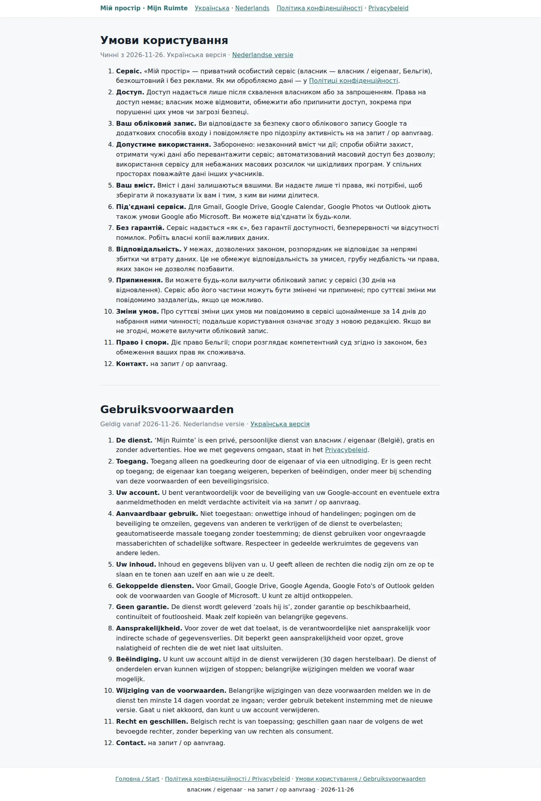 |

### 3. Openliggende sleutels en geheimen

gitleaks 8.30.1 (officiële uitgave, SHA-256 gecontroleerd): 56 treffers in de boom en 129 in de geschiedenis. Elk handmatig gecontroleerd — namen van omgevingsvariabelen, kunstmatige testwaarden, een voorbeeldsleutel uit RFC 6455, publieke AAGUID's van toegangssleutels en de publieke sleutel van de extensie. **Geen echte geheimen**; herschrijven van de geschiedenis is niet nodig.
Toegevoegd: `.gitleaks.toml` met toegelichte uitzonderingen en de werkstroom `.github/workflows/geheimen-scan.yml` die elke verzending en elk samenvoegverzoek controleert.

| Voor | Na |
|---|---|
| 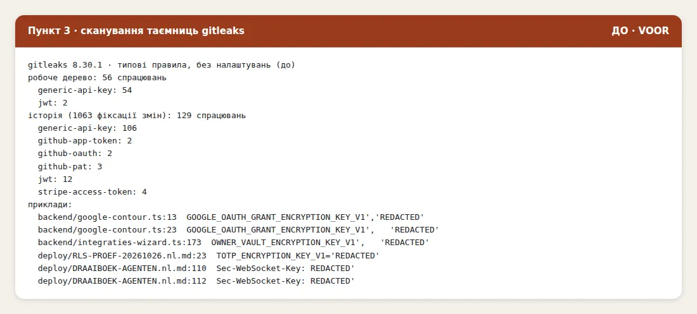 |  |

### 4. HTTPS

De productiesite is uitsluitend lezend gecontroleerd (zonder wijzigingen): alle 11 subdomeinen sturen `http://` met code 301 door naar `https://` en geven `Strict-Transport-Security: max-age=31536000; includeSubDomains`. Het certificaat van Google Trust Services WE1 is geldig tot 21.02.2027. TLS 1.0 en 1.1 worden geweigerd; in de `openssl`-controle antwoordt alleen TLS 1.3. Er was geen codewijziging nodig, dus de schermafdruk «voor» is gelijk aan «na».
Opmerking: het hoofddomein `tarasevych.com` (zonder subdomein) antwoordt niet — dat is een kwestie van de naaminstellingen van de eigenaar, niet van de toepassing.

| Voor = na (geen wijziging nodig) |
|---|
|  |

### 5. Toestemmingsbalk voor cookies

Er was geen toestemmingsbalk, terwijl het beleid analyse alleen met toestemming beloofde. Toegevoegd: [`src/toestemming/`](../../src/toestemming/) — een balk onderaan elke pagina (ook de aanmeldpagina zonder sessie) met twee **gelijkwaardige** knoppen «Alleen noodzakelijke» en «Analyse toestaan» (zelfde grootte en uitzicht, geen vooraf gekozen toestemming), een koppeling naar het beleid en teksten in uk + nl. De keuze wordt in de lokale opslag van de browser bewaard (`mr-toestemming-v1`), niet in een cookie; op pagina's met een sessie gaat ze ook naar de server (`POST /api/owner/privacy/toestemming`). De koppeling «Cookie-instellingen» op de aanmeldpagina opent de balk opnieuw. Delen 9 en 10 van het beleid zijn aangevuld.
Test `tests/eenheid/site-001-toestemming.test.ts`: 24/24.

| Voor | Na |
|---|---|
|  |  |
|  | 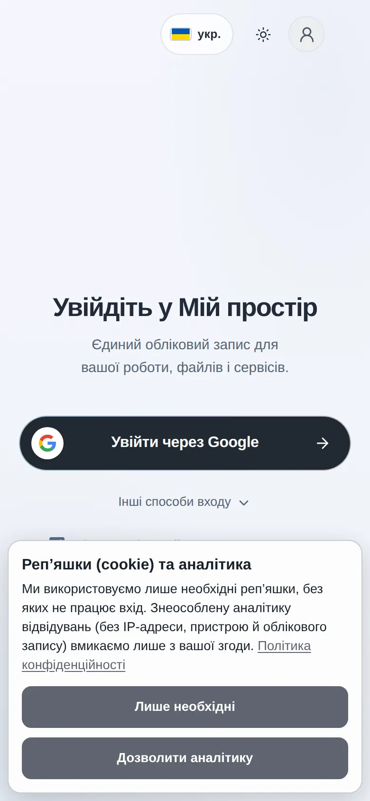 |
| — |  |

### 6–9. Titels, voorbeeldafbeelding, pictogrammen, sitemap.xml en robots.txt

- **6.** De tabbladtitels hadden drie vormen: beheer — «Адміністрування — Tarasevych» / «Tarasevych-beheer», Nederlands — «Mijn ruimte», gasttoegang — «Гостьовий доступ — Mijn Ruimte» (Nederlandse naam in een Oekraïense titel). Nu overal «<розділ> — Мій простір» / «<onderdeel> — Mijn Ruimte». Het aanmeldscherm op `id.tarasevych.com/` had voor iemand zonder sessie de titel «Налаштування — Мій простір»; nu «Вхід — Мій простір» / «Aanmelden — Mijn Ruimte» (instellingenpagina's na aanmelden houden «Instellingen»). De `meta description` van 20–160 tekens per onderdeel bestond al en blijft.
- **7.** Voorbeeldafbeelding van 1200×630 met het sitemerk (dezelfde vorm als `favicon.svg`) en de naam in beide talen. Tags `og:image`, `og:image:alt`, `og:site_name`, `twitter:card` in `index.html` en op `/privacy`, `/terms` (daar ook eigen `og:title`, `og:description`, `og:url`).
- **8.** Fout gevonden die ook op de productiesite staat: `favicon-192.png` en `favicon-512.png` zijn niet te ontcijferen (beschadigde gegevensstroom), dus het app-pictogram op telefoons en in het manifest werkte niet. Alle PNG-pictogrammen opnieuw getekend uit `favicon.svg`; `favicon.ico` (16/32/48) toegevoegd omdat browsers het zelf opvragen (was 404).
- **9.** `public/sitemap.xml` met alleen de twee openbare pagina's; de site is privé, de rest blijft `Disallow`. `robots.txt` laat pictogrammen en de voorbeeldafbeelding toe, anders kunnen sociale netwerken de afbeelding niet tonen.

Test `tests/eenheid/site-001-metadata.test.ts`: 21/21 (met volledige PNG-controle op controlegetallen).

Terloops een fout uit punt 19 verholpen: het tabblad «Bezoeken» las het serverantwoord zonder het veld `data` en werd een zwarte pagina; het antwoord wordt nu juist gelezen, test `site-001-analyse` aangevuld (13/13).

| Voor | Na |
|---|---|
|  |  |
| — |  |
| — |  |
|  |  |

### 10. Alternatieve teksten bij afbeeldingen

Alle 51 JSX-afbeeldingen in `src/` en `index.html` gecontroleerd: geen afbeelding zonder `alt`-attribuut. Een lege `alt` (29 plaatsen) alleen bij decoratieve beelden (avatar naast de naam, miniatuur in een knop met `aria-label`), zoals WCAG 1.1.1 vraagt. Fout: vlag en wapen van een plaats (`src/merk/PlaatsKeten.tsx`) hadden een lege `alt`, hoewel ze inhoud dragen; nu «Vlag: <naam>» / «Wapen: <naam>».
Nieuwe bewakingstest `tests/eenheid/site-001-alt.test.ts`: 4/4 — laat geen nieuwe afbeelding zonder `alt` door.

| Voor | Na |
|---|---|
|  | 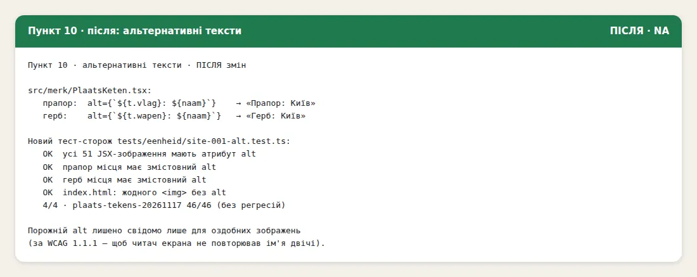 |

### 11. Afbeeldingen comprimeren

Overzicht: 1835 afbeeldingen, 8,38 MB; daarvan 1744 wapens en vlaggen in `webp` (gemiddeld 4,7 kB — al gecomprimeerd), 67 `svg`, 24 `png`. De officiële logo's `src/merk/officieel/*.png` zijn met SHA-256 in `HERKOMST.json` vastgelegd als originelen van de aanbieder — bewust niet gewijzigd. Pictogrammen en voorbeeldafbeelding gecomprimeerd met `pngquant` + `optipng` zonder zichtbaar verlies: 69 319 → 47 395 B (−32 %), voorbeeldafbeelding 61 → 43 kB.

| Na (omvangtabel) | Voorbeeldafbeelding voor / na |
|---|---|
|  |  |

### 12. Laadsnelheid van de site

**Meetopstelling en werkwijze (`prestatie-meten`).** De metingen zijn uitgevoerd op de gebouwde productiebundels (`vite build` + `dist-server` met `brotli`/`gzip` in het geheugen en `Cache-Control: public, max-age=31536000, immutable`) in twee scenario's van telkens **3 herhalingen na een opwarmronde** per adres:
1) lokaal netwerk (`1366×900`);
2) trage mobiele telefoon (`390×844`, `4×` CPU-vertraging, `150 ms` netwerkvertraging, `9 / 3 Mbit/s`).

**Vastgestelde oorzaken van vertraging:**
1. In `src/main.tsx` werd `App` statisch op het hoogste niveau geïmporteerd, waardoor de lichte gastpagina `/toegang` en het `OAuth`-terugkeervenster de volledige kern van 511 kB gecomprimeerde code (666 kB totaal) ophaalden en verwerkten.
2. Op openbare aanmeldschermen zonder sessie werden `TechLaag` + `HulpVraag` (~131 kB gecomprimeerd) en ~30 modules van het luie `MeldingenPortaal` (dat bij een gesloten paneel meteen `null` teruggaf) voortijdig geladen.
3. `regels-opslag.ts` en `uitrol-achtergrond-beheer.ts` riepen eigenaarsroutes aan zonder sessie (twee nutteloze `401`-antwoorden waardoor het netwerk 15,5 s niet stilviel) en stuurden geen `meldingLichaam()` / `tabContext` mee, wat zelfs na aanmelding `401` gaf.

**Verbeteringen:** `App` wordt dynamisch geladen (`import('./App')`) alleen in de hoofdtak; `TechLaag` wacht op sessiebevestiging (`ecosystemSessionLikely` / `wachtOpSessieHint` / `listenCanonicalAuthChanges`); `MeldingenPortaal` wordt pas gemonteerd bij het openen van het paneel of een actieve minimale pil; `meldingen/regels` en `uitrol/achtergrond` controleren eerst de sessie en sturen de tabbladcontext mee. Nieuwe bewakingstest `tests/eenheid/site-001-snelheid.test.ts` — `9/9`, `maquette-mobiel-prestatie` — `19/19`, `perf-001` — `41/41`, `tech-bundels-controle` — `OK`.

| Scenario (mediaan van 3 ronden, spreiding min–max) | Voor | Na | Verschil |
|---|---|---|---|
| `id/` · lokaal netwerk · omvang / `4xx`-fouten | `1013 kB` (`1013–1013`) / `2` | `873 kB` (`720–873`) / `0` | **−140 kB (−13,8 %)**, **`4xx`: 2 → 0** |
| `id/` · lokaal netwerk · `LCP` / netwerkstilte | `572 ms` (`508–604`) / `15 510 ms` | `308 ms` (`0–344`) / `1 475 ms` | **−46,2 % `LCP`**, **×10,5 snellere stilte** |
| `id/` · lokaal netwerk · lange taken (> 50 ms) | `2` (`262 ms`) | `2` (`148 ms`) | **−114 ms (−43,5 %)** |
| `id/` · telefoon 4G `×4` CPU · omvang / lange taken | `938 kB` (`937–1013`) / `7` (`1679 ms`) | `763 kB` (`763–763`) / `4` (`467 ms`) | **−175 kB (−18,7 %)**, **−72,2 % CPU-blokkering** |
| `id/toegang` · lokaal netwerk · omvang / `load` / `LCP` | `666 kB` / `329 ms` (`316–336`) / `352 ms` | `220 kB` / `210 ms` (`174–241`) / `236 ms` | **−446 kB (−67,0 %)**, **−36,2 % `load`** |
| `id/toegang` · lokaal netwerk · lange taken | `1` (`96 ms`) | `0` (`0 ms`) | **−100 % (0 lange taken)** |
| `id/toegang` · telefoon 4G `×4` CPU · zuivere ronde | `666 kB`, `load 2044 ms`, `LCP 2288 ms` (time-outs > 60 s) | `220 kB`, `load 1241 ms`, `LCP 1244 ms`, `FCP 664 ms` (0 time-outs) | **−39,3 % `load`**, **−45,6 % `LCP`** |
| `hub/privacy` · statische HTML · lokaal / telefoon | `32 kB`, `load 45 ms` / `711 ms` | `32 kB`, `load 73 ms` / `565 ms` | onveranderd lichte serverpagina |

*Grenzen van bewijskracht:* de metingen zijn verricht op de geïsoleerde lokale proefomgeving met een lege kunstmatige databank en `CDP`-vertraging boven een lokale `TLS`-verbinding (waarbij de planner van de headless browser in een VM zonder grafische versneller soms ~42 s timerpauze toevoegt, zichtbaar in de bovengrens van de `4G`-spreiding); deze cijfers bewijzen de kleinere netwerkomvang en lagere processorbelasting, maar vervangen geen meting over de echte tunnel van de productieserver.

| Voor | Na |
|---|---|
|  |  |

### 13. Kleurcontrast

De bewaker `scripts/kleur-contrast-controle.mjs` (2190 paren in 30 paletten, beide weergaven) is groen. Daarnaast zijn de weergegeven pagina's gecontroleerd met axe-core 4 (regel `color-contrast`, WCAG 2.1 AA): aanmelden met toestemmingsband, gasttoegang, pagina 404 en beheer — 0 schendingen. Op `/privacy` en `/terms` zijn twee fouten in `public/juridisch.css` gevonden:
- datum van de versie `#6a7580` op `#f7f8fa` — 4,42:1 (vereist 4,5:1) → `#5f6a75`, 5,19:1; in donkere weergave `#a3adb7`, 7,82:1;
- **in donkere weergave hadden alle koppelingen 2,64:1**: het blok `@media (prefers-color-scheme: dark)` stond boven de regel `a{color:#2f6f73}`, die het overschreef. Het blok staat nu aan het einde van het bestand — 7,15:1.

Na de correctie: 0 schendingen in lichte en donkere weergave.

| Voor | Na |
|---|---|
|  |  |
| 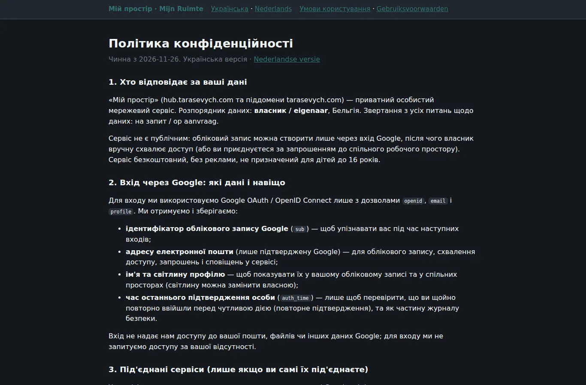 |  |

### 14. Geschiktheid voor mobiel

Nieuwe meting van weergegeven pagina's op breedtes van 320, 360, 390 en 768 pixels (zijwaarts schuiven, elementen voorbij de rechterrand, aanraakdoelen kleiner dan 24×24 volgens WCAG 2.2 · 2.5.8, tekst kleiner dan 12 pixels): aanmelden `id/`, gasttoegang `id/toegang`, `/privacy`, `/terms`, 404-pagina, e-mail. **Voor — 174 fouten, na — 0.** Verholpen:
- **`/privacy` en `/terms` schoven zijwaarts** op 320 (inhoudsbreedte 330 en 356 pixels): lange woorden en adressen braken niet af. Toegevoegd: `overflow-wrap:break-word` en `hyphens:auto`, voor `code` — `overflow-wrap:anywhere`; de kop `h1` schaalt met `clamp(1.4rem, 6.5vw, 1.7rem)`;
- **`code` was 11,44 pixels**: zonder uitdrukkelijke lettertypefamilie verkleint de browser het vastebreedtelettertype. Er is nu een uitdrukkelijke familie opgegeven;
- **te kleine aanraakdoelen**: de navigatiekoppelingen van de juridische pagina's, de koppelingen «Beleid» / «Voorwaarden» en het vakje «Onthouden» op het aanmeldscherm zijn nu minstens 24 pixels hoog; de taalknop — 0,76 rem;
- **Fastmail op de e-mailbaan** heeft een echte aanmeldknop (IMAP), maar had geen eigen plek en stond afgesneden in een hoek op een breed scherm. Nu staan de zeven enveloppen zonder overlapping: op een breed scherm staat Fastmail boven naast Outlook, op mobiel drie aan elke kant; de test `mail-orbit-001` controleert nu dat elk van de 7 aanbieders een plek op de baan heeft (voor de wijziging faalde hij: 16/17, nu 18/18).

Tests: `mail-orbit-001` 18/18, `mailmob-001` 22/22, `site-001-404` 24/24.

| Voor | Na |
|---|---|
|  |  |
|  |  |
|  |  |
|  |  |
| 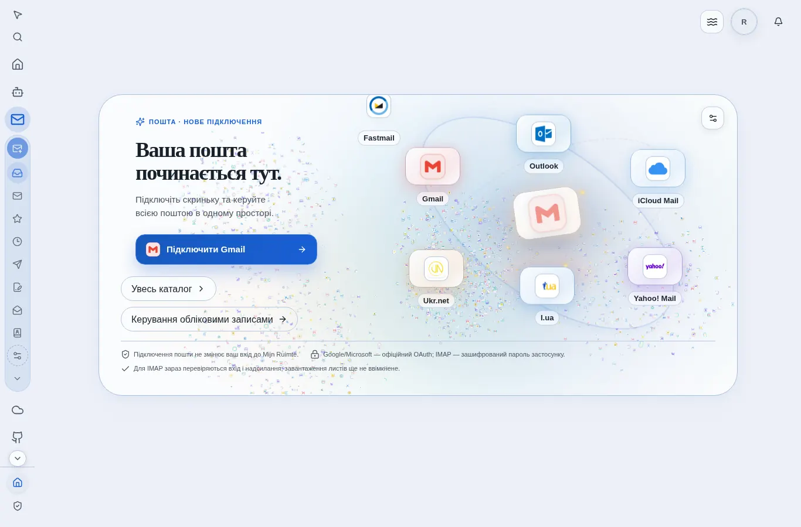 |  |
|  |  |

### 15. Eigen 404-pagina

De pagina «Pagina niet gevonden» (`src/NietGevonden.tsx`) bestond al, maar had vier fouten — alle verholpen:
- **«zachte 404»:** de server antwoordde op elk onbekend adres met 200, zodat zoekmachines en koppelingscontroles het als echte pagina zagen. Nu voert `server/platform/onbekend-pad.ts` dezelfde functie `resolve` uit `canonical-service.js` uit als de browser (in een afgeschermde `vm`-context, zonder tweede lijst van tabbladen), en antwoordt de server bij een onbekend adres met **404**. Tabbladen, oude adressen en aliassen, gasttoegang `id/toegang`, OAuth-terugkeer en gedeelde cloudkoppelingen blijven 200. Bij elke fout in de controle: oud gedrag (200);
- **zonder aanmelding** zag men het hele dienstenmenu (op hub bedekte het op 1366 breed ook de kaart), en op andere diensten in plaats van 404 het aanmeldscherm. Nu staat de 404-pagina zonder aanmelding op zichzelf, gecentreerd; met aanmelding de gewone schil (geen bedekking);
- **gecodeerd pad** (`/%D1%89%D0%BE`) → getoond zoals een mens het leest (`/що`);
- titel van het tabblad — «Сторінку не знайдено — <служба>» / «Pagina niet gevonden — <dienst>».

Bewakingstest `tests/eenheid/site-001-404.test.ts` — 24/24. axe-core — 0 schendingen.

| Voor | Na |
|---|---|
| 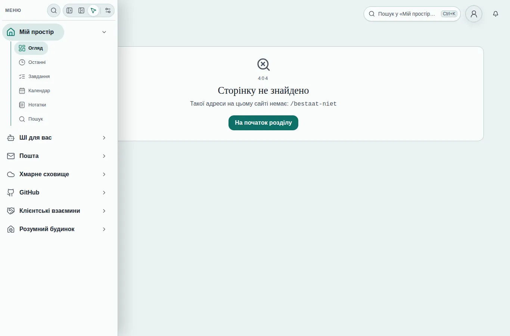 | 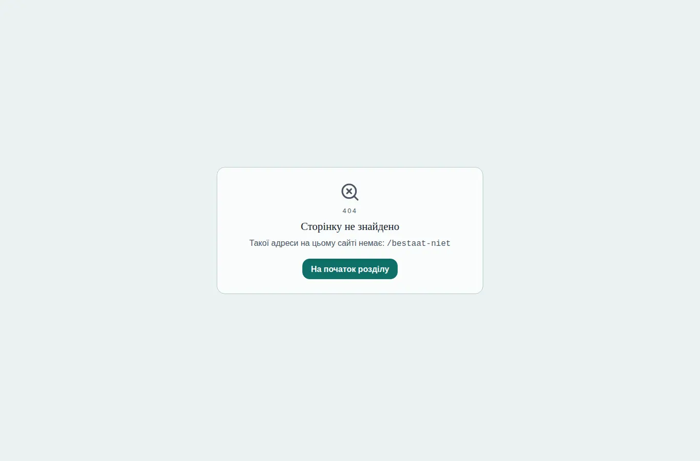 |
|  |  |
| 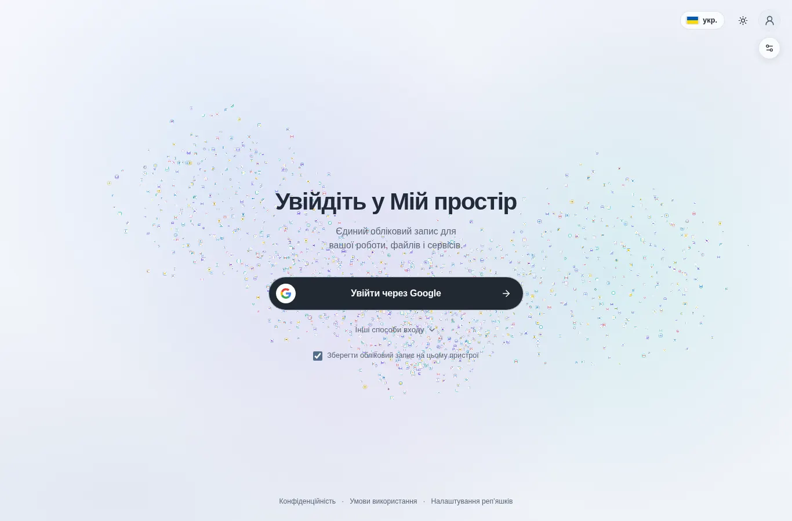 | 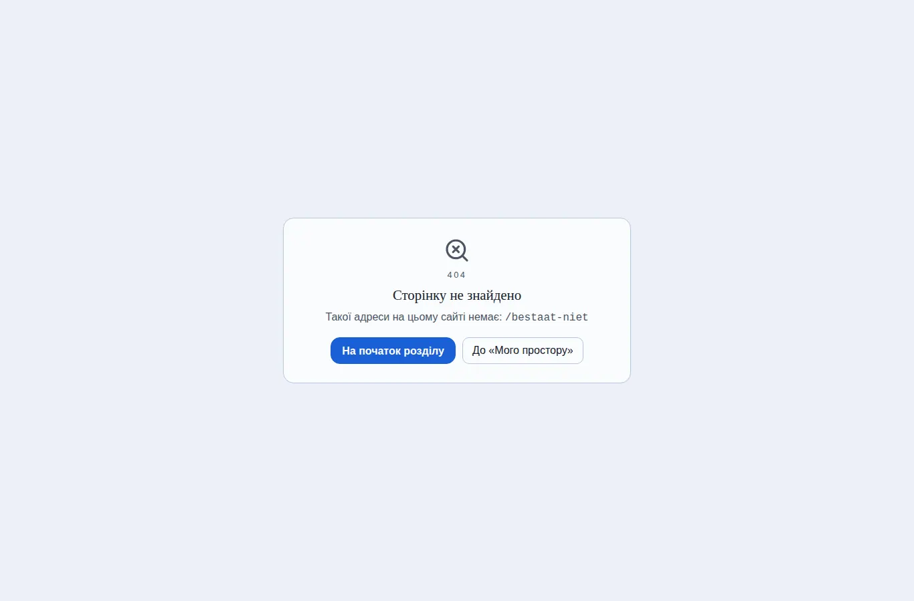 |
|  | 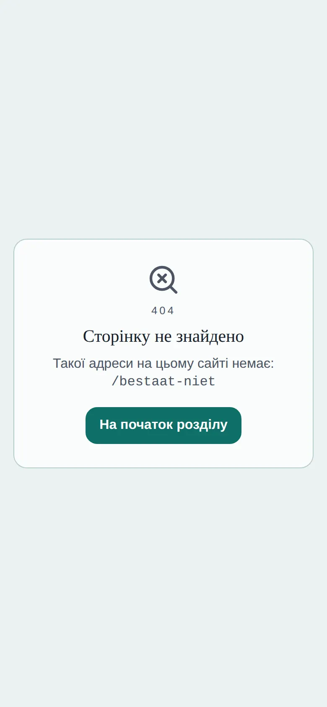 |
| 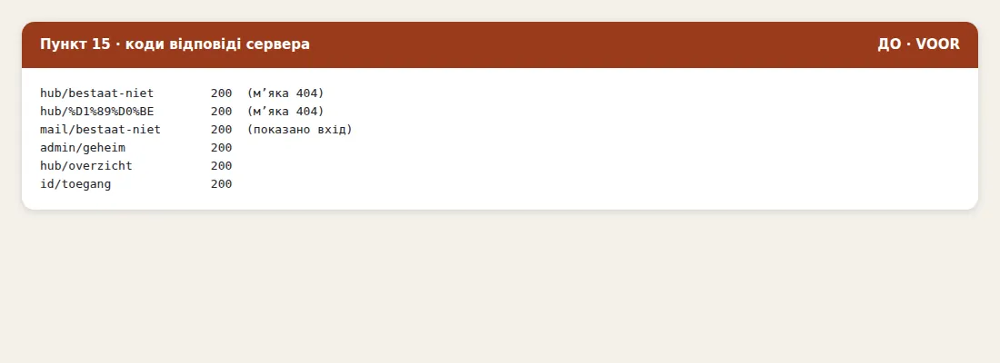 |  |
| | 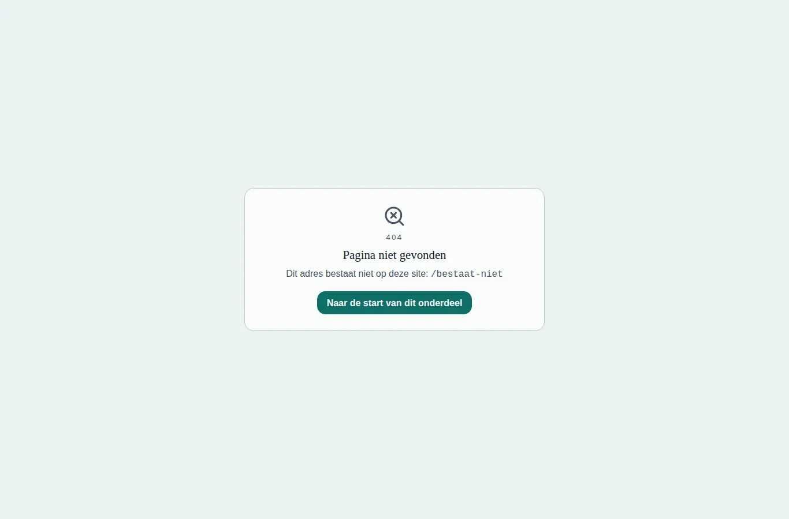 |
| |  |

### 16. Kapotte koppelingen

Een nieuw hulpmiddel doorloopt weergegeven pagina's zonder aanmelding (aanmelden, gasttoegang, `/privacy`, `/terms`, 404, e-mail), verzamelt alle `a`, `link`, `img`, `script`, leest `sitemap.xml` en voegt de vaste adressen uit de code toe (`src/`, `backend/`, `public/`, `index.html`). Gecontroleerd: 305 interne adressen op de proefopstelling en 3 externe (Google-beleidspagina, Belgische gegevensbeschermingsautoriteit) — alle externe werken.

De eerste ronde toonde 181 «kapotte» adressen, maar dat was een fout in het hulpmiddel zelf: verzoeken van Playwright negeerden de naamomleiding en gingen naar de productiesite met de oude bouw (de productiesite werd alleen gelezen). Na de verbetering bleven 9 kandidaten over, elk met de hand nagegaan:
- **echte fout:** het bevestigingsvenster (`src/platform/bevestig-toegang.tsx`) opent op elke dienst, ook mcp en api, maar de koppeling «naar aanmeldmethoden» was relatief (`/aanmeldmethoden`) — daar leidde ze naar 404. Nu is het adres absoluut `https://id.tarasevych.com/aanmeldmethoden`, zoals in `kluis-poort.tsx`;
- `/methods`, `/sharing`, `/audit`, `/ai` — niet kapot: deze onderdelen verschijnen alleen op hun eigen diensten (id en admin), waar de paden openen (200);
- `mcp.tarasevych.com/Grok`, `/claude`, `/mcp` — adressen van de aparte MCP-brug (poort 8091), die op de proefopstelling ontbreekt;
- `/bestaat-niet` — bewuste controle van de 404-pagina.

Daarnaast is de naam gelijkgetrokken: de pagina en de voetregel hadden «Умови користування», de app «Умови використання». Nu overal «Умови використання», zoals in de opdracht van de eigenaar. Zonder de variabele `MR_EIGENAAR_NAAM` belandde een tweetalige vervanging in een eentalige zin («власник — власник / eigenaar»). Nu heeft elke taal een eigen vervanging: «приватна особа» / «een particulier». Evenzo gaf het ontbreken van `MR_CONTACT_EMAIL` «…активність на на запит / op aanvraag». Nu heeft elke zin een natuurlijke vervanging in de eigen taal («meldt verdachte activiteit bij de eigenaar», «Adres op aanvraag»).

Nieuwe bewakingstest `tests/eenheid/site-001-koppelingen.test.ts` — 6/6: gedeelde onderdelen `src/platform/**` hebben geen relatieve `href`; `sitemap.xml` en `robots.txt` wijzen naar iets bestaands; elk vast bestand uit `index.html` en de juridische pagina's staat in `public/`. `juridisch.test.ts` — 12/12.

| Voor | Na |
|---|---|
|  |  |
|  | 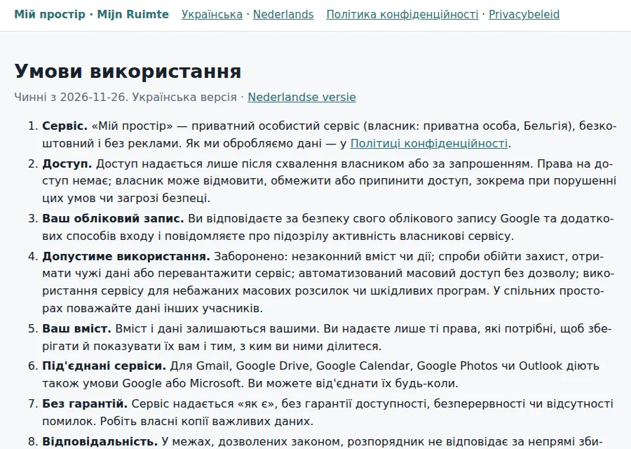 |

### 17. Validatie van alle formulieren

**Server.** Een nieuw hulpmiddel stuurt naar elk van de 50 openbare POST-routes (aanmelden, gasttoegang, toegangsverzoeken, registratie van aanmeldmethoden enz.) acht kapotte inhouden: geen JSON, een lijst, `null`, een tekenreeks, verkeerde typen, te lange tekenreeksen, stuurtekens, een inhoud van 2 MB — samen 400 gevallen. Geen enkele crash (500 of verbroken verbinding): 116 × 400, 100 × 413, 63 × 401, 42 × 404 (geen dergelijke poging, transactie of ingeschakelde methode), 12 × 403, 6 × 409, 1 × 429 — steeds met een redencode; 48 × 200 — alleen-lezen routes (catalogus) die de kapotte inhoud gewoon negeren. De enige 12 antwoorden 503 zijn `ACCESS_WEBAUTHN_DISABLED` op twee eigenaarsroutes waar deze mogelijkheid op de proefomgeving bewust uit staat; dat is geen fout.

**Browser.** Het hulpmiddel controleert het gastformulier en het wachtwoordformulier zoals een mens en een schermlezer ze zien. Op de oude bouw — 7 fouten:
- een gastcode getypt op een Oekraïense indeling (А, В, Е, К, М, Н, О, Р, С, Т, Х, І) werd door de server geweigerd, hoewel hij er juist uitziet;
- ongeldige tekens (bijvoorbeeld U of «!») werden pas na weigering door de server zichtbaar;
- na weigering werd het veld niet als onjuist gemarkeerd (`aria-invalid`), was de melding niet aan het veld gekoppeld (`aria-describedby`) en ging de focus verloren — hetzelfde in het wachtwoordformulier (adres en wachtwoord).

**Verbeteringen:**
- nieuwe module `src/gast-code.ts`: Cyrillische dubbelgangers worden al tijdens het typen Latijn; ongeldige tekens worden meteen met uitleg getoond (`role=alert`); teller «N van 16 ingevoerd»; de knop «Verzenden» werkt alleen bij een volledige code; een code uit de koppeling `#code=` krijgt dezelfde opschoning;
- `src/GastToegang.tsx`: het veld heeft `aria-invalid` en `aria-describedby` naar de hint, de tekenmelding en de serverfout; na weigering keren focus en selectie terug naar het veld;
- `src/aanmelden/AanmeldZonderGoogle.tsx`: de foutmelding heeft een eigen `id`, de velden adres, wachtwoord en code worden gemarkeerd en verwijzen ernaar; na weigering komt de focus in het wachtwoordveld; `src/geheim/GeheimInvoer.tsx` kreeg de eigenschap `ariaInvalid`.

Herhaalde controle in de browser — 0 fouten. Nieuwe bewakingstest `tests/eenheid/site-001-formulieren.test.ts` — 22/22.

| Voor | Na |
|---|---|
| 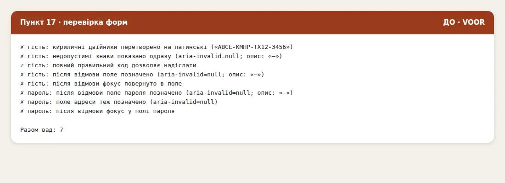 | 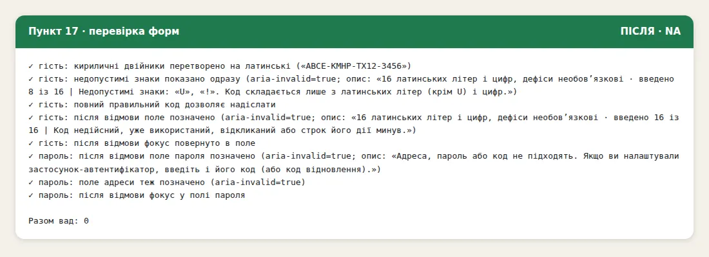 |
|  |  |
| 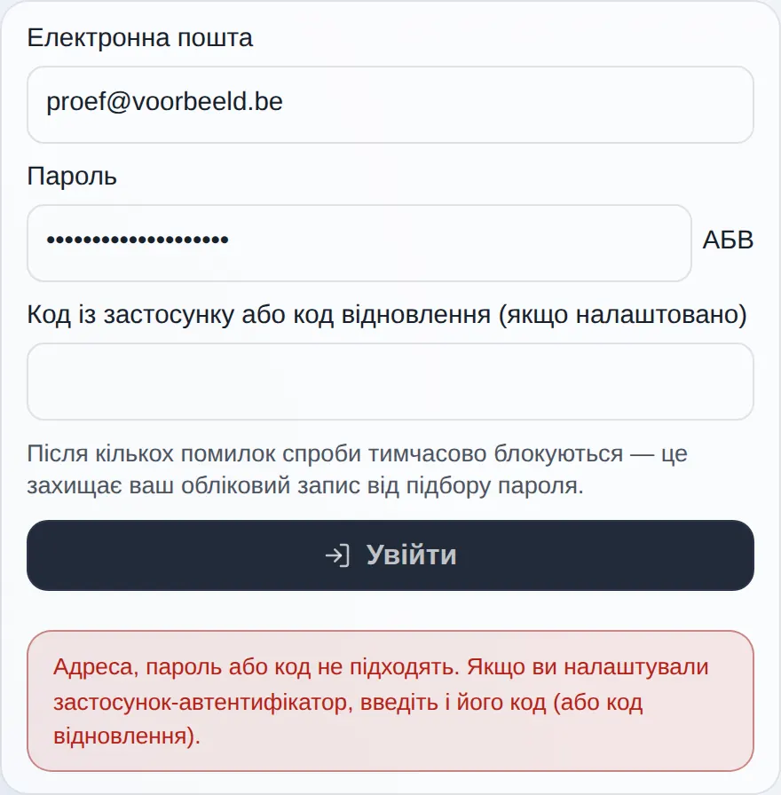 | 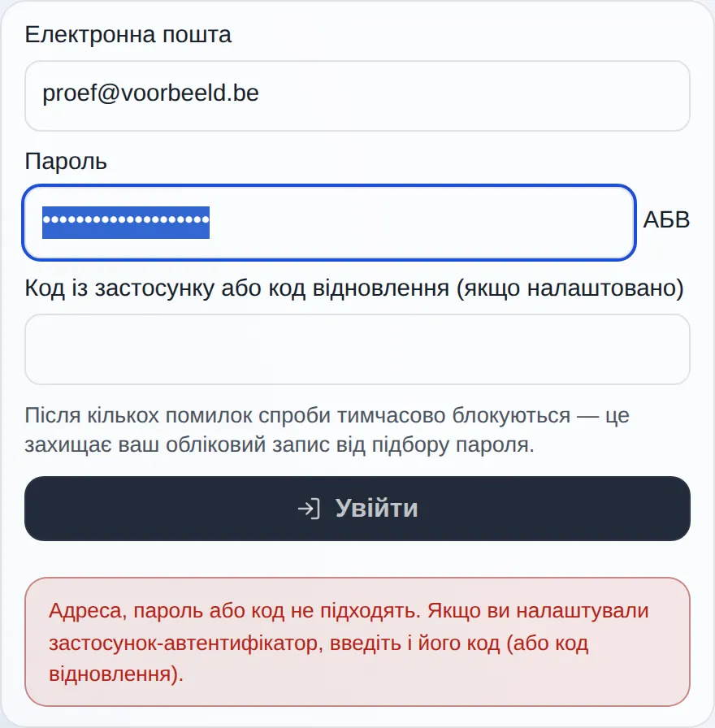 |

### 18. Bescherming tegen spam

De site heeft geen open formulieren voor anonieme berichten (contactformulier, vrije registratie): alles wat zonder aanmelding gegevens aanneemt, is aanmelden, de gastcode, gedeelde koppelingen, terugroepadressen van diensten en de MCP-connector. Bescherming tegen spam betekent hier dus snelheidslimieten, tellers voor mislukte pogingen en controle van handtekeningen. Een lokveld is niet nodig: er is geen formulier dat een robot zonder geheim kan invullen.

**Inventaris.** Van de 56 openbare POST-routes (zonder sessie) hebben er 23 een strikte limiet per IP in `server/start.ts` (`STRIKTE_LIMIETEN`; bij een databasestoring weigeren in plaats van doorlaten) en 33 alleen de algemene grens van 600/min. Voor elk van die 33 is uitgezocht waarom dat volstaat: een eigen teller (code in het Telegram-venster — pauze en uitschakeling; gedeelde koppelingen — code van 192 bits, 120/min per IP en 10 wachtwoordpogingen per 5 min), een verplichte handtekening (GitHub, Telegram, Google, Microsoft), een toegangstoken (extensie, agenten, MCP), alleen lezen of idempotent afmelden. Een toegangsverzoek van een nieuwe gebruiker heeft al een grens van 5/uur per account en 30/uur per IP, en de eigenaar krijgt maar één melding.

**Live controle op de proefomgeving.** De eerste ronde toonde twee limieten die «niet werkten» — de oorzaak lag bij de proefomgeving: `E2E_LOKALE_LIMIETEN=1` vermenigvuldigt de strikte limieten met 20 voor lokale browsertests. Zonder die factor, zoals op de productiesite, werken alle 6 gecontroleerde limieten precies volgens de instellingen: gastcode en oude wachtwoordaanmelding — blokkade na 5 mislukte pogingen; aanmelden met wachtwoord — 429 vanaf de 11e poging; start van aanmelden zonder Google — vanaf de 31e; registratie van een MCP-client — vanaf de 21e; gedeelde koppeling — vanaf de 121e. De vensters zijn vast (60 s), daarom zijn de reeksen 2 × de limiet plus marge lang. De mens ziet de uitleg «Te veel pogingen. Probeer het over ~N min opnieuw» (uk + nl).

**Nieuwe bewakingstest** `tests/eenheid/site-001-spam.test.ts` — 50/50. Hij leest `PUBLIEKE_ROUTES` en `STRIKTE_LIMIETEN` en eist voor elke openbare POST-route een strikte limiet of een vastgelegde eigen bescherming met een merkteken dat in de code te vinden is. Daarnaast controleert hij: raadbare geheimen (wachtwoorden, gastcode, koppelcode van een agent, Telegram-code, sessieoverdracht, MCP-registratie en -tokens) hebben juist een strikte limiet; alle strikte limieten weigeren bij een databasestoring; de factor ×20 werkt alleen bij de waarde `1` en ontbreekt in `deploy/`. Een nieuwe route zonder bescherming glipt er niet meer ongemerkt door.

| Voor | Na |
|---|---|
|  | 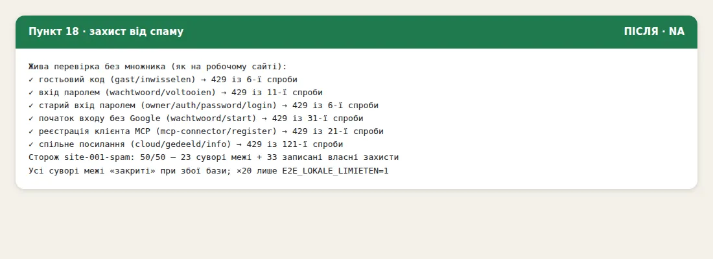 |

### 19. Siteanalyse (samen met punt 5 uitgevoerd)

De serverkant bestond al (`backend/privacy.ts`: toestemming standaard uit, anonieme dagtellers), maar de interface riep haar nooit aan en niemand las de tellers. Nu: na toestemming één gebeurtenis `bezoek.<dienst>` per tabbladsessie (zonder paginapad, id, IP of apparaat); een beheerdersroute `POST /api/owner/admin/analyse-overzicht` (`admin.read`, alleen lezen) en een tabblad «Bezoeken» in «Diagnostiek» met perioden van 7/30/90 dagen. Geen externe analysediensten — nul nieuwe kosten en geen doorgifte aan derden.
Test `tests/eenheid/site-001-analyse.test.ts`: 12/12 (met een echte PostgreSQL 18-database).

| Voor | Na |
|---|---|
|  |  |

### 20. Één duidelijke oproep tot actie

**Controle «voor».** Het hulpmiddel `cta.mjs` bekeek 6 kernschermen (`id/` nieuw toestel, `id/` met bewaard account, `mail/`, `id/toegang`, `id/bestaat-niet`, `hub/privacy`) en beoordeelde de visuele hiërarchie van de knoppen en koppelingen in het hoofdgebied (buiten de bovenbalk met taal/thema, de juridische voetregel en de wettelijk gelijkwaardige knoppen van de toestemmingsbalk). Twee fouten gevonden:
1. Op het aanmeldscherm met een bewaard account was de kaart van de gebruiker bleek en ondergeschikt, terwijl de knop «Aanmelden met Google» eronder donker gevuld bleef als hoofdactie — de nevenactie overschreeuwde het snelle aanmelden van de eigenaar van het toestel.
2. Op de openbare juridische pagina's `/privacy` en `/terms` ontbrak in de kop een herkenbare hoofdknop terug naar de ruimte (`0` hoofdacties — enkel gewone tekstkoppelingen).

**Verbeteringen:**
- In `src/CanoniekOmlijsting.tsx`, `src/aanmeld-herontwerp.css` en `src/maquette-kern/maquette-aanmelden.css` kreeg de eerste bewaarde accountkaart `data-hoofdactie="true"` en de opvallende opmaak van de hoofdknop (contrast > 10:1), terwijl de Google-knop en extra methoden eronder een rustige omlijnde weergave `data-hoofdactie="false"` krijgen. Zonder bewaard account blijft de eerste aanmeldmethode de enige hoofdactie.
- In `backend/juridisch.ts` en `public/juridisch.css` is de koppeling «Мій простір · Mijn Ruimte» in de kop vormgegeven als de enige opvallende pilknop (contrast 8,1:1 in lichte en 9,6:1 in donkere weergave; `axe-core` — 0 schendingen). Op de 404-pagina (`src/NietGevonden.tsx`) zijn hoofd- en nevenactie expliciet gemarkeerd.

Herhaalde controle met `cta.mjs` — **0 fouten** (6 van 6 schermen hebben precies 1 hoofdactie). Nieuwe bewakingstest `tests/eenheid/site-001-cta.test.ts` — `8/8`, `aanmelden-integ` — `43/43`, `juridisch` — `12/12`.

| Voor | Na |
|---|---|
|  |  |
|  | 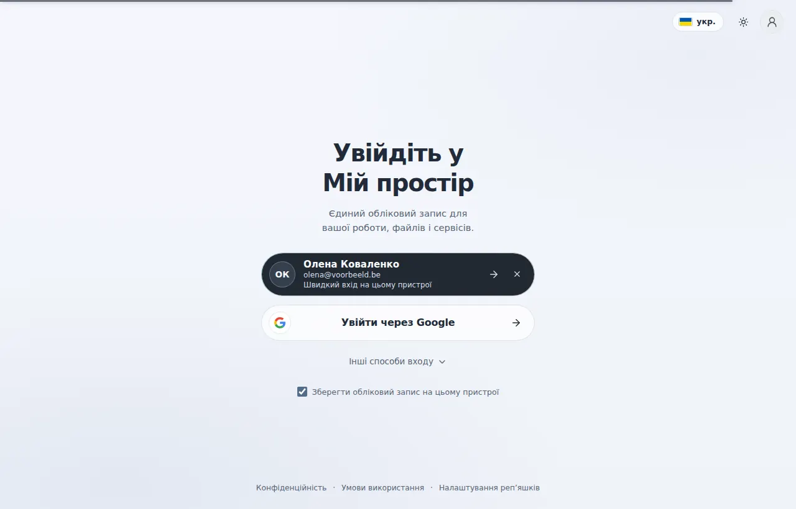 |
| 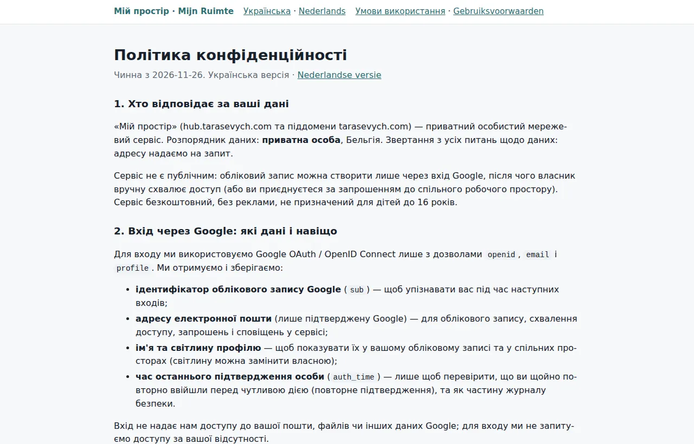 |  |

### Taalzuivering op besluit van de eigenaar («акаунт» → «обліковий запис»)

Op uitdrukkelijk besluit van de eigenaar is het anglicisme «акаунт» in alle naamvallen en vormen overal vervangen door het zuivere Oekraïense «обліковий запис» in de interfacecode, gedeelde modules, servermeldingen, zoekwoordenboeken en uitrolscripts (`src/`, `shared/`, `backend/`, `server/`, `public/`, `deploy/`, `index.html` — samen 852 voorkomens in 285 bestanden; het ontwerp van het accountcentrum is opnieuw opgebouwd via `scripts/identiteit-maquette/bouw.mjs` en de zoekindex `shared/zoek-ui-knoppen.generated.ts` is bijgewerkt voor 2439 elementen). Het ondertekende browserextensiepakket `extension/` versie `0.9.7` bleef bewust ongewijzigd om de geldige `CRX3`-handtekening van de eigenaar te behouden tot herondertekening.

Een vergelijkende proef van alle 638 eenheidstestbestanden ten opzichte van de basis en gerichte nacontroles bevestigden 0 regressies (daarbij zijn de 404-verwachtingen in `maquette-001-kern.test.ts` en `ui-audit-g.test.ts` gelijkgetrokken). Bewakingstest `tests/eenheid/site-001-akaunt.test.ts` (8/8) toegevoegd. Dit onderdeel werd voorbereid door `Claude Opus 5.5 (High)` via `Antigravity Google` en na onderbreking door limietuitputting gecontroleerd en afgerond door `Gemini 4 Carbon High` van `Google Antigravity`.

| Voor | Na |
|---|---|
|  |  |
| 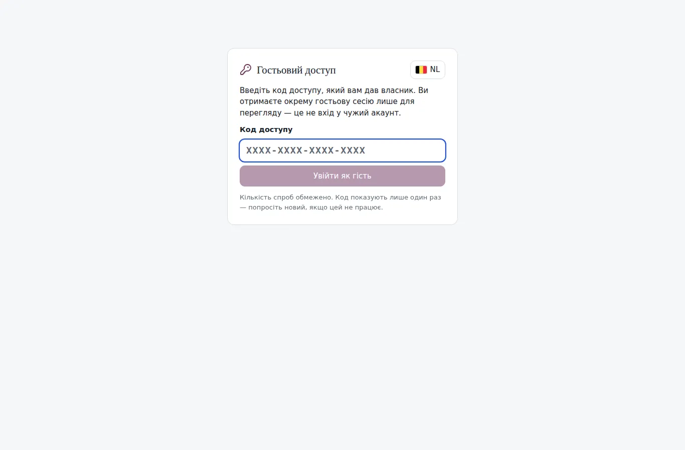 |  |

### 21. Knoppen en interactieve elementen

**Controle «voor».** Het eind-tot-eindhulpmiddel `knoppen.mjs` controleerde op de lokale proefomgeving de interactieve elementen zowel zonder aanmelding (`id/`, `/toegang`, `/privacy`, 404-pagina) als met aanmelding als eigenaar op een eenmalige `rook`-server (`id/` instellingencentrum en het mobiele werkblad `hub/` op 390×844). Vier fouten gevonden:
1. Op de gasttoegangspagina `/toegang` (`src/GastToegang.tsx`) toonde de taalwisselaar `.gast-taal` de zichtbare tekst `NL` / `UA`, maar miste die zichtbare tekst in `aria-label` — een ernstige schending van WCAG 2.5.3 (`label-content-name-mismatch` in `axe-core`, breekt spraakbediening).
2. Aangemeld in het instellingencentrum `id/` stuurde het ontwerp `src/identiteit/maquette/IdentiteitMaquette.tsx` bij elke achtergrondlezing een verzoek `POST /api/owner/workspaces/list` naar een niet-bestaande route, wat telkens een `404`-netwerkfout veroorzaakte.
3. Na bevestiging van de sessie op `id/` bleef de tabbladtitel `document.title` staan op het aanvankelijke «Вхід — Мій простір» / «Aanmelden — Mijn Ruimte» in plaats van «Налаштування — Мій простір» / «Instellingen — Mijn Ruimte» (en bij taalwisseling in andere diensten werd de titel evenmin zonder herladen bijgewerkt).
4. Op een nieuw leeg werkblad `WerkbladV3` (`src/werkblad/WerkbladV3.tsx`) werd buiten de bewerkmodus enkel een leeg canvas getekend zonder verklarende kaart of knop om widgets toe te voegen of de standaardindeling te plaatsen.

**Verbeteringen:**
- `src/GastToegang.tsx`: de toegankelijke naam `aria-label` van `.gast-taal` begint nu met het zichtbare opschrift `MOVA_NAAM` (`NL — перемкнути мову на нідерландську` / `UA — taal wisselen naar Oekraïens`).
- `src/identiteit/maquette/IdentiteitMaquette.tsx`: de aanroep `/api/owner/workspaces/list` is vervangen door het canonieke `/api/owner/session/bootstrap`, dat de lijst `workspaces` zonder enige `404`-fout teruggeeft.
- `src/VerenigdDienstApp.tsx` en `src/App.tsx`: reactieve synchronisatie van `document.title` met de sessiestatus en de gekozen taal toegevoegd (met behoud van de `[ТЕХ]` / `[TECH]`-aanduiding van de technische strook en de eigen titel van de 404-pagina).
- `src/werkblad/WerkbladV3.tsx`: op een leeg werkblad verschijnt nu de uitnodigende kaart `.wb-leeg-stol` (`data-wb-leeg="1"`, `data-wb-aantal`) met twee acties — de hoofdknop «Uit bibliotheek toevoegen» en de nevenknop «Standaardindeling» (zet de standaardset voor de huidige toestelklasse klaar en bewaart haar). De zoekindex van de interface is bijgewerkt (2440 elementen).

Herhaalde proef met `knoppen.mjs` — **0 fouten** (11 van 11 live scenario's geslaagd). Nieuwe bewakingstest `tests/eenheid/site-001-knoppen.test.ts` — `7/7`, aangrenzende tests `werkblad-hoek-20261115` (`9/9`) en `identiteit-maquette` (`56/56`) groen.

| Voor | Na |
|---|---|
|  |  |
|  |  |
| — | 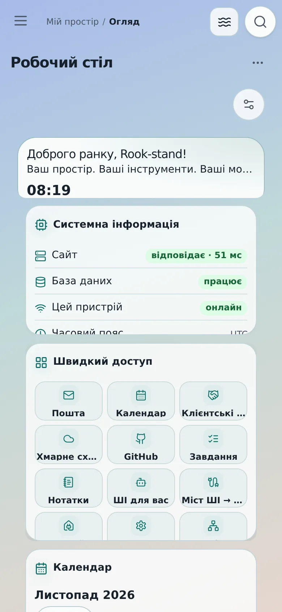 |

### 22. Foutregistratie en bewaking

**Controle van de bestaande bewakings- en foutregistratielagen:**
- **Vangnet van het serverproces (`server/platform/proces-vangnet.ts`, `server/start.ts`):** onopgevangen uitzonderingen en afgewezen beloften worden zonder verzoekinhoud of geheimen in het serverjournaal vastgelegd, zodat één fout niet alle sessies en geheugensleutels verbreekt; bij meer dan 50 fouten binnen 60 s stopt het proces met code `1` voor een schone herstart via `systemd`. De vertraging van de gebeurtenislus wordt gemeten met `monitorEventLoopDelay`.
- **Gezondheidscontroles (`/__gezondheid` en `/__gezondheid?diep=1`, `backend/diepe-gezondheid.ts`):** de basiscontrole geeft `{"ok":true,"db":true}`; de diepe controle vanaf `127.0.0.1` toetst in 20 ms de database, een proefsessie van de technische ruimte v2, uitgifte en intrekking van het toegangskoekje voor `/assets/tech/*` en de aanwezigheid van de gebouwde modules, terwijl elk verzoek met een tunnelkop (`cf-connecting-ip`) `403 {"ok":false,"fout":"ALLEEN_LOKAAL"}` krijgt.
- **Ontvanger voor clientstoringen en lekvrije logboeken (`backend/toegangsfout-tellers.ts`, `shared/beheer-journaal.ts`):** `401`/`403`/`404`-antwoorden en meldingen van niet-geladen modules (`POST /api/storing/tech-bundel`) worden per uur in 6 groepen geteld zonder IP-adressen of gebruikers; `meldingen-register-controle.mjs` bevestigde alle 333 serveractiecodes en 537 tweetalige omschrijvingen (`overig: 0`). De nazorgdienst `deploy/uitrol/mijn-ruimte-nazorg.sh` bewaakt elke minuut de gezondheid en weergave en draait bij uitval automatisch terug naar de vorige uitgave.

**Gevonden en verholpen fouten:**
1. **De eenmalige weergavestand `server/rook.ts` stopte met code `2`** op een verse database met de vlag `tech-ruimtes-v2`: `POST /api/owner/tech/activeren` gaf `409 GEBRUIK_RUIMTES_V2`. Nu voert de stand bij `409 GEBRUIK_RUIMTES_V2` een herbevestiging op `hub` uit, start hij de technische ruimte v2 via `POST /api/owner/hub/tech/ruimtes/starten` en haalt hij via `POST /api/owner/tech/status` alle 3 cookies op (inclusief `mr_tech_asset` voor `/assets/tech/*`). Een live proef met het ongewijzigde `dist-server/rook.mjs` opende `https://admin.tarasevych.com/diagnostiek` in de technische ruimte met status `200` en `0` fouten.
2. **Verouderde verwachting in `tests/eenheid/rook-controle-20261022.test.ts` (`39/40`):** de test rekende op 13 pagina's in `paginaLijst` terwijl dat er na toevoeging van `crm` 14 zijn — bijgewerkt (`40/40`).

Nieuwe bewakingstest `tests/eenheid/site-001-monitoring.test.ts` — `7/7`, aangrenzende tests `rook-controle-20261022` (`40/40`), `beheer-diagnostiek-rook-20261022` (`26/26`) en `uitrol-nazorg-rook-20261022` (`13/13`) alle groen.

| Voor | Na |
|---|---|
|  | 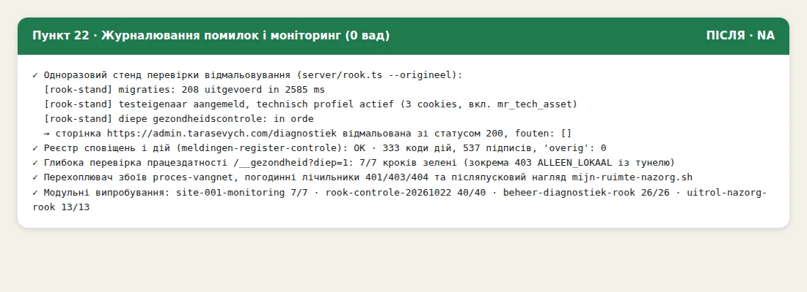 |
| — |  |

### 23. Reservekopieën van de database

**Controle van de reservekopieketen (`deploy/backup-maken.sh`, `mijn-ruimte-backup.timer`, `mijn-ruimte-backup.service`, `installeer-app.sh`):**
- Elke nacht om `03:30` (`Persistent=true`) en automatisch vóór elke uitgave-installatie en migratie (`installeer-app.sh` breekt de installatie na twee mislukte pogingen af) draait `mijn-ruimte-backup.service` onder een aparte gebruiker met `ProtectSystem=strict`, `NoNewPrivileges=yes` en `RestrictSUIDSGID=no`.
- `deploy/backup-maken.sh` ontleedt `DATABASE_URL_SYSTEM` naar `PG*`-omgevingsvariabelen met `unset DUMP_URL` (geen wachtwoorden in procesargumenten), stuurt `pg_dump --format=custom --compress=6` rechtstreeks door `age --encrypt --recipients-file` zonder klare tekst op schijf (de privésleutel blijft enkel offline bij de eigenaar), sluit geheimen uit het systeemarchief uit, berekent `SHA256SUMS` en schrijft als laatste atomair het merkteken `KLAAR`. Zonder een `BYPASSRLS`-rol weigert `pg_dump` zelf een opname, zodat een onvolledige kopie van RLS-tabellen onmogelijk is.

**Kritieke bevinding en verbetering:**
- In het noodherstelscript voor een lege machine `deploy/archief-herstellen.sh` (`vidnovyty.sh`), de toelichting in `deploy/archief-maken.sh` en de handleidingen `deploy/ВІДНОВЛЕННЯ.uk.md` / `deploy/HERSTEL.nl.md` stond nog **`postgresql-17` / `PostgreSQL 17`**, terwijl de productiedatabase op **PostgreSQL 18** draait en een dump van formaat `Dump Version: 1.16-0` maakt die door `pg_restore` 17 wordt geweigerd (`unsupported version (1.16) in file header`), en de migraties PostgreSQL 18 vereisen. Alle herstelscripts en handleidingen zijn bijgewerkt naar **`postgresql-18` (`postgresql-client-18`, `PostgreSQL 18`)**.

**Live proef van maken én terugzetten:**
- Met een proefsleutelpaar van `age` is `deploy/backup-maken.sh` echt uitgevoerd tegen de lokale PostgreSQL 18.7-database, zijn alle controlesommen met `sha256sum -c SHA256SUMS` en de kop `age-encryption.org/v1` geverifieerd.
- Via `age --decrypt | pg_restore --no-owner --role=mijnruimte` is de kopie teruggezet in een schone tijdelijke PostgreSQL 18.7-database: **100 % overeenkomst** met de brondatabase (`208/208` migraties, `224/224` `app`-tabellen, `3322/3322` rijen in `app.records`, `193/193` tabellen met actieve rijbeveiliging RLS).
- Nieuwe bewakingstest `tests/eenheid/site-001-backups.test.ts` — `6/6`, aangrenzende test `archief-herstellen-20261116` — `19/19`.

| Voor | Na |
|---|---|
|  |  |

### 24. Beveiligingskoppen en aanvraagbeperking

**Controle van de bestaande beveiligingslagen (`server/start.ts`, `server/platform/beveiliging.ts`, `shared/ip-limiet.ts`):**
- Alle antwoorden hadden al 6 kernkoppen: `Strict-Transport-Security: max-age=31536000; includeSubDomains`, een strikte `Content-Security-Policy` zonder `'unsafe-eval'` en zonder ingebedde scripts (`default-src 'self'; base-uri 'none'; object-src 'none'; frame-ancestors 'none'; form-action 'self'; upgrade-insecure-requests`), `X-Content-Type-Options: nosniff`, `X-Frame-Options: DENY`, `Referrer-Policy: strict-origin-when-cross-origin` en `Permissions-Policy: camera=(), microphone=(), geolocation=(), payment=(), usb=()`.
- Een onbekende `Host`-kop wordt geweigerd met code `421`, een vreemde `Origin` op `/api/*` met code `403`, en `Server-Timing` wordt weggelaten op gevoelige aanmeldpaden en `4xx/5xx`-antwoorden.
- De tweelaagse aanvraagbeperking groepeert IPv6-adressen per `/64`-subnet, begrenst het geheugen op `600/min` (`100 000` sleutels), bewaart strikte emmers in PostgreSQL (`app.rate_limits`, `failClosed: true`, `Retry-After`) en blokkeert herhaald raden oplopend via `app.login_lockouts` (`15 min → … → 24 uur` vanaf 5 mislukte pogingen).

**Aanvulling met isolatiekoppen tussen domeinen:**
- Aan `BASE_HEADERS` in `server/start.ts` zijn drie ontbrekende moderne beveiligingskoppen toegevoegd:
  1. `Cross-Origin-Opener-Policy: same-origin-allow-popups` — isoleert het tabblad tegen vreemde sites en houdt zelf geopende aanmeldvensters van Google OAuth en Telegram intact;
  2. `Cross-Origin-Resource-Policy: same-site` — verbiedt het insluiten van interne antwoorden en modules door derden terwijl uitwisseling tussen alle eigen `*.tarasevych.com`-subdomeinen behouden blijft (voor `/og-afbeelding.png`, `favicon*` en het ingebedde Telegram-venster geldt `cross-origin`);
  3. `X-Permitted-Cross-Domain-Policies: none`.

Live controle op de proefomgeving bevestigde alle **9 beveiligingskoppen**. Nieuwe bewakingstest `tests/eenheid/site-001-beveiliging.test.ts` — `7/7`, aangrenzende tests `site-001-spam` (`50/50`) en `telegram-venster-20261114` (`99/99`) groen.

| Voor | Na |
|---|---|
|  | 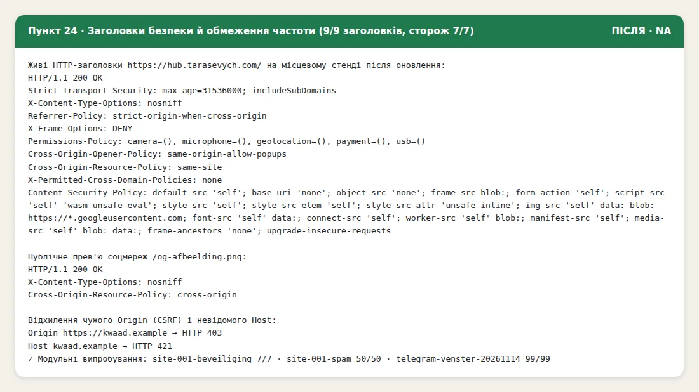 |

### 25. Registratie, aanmelding en wachtwoordherstel

De volledige levenscyclus van het account is gecontroleerd op een actieve PostgreSQL 18.7-database met de drie standaardrollen (`mijnruimte_migrator`, `mijnruimte_app`, `mijnruimte_system`), afgedwongen rijbeveiliging (`rls-aan`) en Chromium:

1. **Vertraging in het legen van het vlaggengeheugen (`VLAG-001`) opgespoord en verholpen:**
   - in `backend/account-wissen.ts` wordt na `COMMIT` van `accountMeteenWissen` direct `wisVlagGeheugen()` aangeroepen, zodat een gewist account niet alleen uit `app.feature_flags.gebruikers` in PostgreSQL verdwijnt, maar ook meteen uit het geheugen van de server (zonder 15 seconden wachttijd);
   - in `tests/eenheid/identiteit-015-herstel.test.ts` (`24/27 → 27/27`) en `tests/eenheid/identiteit-015-sleutels-gasten.test.ts` (`28/32 → 38/38`) is `wisVlagGeheugen()` toegevoegd na rechtstreekse SQL-bijwerkingen `UPDATE app.feature_flags`;
   - na het instellen van de standaardrollen via `deploy/db-rollen-instellen.sh instellen` en `rls-aan` slaagde `toegangscodes.test.ts` volledig (`54/56 → 56/56`).
2. **Nieuwe ketenbewaker `tests/eenheid/site-001-aanmelden-herstel.test.ts` (`12/12`):**
   - **registratie van een nieuw account:** eerste aanmelding maakt het account aan in de stand `new` en houdt de werkruimte dicht (`403`) → `POST /api/owner/access/request` zet de stand op `pending` en meldt dit aan de eigenaar → goedkeuring door de eigenaar via `POST /api/owner/admin/access-requests/:id` zet de stand op `approved` en maakt de eigen werkruimte aan;
   - **aanmelden zonder Google:** weigering van te korte wachtwoorden (`< 10` tekens), `scrypt`-opslag, inschakelen van tweestapsverificatie (`TOTP`) met uitgifte van 10 eenmalige herstelcodes (alleen HMAC-SHA256-controlewaarden in de database), gelijke weigering `401 ACCESS_CREDENTIALS_INVALID` bij onjuist wachtwoord of ontbrekende/hergebruikte `TOTP`-stap, en sessie-aanmaak met geldig wachtwoord + verse `TOTP` (`authMethod = 'password'`) en WebAuthn-toegangssleutel (`passkey`);
   - **wachtwoord- en accountherstel:** de dienst verstuurt bewust geen onversleutelde herstelberichten per e-mail — herstel verloopt via een eenmalige herstelcode (eerste code opent de sessie en verlaagt het saldo `10 → 9`, hergebruik van dezelfde code geeft `401`), `stap-op` met een herstelcode om een nieuw wachtwoord in te stellen, of een beheerdersreset (`mustChange: true` → weigering `403 ACCESS_PASSWORD_MUST_CHANGE` tot een eigen wachtwoord is ingesteld); daarnaast zijn het 7-daagse herstel van een ontkoppelde aanmeldmethode (`method/herstel`) en het 30-daagse herstel van een verwijderd account met werkruimte (`account/recover`) bevestigd.

Alle **11 integratiereeksen** zijn voor 100 % geslaagd (**432/432** controles groen).

| Voor | Na |
|---|---|
|  |  |
|  | 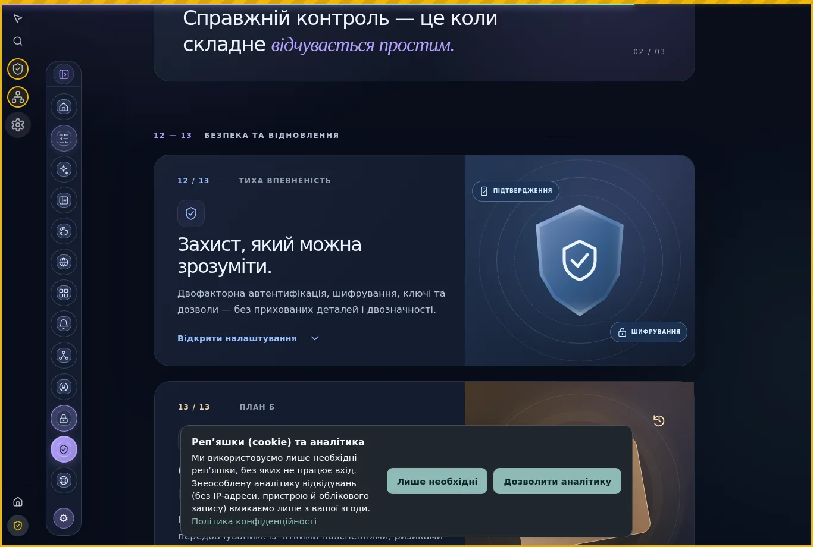 |

### Aanvullende verbetering op opmerking van de eigenaar: behoud van e-mail-, bijlage- en paginastatus tussen subdomeinen en bij terugkeer naar het tabblad (`Gemini 4 Argon High` · `Google Antigravity`)

- **Direct openen van e-mail vanuit andere subdomeinen (`src/MailFunctioneelWeergave.tsx`, `src/mail-aanbieder-toestand.ts`):** de e-mailopname wordt vanaf het eerste beeld synchroon hersteld uit de browseropslag (`tsv:mail-bootstrap-cache-v1`, `sessionStorage` + `localStorage`, `loading = false`), en de labels worden synchroon hersteld uit `tsv:mail-labels-snapshot-v1` met een versheidsvenster van 5 minuten (`LABELS_FRESH_TTL_MS = 300 000`).
- **Behoud van berichtenlijst, geopend bericht en bijlagen (`src/GoogleMailWerkruimte.tsx`, `src/mail-bijlage-cache.ts`):** het versheidsvenster van de berichtenlijst is verhoogd van 20 s naar 5 min (`freshCacheTtlMs = 300 000`) en dat van de kopcontrole naar 15 min (`900 000`); bijlagegegevens per rij (`attachmentsByMessage`) worden bewaard in `MailListViewSnapshot` en in de tijdelijke status `tsv:mail-ui-context-v3` (`sessionStorage` + `localStorage`); `openMessageById` en `openAttachment` openen een al geladen bericht en bijlage (`sourceBlob` uit `CacheStorage` `tsv-mail-private-v2`) direct zonder terug te vallen naar de laadstand.
- **Rustige terugkeer naar het tabblad zonder overbodige voortgangsbalk (`src/VerenigdDienstApp.tsx`, `src/App.tsx`, `src/tech/tech-opslag.ts`, `src/tech/ruimtes/ruimtes-opslag.ts`, `src/platform/client.ts`, `src/navigatie-snel.ts`):** bij ongewijzigd account en ongewijzigde ruimte loopt de achtergrondcontrole bij terugkeer naar het tabblad (`visibilitychange` / `focus`) hoogstens eens per 5 min (`300 000` ms) voor sessie/e-mail en eens per 60 s voor de ruimtestatus, en achtergrondroutes (`ACHTERGROND_PAD`) starten geen zichtbare bovenbalk `#tsv-voortgang` op een al getekende pagina. De bewakingstest `tests/eenheid/site-001-snelheid.test.ts` is uitgebreid naar `16/16`.

| Voor | Na |
|---|---|
|  |  |

### Aanvullende verbetering op opmerking van de eigenaar: betrouwbaar verzenden van berichten en antwoorden, achtergrondverzending tussen subdomeinen en meldingsbox (`Gemini 4 Argon High` · `Google Antigravity`)

- **Oplossing voor de fout «Het antwoord kon nu niet worden verzonden. De tekst blijft in de editor staan.» (`backend/google-suite-mail-browser.ts`, `backend/mail-opstel.ts`, `backend/google-suite-inrichting.ts`):**
  1. In `POST /api/owner/mail/google-suite/thread` en `POST /api/owner/mail/google-suite/reply` worden automatisch bewaarde concepten (`!(message.labelIds || []).includes('DRAFT')`) uitgefilterd. Als doelbericht voor het antwoord wordt het laatste inkomende bericht (`lastIncoming`, waarbij de afzender verschilt van `mine`) gekozen en worden alle deelnemers (`participants`) uit de hele conversatie verzameld. Dit voorkomt de onterechte fout `400 GOOGLE_MAIL_REPLY_RECIPIENT_INVALID` wanneer aan het einde van het gesprek een automatisch bewaard concept of een eigen bericht van de eigenaar stond (`to === mine`).
  2. In `_mailBrowserIntern.buildReplyRaw` zijn de delen `text/plain` en `text/html` omgezet van `8bit` zonder regeleinden (waarbij lange HTML-regels de RFC 5322-grens van 998 bytes overschreden) naar `Content-Transfer-Encoding: base64` met regels van hoogstens 76 tekens (`wrap64`), en voor de `Subject`-kop wordt `encodeWord` volgens RFC 2047 gebruikt.
  3. Terugval op de actieve postbus (`snapshot.account || snapshot.accounts[0]`) wanneer `accountId` leeg of `'all'` is, automatische herhaling van `POST /messages/send` zonder `threadId` bij HTTP 400/404 en opruiming van antwoordconcepten (`deleteDraftsForThread`) na geslaagde verzending.
- **Ononderbroken achtergrondverzending bij het wisselen tussen onderdelen en subdomeinen (`src/mail/uitgaande-post-achtergrond.ts`, `src/platform/client.ts`, `backend/mail-opstel.ts`, `backend/google-suite-mail-browser.ts`, `backend/ai-mail-assistent.ts`, `backend/mail-afzenders.ts`):**
  - E-mailroutes aanvaarden achtergrondverzoeken vanuit elk subdomein van `*.tarasevych.com` (`!auth.service`).
  - Verzending gebruikt `fetch` met `keepalive: true` (voor verzoeken ≤ 60 kB) en synchroniseert de taakstatus via de gedeelde cookie `mr_uitgaande_post_v1` (`Domain=.tarasevych.com`), `localStorage` (`tsv:uitgaande-post-wachtrij-v1`), `BroadcastChannel` en het serverconcept in PostgreSQL (`app.mail_drafts`). Bij overstap naar een ander subdomein (`hub.*`, `cloud.*`, `id.*`, `mcp.*`) neemt `controleerUitgaandePostOpSubdomein` in `src/CanoniekMeldingencentrum.tsx` de verzending op de achtergrond over.
- **Directe meldingsbox met knop «Opnieuw verzenden» op alle subdomeinen (`src/CanoniekMeldingencentrum.tsx`, `src/mail/uitgaande-post-achtergrond.ts`):**
  - Bij een verzendfout verschijnt op elk onderdeel en elk subdomein onmiddellijk (zonder 2,5 s typvertraging, `kind === 'error' || Boolean(notice.retain)`) een prominente meldingsbox `.canonical-notification-toast` (8 s zichtbaar, gepauzeerd bij aanwijzen of aanraken) met de duidelijke oorzaak, bevestiging dat het concept bewaard is en een directe actieknop **«Opnieuw verzenden»** (`data-qa-id="melding-actie-knop"`). De bewakingstest `tests/eenheid/site-001-snelheid.test.ts` is uitgebreid naar `22/22`.

| Voor | Na |
|---|---|
|  |  |

### Aanvullende verbetering op opmerking van de eigenaar: compacte capsuleknop voor e-mailsecties tussen menuknop en zoekveld en adaptief zoekveld (`Gemini 4 Argon High` · `Google Antigravity`)

- **Vervanging van de lange overbodige onderbalk door een compacte capsuleknop direct in de bovenbalk (`src/GoogleMailWerkruimte.tsx`, `src/maquette-kern/maquette-oppervlakken.css`, `src/mail/mail-werkruimte-maquette.css`, `src/mail-mobiel.css`):**
  1. De afzonderlijke brede balk `.mq-anker-onderbalk` onder de bovenste opdrachtbalk van de e-mail (~60 px hoog + 14 px marge, die verticale ruimte boven de berichtenlijst innam) is verwijderd.
  2. `MaquetteAnkerRail` is rechtstreeks ingebed in de bovenste opdrachtbalk (`.mail-top-command-bar`) tussen de hoofdmenuknop (`☰`) en het zoekveld (`MailSearchField`) als een compacte capsuleknop `.mq-onderbalk-trekker` (`☰ Postvak IN ▾`), waarmee het sectiemenu met één tik openklapt.
- **Adaptief zoekveld voor e-mail (`src/MailZoekVeld.tsx`, `src/mail/mail-werkruimte-maquette.css`, `src/mail-mobiel.css`):**
  1. Via een `ResizeObserver` wordt de werkelijke resterende breedte van `.mail-top-search-area` tussen de capsuleknop en de rechter actieknoppen gemeten.
  2. Wanneer de resterende breedte voldoende is (`MAIL_ZOEK_WOORD_MIN_BREEDTE >= 168 px` voor «Zoeken» of `MAIL_ZOEK_VOLLEDIG_MIN_BREEDTE >= 248 px` voor «Zoeken in e-mail»), blijft het zoekveld open (`data-zoek-compact="veld"`) met een ruime binnenmarge (`padding-right: 16px` en `margin-left: 4px`) tussen het woord «Zoeken» en de zoekfilterknop (`.mail-top-search-tune`), zodat tekst en knop nooit samensmelten.
  3. Wanneer het woord «Zoeken» niet met voldoende afstand in de resterende breedte past (`< 168 px`) en het zoekveld niet actief is, krimpt het zoekveld tot een compact zoekpictogram (`🔍`, `data-zoek-compact="icoon"`) en klapt het bij aanraken of focus direct over de volle breedte van de bovenbalk open. De bewakingstest `tests/eenheid/site-001-snelheid.test.ts` is uitgebreid naar `25/25`.

| Voor | Na |
|---|---|
|  |  |

### Aanvullende verbetering op opmerking van de eigenaar: samenvoeging van drie bijlageweergaven tot één enkel «Compact paneel v2» met alle mogelijkheden (`Gemini 4 Argon High` · `Google Antigravity`)

- **Één enkele bijlageweergave in plaats van drie afzonderlijke vensters (`src/bijlage-v2/BijlageWerkbalk.tsx`, `src/bijlage-v2/Poort.tsx`, `src/bijlage-v2/BijlageV2Kop.tsx`, `src/GoogleMailWerkruimte.tsx`, `src/bijlage-weergave/Weergave.tsx`):**
  1. Uit het menu `•••` is de overbodige keuzeschakelaar tussen drie weergavemodi (`Gedeelde weergave`, `Compact paneel v2`, `Klassiek`) verwijderd. Voortaan opent altijd één uniforme weergave **Compact paneel v2** (`BijlageWerkbalk`) met een enkelrijige kop van `≤ 56 px`.
  2. **Alle mogelijkheden van het Compact paneel v2 behouden:** navigatie tussen bijlagen `[‹ 1/3 ›]`, nauwkeurig in- en uitzoomen `ZoomGroep` (`25–400%`), gesplitste knop `[⬇ Downloaden ▾]` (`Origineel downloaden`, `Opslaan in opslag…`, `Delen`), zij-/onderpaneel `✨ AI en vertaling`, zij-/onderpaneel `ⓘ Over bestand`, `🖨 Afdrukken`, `Weergave inklappen`, `Sluiten` en de compacte PDF-balk (`PdfWerkbalk`).
  3. **Alle mogelijkheden van de Gedeelde weergave geïntegreerd:**
     - veiligheidscontrole en echtheidsbewijs uit de eerste bytes (`bewijsUitBlob`: PDF zonder verborgen `/OpenAction` of `/JavaScript`, DOCX/XLSM op macro's `vbaProject.bin`, vermomde programma's `MZ`) en afzendercontrole (`metAfzender`) met statusstip in de kop;
     - uitgebreide technische gegevens (`technischeRijen`: documentsoort, formaat uit naam, werkelijk type uit inhoud, afbeeldingsafmetingen in pixels), veiligheidsbevindingen (`vertrouwen.bevindingen`) en snelle factuurkaart (`WeergaveSnelkaart`: bedrag, vervaldatum met spoedindicatie, factuurnummer) in het paneel `ⓘ Over bestand`;
     - actie en venster **«Betaling in Agenda»** (`KalenderBetalingVenster`);
     - actie en venster **«Wat is gewijzigd»** (`VersieVergelijk` — vergelijking met een eerdere versie van hetzelfde document in het gesprek);
     - actie en venster **«Zoeken in bijlagen»** (`ZoekVeld` — tekst- en OCR-zoekopdracht door alle bijlagen van het bericht);
     - actie **«Ondertekenen of markeren»** (`onOndertekenen`);
     - schakelaar **«Donkere documentpagina's»** (`data-donkere-paginas="ja"`);
     - contextacties (`contextActies`), onderste miniatuurstrook van alle bijlagen (`WeergaveStrook`), veegnavigatie op de telefoon (`useVeeg`), onthouden van de leesplek (`usePlekOnthouden`), inerte achtergrondkop (`useAchterInert`) en statusvenster (`WeergaveStaatVenster`).
  4. **Alle mogelijkheden van het Klassieke paneel behouden:** alle 30+ vakspecifieke bewerkingslabels (`bewerkLabel`), formaatlabel (`bewerkBadge`), weergavestatus (`weergaveLabel`), actie `Notitie uit bijlage maken` en de volledige lijst van acties in het menu `•••` op elke schermbreedte (`smal`, `midden`, `ruim`). De bewakingstest `tests/eenheid/site-001-snelheid.test.ts` is uitgebreid naar `28/28`.

| Voor | Na |
|---|---|
|  |  |

### Aanvullende verbetering op opmerking van de eigenaar: witte tekst uitsluitend voor ongelezen berichten en grijze tint met bescheiden halfvet onderwerp (500) voor gelezen berichten (`Gemini 4 Argon High` · `Google Antigravity`)

- **Duidelijk onderscheid tussen ongelezen en gelezen berichten in de berichtenlijst (`src/mail/mail-lezer-opstel-maquette.css`, `src/mail/mail-lijst-klassiek.css`, `src/mail-gesprek-bewerker.css`, `src/mail-rij-2026-10-18.css`, `src/mail-minimum-rij.css`, `src/MailBerichtRij.tsx`, `src/MailMinimumBerichtRij.tsx`, `src/MailInstellingenVoorbeeld.tsx`, `src/mail-instellingen-voorbeeld.css`):**
  1. **Ongelezen berichten (`.google-mail-row.unread`):** het onderwerp (`.mail-row-subject-block > strong`, `.mail-minimum-subject`) en de afzender (`.mail-row-sender-copy > strong`, `.mail-minimum-sender > strong`) hebben de **witte / primaire heldere tekstkleur** (`var(--mq-tekst, var(--text))`) en een uitgesproken letterdikte **`font-weight: 650`** (datum — `600`), zodat ongelezen berichten direct opvallen.
  2. **Gelezen berichten (`.google-mail-row.read`):** de geforceerde witte kleur `var(--mq-tekst)` en dikte `700!important` op gelezen rijen zijn verwijderd. Voortaan hebben bij gelezen berichten zowel de afzender, het onderwerp, de inhoudelijke samenvatting als de datum een **grijze kleur** (`var(--mail-row-secondary, var(--mq-gedempt, var(--muted)))` met een gegarandeerd contrast `≥ 4,5:1` in alle 26 paletten).
  3. **Verzorgde, bescheiden halfvette dikte voor het onderwerp van gelezen berichten (`500` tegenover `400`):** voor het onderwerp van een gelezen bericht is een subtiele halfvette dikte **`font-weight: 500`** ingesteld, terwijl de inhoudelijke samenvatting en de afzendernaam in een gelezen bericht de gewone dikte **`font-weight: 400`** hebben. Dit zorgt voor een rustige uitstraling en een helder onderscheid tussen het onderwerp en de gewone berichttekst. De bewakingstest `tests/eenheid/site-001-snelheid.test.ts` is uitgebreid naar `29/29`.

| Voor | Na |
|---|---|
|  |  |

### Aanvullende verbetering op opmerking van de eigenaar: volledige weergave van afzenderbadges zonder afkapping en juiste classificatie van officiële afzenders (`Gemini 4 Argon High` · `Google Antigravity`)

- **Oplossing voor horizontale en verticale afkapping van het afzenderschild (`src/afzenders/afzenders.css`, `src/afzenders/AfzenderBadge.tsx`):**
  1. In `src/afzenders/afzenders.css` is op `.afz-groep` `overflow: hidden` gewijzigd in `overflow: visible`, en op `.afz-adres` is de niet-krimpbare buitenmarge `margin-inline-start: 6px` vervangen door `margin-inline-start: 0; padding-inline-start: 4px; box-sizing: border-box`. Voorheen kromp `.afz-adres` bij een lange afzendernaam in een groep van `min-width: 22px` weliswaar tot `0px`, maar bleven `margin-inline-start: 6px` + `4px` + `18px` samen `28px > 22px`, waardoor de rechter `6px` van het schild werd afgesneden! Voortaan neemt een gekrompen `.afz-adres` exact `0px` in en past `.afz-badge` (`3px + 18px = 21px <= 22px`) volledig zonder enige afkapping.
  2. Voor afzenderregels (`.mail-row-sender-copy:not([data-layout='inline'])`, `.mail-row-sender-copy[data-layout='inline']`, `.mail-minimum-sender`) en de kop van het geopende bericht (`.mail-thread-message-head > span:has(> .afz-groep)`) zijn `align-items: center`, `display: grid; min-width: 0` en afkapping met beletselteken op `strong` ingesteld, zodat het schild nooit bovenaan door `baseline` of rechts door een lange naam wordt afgesneden.
- **Oplossing voor het onterecht als verdacht markeren van officiële afzenders (`shared/mail-bekende-afzenders.ts`, `shared/mail-afzenders.ts`, `shared/afzender-regels.ts`, `backend/mail-afzenders.ts`, `src/afzenders/AfzenderBadge.tsx`):**
  1. In `shared/mail-bekende-afzenders.ts` is de lijst van officiële verzend- en regionale domeinen in `BEKENDE_DIENSTEN` uitgebreid (`rozetka.ua`, `postnl.be`, `postnl.com`, `chatgpt.com`, `claude.ai`, `monobank.com.ua`, `universalbank.com.ua`, `privat24.ua`, `pb.ua`, `oschadbank.com.ua`, `fuib.com`, `ukrgasbank.ua`, `sensebank.ua`, `novaposhta.com`, `np.ua`, `ukrposhta.com`, `office.com`, `office365.com`, `microsoftonline.com`, `microsoftsupport.com`, `onedrive.com`, `xbox.com`, `skype.com`, `azure.com`, `visualstudio.com`, `google.be`, `google.nl`, `google.com.ua`, `google.de`, `google.fr`, `google.co.uk`, `withgoogle.com`, `paypal.eu`, `paypal-communication.com`, `revolut.be`, `revolut.nl`, `revolut.eu`, `mollie.nl`, `mollie.be`, `bpost.cloud`, `bpost2.be`, `airbnbmail.com`, `airbnb.be`, `airbnb.nl`, `bstatic.com`, `licdn.com`, `meta.com`, `fb.com`, `whatsapp.com`, `itunes.com`, `githubstatus.com`, `github.io`, `toogoodtogo.com/.be/.nl`, `telegram.org`, `dhl.com/.be/.nl`, `dpd.be/.nl/.com`, `nmbs.be`, `delijn.be`).
  2. In `shared/mail-afzenders.ts` (`authGeslaagdVoor` en `classificeer`) telt een geldige DKIM-handtekening van een ander officieel domein van dezelfde dienst uit `BEKENDE_DIENSTEN` mee (bijv. `chatgpt.com` ondertekend door `openai.com`), zijn systeemadressen `noreply@icloud.com` toegestaan en zijn algemene dienstnamen (`Support`, `Info`, `No-Reply`, `Klantenservice`, `Customer Service`, `Notifications`, `Team`, `Service`, `Підтримка`, `Служба підтримки` — `isAlgemeneAfzenderNaam`) uitgesloten van `NAAM_VAN_CONTACT_ANDER_ADRES`.
  3. In `shared/afzender-regels.ts` is `AFZENDER_REGELS_VERSIE = 4` ingesteld, en in `backend/mail-afzenders.ts` (`herbeoordeelUitBewijs` en `afzenderStatus`) worden eerder opgeslagen onterechte automatische `verdacht`-statussen automatisch herbeoordeeld en is de luie `Authentication-Results`-controle verhoogd (`LAZY_PER_VERZOEK = 25`, `LAZY_PER_5MIN = 200`). De bewakingstest `tests/eenheid/site-001-snelheid.test.ts` is uitgebreid naar `30/30`.

| Voor | Na |
|---|---|
| 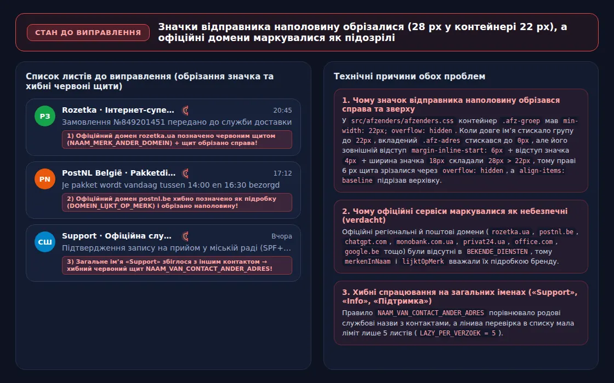 | 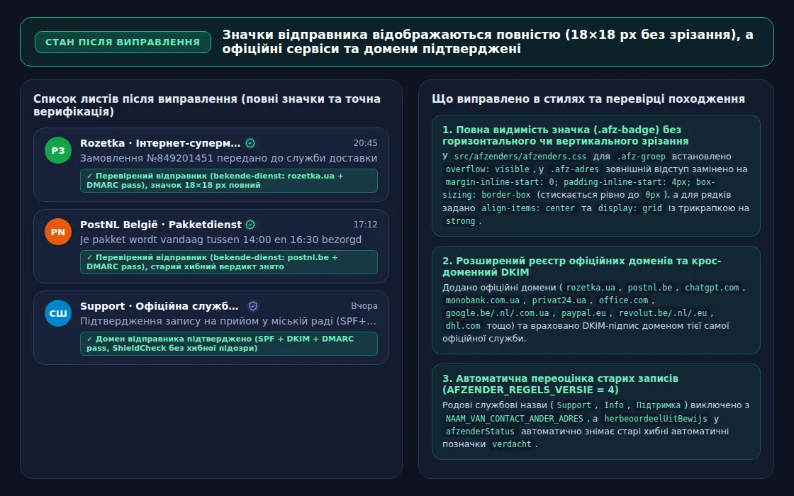 |

## Logboek

- **25.11.2026 23:25** — vertakking gemaakt vanaf `integratie`, taak `SITE-001` geregistreerd, `orch controleer` groen. Eerste overzicht van bestaande onderdelen.
- **25.11.2026 23:40** — punten 1–3 klaar; lokale testomgeving (PostgreSQL 18, Node 24, Chromium) buiten de opslagplaats opgezet.
- **25.11.2026 23:58** — punt 4 gecontroleerd (geen wijziging nodig); punten 5 en 19 klaar, volledige bouw met bewakers en typecontrole van de server groen.
- **26.11.2026 00:25** — punten 6–9 klaar (titels, voorbeeldafbeelding, pictogrammen, `sitemap.xml`, `robots.txt`); zwarte pagina van het tabblad «Bezoeken» verholpen; volledige bouw groen.
- **26.11.2026 06:00** — punten 10 en 11 klaar. De eigenaar gaf opdracht «акаунт» overal in de interface te vervangen door «обліковий запис».
- **26.11.2026 06:20** — punt 13 klaar: datumkleur en koppelingen in donkere weergave op de juridische pagina's verholpen; axe-core 0 schendingen.
- **26.11.2026 06:40** — punt 15 klaar: echte 404 op de server, losse pagina zonder aanmelding, gedecodeerd pad.
- **26.11.2026 07:10** — punt 14 klaar: meting op breedtes 320–768 gaf 174 fouten, na de verbetering 0; Fastmail kreeg een plek op de e-mailbaan.
- **26.11.2026 07:30** — punt 16 klaar: één echt kapotte koppeling verholpen, naam van de voorwaarden gelijkgetrokken, nieuwe bewakingstest.
- **26.11.2026 07:55** — punt 17 klaar: de server doorstond 400 kapotte verzoeken zonder crash; 7 formulierfouten in de browser verholpen, nieuwe bewakingstest.
- **26.11.2026 08:00** — punt 18 klaar: snelheidslimieten live gecontroleerd (6 van 6), 56 openbare routes uitgezocht, nieuwe bewakingstest.
- **26.11.2026 22:55** — sessie overgenomen door `Gemini 4 Carbon High` (`Google Antigravity`) na stop door limietuitputting van `Claude Opus 5.5 (High)` (`Antigravity Google`) op vastlegging `204f9ec8`; vervanging naar «обліковий запис» in 285 bestanden afgerond met bewakingstest 8/8 en auteurschapsregistratie van beide modellen.
- **26.11.2026 23:35** — punt 12 klaar (`Gemini 4 Carbon High` · `Google Antigravity`): `/toegang` 67 % lichter (666 → 220 kB), `id/` versneld (`LCP` −46 %, netwerkstilte 15,5 → 1,48 s, CPU-blokkering op telefoon −72 %, `4xx`-fouten 2 → 0), bewakingstest 9/9 toegevoegd.
- **26.11.2026 23:52** — punt 20 klaar (`Gemini 4 Carbon High` · `Google Antigravity`): op alle 6 kernschermen precies één hoofdactie gewaarborgd (2 → 0 fouten), bewakingstest 8/8.
- **27.11.2026 00:21** — punt 21 klaar (`Gemini 4 Carbon High` · `Google Antigravity`): live controle van alle knoppen en interactieve acties zonder en met aanmelding (4 → 0 fouten: `aria-label` op `/toegang`, 404 `/api/owner/workspaces/list` verholpen, tabbladtitel na aanmelden, kaart voor leeg werkblad in `WerkbladV3`), bewakingstest 7/7.
- **27.11.2026 00:33** — punt 22 klaar (`Gemini 4 Carbon High` · `Google Antigravity`): alle lagen van foutregistratie en gezondheidsbewaking gecontroleerd (`/__gezondheid?diep=1`, `proces-vangnet`, `nazorg`, register van 333 acties); `server/rook.ts` aangepast voor `tech-ruimtes-v2` (code 2 → 0) en `rook-controle`-test hersteld (40/40), bewakingstest 7/7 toegevoegd.
- **27.11.2026 00:44** — punt 23 klaar (`Gemini 4 Carbon High` · `Google Antigravity`): live cyclus van versleutelde reservekopie `backup-maken.sh` + `age` en terugzetten `pg_restore` op PostgreSQL 18.7 uitgevoerd (100 % overeenkomst van 208 migraties, 224 tabellen en 3322 rijen); onverenigbaar `postgresql-17` → `postgresql-18` hersteld in `archief-herstellen.sh` en herstelgidsen, bewakingstest 6/6 toegevoegd.
- **27.11.2026 00:54** — punt 24 klaar (`Gemini 4 Carbon High` · `Google Antigravity`): `Cross-Origin-Opener-Policy`, `Cross-Origin-Resource-Policy` en `X-Permitted-Cross-Domain-Policies` toegevoegd (volledige 9/9 beveiligingskoppen met behoud van voorbeeldafbeelding en Telegram-venster), snelheidslimieten en blokkering geverifieerd, bewakingstest 7/7.
- **27.11.2026 01:18** — punt 25 klaar (`Gemini 4 Carbon High` · `Google Antigravity`): volledige ketencontrole van registratie, aanmelding en wachtwoord-/accountherstel afgerond (11 reeksen, 432/432 controles op PostgreSQL 18.7 met afgedwongen RLS), direct legen van vlaggengeheugen hersteld in `backend/account-wissen.ts` en twee testreeksen, ketenbewaker `site-001-aanmelden-herstel.test.ts` (12/12) toegevoegd. **Alle 25 van 25 punten zijn voltooid.**
- **27.11.2026 17:05** — aanvullende verbetering op opmerking van de eigenaar (`Gemini 4 Argon High` · `Google Antigravity`): direct behoud en herstel van e-mail, labels, geopend bericht en geladen bijlagen tussen subdomeinen en bij terugkeer naar het tabblad zonder herhaald herladen en zonder overbodige voortgangsbalk `#tsv-voortgang` (bewakingstest `site-001-snelheid.test.ts` uitgebreid naar 16/16).
- **27.11.2026 19:22** — aanvullende verbetering op opmerking van de eigenaar (`Gemini 4 Argon High` · `Google Antigravity`): verzending van antwoorden en nieuwe berichten hersteld (filtering van `DRAFT`-concepten, selectie van `lastIncoming`, `Content-Transfer-Encoding: base64` met regels ≤ 76 tekens en RFC 2047 `Subject` in `buildReplyRaw`, terugval op actieve postbus), achtergronddienst `src/mail/uitgaande-post-achtergrond.ts` (`mr_uitgaande_post_v1`, `keepalive: true`) tussen subdomeinen en directe meldingsbox `.canonical-notification-toast` met knop «Opnieuw verzenden» op alle subdomeinen toegevoegd (bewakingstest `site-001-snelheid.test.ts` uitgebreid naar 22/22).
- **27.11.2026 20:08** — aanvullende verbetering op opmerking van de eigenaar (`Gemini 4 Argon High` · `Google Antigravity`): lange mobiele balk `.mq-anker-onderbalk` omgevormd tot een compacte capsuleknop `.mq-onderbalk-trekker` direct in `.mail-top-command-bar` tussen de menuknop (`☰`) en het zoekveld (`MailSearchField`), en het zoekveld in `src/MailZoekVeld.tsx` adaptief gemaakt (krimpen tot zoekpictogram `🔍` bij resterende breedte `< 168 px` met openklappen bij aanraken, of duidelijke afstand tussen «Zoeken» en de filterknop bij voldoende breedte; bewakingstest `site-001-snelheid.test.ts` uitgebreid naar 25/25).
- **27.11.2026 20:50** — aanvullende verbetering op opmerking van de eigenaar (`Gemini 4 Argon High` · `Google Antigravity`): alle drie de bijlageweergaven («Gedeelde weergave», «Compact paneel v2», «Klassiek») samengevoegd tot één enkel **Compact paneel v2** (`src/bijlage-v2/BijlageWerkbalk.tsx`) met alle functionaliteit van de drie weergaven (byte- en afzendercontrole, factuurkaart, «Betaling in Agenda», «Wat is gewijzigd», «Zoeken in bijlagen», «Ondertekenen of markeren», «Donkere documentpagina's», onderste miniatuurstrook, veegnavigatie, onthouden van leesplek, zoom 25–400%, AI en vertaling, `PdfWerkbalk`, 30+ vakspecifieke bewerkingsacties en notitie uit bijlage) en zonder de overbodige modusschakelaar in `•••` (bewakingstest `site-001-snelheid.test.ts` uitgebreid naar 28/28).
- **27.11.2026 21:28** — aanvullende verbetering op opmerking van de eigenaar (`Gemini 4 Argon High` · `Google Antigravity`): kleuren en letterdiktes van gelezen en ongelezen berichten in de berichtenlijst geordend (`mail-lezer-opstel-maquette.css`, `mail-lijst-klassiek.css`, `mail-gesprek-bewerker.css`, `mail-rij-2026-10-18.css`, `mail-minimum-rij.css`, `MailBerichtRij.tsx`, `MailMinimumBerichtRij.tsx`, `MailInstellingenVoorbeeld.tsx`): witte / primaire heldere tekstkleur (`var(--mq-tekst, var(--text))`) en dikte `650` uitsluitend voor ongelezen berichten (`.unread`), en bij gelezen berichten (`.read`) een grijze tint (`var(--mail-row-secondary)`) voor zowel onderwerp, afzender als inhoud, waarbij het onderwerp van een gelezen bericht een bescheiden, verzorgde halfvette dikte `font-weight: 500` heeft tegenover `400` voor de gewone berichttekst (bewakingstest `site-001-snelheid.test.ts` uitgebreid naar 29/29).
- **27.11.2026 22:15** — aanvullende verbetering op opmerking van de eigenaar (`Gemini 4 Argon High` · `Google Antigravity`): afkapping van afzenderbadges (`.afz-groep` / `.afz-badge`) in alle lijstmodi en berichtkop verholpen (`overflow: visible`, `margin-inline-start: 0; padding-inline-start: 4px; box-sizing: border-box` op `.afz-adres`, `align-items: center`) en onterechte verdacht-markering van officiële afzenders opgelost (uitgebreide lijst officiële verzend- en regionale domeinen in `shared/mail-bekende-afzenders.ts`, DKIM van dezelfde dienst en algemene dienstnamen `Support` / `Info` / `Підтримка` in `shared/mail-afzenders.ts`, `AFZENDER_REGELS_VERSIE = 4` met automatische herbeoordeling in `backend/mail-afzenders.ts`; bewakingstest `site-001-snelheid.test.ts` uitgebreid naar 30/30).
