> 🌐 **Taal:** [Українська](ПЕРЕБІГ-РОБІТ.uk.md) · **Nederlands**

# SITE-001 — gereedheid van de site Mijn Ruimte: voortgang

- **Taak:** SITE-001 · agent `antigravity` · vertakking `feature/site-001-20261125-232500`
- **Basis:** `origin/integratie` `8890f85a1c34c9f12e945eb78bd2e8588cceb56a` · regels `1.8.0`
- **Toestemming van de eigenaar:** samenvoegen in `integratie` na groene controles (25.11.2026).
- **Schermafdrukken «voor» en «na»:** [`schermafdrukken/`](schermafdrukken/) — lokale bouw van de site, Chromium zonder venster.

## Hoe een andere agent het werk voortzet

1. `git fetch origin && git switch feature/site-001-20261125-232500`
2. Lees dit bestand: de tabel hieronder toont welk punt klaar is en welk het volgende is.
3. Neem het eerste punt met de status «wacht» of «bezig», maak een schermafdruk «voor», de verbetering, een schermafdruk «na», een vastlegging en een verzending.
4. Werk na elk punt de tabel en het logboek onderaan bij.

## Status per punt

| Nr. | Punt | Status | Samenvatting |
|---|---|---|---|
| 1 | Privacybeleid | ✅ klaar | Bestaande `/privacy` gecontroleerd (13 delen, uk + nl); taalzuivering, `meta description`, canonieke adres, pictogram, contactplaatshouder hersteld |
| 2 | Gebruiksvoorwaarden | ✅ klaar | Bestaande `/terms` gecontroleerd; punt «Wijziging van de voorwaarden» toegevoegd (uk + nl), naam van de eigenaar in de Oekraïense versie, taalzuivering |
| 3 | Openliggende sleutels en geheimen verwijderen | ✅ klaar | Geen echte geheimen in de boom of de geschiedenis (1063 vastleggingen); `.gitleaks.toml` + werkstroom «Geheimscan» |
| 4 | HTTPS | ✅ klaar | Alle 11 subdomeinen: http → 301 naar https, HSTS voor een jaar met subdomeinen, alleen TLS 1.3, certificaat tot 21.02.2027; geen codewijziging nodig |
| 5 | Toestemmingsbalk voor cookies | ✅ klaar | Nieuwe toestemmingsbalk met twee gelijkwaardige knoppen op alle pagina's, uk + nl, opnieuw te openen vanaf de aanmeldpagina; 24/24 tests |
| 6 | Paginatitels en `meta description` | ✅ klaar | Alle tabbladtitels «<розділ> — Мій простір» / «<onderdeel> — Mijn Ruimte» (was «— Tarasevych», «Tarasevych-beheer», «Mijn ruimte», «— Mijn Ruimte» in het Oekraïens) |
| 7 | Voorbeeldafbeelding voor sociale netwerken | ✅ klaar | `public/og-afbeelding.png` 1200×630 (61 kB), `og:image` met alternatieve tekst en `twitter:card` in de toepassing en op de juridische pagina's |
| 8 | Sitepictogram (favicon) | ✅ klaar | **Fout op de productiesite:** `favicon-192.png` en `favicon-512.png` beschadigd; alle pictogrammen opnieuw getekend uit `favicon.svg`, `favicon.ico` toegevoegd, manifest met «any» en «maskable» |
| 9 | `sitemap.xml` en `robots.txt` | ✅ klaar | `sitemap.xml` met alleen `/privacy` en `/terms`; `robots.txt` met `Sitemap:`-regel en toegang tot pictogrammen en voorbeeldafbeelding, rest van de site gesloten |
| 10 | Alternatieve teksten bij afbeeldingen | wacht | — |
| 11 | Afbeeldingen comprimeren | wacht | — |
| 12 | Laadsnelheid | wacht | — |
| 13 | Kleurcontrast | wacht | Bewaker `scripts/kleur-contrast-controle.mjs` aanwezig |
| 14 | Geschiktheid voor mobiel | wacht | — |
| 15 | Eigen 404-pagina | wacht | Bestaande `src/NietGevonden.tsx` — controleren |
| 16 | Kapotte koppelingen | wacht | — |
| 17 | Validatie van alle formulieren | wacht | — |
| 18 | Bescherming tegen spam | wacht | — |
| 19 | Siteanalyse | ✅ klaar | Eigen anonieme analyse werkt nu echt en alleen met toestemming; tabblad «Bezoeken» voor de beheerder; 12/12 tests |
| 20 | Eén duidelijke oproep tot actie | wacht | — |
| 21 | Knoppen en interactieve elementen | wacht | — |
| 22 | Foutregistratie en bewaking | wacht | — |
| 23 | Reservekopieën van de database | wacht | `deploy/backup-maken.sh`, `mijn-ruimte-backup.timer` — controleren |
| 24 | Beveiligingskoppen en aanvraagbeperking | wacht | `server/start.ts`, `rateLimit` — controleren |
| 25 | Registratie, aanmelding en wachtwoordherstel | wacht | — |

## Gevonden fouten die nog op hun punt wachten

| Fout | Waar | Punt |
|---|---|---|
| Onbekende paden geven HTTP 200 («zachte 404»); de 404-pagina toont zonder aanmelding het hele menu, wordt op 1366 breed door het zijmenu bedekt en toont het pad gecodeerd | `server/start.ts` (`serveStatic`), `src/NietGevonden.tsx` | 15 |
| Pagina's zonder aanmelding sturen `POST /api/owner/meldingen/regels` en `/api/owner/uitrol/achtergrond` → 401; `meldingen/regels` geeft 401 ook met aanmelding | `UitrolAchtergrondBand`, meldingen | 21 |
| De weergavecontrole van het installatieprogramma (`server/rook.ts`) stopt met code 2: `/api/owner/tech/activeren` → 409 `GEBRUIK_RUIMTES_V2` sinds ruimtes v2 aan staan | `server/rook.ts`, `backend/tech-profiel.ts:156` | 22 |
| Het woord «акаунт» staat 264 keer in de interface (volgens de taalwet: «обліковий запис») | `src/**` | beslissing van de eigenaar |

## Verslagen per punt

### 1. Privacybeleid

De pagina `/privacy` bestond al (`backend/juridisch.ts`, server-HTML zonder JavaScript). Volledigheid volgens de AVG gecontroleerd: verantwoordelijke, doelen, grondslagen, termijnen, verwerkers, rechten, toezichthouder — alles aanwezig.
Verbeterd: Engelse leenwoorden in de Oekraïense tekst, `meta description`, canonieke adres, sitepictogram en themakleur toegevoegd, datum bijgewerkt naar 2026-11-26, contactplaatshouder zonder omgevingsvariabele nu «на запит / op aanvraag» (was tweemaal Nederlands).
Test `tests/eenheid/juridisch.test.ts`: 11/11, waarvan 2 nieuwe SITE-001-controles.

| Voor | Na |
|---|---|
| 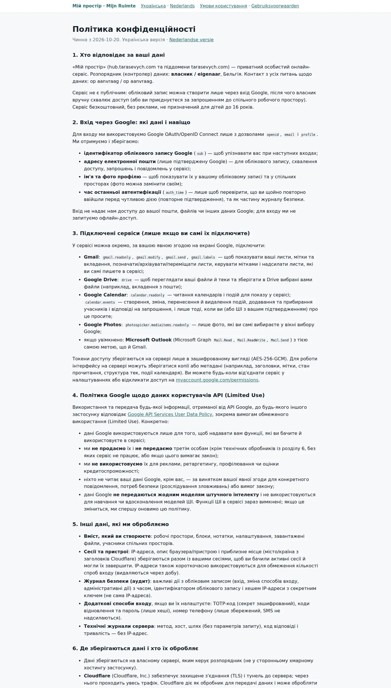 | 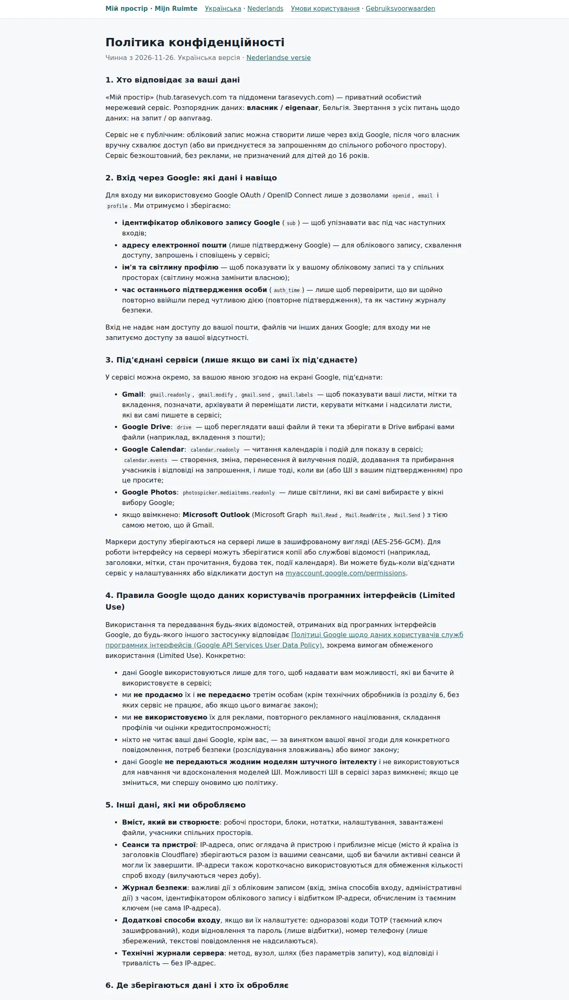 |

> [!IMPORTANT]
> Ter controle door de eigenaar: de zin «AI-functies staan in de dienst momenteel uit» (punt 4) klopt mogelijk niet meer — de toepassing heeft een AI-werkruimte. De tekst is niet gewijzigd omdat het een juridische verklaring over gegevensverwerking is.

### 2. Gebruiksvoorwaarden

De pagina `/terms` bestond al. Punt «Wijziging van de voorwaarden» toegevoegd (melding minstens 14 dagen vooraf), de Oekraïense versie gelijkgetrokken met de Nederlandse (naam van de eigenaar), «spam of malware» vervangen door «ongevraagde massaberichten of schadelijke software».

| Voor | Na |
|---|---|
| 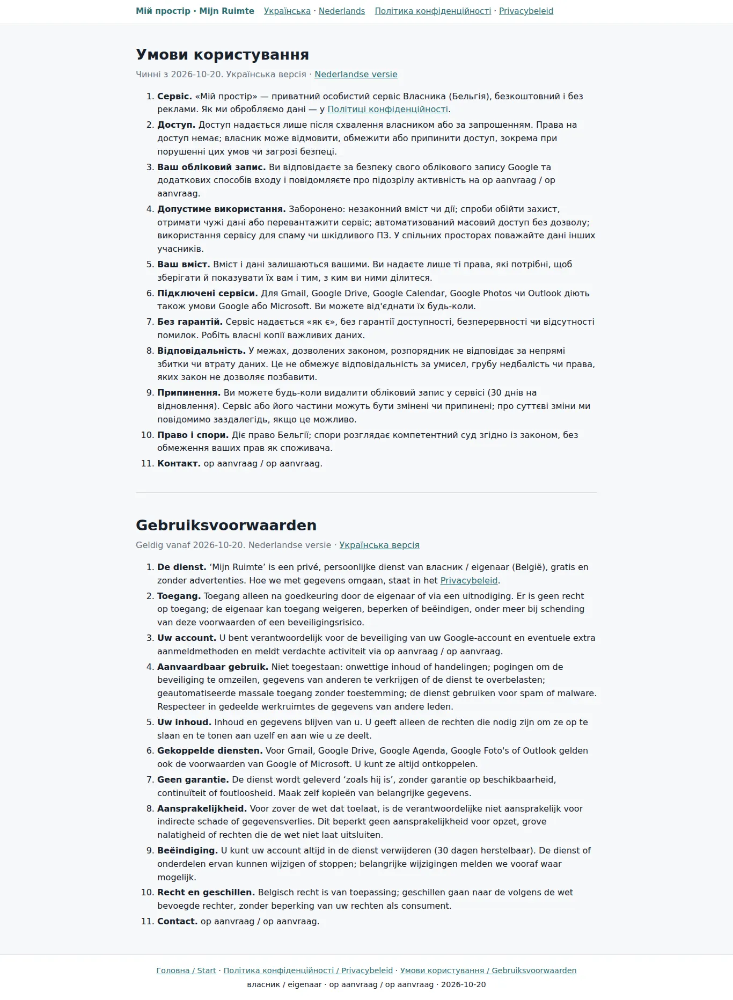 |  |

### 3. Openliggende sleutels en geheimen

gitleaks 8.30.1 (officiële uitgave, SHA-256 gecontroleerd): 56 treffers in de boom en 129 in de geschiedenis. Elk handmatig gecontroleerd — namen van omgevingsvariabelen, kunstmatige testwaarden, een voorbeeldsleutel uit RFC 6455, publieke AAGUID's van toegangssleutels en de publieke sleutel van de extensie. **Geen echte geheimen**; herschrijven van de geschiedenis is niet nodig.
Toegevoegd: `.gitleaks.toml` met toegelichte uitzonderingen en de werkstroom `.github/workflows/geheimen-scan.yml` die elke verzending en elk samenvoegverzoek controleert.

| Voor | Na |
|---|---|
|  | 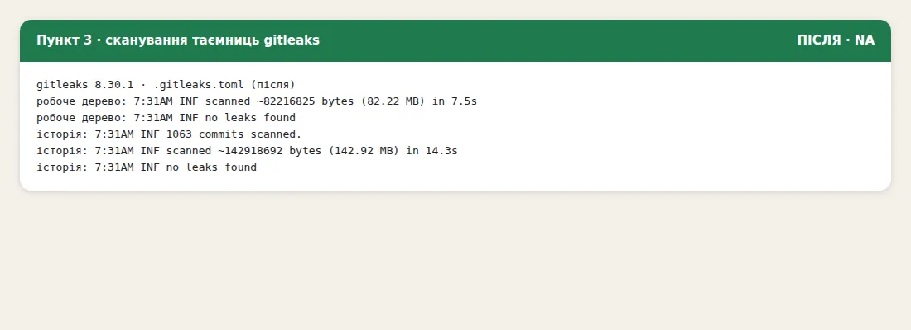 |

### 4. HTTPS

De productiesite is uitsluitend lezend gecontroleerd (zonder wijzigingen): alle 11 subdomeinen sturen `http://` met code 301 door naar `https://` en geven `Strict-Transport-Security: max-age=31536000; includeSubDomains`. Het certificaat van Google Trust Services WE1 is geldig tot 21.02.2027. TLS 1.0 en 1.1 worden geweigerd; in de `openssl`-controle antwoordt alleen TLS 1.3. Er was geen codewijziging nodig, dus de schermafdruk «voor» is gelijk aan «na».
Opmerking: het hoofddomein `tarasevych.com` (zonder subdomein) antwoordt niet — dat is een kwestie van de naaminstellingen van de eigenaar, niet van de toepassing.

| Voor = na (geen wijziging nodig) |
|---|
| 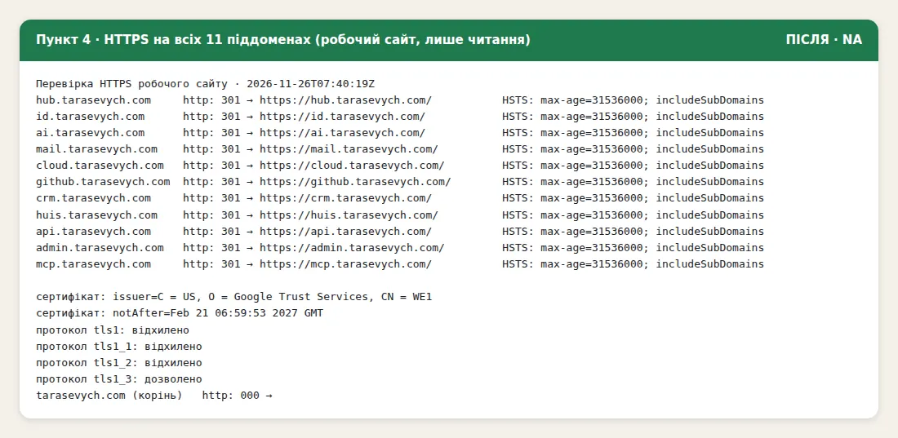 |

### 5. Toestemmingsbalk voor cookies

Er was geen toestemmingsbalk, terwijl het beleid analyse alleen met toestemming beloofde. Toegevoegd: [`src/toestemming/`](../../src/toestemming/) — een balk onderaan elke pagina (ook de aanmeldpagina zonder sessie) met twee **gelijkwaardige** knoppen «Alleen noodzakelijke» en «Analyse toestaan» (zelfde grootte en uitzicht, geen vooraf gekozen toestemming), een koppeling naar het beleid en teksten in uk + nl. De keuze wordt in de lokale opslag van de browser bewaard (`mr-toestemming-v1`), niet in een cookie; op pagina's met een sessie gaat ze ook naar de server (`POST /api/owner/privacy/toestemming`). De koppeling «Cookie-instellingen» op de aanmeldpagina opent de balk opnieuw. Delen 9 en 10 van het beleid zijn aangevuld.
Test `tests/eenheid/site-001-toestemming.test.ts`: 24/24.

| Voor | Na |
|---|---|
|  | 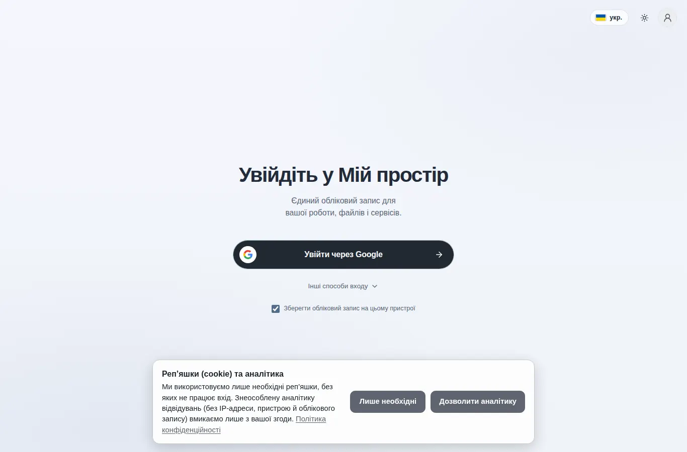 |
| 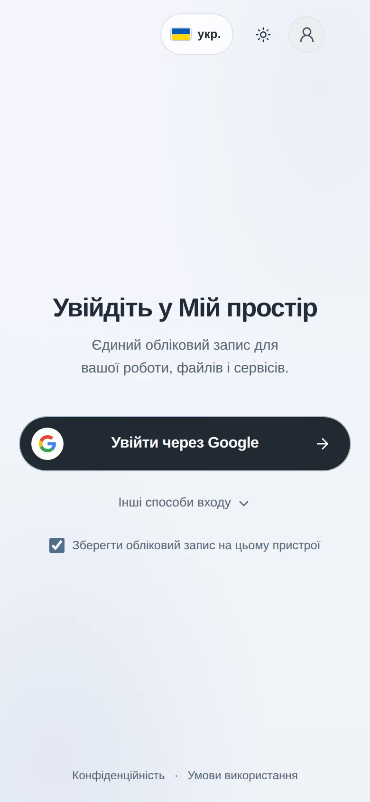 |  |
| — | 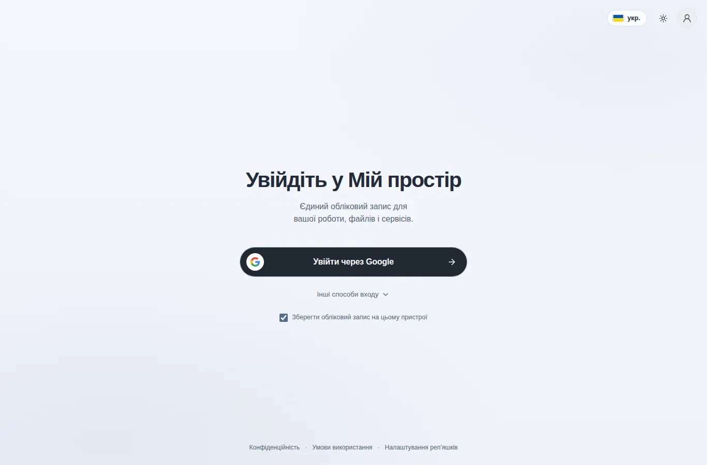 |

### 6–9. Titels, voorbeeldafbeelding, pictogrammen, sitemap.xml en robots.txt

- **6.** De tabbladtitels hadden drie vormen: beheer — «Адміністрування — Tarasevych» / «Tarasevych-beheer», Nederlands — «Mijn ruimte», gasttoegang — «Гостьовий доступ — Mijn Ruimte» (Nederlandse naam in een Oekraïense titel). Nu overal «<розділ> — Мій простір» / «<onderdeel> — Mijn Ruimte». Het aanmeldscherm op `id.tarasevych.com/` had voor iemand zonder sessie de titel «Налаштування — Мій простір»; nu «Вхід — Мій простір» / «Aanmelden — Mijn Ruimte» (instellingenpagina's na aanmelden houden «Instellingen»). De `meta description` van 20–160 tekens per onderdeel bestond al en blijft.
- **7.** Voorbeeldafbeelding van 1200×630 met het sitemerk (dezelfde vorm als `favicon.svg`) en de naam in beide talen. Tags `og:image`, `og:image:alt`, `og:site_name`, `twitter:card` in `index.html` en op `/privacy`, `/terms` (daar ook eigen `og:title`, `og:description`, `og:url`).
- **8.** Fout gevonden die ook op de productiesite staat: `favicon-192.png` en `favicon-512.png` zijn niet te ontcijferen (beschadigde gegevensstroom), dus het app-pictogram op telefoons en in het manifest werkte niet. Alle PNG-pictogrammen opnieuw getekend uit `favicon.svg`; `favicon.ico` (16/32/48) toegevoegd omdat browsers het zelf opvragen (was 404).
- **9.** `public/sitemap.xml` met alleen de twee openbare pagina's; de site is privé, de rest blijft `Disallow`. `robots.txt` laat pictogrammen en de voorbeeldafbeelding toe, anders kunnen sociale netwerken de afbeelding niet tonen.

Test `tests/eenheid/site-001-metadata.test.ts`: 21/21 (met volledige PNG-controle op controlegetallen).

Terloops een fout uit punt 19 verholpen: het tabblad «Bezoeken» las het serverantwoord zonder het veld `data` en werd een zwarte pagina; het antwoord wordt nu juist gelezen, test `site-001-analyse` aangevuld (13/13).

| Voor | Na |
|---|---|
| 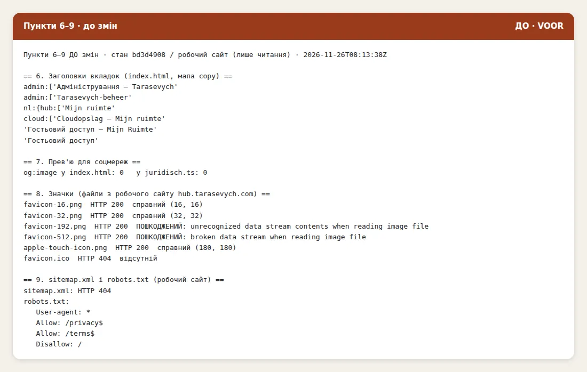 | 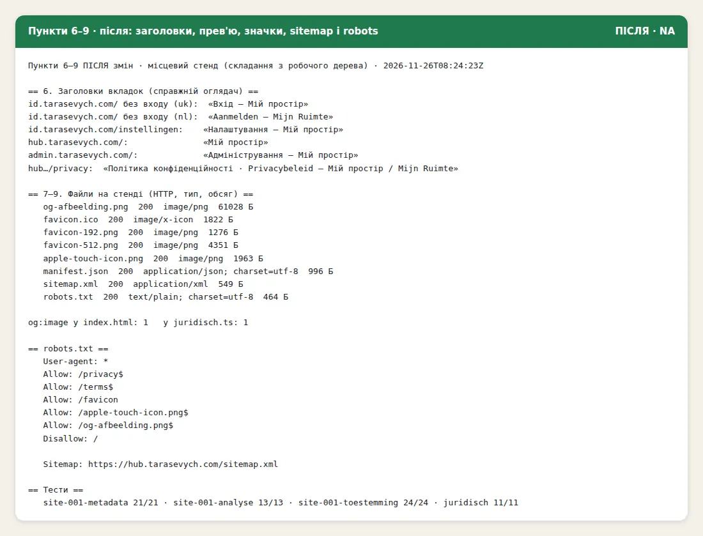 |
| — |  |
| — | 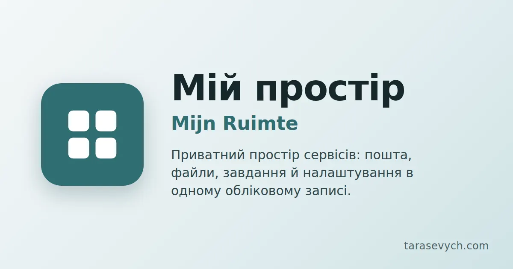 |
| 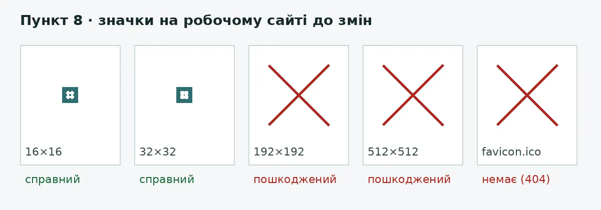 | 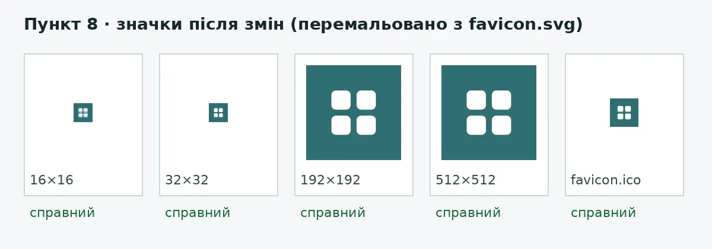 |

### 19. Siteanalyse (samen met punt 5 uitgevoerd)

De serverkant bestond al (`backend/privacy.ts`: toestemming standaard uit, anonieme dagtellers), maar de interface riep haar nooit aan en niemand las de tellers. Nu: na toestemming één gebeurtenis `bezoek.<dienst>` per tabbladsessie (zonder paginapad, id, IP of apparaat); een beheerdersroute `POST /api/owner/admin/analyse-overzicht` (`admin.read`, alleen lezen) en een tabblad «Bezoeken» in «Diagnostiek» met perioden van 7/30/90 dagen. Geen externe analysediensten — nul nieuwe kosten en geen doorgifte aan derden.
Test `tests/eenheid/site-001-analyse.test.ts`: 12/12 (met een echte PostgreSQL 18-database).

| Voor | Na |
|---|---|
| 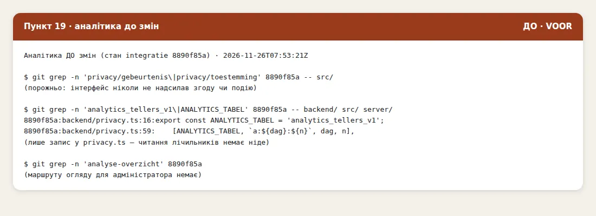 | 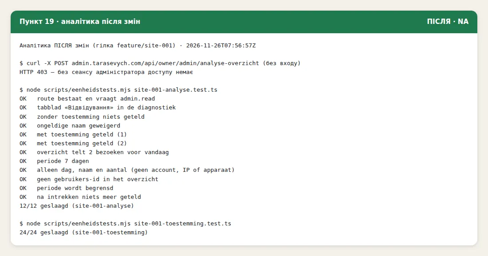 |

## Logboek

- **25.11.2026 23:25** — vertakking gemaakt vanaf `integratie`, taak `SITE-001` geregistreerd, `orch controleer` groen. Eerste overzicht van bestaande onderdelen.
- **25.11.2026 23:40** — punten 1–3 klaar; lokale testomgeving (PostgreSQL 18, Node 24, Chromium) buiten de opslagplaats opgezet.
- **25.11.2026 23:58** — punt 4 gecontroleerd (geen wijziging nodig); punten 5 en 19 klaar, volledige bouw met bewakers en typecontrole van de server groen.
- **26.11.2026 00:25** — punten 6–9 klaar (titels, voorbeeldafbeelding, pictogrammen, `sitemap.xml`, `robots.txt`); zwarte pagina van het tabblad «Bezoeken» verholpen; volledige bouw groen.
