> 🌐 **Мова:** **Українська** · [Nederlands](VOORTGANG.nl.md)

# SITE-001 — готовність сайту Mijn Ruimte: перебіг робіт

- **Завдання:** SITE-001 · агент `antigravity` · гілка `feature/site-001-20261125-232500`
- **База:** `origin/integratie` `8890f85a1c34c9f12e945eb78bd2e8588cceb56a` · правила `1.8.0`
- **Дозвіл власника:** злиття в `integratie` після зелених перевірок (25.11.2026).
- **Знімки «до» й «після»:** [`schermafdrukken/`](schermafdrukken/) — місцеве складання сайту, безголовий оглядач Chromium.

## Як продовжити роботу іншому агентові

1. `git fetch origin && git switch feature/site-001-20261125-232500`
2. Прочитати цей файл: таблиця нижче показує, який пункт виконано, а який наступний.
3. Брати перший пункт зі станом «очікує» або «у роботі», робити знімок «до», виправлення, знімок «після», фіксацію змін і відправлення.
4. Після кожного пункту оновлювати таблицю та журнал наприкінці файла.

## Стан пунктів

| № | Пункт | Стан | Підсумок |
|---|---|---|---|
| 1 | Політика конфіденційності | ✅ виконано | Наявна `/privacy` перевірена (13 розділів, uk + nl); мовне очищення, `meta description`, канонічна адреса, значок, виправлено заповнювач контакту |
| 2 | Умови використання | ✅ виконано | Наявна `/terms` перевірена; додано пункт «Зміни умов» (uk + nl), ім'я власника в українській версії, мовне очищення |
| 3 | Прибрати відкриті ключі та таємниці | ✅ виконано | Справжніх таємниць немає ні в дереві, ні в історії (1063 фіксації змін); `.gitleaks.toml` + робочий процес «Пошук таємниць» |
| 4 | HTTPS | ✅ виконано | Усі 11 піддоменів: http → 301 на https, HSTS на рік із піддоменами, лише TLS 1.3, сертифікат до 21.02.2027; змін у коді не потрібно |
| 5 | Смуга згоди на реп'яшки (cookie) | ✅ виконано | Нова смуга згоди з двома рівноцінними кнопками на всіх сторінках, uk + nl, повторне відкриття зі сторінки входу; 24/24 тести |
| 6 | Заголовки сторінок і опис `meta description` | ✅ виконано | Усі заголовки вкладок «<розділ> — Мій простір» / «<onderdeel> — Mijn Ruimte» (було «— Tarasevych», «Tarasevych-beheer», «Mijn ruimte», «— Mijn Ruimte» в українській) |
| 7 | Прев'ю-зображення для соцмереж | ✅ виконано | `public/og-afbeelding.png` 1200×630 (61 кБ), `og:image` з альтернативним текстом і `twitter:card` у застосунку та на юридичних сторінках |
| 8 | Значок сайту (favicon) | ✅ виконано | **Вада робочого сайту:** `favicon-192.png` і `favicon-512.png` пошкоджені; усі значки перемальовано з `favicon.svg`, додано `favicon.ico`, маніфест із призначеннями «any» і «maskable» |
| 9 | `sitemap.xml` і `robots.txt` | ✅ виконано | `sitemap.xml` лише з `/privacy` і `/terms`; у `robots.txt` рядок `Sitemap:` і дозвіл на значки та прев'ю, решта сайту закрита |
| 10 | Альтернативні тексти зображень | ✅ виконано | Усі 51 зображення мають `alt`; прапор і герб місця отримали змістовний текст; тест-сторож 4/4 |
| 11 | Стиснення зображень | ✅ виконано | PNG значків і прев'ю: 69 319 → 47 395 Б (−32 %); 1744 webp уже стиснені; офіційні логотипи незмінні (SHA-256) |
| 12 | Швидкість завантаження | ✅ виконано | Відокремлено ядро `App` від `/toegang` (666 → 220 кБ, −67 %), відкладено `TechLaag` і `MeldingenPortaal` без сеансу (`id/`: 1013 → 873 кБ, LCP 572 → 308 мс, тиша 15,5 → 1,48 с, 4xx: 2 → 0, блокування процесора на телефоні −72 %); сторож 9/9 |
| 13 | Контраст кольорів | ✅ виконано | Сторож токенів: 2190 пар — усе ≥ вимоги. axe-core на відмальованих сторінках знайшов 22 вузли на `/privacy` і `/terms`; виправлено, тепер 0 у світлій і темній темах |
| 14 | Адаптивність під мобільні | ✅ виконано | 174 → 0 вад на ширинах 320–768: горизонтальне прокручування юридичних сторінок, дрібний текст, замалі цілі дотику; Fastmail отримав місце на орбіті пошти; тест 18/18 |
| 15 | Власна сторінка 404 | ✅ виконано | Справжній код 404 для невідомих адрес (раніше 200); без входу — окрема сторінка без меню; шлях розкодовано; тест 24/24; axe 0 |
| 16 | Биті посилання | ✅ виконано | 305 внутрішніх і 3 зовнішні адреси: одне справді бите посилання (діалог підтвердження на mcp/api вів на 404) — виправлено; назву «Умови використання» уніфіковано; тест-сторож 6/6 |
| 17 | Перевірка всіх форм | ✅ виконано | Сервер: 400 зламаних запитів на 50 публічних форм — 0 аварій. Оглядач: 7 вад (кириличні двійники в гостьовому коді, помилки не пов'язані з полями, фокус губився) — усі виправлено; тест-сторож 22/22 |
| 18 | Захист від спаму | ✅ виконано | 56 публічних POST: 23 мають суворе обмеження на IP, 33 — власний захист (лічильник спроб, підпис, маркер доступу); жива перевірка — 6 із 6 меж спрацьовують точно; новий тест-сторож 50/50 не пропустить новий маршрут без захисту |
| 19 | Аналітика сайту | ✅ виконано | Власна знеособлена аналітика тепер справді працює лише за згодою; вкладка «Відвідування» для адміністратора; 12/12 тестів |
| 20 | Один чіткий заклик до дії | ✅ виконано | На 6 ключових екранах забезпечено рівно 1 головну дію: при збереженому записі на пристрої головною стає картка користувача, а кнопка Google — спокійною другорядною; на `/privacy` і `/terms` додано акцентну кнопку повернення до простору; сторож 8/8 |
| 21 | Кнопки й інтерактивні елементи | ✅ виконано | 4 → 0 вад у живій перевірці без входу і за входом (`knoppen.mjs`): `aria-label` перемикача мови `/toegang`, усунено 404 `/api/owner/workspaces/list`, оновлення `document.title` за входом, картка й кнопки порожнього столу `WerkbladV3`; сторож 7/7 |
| 22 | Журналювання помилок і моніторинг | ✅ виконано | Перевірено `proces-vangnet`, `/__gezondheid?diep=1` (`ALLEEN_LOKAAL`), лічильники 401/403/404, реєстр 333 дій та `nazorg`; виправлено `server/rook.ts` під `tech-ruimtes-v2` (код 2 → 0, усі 3 реп'яшки) й тест `rook-controle` (40/40); сторож 7/7 |
| 23 | Запасні копії бази даних | ✅ виконано | Жива перевірка `backup-maken.sh` → `age` → `SHA256SUMS` → `age -d \| pg_restore` у PostgreSQL 18.7 (208/208 міграцій, 224/224 таблиці, 3322/3322 рядки, 193/193 таблиці з RLS); виправлено несумісний `postgresql-17` → `postgresql-18` у `archief-herstellen.sh` (формат дампу `1.16-0`); сторож 6/6 |
| 24 | Заголовки безпеки й обмеження частоти запитів | ✅ виконано | Доповнено `BASE_HEADERS` у `server/start.ts` до повного набору з 9 заголовків (`COOP: same-origin-allow-popups`, `CORP: same-site` із `cross-origin` для значків/прев'ю й вікна Telegram, `X-Permitted-Cross-Domain-Policies: none`); перевірено маскування IPv6 `/64`, `rateLimit` (`failClosed`), `pogingReserveren` і відхилення чужого `Origin`/`Host`; сторож 7/7 |
| 25 | Реєстрація, вхід і відновлення пароля | ✅ виконано | Повна жива перевірка на PostgreSQL 18.7 із примусовим RLS (11 наборів, 432/432 перевірки): реєстрація `new→pending→approved`, вхід ключем доступу, паролем + TOTP, кодами відновлення, заміна забутого пароля й скидання `mustChange`, 7-денне повернення способу та 30-денне відновлення облікового запису; усунено затримку пам'яті прапорців у `accountMeteenWissen` та 2 наборах випробувань; сторож 12/12 |

## Знайдені вади, які ще чекають на свій пункт

_Усі раніше відкладені вади усунено (зокрема `server/rook.ts` → `409 GEBRUIK_RUIMTES_V2` виправлено в пункті 22)._

## Звіти за пунктами

### 1. Політика конфіденційності

Сторінка `/privacy` вже існувала (`backend/juridisch.ts`, серверний HTML без JavaScript). Перевірено повноту за Загальним регламентом захисту даних: розпорядник, мета, підстави, строки, обробники, права, орган нагляду — усе наявне.
Виправлено: англіцизми в українському тексті («браузер», «токени», «кеш», «хостинг», «трафік», «онлайн», «e-mail» тощо), додано `meta description`, канонічну адресу, значок сайту й колір теми, дату редакції оновлено до 2026-11-26, заповнювач контакту без змінної середовища тепер «на запит / op aanvraag» (було двічі нідерландською).
Тест `tests/eenheid/juridisch.test.ts`: 11/11, з них 2 нові перевірки SITE-001.

| До | Після |
|---|---|
|  |  |

> [!IMPORTANT]
> На перевірку власникові: речення «Можливості ШІ в сервісі зараз вимкнені» (розділ 4) може вже не відповідати дійсності — у застосунку є робочий простір ШІ. Текст не змінено, бо це юридичне твердження про обробку даних.

### 2. Умови використання

Сторінка `/terms` вже існувала. Додано пункт «Зміни умов» (повідомлення щонайменше за 14 днів), українську версію вирівняно з нідерландською (ім'я власника), «спам/ПЗ» замінено питомими словами, у нідерландській «spam of malware» → «ongevraagde massaberichten of schadelijke software».

| До | Після |
|---|---|
| 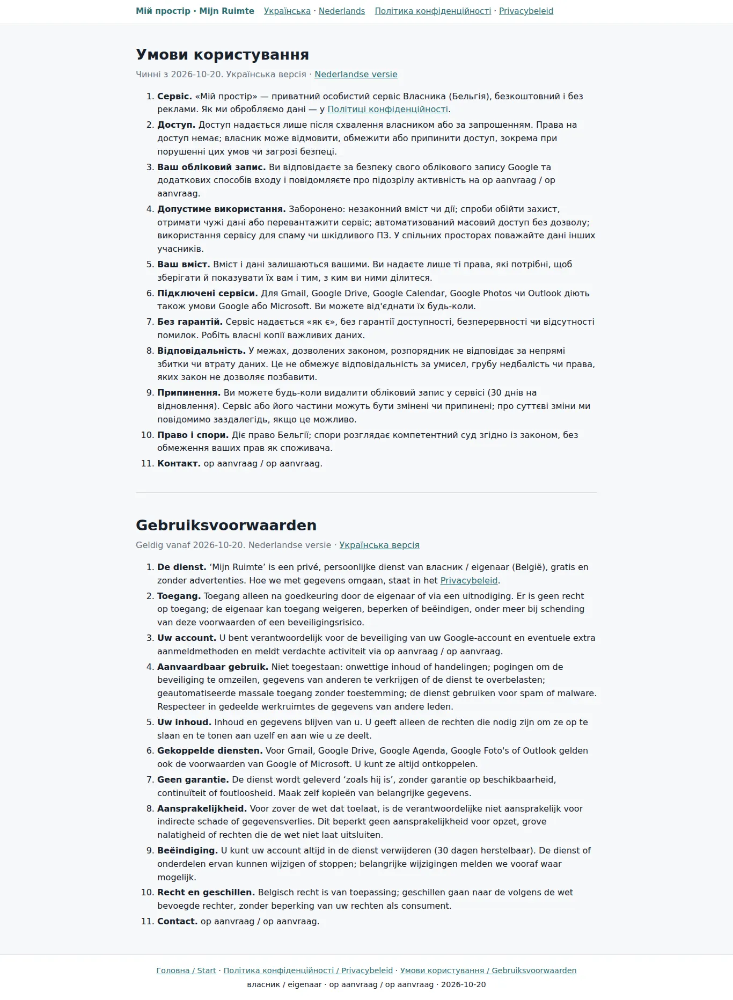 | 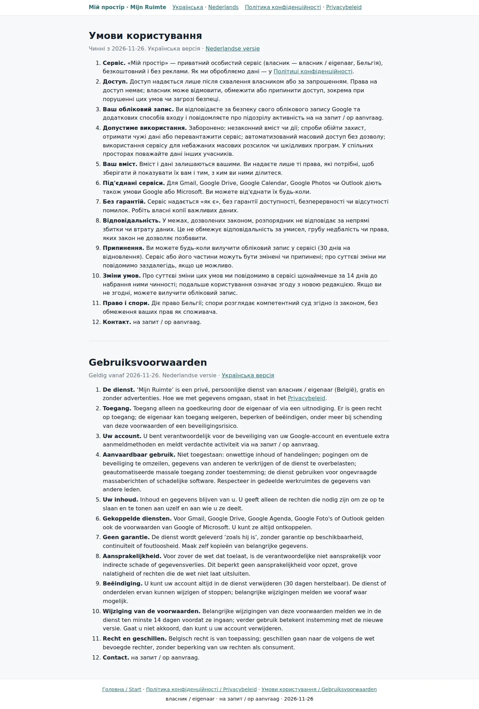 |

### 3. Відкриті ключі та таємниці

gitleaks 8.30.1 (офіційний випуск, SHA-256 звірено): 56 спрацювань у дереві та 129 в історії. Кожне перевірено вручну — це назви змінних середовища, штучні тестові значення, приклад ключа з RFC 6455, публічні ідентифікатори ключів доступу (AAGUID) та публічний ключ розширення. **Справжніх таємниць немає**, переписування історії не потрібне.
Додано `.gitleaks.toml` з поясненими винятками і робочий процес `.github/workflows/geheimen-scan.yml`, який перевіряє кожне надсилання й запит на злиття.

| До | Після |
|---|---|
| 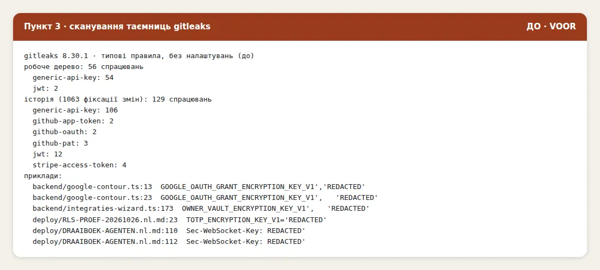 |  |

### 4. HTTPS

Перевірено робочий сайт лише читанням (без змін): усі 11 піддоменів переспрямовують `http://` → `https://` кодом 301 і віддають `Strict-Transport-Security: max-age=31536000; includeSubDomains`. Сертифікат Google Trust Services WE1 дійсний до 21.02.2027. TLS 1.0 і 1.1 відхилено, у перевірці `openssl` відповідає лише TLS 1.3. Змін у коді не знадобилося, тому знімок «до» збігається зі станом «після».
Зауваження: корінь `tarasevych.com` (без піддомену) не відповідає — це питання налаштування імен власника, а не застосунку.

| До = після (змін не потрібно) |
|---|
|  |

### 5. Смуга згоди на реп'яшки (cookie)

Смуги згоди не було, хоча політика обіцяла аналітику лише за згодою. Додано [`src/toestemming/`](../../src/toestemming/): смуга внизу кожної сторінки (зокрема сторінки входу без сеансу) з двома **рівноцінними** кнопками «Лише необхідні» та «Дозволити аналітику» (однаковий розмір і вигляд, без попередньо вибраної згоди), посилання на політику, тексти uk + nl. Вибір зберігається в місцевому сховищі оглядача (`mr-toestemming-v1`), а не в реп'яшку; для сторінок із сеансом він передається на сервер (`POST /api/owner/privacy/toestemming`). Посилання «Налаштування реп'яшків» на сторінці входу відкриває смугу знову. Розділи 9 і 10 політики доповнено описом.
Тест `tests/eenheid/site-001-toestemming.test.ts`: 24/24.

| До | Після |
|---|---|
|  |  |
|  | 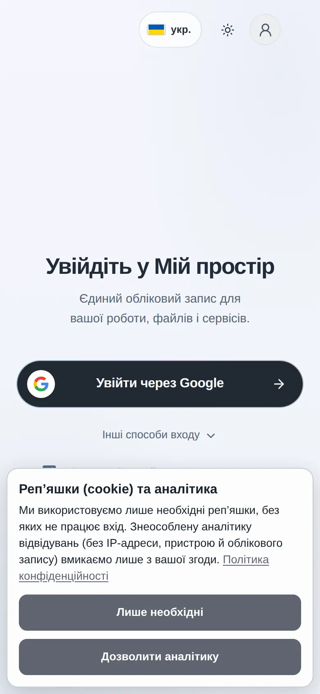 |
| — | 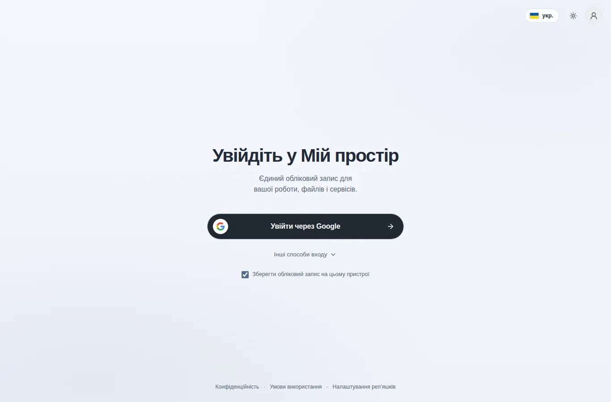 |

### 6–9. Заголовки, прев'ю, значки, sitemap.xml і robots.txt

- **6.** Заголовки вкладок мали три різні будови: адміністрування — «Адміністрування — Tarasevych» / «Tarasevych-beheer», нідерландська — «Mijn ruimte», гостьовий доступ — «Гостьовий доступ — Mijn Ruimte» (нідерландська назва в українському заголовку). Тепер усюди «<розділ> — Мій простір» / «<onderdeel> — Mijn Ruimte». Екран входу на `id.tarasevych.com/` для людини без сеансу мав заголовок «Налаштування — Мій простір»; тепер «Вхід — Мій простір» / «Aanmelden — Mijn Ruimte» (сторінки налаштувань за входом лишають «Налаштування»). Описи `meta description` 20–160 знаків для кожного розділу вже були й лишилися.
- **7.** Створено прев'ю 1200×630 зі знаком сайту (та сама геометрія, що в `favicon.svg`) і назвою обома мовами. Теги `og:image`, `og:image:alt`, `og:site_name`, `twitter:card` — у `index.html` і на `/privacy`, `/terms` (там також власні `og:title`, `og:description`, `og:url`).
- **8.** Знайдено ваду, яка є й на робочому сайті: `favicon-192.png` і `favicon-512.png` не розпаковуються (пошкоджений потік даних), тож значок застосунку на телефоні й у маніфесті не працював. Усі PNG-значки перемальовано з `favicon.svg`, додано `favicon.ico` (16/32/48), бо оглядачі просять його самі (було 404).
- **9.** Додано `public/sitemap.xml` лише з двома публічними сторінками; сайт приватний, тому решта лишається `Disallow`. У `robots.txt` дозволено значки та прев'ю, бо інакше соцмережі не змогли б показати картинку.

Тест `tests/eenheid/site-001-metadata.test.ts`: 21/21 (зокрема повна перевірка PNG за контрольними сумами).

Попутно виправлено ваду пункту 19: вкладка «Відвідування» читала відповідь сервера без поля `data` і ставала чорною сторінкою; тепер відповідь розбирається правильно, тест `site-001-analyse` доповнено (13/13).

| До | Після |
|---|---|
| 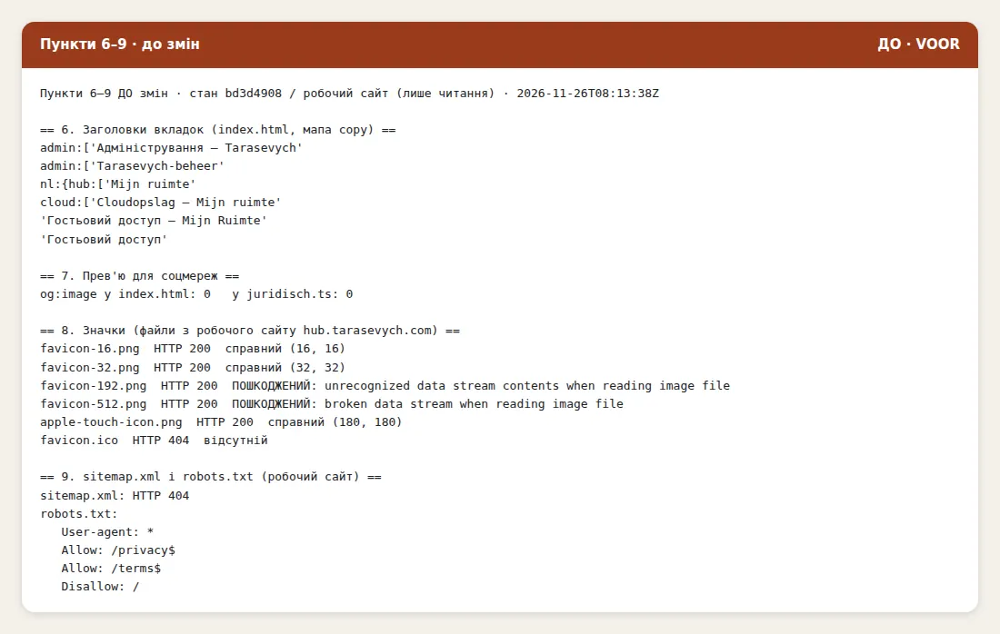 |  |
| — |  |
| — | 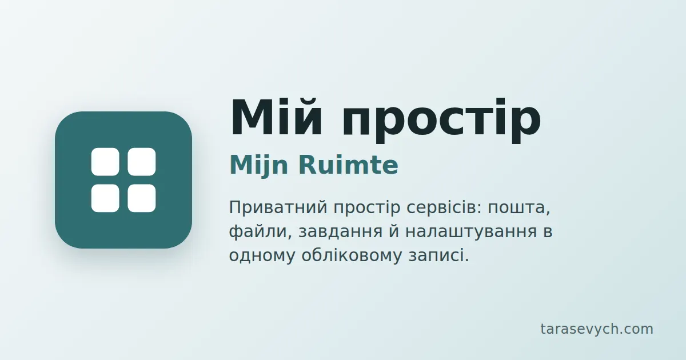 |
| 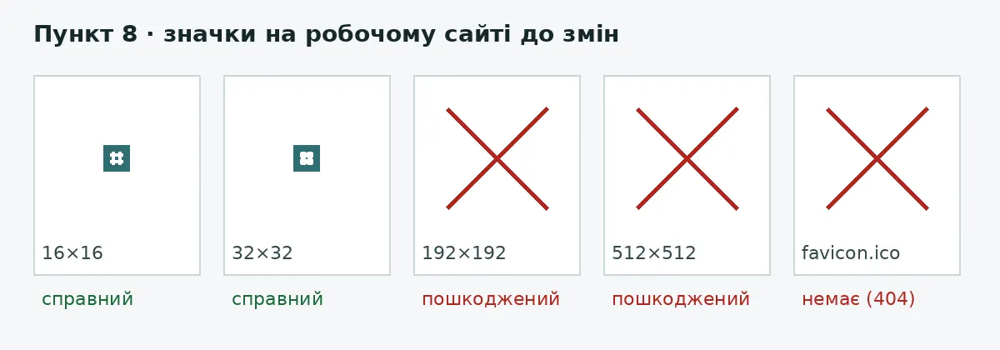 |  |

### 10. Альтернативні тексти зображень

Перевірено всі 51 JSX-зображення в `src/` та `index.html`: зображень без атрибута `alt` немає. Порожній `alt` (29 місць) — лише для оздобних зображень (аватар поруч з ім'ям, мініатюра в кнопці з `aria-label`), як вимагає WCAG 1.1.1. Вада: прапор і герб місця (`src/merk/PlaatsKeten.tsx`) мали порожній `alt`, хоча несуть зміст; тепер «Прапор: <назва>» / «Герб: <назва>».
Новий тест-сторож `tests/eenheid/site-001-alt.test.ts`: 4/4 — не пропустить нового зображення без `alt`.

| До | Після |
|---|---|
| 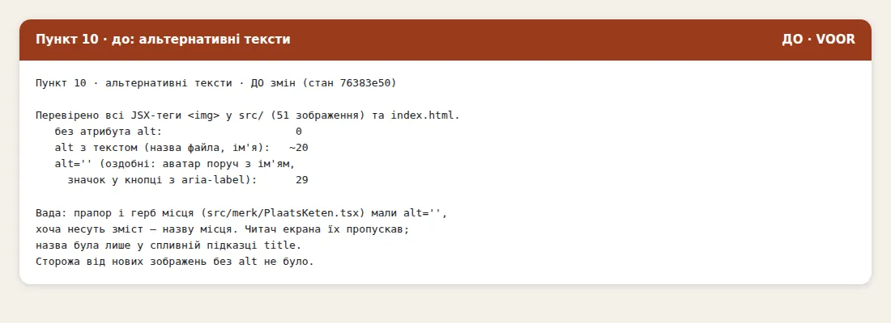 | 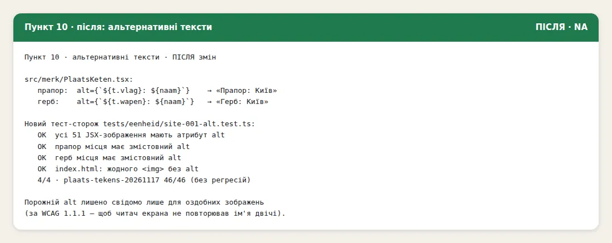 |

### 11. Стиснення зображень

Огляд: 1835 зображень, 8,38 МБ; з них 1744 гербів і прапорів у `webp` (у середньому 4,7 кБ — уже стиснені), 67 `svg`, 24 `png`. Офіційні логотипи `src/merk/officieel/*.png` закріплені відбитками SHA-256 у `HERKOMST.json` як оригінали постачальників — їх свідомо не змінено. Значки й прев'ю стиснено `pngquant` + `optipng` без видимих втрат: 69 319 → 47 395 Б (−32 %), прев'ю для соцмереж 61 → 43 кБ.

| Після (таблиця обсягів) | Прев'ю до / після |
|---|---|
|  |  |

### 12. Швидкість завантаження сайту

**Умови стенда та методика (`prestatie-meten`).** Вимірювання виконано на зібраному вигляді продукту (`vite build` + `dist-server` зі стисненням `brotli`/`gzip` у пам'яті та `Cache-Control: public, max-age=31536000, immutable`) у двох режимах по **3 прогони після окремого прогріву** для кожної адреси:
1) місцева мережа (`1366×900`);
2) умовно повільний мобільний телефон (`390×844`, штучне сповільнення процесора `4×`, затримка мережі `150 мс`, пропускна здатність `9 / 3 Мбіт/с`).

**Виявлені першопричини сповільнення:**
1. У `src/main.tsx` головний застосунок `App` підключався статичним імпортом верхнього рівня, через що легка гостьова сторінка `/toegang` і вікно повернення `OAuth` завантажували й компілювали ядро на 511 кБ стисненого коду (666 кБ разом).
2. На публічних екранах входу без сеансу передчасно завантажувалися шар технічного профілю `TechLaag` + `HulpVraag` (~131 кБ стисненого коду) та ~30 модулів лінивого `MeldingenPortaal` (який на закритій панелі одразу повертав `null`).
3. Складники `regels-opslag.ts` та `uitrol-achtergrond-beheer.ts` викликали маршрути власника без сеансу (два марні `401`, через які мережа не затихала 15,5 с) і не передавали `meldingLichaam()` / `tabContext`, спричиняючи `401` навіть за входом.

**Виправлення:** `App` переведено на динамічний `import('./App')` лише у гілці застосунку; `TechLaag` завантажується лише після підтвердження сеансу (`ecosystemSessionLikely` / `wachtOpSessieHint` / `listenCanonicalAuthChanges`); `MeldingenPortaal` монтується при відкритті панелі або за активної згорнутої пігулки; запити `meldingen/regels` і `uitrol/achtergrond` обмежено наявністю сеансу та доповнено контекстом вкладки. Постійний сторож `tests/eenheid/site-001-snelheid.test.ts` — `9/9`, `maquette-mobiel-prestatie` — `19/19`, `perf-001` — `41/41`, `tech-bundels-controle` — `OK`.

| Сценарій (медіана 3 прогонів, у дужках розкид мін–макс) | До | Після | Різниця |
|---|---|---|---|
| `id/` · місцева мережа · обсяг / запити `4xx` | `1013 кБ` (`1013–1013`) / `2` | `873 кБ` (`720–873`) / `0` | **−140 кБ (−13,8 %)**, **`4xx`: 2 → 0** |
| `id/` · місцева мережа · `LCP` / тиша мережі | `572 мс` (`508–604`) / `15 510 мс` | `308 мс` (`0–344`) / `1 475 мс` | **−46,2 % `LCP`**, **×10,5 швидша тиша** |
| `id/` · місцева мережа · довгі завдання (> 50 мс) | `2` (`262 мс`) | `2` (`148 мс`) | **−114 мс (−43,5 %)** |
| `id/` · телефон 4G `×4` ЦП · обсяг / довгі завдання | `938 кБ` (`937–1013`) / `7` (`1679 мс`) | `763 кБ` (`763–763`) / `4` (`467 мс`) | **−175 кБ (−18,7 %)**, **−72,2 % блокування ЦП** |
| `id/toegang` · місцева мережа · обсяг / `load` / `LCP` | `666 кБ` / `329 мс` (`316–336`) / `352 мс` | `220 кБ` / `210 мс` (`174–241`) / `236 мс` | **−446 кБ (−67,0 %)**, **−36,2 % `load`** |
| `id/toegang` · місцева мережа · довгі завдання | `1` (`96 мс`) | `0` (`0 мс`) | **−100 % (0 довгих завдань)** |
| `id/toegang` · телефон 4G `×4` ЦП · чистий прогін | `666 кБ`, `load 2044 мс`, `LCP 2288 мс` (зриви > 60 с) | `220 кБ`, `load 1241 мс`, `LCP 1244 мс`, `FCP 664 мс` (0 зривів) | **−39,3 % `load`**, **−45,6 % `LCP`** |
| `hub/privacy` · статичний HTML · місцева / телефон | `32 кБ`, `load 45 мс` / `711 мс` | `32 кБ`, `load 73 мс` / `565 мс` | незмінно легка серверна сторінка |

*Межі достовірності:* виміри виконано на ізольованому місцевому стенді з порожньою штучною базою даних і емуляцією затримки `CDP` поверх локального `TLS`-з'єднання (де планувальник безголового переглядача у віртуальній машині без графічного прискорювача інколи додає ~42 с паузи таймера, що відображено у верхній межі розкиду `4G`); ці цифри доводять зменшення мережевого обсягу та навантаження процесора, але не замінюють виміру через справжній зовнішній тунель робочого сервера.

| До | Після |
|---|---|
|  |  |

### 13. Контраст кольорів

Сторож `scripts/kleur-contrast-controle.mjs` (2190 пар у 30 палітрах, обидві теми) — зелений. Додатково відмальовані сторінки перевірено axe-core 4 (правило `color-contrast`, WCAG 2.1 AA): вхід зі смугою згоди, гостьовий доступ, сторінка 404, адміністрування — 0 порушень. На `/privacy` і `/terms` знайдено дві вади в `public/juridisch.css`:
- дата редакції `#6a7580` на `#f7f8fa` — 4,42:1 (треба 4,5:1) → `#5f6a75`, 5,19:1; у темній темі `#a3adb7`, 7,82:1;
- **у темній темі всі посилання мали 2,64:1**: блок `@media (prefers-color-scheme: dark)` стояв вище за правило `a{color:#2f6f73}`, і воно його перекривало. Блок перенесено в кінець файла — 7,15:1.

Після виправлення: 0 порушень у світлій і темній темах.

| До | Після |
|---|---|
|  |  |
| 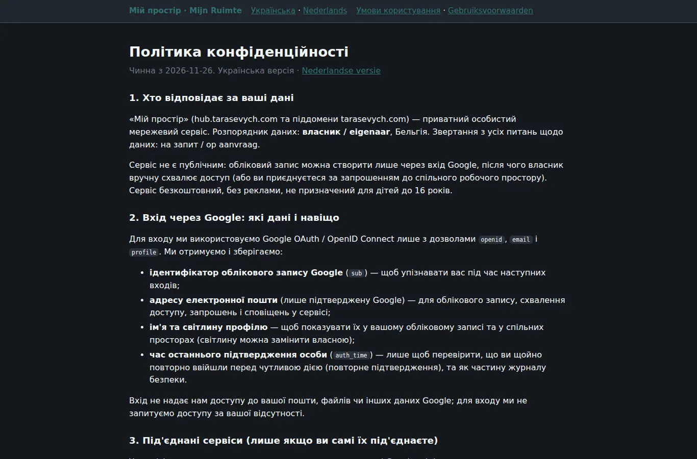 |  |

### 14. Адаптивність під мобільні

Новий замір відмальованих сторінок на ширинах 320, 360, 390 і 768 пікселів (горизонтальне прокручування, елементи за правим краєм, цілі дотику менші за 24×24 за WCAG 2.2 · 2.5.8, текст дрібніший за 12 пікселів): вхід `id/`, гостьовий доступ `id/toegang`, `/privacy`, `/terms`, сторінка 404, пошта. **До — 174 вади, після — 0.** Виправлено:
- **`/privacy` і `/terms` прокручувалися вбік** на 320 (ширина вмісту 330 і 356 пікселів): довгі слова й адреси не переносилися. Додано `overflow-wrap:break-word` і `hyphens:auto`, для `code` — `overflow-wrap:anywhere`; заголовок `h1` масштабується `clamp(1.4rem, 6.5vw, 1.7rem)`;
- **`code` мав 11,44 пікселя**: без явної родини шрифтів оглядач зменшує моноширинний шрифт. Задано явну родину шрифтів;
- **замалі цілі дотику**: посилання навігації юридичних сторінок, посилання «Політика» / «Умови» та прапорець «Запам'ятати» на екрані входу тепер мають щонайменше 24 пікселі заввишки; кнопка мови — 0,76 rem;
- **Fastmail на орбіті пошти** має справжню кнопку входу (IMAP), але не мав свого місця й стояв у куті, обрізаний на широкому екрані. Тепер сім конвертів стоять без накладань: на широкому екрані Fastmail угорі поруч з Outlook, на мобільному — по три з кожного боку; тест `mail-orbit-001` тепер перевіряє, що кожен із 7 постачальників має місце на орбіті (до змін падав: 16/17, тепер 18/18).

Тести: `mail-orbit-001` 18/18, `mailmob-001` 22/22, `site-001-404` 24/24.

| До | Після |
|---|---|
|  |  |
| 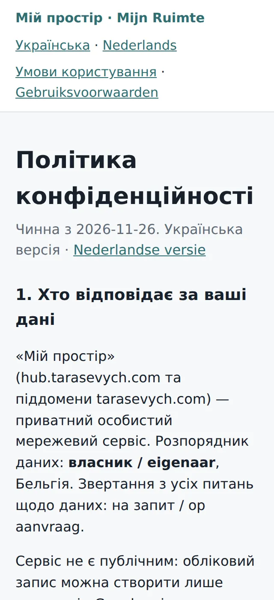 |  |
|  |  |
| 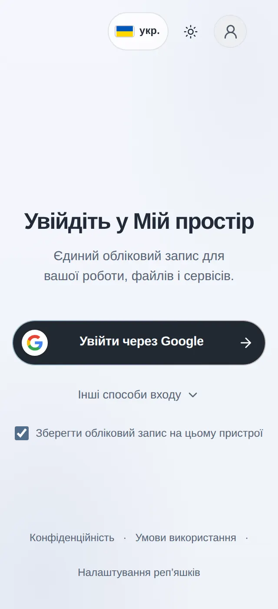 |  |
| 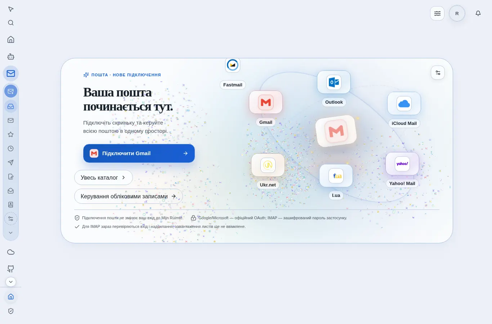 |  |
|  |  |

### 15. Власна сторінка 404

Сторінка «Сторінку не знайдено» (`src/NietGevonden.tsx`) уже була, але мала чотири вади — усі виправлено:
- **«м'яка 404»:** сервер на будь-яку невідому адресу відповідав кодом 200, тож пошукові системи й перевірки посилань вважали її справжньою сторінкою. Тепер `server/platform/onbekend-pad.ts` виконує ту саму функцію `resolve` з `canonical-service.js`, що й оглядач (в ізольованому `vm`-контексті, без другого списку вкладок), і для невідомої адреси сервер відповідає **404**. Вкладки, давні адреси й псевдоніми, гостьовий доступ `id/toegang`, повернення з OAuth і спільні посилання хмари лишаються 200. Будь-яка вада перевірки — поводження як раніше (200);
- **людина без входу** бачила все меню служб (на hub воно ще й накривало картку на ширині 1366), а на інших службах замість 404 — екран входу. Тепер без входу сторінка 404 стоїть сама, по центру; за входом — звична оболонка (накриття немає);
- **шлях закодований** (`/%D1%89%D0%BE`) → показано так, як його бачить людина (`/що`);
- заголовок вкладки — «Сторінку не знайдено — <служба>» / «Pagina niet gevonden — <dienst>».

Тест-сторож `tests/eenheid/site-001-404.test.ts` — 24/24. axe-core — 0 порушень.

| До | Після |
|---|---|
| 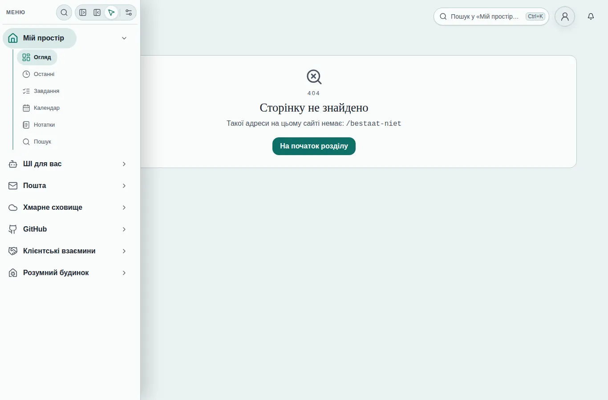 | 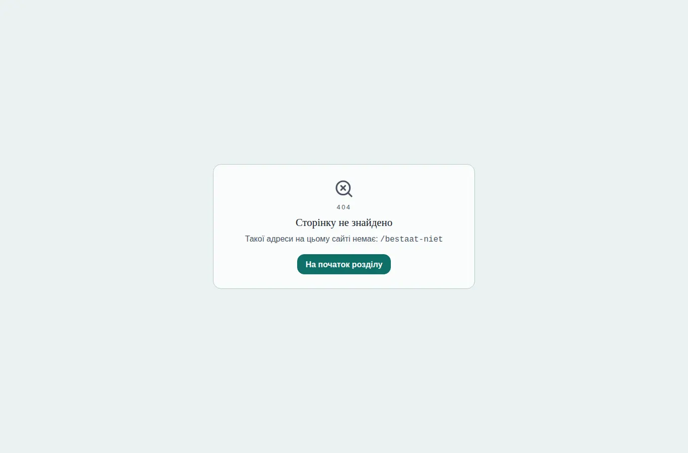 |
|  | 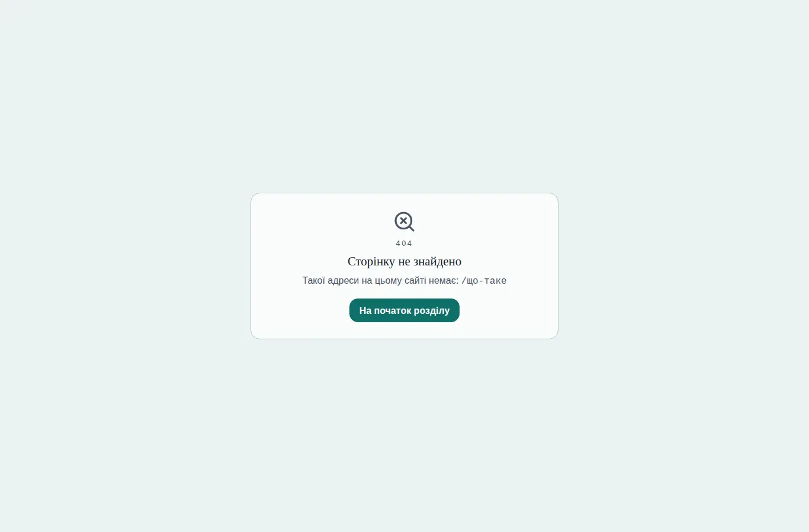 |
| 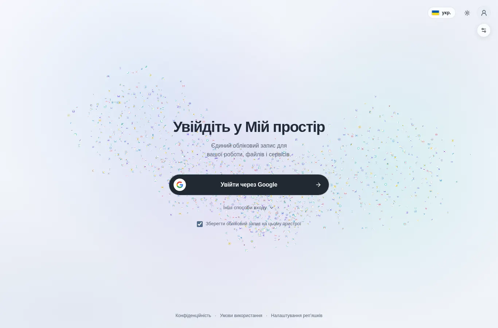 | 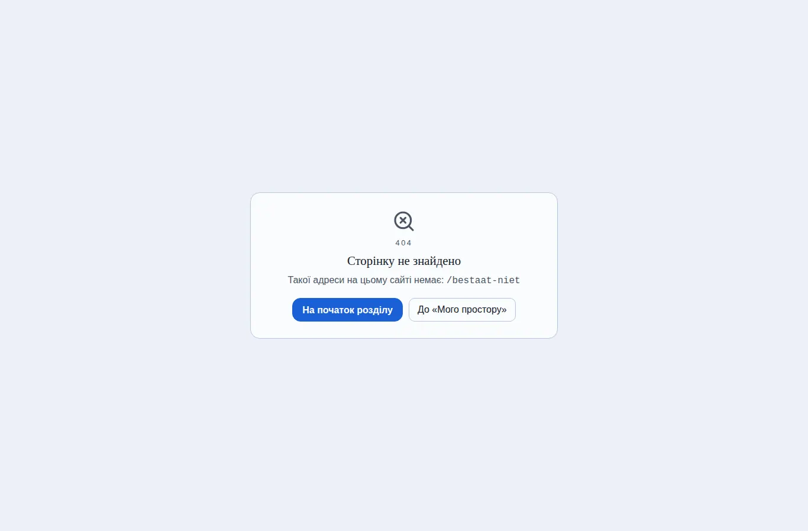 |
|  | 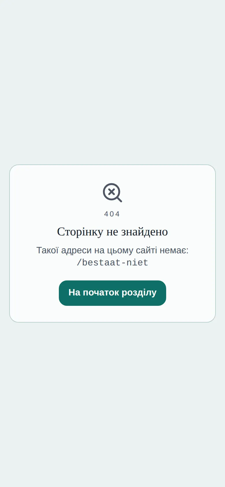 |
| 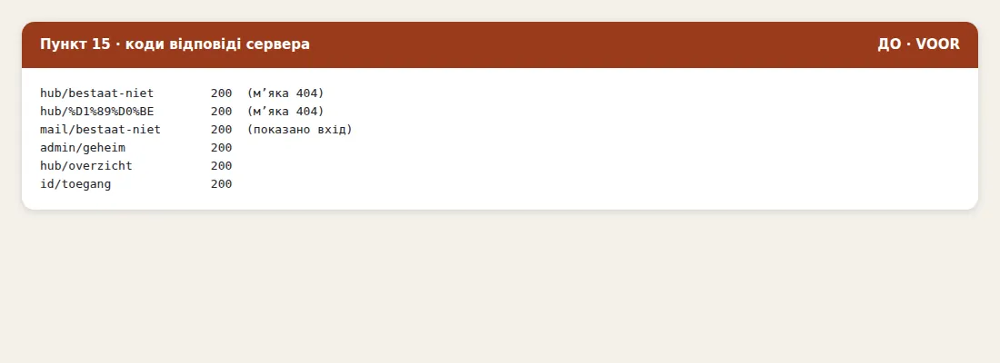 |  |
| | 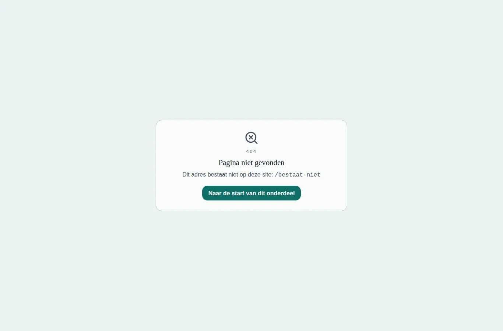 |
| |  |

### 16. Биті посилання

Новий засіб обходить відмальовані сторінки без входу (вхід, гостьовий доступ, `/privacy`, `/terms`, 404, пошта), збирає всі `a`, `link`, `img`, `script`, читає `sitemap.xml` і додає статичні адреси з коду (`src/`, `backend/`, `public/`, `index.html`). Перевірено 305 внутрішніх адрес на стенді та 3 зовнішні (сторінка правил Google, орган захисту даних Бельгії) — усі зовнішні живі.

Перший прогін показав 181 «биту» адресу, але це була вада самого засобу: запити Playwright ішли повз правило перенаправлення імен на робочий сайт, де ще старе складання (робочий сайт лише читався). Після виправлення лишилося 9 кандидатів, кожен розібрано вручну:
- **справжня вада:** діалог підтвердження доступу (`src/platform/bevestig-toegang.tsx`) відкривається на будь-якій службі, зокрема mcp і api, а посилання «до способів входу» було відносним (`/aanmeldmethoden`) — там воно вело на 404. Тепер адреса абсолютна `https://id.tarasevych.com/aanmeldmethoden`, як у `kluis-poort.tsx`;
- `/methods`, `/sharing`, `/audit`, `/ai` — не биті: ці складники показуються лише на своїх службах (id та admin), де шляхи відкриваються (200);
- `mcp.tarasevych.com/Grok`, `/claude`, `/mcp` — адреси окремого моста MCP (порт 8091), якого на стенді немає;
- `/bestaat-niet` — навмисна перевірка сторінки 404.

Попутно уніфіковано назву: сторінка й нижня смуга мали «Умови користування», а застосунок — «Умови використання». Тепер скрізь «Умови використання», як у завданні власника. Без змінної `MR_EIGENAAR_NAAM` в одномовне речення потрапляла двомовна заглушка («власник — власник / eigenaar»). Тепер кожна мова має свою заглушку: «приватна особа» / «een particulier». Так само без `MR_CONTACT_EMAIL` виходило «повідомляєте про підозрілу активність на на запит / op aanvraag». Тепер кожне речення має природний варіант своєю мовою («повідомляєте… власникові сервісу», «Адресу надаємо на запит»).

Новий тест-сторож `tests/eenheid/site-001-koppelingen.test.ts` — 6/6: спільні складники `src/platform/**` не мають відносних `href`; `sitemap.xml` і `robots.txt` вказують на наявне; кожен статичний файл з `index.html` і юридичних сторінок є в `public/`. `juridisch.test.ts` — 12/12.

| До | Після |
|---|---|
|  |  |
|  | 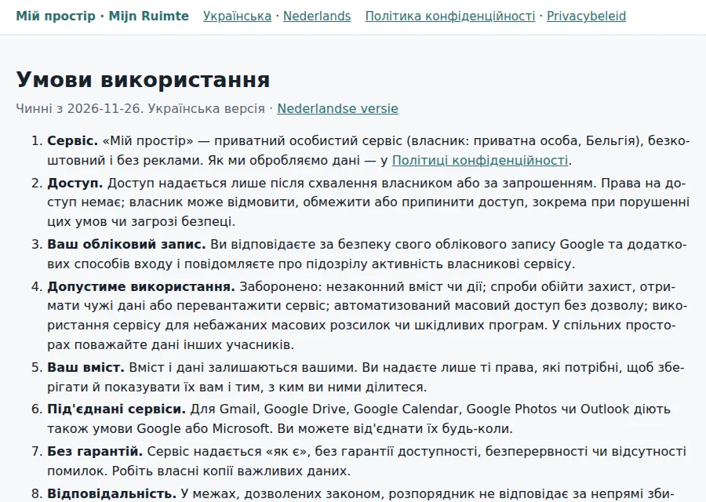 |

### 17. Перевірка всіх форм

**Сервер.** Новий засіб надсилає на кожен із 50 публічних маршрутів POST (вхід, гостьовий доступ, запити доступу, реєстрація способів входу тощо) вісім зламаних тіл: не JSON, масив, `null`, рядок, неправильні типи, задовгі рядки, керувальні символи, тіло 2 МБ — разом 400 випадків. Жодної аварії (500 чи обірваного з'єднання): 116 × 400, 100 × 413, 63 × 401, 42 × 404 (немає такої спроби, транзакції чи увімкненого способу), 12 × 403, 6 × 409, 1 × 429 — щоразу з кодом причини; 48 × 200 — маршрути лише для читання (каталог), що зламане тіло просто ігнорують. Єдині 12 відповідей 503 — `ACCESS_WEBAUTHN_DISABLED` на двох маршрутах власника, де ця можливість навмисно вимкнена на стенді; це не вада.

**Оглядач.** Засіб перевіряє гостьову форму й форму входу паролем так, як їх бачить людина й читач екрана. На старому складанні — 7 вад:
- код гостьового доступу, набраний на українській розкладці (А, В, Е, К, М, Н, О, Р, С, Т, Х, І), сервер відкидав як неправильний, хоча на вигляд він правильний;
- недопустимі знаки (наприклад, U чи «!») ставали помітні лише після відмови сервера;
- після відмови поле не позначалося як хибне (`aria-invalid`), повідомлення не було пов'язане з полем (`aria-describedby`), а фокус губився — те саме у формі пароля (адреса й пароль).

**Виправлення:**
- новий модуль `src/gast-code.ts`: кириличні двійники перетворюються на латинські ще під час введення; недопустимі знаки показуються одразу з поясненням (`role=alert`); лічильник «введено N із 16»; кнопка «Надіслати» вмикається лише для повного коду; код із посилання `#code=` проходить те саме очищення;
- `src/GastToegang.tsx`: поле має `aria-invalid` і `aria-describedby` на підказку, повідомлення про знаки й помилку сервера; після відмови фокус і виділення повертаються в поле;
- `src/aanmelden/AanmeldZonderGoogle.tsx`: повідомлення про помилку має власний `id`, поля адреси, пароля й коду позначаються й посилаються на нього; після відмови фокус стає в поле пароля; `src/geheim/GeheimInvoer.tsx` отримав властивість `ariaInvalid`.

Повторна перевірка в оглядачі — 0 вад. Новий тест-сторож `tests/eenheid/site-001-formulieren.test.ts` — 22/22.

| До | Після |
|---|---|
| 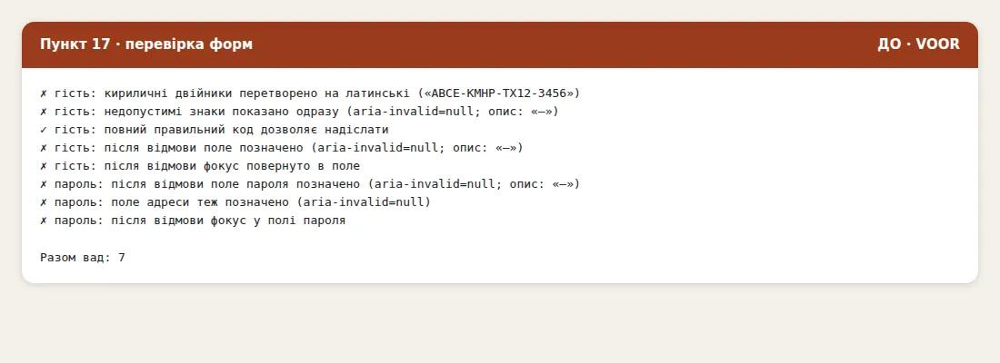 | 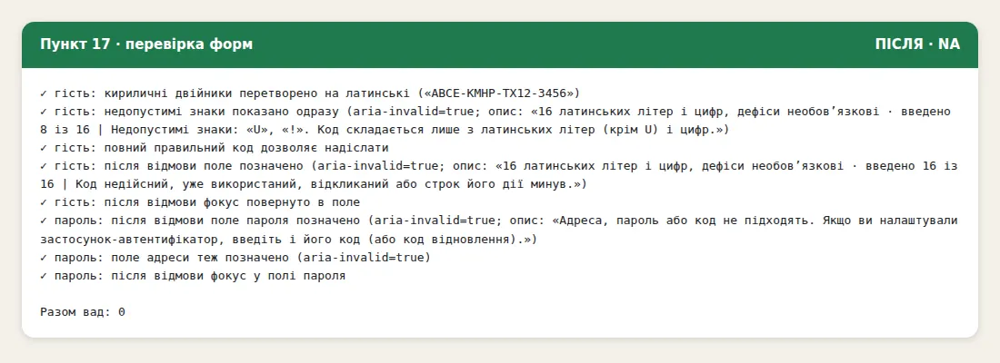 |
|  | 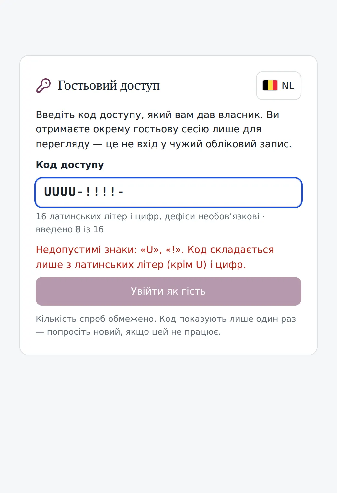 |
| 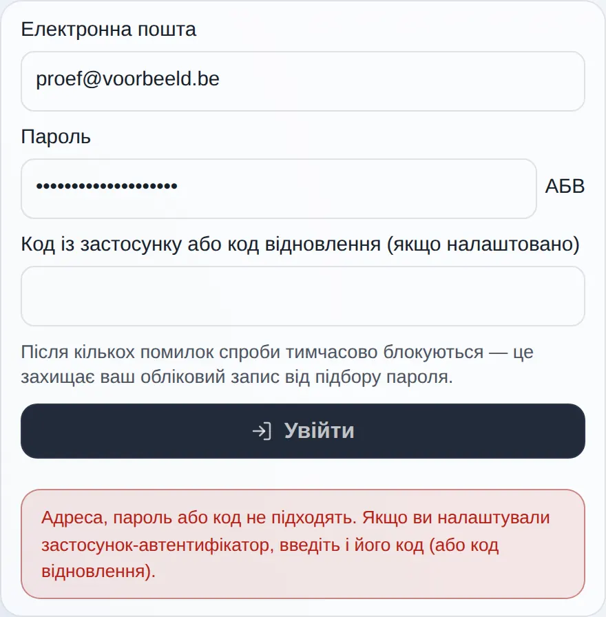 | 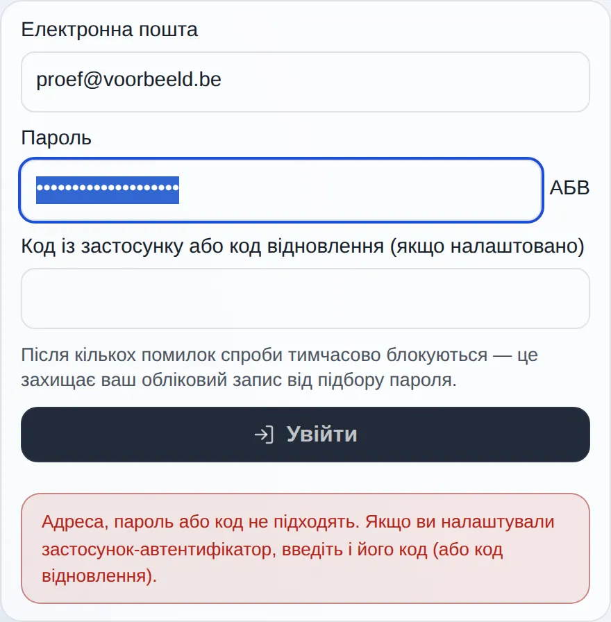 |

### 18. Захист від спаму

Сайт не має відкритих форм для анонімних повідомлень (контактної форми, вільної реєстрації): усе, що приймає дані без входу, — це вхід, гостьовий код, спільні посилання, зворотні виклики служб і з'єднувач MCP. Тому захист від спаму тут — це обмеження частоти, лічильники невдалих спроб і перевірка підписів. Поле-пастка не потрібне: немає форми, яку робот міг би заповнити, не знаючи таємниці.

**Інвентаризація.** Із 56 публічних POST (без сеансу) 23 мають суворе обмеження на IP у `server/start.ts` (`STRIKTE_LIMIETEN`, при збої бази — відмова, а не пропуск), а 33 — лише загальну межу 600/хв. Для кожного з цих 33 розібрано, чому цього досить: власний лічильник (код вікна Telegram — пауза й вимкнення; спільні посилання — код 192 біти, 120/хв на IP і 10 спроб пароля за 5 хв), обов'язковий підпис (GitHub, Telegram, Google, Microsoft), маркер доступу (розширення, агенти, MCP), лише читання або ідемпотентний вихід. Запит доступу від нового користувача вже має межу 5/год на обліковий запис і 30/год на IP, а власник отримує сповіщення лише раз.

**Жива перевірка на стенді.** Перший прогін показав дві межі, що «не спрацювали», — причина у стенді: `E2E_LOKALE_LIMIETEN=1` множить суворі межі на 20 для місцевих перевірок оглядача. Без множника, як на робочому сайті, усі 6 перевірених меж спрацьовують точно за налаштуваннями: гостьовий код і старий вхід паролем — блокування після 5 невдалих спроб; вхід паролем — 429 з 11-ї спроби; початок входу без Google — з 31-ї; реєстрація клієнта MCP — з 21-ї; спільне посилання — зі 121-ї. Вікна фіксовані (60 с), тому серії мають довжину 2 × межа + запас. Людина бачить пояснення «Забагато спроб. Спробуйте через ~N хв» (uk + nl).

**Новий тест-сторож** `tests/eenheid/site-001-spam.test.ts` — 50/50. Він читає `PUBLIEKE_ROUTES` і `STRIKTE_LIMIETEN` та вимагає для кожного публічного POST або суворої межі, або запису власного захисту з міткою, яку видно в коді. Окремо сторож перевіряє: таємниці, які можна підбирати (паролі, гостьовий код, код прив'язки агента, код Telegram, передача сеансу, реєстрація й маркери MCP), мають саме суворе обмеження; усі суворі межі «закриті» при збої бази; множник ×20 вмикається лише значенням `1` і відсутній у `deploy/`. Новий маршрут без захисту більше не пройде непомітно.

| До | Після |
|---|---|
| 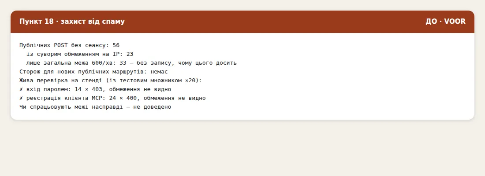 | 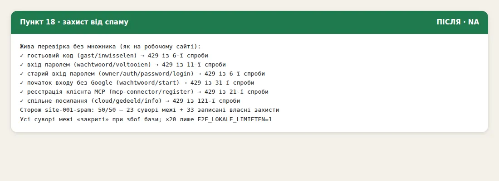 |

### 19. Аналітика сайту (виконано разом із пунктом 5)

Серверна частина вже була (`backend/privacy.ts`: згода типово вимкнена, знеособлені денні лічильники), але інтерфейс її ніколи не викликав, а лічильники ніхто не читав. Тепер: після згоди одна подія `bezoek.<сервіс>` за сеанс вкладки (без адреси сторінки, ідентифікатора, IP чи пристрою); маршрут для адміністратора `POST /api/owner/admin/analyse-overzicht` (`admin.read`, лише читання) і вкладка «Відвідування» в розділі «Діагностика» з періодами 7/30/90 днів. Сторонніх систем аналітики не додано — нуль нових витрат і нуль передачі даних третім сторонам.
Тест `tests/eenheid/site-001-analyse.test.ts`: 12/12 (зі справжньою базою PostgreSQL 18).

| До | Після |
|---|---|
|  | 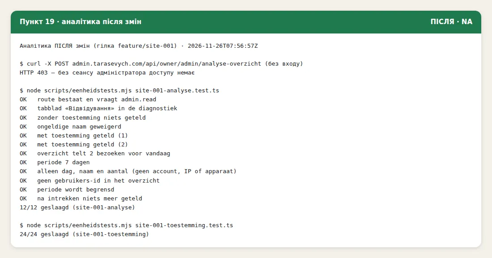 |

### 20. Один чіткий заклик до дії

**Перевірка «до».** Засіб `cta.mjs` обійшов 6 ключових екранів (`id/` новий пристрій, `id/` зі збереженим обліковим записом, `mail/`, `id/toegang`, `id/bestaat-niet`, `hub/privacy`) та оцінив візуальну ієрархію інтерактивних елементів основної ділянки (поза верхньою панеллю мови/теми, нижньою правовою смугою та рівноцінними за законом кнопками смуги згоди на реп'яшки). Виявлено 2 вади:
1. На екрані входу зі збереженим обліковим записом картка користувача була блідою другорядною, тоді як нижче кнопка «Увійти через Google» залишалася залитою темним кольором як головна — другорядна дія перекрикувала швидкий вхід власника пристрою (а за кількох способів у головній групі всі вони малювалися однаково темними).
2. На публічних юридичних сторінках `/privacy` та `/terms` у шапці не було виразної головної кнопки повернення до простору (`0` головних дій — лише звичайні текстові посилання).

**Виправлення:**
- У `src/CanoniekOmlijsting.tsx`, `src/aanmeld-herontwerp.css` і `src/maquette-kern/maquette-aanmelden.css` перша збережена картка облікового запису отримала `data-hoofdactie="true"` та акцентне оформлення головної кнопки (контраст > 10:1), а кнопка Google й додаткові способи під нею переходять у спокійне контурне подання `data-hoofdactie="false"`. За відсутності збережених записів єдиною головною дією лишається перший спосіб входу.
- У `backend/juridisch.ts` та `public/juridisch.css` посилання «Мій простір · Mijn Ruimte» у шапці оформлено як єдину акцентну кнопку-пігулку (контраст 8,1:1 у світлій і 9,6:1 у темній темі; `axe-core` — 0 порушень). На сторінці 404 (`src/NietGevonden.tsx`) закріплено явні позначки головної та другорядної дій.

Повторний прогін `cta.mjs` — **0 вад** (6 із 6 екранів мають рівно 1 головний заклик до дії). Новий сторож `tests/eenheid/site-001-cta.test.ts` — `8/8`, `aanmelden-integ` — `43/43`, `juridisch` — `12/12`.

| До | Після |
|---|---|
|  | 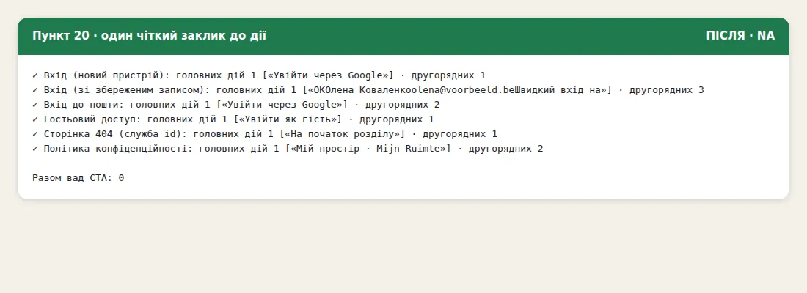 |
| 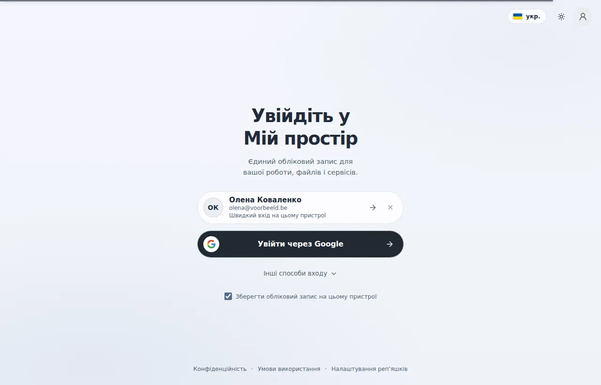 | 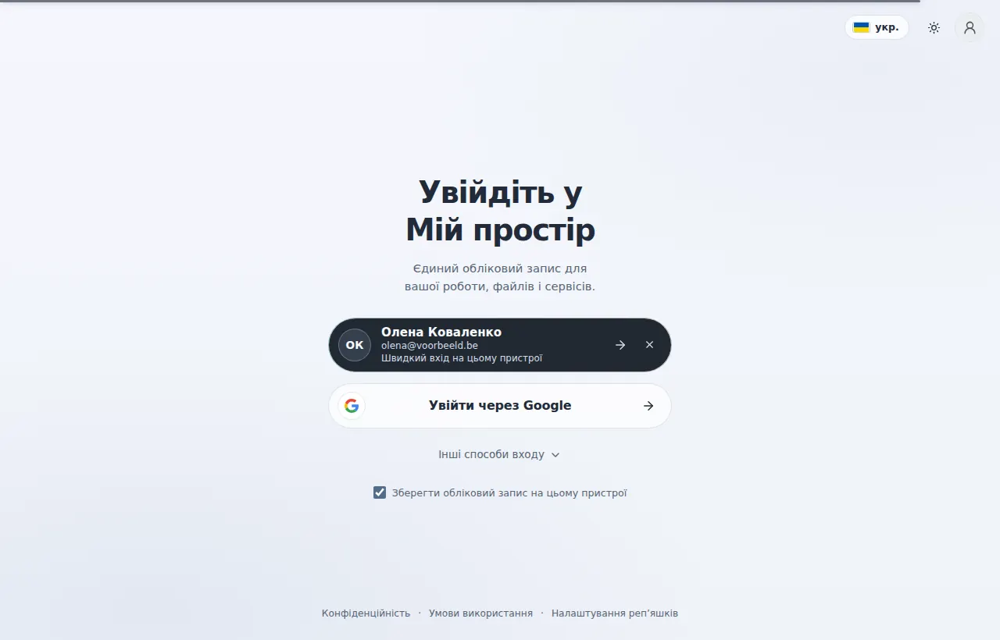 |
| 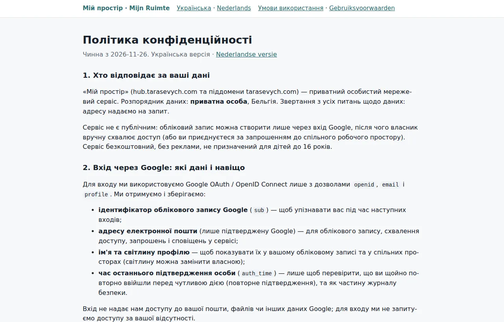 | 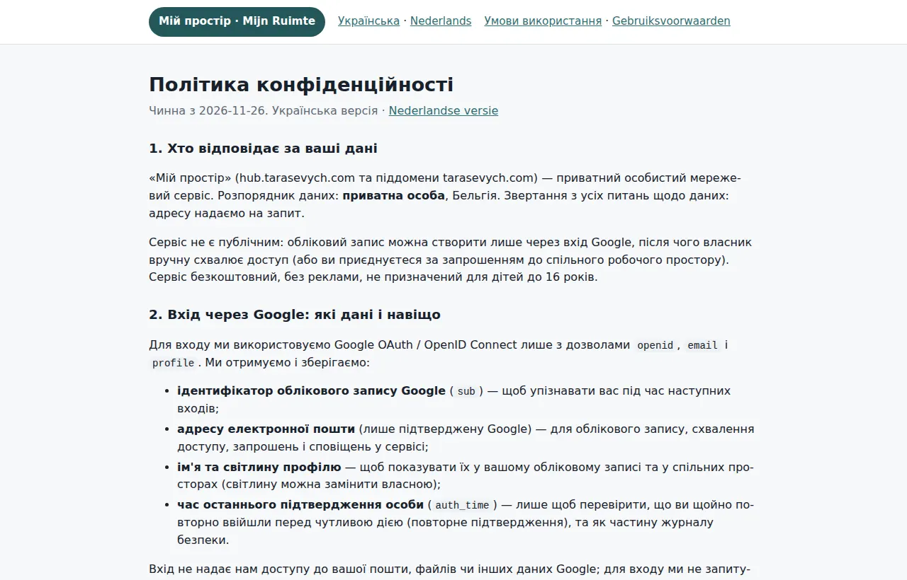 |

### Мовне очищення за рішенням власника («акаунт» → «обліковий запис»)

На пряме рішення власника («так, виправ всі необхідні») виконано повну заміну англіцизму «акаунт» у всіх відмінках і формах на питомий український відповідник «обліковий запис» у вихідному коді інтерфейсу, спільних модулях, повідомленнях сервера, словниках пошуку та сценаріях розгортання (`src/`, `shared/`, `backend/`, `server/`, `public/`, `deploy/`, `index.html` — разом 852 входження у 285 файлах; макет особистого кабінету перегенеровано через `scripts/identiteit-maquette/bouw.mjs`, пошуковий покажчик інтерфейсу `shared/zoek-ui-knoppen.generated.ts` оновлено на 2439 елементів). Підписаний пакет розширення оглядача `extension/` версії `0.9.7` свідомо не змінювався, щоб зберегти дійсний відбиток підпису `CRX3` ключа власника до планового перепідписання.

Порівняльний прогін усіх 638 файлів модульних випробувань відносно базової основи та окрема переперевірка підтвердили відсутність регресій (попутно узгоджено очікування сторінки 404 у `maquette-001-kern.test.ts` та `ui-audit-g.test.ts`). Додано постійний сторож `tests/eenheid/site-001-akaunt.test.ts` (8/8). Роботу розпочала модель `Claude Opus 5.5 (High)` через `Antigravity Google`, а після обриву сеансу через вичерпання ліміту перевірила й завершила модель `Gemini 4 Carbon High` від `Google Antigravity`.

| До | Після |
|---|---|
| 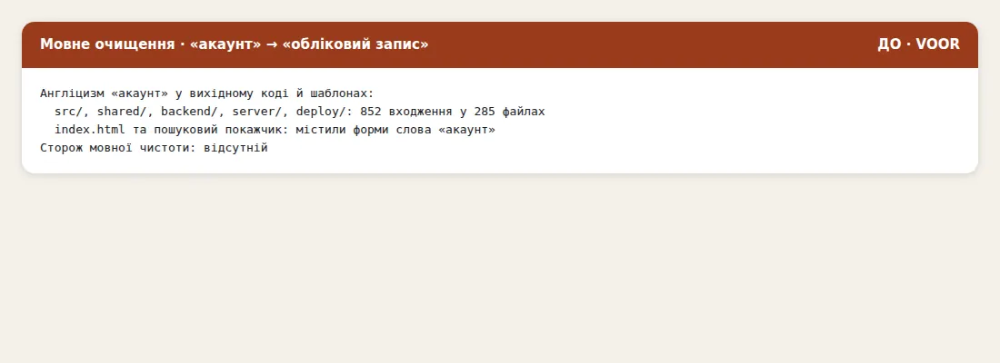 |  |
| 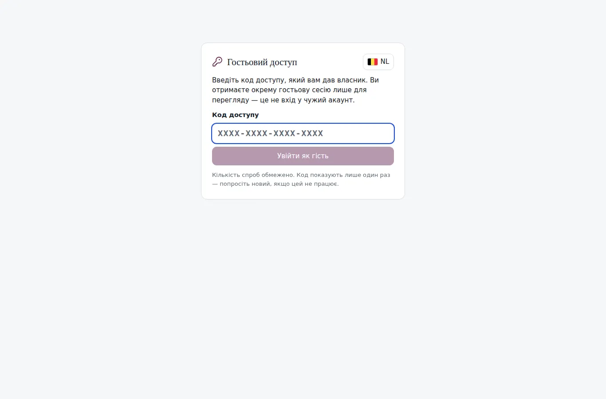 |  |

### 21. Кнопки та інтерактивні елементи

**Перевірка «до».** Наскрізний засіб `knoppen.mjs` перевірив на живому стенді інтерактивні елементи як без входу (`id/`, `/toegang`, `/privacy`, сторінка 404), так і за входом власника на одноразовому сервері `rook` (`id/` кабінет налаштувань та мобільний робочий стіл `hub/` 390×844). Виявлено 4 вади:
1. На сторінці гостьового доступу `/toegang` (`src/GastToegang.tsx`) перемикач мови `.gast-taal` відображав видимий напис `NL` / `UA`, але `aria-label` не містив цього видимого тексту — серйозне порушення WCAG 2.5.3 (`label-content-name-mismatch` у `axe-core`, ламає голосове керування).
2. За входом у кабінеті налаштувань `id/` макет `src/identiteit/maquette/IdentiteitMaquette.tsx` під час фонового читання стану щоразу надсилав запит `POST /api/owner/workspaces/list` на неіснуючий маршрут і породжував мережеву помилку `404`.
3. Після підтвердження сеансу в `id/` заголовок вкладки оглядача `document.title` залишався рівним початковому «Вхід — Мій простір» замість «Налаштування — Мій простір» (а в інших службах не оновлювався під час перемикання мови без перезавантаження).
4. На новому порожньому робочому столі `WerkbladV3` (`src/werkblad/WerkbladV3.tsx`) поза режимом редагування замість пояснювальної картки малювалося порожнє полотно без жодної кнопки додавання віджетів чи вибору початкового набору.

**Виправлення:**
- `src/GastToegang.tsx`: доступну назву `aria-label` перемикача `.gast-taal` розпочато з видимого напису `MOVA_NAAM` (`NL — перемкнути мову на нідерландську` / `UA — taal wisselen naar Oekraïens`).
- `src/identiteit/maquette/IdentiteitMaquette.tsx`: виклик `/api/owner/workspaces/list` замінено на канонічний `/api/owner/session/bootstrap`, який повертає список просторів `workspaces` без жодної помилки `404`.
- `src/VerenigdDienstApp.tsx` і `src/App.tsx`: додано реактивну синхронізацію `document.title` зі станом сеансу та обраною мовою (зі збереженням позначки `[ТЕХ]` / `[TECH]` технічної смуги та власного заголовка сторінки 404).
- `src/werkblad/WerkbladV3.tsx`: на порожньому столі додано привітну картку `.wb-leeg-stol` (`data-wb-leeg="1"`, `data-wb-aantal`) із двома діями — головною кнопкою «Додати з бібліотеки» та другорядною «Стандартна розкладка» (переносить стандартний набір віджетів на поточний клас пристрою й зберігає його). Пошуковий покажчик інтерфейсу оновлено (2440 елементів).

Повторний прогін `knoppen.mjs` — **0 вад** (11 із 11 живих сценаріїв успішні). Новий сторож `tests/eenheid/site-001-knoppen.test.ts` — `7/7`, суміжні тести `werkblad-hoek-20261115` (`9/9`) та `identiteit-maquette` (`56/56`) зелені.

| До | Після |
|---|---|
| 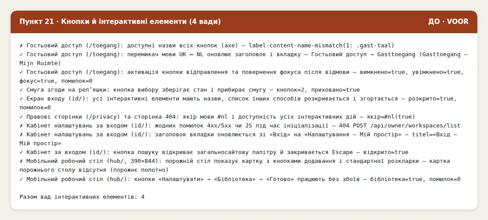 |  |
|  |  |
| — | 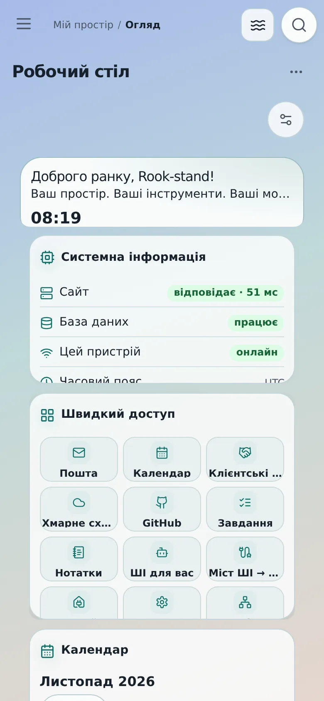 |

### 22. Журналювання помилок і моніторинг

**Перевірка наявної системи нагляду та журналювання:**
- **Серверна сітка перехоплення помилок (`server/platform/proces-vangnet.ts`, `server/start.ts`):** неперехоплені винятки й відхилені обіцянки записуються у журнал сервера без тіла запиту чи таємниць, щоб поодинокий збій не обірвав сеанси й не закрив відкриті в пам'яті ключі користувачів; якщо за 60 с трапляється понад 50 помилок, процес зупиняється з кодом `1` для чистого перезапуску через `systemd`. Затримка циклу подій вимірюється через `monitorEventLoopDelay`.
- **Перевірка працездатності (`/__gezondheid` та `/__gezondheid?diep=1`, `backend/diepe-gezondheid.ts`):** на живому стенді базова перевірка повертає `{"ok":true,"db":true}`, глибока з `127.0.0.1` за 20 мс перевіряє базу, пробний сеанс технічного простору v2, видачу й відкликання реп'яшка для `/assets/tech/*` та наявність зібраних модулів, а будь-який запит із заголовком тунелю (`cf-connecting-ip`) отримує `403 {"ok":false,"fout":"ALLEEN_LOKAAL"}`.
- **Приймач клієнтських збоїв і журнали без витоків (`backend/toegangsfout-tellers.ts`, `shared/beheer-journaal.ts`):** помилки `401`/`403`/`404` та сигнали недовантажених модулів `POST /api/storing/tech-bundel` рахуються погодинно за 6 групами без IP-адрес і користувачів; реєстр `meldingen-register-controle.mjs` підтвердив усі 333 серверні коди дій і 537 двомовних назв (`overig: 0`). Післяпусковий сторож `deploy/uitrol/mijn-ruimte-nazorg.sh` щохвилини перевіряє працездатність і відмальовування, автоматично повертаючи попередній випуск у разі відмови.

**Виявлені та виправлені вади:**
1. **Одноразовий стенд перевірки відмальовування `server/rook.ts` падав із кодом `2`** на свіжій базі з увімкненим прапорцем `tech-ruimtes-v2`: виклик `POST /api/owner/tech/activeren` повертав `409 GEBRUIK_RUIMTES_V2`. Тепер при `409 GEBRUIK_RUIMTES_V2` стенд виконує підтвердження для `hub`, запускає технічний простір v2 через `POST /api/owner/hub/tech/ruimtes/starten` і запитує `POST /api/owner/tech/status`, отримуючи всі 3 реп'яшки (зокрема `mr_tech_asset` для завантаження `/assets/tech/*`). Живий запуск оригінального `dist-server/rook.mjs` відкрив `https://admin.tarasevych.com/diagnostiek` у технічному контурі зі статусом `200` і `0` помилок.
2. **Застаріле очікування в `tests/eenheid/rook-controle-20261022.test.ts` (`39/40`):** тест очікував 13 сторінок у `paginaLijst`, хоча після додавання `crm` їх стало 14 — узгоджено (`40/40`).

Новий постійний сторож `tests/eenheid/site-001-monitoring.test.ts` — `7/7`, суміжні тести `rook-controle-20261022` (`40/40`), `beheer-diagnostiek-rook-20261022` (`26/26`), `uitrol-nazorg-rook-20261022` (`13/13`) — усі зелені.

| До | Після |
|---|---|
|  | 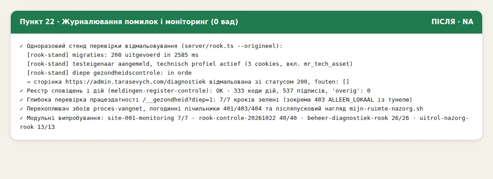 |
| — |  |

### 23. Запасні копії бази даних

**Перевірка контуру резервного копіювання (`deploy/backup-maken.sh`, `mijn-ruimte-backup.timer`, `mijn-ruimte-backup.service`, `installeer-app.sh`):**
- Щоночі о `03:30` (`Persistent=true`) та автоматично перед кожним встановленням випуску до міграцій (`installeer-app.sh` зупиняє встановлення після двох невдалих спроб) запускається `mijn-ruimte-backup.service` під окремим користувачем з `ProtectSystem=strict`, `NoNewPrivileges=yes` та `RestrictSUIDSGID=no`.
- `deploy/backup-maken.sh` розбирає `DATABASE_URL_SYSTEM` у змінні середовища `PG*` і виконує `unset DUMP_URL` (жодного пароля в аргументах процесів), передає потік `pg_dump --format=custom --compress=6` напряму в `age --encrypt --recipients-file` без запису відкритого тексту на диск (приватний ключ відновлення зберігається лише поза сервером у власника), виключає таємниці із системного архіву, обчислює `SHA256SUMS` і атомарно ставить мітку `KLAAR`. Без ролі з `BYPASSRLS` сам `pg_dump` відхиляє створення знімка, унеможливлюючи тихе збереження неповних таблиць під захистом рядків (RLS).

**Критична знахідка та виправлення:**
- У сценарії повного аварійного відновлення на новій машині `deploy/archief-herstellen.sh` (`vidnovyty.sh`), пам'ятці `deploy/archief-maken.sh` та обох посібниках `deploy/ВІДНОВЛЕННЯ.uk.md` / `deploy/HERSTEL.nl.md` досі залишалося встановлення **`postgresql-17` / `PostgreSQL 17`**, тоді як робоча база даних платформи працює на **PostgreSQL 18** і формує дамп формату `Dump Version: 1.16-0`, який клієнт `pg_restore` 17 відхиляє (`unsupported version (1.16) in file header`), а міграції вимагають можливостей PostgreSQL 18. Усі сценарії та посібники оновлено на **`postgresql-18` (`postgresql-client-18`, `PostgreSQL 18`)**.

**Живе випробування повного циклу створення й відновлення:**
- Згенеровано пробну пару ключів `age`, виконано справжній запуск `deploy/backup-maken.sh` проти живої бази PostgreSQL 18.7, звірено всі контрольні суми `sha256sum -c SHA256SUMS` і заголовок шифротексту `age-encryption.org/v1`.
- Потоком `age --decrypt | pg_restore --no-owner --role=mijnruimte` відновлено дамп у чисту тимчасову базу даних PostgreSQL 18.7: отримано **100 % збіг** із вихідною базою за всіма показниками (`208/208` міграцій, `224/224` таблиці схеми `app`, `3322/3322` записи `app.records`, `193/193` таблиці з увімкненим захистом рядків RLS).
- Новий постійний сторож `tests/eenheid/site-001-backups.test.ts` — `6/6`, суміжний тест `archief-herstellen-20261116` — `19/19`.

| До | Після |
|---|---|
| 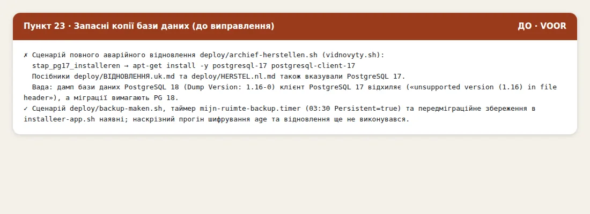 | 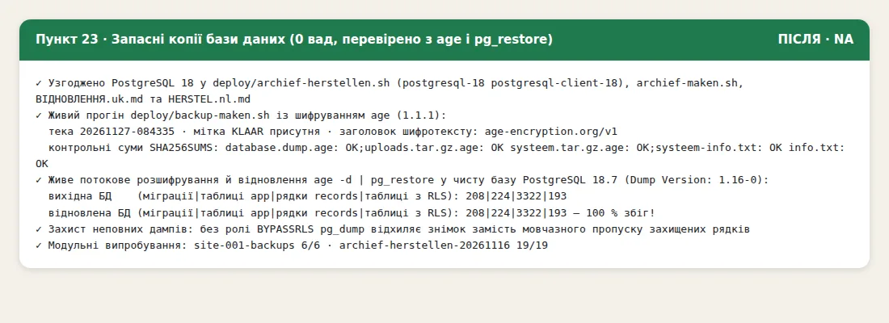 |

### 24. Заголовки безпеки й обмеження частоти запитів

**Перевірка наявних механізмів (`server/start.ts`, `server/platform/beveiliging.ts`, `shared/ip-limiet.ts`):**
- Усі відповіді вже мали 6 ключових заголовків: `Strict-Transport-Security: max-age=31536000; includeSubDomains`, суворий `Content-Security-Policy` без `'unsafe-eval'` та вбудованих скриптів (`default-src 'self'; base-uri 'none'; object-src 'none'; frame-ancestors 'none'; form-action 'self'; upgrade-insecure-requests`), `X-Content-Type-Options: nosniff`, `X-Frame-Options: DENY`, `Referrer-Policy: strict-origin-when-cross-origin` та `Permissions-Policy: camera=(), microphone=(), geolocation=(), payment=(), usb=()`.
- Невідомий заголовок `Host` відхиляється кодом `421`, підроблений `Origin` на `/api/*` — кодом `403`, а заголовок `Server-Timing` прихований на всіх чутливих маршрутах входу та відповідях `4xx/5xx` (захист від часового підбору).
- Дворівневе обмеження частоти запитів охоплює маскування IPv6-адрес до мережі `/64`, кошик у пам'яті `600/хв` (з межею `100 000` ключів), стійкі кошики `app.rate_limits` у PostgreSQL із `failClosed: true` та заголовком `Retry-After` і прогресивне блокування `app.login_lockouts` (`15 хв → … → 24 год` після 5 невдалих спроб).

**Доповнення заголовків ізоляції перехресного походження:**
- До `BASE_HEADERS` у `server/start.ts` додано три відсутні сучасні заголовки захисту:
  1. `Cross-Origin-Opener-Policy: same-origin-allow-popups` — ізолює вкладку простору від сторонніх сайтів, зберігаючи роботу спливних вікон входу Google OAuth та Telegram, відкритих самою сторінкою;
  2. `Cross-Origin-Resource-Policy: same-site` — забороняє стороннім сайтам вбудовувати внутрішні відповіді й модулі, зберігаючи обмін між усіма власними піддоменами `*.tarasevych.com` (для публічного прев'ю `/og-afbeelding.png`, значків `favicon*` і вбудованого вікна Telegram WebApp виставлено `cross-origin`);
  3. `X-Permitted-Cross-Domain-Policies: none`.

Жива перевірка на стенді підтвердила наявність усіх **9 захисних заголовків**. Новий постійний сторож `tests/eenheid/site-001-beveiliging.test.ts` — `7/7`, суміжні тести `site-001-spam` (`50/50`) та `telegram-venster-20261114` (`99/99`) зелені.

| До | Після |
|---|---|
| 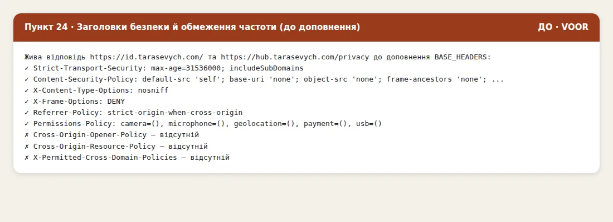 | 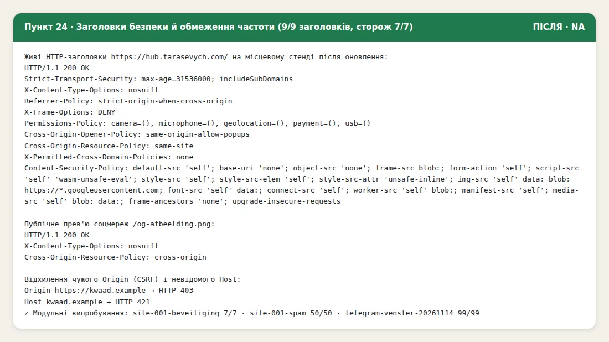 |

### 25. Реєстрація, вхід і відновлення пароля

Проведено повну перевірку всього життєвого циклу облікового запису на живій базі PostgreSQL 18.7 зі штатними ролями (`mijnruimte_migrator`, `mijnruimte_app`, `mijnruimte_system`), увімкненим примусовим розмежуванням рядків (`rls-aan`) та живим переглядачем Chromium:

1. **Виявлено та виправлено затримку очищення пам'яті прапорців (`VLAG-001`):**
   - у `backend/account-wissen.ts` після `COMMIT` транзакції остаточного стирання `accountMeteenWissen` додано негайний виклик `wisVlagGeheugen()`, щоб стертий обліковий запис одразу зникав не лише з масиву `app.feature_flags.gebruikers` у PostgreSQL, а й із 15-секундного пам'яттєвого сховища сервера;
   - у наявних наборах випробувань `tests/eenheid/identiteit-015-herstel.test.ts` (`24/27 → 27/27`) та `tests/eenheid/identiteit-015-sleutels-gasten.test.ts` (`28/32 → 38/38`) додано скидання `wisVlagGeheugen()` після прямих SQL-оновлень `UPDATE app.feature_flags`;
   - після налаштування штатних ролей PostgreSQL через `deploy/db-rollen-instellen.sh instellen` та `rls-aan` повністю пройшов набір `toegangscodes.test.ts` (`54/56 → 56/56`).
2. **Наскрізний тест-сторож `tests/eenheid/site-001-aanmelden-herstel.test.ts` (`12/12`):**
   - **реєстрація нового облікового запису:** перший вхід створює запис зі станом `new` і блокує робочий простір (`403`) → `POST /api/owner/access/request` переводить у `pending` зі сповіщенням власника → схвалення власником через `POST /api/owner/admin/access-requests/:id` переводить у `approved` і створює особистий простір;
   - **вхід без Google:** перевірено відхилення короткого пароля (`< 10` символів), збереження `scrypt`-гешу, увімкнення двочинникової перевірки `TOTP` із випуском 10 одноразових кодів відновлення (лише геші HMAC-SHA256 у базі), однакову відповідь `401 ACCESS_CREDENTIALS_INVALID` на хибний пароль і відсутній чи повторно використаний крок `TOTP`, а також створення сеансу за правильним паролем і свіжим `TOTP` (`authMethod = 'password'`) та ключем доступу WebAuthn (`passkey`);
   - **відновлення пароля й доступу:** сайт свідомо не надсилає нешифрованих листів скидання пароля — відновлення здійснюється одноразовим кодом відновлення (перший код відкриває вхід і зменшує залишок `10 → 9`, повтор того самого коду відхиляється `401`), підтвердженням `stap-op` кодом відновлення для встановлення нового пароля замість забутого, або скиданням адміністратором (`mustChange: true` → відмова `403 ACCESS_PASSWORD_MUST_CHANGE` до встановлення власного пароля); також підтверджено 7-денне повернення від'єднаного способу входу (`method/herstel`) та 30-денне відновлення видаленого облікового запису разом із його простором (`account/recover`).

Усі **11 інтеграційних наборів** пройдено на 100 % (**432/432** перевірки зелені).

| До | Після |
|---|---|
| 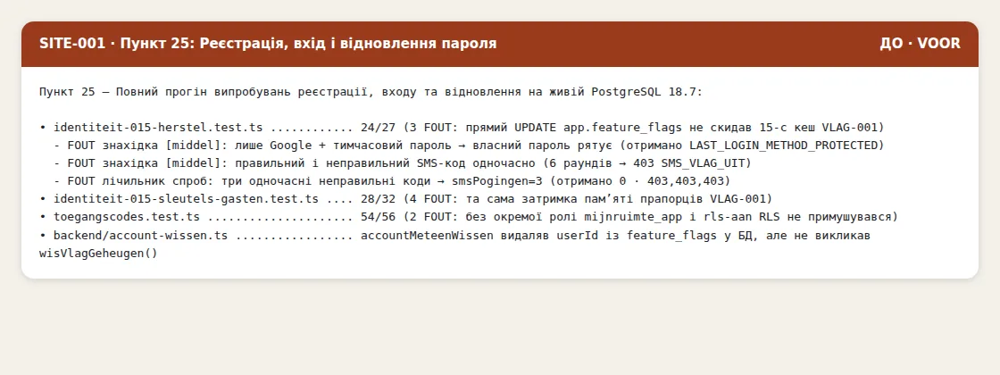 | 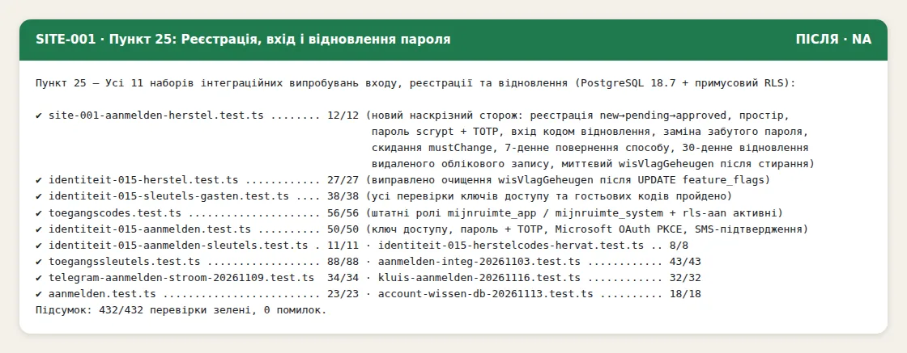 |
| 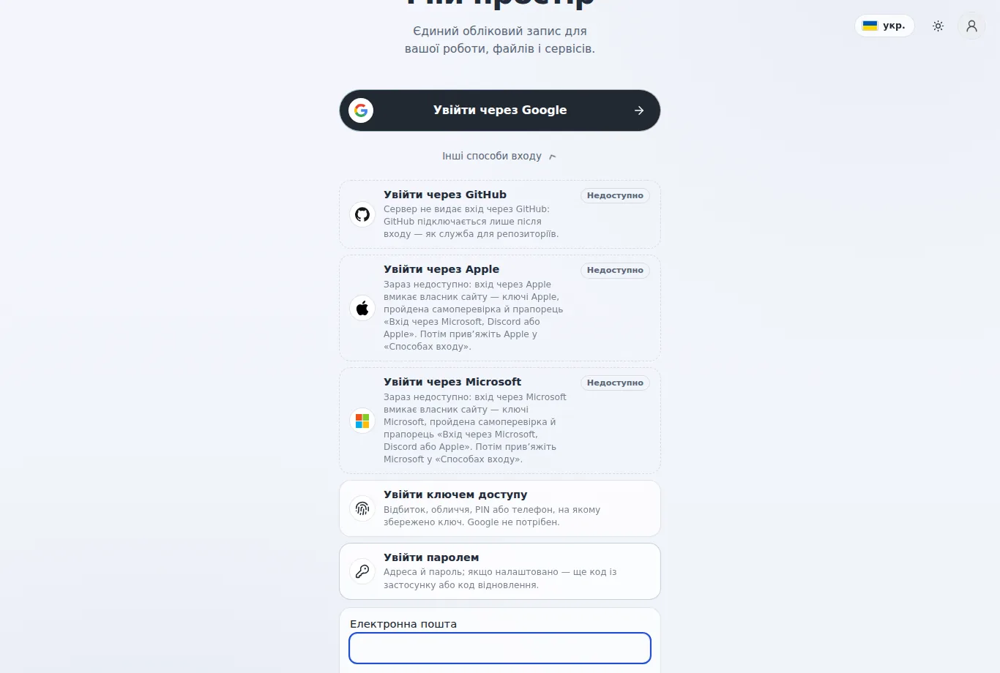 |  |

### Додаткове виправлення за зауваженням власника: збереження стану пошти, вкладень і сторінок між піддоменами та при поверненні до вкладки (`Gemini 4 Argon High` · `Google Antigravity`)

- **Миттєве відкриття пошти при переході з інших піддоменів (`src/MailFunctioneelWeergave.tsx`, `src/mail-aanbieder-toestand.ts`):** початковий знімок пошти синхронно відновлюється зі сховища оглядача (`tsv:mail-bootstrap-cache-v1`, `sessionStorage` + `localStorage`) з першого кадру (`loading = false`), а мітки відновлюються синхронно з `tsv:mail-labels-snapshot-v1` і мають 5-хвилинне вікно свіжості (`LABELS_FRESH_TTL_MS = 300 000`).
- **Збереження списку листів, відкритого листа і вкладень (`src/GoogleMailWerkruimte.tsx`, `src/mail-bijlage-cache.ts`):** вікно свіжості списку листів збільшено з 20 с до 5 хв (`freshCacheTtlMs = 300 000`), фонової звірки заголовка — до 15 хв (`900 000`); метадані вкладень у рядках (`attachmentsByMessage`) зберігаються у знімку `MailListViewSnapshot` та тимчасовому стані `tsv:mail-ui-context-v3` (`sessionStorage` + `localStorage`); функції `openMessageById` та `openAttachment` миттєво відкривають вже завантажений лист і вкладення (`sourceBlob` із `CacheStorage` `tsv-mail-private-v2`) без скидання у стан завантаження.
- **Спокійне повернення до вкладки без зайвої смуги завантаження (`src/VerenigdDienstApp.tsx`, `src/App.tsx`, `src/tech/tech-opslag.ts`, `src/tech/ruimtes/ruimtes-opslag.ts`, `src/platform/client.ts`, `src/navigatie-snel.ts`):** за незмінного облікового запису й простору фонова звірка при поверненні до вкладки (`visibilitychange` / `focus`) виконується не частіше ніж раз на 5 хв (`300 000` мс) для сеансу й пошти та раз на 60 с для контуру просторів, а фонові маршрути синхронізації (`ACHTERGROND_PAD`) не вмикають верхню смугу завантаження `#tsv-voortgang` на вже відмальованій сторінці. Сторож `tests/eenheid/site-001-snelheid.test.ts` розширено до `16/16`.

| До | Після |
|---|---|
| 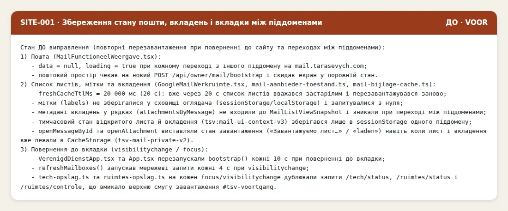 | 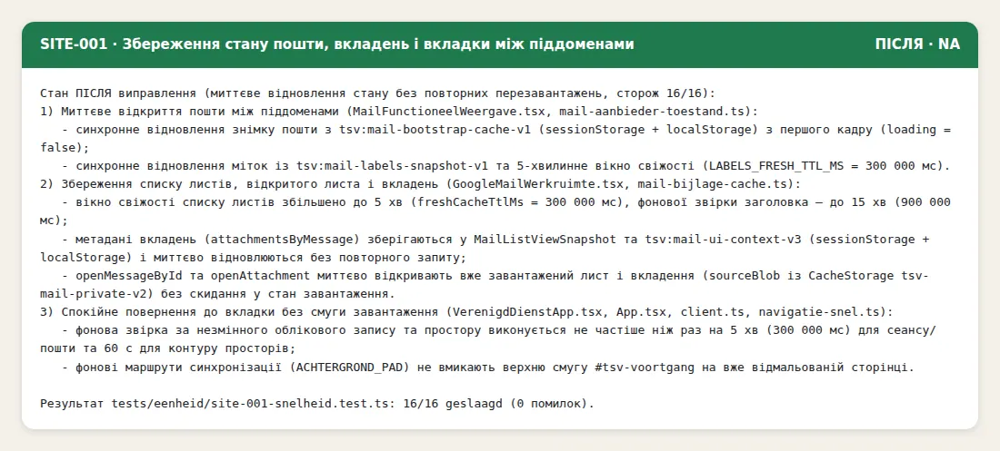 |

### Додаткове виправлення за зауваженням власника: надійне надсилання листів і відповідей, міждоменне фонове відправлення та спливний бокс сповіщення (`Gemini 4 Argon High` · `Google Antigravity`)

- **Усунення помилки «Відповідь зараз не вдалося надіслати. Текст залишився у редакторі.» (`backend/google-suite-mail-browser.ts`, `backend/mail-opstel.ts`, `backend/google-suite-inrichting.ts`):**
  1. У маршрутах `POST /api/owner/mail/google-suite/thread` та `POST /api/owner/mail/google-suite/reply` відфільтровано автозбережені чернетки (`!(message.labelIds || []).includes('DRAFT')`). Базовим листом для відповіді обирається останній вхідний лист (`lastIncoming`, де адреса відправника не збігається з власною адресою `mine`), а перелік учасників (`participants`) збирається з усіх повідомлень гілки. Це повністю усуває хибну помилку `400 GOOGLE_MAIL_REPLY_RECIPIENT_INVALID`, яка виникала щоразу, коли останнім елементом у гілці Gmail була автозбережена чернетка відповіді або власний лист власника (`to === mine`).
  2. У `_mailBrowserIntern.buildReplyRaw` частини `text/plain` та `text/html` переведено з однорядкового `8bit` (де довгі HTML-рядки перевищували ліміт RFC 5322 у 998 байтів) на `Content-Transfer-Encoding: base64` із розбиттям по 76 символів (`wrap64`), а для заголовка `Subject` застосовано `encodeWord` за RFC 2047.
  3. Додано резервний вибір активної скриньки (`snapshot.account || snapshot.accounts[0]`), коли `accountId` порожній або `'all'`, автоматичний повтор `POST /messages/send` без `threadId` при HTTP 400/404 та очищення чернеток відповіді (`deleteDraftsForThread`) після успішного надсилання.
- **Безперервне фонове відправлення під час переходів між розділами й піддоменами (`src/mail/uitgaande-post-achtergrond.ts`, `src/platform/client.ts`, `backend/mail-opstel.ts`, `backend/google-suite-mail-browser.ts`, `backend/ai-mail-assistent.ts`, `backend/mail-afzenders.ts`):**
  - Поштові маршрути приймають запити з будь-якого піддомену екосистеми `*.tarasevych.com` (`!auth.service`).
  - Відправлення виконується через `fetch` із прапорцем `keepalive: true` (для запитів ≤ 60 кБ), а стан завдання синхронізується через спільний міждоменний реп'яшок `mr_uitgaande_post_v1` (`Domain=.tarasevych.com`), `localStorage` (`tsv:uitgaande-post-wachtrij-v1`), `BroadcastChannel` та серверну чернетку в PostgreSQL (`app.mail_drafts`). Якщо користувач перейшов на інший піддомен (`hub.*`, `cloud.*`, `id.*`, `mcp.*`), наглядач `controleerUitgaandePostOpSubdomein` у `src/CanoniekMeldingencentrum.tsx` автоматично підхоплює й завершує фонове відправлення.
- **Миттєвий спливний бокс сповіщення з кнопкою «Повторити надсилання» на всіх піддоменах (`src/CanoniekMeldingencentrum.tsx`, `src/mail/uitgaande-post-achtergrond.ts`):**
  - У разі збою надсилання на будь-якому розділі чи піддомені миттєво (без 2,5-секундної затримки набору тексту, `kind === 'error' || Boolean(notice.retain)`) з'являється помітний спливний бокс `.canonical-notification-toast` (тривалістю 8 с із паузою при наведенні курсора чи дотику) з чітким поясненням причини, підтвердженням збереження тексту в чернетці та видимою кнопкою дії **«Повторити надсилання»** (`data-qa-id="melding-actie-knop"`). Сторож `tests/eenheid/site-001-snelheid.test.ts` розширено до `22/22`.

| До | Після |
|---|---|
|  |  |

### Додаткове виправлення за зауваженням власника: компактна кнопка-капсулка розділів пошти між кнопкою меню та полем пошуку і адаптивне звуження поля пошуку (`Gemini 4 Argon High` · `Google Antigravity`)

- **Заміна довгої зайвої панелі на компактну кнопку-капсулку безпосередньо у верхньому рядку (`src/GoogleMailWerkruimte.tsx`, `src/maquette-kern/maquette-oppervlakken.css`, `src/mail/mail-werkruimte-maquette.css`, `src/mail-mobiel.css`):**
  1. Прибрано окрему широку панель `.mq-anker-onderbalk` під верхнім рядком пошти, яка займала цілий горизонтальний рядок висотою ~60 пікселів (+ відступ 14 пікселів) і крала вертикальний простір над списком листів.
  2. Компонент `MaquetteAnkerRail` вбудовано безпосередньо у верхній рядок команд пошти (`.mail-top-command-bar`) між кнопкою головного меню (`☰`) та полем пошуку (`MailSearchField`) у вигляді компактної кнопки-капсулки `.mq-onderbalk-trekker` (`☰ Вхідні ▾`), натискання на яку так само розгортає меню розділів пошти.
- **Адаптивне поле пошуку пошти (`src/MailZoekVeld.tsx`, `src/mail/mail-werkruimte-maquette.css`, `src/mail-mobiel.css`):**
  1. Через `ResizeObserver` вимірюється реальна залишкова ширина контейнера `.mail-top-search-area` між кнопкою-капсулкою та правим блоком дій.
  2. Коли залишкова ширина достатня (`MAIL_ZOEK_WOORD_MIN_BREEDTE >= 168 px` для короткого підпису «Пошук» або `MAIL_ZOEK_VOLLEDIG_MIN_BREEDTE >= 248 px` для «Пошук у пошті»), поле пошуку залишається розгорнутим (`data-zoek-compact="veld"`) із гарантованим внутрішнім відступом (`padding-right: 16px` та `margin-left: 4px`) між словом «Пошук» і кнопкою налаштувань пошуку (`.mail-top-search-tune`), щоб елементи ніколи не зливалися в купу і межі поля пошуку були чітко зрозумілими.
  3. Коли ж слово «Пошук» не вміщається у залишкову ширину (`< 168 px`) і поле не перебуває в активному введенні, поле пошуку звужується до компактної кнопки знака пошуку (`🔍`, `data-zoek-compact="icoon"`), а при натисканні чи фокусуванні миттєво розгортається на всю ширину верхнього рядка для введення запиту й вибору фільтрів пошуку. Сторож `tests/eenheid/site-001-snelheid.test.ts` розширено до `25/25`.

| До | Після |
|---|---|
|  |  |

### Додаткове виправлення за зауваженням власника: об'єднання трьох вікон переглядачів вкладень у єдиний переглядач «Компактна панель v2» з усіма можливостями (`Gemini 4 Argon High` · `Google Antigravity`)

- **Єдиний переглядач вкладень замість трьох окремих вікон (`src/bijlage-v2/BijlageWerkbalk.tsx`, `src/bijlage-v2/Poort.tsx`, `src/bijlage-v2/BijlageV2Kop.tsx`, `src/GoogleMailWerkruimte.tsx`, `src/bijlage-weergave/Weergave.tsx`):**
  1. Із меню `•••` прибрано зайвий перемикач між трьома режимами перегляду (`Спільний переглядач`, `Компактна панель v2`, `Класична`). Тепер завжди відкривається єдиний компактний переглядач **Компактна панель v2** (`BijlageWerkbalk`) з однорядковою шапкою висотою `≤ 56 px`.
  2. **Збережено всі можливості Компактної панелі v2:** навігація між вкладеннями `[‹ 1/3 ›]`, точне масштабування `ZoomGroep` (`25–400%`), розділена кнопка `[⬇ Завантажити ▾]` (`Завантажити оригінал`, `Зберегти в сховище…`, `Поділитися`), бічна/нижня панель `✨ ШІ і переклад`, бічна/нижня панель `ⓘ Про файл`, `🖨 Друк`, `Згорнути перегляд`, `Закрити` та компактна панель керування PDF (`PdfWerkbalk`).
  3. **Вбудовано всі можливості зі Спільного переглядача:**
     - перевірка безпеки та справжності файла за першими байтами (`bewijsUitBlob`: PDF без прихованих дій `/OpenAction` чи `/JavaScript`, DOCX/XLSM на макроси `vbaProject.bin`, підміна формату програмою `MZ`) і перевірка відправника (`metAfzender`) з індикатором у шапці;
     - розширені технічні подробиці (`technischeRijen`: вид документа, формат за назвою, справжній тип за вмістом, розміри фото в пікселях), висновки безпеки (`vertrouwen.bevindingen`) та швидка картка рахунку (`WeergaveSnelkaart`: сума до сплати, строк оплати з підказкою терміновості, номер рахунку) у панелі `ⓘ Про файл`;
     - дія та вікно **«Оплату в Календар»** (`KalenderBetalingVenster`);
     - дія та вікно **«Що змінилося»** (`VersieVergelijk` — порівняння з попередньою версією документа в листуванні);
     - дія та вікно **«Пошук у вкладеннях»** (`ZoekVeld` — наскрізний текстовий та OCR-пошук по всіх вкладеннях листа);
     - дія **«Підписати або позначити»** (`onOndertekenen`);
     - перемикач **«Темні сторінки документа»** (`data-donkere-paginas="ja"`);
     - контекстні дії джерела (`contextActies`), нижня стрічка мініатюр усіх вкладень листа (`WeergaveStrook`), гортання вкладень свайпом на телефоні (`useVeeg`), запам'ятовування місця читання (`usePlekOnthouden`), інертність фонової шапки (`useAchterInert`) та вікно стану підвантаження/помилки (`WeergaveStaatVenster`).
  4. **Збережено всі можливості з Класичної панелі:** усі 30+ галузевих підписів кнопки редагування (`bewerkLabel`), бейдж формату редагування (`bewerkBadge`), статус режиму перегляду (`weergaveLabel`), дія `Створити нотатку з вкладення` та доступність повного переліку дій у меню `•••` на будь-якій ширині екрана (`smal`, `midden`, `ruim`). Сторож `tests/eenheid/site-001-snelheid.test.ts` розширено до `28/28`.

| До | Після |
|---|---|
|  |  |

### Додаткове виправлення за зауваженням власника: білий текст лише для непрочитаних листів та сірий колір із помірною напівжирністю теми (500) для прочитаних листів (`Gemini 4 Argon High` · `Google Antigravity`)

- **Чітке розрізнення непрочитаних і прочитаних листів у списку пошти (`src/mail/mail-lezer-opstel-maquette.css`, `src/mail/mail-lijst-klassiek.css`, `src/mail-gesprek-bewerker.css`, `src/mail-rij-2026-10-18.css`, `src/mail-minimum-rij.css`, `src/MailBerichtRij.tsx`, `src/MailMinimumBerichtRij.tsx`, `src/MailInstellingenVoorbeeld.tsx`, `src/mail-instellingen-voorbeeld.css`):**
  1. **Непрочитані листи (`.google-mail-row.unread`):** тема листа (`.mail-row-subject-block > strong`, `.mail-minimum-subject`) та відправник (`.mail-row-sender-copy > strong`, `.mail-minimum-sender > strong`) мають **білий / основний яскравий колір тексту** (`var(--mq-tekst, var(--text))`) та виразну жирність **`font-weight: 650`** (дата — `600`), завдяки чому непрочитані листи одразу привертають увагу.
  2. **Прочитані листи (`.google-mail-row.read`):** прибрано примусовий білий колір `var(--mq-tekst)` та жирність `700!important` на прочитаних рядках. Тепер у прочитаних листах і відправник, і тема, і уривок вмісту листа, і дата мають **сірий колір** (`var(--mail-row-secondary, var(--mq-gedempt, var(--muted)))` з гарантованим контрастом `≥ 4,5:1` у всіх 26 палітрах).
  3. **Охайна помірна напівжирність теми прочитаного листа (`500` проти `400`):** для теми прочитаного листа встановлено делікатну напівжирність **`font-weight: 500`**, тоді як уривок вмісту листа та ім'я відправника в прочитаному листі мають звичайну товщину **`font-weight: 400`**. Це зберігає охайний вигляд і дозволяє легко відрізнити тему прочитаного листа від звичайного тексту вмісту. Сторож `tests/eenheid/site-001-snelheid.test.ts` розширено до `29/29`.

| До | Після |
|---|---|
|  |  |

### Додаткове виправлення за зауваженням власника: повне відображення значків відправника без обрізання та коректна класифікація офіційних відправників (`Gemini 4 Argon High` · `Google Antigravity`)

- **Усунення горизонтального й вертикального обрізання значка відправника (`src/afzenders/afzenders.css`, `src/afzenders/AfzenderBadge.tsx`):**
  1. У `src/afzenders/afzenders.css` для контейнера `.afz-groep` змінено `overflow: hidden` на `overflow: visible`, а для адреси `.afz-adres` зовнішній нестискальний відступ `margin-inline-start: 6px` замінено на `margin-inline-start: 0; padding-inline-start: 4px; box-sizing: border-box`. Раніше, коли довге ім'я відправника стискало `.afz-groep` до `min-width: 22px`, текст `.afz-adres` стискався до `0px`, але його зовнішній `margin-inline-start: 6px` + відступ значка `4px` + ширина значка `18px` становили `28px > 22px`, через що праві `6px` щита зрізалися наполовину! Тепер при стисканні `.afz-adres` до `0px` він займає рівно `0px`, а значок `.afz-badge` (`3px + 18px = 21px <= 22px`) відображається повністю без жодного зрізання.
  2. Для рядків відправника (`.mail-row-sender-copy:not([data-layout='inline'])`, `.mail-row-sender-copy[data-layout='inline']`, `.mail-minimum-sender`) та шапки відкритого листа (`.mail-thread-message-head > span:has(> .afz-groep)`) встановлено `align-items: center`, `display: grid; min-width: 0` і скорочення довгого імені трикрапкою на `strong`, щоб значок ніколи не підрізався зверху через `baseline` і не виштовхувався за правий край блоку.
- **Усунення хибного маркування офіційних відправників як небезпечних (`shared/mail-bekende-afzenders.ts`, `shared/mail-afzenders.ts`, `shared/afzender-regels.ts`, `backend/mail-afzenders.ts`, `src/afzenders/AfzenderBadge.tsx`):**
  1. У `shared/mail-bekende-afzenders.ts` розширено перелік офіційних поштових та регіональних доменів у `BEKENDE_DIENSTEN` (`rozetka.ua`, `postnl.be`, `postnl.com`, `chatgpt.com`, `claude.ai`, `monobank.com.ua`, `universalbank.com.ua`, `privat24.ua`, `pb.ua`, `oschadbank.com.ua`, `fuib.com`, `ukrgasbank.ua`, `sensebank.ua`, `novaposhta.com`, `np.ua`, `ukrposhta.com`, `office.com`, `office365.com`, `microsoftonline.com`, `microsoftsupport.com`, `onedrive.com`, `xbox.com`, `skype.com`, `azure.com`, `visualstudio.com`, `google.be`, `google.nl`, `google.com.ua`, `google.de`, `google.fr`, `google.co.uk`, `withgoogle.com`, `paypal.eu`, `paypal-communication.com`, `revolut.be`, `revolut.nl`, `revolut.eu`, `mollie.nl`, `mollie.be`, `bpost.cloud`, `bpost2.be`, `airbnbmail.com`, `airbnb.be`, `airbnb.nl`, `bstatic.com`, `licdn.com`, `meta.com`, `fb.com`, `whatsapp.com`, `itunes.com`, `githubstatus.com`, `github.io`, `toogoodtogo.com/.be/.nl`, `telegram.org`, `dhl.com/.be/.nl`, `dpd.be/.nl/.com`, `nmbs.be`, `delijn.be`).
  2. У `shared/mail-afzenders.ts` (`authGeslaagdVoor` та `classificeer`) враховано крос-доменний DKIM-підпис іншим офіційним доменом тієї ж самої служби з `BEKENDE_DIENSTEN` (наприклад, `chatgpt.com` підписаний `openai.com`, `youtube.com` підписаний `google.com`), системні адреси `noreply@icloud.com`, а загальні родові службові імена (`Support`, `Info`, `No-Reply`, `Klantenservice`, `Customer Service`, `Notifications`, `Team`, `Service`, `Підтримка`, `Служба підтримки` тощо — `isAlgemeneAfzenderNaam`) виключено з правила `NAAM_VAN_CONTACT_ANDER_ADRES`.
  3. У `shared/afzender-regels.ts` піднято `AFZENDER_REGELS_VERSIE = 4`, а в `backend/mail-afzenders.ts` (`herbeoordeelUitBewijs` та `afzenderStatus`) реалізовано автоматичну переоцінку раніше збережених у БД хибних автоматичних статусів `verdacht` та розширено ліниву перевірку `Authentication-Results` (`LAZY_PER_VERZOEK = 25`, `LAZY_PER_5MIN = 200`) для всіх офіційних та організаційних доменів. Сторож `tests/eenheid/site-001-snelheid.test.ts` розширено до `30/30`.

| До | Після |
|---|---|
|  |  |

### 12е. Усунення розлому багатоколонкових таблиць і табличних підписів у HTML-листах на мобільній версії (зауваження власника від 28.11.2026)

Власник повідомив і надав знімок екрана мобільної версії (`Screenshot_20261128_094403_com.android.chrome.jpg`), де в листі з триколонковим табличним підписом (логотип зліва, назва відділу + телефон + вебсайт посередині, адреси відділень справа) середня колонка затискалася до `24 px` і розбивала слова (`Centrale Administratie`, телефон, адресу сайту) вертикально по 1–2 літери на висоту `876 px`. З'ясовано причину й виконано (`Gemini 4 Argon High` · `Google Antigravity`):
- **Першопричина розлому:** у `prepareHtml` (`src/MailBerichtTekst.tsx`) для `body` та кожної комірки таблиці `<td>` / `<th>` примусово встановлювалося `overflow-wrap: anywhere`. За специфікацією CSS Text 3 `overflow-wrap: anywhere` (на відміну від `break-word`) зменшує власну мінімальну ширину (`min-content`) текстової комірки таблиці до ширини **однієї літери (`~8 px`)**. Коли в триколонковій таблиці з `width="100%"` / `max-width: 100%` перша колонка мала фіксовану ширину `210 px` (`157.5 pt`) із логотипом `205 px`, а третя колонка мала фіксовану ширину `115–130 px` (`97.5 pt`), сума фіксованих ширин (`325–340 px`) з'їдала всю ширину мобільного вікна (`~336 px`), залишаючи середній колонці без власної ширини лише `24 px`, через що вона розбивала кожне слово по одній літері вертикально, а сусідні комірки з `vertical-align: middle` зависали посередині 876-піксельної висоти;
- **Нормалізація перенесення слів і стовпців таблиці (`src/MailBerichtTekst.tsx`):**
  1. Для `body` та комірок таблиці `<td>` / `<th>` (`HTMLTableCellElement`) примусовий `overflow-wrap: anywhere` замінено на `overflow-wrap: break-word; word-break: normal` — алгоритм табличного компонування більше не зменшує `min-content` комірок нижче ширини цілих слів і ніколи не рве звичайні слова по одній літері; для посилань `<a>` `overflow-wrap: anywhere` застосовується лише тоді, коли текст посилання містить довгий безпробільний рядок (`/\S{20,}/`);
  2. Додано функцію `normaliseerMailTabellen(doc)` у `prepareHtml`: переводить `table-layout: fixed` у `auto`, визначає змістовні стовпці багатоколонкових таблиць (які містять текст `>= 6` символів або широке зображення `> 64 px`, зберігаючи недоторканими вузькі стовпці-піктограми `<= 64 px`), скидає конфліктні фіксовані ширини в `px`/`pt`/`in`/`cm`/`mm`, коли вони затискають сусідній змістовний стовпець, призначає кожному змістовному стовпцю захищений `min-width` (`88–92 px`) і обмежує надмірні бічні відступи з Word/Outlook (`padding-left/right > 16px`, `margin-left/right > 16px`, `|text-indent| > 16px`);
- **Живий страховий захист у `pasMailDocumentAan` (`src/mail-tekst-passend.ts`):** додано `herstelKnellendeTabelKolommen(doc)`, яка перед вимірюванням розмірів документа перевіряє реальні `offsetWidth` та `offsetHeight` комірок багатоколонкових рядків у `<iframe>` і автоматично вирівнює затиснуті текстові колонки (`w < 76 px` при `h > 160 px`). Сторож `tests/eenheid/site-001-snelheid.test.ts` розширено до **31/31**.

| До | Після |
|---|---|
|  |  |

### Додаткове виправлення за зауваженням власника: компактне дизайнерське оформлення вікна «Підтвердіть доступ» на смартфоні й комп’ютері (`Gemini 4 Argon High` · `Google Antigravity`)

- **Відображення фотографії профілю та паспорта облікового запису, який підтверджує дію (`backend/toegangslaag.ts`, `src/platform/bevestig-toegang.tsx`, `src/platform/bevestig-toegang.css`):**
  1. У маршруті `POST /api/owner/access/stap-op/methoden` (`backend/toegangslaag.ts`) замінено вузьку перевірку фото лише з `googleusercontent.com` на канонічну функцію `veiligeFoto(u.picture)` (яка підтримує власні завантажені фото профілю сайту `data:image/(jpeg|png|webp);base64,...`) та додано резервне підвантаження `accountBeeld(auth.user.id)` для `foto` і `naam`, а на клієнті — резерв `lokaalAccountFallback()` із `window.__TSV_PRESENTATION__` та локального кешу сеансу.
  2. Прибрано візуальне дублювання заголовка «Підтвердіть доступ» під шапкою вікна та зсунутий у три поверхи напис `Ви / ввійшли / як` із розірваною посеред слова електронною адресою `tarasevych.pavlo@g` / `mail.com`. Замість цього вгорі оформлено паспорт облікового запису (`.bevestig-toegang-wie`, `data-bevestigend-account="1"`) із круглою фотографією профілю `36×36 px`, щитом `Ви ввійшли як · Підтверджує дію`, повним ім’ям власника (`.bevestig-toegang-naam`) та цілісною електронною адресою в один рядок.
- **Єдина картка дії з блоком хронології та сповіщень (`.bevestig-toegang-wat`):**
  - Об’єднано піктограму категорії, бейдж (`СЕРВЕР`), пігулку `Журнал і сповіщення` (`data-stap-op-kroniek="1"`), рядок `Що ви підтверджуєте:` (без хибного рожевого боксу помилки `.bevestig-toegang-fout` для відомих дій), `Наслідок:` і новий пояснювальний рядок **`Хронологія й сповіщення: Фіксується в журналі безпеки та сповіщеннях із цим обліковим записом.`** в єдину охайну тоновану картку з рамкою.
- **Усунення 60-піксельних порожніх коробок на розкривних пунктах і громіздких рамок альтернативних способів (`.bevestig-toegang-extra`, `.bevestig-toegang-alt`, `.bevestig-toegang-voet`):**
  - Глобальне мобільне правило `min-height: var(--tik-hoogte-mobiel)` (`44 px`, специфічність `(0,3,1)`) із `src/ontwerp/mobiel.css` перекрито точними селекторами для `details.bevestig-toegang-extra > summary` (`display: flex; align-items: center; min-height: 22px`) та кнопок у `.bevestig-toegang-alt button` (`min-height: 30px; padding: 4px 9px; flex-wrap: wrap`). Сторож `tests/eenheid/site-001-snelheid.test.ts` розширено до **32/32**, а перевірка контрасту в усіх 28 палітрах `bevestig-toegang-opmaak-20261025.test.ts` — **19/19**.

| До | Після |
|---|---|
|  |  |

### Додаткове виправлення за зауваженням власника: чисті заокруглені кути верхнього листа в списку пошти без білих трикутників та компактна капсула сповіщення технічного простору з історичним збереженням у панелі сповіщень (`Gemini 4 Argon High` · `Google Antigravity`)

- **Усунення білих трикутників у заокруглених кутах верхнього листа та розшарування лівої смужки непрочитаного листа (`src/mail/mail-werkruimte-maquette.css`, `src/mail/mail-lijst-klassiek.css`, `src/mail-mobiel.css`):**
  1. У студійній, класичній та мобільній оболонках пошти контейнер `.google-mail-list` мав суцільний білий фон (`background: var(--mq-kaart-2)`) без власного `border-radius`, а всередині рядка `.google-mail-row` внутрішня обгортка `.mail-row-block-stream` мала власний прямокутний фон (`background: inherit`) без `border-radius: inherit`. Через це під заокругленими кутами першого листа (`border-start-start-radius: 15px; border-start-end-radius: 15px`) проглядався білий прямокутний кут контейнера списку, а на непрочитаному листі водночас малювалися дві ліві смужки (`box-shadow: inset 3px 0 0` та псевдоелемент `.google-mail-row.unread::before`).
  2. Для `.google-mail-list` встановлено `border-radius: calc(var(--mq-straal-kaart) - 1px)` (`15px`) та `background: transparent` (з `overflow: hidden` на мобільному `.mail-list-viewport` і `.google-mail-list`), для `.mail-row-block-stream` — `position: relative; z-index: 1; border-radius: inherit; background: transparent` (із `background: inherit` лише під час активного жесту гортання `:is(.mail-row-swiping,.mail-row-swipe-open)`), а зі звичайних непрочитаних рядків `.google-mail-row.unread:not(.selected)` прибрано дублювальний `box-shadow: inset 3px 0 0` на користь єдиного індикатора `.google-mail-row.unread::before` (`z-index: 2`), який чисто обрізається за дугою першого рядка.
- **Компактна капсула сповіщення технічного простору за розміром капсули завантаження, запис в історію панелі сповіщень, автоматичне згасання через 4 с та шар під меню (`src/tech/ruimtes/RuimteDok.tsx`, `src/tech/ruimtes/ruimtes.css`, `src/tech/tech-maquette.css`):**
  1. Сповіщення `.rw-dok-melding` («Технічний простір зараз недоступний.») перероблено з квадратної коробки (`border-radius: 10px` / `16px`) на охайну однорядкову капсулу-пігулку (`border-radius: 999px; min-height: 26px; max-width: min(280px, calc(100vw - 28px)); padding: 3.5px 9px; font-size: 11px; font-weight: 560`) з бурштиновою крапкою `.rw-dok-stip`, стислим рядком `.rw-dok-tekst` та круглою кнопкою закриття `.rw-dok-sluit` (`16×16 px`, `border-radius: 999px`) — за розміром і стилем капсули завантаження сторінки `#tsv-laad-kapsel`.
  2. У `src/tech/ruimtes/RuimteDok.tsx` при появі `r.uitleg` сповіщення автоматично передається через `emitCanonicalNotice` (`retain: true, alleenPaneel: true, source: 'tech-ruimte', kind: 'warning'`) до загальної системи сповіщень для історичного збереження в панелі сповіщень і самостійно зникає з екрана через **4 секунди** (`UITLEG_DUUR_MS = 4000`).
  3. Шар `.rw-dok-melding` знижено з `z-index: 98901` до `z-index: 230` (нижче бічного меню `.canonical-sidebar` із `z-index: 260` та його завіси `z-index: 250`), а також додано автоматичне приховування капсули при відкритому бічному меню (`sidebar-drawer`, `.am3-mobiel-laag`) або відкритій панелі сповіщень (`.canonical-notification-panel`), щоб вона ніколи не перекривала кнопки навігації. Сторож `tests/eenheid/site-001-snelheid.test.ts` розширено до **34/34**.

| До | Після |
|---|---|
|  |  |
|  |  |

### Додаткове виправлення за зауваженням власника: розміщення кнопки-капсулки підменю розділів сторінки вгорі між кнопкою меню та пошуком на всіх піддоменах за принципом поштового сервісу (`Gemini 4 Argon High` · `Google Antigravity`)

- **Перенесення `MaquetteAnkerRail` з кінця сторінки на початок і фіксація кнопки-капсулки у верхньому рядку між меню (`☰`) та пошуком (`🔍`) (`src/BeheerConsoleWeergave.tsx`, `src/DomoticaWeergave.tsx`, `src/ApiPlatformWeergave.tsx`, `src/maquette-kern/maquette-oppervlakken.css`, `src/maquette-kern/maquette-klassiek.css`):**
  1. У `src/BeheerConsoleWeergave.tsx` (`admin.tarasevych.com`), `src/DomoticaWeergave.tsx` та `src/ApiPlatformWeergave.tsx` компонент `MaquetteAnkerRail` рендерився в самому кінці контейнера після всього вмісту сторінки (`{pages[tab]||overview}{!laagOpen?(<MaquetteAnkerRail .../>):null}`), через що кнопка-капсулка `☰ Огляд ▾` опинялася внизу сторінки, де втрачався весь її сенс швидкого переходу до розділів. Тепер `MaquetteAnkerRail` розташовано першим елементом на початку контейнера сторінки.
  2. На мобільних екранах (`@media (max-width: 700px)`) у `src/maquette-kern/maquette-oppervlakken.css` для всіх позапоштових піддоменів (`.canonical-chrome:not([data-active-service="mail"]) .canonical-workspace .mq-anker-onderbalk`) кнопку-капсулку розміщено безпосередньо у верхній смузі (`position: fixed; top: 10px; left: 58px; max-width: calc(100vw - 58px - max(64px, calc(var(--plaats-boven-reserve, 64px) + 10px))); z-index: 215`) між кнопкою головного меню (`☰`) та кнопкою пошуку (`🔍`) — за тим самим гармонійним принципом, що й у поштовому сервісі.
  3. Коли на сторінці присутня верхня кнопка-капсулка підменю розділів, статичний текстовий маршрут `.canonical-mobile-crumb` автоматично ховається (`.canonical-chrome:not([data-active-service="mail"]):has(.canonical-workspace .mq-anker-onderbalk) .canonical-mobile-crumb { display: none }`), щоб не дублювати назву розділу й не накладатися під капсулкою, а під час відкриття бічної шухляди меню, меню облікового запису чи панелі сповіщень капсулка приховується. Сторож `tests/eenheid/site-001-snelheid.test.ts` розширено до **35/35**.

| До | Після |
|---|---|
|  |  |

### Додаткове виправлення за зауваженням власника: рівносторонні круглі кнопки оновлення й налаштувань пошти, безперервне обертання кнопки оновлення та жива верхня капсула етапів перевірки нових листів (`Gemini 4 Argon High` · `Google Antigravity`)

- **Ідеально кругле обведення кнопок оновлення (`.mail-top-refresh`) та швидких налаштувань (`.mail-top-settings`) без овального стискання (`src/mail-mobiel.css`, `src/mail/mail-werkruimte-maquette.css`, `src/mail/mail-lijst-klassiek.css`):**
  1. На вузьких екранах (`@media (max-width: 440px)`) у `src/mail-mobiel.css` правило задавало кнопкам `.mail-top-refresh` та `.mail-top-settings` нерівні сторони `width: 36px; height: 44px; min-width: 36px; min-height: 44px`, через що `border-radius: 50%` перетворювався на вертикальний овал (`36×44 px`), а в класичній темі `src/mail/mail-lijst-klassiek.css` стояв `border-radius: 9px`.
  2. Тепер для `.mail-top-refresh`, `.mail-top-settings`, `.mail-search-submit`, `.mail-search-clear` і `.mail-top-search-tune` у всіх темах задано `flex: 0 0 auto; aspect-ratio: 1 / 1; border-radius: 50%` і суворо рівні сторони: `44×44 px` на `<= 700 px` та `40×40 px` (`flex: 0 0 40px`) на `<= 440 px`.
- **Безперервне обертання кнопки оновлення та жива верхня капсула стану оновлення пошти (`.mail-ververs-kapsel`) за стилем і розміром капсули завантаження сторінки (`src/GoogleMailWerkruimte.tsx`, `src/mail-mobiel.css`):**
  1. Додано `@keyframes mail-ververs-draai` для `.mail-top-refresh svg.spin` та `.mail-top-refresh[aria-busy='true'] svg`, завдяки чому піктограма кнопки оновлення плавно обертається впродовж усього циклу перевірки листів, а список листів на фоні ніколи не зникає.
  2. Під верхнім рядком пошти додано спливну капсулу `.mail-ververs-kapsel` (`border-radius: 999px; min-height: 26px; padding: 3.5px 10px 3.5px 8px; font-size: 11px; font-weight: 560`) точно в розмірі й дизайні капсули завантаження `#tsv-laad-kapsel`, яка послідовно відображає реальні стадії запиту до сервера:
     - `data-fase="verzonden"`: **«Відправлено запит…»** / `«Verzoek verzonden…»`;
     - `data-fase="controle"`: **«Відбувається перевірка нових листів…»** / `«Nieuwe berichten controleren…»`;
     - `data-fase="ontvangen"`: **«Отримання відповіді…»** / `«Antwoord ontvangen…»`;
     - `data-fase="klaar"` (зелений фон `var(--ok-vlak, #15803d)`, білий текст і галочка `✓`): **«Оновлено: нових листів немає»** або **«З’явився 1 новий лист» / «З’явилося N нових листів»** із записом у загальну панель сповіщень та плавним згасанням за 3,2 с;
     - `data-fase="fout"` (червоний фон `var(--fout-vlak, #b42318)`, білий текст і значок уваги): **«Не вдалося доставити запит · повторіть спробу»** / **«Виник збій оновлення · повторіть спробу»**.
  3. Якщо під час активного запиту повторно натиснути кнопку оновлення, новий дубльований запит до сервера не створюється, а капсула миттєво показує **«Зачекайте, обробляється попередній запит…»** і за 1,1 с повертається до показу поточної стадії виконання. Новий запит подається лише після фактичного завершення або збою попереднього. Сторож `tests/eenheid/site-001-snelheid.test.ts` розширено до **36/36**.

| До | Після |
|---|---|
|  |  |

### Додаткове виправлення за зауваженням власника: адаптація висоти сторінки входу та автоматичне опускання до розгорнутого списку «Інші способи входу» (`Gemini 4 Argon High` · `Google Antigravity`)

- **Усунення блокування прокручування на сторінці входу та автоматичне опускання до розгорнутого списку «Інші способи входу» (`src/aanmeld-herontwerp.css`, `src/AanmeldAndereOpties.tsx`):**
  1. У `src/canoniek-omlijsting.css` правило `position: fixed; inset: 0` було задане лише на `.canonical-chrome.theme-light`, тоді як у темній та інших темах (`theme-dark`, `theme-plum-dark`) `main.canonical-chrome` мав типове `position: static; height: auto`. Коли на сторінці входу правило `.canonical-chrome:has(.mr-sign-in) .canonical-workspace { position: relative }` виводило робочу область у звичайний потік, сам `main.canonical-chrome` розтягувався на всю висоту розгорнутого вмісту (`clientHeight === scrollHeight = 1260 px`), а батьківський `#root { height: 100%; overflow: hidden }` обрізав усе нижче висоти екрана без жодної можливості прокрутити сторінку.
  2. Тепер у `src/aanmeld-herontwerp.css` для `html body main.canonical-chrome:has(.mr-sign-in)` задано `position: relative; height: 100%; max-height: 100dvh; overflow-x: hidden; overflow-y: auto; overscroll-behavior-y: contain; -webkit-overflow-scrolling: touch`, а за відкритої смуги згоди `.mr-toestemming` додано нижній запас висоти (`body:has(.mr-toestemming) .canonical-chrome[data-surface-model='flat-content'] .canonical-content .canonical-signed-out.mr-sign-in { padding-bottom: calc(310px + env(safe-area-inset-bottom, 0px)) }` на `<= 700 px` та `168px` на широких екранах), щоб увесь список способів входу, прапорець збереження облікового запису й правові посилання вільно піднімалися над смугою згоди.
  3. У `src/AanmeldAndereOpties.tsx` додано автоматичне плавне опускання сторінки при натисканні кнопки «Інші способи входу»: одразу після розгортання списку компонент вимірює видиму межу вікна над смугою `.mr-toestemming` і плавно прокручує контейнер входу (`houder.scrollBy({ top: delta, behavior: 'smooth' })`), відкриваючи користувачеві розгорнутий список способів входу. Сторож `tests/eenheid/site-001-snelheid.test.ts` розширено до **37/37**.

| До | Після |
|---|---|
|  |  |

### Додаткове виправлення за зауваженням власника: вибір усіх доступних способів входу при натисканні «+» або «Увійти в обліковий запис» у меню облікових записів (`Gemini 4 Argon High` · `Google Antigravity`)

- **Вбудована картка всіх доступних способів входу в меню облікових записів замість примусового перенаправлення лише на Google (`src/aanmelden/AanmeldKeuzePaneel.tsx`, `src/aanmelden/aanmeld-keuze-paneel.css`, `src/accountmenu-v3/AccountMenuV3.tsx`, `src/CanoniekAccountMenu.tsx`, `src/aanmelden/AanmeldZonderGoogle.tsx`, `src/AanmeldAndereOpties.tsx`):**
  1. Раніше в `src/accountmenu-v3/AccountMenuV3.tsx` та `src/CanoniekAccountMenu.tsx` натискання на орбітальний кружечок **«+»** (`.am3-orbit-node.is-add`), головну кнопку **«Увійти в обліковий запис»** (`.am3-manage-pill.add-account`) або кнопку **«Увійти в інший обліковий запис»** / **«Додати інший обліковий запис»** (`.am3-add-row-btn.add-account`, `.canonical-menu-action.add-account`) одразу закривало меню й викликало `onAddAccount()` (`connect(user ? 'replace-tab' : 'login')`), примусово перенаправляючи користувача на вхід через Google без можливості обрати інші доступні на сайті способи входу.
  2. Створено спільний компонент `src/aanmelden/AanmeldKeuzePaneel.tsx` (`section.am3-aanmeld-keuze.canonical-signed-out.mr-sign-in`), який читає `useAanmeldConfig()` та `aanmeldIndeling(aanmeldCfg)` і при натисканні на «+», «Увійти в обліковий запис» або «Увійти в інший обліковий запис» (як до входу, так і за входом) розгортає безпосередньо в меню облікових записів повний перелік способів входу, аналогічний до головної сторінки входу:
     - **«Увійти через Google»** (`onGoogle` → `onAddAccount()`);
     - **«Увійти через Telegram»** (`<AanmeldTelegram lang={lang} remember={rememberBrowser} intent={displayUser ? 'replace-tab' : 'login'} />`);
     - усі активні способи без Google з `werkendZonderGoogle` (`<AanmeldZonderGoogle id={m} lang={lang} remember={rememberBrowser} intent={displayUser ? 'replace-tab' : 'login'} />` — ключ доступу, пароль, Microsoft, Discord, Apple);
     - розкривний список **«Інші способи входу»** (`<AanmeldAndereOpties lang={lang} ids={indeling.andere} extra={...} />`) з автоматичним плавним прокручуванням контейнера `.canonical-account-panel`;
     - прапорець **«Зберегти обліковий запис на цьому пристрої»** (`leesAanmeldenOnthouden` / `zetAanmeldenOnthouden`).
  3. У `src/aanmelden/AanmeldZonderGoogle.tsx` додано передавання параметра `intent: 'login' | 'replace-tab'` у серверні виклики `/api/aanmelden/passkey/opties`, `/api/aanmelden/wachtwoord/start` та `/api/aanmelden/extern/start`, щоб додавання чи заміна облікового запису у вкладці працювали однаково для всіх способів входу. Сторож `tests/eenheid/site-001-snelheid.test.ts` розширено до **38/38**.

| До | Після |
|---|---|
|  |  |

## Журнал

- **25.11.2026 23:25** — створено гілку від `integratie`, зареєстровано завдання `SITE-001`, `orch controleer` зелене. Попередній огляд наявних складників.
- **25.11.2026 23:40** — пункти 1–3 виконано; місцевий стенд (PostgreSQL 18, Node 24, Chromium) піднято поза сховищем.
- **25.11.2026 23:58** — пункт 4 перевірено (змін не потрібно); пункти 5 і 19 виконано, повне складання зі сторожами й перевірка типів сервера зелені.
- **26.11.2026 00:25** — пункти 6–9 виконано (заголовки, прев'ю, значки, `sitemap.xml`, `robots.txt`); виправлено чорну сторінку вкладки «Відвідування»; повне складання зелене.
- **26.11.2026 06:00** — пункти 10 і 11 виконано. Власник доручив замінити «акаунт» на «обліковий запис» у всьому інтерфейсі.
- **26.11.2026 06:20** — пункт 13 виконано (контраст юридичних сторінок, зокрема темна тема).
- **26.11.2026 06:40** — пункт 15 виконано: справжня 404 на сервері, окрема сторінка без входу, розкодований шлях.
- **26.11.2026 07:10** — пункт 14 виконано: замір на ширинах 320–768 дав 174 вади, після виправлення — 0; Fastmail отримав місце на орбіті пошти.
- **26.11.2026 07:30** — пункт 16 виконано: одне справді бите посилання виправлено, назву умов уніфіковано, новий тест-сторож.
- **26.11.2026 07:55** — пункт 17 виконано: сервер витримав 400 зламаних запитів без аварій; 7 вад форм в оглядачі виправлено, новий тест-сторож.
- **26.11.2026 08:00** — пункт 18 виконано: обмеження частоти перевірено наживо (6 із 6), 56 публічних маршрутів розібрано, новий тест-сторож.
- **26.11.2026 22:55** — сеанс перейняла модель `Gemini 4 Carbon High` (`Google Antigravity`) після зупинки `Claude Opus 5.5 (High)` (`Antigravity Google`) через вичерпання ліміту на фіксації `204f9ec8`; завершено заміну «акаунт» → «обліковий запис» у 285 файлах зі сторожем 8/8 та обліком авторства обох моделей.
- **26.11.2026 23:35** — пункт 12 виконано (`Gemini 4 Carbon High` · `Google Antigravity`): `/toegang` полегшено на 67 % (666 → 220 кБ), `id/` прискорено (`LCP` −46 %, тиша мережі 15,5 → 1,48 с, блокування ЦП на телефоні −72 %, помилки `4xx` 2 → 0), додано сторож 9/9.
- **26.11.2026 23:52** — пункт 20 виконано (`Gemini 4 Carbon High` · `Google Antigravity`): забезпечено рівно один головний заклик до дії на всіх 6 ключових екранах (2 → 0 вад), сторож 8/8.
- **27.11.2026 00:21** — пункт 21 виконано (`Gemini 4 Carbon High` · `Google Antigravity`): жива перевірка всіх кнопок та інтерактивних дій без входу і за входом (4 → 0 вад: `aria-label` на `/toegang`, усунено 404 `/api/owner/workspaces/list`, оновлення заголовка вкладки за входом, картка порожнього столу `WerkbladV3`), сторож 7/7.
- **27.11.2026 00:33** — пункт 22 виконано (`Gemini 4 Carbon High` · `Google Antigravity`): перевірено всі контури журналювання помилок і працездатності (`/__gezondheid?diep=1`, `proces-vangnet`, `nazorg`, реєстр 333 дій); виправлено `server/rook.ts` під `tech-ruimtes-v2` (код 2 → 0) та тест `rook-controle` (40/40), додано сторож 7/7.
- **27.11.2026 00:44** — пункт 23 виконано (`Gemini 4 Carbon High` · `Google Antigravity`): проведено живий цикл шифрованого резервного копіювання `backup-maken.sh` + `age` та відновлення `pg_restore` у PostgreSQL 18.7 (100 % збіг усіх 208 міграцій, 224 таблиць і 3322 записів); виправлено несумісний `postgresql-17` → `postgresql-18` у `archief-herstellen.sh` та посібниках відновлення, додано сторож 6/6.
- **27.11.2026 00:54** — пункт 24 виконано (`Gemini 4 Carbon High` · `Google Antigravity`): додано `Cross-Origin-Opener-Policy`, `Cross-Origin-Resource-Policy` та `X-Permitted-Cross-Domain-Policies` (повний набір 9/9 заголовків безпеки зі збереженням сумісності для прев'ю соцмереж та вікна Telegram), перевірено обмеження частоти й блокування підбору, сторож 7/7.
- **27.11.2026 01:18** — пункт 25 виконано (`Gemini 4 Carbon High` · `Google Antigravity`): завершено повну перевірку реєстрації, входу й відновлення пароля/доступу (11 наборів, 432/432 перевірки на живій PostgreSQL 18.7 із примусовим RLS), виправлено миттєве скидання пам'яті прапорців у `backend/account-wissen.ts` та двох наборах випробувань, створено наскрізний сторож `site-001-aanmelden-herstel.test.ts` (12/12). **Усі 25 із 25 пунктів виконано.**
- **27.11.2026 17:05** — додаткове виправлення за зауваженням власника (`Gemini 4 Argon High` · `Google Antigravity`): забезпечено миттєве збереження та відновлення стану пошти, міток, відкритого листа і завантажених вкладень при переходах між піддоменами та поверненні до вкладки без повторних перезавантажень і без зайвої смуги завантаження `#tsv-voortgang` (сторож `site-001-snelheid.test.ts` розширено до 16/16).
- **27.11.2026 19:22** — додаткове виправлення за зауваженням власника (`Gemini 4 Argon High` · `Google Antigravity`): усунено збій надсилання відповідей і нових листів (фільтрація чернеток `DRAFT`, вибір `lastIncoming`, кодування `Content-Transfer-Encoding: base64` з рядками ≤ 76 символів та RFC 2047 `Subject` у `buildReplyRaw`, резервний вибір активної скриньки), впроваджено міждоменну фонову службу `src/mail/uitgaande-post-achtergrond.ts` (`mr_uitgaande_post_v1`, `keepalive: true`) і спливний бокс сповіщення `.canonical-notification-toast` із кнопкою «Повторити надсилання» на всіх піддоменах (сторож `site-001-snelheid.test.ts` розширено до 22/22).
- **27.11.2026 20:08** — додаткове виправлення за зауваженням власника (`Gemini 4 Argon High` · `Google Antigravity`): довгу мобільну панель розділів пошти `.mq-anker-onderbalk` перероблено на компактну кнопку-капсулку `.mq-onderbalk-trekker`, розміщену безпосередньо у верхньому рядку `.mail-top-command-bar` між кнопкою меню (`☰`) та полем пошуку (`MailSearchField`), а поле пошуку в `src/MailZoekVeld.tsx` зроблено адаптивним (звуження до знака пошуку `🔍` при залишковій ширині `< 168 px` із розгортанням при натисканні, або чіткий відступ між словом «Пошук» і кнопкою налаштувань за достатньої ширини; сторож `site-001-snelheid.test.ts` розширено до 25/25).
- **27.11.2026 20:50** — додаткове виправлення за зауваженням власника (`Gemini 4 Argon High` · `Google Antigravity`): усі три вікна переглядачів вкладень («Спільний переглядач», «Компактна панель v2», «Класична») об'єднано в єдиний переглядач **Компактна панель v2** (`src/bijlage-v2/BijlageWerkbalk.tsx`) з усім функціоналом трьох переглядачів (перевірка перших байтів і відправника, картка рахунку, «Оплату в Календар», «Що змінилося», «Пошук у вкладеннях», «Підписати або позначити», «Темні сторінки документа», нижня стрічка мініатюр, гортання свайпом, запам'ятовування місця читання, масштабування 25–400%, ШІ і переклад, `PdfWerkbalk`, 30+ галузевих дій редагування та нотатки з вкладення) і без зайвого перемикача трьох режимів у меню `•••` (сторож `site-001-snelheid.test.ts` розширено до 28/28).
- **27.11.2026 21:28** — додаткове виправлення за зауваженням власника (`Gemini 4 Argon High` · `Google Antigravity`): упорядковано кольори та жирність прочитаних і непрочитаних листів у списку пошти (`mail-lezer-opstel-maquette.css`, `mail-lijst-klassiek.css`, `mail-gesprek-bewerker.css`, `mail-rij-2026-10-18.css`, `mail-minimum-rij.css`, `MailBerichtRij.tsx`, `MailMinimumBerichtRij.tsx`, `MailInstellingenVoorbeeld.tsx`): білий / яскравий основний колір (`var(--mq-tekst, var(--text))`) та жирність `650` залишено виключно для непрочитаних листів (`.unread`), а в прочитаних листах (`.read`) і тема, і відправник, і уривок вмісту мають сірий колір (`var(--mail-row-secondary)`), при цьому тема прочитаного листа має помірну, охайною напівжирність `font-weight: 500` проти `400` у звичайного тексту вмісту (сторож `site-001-snelheid.test.ts` розширено до 29/29).
- **27.11.2026 22:15** — додаткове виправлення за зауваженням власника (`Gemini 4 Argon High` · `Google Antigravity`): усунено обрізання значків відправника (`.afz-groep` / `.afz-badge`) у всіх режимах рядка списку пошти й шапці відкритого листа (`overflow: visible`, `margin-inline-start: 0; padding-inline-start: 4px; box-sizing: border-box` на `.afz-adres`, `align-items: center`) та припинено хибне маркування офіційних відправників як підозрілих (розширено перелік офіційних поштових і регіональних доменів у `shared/mail-bekende-afzenders.ts`, враховано крос-доменний DKIM офіційних служб і родові службові імена `Support` / `Info` / `Підтримка` у `shared/mail-afzenders.ts`, піднято `AFZENDER_REGELS_VERSIE = 4` з автоматичною переоцінкою старих хибних підозр у `backend/mail-afzenders.ts`; сторож `site-001-snelheid.test.ts` розширено до 30/30).
- **28.11.2026 09:25** — додаткове виправлення за зауваженням власника (`Gemini 4 Argon High` · `Google Antigravity`): усунено розлом багатоколонкових таблиць і табличних підписів у HTML-листах на мобільній версії (`src/MailBerichtTekst.tsx`, `src/mail-tekst-passend.ts`): замінено примусовий `overflow-wrap: anywhere` на `overflow-wrap: break-word; word-break: normal` для `body` та комірок `<td>`/`<th>`, додано `normaliseerMailTabellen(doc)` (переведення `table-layout: fixed` в `auto`, скидання конфліктних фіксованих ширин у `px`/`pt`/`in`/`cm`, захищений `min-width: 88–92 px` для змістовних стовпців зі збереженням вузьких стовпців-піктограм `<= 64 px`, обмеження надмірних бічних відступів із Word/Outlook) та живий захист `herstelKnellendeTabelKolommen(doc)` у `pasMailDocumentAan` (сторож `site-001-snelheid.test.ts` розширено до 31/31).
- **28.11.2026 11:40** — додаткове виправлення за зауваженням власника (`Gemini 4 Argon High` · `Google Antigravity`): упорядковано мобільний та комп’ютерний вигляд вікна «Підтвердіть доступ» (`src/platform/bevestig-toegang.tsx`, `src/platform/bevestig-toegang.css`, `backend/toegangslaag.ts`): додано підтримку власних фотографій профілю `data:image/...` через `veiligeFoto` + `accountBeeld` і клієнтський резерв `lokaalAccountFallback()`, оформлено паспорт облікового запису з круглим фото `36×36 px`, щитом «Ви ввійшли як · Підтверджує дію», повним ім’ям та нерозірваною поштою, єдину тоновану картку дії з пігулкою «Журнал і сповіщення» та поясненням хронології й сповіщень, компактні однорядкові розкривні пункти без 60-піксельних порожніх коробок і охайні чипи альтернативних способів (сторож `site-001-snelheid.test.ts` розширено до 32/32, `bevestig-toegang-opmaak-20261025.test.ts` — 19/19).
- **28.11.2026 14:56** — додаткове виправлення двох зауважень власника в єдиний випуск (`Gemini 4 Argon High` · `Google Antigravity`): 1) усунено білі прямокутні трикутники в заокруглених кутах верхнього листа та подвійне розшарування лівої смужки непрочитаного листа в списку пошти (`src/mail/mail-werkruimte-maquette.css`, `src/mail/mail-lijst-klassiek.css`, `src/mail-mobiel.css`: прозорий фон та `border-radius: 15px` на `.google-mail-list`, `border-radius: inherit; background: transparent; z-index: 1` на `.mail-row-block-stream`, єдиний індикатор `.google-mail-row.unread::before` без дублювального `box-shadow: inset 3px 0 0`); 2) сповіщення технічного простору `.rw-dok-melding` («Технічний простір зараз недоступний.») перероблено з квадратної коробки на компактну однорядкову капсулу (`border-radius: 999px; min-height: 26px; padding: 3.5px 9px; font-size: 11px`) за розміром капсули завантаження `#tsv-laad-kapsel`, підключено його історичне збереження в загальній панелі сповіщень через `emitCanonicalNotice({ retain: true, alleenPaneel: true, source: 'tech-ruimte', kind: 'warning' })`, додано автоматичне згасання через 4 с (`UITLEG_DUUR_MS = 4000`) та знижено `z-index` до `230` із приховуванням під відкритим бічним меню та панеллю сповіщень (`src/tech/ruimtes/RuimteDok.tsx`, `src/tech/ruimtes/ruimtes.css`, `src/tech/tech-maquette.css`; сторож `site-001-snelheid.test.ts` розширено до 34/34).
- **28.11.2026 15:46** — додаткове виправлення за зауваженням власника (`Gemini 4 Argon High` · `Google Antigravity`): перенесено `MaquetteAnkerRail` з кінця сторінки на її початок у `src/BeheerConsoleWeergave.tsx`, `src/DomoticaWeergave.tsx` та `src/ApiPlatformWeergave.tsx`, а на мобільних екранах (`<= 700px`) у `src/maquette-kern/maquette-oppervlakken.css` та `src/maquette-kern/maquette-klassiek.css` кнопку-капсулку підменю розділів `.mq-anker-onderbalk` розміщено безпосередньо у верхньому рядку (`position: fixed; top: 10px; left: 58px; z-index: 215`) між кнопкою головного меню (`☰`) та кнопкою пошуку (`🔍`) з автоматичним приховуванням дубльованого `.canonical-mobile-crumb` — за тим самим гармонійним принципом, що й на піддомені поштового сервісу (сторож `site-001-snelheid.test.ts` розширено до 35/35).
- **28.11.2026 16:35** — додаткове виправлення за зауваженням власника (`Gemini 4 Argon High` · `Google Antigravity`): усунено овальне стискання кнопок оновлення й налаштувань пошти (`.mail-top-refresh`, `.mail-top-settings` — рівносторонні круглі кнопки `40×40 px` на `<= 440 px` та `44×44 px` на `<= 700 px` з `aspect-ratio: 1/1; border-radius: 50%`), додано безперервне обертання кнопки оновлення `@keyframes mail-ververs-draai` та живу верхню капсулу стану перевірки нових листів `.mail-ververs-kapsel` (етапи «Відправлено запит…» → «Відбувається перевірка нових листів…» → «Отримання відповіді…» → зелена капсула з галочкою «Оновлено: нових листів немає» / «З’явилося N нових листів» або червона капсула збою, а при повторному натисканні під час активного запиту — повідомлення «Зачекайте, обробляється попередній запит…» з поверненням до поточної стадії без дублювання запитів; сторож `site-001-snelheid.test.ts` розширено до 36/36).
- **28.11.2026 17:15** — додаткове виправлення за зауваженням власника (`Gemini 4 Argon High` · `Google Antigravity`): виправлено адаптацію висоти й прокручування сторінки входу (`src/aanmeld-herontwerp.css`: `position: relative; height: 100%; max-height: 100dvh; overflow-y: auto` на `main.canonical-chrome:has(.mr-sign-in)` та нижній відступ під смугу згоди `.mr-toestemming`) і додано автоматичне плавне опускання сторінки до розгорнутого списку при натисканні кнопки «Інші способи входу» в `src/AanmeldAndereOpties.tsx` (сторож `site-001-snelheid.test.ts` розширено до 37/37).
- **28.11.2026 17:50** — додаткове виправлення за зауваженням власника (`Gemini 4 Argon High` · `Google Antigravity`): у меню облікових записів (`AccountMenuV3.tsx` та `CanoniekAccountMenu.tsx`) натискання на кружечок «+», «Увійти в обліковий запис» або «Увійти в інший обліковий запис» тепер розгортає вбудовану картку `src/aanmelden/AanmeldKeuzePaneel.tsx` з усіма доступними на сайті способами входу (Google, Telegram, активні способи без Google з `AanmeldZonderGoogle` з підтримкою `intent: 'login' | 'replace-tab'` та розкривний список «Інші способи входу» `AanmeldAndereOpties` + прапорець збереження на пристрої) замість примусового перенаправлення лише на Google (сторож `site-001-snelheid.test.ts` розширено до 38/38).

