> 🌐 **Мова:** **Українська** · [Nederlands](VOORTGANG.nl.md)

# SITE-001 — готовність сайту Mijn Ruimte: перебіг робіт

- **Завдання:** SITE-001 · агент `antigravity` · гілка `feature/site-001-20261125-232500`
- **База:** `origin/integratie` `8890f85a1c34c9f12e945eb78bd2e8588cceb56a` · правила `1.8.0`
- **Дозвіл власника:** злиття в `integratie` після зелених перевірок (25.11.2026).
- **Знімки «до» й «після»:** [`schermafdrukken/`](schermafdrukken/) — місцеве складання сайту, безголовий оглядач Chromium.

## Як продовжити роботу іншому агентові

1. `git fetch origin && git switch feature/site-001-20261125-232500`
2. Прочитати цей файл: таблиця нижче показує, який пункт виконано, а який наступний.
3. Брати перший пункт зі станом «очікує» або «у роботі», робити знімок «до», виправлення, знімок «після», фіксацію змін і відправлення.
4. Після кожного пункту оновлювати таблицю та журнал наприкінці файла.

## Стан пунктів

| № | Пункт | Стан | Підсумок |
|---|---|---|---|
| 1 | Політика конфіденційності | ✅ виконано | Наявна `/privacy` перевірена (13 розділів, uk + nl); мовне очищення, `meta description`, канонічна адреса, значок, виправлено заповнювач контакту |
| 2 | Умови використання | ✅ виконано | Наявна `/terms` перевірена; додано пункт «Зміни умов» (uk + nl), ім'я власника в українській версії, мовне очищення |
| 3 | Прибрати відкриті ключі та таємниці | ✅ виконано | Справжніх таємниць немає ні в дереві, ні в історії (1063 фіксації змін); `.gitleaks.toml` + робочий процес «Пошук таємниць» |
| 4 | HTTPS | ✅ виконано | Усі 11 піддоменів: http → 301 на https, HSTS на рік із піддоменами, лише TLS 1.3, сертифікат до 21.02.2027; змін у коді не потрібно |
| 5 | Смуга згоди на реп'яшки (cookie) | ✅ виконано | Нова смуга згоди з двома рівноцінними кнопками на всіх сторінках, uk + nl, повторне відкриття зі сторінки входу; 24/24 тести |
| 6 | Заголовки сторінок і опис `meta description` | ✅ виконано | Усі заголовки вкладок «<розділ> — Мій простір» / «<onderdeel> — Mijn Ruimte» (було «— Tarasevych», «Tarasevych-beheer», «Mijn ruimte», «— Mijn Ruimte» в українській) |
| 7 | Прев'ю-зображення для соцмереж | ✅ виконано | `public/og-afbeelding.png` 1200×630 (61 кБ), `og:image` з альтернативним текстом і `twitter:card` у застосунку та на юридичних сторінках |
| 8 | Значок сайту (favicon) | ✅ виконано | **Вада робочого сайту:** `favicon-192.png` і `favicon-512.png` пошкоджені; усі значки перемальовано з `favicon.svg`, додано `favicon.ico`, маніфест із призначеннями «any» і «maskable» |
| 9 | `sitemap.xml` і `robots.txt` | ✅ виконано | `sitemap.xml` лише з `/privacy` і `/terms`; у `robots.txt` рядок `Sitemap:` і дозвіл на значки та прев'ю, решта сайту закрита |
| 10 | Альтернативні тексти зображень | ✅ виконано | Усі 51 зображення мають `alt`; прапор і герб місця отримали змістовний текст; тест-сторож 4/4 |
| 11 | Стиснення зображень | ✅ виконано | PNG значків і прев'ю: 69 319 → 47 395 Б (−32 %); 1744 webp уже стиснені; офіційні логотипи незмінні (SHA-256) |
| 12 | Швидкість завантаження | ✅ виконано | Відокремлено ядро `App` від `/toegang` (666 → 220 кБ, −67 %), відкладено `TechLaag` і `MeldingenPortaal` без сеансу (`id/`: 1013 → 873 кБ, LCP 572 → 308 мс, тиша 15,5 → 1,48 с, 4xx: 2 → 0, блокування процесора на телефоні −72 %); сторож 9/9 |
| 13 | Контраст кольорів | ✅ виконано | Сторож токенів: 2190 пар — усе ≥ вимоги. axe-core на відмальованих сторінках знайшов 22 вузли на `/privacy` і `/terms`; виправлено, тепер 0 у світлій і темній темах |
| 14 | Адаптивність під мобільні | ✅ виконано | 174 → 0 вад на ширинах 320–768: горизонтальне прокручування юридичних сторінок, дрібний текст, замалі цілі дотику; Fastmail отримав місце на орбіті пошти; тест 18/18 |
| 15 | Власна сторінка 404 | ✅ виконано | Справжній код 404 для невідомих адрес (раніше 200); без входу — окрема сторінка без меню; шлях розкодовано; тест 24/24; axe 0 |
| 16 | Биті посилання | ✅ виконано | 305 внутрішніх і 3 зовнішні адреси: одне справді бите посилання (діалог підтвердження на mcp/api вів на 404) — виправлено; назву «Умови використання» уніфіковано; тест-сторож 6/6 |
| 17 | Перевірка всіх форм | ✅ виконано | Сервер: 400 зламаних запитів на 50 публічних форм — 0 аварій. Оглядач: 7 вад (кириличні двійники в гостьовому коді, помилки не пов'язані з полями, фокус губився) — усі виправлено; тест-сторож 22/22 |
| 18 | Захист від спаму | ✅ виконано | 56 публічних POST: 23 мають суворе обмеження на IP, 33 — власний захист (лічильник спроб, підпис, маркер доступу); жива перевірка — 6 із 6 меж спрацьовують точно; новий тест-сторож 50/50 не пропустить новий маршрут без захисту |
| 19 | Аналітика сайту | ✅ виконано | Власна знеособлена аналітика тепер справді працює лише за згодою; вкладка «Відвідування» для адміністратора; 12/12 тестів |
| 20 | Один чіткий заклик до дії | ✅ виконано | На 6 ключових екранах забезпечено рівно 1 головну дію: при збереженому записі на пристрої головною стає картка користувача, а кнопка Google — спокійною другорядною; на `/privacy` і `/terms` додано акцентну кнопку повернення до простору; сторож 8/8 |
| 21 | Кнопки й інтерактивні елементи | ✅ виконано | 4 → 0 вад у живій перевірці без входу і за входом (`knoppen.mjs`): `aria-label` перемикача мови `/toegang`, усунено 404 `/api/owner/workspaces/list`, оновлення `document.title` за входом, картка й кнопки порожнього столу `WerkbladV3`; сторож 7/7 |
| 22 | Журналювання помилок і моніторинг | ✅ виконано | Перевірено `proces-vangnet`, `/__gezondheid?diep=1` (`ALLEEN_LOKAAL`), лічильники 401/403/404, реєстр 333 дій та `nazorg`; виправлено `server/rook.ts` під `tech-ruimtes-v2` (код 2 → 0, усі 3 реп'яшки) й тест `rook-controle` (40/40); сторож 7/7 |
| 23 | Запасні копії бази даних | ✅ виконано | Жива перевірка `backup-maken.sh` → `age` → `SHA256SUMS` → `age -d \| pg_restore` у PostgreSQL 18.7 (208/208 міграцій, 224/224 таблиці, 3322/3322 рядки, 193/193 таблиці з RLS); виправлено несумісний `postgresql-17` → `postgresql-18` у `archief-herstellen.sh` (формат дампу `1.16-0`); сторож 6/6 |
| 24 | Заголовки безпеки й обмеження частоти запитів | ✅ виконано | Доповнено `BASE_HEADERS` у `server/start.ts` до повного набору з 9 заголовків (`COOP: same-origin-allow-popups`, `CORP: same-site` із `cross-origin` для значків/прев'ю й вікна Telegram, `X-Permitted-Cross-Domain-Policies: none`); перевірено маскування IPv6 `/64`, `rateLimit` (`failClosed`), `pogingReserveren` і відхилення чужого `Origin`/`Host`; сторож 7/7 |
| 25 | Реєстрація, вхід і відновлення пароля | очікує | — |

## Знайдені вади, які ще чекають на свій пункт

_Усі раніше відкладені вади усунено (зокрема `server/rook.ts` → `409 GEBRUIK_RUIMTES_V2` виправлено в пункті 22)._

## Звіти за пунктами

### 1. Політика конфіденційності

Сторінка `/privacy` вже існувала (`backend/juridisch.ts`, серверний HTML без JavaScript). Перевірено повноту за Загальним регламентом захисту даних: розпорядник, мета, підстави, строки, обробники, права, орган нагляду — усе наявне.
Виправлено: англіцизми в українському тексті («браузер», «токени», «кеш», «хостинг», «трафік», «онлайн», «e-mail» тощо), додано `meta description`, канонічну адресу, значок сайту й колір теми, дату редакції оновлено до 2026-11-26, заповнювач контакту без змінної середовища тепер «на запит / op aanvraag» (було двічі нідерландською).
Тест `tests/eenheid/juridisch.test.ts`: 11/11, з них 2 нові перевірки SITE-001.

| До | Після |
|---|---|
|  |  |

> [!IMPORTANT]
> На перевірку власникові: речення «Можливості ШІ в сервісі зараз вимкнені» (розділ 4) може вже не відповідати дійсності — у застосунку є робочий простір ШІ. Текст не змінено, бо це юридичне твердження про обробку даних.

### 2. Умови використання

Сторінка `/terms` вже існувала. Додано пункт «Зміни умов» (повідомлення щонайменше за 14 днів), українську версію вирівняно з нідерландською (ім'я власника), «спам/ПЗ» замінено питомими словами, у нідерландській «spam of malware» → «ongevraagde massaberichten of schadelijke software».

| До | Після |
|---|---|
|  |  |

### 3. Відкриті ключі та таємниці

gitleaks 8.30.1 (офіційний випуск, SHA-256 звірено): 56 спрацювань у дереві та 129 в історії. Кожне перевірено вручну — це назви змінних середовища, штучні тестові значення, приклад ключа з RFC 6455, публічні ідентифікатори ключів доступу (AAGUID) та публічний ключ розширення. **Справжніх таємниць немає**, переписування історії не потрібне.
Додано `.gitleaks.toml` з поясненими винятками і робочий процес `.github/workflows/geheimen-scan.yml`, який перевіряє кожне надсилання й запит на злиття.

| До | Після |
|---|---|
|  | 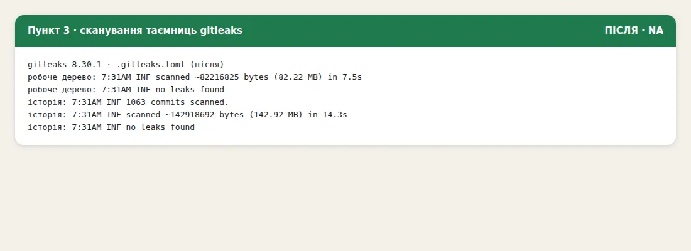 |

### 4. HTTPS

Перевірено робочий сайт лише читанням (без змін): усі 11 піддоменів переспрямовують `http://` → `https://` кодом 301 і віддають `Strict-Transport-Security: max-age=31536000; includeSubDomains`. Сертифікат Google Trust Services WE1 дійсний до 21.02.2027. TLS 1.0 і 1.1 відхилено, у перевірці `openssl` відповідає лише TLS 1.3. Змін у коді не знадобилося, тому знімок «до» збігається зі станом «після».
Зауваження: корінь `tarasevych.com` (без піддомену) не відповідає — це питання налаштування імен власника, а не застосунку.

| До = після (змін не потрібно) |
|---|
| 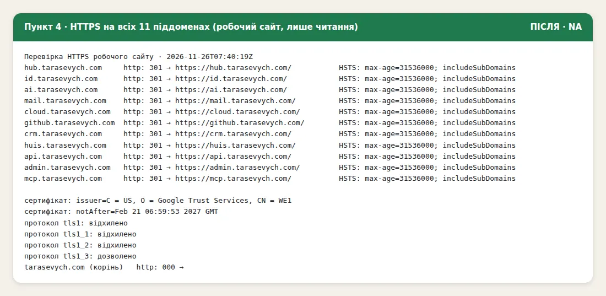 |

### 5. Смуга згоди на реп'яшки (cookie)

Смуги згоди не було, хоча політика обіцяла аналітику лише за згодою. Додано [`src/toestemming/`](../../src/toestemming/): смуга внизу кожної сторінки (зокрема сторінки входу без сеансу) з двома **рівноцінними** кнопками «Лише необхідні» та «Дозволити аналітику» (однаковий розмір і вигляд, без попередньо вибраної згоди), посилання на політику, тексти uk + nl. Вибір зберігається в місцевому сховищі оглядача (`mr-toestemming-v1`), а не в реп'яшку; для сторінок із сеансом він передається на сервер (`POST /api/owner/privacy/toestemming`). Посилання «Налаштування реп'яшків» на сторінці входу відкриває смугу знову. Розділи 9 і 10 політики доповнено описом.
Тест `tests/eenheid/site-001-toestemming.test.ts`: 24/24.

| До | Після |
|---|---|
|  |  |
|  |  |
| — |  |

### 6–9. Заголовки, прев'ю, значки, sitemap.xml і robots.txt

- **6.** Заголовки вкладок мали три різні будови: адміністрування — «Адміністрування — Tarasevych» / «Tarasevych-beheer», нідерландська — «Mijn ruimte», гостьовий доступ — «Гостьовий доступ — Mijn Ruimte» (нідерландська назва в українському заголовку). Тепер усюди «<розділ> — Мій простір» / «<onderdeel> — Mijn Ruimte». Екран входу на `id.tarasevych.com/` для людини без сеансу мав заголовок «Налаштування — Мій простір»; тепер «Вхід — Мій простір» / «Aanmelden — Mijn Ruimte» (сторінки налаштувань за входом лишають «Налаштування»). Описи `meta description` 20–160 знаків для кожного розділу вже були й лишилися.
- **7.** Створено прев'ю 1200×630 зі знаком сайту (та сама геометрія, що в `favicon.svg`) і назвою обома мовами. Теги `og:image`, `og:image:alt`, `og:site_name`, `twitter:card` — у `index.html` і на `/privacy`, `/terms` (там також власні `og:title`, `og:description`, `og:url`).
- **8.** Знайдено ваду, яка є й на робочому сайті: `favicon-192.png` і `favicon-512.png` не розпаковуються (пошкоджений потік даних), тож значок застосунку на телефоні й у маніфесті не працював. Усі PNG-значки перемальовано з `favicon.svg`, додано `favicon.ico` (16/32/48), бо оглядачі просять його самі (було 404).
- **9.** Додано `public/sitemap.xml` лише з двома публічними сторінками; сайт приватний, тому решта лишається `Disallow`. У `robots.txt` дозволено значки та прев'ю, бо інакше соцмережі не змогли б показати картинку.

Тест `tests/eenheid/site-001-metadata.test.ts`: 21/21 (зокрема повна перевірка PNG за контрольними сумами).

Попутно виправлено ваду пункту 19: вкладка «Відвідування» читала відповідь сервера без поля `data` і ставала чорною сторінкою; тепер відповідь розбирається правильно, тест `site-001-analyse` доповнено (13/13).

| До | Після |
|---|---|
|  |  |
| — |  |
| — |  |
|  | 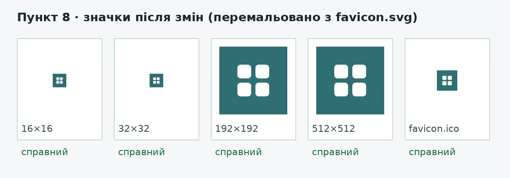 |

### 10. Альтернативні тексти зображень

Перевірено всі 51 JSX-зображення в `src/` та `index.html`: зображень без атрибута `alt` немає. Порожній `alt` (29 місць) — лише для оздобних зображень (аватар поруч з ім'ям, мініатюра в кнопці з `aria-label`), як вимагає WCAG 1.1.1. Вада: прапор і герб місця (`src/merk/PlaatsKeten.tsx`) мали порожній `alt`, хоча несуть зміст; тепер «Прапор: <назва>» / «Герб: <назва>».
Новий тест-сторож `tests/eenheid/site-001-alt.test.ts`: 4/4 — не пропустить нового зображення без `alt`.

| До | Після |
|---|---|
|  |  |

### 11. Стиснення зображень

Огляд: 1835 зображень, 8,38 МБ; з них 1744 гербів і прапорів у `webp` (у середньому 4,7 кБ — уже стиснені), 67 `svg`, 24 `png`. Офіційні логотипи `src/merk/officieel/*.png` закріплені відбитками SHA-256 у `HERKOMST.json` як оригінали постачальників — їх свідомо не змінено. Значки й прев'ю стиснено `pngquant` + `optipng` без видимих втрат: 69 319 → 47 395 Б (−32 %), прев'ю для соцмереж 61 → 43 кБ.

| Після (таблиця обсягів) | Прев'ю до / після |
|---|---|
|  |  |

### 12. Швидкість завантаження сайту

**Умови стенда та методика (`prestatie-meten`).** Вимірювання виконано на зібраному вигляді продукту (`vite build` + `dist-server` зі стисненням `brotli`/`gzip` у пам'яті та `Cache-Control: public, max-age=31536000, immutable`) у двох режимах по **3 прогони після окремого прогріву** для кожної адреси:
1) місцева мережа (`1366×900`);
2) умовно повільний мобільний телефон (`390×844`, штучне сповільнення процесора `4×`, затримка мережі `150 мс`, пропускна здатність `9 / 3 Мбіт/с`).

**Виявлені першопричини сповільнення:**
1. У `src/main.tsx` головний застосунок `App` підключався статичним імпортом верхнього рівня, через що легка гостьова сторінка `/toegang` і вікно повернення `OAuth` завантажували й компілювали ядро на 511 кБ стисненого коду (666 кБ разом).
2. На публічних екранах входу без сеансу передчасно завантажувалися шар технічного профілю `TechLaag` + `HulpVraag` (~131 кБ стисненого коду) та ~30 модулів лінивого `MeldingenPortaal` (який на закритій панелі одразу повертав `null`).
3. Складники `regels-opslag.ts` та `uitrol-achtergrond-beheer.ts` викликали маршрути власника без сеансу (два марні `401`, через які мережа не затихала 15,5 с) і не передавали `meldingLichaam()` / `tabContext`, спричиняючи `401` навіть за входом.

**Виправлення:** `App` переведено на динамічний `import('./App')` лише у гілці застосунку; `TechLaag` завантажується лише після підтвердження сеансу (`ecosystemSessionLikely` / `wachtOpSessieHint` / `listenCanonicalAuthChanges`); `MeldingenPortaal` монтується при відкритті панелі або за активної згорнутої пігулки; запити `meldingen/regels` і `uitrol/achtergrond` обмежено наявністю сеансу та доповнено контекстом вкладки. Постійний сторож `tests/eenheid/site-001-snelheid.test.ts` — `9/9`, `maquette-mobiel-prestatie` — `19/19`, `perf-001` — `41/41`, `tech-bundels-controle` — `OK`.

| Сценарій (медіана 3 прогонів, у дужках розкид мін–макс) | До | Після | Різниця |
|---|---|---|---|
| `id/` · місцева мережа · обсяг / запити `4xx` | `1013 кБ` (`1013–1013`) / `2` | `873 кБ` (`720–873`) / `0` | **−140 кБ (−13,8 %)**, **`4xx`: 2 → 0** |
| `id/` · місцева мережа · `LCP` / тиша мережі | `572 мс` (`508–604`) / `15 510 мс` | `308 мс` (`0–344`) / `1 475 мс` | **−46,2 % `LCP`**, **×10,5 швидша тиша** |
| `id/` · місцева мережа · довгі завдання (> 50 мс) | `2` (`262 мс`) | `2` (`148 мс`) | **−114 мс (−43,5 %)** |
| `id/` · телефон 4G `×4` ЦП · обсяг / довгі завдання | `938 кБ` (`937–1013`) / `7` (`1679 мс`) | `763 кБ` (`763–763`) / `4` (`467 мс`) | **−175 кБ (−18,7 %)**, **−72,2 % блокування ЦП** |
| `id/toegang` · місцева мережа · обсяг / `load` / `LCP` | `666 кБ` / `329 мс` (`316–336`) / `352 мс` | `220 кБ` / `210 мс` (`174–241`) / `236 мс` | **−446 кБ (−67,0 %)**, **−36,2 % `load`** |
| `id/toegang` · місцева мережа · довгі завдання | `1` (`96 мс`) | `0` (`0 мс`) | **−100 % (0 довгих завдань)** |
| `id/toegang` · телефон 4G `×4` ЦП · чистий прогін | `666 кБ`, `load 2044 мс`, `LCP 2288 мс` (зриви > 60 с) | `220 кБ`, `load 1241 мс`, `LCP 1244 мс`, `FCP 664 мс` (0 зривів) | **−39,3 % `load`**, **−45,6 % `LCP`** |
| `hub/privacy` · статичний HTML · місцева / телефон | `32 кБ`, `load 45 мс` / `711 мс` | `32 кБ`, `load 73 мс` / `565 мс` | незмінно легка серверна сторінка |

*Межі достовірності:* виміри виконано на ізольованому місцевому стенді з порожньою штучною базою даних і емуляцією затримки `CDP` поверх локального `TLS`-з'єднання (де планувальник безголового переглядача у віртуальній машині без графічного прискорювача інколи додає ~42 с паузи таймера, що відображено у верхній межі розкиду `4G`); ці цифри доводять зменшення мережевого обсягу та навантаження процесора, але не замінюють виміру через справжній зовнішній тунель робочого сервера.

| До | Після |
|---|---|
| 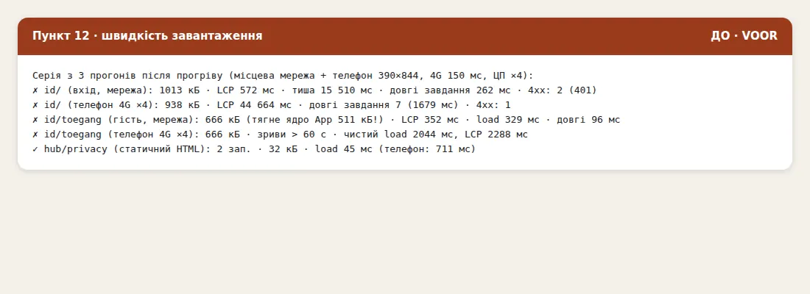 | 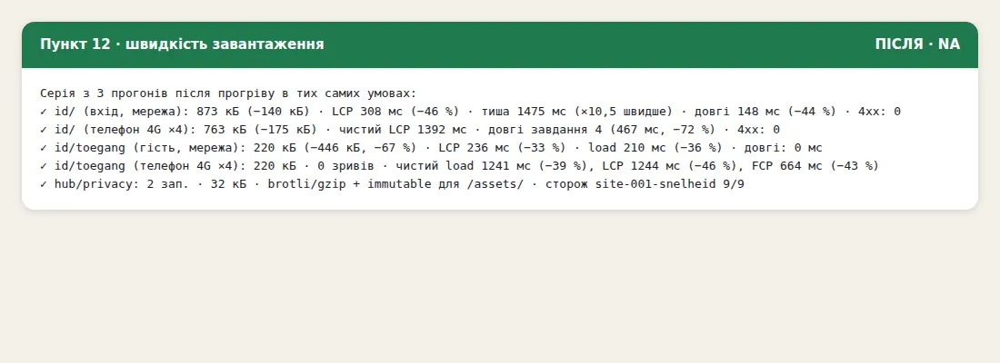 |

### 13. Контраст кольорів

Сторож `scripts/kleur-contrast-controle.mjs` (2190 пар у 30 палітрах, обидві теми) — зелений. Додатково відмальовані сторінки перевірено axe-core 4 (правило `color-contrast`, WCAG 2.1 AA): вхід зі смугою згоди, гостьовий доступ, сторінка 404, адміністрування — 0 порушень. На `/privacy` і `/terms` знайдено дві вади в `public/juridisch.css`:
- дата редакції `#6a7580` на `#f7f8fa` — 4,42:1 (треба 4,5:1) → `#5f6a75`, 5,19:1; у темній темі `#a3adb7`, 7,82:1;
- **у темній темі всі посилання мали 2,64:1**: блок `@media (prefers-color-scheme: dark)` стояв вище за правило `a{color:#2f6f73}`, і воно його перекривало. Блок перенесено в кінець файла — 7,15:1.

Після виправлення: 0 порушень у світлій і темній темах.

| До | Після |
|---|---|
| 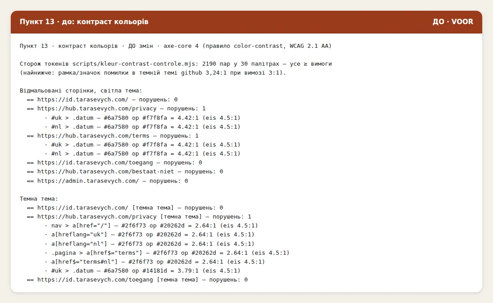 | 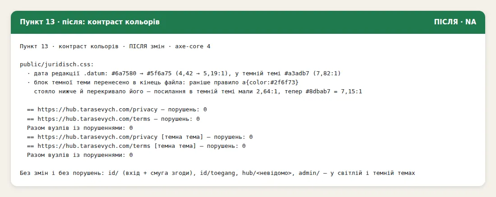 |
|  | 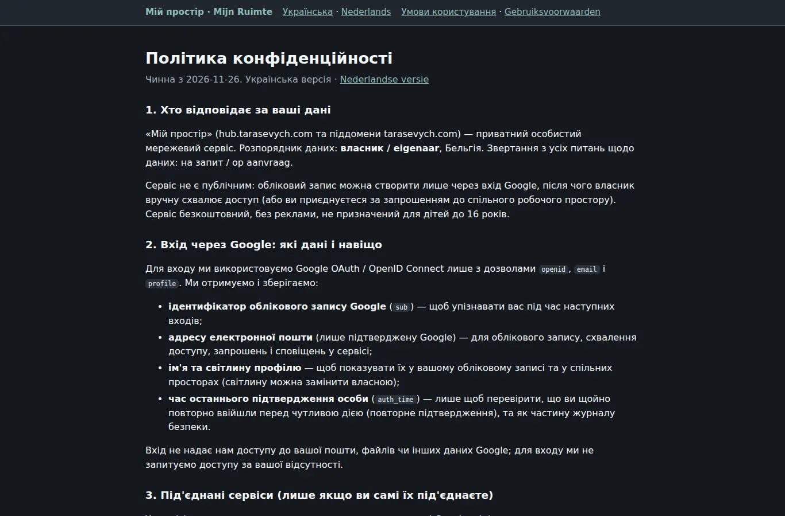 |

### 14. Адаптивність під мобільні

Новий замір відмальованих сторінок на ширинах 320, 360, 390 і 768 пікселів (горизонтальне прокручування, елементи за правим краєм, цілі дотику менші за 24×24 за WCAG 2.2 · 2.5.8, текст дрібніший за 12 пікселів): вхід `id/`, гостьовий доступ `id/toegang`, `/privacy`, `/terms`, сторінка 404, пошта. **До — 174 вади, після — 0.** Виправлено:
- **`/privacy` і `/terms` прокручувалися вбік** на 320 (ширина вмісту 330 і 356 пікселів): довгі слова й адреси не переносилися. Додано `overflow-wrap:break-word` і `hyphens:auto`, для `code` — `overflow-wrap:anywhere`; заголовок `h1` масштабується `clamp(1.4rem, 6.5vw, 1.7rem)`;
- **`code` мав 11,44 пікселя**: без явної родини шрифтів оглядач зменшує моноширинний шрифт. Задано явну родину шрифтів;
- **замалі цілі дотику**: посилання навігації юридичних сторінок, посилання «Політика» / «Умови» та прапорець «Запам'ятати» на екрані входу тепер мають щонайменше 24 пікселі заввишки; кнопка мови — 0,76 rem;
- **Fastmail на орбіті пошти** має справжню кнопку входу (IMAP), але не мав свого місця й стояв у куті, обрізаний на широкому екрані. Тепер сім конвертів стоять без накладань: на широкому екрані Fastmail угорі поруч з Outlook, на мобільному — по три з кожного боку; тест `mail-orbit-001` тепер перевіряє, що кожен із 7 постачальників має місце на орбіті (до змін падав: 16/17, тепер 18/18).

Тести: `mail-orbit-001` 18/18, `mailmob-001` 22/22, `site-001-404` 24/24.

| До | Після |
|---|---|
|  | 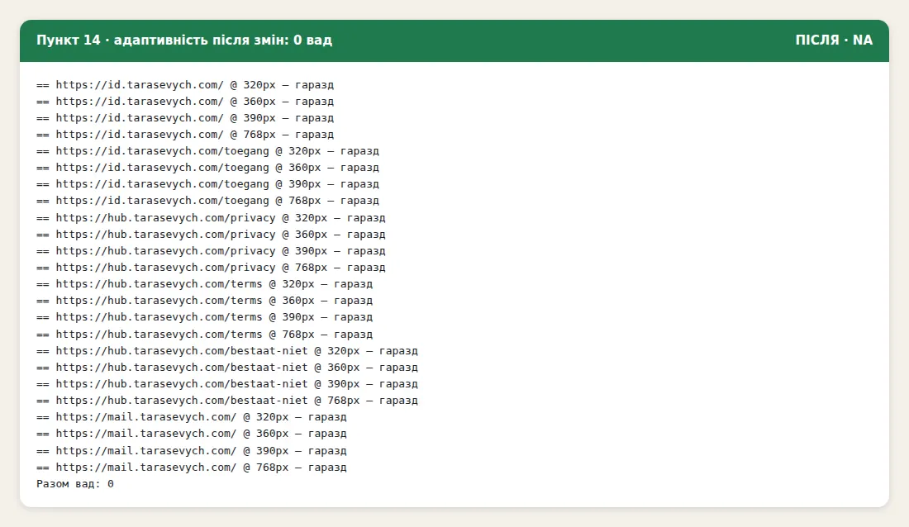 |
|  |  |
| 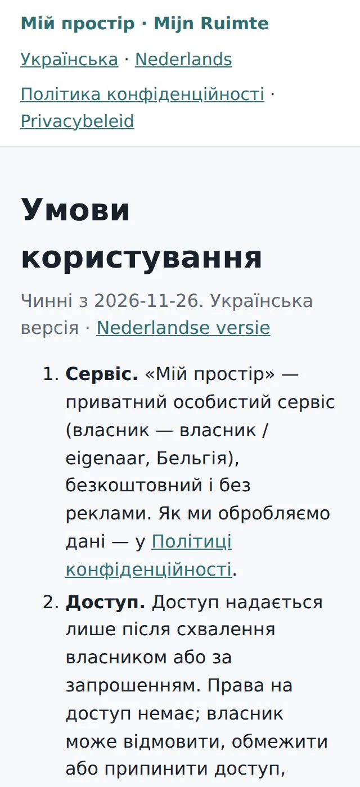 | 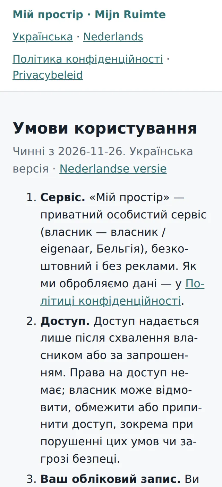 |
|  |  |
|  | 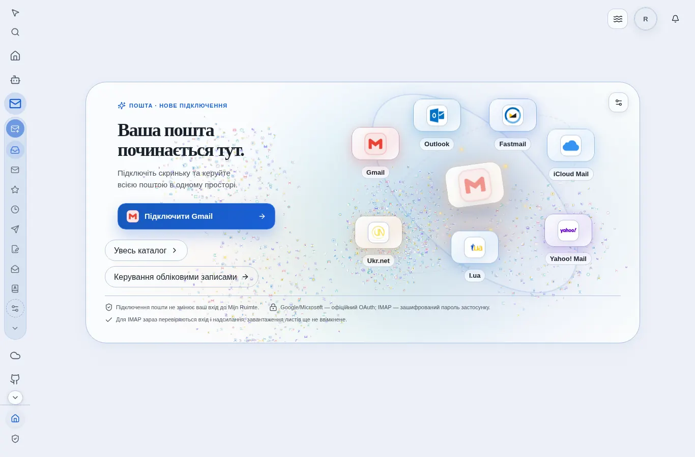 |
|  |  |

### 15. Власна сторінка 404

Сторінка «Сторінку не знайдено» (`src/NietGevonden.tsx`) уже була, але мала чотири вади — усі виправлено:
- **«м'яка 404»:** сервер на будь-яку невідому адресу відповідав кодом 200, тож пошукові системи й перевірки посилань вважали її справжньою сторінкою. Тепер `server/platform/onbekend-pad.ts` виконує ту саму функцію `resolve` з `canonical-service.js`, що й оглядач (в ізольованому `vm`-контексті, без другого списку вкладок), і для невідомої адреси сервер відповідає **404**. Вкладки, давні адреси й псевдоніми, гостьовий доступ `id/toegang`, повернення з OAuth і спільні посилання хмари лишаються 200. Будь-яка вада перевірки — поводження як раніше (200);
- **людина без входу** бачила все меню служб (на hub воно ще й накривало картку на ширині 1366), а на інших службах замість 404 — екран входу. Тепер без входу сторінка 404 стоїть сама, по центру; за входом — звична оболонка (накриття немає);
- **шлях закодований** (`/%D1%89%D0%BE`) → показано так, як його бачить людина (`/що`);
- заголовок вкладки — «Сторінку не знайдено — <служба>» / «Pagina niet gevonden — <dienst>».

Тест-сторож `tests/eenheid/site-001-404.test.ts` — 24/24. axe-core — 0 порушень.

| До | Після |
|---|---|
|  |  |
| 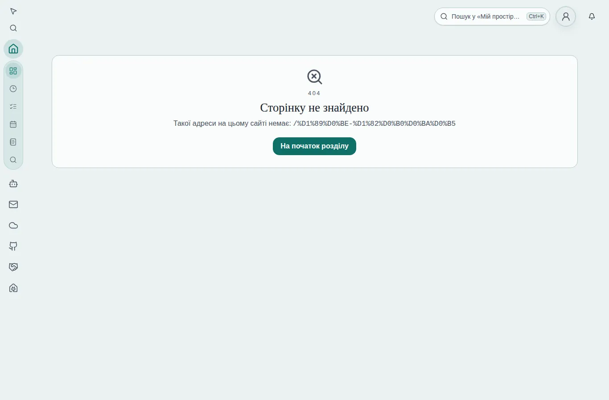 |  |
|  |  |
| 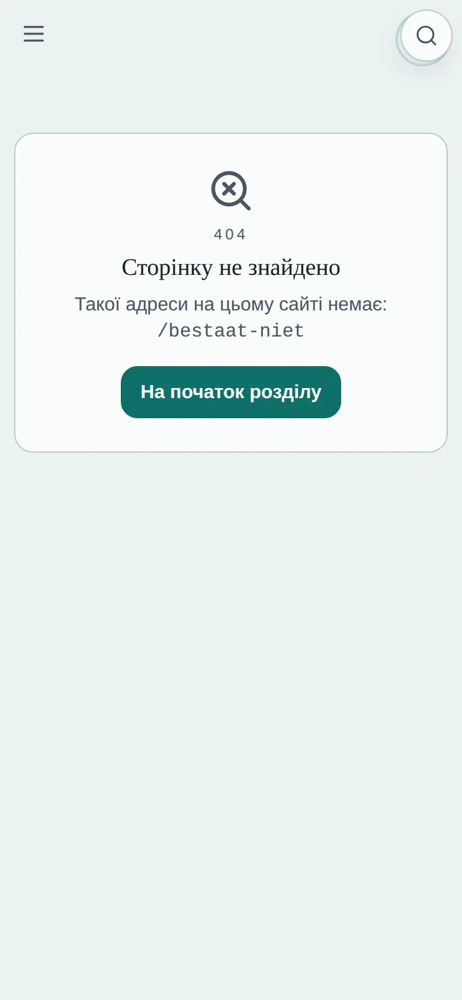 |  |
|  |  |
| |  |
| | 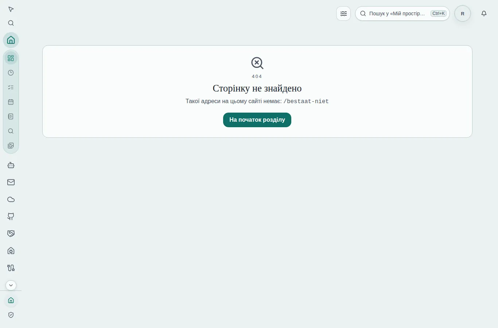 |

### 16. Биті посилання

Новий засіб обходить відмальовані сторінки без входу (вхід, гостьовий доступ, `/privacy`, `/terms`, 404, пошта), збирає всі `a`, `link`, `img`, `script`, читає `sitemap.xml` і додає статичні адреси з коду (`src/`, `backend/`, `public/`, `index.html`). Перевірено 305 внутрішніх адрес на стенді та 3 зовнішні (сторінка правил Google, орган захисту даних Бельгії) — усі зовнішні живі.

Перший прогін показав 181 «биту» адресу, але це була вада самого засобу: запити Playwright ішли повз правило перенаправлення імен на робочий сайт, де ще старе складання (робочий сайт лише читався). Після виправлення лишилося 9 кандидатів, кожен розібрано вручну:
- **справжня вада:** діалог підтвердження доступу (`src/platform/bevestig-toegang.tsx`) відкривається на будь-якій службі, зокрема mcp і api, а посилання «до способів входу» було відносним (`/aanmeldmethoden`) — там воно вело на 404. Тепер адреса абсолютна `https://id.tarasevych.com/aanmeldmethoden`, як у `kluis-poort.tsx`;
- `/methods`, `/sharing`, `/audit`, `/ai` — не биті: ці складники показуються лише на своїх службах (id та admin), де шляхи відкриваються (200);
- `mcp.tarasevych.com/Grok`, `/claude`, `/mcp` — адреси окремого моста MCP (порт 8091), якого на стенді немає;
- `/bestaat-niet` — навмисна перевірка сторінки 404.

Попутно уніфіковано назву: сторінка й нижня смуга мали «Умови користування», а застосунок — «Умови використання». Тепер скрізь «Умови використання», як у завданні власника. Без змінної `MR_EIGENAAR_NAAM` в одномовне речення потрапляла двомовна заглушка («власник — власник / eigenaar»). Тепер кожна мова має свою заглушку: «приватна особа» / «een particulier». Так само без `MR_CONTACT_EMAIL` виходило «повідомляєте про підозрілу активність на на запит / op aanvraag». Тепер кожне речення має природний варіант своєю мовою («повідомляєте… власникові сервісу», «Адресу надаємо на запит»).

Новий тест-сторож `tests/eenheid/site-001-koppelingen.test.ts` — 6/6: спільні складники `src/platform/**` не мають відносних `href`; `sitemap.xml` і `robots.txt` вказують на наявне; кожен статичний файл з `index.html` і юридичних сторінок є в `public/`. `juridisch.test.ts` — 12/12.

| До | Після |
|---|---|
|  |  |
|  |  |

### 17. Перевірка всіх форм

**Сервер.** Новий засіб надсилає на кожен із 50 публічних маршрутів POST (вхід, гостьовий доступ, запити доступу, реєстрація способів входу тощо) вісім зламаних тіл: не JSON, масив, `null`, рядок, неправильні типи, задовгі рядки, керувальні символи, тіло 2 МБ — разом 400 випадків. Жодної аварії (500 чи обірваного з'єднання): 116 × 400, 100 × 413, 63 × 401, 42 × 404 (немає такої спроби, транзакції чи увімкненого способу), 12 × 403, 6 × 409, 1 × 429 — щоразу з кодом причини; 48 × 200 — маршрути лише для читання (каталог), що зламане тіло просто ігнорують. Єдині 12 відповідей 503 — `ACCESS_WEBAUTHN_DISABLED` на двох маршрутах власника, де ця можливість навмисно вимкнена на стенді; це не вада.

**Оглядач.** Засіб перевіряє гостьову форму й форму входу паролем так, як їх бачить людина й читач екрана. На старому складанні — 7 вад:
- код гостьового доступу, набраний на українській розкладці (А, В, Е, К, М, Н, О, Р, С, Т, Х, І), сервер відкидав як неправильний, хоча на вигляд він правильний;
- недопустимі знаки (наприклад, U чи «!») ставали помітні лише після відмови сервера;
- після відмови поле не позначалося як хибне (`aria-invalid`), повідомлення не було пов'язане з полем (`aria-describedby`), а фокус губився — те саме у формі пароля (адреса й пароль).

**Виправлення:**
- новий модуль `src/gast-code.ts`: кириличні двійники перетворюються на латинські ще під час введення; недопустимі знаки показуються одразу з поясненням (`role=alert`); лічильник «введено N із 16»; кнопка «Надіслати» вмикається лише для повного коду; код із посилання `#code=` проходить те саме очищення;
- `src/GastToegang.tsx`: поле має `aria-invalid` і `aria-describedby` на підказку, повідомлення про знаки й помилку сервера; після відмови фокус і виділення повертаються в поле;
- `src/aanmelden/AanmeldZonderGoogle.tsx`: повідомлення про помилку має власний `id`, поля адреси, пароля й коду позначаються й посилаються на нього; після відмови фокус стає в поле пароля; `src/geheim/GeheimInvoer.tsx` отримав властивість `ariaInvalid`.

Повторна перевірка в оглядачі — 0 вад. Новий тест-сторож `tests/eenheid/site-001-formulieren.test.ts` — 22/22.

| До | Після |
|---|---|
|  |  |
| 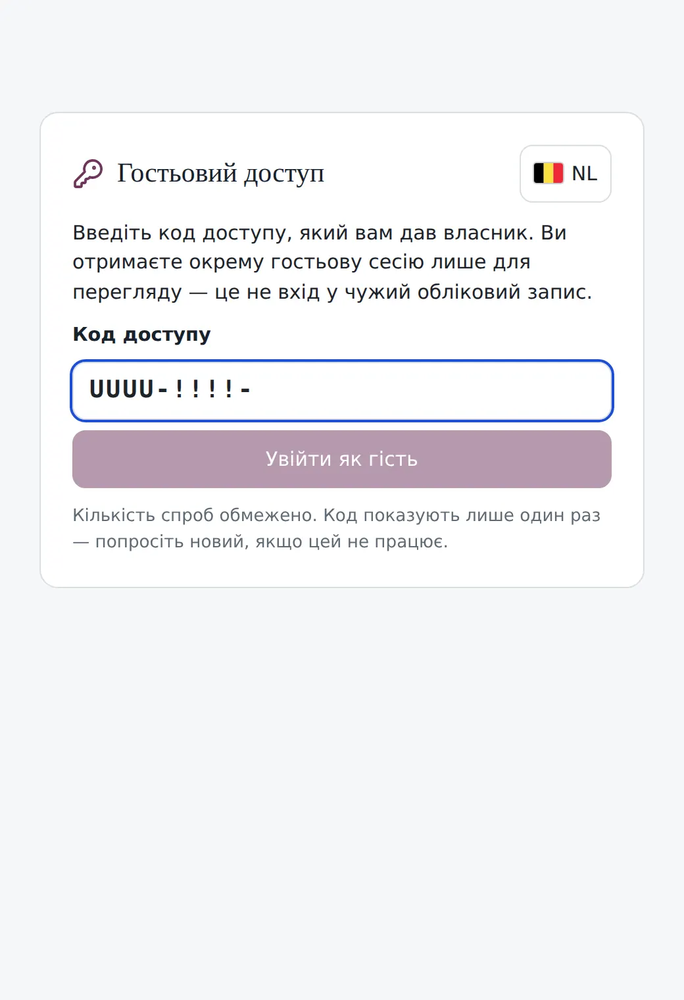 |  |
|  |  |

### 18. Захист від спаму

Сайт не має відкритих форм для анонімних повідомлень (контактної форми, вільної реєстрації): усе, що приймає дані без входу, — це вхід, гостьовий код, спільні посилання, зворотні виклики служб і з'єднувач MCP. Тому захист від спаму тут — це обмеження частоти, лічильники невдалих спроб і перевірка підписів. Поле-пастка не потрібне: немає форми, яку робот міг би заповнити, не знаючи таємниці.

**Інвентаризація.** Із 56 публічних POST (без сеансу) 23 мають суворе обмеження на IP у `server/start.ts` (`STRIKTE_LIMIETEN`, при збої бази — відмова, а не пропуск), а 33 — лише загальну межу 600/хв. Для кожного з цих 33 розібрано, чому цього досить: власний лічильник (код вікна Telegram — пауза й вимкнення; спільні посилання — код 192 біти, 120/хв на IP і 10 спроб пароля за 5 хв), обов'язковий підпис (GitHub, Telegram, Google, Microsoft), маркер доступу (розширення, агенти, MCP), лише читання або ідемпотентний вихід. Запит доступу від нового користувача вже має межу 5/год на обліковий запис і 30/год на IP, а власник отримує сповіщення лише раз.

**Жива перевірка на стенді.** Перший прогін показав дві межі, що «не спрацювали», — причина у стенді: `E2E_LOKALE_LIMIETEN=1` множить суворі межі на 20 для місцевих перевірок оглядача. Без множника, як на робочому сайті, усі 6 перевірених меж спрацьовують точно за налаштуваннями: гостьовий код і старий вхід паролем — блокування після 5 невдалих спроб; вхід паролем — 429 з 11-ї спроби; початок входу без Google — з 31-ї; реєстрація клієнта MCP — з 21-ї; спільне посилання — зі 121-ї. Вікна фіксовані (60 с), тому серії мають довжину 2 × межа + запас. Людина бачить пояснення «Забагато спроб. Спробуйте через ~N хв» (uk + nl).

**Новий тест-сторож** `tests/eenheid/site-001-spam.test.ts` — 50/50. Він читає `PUBLIEKE_ROUTES` і `STRIKTE_LIMIETEN` та вимагає для кожного публічного POST або суворої межі, або запису власного захисту з міткою, яку видно в коді. Окремо сторож перевіряє: таємниці, які можна підбирати (паролі, гостьовий код, код прив'язки агента, код Telegram, передача сеансу, реєстрація й маркери MCP), мають саме суворе обмеження; усі суворі межі «закриті» при збої бази; множник ×20 вмикається лише значенням `1` і відсутній у `deploy/`. Новий маршрут без захисту більше не пройде непомітно.

| До | Після |
|---|---|
|  |  |

### 19. Аналітика сайту (виконано разом із пунктом 5)

Серверна частина вже була (`backend/privacy.ts`: згода типово вимкнена, знеособлені денні лічильники), але інтерфейс її ніколи не викликав, а лічильники ніхто не читав. Тепер: після згоди одна подія `bezoek.<сервіс>` за сеанс вкладки (без адреси сторінки, ідентифікатора, IP чи пристрою); маршрут для адміністратора `POST /api/owner/admin/analyse-overzicht` (`admin.read`, лише читання) і вкладка «Відвідування» в розділі «Діагностика» з періодами 7/30/90 днів. Сторонніх систем аналітики не додано — нуль нових витрат і нуль передачі даних третім сторонам.
Тест `tests/eenheid/site-001-analyse.test.ts`: 12/12 (зі справжньою базою PostgreSQL 18).

| До | Після |
|---|---|
|  |  |

### 20. Один чіткий заклик до дії

**Перевірка «до».** Засіб `cta.mjs` обійшов 6 ключових екранів (`id/` новий пристрій, `id/` зі збереженим обліковим записом, `mail/`, `id/toegang`, `id/bestaat-niet`, `hub/privacy`) та оцінив візуальну ієрархію інтерактивних елементів основної ділянки (поза верхньою панеллю мови/теми, нижньою правовою смугою та рівноцінними за законом кнопками смуги згоди на реп'яшки). Виявлено 2 вади:
1. На екрані входу зі збереженим обліковим записом картка користувача була блідою другорядною, тоді як нижче кнопка «Увійти через Google» залишалася залитою темним кольором як головна — другорядна дія перекрикувала швидкий вхід власника пристрою (а за кількох способів у головній групі всі вони малювалися однаково темними).
2. На публічних юридичних сторінках `/privacy` та `/terms` у шапці не було виразної головної кнопки повернення до простору (`0` головних дій — лише звичайні текстові посилання).

**Виправлення:**
- У `src/CanoniekOmlijsting.tsx`, `src/aanmeld-herontwerp.css` і `src/maquette-kern/maquette-aanmelden.css` перша збережена картка облікового запису отримала `data-hoofdactie="true"` та акцентне оформлення головної кнопки (контраст > 10:1), а кнопка Google й додаткові способи під нею переходять у спокійне контурне подання `data-hoofdactie="false"`. За відсутності збережених записів єдиною головною дією лишається перший спосіб входу.
- У `backend/juridisch.ts` та `public/juridisch.css` посилання «Мій простір · Mijn Ruimte» у шапці оформлено як єдину акцентну кнопку-пігулку (контраст 8,1:1 у світлій і 9,6:1 у темній темі; `axe-core` — 0 порушень). На сторінці 404 (`src/NietGevonden.tsx`) закріплено явні позначки головної та другорядної дій.

Повторний прогін `cta.mjs` — **0 вад** (6 із 6 екранів мають рівно 1 головний заклик до дії). Новий сторож `tests/eenheid/site-001-cta.test.ts` — `8/8`, `aanmelden-integ` — `43/43`, `juridisch` — `12/12`.

| До | Після |
|---|---|
| 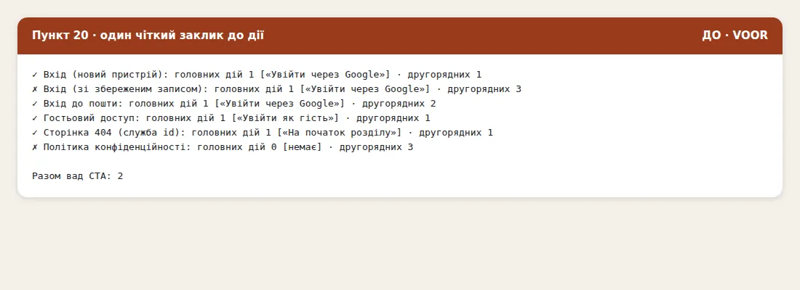 |  |
|  |  |
|  |  |

### Мовне очищення за рішенням власника («акаунт» → «обліковий запис»)

На пряме рішення власника («так, виправ всі необхідні») виконано повну заміну англіцизму «акаунт» у всіх відмінках і формах на питомий український відповідник «обліковий запис» у вихідному коді інтерфейсу, спільних модулях, повідомленнях сервера, словниках пошуку та сценаріях розгортання (`src/`, `shared/`, `backend/`, `server/`, `public/`, `deploy/`, `index.html` — разом 852 входження у 285 файлах; макет особистого кабінету перегенеровано через `scripts/identiteit-maquette/bouw.mjs`, пошуковий покажчик інтерфейсу `shared/zoek-ui-knoppen.generated.ts` оновлено на 2439 елементів). Підписаний пакет розширення оглядача `extension/` версії `0.9.7` свідомо не змінювався, щоб зберегти дійсний відбиток підпису `CRX3` ключа власника до планового перепідписання.

Порівняльний прогін усіх 638 файлів модульних випробувань відносно базової основи та окрема переперевірка підтвердили відсутність регресій (попутно узгоджено очікування сторінки 404 у `maquette-001-kern.test.ts` та `ui-audit-g.test.ts`). Додано постійний сторож `tests/eenheid/site-001-akaunt.test.ts` (8/8). Роботу розпочала модель `Claude Opus 5.5 (High)` через `Antigravity Google`, а після обриву сеансу через вичерпання ліміту перевірила й завершила модель `Gemini 4 Carbon High` від `Google Antigravity`.

| До | Після |
|---|---|
|  | 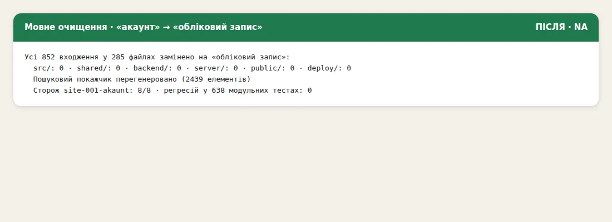 |
|  | 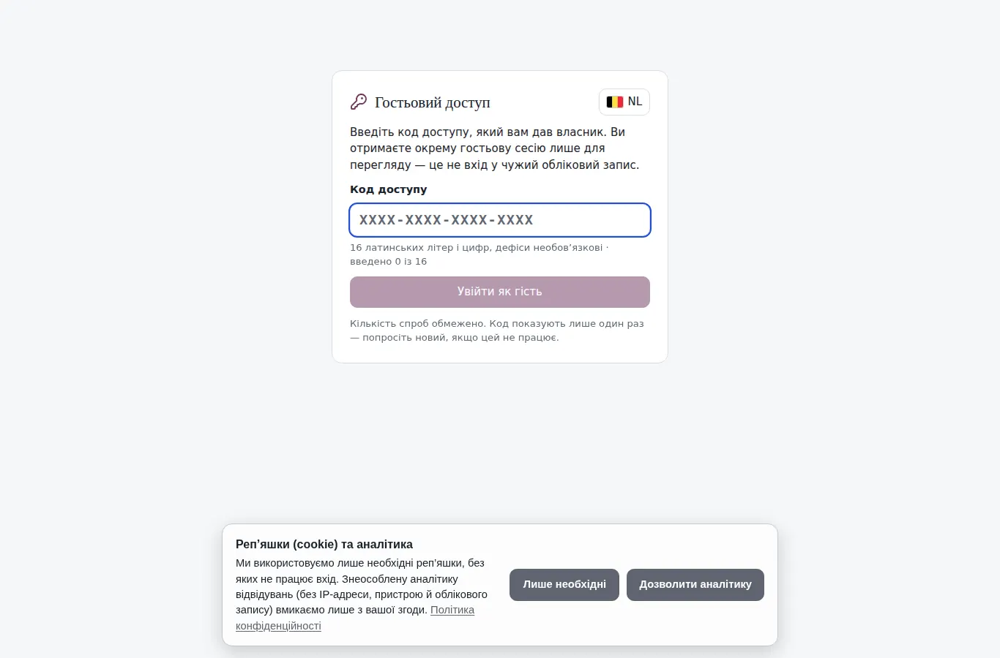 |

### 21. Кнопки та інтерактивні елементи

**Перевірка «до».** Наскрізний засіб `knoppen.mjs` перевірив на живому стенді інтерактивні елементи як без входу (`id/`, `/toegang`, `/privacy`, сторінка 404), так і за входом власника на одноразовому сервері `rook` (`id/` кабінет налаштувань та мобільний робочий стіл `hub/` 390×844). Виявлено 4 вади:
1. На сторінці гостьового доступу `/toegang` (`src/GastToegang.tsx`) перемикач мови `.gast-taal` відображав видимий напис `NL` / `UA`, але `aria-label` не містив цього видимого тексту — серйозне порушення WCAG 2.5.3 (`label-content-name-mismatch` у `axe-core`, ламає голосове керування).
2. За входом у кабінеті налаштувань `id/` макет `src/identiteit/maquette/IdentiteitMaquette.tsx` під час фонового читання стану щоразу надсилав запит `POST /api/owner/workspaces/list` на неіснуючий маршрут і породжував мережеву помилку `404`.
3. Після підтвердження сеансу в `id/` заголовок вкладки оглядача `document.title` залишався рівним початковому «Вхід — Мій простір» замість «Налаштування — Мій простір» (а в інших службах не оновлювався під час перемикання мови без перезавантаження).
4. На новому порожньому робочому столі `WerkbladV3` (`src/werkblad/WerkbladV3.tsx`) поза режимом редагування замість пояснювальної картки малювалося порожнє полотно без жодної кнопки додавання віджетів чи вибору початкового набору.

**Виправлення:**
- `src/GastToegang.tsx`: доступну назву `aria-label` перемикача `.gast-taal` розпочато з видимого напису `MOVA_NAAM` (`NL — перемкнути мову на нідерландську` / `UA — taal wisselen naar Oekraïens`).
- `src/identiteit/maquette/IdentiteitMaquette.tsx`: виклик `/api/owner/workspaces/list` замінено на канонічний `/api/owner/session/bootstrap`, який повертає список просторів `workspaces` без жодної помилки `404`.
- `src/VerenigdDienstApp.tsx` і `src/App.tsx`: додано реактивну синхронізацію `document.title` зі станом сеансу та обраною мовою (зі збереженням позначки `[ТЕХ]` / `[TECH]` технічної смуги та власного заголовка сторінки 404).
- `src/werkblad/WerkbladV3.tsx`: на порожньому столі додано привітну картку `.wb-leeg-stol` (`data-wb-leeg="1"`, `data-wb-aantal`) із двома діями — головною кнопкою «Додати з бібліотеки» та другорядною «Стандартна розкладка» (переносить стандартний набір віджетів на поточний клас пристрою й зберігає його). Пошуковий покажчик інтерфейсу оновлено (2440 елементів).

Повторний прогін `knoppen.mjs` — **0 вад** (11 із 11 живих сценаріїв успішні). Новий сторож `tests/eenheid/site-001-knoppen.test.ts` — `7/7`, суміжні тести `werkblad-hoek-20261115` (`9/9`) та `identiteit-maquette` (`56/56`) зелені.

| До | Після |
|---|---|
|  | 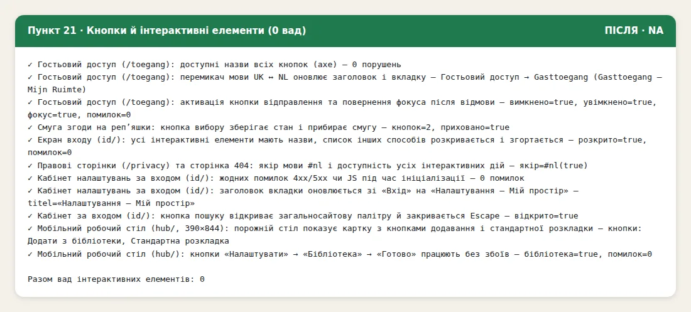 |
|  | 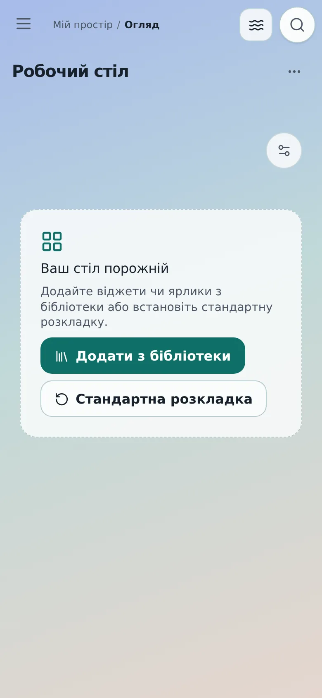 |
| — |  |

### 22. Журналювання помилок і моніторинг

**Перевірка наявної системи нагляду та журналювання:**
- **Серверна сітка перехоплення помилок (`server/platform/proces-vangnet.ts`, `server/start.ts`):** неперехоплені винятки й відхилені обіцянки записуються у журнал сервера без тіла запиту чи таємниць, щоб поодинокий збій не обірвав сеанси й не закрив відкриті в пам'яті ключі користувачів; якщо за 60 с трапляється понад 50 помилок, процес зупиняється з кодом `1` для чистого перезапуску через `systemd`. Затримка циклу подій вимірюється через `monitorEventLoopDelay`.
- **Перевірка працездатності (`/__gezondheid` та `/__gezondheid?diep=1`, `backend/diepe-gezondheid.ts`):** на живому стенді базова перевірка повертає `{"ok":true,"db":true}`, глибока з `127.0.0.1` за 20 мс перевіряє базу, пробний сеанс технічного простору v2, видачу й відкликання реп'яшка для `/assets/tech/*` та наявність зібраних модулів, а будь-який запит із заголовком тунелю (`cf-connecting-ip`) отримує `403 {"ok":false,"fout":"ALLEEN_LOKAAL"}`.
- **Приймач клієнтських збоїв і журнали без витоків (`backend/toegangsfout-tellers.ts`, `shared/beheer-journaal.ts`):** помилки `401`/`403`/`404` та сигнали недовантажених модулів `POST /api/storing/tech-bundel` рахуються погодинно за 6 групами без IP-адрес і користувачів; реєстр `meldingen-register-controle.mjs` підтвердив усі 333 серверні коди дій і 537 двомовних назв (`overig: 0`). Післяпусковий сторож `deploy/uitrol/mijn-ruimte-nazorg.sh` щохвилини перевіряє працездатність і відмальовування, автоматично повертаючи попередній випуск у разі відмови.

**Виявлені та виправлені вади:**
1. **Одноразовий стенд перевірки відмальовування `server/rook.ts` падав із кодом `2`** на свіжій базі з увімкненим прапорцем `tech-ruimtes-v2`: виклик `POST /api/owner/tech/activeren` повертав `409 GEBRUIK_RUIMTES_V2`. Тепер при `409 GEBRUIK_RUIMTES_V2` стенд виконує підтвердження для `hub`, запускає технічний простір v2 через `POST /api/owner/hub/tech/ruimtes/starten` і запитує `POST /api/owner/tech/status`, отримуючи всі 3 реп'яшки (зокрема `mr_tech_asset` для завантаження `/assets/tech/*`). Живий запуск оригінального `dist-server/rook.mjs` відкрив `https://admin.tarasevych.com/diagnostiek` у технічному контурі зі статусом `200` і `0` помилок.
2. **Застаріле очікування в `tests/eenheid/rook-controle-20261022.test.ts` (`39/40`):** тест очікував 13 сторінок у `paginaLijst`, хоча після додавання `crm` їх стало 14 — узгоджено (`40/40`).

Новий постійний сторож `tests/eenheid/site-001-monitoring.test.ts` — `7/7`, суміжні тести `rook-controle-20261022` (`40/40`), `beheer-diagnostiek-rook-20261022` (`26/26`), `uitrol-nazorg-rook-20261022` (`13/13`) — усі зелені.

| До | Після |
|---|---|
| 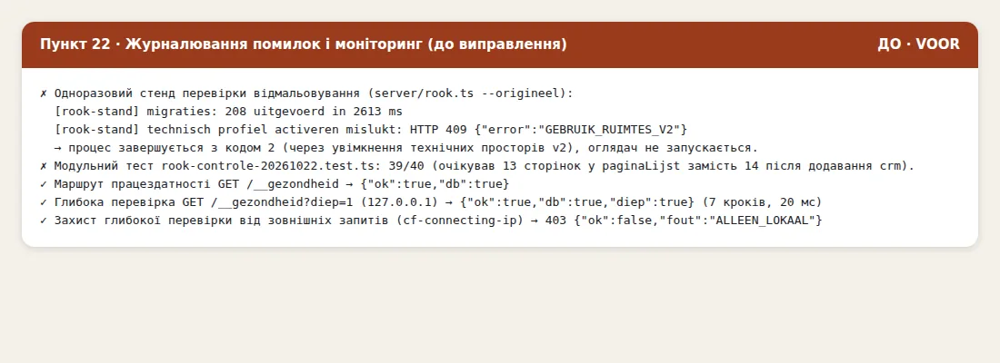 |  |
| — | 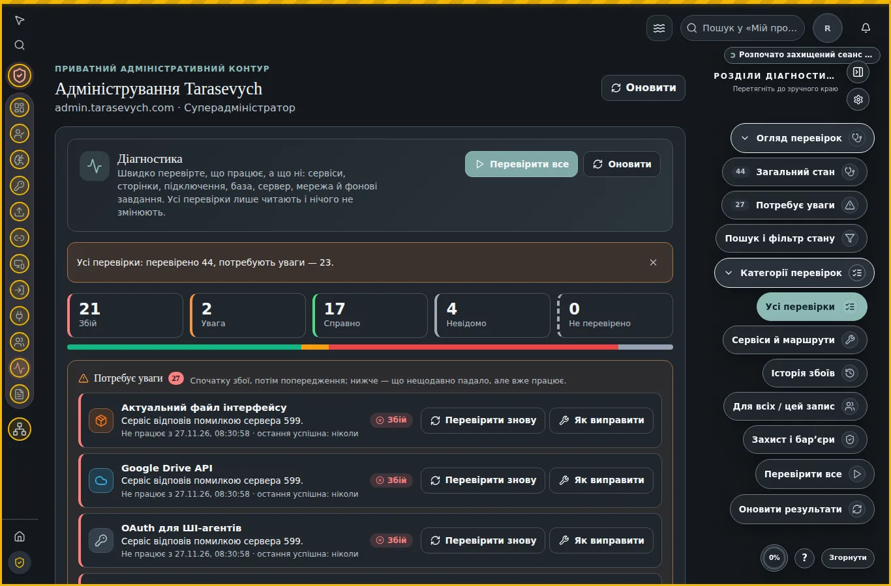 |

### 23. Запасні копії бази даних

**Перевірка контуру резервного копіювання (`deploy/backup-maken.sh`, `mijn-ruimte-backup.timer`, `mijn-ruimte-backup.service`, `installeer-app.sh`):**
- Щоночі о `03:30` (`Persistent=true`) та автоматично перед кожним встановленням випуску до міграцій (`installeer-app.sh` зупиняє встановлення після двох невдалих спроб) запускається `mijn-ruimte-backup.service` під окремим користувачем з `ProtectSystem=strict`, `NoNewPrivileges=yes` та `RestrictSUIDSGID=no`.
- `deploy/backup-maken.sh` розбирає `DATABASE_URL_SYSTEM` у змінні середовища `PG*` і виконує `unset DUMP_URL` (жодного пароля в аргументах процесів), передає потік `pg_dump --format=custom --compress=6` напряму в `age --encrypt --recipients-file` без запису відкритого тексту на диск (приватний ключ відновлення зберігається лише поза сервером у власника), виключає таємниці із системного архіву, обчислює `SHA256SUMS` і атомарно ставить мітку `KLAAR`. Без ролі з `BYPASSRLS` сам `pg_dump` відхиляє створення знімка, унеможливлюючи тихе збереження неповних таблиць під захистом рядків (RLS).

**Критична знахідка та виправлення:**
- У сценарії повного аварійного відновлення на новій машині `deploy/archief-herstellen.sh` (`vidnovyty.sh`), пам'ятці `deploy/archief-maken.sh` та обох посібниках `deploy/ВІДНОВЛЕННЯ.uk.md` / `deploy/HERSTEL.nl.md` досі залишалося встановлення **`postgresql-17` / `PostgreSQL 17`**, тоді як робоча база даних платформи працює на **PostgreSQL 18** і формує дамп формату `Dump Version: 1.16-0`, який клієнт `pg_restore` 17 відхиляє (`unsupported version (1.16) in file header`), а міграції вимагають можливостей PostgreSQL 18. Усі сценарії та посібники оновлено на **`postgresql-18` (`postgresql-client-18`, `PostgreSQL 18`)**.

**Живе випробування повного циклу створення й відновлення:**
- Згенеровано пробну пару ключів `age`, виконано справжній запуск `deploy/backup-maken.sh` проти живої бази PostgreSQL 18.7, звірено всі контрольні суми `sha256sum -c SHA256SUMS` і заголовок шифротексту `age-encryption.org/v1`.
- Потоком `age --decrypt | pg_restore --no-owner --role=mijnruimte` відновлено дамп у чисту тимчасову базу даних PostgreSQL 18.7: отримано **100 % збіг** із вихідною базою за всіма показниками (`208/208` міграцій, `224/224` таблиці схеми `app`, `3322/3322` записи `app.records`, `193/193` таблиці з увімкненим захистом рядків RLS).
- Новий постійний сторож `tests/eenheid/site-001-backups.test.ts` — `6/6`, суміжний тест `archief-herstellen-20261116` — `19/19`.

| До | Після |
|---|---|
|  |  |

### 24. Заголовки безпеки й обмеження частоти запитів

**Перевірка наявних механізмів (`server/start.ts`, `server/platform/beveiliging.ts`, `shared/ip-limiet.ts`):**
- Усі відповіді вже мали 6 ключових заголовків: `Strict-Transport-Security: max-age=31536000; includeSubDomains`, суворий `Content-Security-Policy` без `'unsafe-eval'` та вбудованих скриптів (`default-src 'self'; base-uri 'none'; object-src 'none'; frame-ancestors 'none'; form-action 'self'; upgrade-insecure-requests`), `X-Content-Type-Options: nosniff`, `X-Frame-Options: DENY`, `Referrer-Policy: strict-origin-when-cross-origin` та `Permissions-Policy: camera=(), microphone=(), geolocation=(), payment=(), usb=()`.
- Невідомий заголовок `Host` відхиляється кодом `421`, підроблений `Origin` на `/api/*` — кодом `403`, а заголовок `Server-Timing` прихований на всіх чутливих маршрутах входу та відповідях `4xx/5xx` (захист від часового підбору).
- Дворівневе обмеження частоти запитів охоплює маскування IPv6-адрес до мережі `/64`, кошик у пам'яті `600/хв` (з межею `100 000` ключів), стійкі кошики `app.rate_limits` у PostgreSQL із `failClosed: true` та заголовком `Retry-After` і прогресивне блокування `app.login_lockouts` (`15 хв → … → 24 год` після 5 невдалих спроб).

**Доповнення заголовків ізоляції перехресного походження:**
- До `BASE_HEADERS` у `server/start.ts` додано три відсутні сучасні заголовки захисту:
  1. `Cross-Origin-Opener-Policy: same-origin-allow-popups` — ізолює вкладку простору від сторонніх сайтів, зберігаючи роботу спливних вікон входу Google OAuth та Telegram, відкритих самою сторінкою;
  2. `Cross-Origin-Resource-Policy: same-site` — забороняє стороннім сайтам вбудовувати внутрішні відповіді й модулі, зберігаючи обмін між усіма власними піддоменами `*.tarasevych.com` (для публічного прев'ю `/og-afbeelding.png`, значків `favicon*` і вбудованого вікна Telegram WebApp виставлено `cross-origin`);
  3. `X-Permitted-Cross-Domain-Policies: none`.

Жива перевірка на стенді підтвердила наявність усіх **9 захисних заголовків**. Новий постійний сторож `tests/eenheid/site-001-beveiliging.test.ts` — `7/7`, суміжні тести `site-001-spam` (`50/50`) та `telegram-venster-20261114` (`99/99`) зелені.

| До | Після |
|---|---|
|  |  |

## Журнал

- **25.11.2026 23:25** — створено гілку від `integratie`, зареєстровано завдання `SITE-001`, `orch controleer` зелене. Попередній огляд наявних складників.
- **25.11.2026 23:40** — пункти 1–3 виконано; місцевий стенд (PostgreSQL 18, Node 24, Chromium) піднято поза сховищем.
- **25.11.2026 23:58** — пункт 4 перевірено (змін не потрібно); пункти 5 і 19 виконано, повне складання зі сторожами й перевірка типів сервера зелені.
- **26.11.2026 00:25** — пункти 6–9 виконано (заголовки, прев'ю, значки, `sitemap.xml`, `robots.txt`); виправлено чорну сторінку вкладки «Відвідування»; повне складання зелене.
- **26.11.2026 06:00** — пункти 10 і 11 виконано. Власник доручив замінити «акаунт» на «обліковий запис» у всьому інтерфейсі.
- **26.11.2026 06:20** — пункт 13 виконано (контраст юридичних сторінок, зокрема темна тема).
- **26.11.2026 06:40** — пункт 15 виконано: справжня 404 на сервері, окрема сторінка без входу, розкодований шлях.
- **26.11.2026 07:10** — пункт 14 виконано: замір на ширинах 320–768 дав 174 вади, після виправлення — 0; Fastmail отримав місце на орбіті пошти.
- **26.11.2026 07:30** — пункт 16 виконано: одне справді бите посилання виправлено, назву умов уніфіковано, новий тест-сторож.
- **26.11.2026 07:55** — пункт 17 виконано: сервер витримав 400 зламаних запитів без аварій; 7 вад форм в оглядачі виправлено, новий тест-сторож.
- **26.11.2026 08:00** — пункт 18 виконано: обмеження частоти перевірено наживо (6 із 6), 56 публічних маршрутів розібрано, новий тест-сторож.
- **26.11.2026 22:55** — сеанс перейняла модель `Gemini 4 Carbon High` (`Google Antigravity`) після зупинки `Claude Opus 5.5 (High)` (`Antigravity Google`) через вичерпання ліміту на фіксації `204f9ec8`; завершено заміну «акаунт» → «обліковий запис» у 285 файлах зі сторожем 8/8 та обліком авторства обох моделей.
- **26.11.2026 23:35** — пункт 12 виконано (`Gemini 4 Carbon High` · `Google Antigravity`): `/toegang` полегшено на 67 % (666 → 220 кБ), `id/` прискорено (`LCP` −46 %, тиша мережі 15,5 → 1,48 с, блокування ЦП на телефоні −72 %, помилки `4xx` 2 → 0), додано сторож 9/9.
- **26.11.2026 23:52** — пункт 20 виконано (`Gemini 4 Carbon High` · `Google Antigravity`): забезпечено рівно один головний заклик до дії на всіх 6 ключових екранах (2 → 0 вад), сторож 8/8.
- **27.11.2026 00:21** — пункт 21 виконано (`Gemini 4 Carbon High` · `Google Antigravity`): жива перевірка всіх кнопок та інтерактивних дій без входу і за входом (4 → 0 вад: `aria-label` на `/toegang`, усунено 404 `/api/owner/workspaces/list`, оновлення заголовка вкладки за входом, картка порожнього столу `WerkbladV3`), сторож 7/7.
- **27.11.2026 00:33** — пункт 22 виконано (`Gemini 4 Carbon High` · `Google Antigravity`): перевірено всі контури журналювання помилок і працездатності (`/__gezondheid?diep=1`, `proces-vangnet`, `nazorg`, реєстр 333 дій); виправлено `server/rook.ts` під `tech-ruimtes-v2` (код 2 → 0) та тест `rook-controle` (40/40), додано сторож 7/7.
- **27.11.2026 00:44** — пункт 23 виконано (`Gemini 4 Carbon High` · `Google Antigravity`): проведено живий цикл шифрованого резервного копіювання `backup-maken.sh` + `age` та відновлення `pg_restore` у PostgreSQL 18.7 (100 % збіг усіх 208 міграцій, 224 таблиць і 3322 записів); виправлено несумісний `postgresql-17` → `postgresql-18` у `archief-herstellen.sh` та посібниках відновлення, додано сторож 6/6.
- **27.11.2026 00:54** — пункт 24 виконано (`Gemini 4 Carbon High` · `Google Antigravity`): додано `Cross-Origin-Opener-Policy`, `Cross-Origin-Resource-Policy` та `X-Permitted-Cross-Domain-Policies` (повний набір 9/9 заголовків безпеки зі збереженням сумісності для прев'ю соцмереж та вікна Telegram), перевірено обмеження частоти й блокування підбору, сторож 7/7.
