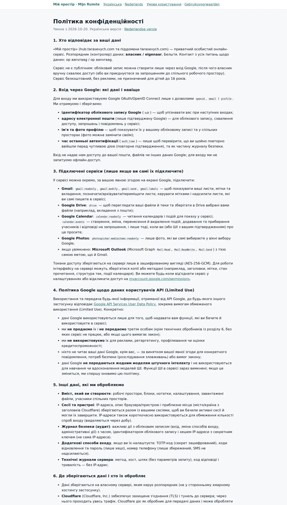
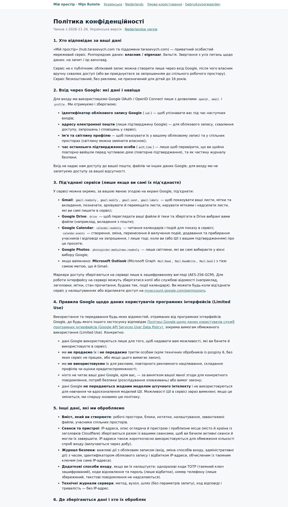

> 🌐 **Мова:** **Українська** · [Nederlands](VOORTGANG.nl.md)

# SITE-001 — готовність сайту Mijn Ruimte: перебіг робіт

- **Завдання:** SITE-001 · агент `antigravity` · гілка `feature/site-001-20261125-232500`
- **База:** `origin/integratie` `8890f85a1c34c9f12e945eb78bd2e8588cceb56a` · правила `1.8.0`
- **Дозвіл власника:** злиття в `integratie` після зелених перевірок (25.11.2026).
- **Знімки «до» й «після»:** [`schermafdrukken/`](schermafdrukken/) — місцеве складання сайту, безголовий оглядач Chromium.

## Як продовжити роботу іншому агентові

1. `git fetch origin && git switch feature/site-001-20261125-232500`
2. Прочитати цей файл: таблиця нижче показує, який пункт виконано, а який наступний.
3. Брати перший пункт зі станом «очікує» або «у роботі», робити знімок «до», виправлення, знімок «після», фіксацію змін і відправлення.
4. Після кожного пункту оновлювати таблицю та журнал наприкінці файла.

## Стан пунктів

| № | Пункт | Стан | Підсумок |
|---|---|---|---|
| 1 | Політика конфіденційності | ✅ виконано | Наявна `/privacy` перевірена (13 розділів, uk + nl); мовне очищення, `meta description`, канонічна адреса, значок, виправлено заповнювач контакту |
| 2 | Умови використання | ✅ виконано | Наявна `/terms` перевірена; додано пункт «Зміни умов» (uk + nl), ім'я власника в українській версії, мовне очищення |
| 3 | Прибрати відкриті ключі та таємниці | ✅ виконано | Справжніх таємниць немає ні в дереві, ні в історії (1063 фіксації змін); `.gitleaks.toml` + робочий процес «Пошук таємниць» |
| 4 | HTTPS | ✅ виконано | Усі 11 піддоменів: http → 301 на https, HSTS на рік із піддоменами, лише TLS 1.3, сертифікат до 21.02.2027; змін у коді не потрібно |
| 5 | Смуга згоди на реп'яшки (cookie) | ✅ виконано | Нова смуга згоди з двома рівноцінними кнопками на всіх сторінках, uk + nl, повторне відкриття зі сторінки входу; 24/24 тести |
| 6 | Заголовки сторінок і опис `meta description` | ✅ виконано | Усі заголовки вкладок «<розділ> — Мій простір» / «<onderdeel> — Mijn Ruimte» (було «— Tarasevych», «Tarasevych-beheer», «Mijn ruimte», «— Mijn Ruimte» в українській) |
| 7 | Прев'ю-зображення для соцмереж | ✅ виконано | `public/og-afbeelding.png` 1200×630 (61 кБ), `og:image` з альтернативним текстом і `twitter:card` у застосунку та на юридичних сторінках |
| 8 | Значок сайту (favicon) | ✅ виконано | **Вада робочого сайту:** `favicon-192.png` і `favicon-512.png` пошкоджені; усі значки перемальовано з `favicon.svg`, додано `favicon.ico`, маніфест із призначеннями «any» і «maskable» |
| 9 | `sitemap.xml` і `robots.txt` | ✅ виконано | `sitemap.xml` лише з `/privacy` і `/terms`; у `robots.txt` рядок `Sitemap:` і дозвіл на значки та прев'ю, решта сайту закрита |
| 10 | Альтернативні тексти зображень | очікує | — |
| 11 | Стиснення зображень | очікує | — |
| 12 | Швидкість завантаження | очікує | — |
| 13 | Контраст кольорів | очікує | Є сторож `scripts/kleur-contrast-controle.mjs` |
| 14 | Адаптивність під мобільні | очікує | — |
| 15 | Власна сторінка 404 | очікує | Наявна `src/NietGevonden.tsx` — перевірити |
| 16 | Биті посилання | очікує | — |
| 17 | Перевірка всіх форм | очікує | — |
| 18 | Захист від спаму | очікує | — |
| 19 | Аналітика сайту | ✅ виконано | Власна знеособлена аналітика тепер справді працює лише за згодою; вкладка «Відвідування» для адміністратора; 12/12 тестів |
| 20 | Один чіткий заклик до дії | очікує | — |
| 21 | Кнопки й інтерактивні елементи | очікує | — |
| 22 | Журналювання помилок і моніторинг | очікує | — |
| 23 | Запасні копії бази даних | очікує | `deploy/backup-maken.sh`, `mijn-ruimte-backup.timer` — перевірити |
| 24 | Заголовки безпеки й обмеження частоти запитів | очікує | `server/start.ts`, `rateLimit` — перевірити |
| 25 | Реєстрація, вхід і відновлення пароля | очікує | — |

## Знайдені вади, які ще чекають на свій пункт

| Вада | Де | Пункт |
|---|---|---|
| Невідомі шляхи віддають HTTP 200 («м'яка 404»); сторінка 404 для людини без входу показує все меню, накривається бічним меню на ширині 1366, шлях показано закодованим | `server/start.ts` (`serveStatic`), `src/NietGevonden.tsx` | 15 |
| Сторінки без входу надсилають `POST /api/owner/meldingen/regels` і `/api/owner/uitrol/achtergrond` → 401; `meldingen/regels` повертає 401 навіть за входом | `UitrolAchtergrondBand`, сповіщення | 21 |
| Перевірка відмальовування установника (`server/rook.ts`) завершується кодом 2: `/api/owner/tech/activeren` → 409 `GEBRUIK_RUIMTES_V2` після ввімкнення просторів v2 | `server/rook.ts`, `backend/tech-profiel.ts:156` | 22 |
| Слово «акаунт» трапляється в інтерфейсі 264 рази (за мовним законом — «обліковий запис») | `src/**` | на рішення власника |

## Звіти за пунктами

### 1. Політика конфіденційності

Сторінка `/privacy` вже існувала (`backend/juridisch.ts`, серверний HTML без JavaScript). Перевірено повноту за Загальним регламентом захисту даних: розпорядник, мета, підстави, строки, обробники, права, орган нагляду — усе наявне.
Виправлено: англіцизми в українському тексті («браузер», «токени», «кеш», «хостинг», «трафік», «онлайн», «e-mail» тощо), додано `meta description`, канонічну адресу, значок сайту й колір теми, дату редакції оновлено до 2026-11-26, заповнювач контакту без змінної середовища тепер «на запит / op aanvraag» (було двічі нідерландською).
Тест `tests/eenheid/juridisch.test.ts`: 11/11, з них 2 нові перевірки SITE-001.

| До | Після |
|---|---|
|  |  |

> [!IMPORTANT]
> На перевірку власникові: речення «Можливості ШІ в сервісі зараз вимкнені» (розділ 4) може вже не відповідати дійсності — у застосунку є робочий простір ШІ. Текст не змінено, бо це юридичне твердження про обробку даних.

### 2. Умови використання

Сторінка `/terms` вже існувала. Додано пункт «Зміни умов» (повідомлення щонайменше за 14 днів), українську версію вирівняно з нідерландською (ім'я власника), «спам/ПЗ» замінено питомими словами, у нідерландській «spam of malware» → «ongevraagde massaberichten of schadelijke software».

| До | Після |
|---|---|
|  |  |

### 3. Відкриті ключі та таємниці

gitleaks 8.30.1 (офіційний випуск, SHA-256 звірено): 56 спрацювань у дереві та 129 в історії. Кожне перевірено вручну — це назви змінних середовища, штучні тестові значення, приклад ключа з RFC 6455, публічні ідентифікатори ключів доступу (AAGUID) та публічний ключ розширення. **Справжніх таємниць немає**, переписування історії не потрібне.
Додано `.gitleaks.toml` з поясненими винятками і робочий процес `.github/workflows/geheimen-scan.yml`, який перевіряє кожне надсилання й запит на злиття.

| До | Після |
|---|---|
|  |  |

### 4. HTTPS

Перевірено робочий сайт лише читанням (без змін): усі 11 піддоменів переспрямовують `http://` → `https://` кодом 301 і віддають `Strict-Transport-Security: max-age=31536000; includeSubDomains`. Сертифікат Google Trust Services WE1 дійсний до 21.02.2027. TLS 1.0 і 1.1 відхилено, у перевірці `openssl` відповідає лише TLS 1.3. Змін у коді не знадобилося, тому знімок «до» збігається зі станом «після».
Зауваження: корінь `tarasevych.com` (без піддомену) не відповідає — це питання налаштування імен власника, а не застосунку.

| До = після (змін не потрібно) |
|---|
|  |

### 5. Смуга згоди на реп'яшки (cookie)

Смуги згоди не було, хоча політика обіцяла аналітику лише за згодою. Додано [`src/toestemming/`](../../src/toestemming/): смуга внизу кожної сторінки (зокрема сторінки входу без сеансу) з двома **рівноцінними** кнопками «Лише необхідні» та «Дозволити аналітику» (однаковий розмір і вигляд, без попередньо вибраної згоди), посилання на політику, тексти uk + nl. Вибір зберігається в місцевому сховищі оглядача (`mr-toestemming-v1`), а не в реп'яшку; для сторінок із сеансом він передається на сервер (`POST /api/owner/privacy/toestemming`). Посилання «Налаштування реп'яшків» на сторінці входу відкриває смугу знову. Розділи 9 і 10 політики доповнено описом.
Тест `tests/eenheid/site-001-toestemming.test.ts`: 24/24.

| До | Після |
|---|---|
|  |  |
|  |  |
| — |  |

### 6–9. Заголовки, прев'ю, значки, sitemap.xml і robots.txt

- **6.** Заголовки вкладок мали три різні будови: адміністрування — «Адміністрування — Tarasevych» / «Tarasevych-beheer», нідерландська — «Mijn ruimte», гостьовий доступ — «Гостьовий доступ — Mijn Ruimte» (нідерландська назва в українському заголовку). Тепер усюди «<розділ> — Мій простір» / «<onderdeel> — Mijn Ruimte». Екран входу на `id.tarasevych.com/` для людини без сеансу мав заголовок «Налаштування — Мій простір»; тепер «Вхід — Мій простір» / «Aanmelden — Mijn Ruimte» (сторінки налаштувань за входом лишають «Налаштування»). Описи `meta description` 20–160 знаків для кожного розділу вже були й лишилися.
- **7.** Створено прев'ю 1200×630 зі знаком сайту (та сама геометрія, що в `favicon.svg`) і назвою обома мовами. Теги `og:image`, `og:image:alt`, `og:site_name`, `twitter:card` — у `index.html` і на `/privacy`, `/terms` (там також власні `og:title`, `og:description`, `og:url`).
- **8.** Знайдено ваду, яка є й на робочому сайті: `favicon-192.png` і `favicon-512.png` не розпаковуються (пошкоджений потік даних), тож значок застосунку на телефоні й у маніфесті не працював. Усі PNG-значки перемальовано з `favicon.svg`, додано `favicon.ico` (16/32/48), бо оглядачі просять його самі (було 404).
- **9.** Додано `public/sitemap.xml` лише з двома публічними сторінками; сайт приватний, тому решта лишається `Disallow`. У `robots.txt` дозволено значки та прев'ю, бо інакше соцмережі не змогли б показати картинку.

Тест `tests/eenheid/site-001-metadata.test.ts`: 21/21 (зокрема повна перевірка PNG за контрольними сумами).

Попутно виправлено ваду пункту 19: вкладка «Відвідування» читала відповідь сервера без поля `data` і ставала чорною сторінкою; тепер відповідь розбирається правильно, тест `site-001-analyse` доповнено (13/13).

| До | Після |
|---|---|
|  |  |
| — |  |
| — |  |
|  |  |

### 19. Аналітика сайту (виконано разом із пунктом 5)

Серверна частина вже була (`backend/privacy.ts`: згода типово вимкнена, знеособлені денні лічильники), але інтерфейс її ніколи не викликав, а лічильники ніхто не читав. Тепер: після згоди одна подія `bezoek.<сервіс>` за сеанс вкладки (без адреси сторінки, ідентифікатора, IP чи пристрою); маршрут для адміністратора `POST /api/owner/admin/analyse-overzicht` (`admin.read`, лише читання) і вкладка «Відвідування» в розділі «Діагностика» з періодами 7/30/90 днів. Сторонніх систем аналітики не додано — нуль нових витрат і нуль передачі даних третім сторонам.
Тест `tests/eenheid/site-001-analyse.test.ts`: 12/12 (зі справжньою базою PostgreSQL 18).

| До | Після |
|---|---|
|  |  |

## Журнал

- **25.11.2026 23:25** — створено гілку від `integratie`, зареєстровано завдання `SITE-001`, `orch controleer` зелене. Попередній огляд наявних складників.
- **25.11.2026 23:40** — пункти 1–3 виконано; місцевий стенд (PostgreSQL 18, Node 24, Chromium) піднято поза сховищем.
- **25.11.2026 23:58** — пункт 4 перевірено (змін не потрібно); пункти 5 і 19 виконано, повне складання зі сторожами й перевірка типів сервера зелені.
- **26.11.2026 00:25** — пункти 6–9 виконано (заголовки, прев'ю, значки, `sitemap.xml`, `robots.txt`); виправлено чорну сторінку вкладки «Відвідування»; повне складання зелене.
