> 🌐 **Мова:** **Українська** · [Nederlands](VOORTGANG.nl.md)

# SITE-001 — готовність сайту Mijn Ruimte: перебіг робіт

- **Завдання:** SITE-001 · агент `antigravity` · гілка `feature/site-001-20261125-232500`
- **База:** `origin/integratie` `8890f85a1c34c9f12e945eb78bd2e8588cceb56a` · правила `1.8.0`
- **Дозвіл власника:** злиття в `integratie` після зелених перевірок (25.11.2026).
- **Знімки «до» й «після»:** [`schermafdrukken/`](schermafdrukken/) — місцеве складання сайту, безголовий оглядач Chromium.

## Як продовжити роботу іншому агентові

1. `git fetch origin && git switch feature/site-001-20261125-232500`
2. Прочитати цей файл: таблиця нижче показує, який пункт виконано, а який наступний.
3. Брати перший пункт зі станом «очікує» або «у роботі», робити знімок «до», виправлення, знімок «після», фіксацію змін і відправлення.
4. Після кожного пункту оновлювати таблицю та журнал наприкінці файла.

## Стан пунктів

| № | Пункт | Стан | Підсумок |
|---|---|---|---|
| 1 | Політика конфіденційності | ✅ виконано | Наявна `/privacy` перевірена (13 розділів, uk + nl); мовне очищення, `meta description`, канонічна адреса, значок, виправлено заповнювач контакту |
| 2 | Умови використання | ✅ виконано | Наявна `/terms` перевірена; додано пункт «Зміни умов» (uk + nl), ім'я власника в українській версії, мовне очищення |
| 3 | Прибрати відкриті ключі та таємниці | ✅ виконано | Справжніх таємниць немає ні в дереві, ні в історії (1063 фіксації змін); `.gitleaks.toml` + робочий процес «Пошук таємниць» |
| 4 | HTTPS | ✅ виконано | Усі 11 піддоменів: http → 301 на https, HSTS на рік із піддоменами, лише TLS 1.3, сертифікат до 21.02.2027; змін у коді не потрібно |
| 5 | Смуга згоди на реп'яшки (cookie) | ✅ виконано | Нова смуга згоди з двома рівноцінними кнопками на всіх сторінках, uk + nl, повторне відкриття зі сторінки входу; 24/24 тести |
| 6 | Заголовки сторінок і опис `meta description` | ✅ виконано | Усі заголовки вкладок «<розділ> — Мій простір» / «<onderdeel> — Mijn Ruimte» (було «— Tarasevych», «Tarasevych-beheer», «Mijn ruimte», «— Mijn Ruimte» в українській) |
| 7 | Прев'ю-зображення для соцмереж | ✅ виконано | `public/og-afbeelding.png` 1200×630 (61 кБ), `og:image` з альтернативним текстом і `twitter:card` у застосунку та на юридичних сторінках |
| 8 | Значок сайту (favicon) | ✅ виконано | **Вада робочого сайту:** `favicon-192.png` і `favicon-512.png` пошкоджені; усі значки перемальовано з `favicon.svg`, додано `favicon.ico`, маніфест із призначеннями «any» і «maskable» |
| 9 | `sitemap.xml` і `robots.txt` | ✅ виконано | `sitemap.xml` лише з `/privacy` і `/terms`; у `robots.txt` рядок `Sitemap:` і дозвіл на значки та прев'ю, решта сайту закрита |
| 10 | Альтернативні тексти зображень | ✅ виконано | Усі 51 зображення мають `alt`; прапор і герб місця отримали змістовний текст; тест-сторож 4/4 |
| 11 | Стиснення зображень | ✅ виконано | PNG значків і прев'ю: 69 319 → 47 395 Б (−32 %); 1744 webp уже стиснені; офіційні логотипи незмінні (SHA-256) |
| 12 | Швидкість завантаження | очікує | — |
| 13 | Контраст кольорів | ✅ виконано | Сторож токенів: 2190 пар — усе ≥ вимоги. axe-core на відмальованих сторінках знайшов 22 вузли на `/privacy` і `/terms`; виправлено, тепер 0 у світлій і темній темах |
| 14 | Адаптивність під мобільні | ✅ виконано | 174 → 0 вад на ширинах 320–768: горизонтальне прокручування юридичних сторінок, дрібний текст, замалі цілі дотику; Fastmail отримав місце на орбіті пошти; тест 18/18 |
| 15 | Власна сторінка 404 | ✅ виконано | Справжній код 404 для невідомих адрес (раніше 200); без входу — окрема сторінка без меню; шлях розкодовано; тест 24/24; axe 0 |
| 16 | Биті посилання | ✅ виконано | 305 внутрішніх і 3 зовнішні адреси: одне справді бите посилання (діалог підтвердження на mcp/api вів на 404) — виправлено; назву «Умови використання» уніфіковано; тест-сторож 6/6 |
| 17 | Перевірка всіх форм | ✅ виконано | Сервер: 400 зламаних запитів на 50 публічних форм — 0 аварій. Оглядач: 7 вад (кириличні двійники в гостьовому коді, помилки не пов'язані з полями, фокус губився) — усі виправлено; тест-сторож 22/22 |
| 18 | Захист від спаму | ✅ виконано | 56 публічних POST: 23 мають суворе обмеження на IP, 33 — власний захист (лічильник спроб, підпис, маркер доступу); жива перевірка — 6 із 6 меж спрацьовують точно; новий тест-сторож 50/50 не пропустить новий маршрут без захисту |
| 19 | Аналітика сайту | ✅ виконано | Власна знеособлена аналітика тепер справді працює лише за згодою; вкладка «Відвідування» для адміністратора; 12/12 тестів |
| 20 | Один чіткий заклик до дії | очікує | — |
| 21 | Кнопки й інтерактивні елементи | очікує | — |
| 22 | Журналювання помилок і моніторинг | очікує | — |
| 23 | Запасні копії бази даних | очікує | `deploy/backup-maken.sh`, `mijn-ruimte-backup.timer` — перевірити |
| 24 | Заголовки безпеки й обмеження частоти запитів | очікує | `server/start.ts`, `rateLimit` — перевірити |
| 25 | Реєстрація, вхід і відновлення пароля | очікує | — |

## Знайдені вади, які ще чекають на свій пункт

| Вада | Де | Пункт |
|---|---|---|
| Сторінки без входу надсилають `POST /api/owner/meldingen/regels` і `/api/owner/uitrol/achtergrond` → 401; `meldingen/regels` повертає 401 навіть за входом | `UitrolAchtergrondBand`, сповіщення | 21 |
| Перевірка відмальовування установника (`server/rook.ts`) завершується кодом 2: `/api/owner/tech/activeren` → 409 `GEBRUIK_RUIMTES_V2` після ввімкнення просторів v2 | `server/rook.ts`, `backend/tech-profiel.ts:156` | 22 |
| Слово «акаунт» трапляється в інтерфейсі 264 рази (за мовним законом — «обліковий запис») | `src/**` | на рішення власника |

## Звіти за пунктами

### 1. Політика конфіденційності

Сторінка `/privacy` вже існувала (`backend/juridisch.ts`, серверний HTML без JavaScript). Перевірено повноту за Загальним регламентом захисту даних: розпорядник, мета, підстави, строки, обробники, права, орган нагляду — усе наявне.
Виправлено: англіцизми в українському тексті («браузер», «токени», «кеш», «хостинг», «трафік», «онлайн», «e-mail» тощо), додано `meta description`, канонічну адресу, значок сайту й колір теми, дату редакції оновлено до 2026-11-26, заповнювач контакту без змінної середовища тепер «на запит / op aanvraag» (було двічі нідерландською).
Тест `tests/eenheid/juridisch.test.ts`: 11/11, з них 2 нові перевірки SITE-001.

| До | Після |
|---|---|
|  |  |

> [!IMPORTANT]
> На перевірку власникові: речення «Можливості ШІ в сервісі зараз вимкнені» (розділ 4) може вже не відповідати дійсності — у застосунку є робочий простір ШІ. Текст не змінено, бо це юридичне твердження про обробку даних.

### 2. Умови використання

Сторінка `/terms` вже існувала. Додано пункт «Зміни умов» (повідомлення щонайменше за 14 днів), українську версію вирівняно з нідерландською (ім'я власника), «спам/ПЗ» замінено питомими словами, у нідерландській «spam of malware» → «ongevraagde massaberichten of schadelijke software».

| До | Після |
|---|---|
|  |  |

### 3. Відкриті ключі та таємниці

gitleaks 8.30.1 (офіційний випуск, SHA-256 звірено): 56 спрацювань у дереві та 129 в історії. Кожне перевірено вручну — це назви змінних середовища, штучні тестові значення, приклад ключа з RFC 6455, публічні ідентифікатори ключів доступу (AAGUID) та публічний ключ розширення. **Справжніх таємниць немає**, переписування історії не потрібне.
Додано `.gitleaks.toml` з поясненими винятками і робочий процес `.github/workflows/geheimen-scan.yml`, який перевіряє кожне надсилання й запит на злиття.

| До | Після |
|---|---|
|  |  |

### 4. HTTPS

Перевірено робочий сайт лише читанням (без змін): усі 11 піддоменів переспрямовують `http://` → `https://` кодом 301 і віддають `Strict-Transport-Security: max-age=31536000; includeSubDomains`. Сертифікат Google Trust Services WE1 дійсний до 21.02.2027. TLS 1.0 і 1.1 відхилено, у перевірці `openssl` відповідає лише TLS 1.3. Змін у коді не знадобилося, тому знімок «до» збігається зі станом «після».
Зауваження: корінь `tarasevych.com` (без піддомену) не відповідає — це питання налаштування імен власника, а не застосунку.

| До = після (змін не потрібно) |
|---|
|  |

### 5. Смуга згоди на реп'яшки (cookie)

Смуги згоди не було, хоча політика обіцяла аналітику лише за згодою. Додано [`src/toestemming/`](../../src/toestemming/): смуга внизу кожної сторінки (зокрема сторінки входу без сеансу) з двома **рівноцінними** кнопками «Лише необхідні» та «Дозволити аналітику» (однаковий розмір і вигляд, без попередньо вибраної згоди), посилання на політику, тексти uk + nl. Вибір зберігається в місцевому сховищі оглядача (`mr-toestemming-v1`), а не в реп'яшку; для сторінок із сеансом він передається на сервер (`POST /api/owner/privacy/toestemming`). Посилання «Налаштування реп'яшків» на сторінці входу відкриває смугу знову. Розділи 9 і 10 політики доповнено описом.
Тест `tests/eenheid/site-001-toestemming.test.ts`: 24/24.

| До | Після |
|---|---|
|  |  |
| 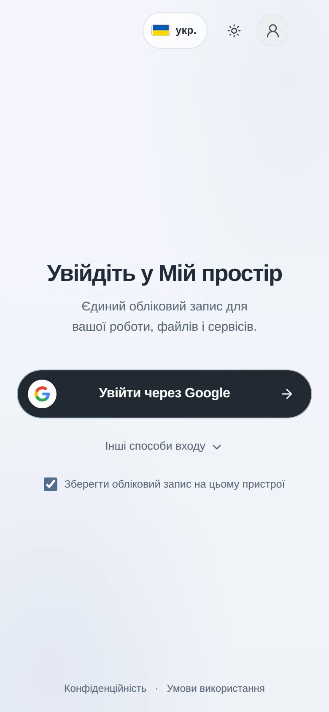 |  |
| — |  |

### 6–9. Заголовки, прев'ю, значки, sitemap.xml і robots.txt

- **6.** Заголовки вкладок мали три різні будови: адміністрування — «Адміністрування — Tarasevych» / «Tarasevych-beheer», нідерландська — «Mijn ruimte», гостьовий доступ — «Гостьовий доступ — Mijn Ruimte» (нідерландська назва в українському заголовку). Тепер усюди «<розділ> — Мій простір» / «<onderdeel> — Mijn Ruimte». Екран входу на `id.tarasevych.com/` для людини без сеансу мав заголовок «Налаштування — Мій простір»; тепер «Вхід — Мій простір» / «Aanmelden — Mijn Ruimte» (сторінки налаштувань за входом лишають «Налаштування»). Описи `meta description` 20–160 знаків для кожного розділу вже були й лишилися.
- **7.** Створено прев'ю 1200×630 зі знаком сайту (та сама геометрія, що в `favicon.svg`) і назвою обома мовами. Теги `og:image`, `og:image:alt`, `og:site_name`, `twitter:card` — у `index.html` і на `/privacy`, `/terms` (там також власні `og:title`, `og:description`, `og:url`).
- **8.** Знайдено ваду, яка є й на робочому сайті: `favicon-192.png` і `favicon-512.png` не розпаковуються (пошкоджений потік даних), тож значок застосунку на телефоні й у маніфесті не працював. Усі PNG-значки перемальовано з `favicon.svg`, додано `favicon.ico` (16/32/48), бо оглядачі просять його самі (було 404).
- **9.** Додано `public/sitemap.xml` лише з двома публічними сторінками; сайт приватний, тому решта лишається `Disallow`. У `robots.txt` дозволено значки та прев'ю, бо інакше соцмережі не змогли б показати картинку.

Тест `tests/eenheid/site-001-metadata.test.ts`: 21/21 (зокрема повна перевірка PNG за контрольними сумами).

Попутно виправлено ваду пункту 19: вкладка «Відвідування» читала відповідь сервера без поля `data` і ставала чорною сторінкою; тепер відповідь розбирається правильно, тест `site-001-analyse` доповнено (13/13).

| До | Після |
|---|---|
|  | 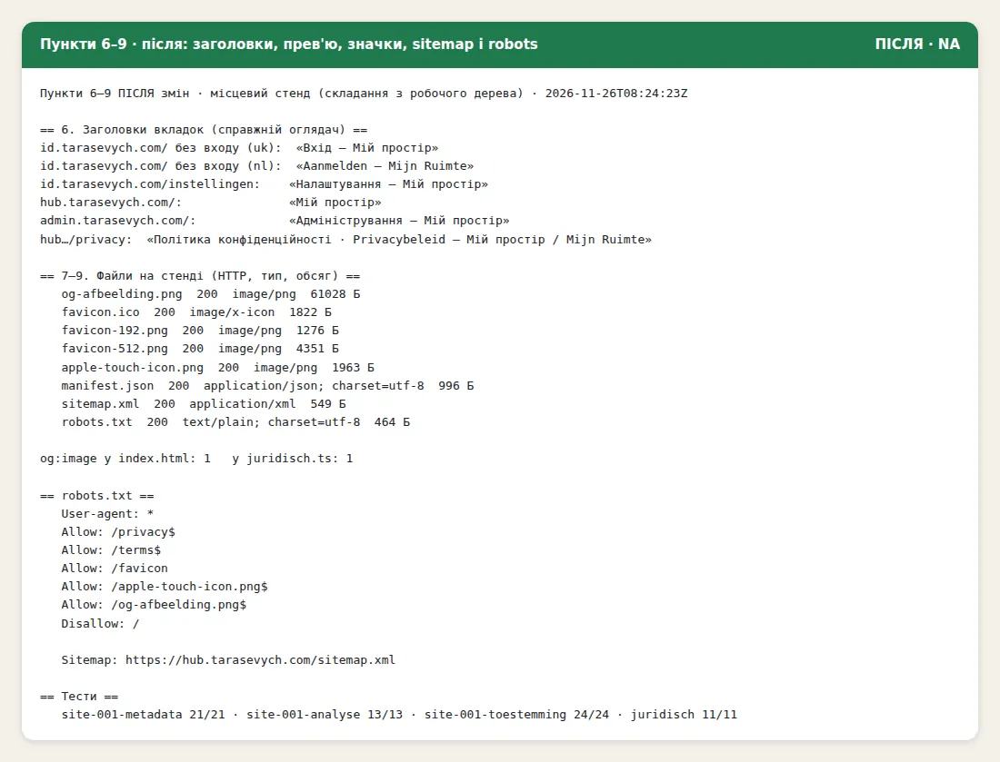 |
| — | 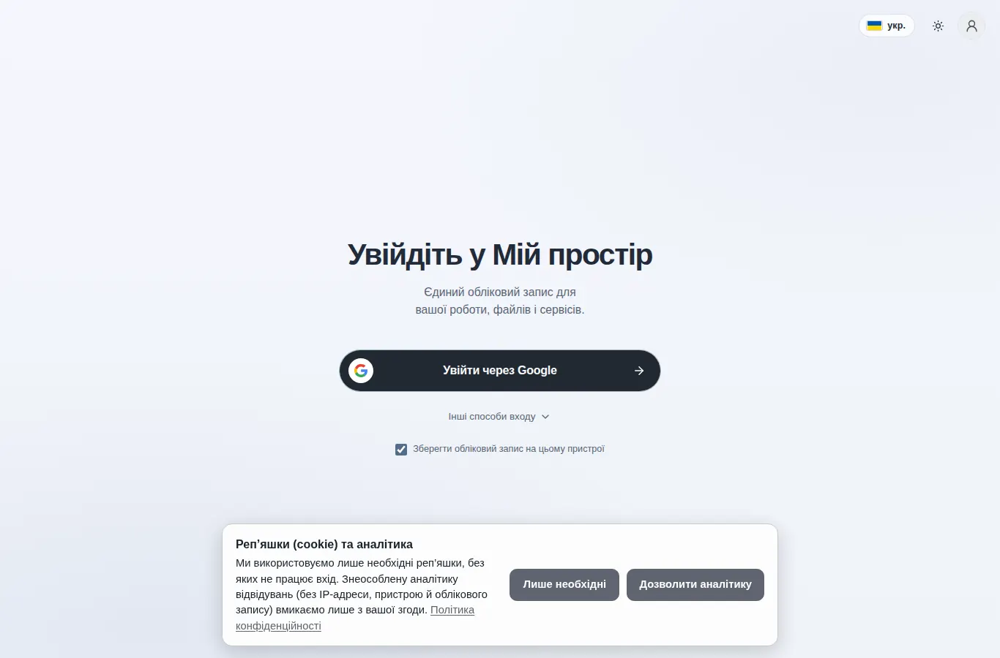 |
| — |  |
|  |  |

### 10. Альтернативні тексти зображень

Перевірено всі 51 JSX-зображення в `src/` та `index.html`: зображень без атрибута `alt` немає. Порожній `alt` (29 місць) — лише для оздобних зображень (аватар поруч з ім'ям, мініатюра в кнопці з `aria-label`), як вимагає WCAG 1.1.1. Вада: прапор і герб місця (`src/merk/PlaatsKeten.tsx`) мали порожній `alt`, хоча несуть зміст; тепер «Прапор: <назва>» / «Герб: <назва>».
Новий тест-сторож `tests/eenheid/site-001-alt.test.ts`: 4/4 — не пропустить нового зображення без `alt`.

| До | Після |
|---|---|
|  |  |

### 11. Стиснення зображень

Огляд: 1835 зображень, 8,38 МБ; з них 1744 гербів і прапорів у `webp` (у середньому 4,7 кБ — уже стиснені), 67 `svg`, 24 `png`. Офіційні логотипи `src/merk/officieel/*.png` закріплені відбитками SHA-256 у `HERKOMST.json` як оригінали постачальників — їх свідомо не змінено. Значки й прев'ю стиснено `pngquant` + `optipng` без видимих втрат: 69 319 → 47 395 Б (−32 %), прев'ю для соцмереж 61 → 43 кБ.

| Після (таблиця обсягів) | Прев'ю до / після |
|---|---|
| 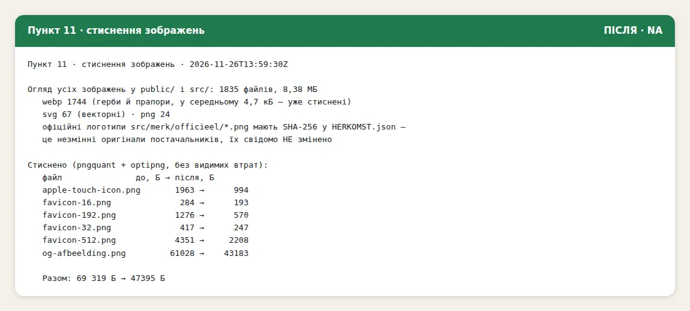 | 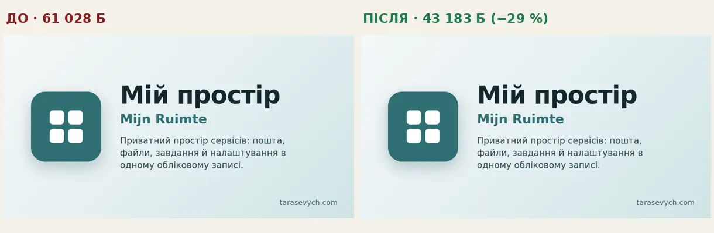 |

### 13. Контраст кольорів

Сторож `scripts/kleur-contrast-controle.mjs` (2190 пар у 30 палітрах, обидві теми) — зелений. Додатково відмальовані сторінки перевірено axe-core 4 (правило `color-contrast`, WCAG 2.1 AA): вхід зі смугою згоди, гостьовий доступ, сторінка 404, адміністрування — 0 порушень. На `/privacy` і `/terms` знайдено дві вади в `public/juridisch.css`:
- дата редакції `#6a7580` на `#f7f8fa` — 4,42:1 (треба 4,5:1) → `#5f6a75`, 5,19:1; у темній темі `#a3adb7`, 7,82:1;
- **у темній темі всі посилання мали 2,64:1**: блок `@media (prefers-color-scheme: dark)` стояв вище за правило `a{color:#2f6f73}`, і воно його перекривало. Блок перенесено в кінець файла — 7,15:1.

Після виправлення: 0 порушень у світлій і темній темах.

| До | Після |
|---|---|
|  |  |
|  |  |

### 14. Адаптивність під мобільні

Новий замір відмальованих сторінок на ширинах 320, 360, 390 і 768 пікселів (горизонтальне прокручування, елементи за правим краєм, цілі дотику менші за 24×24 за WCAG 2.2 · 2.5.8, текст дрібніший за 12 пікселів): вхід `id/`, гостьовий доступ `id/toegang`, `/privacy`, `/terms`, сторінка 404, пошта. **До — 174 вади, після — 0.** Виправлено:
- **`/privacy` і `/terms` прокручувалися вбік** на 320 (ширина вмісту 330 і 356 пікселів): довгі слова й адреси не переносилися. Додано `overflow-wrap:break-word` і `hyphens:auto`, для `code` — `overflow-wrap:anywhere`; заголовок `h1` масштабується `clamp(1.4rem, 6.5vw, 1.7rem)`;
- **`code` мав 11,44 пікселя**: без явної родини шрифтів оглядач зменшує моноширинний шрифт. Задано явну родину шрифтів;
- **замалі цілі дотику**: посилання навігації юридичних сторінок, посилання «Політика» / «Умови» та прапорець «Запам'ятати» на екрані входу тепер мають щонайменше 24 пікселі заввишки; кнопка мови — 0,76 rem;
- **Fastmail на орбіті пошти** має справжню кнопку входу (IMAP), але не мав свого місця й стояв у куті, обрізаний на широкому екрані. Тепер сім конвертів стоять без накладань: на широкому екрані Fastmail угорі поруч з Outlook, на мобільному — по три з кожного боку; тест `mail-orbit-001` тепер перевіряє, що кожен із 7 постачальників має місце на орбіті (до змін падав: 16/17, тепер 18/18).

Тести: `mail-orbit-001` 18/18, `mailmob-001` 22/22, `site-001-404` 24/24.

| До | Після |
|---|---|
| 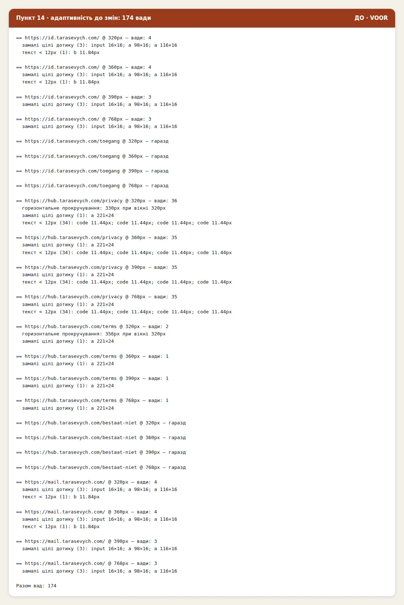 |  |
|  | 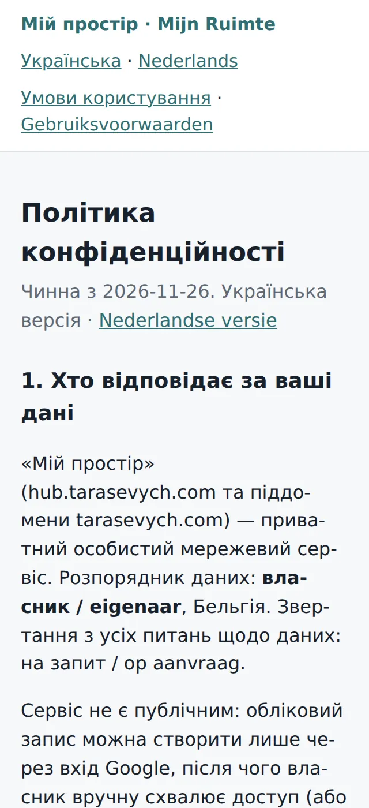 |
|  |  |
|  | 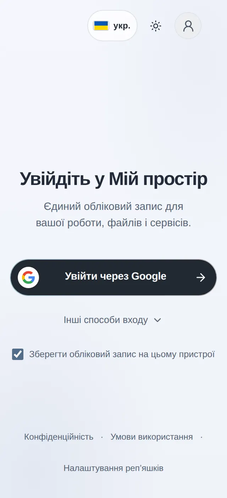 |
|  |  |
|  |  |

### 15. Власна сторінка 404

Сторінка «Сторінку не знайдено» (`src/NietGevonden.tsx`) уже була, але мала чотири вади — усі виправлено:
- **«м'яка 404»:** сервер на будь-яку невідому адресу відповідав кодом 200, тож пошукові системи й перевірки посилань вважали її справжньою сторінкою. Тепер `server/platform/onbekend-pad.ts` виконує ту саму функцію `resolve` з `canonical-service.js`, що й оглядач (в ізольованому `vm`-контексті, без другого списку вкладок), і для невідомої адреси сервер відповідає **404**. Вкладки, давні адреси й псевдоніми, гостьовий доступ `id/toegang`, повернення з OAuth і спільні посилання хмари лишаються 200. Будь-яка вада перевірки — поводження як раніше (200);
- **людина без входу** бачила все меню служб (на hub воно ще й накривало картку на ширині 1366), а на інших службах замість 404 — екран входу. Тепер без входу сторінка 404 стоїть сама, по центру; за входом — звична оболонка (накриття немає);
- **шлях закодований** (`/%D1%89%D0%BE`) → показано так, як його бачить людина (`/що`);
- заголовок вкладки — «Сторінку не знайдено — <служба>» / «Pagina niet gevonden — <dienst>».

Тест-сторож `tests/eenheid/site-001-404.test.ts` — 24/24. axe-core — 0 порушень.

| До | Після |
|---|---|
|  |  |
|  |  |
|  |  |
|  |  |
|  | 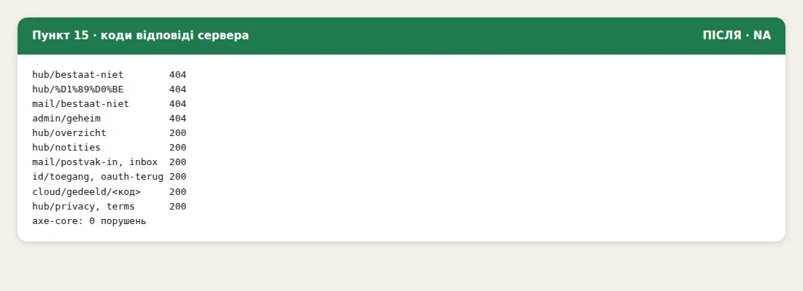 |
| |  |
| |  |

### 16. Биті посилання

Новий засіб обходить відмальовані сторінки без входу (вхід, гостьовий доступ, `/privacy`, `/terms`, 404, пошта), збирає всі `a`, `link`, `img`, `script`, читає `sitemap.xml` і додає статичні адреси з коду (`src/`, `backend/`, `public/`, `index.html`). Перевірено 305 внутрішніх адрес на стенді та 3 зовнішні (сторінка правил Google, орган захисту даних Бельгії) — усі зовнішні живі.

Перший прогін показав 181 «биту» адресу, але це була вада самого засобу: запити Playwright ішли повз правило перенаправлення імен на робочий сайт, де ще старе складання (робочий сайт лише читався). Після виправлення лишилося 9 кандидатів, кожен розібрано вручну:
- **справжня вада:** діалог підтвердження доступу (`src/platform/bevestig-toegang.tsx`) відкривається на будь-якій службі, зокрема mcp і api, а посилання «до способів входу» було відносним (`/aanmeldmethoden`) — там воно вело на 404. Тепер адреса абсолютна `https://id.tarasevych.com/aanmeldmethoden`, як у `kluis-poort.tsx`;
- `/methods`, `/sharing`, `/audit`, `/ai` — не биті: ці складники показуються лише на своїх службах (id та admin), де шляхи відкриваються (200);
- `mcp.tarasevych.com/Grok`, `/claude`, `/mcp` — адреси окремого моста MCP (порт 8091), якого на стенді немає;
- `/bestaat-niet` — навмисна перевірка сторінки 404.

Попутно уніфіковано назву: сторінка й нижня смуга мали «Умови користування», а застосунок — «Умови використання». Тепер скрізь «Умови використання», як у завданні власника. Без змінної `MR_EIGENAAR_NAAM` в одномовне речення потрапляла двомовна заглушка («власник — власник / eigenaar»). Тепер кожна мова має свою заглушку: «приватна особа» / «een particulier». Так само без `MR_CONTACT_EMAIL` виходило «повідомляєте про підозрілу активність на на запит / op aanvraag». Тепер кожне речення має природний варіант своєю мовою («повідомляєте… власникові сервісу», «Адресу надаємо на запит»).

Новий тест-сторож `tests/eenheid/site-001-koppelingen.test.ts` — 6/6: спільні складники `src/platform/**` не мають відносних `href`; `sitemap.xml` і `robots.txt` вказують на наявне; кожен статичний файл з `index.html` і юридичних сторінок є в `public/`. `juridisch.test.ts` — 12/12.

| До | Після |
|---|---|
| 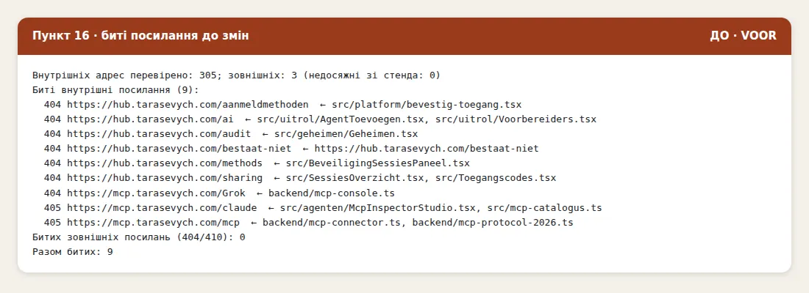 | 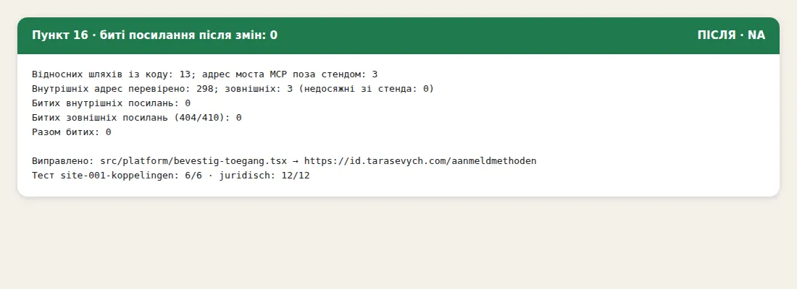 |
| 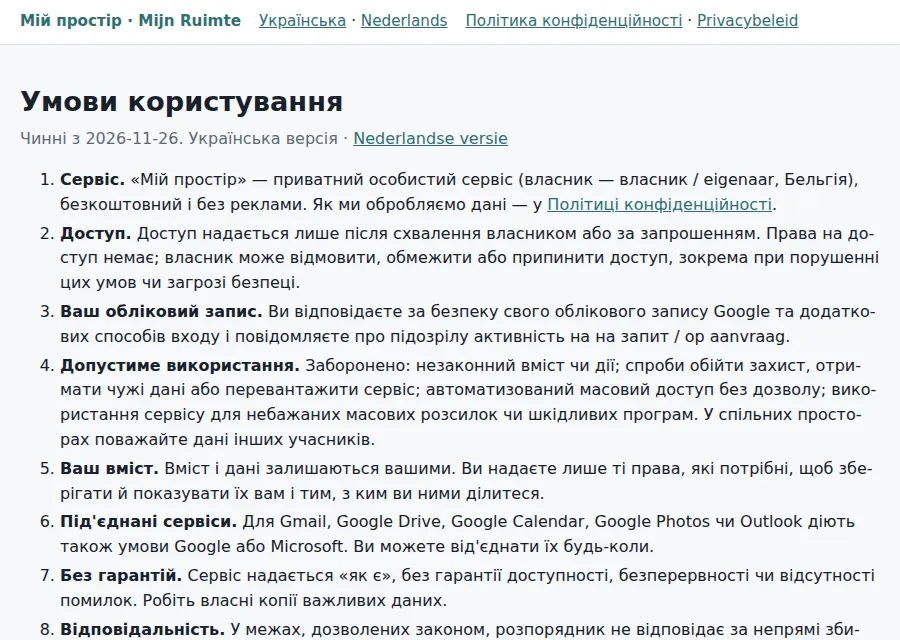 |  |

### 17. Перевірка всіх форм

**Сервер.** Новий засіб надсилає на кожен із 50 публічних маршрутів POST (вхід, гостьовий доступ, запити доступу, реєстрація способів входу тощо) вісім зламаних тіл: не JSON, масив, `null`, рядок, неправильні типи, задовгі рядки, керувальні символи, тіло 2 МБ — разом 400 випадків. Жодної аварії (500 чи обірваного з'єднання): 116 × 400, 100 × 413, 63 × 401, 42 × 404 (немає такої спроби, транзакції чи увімкненого способу), 12 × 403, 6 × 409, 1 × 429 — щоразу з кодом причини; 48 × 200 — маршрути лише для читання (каталог), що зламане тіло просто ігнорують. Єдині 12 відповідей 503 — `ACCESS_WEBAUTHN_DISABLED` на двох маршрутах власника, де ця можливість навмисно вимкнена на стенді; це не вада.

**Оглядач.** Засіб перевіряє гостьову форму й форму входу паролем так, як їх бачить людина й читач екрана. На старому складанні — 7 вад:
- код гостьового доступу, набраний на українській розкладці (А, В, Е, К, М, Н, О, Р, С, Т, Х, І), сервер відкидав як неправильний, хоча на вигляд він правильний;
- недопустимі знаки (наприклад, U чи «!») ставали помітні лише після відмови сервера;
- після відмови поле не позначалося як хибне (`aria-invalid`), повідомлення не було пов'язане з полем (`aria-describedby`), а фокус губився — те саме у формі пароля (адреса й пароль).

**Виправлення:**
- новий модуль `src/gast-code.ts`: кириличні двійники перетворюються на латинські ще під час введення; недопустимі знаки показуються одразу з поясненням (`role=alert`); лічильник «введено N із 16»; кнопка «Надіслати» вмикається лише для повного коду; код із посилання `#code=` проходить те саме очищення;
- `src/GastToegang.tsx`: поле має `aria-invalid` і `aria-describedby` на підказку, повідомлення про знаки й помилку сервера; після відмови фокус і виділення повертаються в поле;
- `src/aanmelden/AanmeldZonderGoogle.tsx`: повідомлення про помилку має власний `id`, поля адреси, пароля й коду позначаються й посилаються на нього; після відмови фокус стає в поле пароля; `src/geheim/GeheimInvoer.tsx` отримав властивість `ariaInvalid`.

Повторна перевірка в оглядачі — 0 вад. Новий тест-сторож `tests/eenheid/site-001-formulieren.test.ts` — 22/22.

| До | Після |
|---|---|
|  |  |
|  |  |
|  |  |

### 18. Захист від спаму

Сайт не має відкритих форм для анонімних повідомлень (контактної форми, вільної реєстрації): усе, що приймає дані без входу, — це вхід, гостьовий код, спільні посилання, зворотні виклики служб і з'єднувач MCP. Тому захист від спаму тут — це обмеження частоти, лічильники невдалих спроб і перевірка підписів. Поле-пастка не потрібне: немає форми, яку робот міг би заповнити, не знаючи таємниці.

**Інвентаризація.** Із 56 публічних POST (без сеансу) 23 мають суворе обмеження на IP у `server/start.ts` (`STRIKTE_LIMIETEN`, при збої бази — відмова, а не пропуск), а 33 — лише загальну межу 600/хв. Для кожного з цих 33 розібрано, чому цього досить: власний лічильник (код вікна Telegram — пауза й вимкнення; спільні посилання — код 192 біти, 120/хв на IP і 10 спроб пароля за 5 хв), обов'язковий підпис (GitHub, Telegram, Google, Microsoft), маркер доступу (розширення, агенти, MCP), лише читання або ідемпотентний вихід. Запит доступу від нового користувача вже має межу 5/год на обліковий запис і 30/год на IP, а власник отримує сповіщення лише раз.

**Жива перевірка на стенді.** Перший прогін показав дві межі, що «не спрацювали», — причина у стенді: `E2E_LOKALE_LIMIETEN=1` множить суворі межі на 20 для місцевих перевірок оглядача. Без множника, як на робочому сайті, усі 6 перевірених меж спрацьовують точно за налаштуваннями: гостьовий код і старий вхід паролем — блокування після 5 невдалих спроб; вхід паролем — 429 з 11-ї спроби; початок входу без Google — з 31-ї; реєстрація клієнта MCP — з 21-ї; спільне посилання — зі 121-ї. Вікна фіксовані (60 с), тому серії мають довжину 2 × межа + запас. Людина бачить пояснення «Забагато спроб. Спробуйте через ~N хв» (uk + nl).

**Новий тест-сторож** `tests/eenheid/site-001-spam.test.ts` — 50/50. Він читає `PUBLIEKE_ROUTES` і `STRIKTE_LIMIETEN` та вимагає для кожного публічного POST або суворої межі, або запису власного захисту з міткою, яку видно в коді. Окремо сторож перевіряє: таємниці, які можна підбирати (паролі, гостьовий код, код прив'язки агента, код Telegram, передача сеансу, реєстрація й маркери MCP), мають саме суворе обмеження; усі суворі межі «закриті» при збої бази; множник ×20 вмикається лише значенням `1` і відсутній у `deploy/`. Новий маршрут без захисту більше не пройде непомітно.

| До | Після |
|---|---|
|  |  |

### 19. Аналітика сайту (виконано разом із пунктом 5)

Серверна частина вже була (`backend/privacy.ts`: згода типово вимкнена, знеособлені денні лічильники), але інтерфейс її ніколи не викликав, а лічильники ніхто не читав. Тепер: після згоди одна подія `bezoek.<сервіс>` за сеанс вкладки (без адреси сторінки, ідентифікатора, IP чи пристрою); маршрут для адміністратора `POST /api/owner/admin/analyse-overzicht` (`admin.read`, лише читання) і вкладка «Відвідування» в розділі «Діагностика» з періодами 7/30/90 днів. Сторонніх систем аналітики не додано — нуль нових витрат і нуль передачі даних третім сторонам.
Тест `tests/eenheid/site-001-analyse.test.ts`: 12/12 (зі справжньою базою PostgreSQL 18).

| До | Після |
|---|---|
| 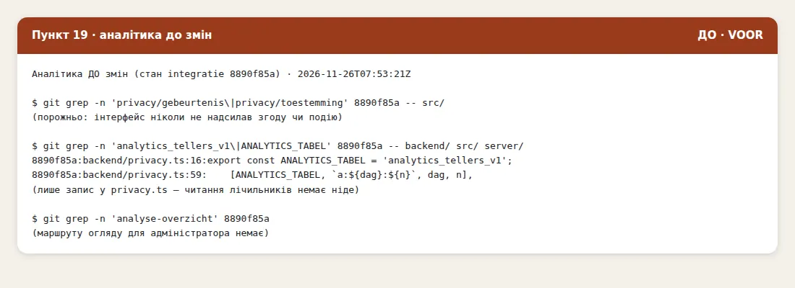 |  |

## Журнал

- **25.11.2026 23:25** — створено гілку від `integratie`, зареєстровано завдання `SITE-001`, `orch controleer` зелене. Попередній огляд наявних складників.
- **25.11.2026 23:40** — пункти 1–3 виконано; місцевий стенд (PostgreSQL 18, Node 24, Chromium) піднято поза сховищем.
- **25.11.2026 23:58** — пункт 4 перевірено (змін не потрібно); пункти 5 і 19 виконано, повне складання зі сторожами й перевірка типів сервера зелені.
- **26.11.2026 00:25** — пункти 6–9 виконано (заголовки, прев'ю, значки, `sitemap.xml`, `robots.txt`); виправлено чорну сторінку вкладки «Відвідування»; повне складання зелене.
- **26.11.2026 06:00** — пункти 10 і 11 виконано. Власник доручив замінити «акаунт» на «обліковий запис» у всьому інтерфейсі.
- **26.11.2026 06:20** — пункт 13 виконано (контраст юридичних сторінок, зокрема темна тема).
- **26.11.2026 06:40** — пункт 15 виконано: справжня 404 на сервері, окрема сторінка без входу, розкодований шлях.
- **26.11.2026 07:10** — пункт 14 виконано: замір на ширинах 320–768 дав 174 вади, після виправлення — 0; Fastmail отримав місце на орбіті пошти.
- **26.11.2026 07:30** — пункт 16 виконано: одне справді бите посилання виправлено, назву умов уніфіковано, новий тест-сторож.
- **26.11.2026 07:55** — пункт 17 виконано: сервер витримав 400 зламаних запитів без аварій; 7 вад форм в оглядачі виправлено, новий тест-сторож.
- **26.11.2026 08:00** — пункт 18 виконано: обмеження частоти перевірено наживо (6 із 6), 56 публічних маршрутів розібрано, новий тест-сторож.
